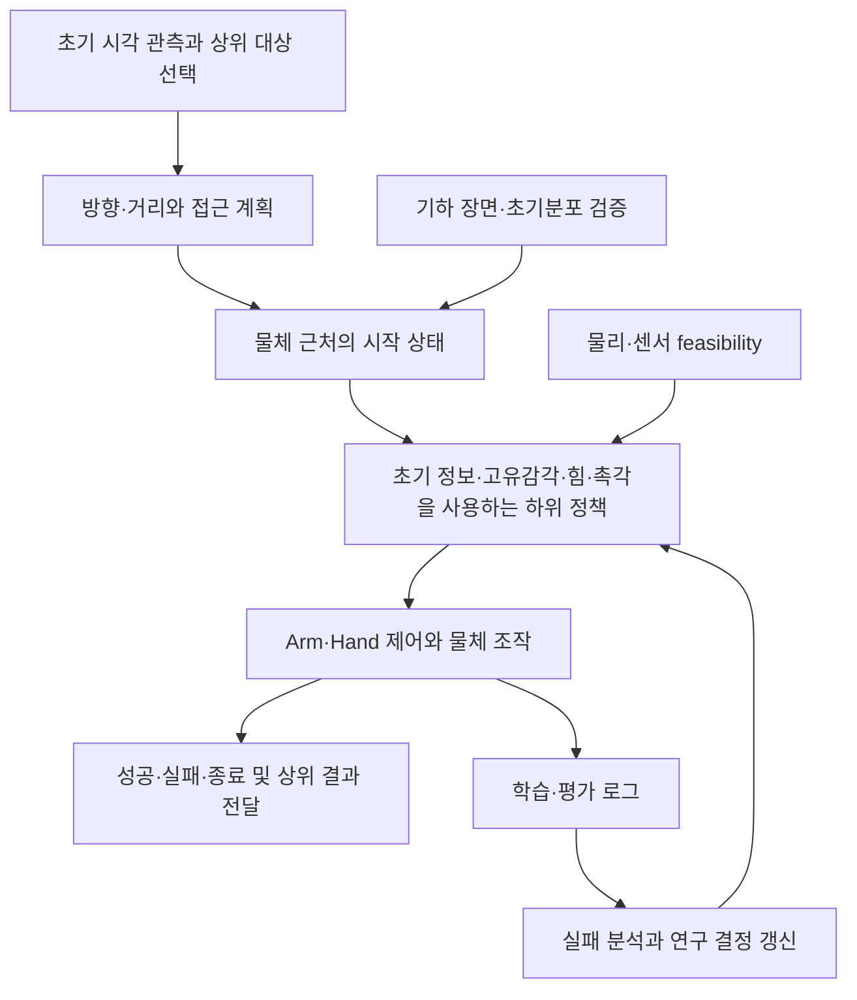

# Workspace 구성과 문서 지도

[문서 안내](../01_plan/README.md) · [연구 요약](../01_plan/00_HANDOFF_BRIEF.md) · [활성 환경](../02_implementation/08_ACTIVE_ENVIRONMENTS.md) · [개발 지침](09_DEVELOPMENT_GUIDE.md)

기준일: 2026-10-14. 이 문서는 코드 workspace와 문서 저장소가 함께 있는 checkout을 기준으로 설명한다. 이 저장소만 별도로 clone한 경우 workspace로 나가는 상대 링크는 연결되지 않으며, 문서 내부의 연구·결정·로그는 독립적으로 읽을 수 있다.

## 세 문서 영역의 역할

| 위치 | 담는 내용 | 이곳에서 찾는 방법 |
| --- | --- | --- |
| `example/Contact-Rich-Manipulation-Context` | Contact-Rich Manipulation 전체 flow, 연구 근거·계획·결정·상태·개발 로그 | [전체 문서 안내](../README.md) |
| `example/Sweep-Policy/docs` | 참고 Sweeping RL 프로젝트 내부 환경의 관측·제어·상속·실행 설명 | [참고 환경 문서](../../Sweep-Policy/docs/README.md) |
| workspace 루트 `docs` | 위 두 프로젝트에 속하지 않는 일반 지식 | [일반 지식 안내](../../../docs/README.md) |

문서 저장소를 별도 submodule로 둔 목적은 학습·로봇 코드 없이도 다른 에이전트가 연구의 전체 흐름과 현재 상태를 이해하도록 하기 위해서다. 코드의 API와 세부 실행 조건은 해당 코드의 README에 남기되, 프로젝트 수준 문서는 이 저장소에 모으고 링크한다.

## 현재 디렉터리 구조

```text
<workspace>/
├── README.md                         전체 workspace 진입점
├── AGENTS.md                         workspace 작업 지침
├── IsaacLab/                         Isaac Lab framework submodule
├── src/
│   ├── inspire_sweep_baseline/        활성 Manager-based Sweep RL
│   ├── inspire_tactile_validation/   독립 Hand 촉각 벡터 접촉 검증
│   ├── axia80_feasibility/            활성 정하중·cantilever F/T 검증
│   ├── scene_randomization/          독립적인 NumPy 기하 장면 검증 도구
│   └── trash/                        과거 패키지·UR description 보관
│       └── COLCON_IGNORE             하위 ROS2 패키지 검색 차단
├── example/
│   ├── Contact-Rich-Manipulation-Context/   이 문서 submodule
│   │   ├── 00_guidelines/             지침·템플릿·문서 관리 도구
│   │   ├── 01_plan/                   연구·아이디어·계획
│   │   ├── 02_implementation/         실제 코드·개발·실험 문서
│   │   └── 03_assets/                 정적 파일·원시 근거
│   └── Sweep-Policy/                 참고 Sweeping RL submodule
├── docs/                             일반 지식
├── tests/                            검증 코드
├── logs/, rsl_rl/                    학습·평가 실행 산출물
└── outputs/                          센서·기하 검증 등 생성 산출물
```

`src`의 활성 범위는 위 세 패키지다. `src/trash/COLCON_IGNORE`는 colcon의 재귀 package discovery를 차단한다. Isaac Lab의 Python/Gym 등록은 ROS2 빌드와 별개이므로 활성 launcher는 활성 패키지만 등록하고, 보관된 환경을 기본 실행 대상으로 안내하지 않는다. 과거 코드는 삭제하지 않아 당시 구현을 추적할 수 있다.

참고 submodule과 문서 submodule, `build`, `install`, `log`, `logs`, `outputs`, `videos`, `reports`에도 ignore marker를 두어 저장된 source snapshot이나 생성 결과가 colcon package로 다시 검색되지 않게 한다. 산출물 자체는 보존하며, 각 도구의 명시적 실행은 해당 launcher·문서의 명령을 따른다.

## 구성요소의 역할

| 구성요소 | 역할 | 자세한 설명 |
| --- | --- | --- |
| `inspire_sweep_baseline` | UR5e–F/T 하우징–Inspire Hand로 단일 물체 Sweep을 학습하는 독립 기준선과 파생 환경 | [활성 환경·상속·명령](../02_implementation/08_ACTIVE_ENVIRONMENTS.md), [패키지 README](../../../src/inspire_sweep_baseline/README.md) |
| `axia80_feasibility` | Fixed joint의 6축 반력, frame·기준점·raw/tare 비교를 정하중·cantilever·각도 실험으로 검증 | [패키지 README](../../../src/axia80_feasibility/README.md), [9월 실험 기록](../02_implementation/experiments/2026-09-22_axia80_ft_sensor_feasibility.md) |
| `IsaacLab` | Manager-based 환경, controller·sensor·scene 및 학습 실행 기반 | [framework README](../../../IsaacLab/README.md) |
| `Sweep-Policy` | 이전 Sweeping RL 환경을 참고하고 Hand 교체·물성 변경 등을 비교할 때 사용 | [환경 문서](../../Sweep-Policy/docs/README.md), [10월 9일 이식 기록](../02_implementation/logs/1009.md) |
| `src/scene_randomization` | 실제 simulator 없이 방향·거리·타겟·장애물·접근 경로의 기하 조건을 생성하고 검증 | [도구 README](../../../src/scene_randomization/README.md), [생성 로직](../../../src/scene_randomization/LOGIC.md) |
| `src/trash` | 이전 Sweep·Hand·촉각·로봇 예제와 ROS description 보관 | [보관 목록과 제외 방법](../../../src/trash/README.md) |
| `tests`, `logs`, `rsl_rl`, `outputs` | 검증 코드와 실행 산출물; 프로젝트 해석과 결과 설명은 이 문서 저장소에 기록 | [로그 작성 원칙](09_DEVELOPMENT_GUIDE.md), [개발 로그 목록](../02_implementation/logs/README.md) |

`scene_randomization`은 접촉·마찰·전도·로봇 IK를 계산하지 않는 기하 검증 도구다. 방향·거리→가능한 타겟 위치→접근 경로→장애물 순서로 생성하고, 작은 원으로 근사한 손가락 접근 및 Tool/Wrist의 월드 −Y 점유를 검사한다. 360도 command를 생성하는 이 도구의 실험 범위와 좌우 Sweep 또는 Omni RL 환경의 범위는 구분한다. 현재 활성 RL reset에 연결되어 있다고 가정하지 않는다.

## 전체 연구와 개발 흐름



이 그림은 전체 연구의 연결 관계다. 상위 대상 선택과 접근은 하위 연구의 시작 조건이며, 모든 칸이 현재 구현 완료된 모듈이라는 뜻은 아니다. 실행 중 현재 물체 위치를 관측하는 baseline은 연구용 Blind actor와 구분하며, 설계→구현→실험 결과의 근거를 각각 연결한다.

| 흐름의 단계 | 먼저 읽을 문서 |
| --- | --- |
| 연구 목적과 상위/하위 책임 경계 | [프로젝트 개요](../01_plan/01_PROJECT_OVERVIEW.md), [과업과 프레임워크](../01_plan/presentation/02_Task_Definition_and_Framework.md) |
| 현재 방향·보류·설계와 이력 | [결정 목록](../01_plan/03_DECISIONS_AND_OPEN_QUESTIONS.md), [미팅 이력](../01_plan/02_MEETING_HISTORY.md) |
| 논문 근거와 센서 조건 비교 | [문헌조사](../01_plan/literature/README.md) |
| 관측·action·reward·종료의 연구 설계 | [최종 발표 설명](../01_plan/presentation/README.md), [9월 26일 구현 계획](../01_plan/experiments/2026-09-26_blind_sweeping_build_plan.md) |
| Omni의 현재 동작과 검토 중인 보상 | [Omni 환경](../02_implementation/environments/OMNI_ENVIRONMENT.md), [Omni 보상 계획](../01_plan/environments/OMNI_REWARD_PLAN.md) |
| 실제 활성 환경과 실행 | [활성 환경](../02_implementation/08_ACTIVE_ENVIRONMENTS.md), [코드·장비 상태](../02_implementation/07_CODE_AND_HARDWARE_STATUS.md) |
| 새 환경 개발과 재현 기록 | [개발 지침](09_DEVELOPMENT_GUIDE.md), [연구 로그 템플릿](templates/RESEARCH_LOG.md) |
| 다음 검증 질문 | [다음 작업](../01_plan/04_NEXT_ACTIONS.md) |

## Submodule과 과거 기록

문서·참고 코드·framework는 각각 독립 Git 저장소다. 상위 저장소는 submodule의 commit을 기록하고, submodule 내부 변경은 별도로 확인한다. UR description submodule은 현재 `src/trash/Universal_Robots_ROS2_Description`에 보존한다. 문서 submodule에 있던 Axia80 Python snapshot도 `src/trash/context_artifacts/axia80_feasibility`로 이동했으며, 당시 CSV·metadata·run.log 근거는 문서 저장소의 `03_assets/artifacts/axia80_feasibility/results`에 유지한다. 문서 검사·서지 관리 스크립트는 문서 관리 도구로 유지한다.

```bash
# 상위 workspace가 기록한 commit을 초기화한다.
git submodule update --init --recursive

# 내부 작업트리의 변경을 확인한다.
git -C example/Contact-Rich-Manipulation-Context status --short
git -C example/Sweep-Policy status --short
```

실험을 재현할 때는 상위 저장소와 관련 submodule의 commit, 작업트리 차이를 함께 남긴다. 문서 수정·파일 이동만으로 Git commit 또는 원격 반영이 완료되는 것은 아니다.

정리 전 루트 README의 세 설계안, 7월 `sweep_rl` TODO, 과거 설정 개정 요청은 [역사 자료 안내](../01_plan/history/README.md)에 보존한다. 10월 9–12일 로그에는 당시 패키지·환경과 checkpoint가 남아 있다. 파일 이동 후 코드 링크는 새 보관 위치를 가리키며 당시 실행 명령은 역사적 스냅샷으로 읽는다. 이전 README가 가리켰으나 현 작업트리에 없는 자료는 [이관 기록](../01_plan/history/2026-10-14_legacy_workspace_design.md)에 미확보로 표시했다.

이 문서 submodule의 내부 배치와 에이전트 읽기·문서 생산 규칙은 [문서 구조 규칙](DOCUMENT_STRUCTURE.md)을 따른다. 상위 workspace의 `docs` 및 참고 프로젝트의 `docs`는 위 역할을 유지한다.
