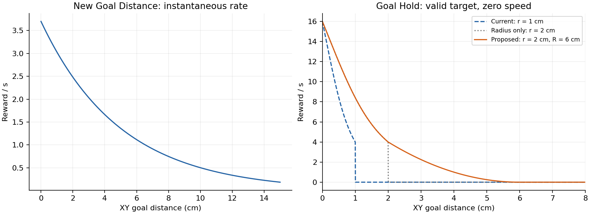
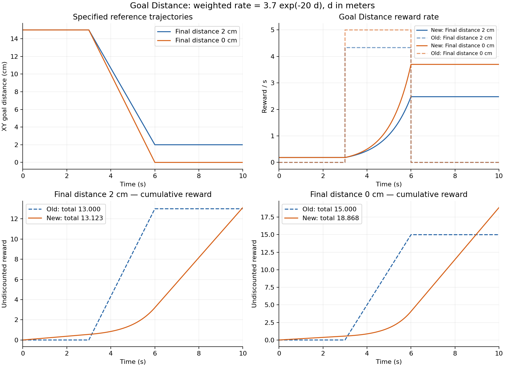

# Final Goal Accuracy v0_1 파생 환경 개발 사양서

[현재 인계](../00_HANDOFF_BRIEF.md) · [현재 구현 명세](../../02_implementation/environments/FINAL_GOAL_ACCURACY_V0_ENVIRONMENT.md) · [작성·검증 기록](../../02_implementation/logs/2026-10-28_goal_accuracy_reward_spec.md)

기준일: 2026-10-28. **상태: 2026-10-28 구현 반영.** [구현 계약·검증 범위](../../02_implementation/environments/FINAL_GOAL_ACCURACY_V0_1_ENVIRONMENT.md)를 함께 확인한다. 부모 v0·기존 v1의 1cm 계약은 유지한다. 최신 정정에 따라 신규 v0_1 생성, 기존 환경 철자 교정, Reaching 0.20m, Goal Distance weight 3.7을 적용한다. 이전의 v0 직접 변경 계획은 폐기한다.

## 1. 대상과 목적

대상은 v0를 계승하는 신규 `inspire_final_goal_accuracy_v0_1` 환경이다. 기존 v0에 보상 변경을 직접 적용한다는 이전 사양은 폐기한다. 기존 v0·v1은 `Accuacy`→`Accuracy` 이름 교정만 수행하고 구성·수치·동작을 보존한다. 모든 2cm 반경·보상 변경은 새 v0_1에만 적용한다.

| 구분 | 기존 / 부모 | 변경 또는 신규 이름 |
| --- | --- | --- |
| 기존 v0 Gym ID | `Isaac-Inspire-Final-GoalAccuacy-v0` | `Isaac-Inspire-Final-GoalAccuracy-v0` |
| 기존 v1 Gym ID | `Isaac-Inspire-Final-GoalAccuacy-v1` | `Isaac-Inspire-Final-GoalAccuracy-v1` |
| 신규 v0_1 Gym ID | 교정된 v0를 계승 | `Isaac-Inspire-Final-GoalAccuracy-v0_1` |
| 신규 EnvCfg | `FinalGoalAccuracyEnvCfg` 직접 상속 | `FinalGoalAccuracyV0_1EnvCfg` |
| 신규 RewardsCfg | `FinalGoalAccuracyRewardsCfg` 상속 | `FinalGoalAccuracyV0_1RewardsCfg` |
| 신규 CurriculumCfg | `FinalGoalAccuracyCurriculumCfg` 상속 | `FinalGoalAccuracyV0_1CurriculumCfg` |
| 신규 TerminationsCfg | `FinalGoalAccuracyTerminationsCfg` 상속 | `FinalGoalAccuracyV0_1TerminationsCfg` |
| 신규 PPO 설정 | `FinalGoalAccuracyPPORunnerCfg` 상속 | `FinalGoalAccuracyV0_1PPORunnerCfg` |
| 신규 experiment_name | 부모의 학습 하이퍼파라미터 보존 | `inspire_final_goal_accuracy_v0_1` |
| runtime | `FinalGoalAccuracyEnv` | 기존 runtime 재사용 |

버전 표기는 사용자 지정 `v0_1`을 유지하며 `v0-1`이나 기존 `v1`로 바꾸지 않는다. 기존 Python 클래스와 experiment_name은 이미 `Accuracy`/`accuracy`이므로 이름을 바꿀 필요가 없다. 등록 상수 `FINAL_GOAL_ACCUACY_V0_TASK_ID`, `FINAL_GOAL_ACCUACY_V1_TASK_ID`는 각각 `FINAL_GOAL_ACCURACY_V0_TASK_ID`, `FINAL_GOAL_ACCURACY_V1_TASK_ID`로 교정한다. 신규 상수는 `FINAL_GOAL_ACCURACY_V0_1_TASK_ID`로 한다.

후속 구현에서 등록 참조·테스트·실행 예시·활성 환경 문서의 오타도 교정한다. 현재 설명 파일 `FINAL_GOAL_ACCURACY_V0_ENVIRONMENT.md`, `FINAL_GOAL_ACCURACY_V1_ENVIRONMENT.md`는 `ACCURACY` 철자로 이름을 바꾸고 참조 링크를 함께 갱신한다. 기존 로그 디렉터리·저장된 설정·checkpoint·과거 실행 기록은 변경하지 않는다. 옛 Gym ID의 호환 alias는 이번 사양에 포함하지 않으며 신규 실행에는 교정 ID를 사용한다. 2026-10-28 구현에서 실제 등록 및 기존 구현 문서 파일명 교정을 완료했다.

새 v0_1의 목표 인정 반경을 부모 v0의 1cm에서 2cm로 완화한다. 손의 접촉 보상은 타겟 접촉에 한정하고, Reaching의 목표 점유 전환은 없앤다. Hold는 6cm부터 연속적으로 증가하도록 연결하고, Goal Distance는 현재 거리의 단순 지수함수로 변경한다.

기준 소스 HEAD는 `350db965476f051ba1e1b3e00a7ea6bb377f3ead`, 문서 저장소 HEAD는 `548d46ac07df17a39cbf70bdaa9b27ff0727c97d`다. 참고 학습은 workspace의 `logs/TEMP/2026-10-27_22-02-25`다. 해당 실행 로그를 새 보상 설계의 성능 증거로 사용하지 않는다.

## 2. 변경 계약

아래 표의 첫 열은 부모 v0의 기존 term 이름이다. v0_1의 최종 Manager 이름은 8.3절의 명시적 대응표를 따른다. 이름 정정은 이미 합의한 수식·수치 변경에 추가되는 식 변경이 아니다.

| 항목 | 변경 전 | 개발 사양 |
| --- | --- | --- |
| 공통 목표 반경 | 고정 0.01m | 고정 0.02m; 목표 점유는 `d <= r` |
| `hand_contact` 실제 접촉 | 선반·바닥을 포함한 전체 손 합력 | 현재 타겟과 손 사이의 합력만 사용 |
| `hand_contact` 목표 간주 | 유효한 타겟의 `d <= 0.01` | 유효한 타겟의 `d <= 0.02`; 접촉 없이도 인정 |
| `hand_reaching` | 목표 점유 시 near radius 0.10→1.0m | 목표 점유 분기 삭제; 항상 0.20m |
| `goal_hold` | 1cm 안에서만 지급 | 내부 반경 2cm, 외곽 지급 범위 6cm |
| `goal_distance` | 최단 거리 기록 갱신량 × 100 | 매 스텝 현재 거리의 `exp(-20d)` × 3.7 |
| 성공·timeout | 10초 만료 시 거리 1cm로 분류 | 시점·분류 방식은 유지하고 거리만 2cm로 변경 |
| 큐브 타겟 기본 형상 | 0.08 × 0.08 × 0.08m 정육면체 | v0_1부터 0.06 × 0.08 × 0.10m 직육면체; 기존 ±10% 균일 크기 랜덤화 유지 |
| 기타 | 현재 v0 구성 | 위 형상 변경 및 이에 따른 bounds 갱신 외 관측·제어·Scene·reset·PPO·실패 종료·기타 비용·일정 유지 |

`r`은 타겟–목표 world XY 거리 기준이다. v0_1의 EEF–타겟 3D 접근 반경 0.20m와 혼동하지 않는다. 거리 단위는 m, 속력은 m/s다. 아래의 보상률은 weight를 포함한 초당 값이며, 실제 스텝 보상은 보상률에 `step_dt=0.02s`를 한 번 곱한다. Reaching만 기존처럼 거리 증가분을 지급하기 위해 함수 내부에서 dt를 나눈다.

## 3. 공통 목표 판정과 종료

`target_goal_hold.position_tolerance=0.02`를 공통 반경의 단일 기준으로 유지한다. `goal_radius(env)`를 사용하는 Contact 목표 간주와 만료 성공 분류가 이 값을 읽도록 한다. 목표 거리와 무관한 기존 0.01 수치를 일괄 치환하지 않는다. 예를 들어 접촉력 임계값 0.01N, 관측 노이즈 ±0.01m는 그대로다.

```math
\mathrm{success}=\mathrm{expired}\land(d\le0.02),\qquad
\mathrm{time\_out}=\mathrm{expired}\land\neg(d\le0.02).
```

10초 이전에 반경에 진입해도 조기 성공 종료하지 않는다. 성공 판정에 속도·유지시간·접촉·보상 유효성 조건을 추가하지 않는다. 두 만료 항의 `time_out=True`와 value bootstrapping, 기존 실패 종료와의 동시 발생 가능성도 유지한다.

보상에 쓰는 타겟 유효성 `V`는 기존 `target_measurements`의 조건을 보존한다. 위치·속도·목표·축 정렬의 유한성, 선반 좌표의 `|x|<=0.16`, `|y|<=0.46`, `1.04<=z<=1.07`, up축 정렬 `>=cos(0.9)`를 검사한다. 성공 판정과 보상 유효성은 서로 다른 기존 계약이다.

`target_goal_position_tolerance`와 `target_goal_speed_scale` 커리큘럼(부모의 `goal_position_tolerance`, `goal_speed_scale`)은 계속 비활성이다. `r=0.02`, `R=0.06`, `speed_scale=0.05`는 고정값이다. 커리큘럼 이름은 8.3절대로 교정하고, 점·간격·활성 여부는 바꾸지 않는다.

## 4. Contact: 대상만 타겟으로 제한

```math
\rho_C=1.45\,\mathbf{1}_{\{C_T\lor(V\land d\le r)\}}.
```

`C_T`는 최신 센서 샘플이며 유한한 타겟–손 합력의 norm이 0.01N 이상이라는 조건이다. 타겟 접촉 분기에 새로운 거리·저속·유지시간 조건이나 `V` 조건을 추가하지 않는다. `V`는 기존처럼 목표 점유 간주 분기에만 적용한다. 두 분기가 동시에 참이어도 한 번만 지급한다.

물체별 `hand_contact_<object_name>` 센서의 `force_matrix_w`에서 환경별 `target_id`에 해당하는 물체를 선택한다. Hand filter에 해당하는 normal force 벡터를 합한 뒤 norm을 구한다. 물체에 작용한 힘을 손에 작용한 힘으로 표현할 경우 부호를 반전하되 norm 결과는 같다. per-body norm의 합으로 바꾸지 않아 벡터 상쇄 특성을 보존한다.

기존 센서 경로와 동적 타겟 선택을 재사용한다. 장애물·선반·바닥 접촉만으로는 목표 밖에서 지급하지 않는다. 접촉 간주는 보상에만 적용하며 실제 촉각 관측을 강제로 켜지 않는다. 센서 freshness·부분 reset 계약을 보존하고, weight 1.45와 threshold 0.01N은 유지한다.

## 5. Hand Reaching: 목표 반경 분기 삭제

```math
g_t=\max(\|p_{\mathrm{eef},t}-p_{T,t}\|-0.20,0),\qquad
b_t=\min(b_{t-1},g_t),\qquad
R_{\mathrm{reach},t}=30(b_{t-1}-b_t).
```

`goal_near_radius=1.0`과 목표 점유 검사·`goal_radius` 의존을 제거한다. 현재 목표 거리와 무관하게 near radius는 0.20m다. 부모의 평소 0.10m도 v0_1에서는 0.20m로 변경한다. term 이름은 `hand_reaching`에서 `target_reaching`으로 바꾸며, weight 30, `ee_frame`, 과거 최소 gap·reset·dt 처리·다시 접근할 때 재지급하지 않는 방식은 보존한다.

기존 `DexReachProgress`가 이 계산을 제공하므로 재사용을 우선한다. 단, reset 직후 첫 접근량과 부분 reset 동작을 회귀 검증한다. 이는 Reaching 항을 삭제하거나 지속 접촉 보상으로 바꾸는 요구가 아니다.

## 6. Goal Hold: 2cm 내부와 6cm 외곽 연결

`r=0.02`, `R=0.06`, `s=0.05`, weight는 8을 사용한다. `v`는 타겟 3D 선속력이다.

```math
\rho_H(d,v)=\mathbf{1}_{\{V\}}\,2^{-(v/s)^2}
\begin{cases}
8\,2^{-(d/r)^2}\left[1+(1-d/r)^2\right],&0\le d\le r,\\
4\left(\dfrac{R-d}{R-r}\right)^2,&r<d<R,\\
0,&d\ge R.
\end{cases}
```

내부 식은 기존 반경을 2cm로 치환한 것이다. 외곽 식은 경계의 4/초에서 6cm의 0까지 연속 연결한다. `r`에서 좌우 값은 같지만 미분까지 연속인 식은 아니다. `R`에서는 값과 거리 미분이 0이다. 보상 함수가 raw 값을 반환하고 Manager weight 8을 사용하는 경우 외곽 raw 계수는 0.5다. weight를 두 번 곱하지 않는다.

| 거리 | 정지한 유효 타겟의 보상률 |
| --- | ---: |
| 0cm | 16 |
| 1cm | 8.408964 |
| 2cm | 4 |
| 3cm | 2.25 |
| 4cm | 1 |
| 5cm | 0.25 |
| 6cm 이상 | 0 |

`v=0.05`이면 표 값의 절반이다. 지급 시간 상한·성공 latch·연속 유지시간 ramp는 추가하지 않는다. 타겟 접촉이 없어도 `V`를 만족하면 거리·속력에 따라 Hold를 지급한다. 외곽 보상은 성공 판정이 아니므로 2cm 밖에서 Contact 목표 간주나 success를 켜지 않는다.



Hold 그래프는 기존 1cm, 반경만 2cm로 바꾼 경우, 외곽까지 연결한 최종안을 구분한다. 정지 상태의 식 비교이며 학습 결과가 아니다.

## 7. Goal Distance: 단순 지수형과 적분 보정

### 7.1. 최종 계산식

```math
\rho_D(d)=A\exp(-ad),\qquad
a=20\,\mathrm{m}^{-1},\qquad A=3.7.
```

거리 스케일로 표현하면 `exp(-d/0.05)`다. 기존 `exponential_planar_goal_proximity`를 `distance_scale=0.05`, Manager weight `A`로 재사용할 수 있다. term 이름은 `goal_distance`에서 `target_goal_distance`로 바꾼다. 기존 `DexPlanarGoalProgress`의 weight 100, tolerance 파라미터, 최고 기록 상태는 이 항에서 사용하지 않는다.

이 값은 **현재 거리에서 매 스텝 지급하는 보상률**이다. 미분이나 최고 기록 갱신량이 아니다. 목표 내부에서도 계속 지급하고, 2cm에서 clamp하거나 지급을 중단하지 않는다. 2cm→0cm 구간에서도 계속 증가한다. 속력·접촉·새로운 `V` 게이트는 추가하지 않아 단순 거리 항으로 유지한다. 기존 실패 종료는 그대로 작동한다.

`a=20`은 보상 규모 조건만으로 유일하게 정해지는 값은 아니다. 기존 지수형 함수의 기본 5cm 거리 스케일을 사용하고, 주어진 기준 궤적의 적분으로 보정한 뒤 사용자 지시에 따라 `A=3.7`로 둥글린 설계 선택이다. 실행 시 초기 거리나 실제 궤적별로 `A`를 다시 계산하지 않는다.

### 7.2. 기준 궤적

최종 거리 `q=0.02m`를 기준으로 하며, 중심 도달 비교는 `q=0`으로 동일한 시각 구조를 사용한다. 0–3초 대기, 3–6초 선형 접근, 6–10초 고정이다.

```math
d_q(t)=
\begin{cases}
0.15,&0\le t\le3,\\
0.15-(0.15-q)(t-3)/3,&3<t<6,\\
q,&6\le t\le10.
\end{cases}
```

기존 Goal Distance의 tolerance는 0이므로 이 단조 접근 궤적의 총보상은 `100(0.15-q)`다. 2cm 도달은 13, 중심 도달은 15다. 기존 반경 1cm 또는 새 반경 2cm를 기존 Goal Distance의 tolerance로 대입하지 않는다.

### 7.3. 적분과 계수

```math
I(q;a)=3e^{-0.15a}
+\frac{3(e^{-aq}-e^{-0.15a})}{a(0.15-q)}
+4e^{-aq},\qquad
J_D(q)=A I(q;a).
```

```math
A_{\mathrm{match}}=\frac{13}{I(0.02;20)}\approx3.66544008,\qquad A=3.7.
```

| 동일 시간 구조의 최종 거리 | 기존 총보상 | 새 연속시간 적분 | 새 50Hz 스텝 합 | 새 적분 ÷ 10초 |
| --- | ---: | ---: | ---: | ---: |
| 0.02m | 13 | 13.122572 | 13.145598 | 1.312257 |
| 0m | 15 | 18.868424 | 18.903699 | 1.886842 |

50Hz 합은 물리 업데이트 후 `t=0.02,0.04,...,10`의 거리로 500번 계산한 우측 표본 합이다. 적분과 약 0.2% 이내 차이가 난다. 사용자 지정 weight 3.7을 고정한다. 기준 2cm 궤적의 적분은 기존 13보다 약 0.943% 크며 정확한 일치가 아닌 1% 이내 근사다. 표의 마지막 열은 해당 기준 에피소드에서 예상되는 Goal Distance 로그 정규화 값이며 전체 학습 평균이나 다른 보상까지 포함한 총보상이 아니다.

새 식의 중심 도달 적분은 새 2cm 도달 적분보다 약 43.79% 크고, 기존 중심 도달 15보다 약 25.79% 크다. 시작 후 대기 중에도 초당 약 0.184212, 2cm 고정 시 약 2.480184, 중심 고정 시 약 3.7을 지급한다.



위 그래프의 기존 보상률은 해당 선형 궤적에서의 연속시간 표현이다. 일반 궤적에서 기존 보상은 거리만의 함수가 아니라 최고 기록에 의존하므로 단일 거리 축 위에 같은 종류의 곡선으로 그리지 않는다.

### 7.4. 보존되지 않는 성질과 영향

기존 대비 1% 이내 적분 근사는 지정한 2cm 기준 궤적에서의 **할인 전 Goal Distance 한 항**에 대해서만 성립한다. 실제 PPO의 `gamma=0.98` 할인 수익, 전체 보상합, 초기 거리가 다른 에피소드, 이동 시각이 다른 궤적의 총보상은 같다고 주장하지 않는다. 시간 보정용 기준 궤적은 정책 관측이나 명령에 추가하지 않는다.

새 항은 정지 중에도 지급하며 이전 최단 거리로 복귀할 때도 다시 지급한다. 유한한 10초 에피소드에서 전체 시간 동안 중심에 있을 때의 이 항 상한은 37이다. 거리 증가에 별도의 음의 보상은 없다. 이것은 단순 현재 거리 기반 식으로 전환하면서 생기는 의도된 차이다.

Hold도 외곽 체류를 보상하므로 근거리 정체 가능성이 사라졌다고 보장할 수 없다. 또한 `wrench_change_penalty`의 양의 누적 보상 5% 예산은 새 보상 지급 시점·규모에 의해 달라질 수 있다. Wrench 함수·계수는 보존하지만 실제 비용값까지 기존과 같다고 주장하지 않는다.

## 8. 후속 구현 범위와 보존 조건

기존 역할별 디렉터리를 유지한다. 다음 표는 구현 접점이다. 실제 변경과 검증 결과는 구현 문서·개발 로그를 따른다.

| 접점 | 후속 작업 |
| --- | --- |
| `mdp/rewards/final.py` | v0_1의 Reaching callable, Goal Distance callable/weight/params, Hold 반경·외곽 파라미터, Contact callable 명시 |
| `mdp/reward_functions/final.py` | v0_1 전용 외곽 Hold 및 타겟 Contact 계산 배치 검토; 기존 지수형 재사용 |
| `mdp/common/contact_sweep_clutter_fusion_contacts.py` | 물체별 손 접촉 센서 선택 재사용 검토; 기존 전체 손·장애물 계산 보존 |
| `mdp/termination_functions/final.py` 및 공통 `goal_radius` | 현재 반경을 읽는 방식 확인; 종료 시점·함수 의미 보존 |
| `mdp/curricula/final.py` | v0_1 전용 이름 매핑과 대상 term 참조 갱신; 반경·속도 일정 비활성 및 기존 일정 보존 |
| `mdp/terminations/final.py` | v0_1 전용 이름 매핑; 조건·순서·time_out 플래그 보존 |
| `envs/final_envs.py` | v0를 직접 상속하는 v0_1 EnvCfg 추가; 부모·기존 v1 보존 |
| `__init__.py` | 기존 v0/v1 Gym ID·등록 상수 철자 교정, v0_1 신규 등록 |
| `agent/final_ppo_cfg.py` | 부모 PPO를 상속하고 v0_1 experiment_name만 분리 |
| `assets/final_spawners.py`, `assets/scenes/final.py` | v0_1에서만 큐브 타겟 기본 치수 선택; 기존 공유 형상 기본값 보존 |
| `mdp/event_functions/final.py` | 기존 크기 랜덤화·bounds 기반 스폰 경로로 새 치수 반영 확인; reset 방식 보존 |

기존 `FinalGoalAccuracyV1EnvCfg`와 신규 `FinalGoalAccuracyV0_1EnvCfg`는 v0를 공통 부모로 갖는 별도 파생 환경이다. v0의 보상·반경을 바꾸지 않고 v0_1에서만 요청 항목을 override한다. mutable term 설정을 수정할 때 부모와 공유하지 않도록 복사·replace하며, 부모 v0와 기존 v1의 1cm 계약 및 기존 Reaching 분기·Goal Distance를 보존한다. 공용 함수를 직접 바꾸어 다른 환경에 변경을 전파하지 않는다. 기존 Final v1, v1-1 및 Holding 호출자도 회귀 비교 대상이다.

관측 GT 범위·노이즈·모델·학습 하이퍼파라미터·OSC·action scale·실패 종료는 변경하지 않는다. Scene은 8.1절의 큐브 타겟 기본 치수만 변경하며, 배치·reset 알고리즘과 랜덤화 시점은 보존하고 입력 bounds만 실제 형상에 맞게 갱신한다. 기존 `Metrics/*` 이름과 집계를 유지한다. Manager term 이름을 반영하는 `Episode_Reward/*`, `Curriculum/*`, `Episode_Termination/*` 키는 8.3절대로 바꾸되 집계 방식은 유지한다. 검증용 2cm 진입률·종료 거리·체류시간 측정은 평가 절차로 제안하며, 새 runtime metric 추가를 이번 필수 구현 범위로 암묵적으로 확대하지 않는다.

### 8.1. 큐브 타겟의 기본 치수 변경

최신 사용자 지시에 따라 ±5% 크기 variant 추가 및 Scene Reset 시 타겟 종류 재선택 요구는 취소한다. 이번 추가 변경은 **Accuracy-v0_1의 큐브 타겟 기본 치수를 직육면체로 바꾸는 것**에 한정한다. 기존 Accuracy v0·v1에는 적용하지 않는다. 이후 v0_1 파생 환경은 별도 override가 없다면 이 구성을 상속한다.

| 항목 | 최종 사양 |
| --- | --- |
| 기본 치수 | 물체 로컬 X=0.06m, Y=0.08m, Z=0.10m(높이) |
| 형상 식별 | 기존 cube 타겟 분류 유지; 형상은 직육면체 |
| 크기 랜덤화 | 기존 `Uniform(0.9, 1.1)` 배율을 XYZ에 동일하게 적용 |
| 선택 시점 | 기존처럼 환경 생성 시 형상·배율 선택; 에피소드 reset에서 재선택하지 않음 |
| 기타 형상·장애물 | 실린더·머그컵·뚜껑 있는 병·스캔 물체 및 장애물 구성·기본 치수·랜덤화 유지 |
| 종류 확률·reset | 기존 종류 선택 확률, reset 위치·물성 랜덤화 및 이벤트 순서 유지 |

동일 배율을 사용하므로 X/Y/Z를 독립적으로 샘플링하지 않는다. 배율 0.9/1.0/1.1에서 치수는 각각 `(0.054, 0.072, 0.090)`, `(0.060, 0.080, 0.100)`, `(0.066, 0.088, 0.110)`m다. 이 세 값은 연속 분포의 하한·기준·상한 검증점이며 세 가지 이산 variant로 변경하라는 의미가 아니다.

공유 `shelf_object_meshes`의 cube 기본값을 전역 변경해 부모·기존 환경까지 바꾸지 않는다. v0_1 전용 Scene/spawner 설정에서 새 치수를 전달하는 등 요청 대상만 변경되는 경로를 사용한다. 시각 mesh와 collision mesh에 같은 직육면체 치수와 배율을 적용하고, 기존 bottom-origin 및 물성 랜덤화 계약을 보존한다. 명시적 관성이 있다면 새 기본 형상에 맞는 값인지 확인하되 질량·마찰 분포나 기존 scale² 처리 정책을 임의로 변경하지 않는다.

### 8.2. 실제 형상에 따른 스폰 정렬과 간격

기존 `randomize_object_sizes`는 prestartup에서 형상과 배율을 반영한 `_final_object_bounds`를 생성한다. 기존 `randomize_final_scene`은 이 bounds로 스폰 Z와 XY 배치 범위를 정한다. **이 경로를 보존하면서 새 직육면체의 실제 bounds가 전달되는지 확인한다.** 기존 정육면체의 8cm 높이·폭이나 오래된 bounds를 재사용하지 않는다.

```math
z_{\mathrm{origin,shelf}}=h_{\mathrm{shelf}}-b_{z,\min},\qquad h_{\mathrm{shelf}}=1.05.
```

`b_z,min`은 선택된 형상과 배율 및 초기 자세가 반영된 선반 좌표 방향의 바닥 상대 높이다. 기존처럼 upright/yaw-only 배치를 유지한다. bottom-origin 직육면체는 바닥 상대 높이가 0이므로, 높이가 0.10m로 바뀌었다는 이유만으로 root Z에 반높이를 더하지 않는다. 원점 규약이 다른 형상도 실제 하단 bounds로 맞추어 선반 관통·공중 스폰을 방지한다. 임의의 고정 Z 보정값은 추가하지 않는다.

XY 방향도 새 실제 footprint와 yaw를 사용한다. 목표 위치의 가장자리 여유, 타겟–장애물·장애물 간 겹침 방지, 손 접근 간격, `target_width`, 가림 판정과 시각화가 같은 최신 bounds를 사용해야 한다. 배치 샘플링 규칙·목표 거리·장애물 수 일정 자체는 바꾸지 않는다. 형상 변화로 가능한 배치나 fallback 결과가 달라질 수는 있다.

### 8.3. Reward·Curriculum·Termination 이름 교정

이 절은 **v0_1의 Manager term 이름만** 변경한다. 부모 v0와 기존 v1의 term 이름은 유지한다. 기존 환경의 `Accuacy`→`Accuracy` Gym ID 교정과는 별개의 작업이다. 계산 함수의 이름·수식·대상 selector·계수·파라미터 값·커리큘럼 점·갱신 간격·종료 조건을 이름에 맞춰 바꾸지 않는다. 기존 순서와 reset/cache 수명도 유지한다.

접두사 `object`는 활성 타겟과 장애물 전체, `target`은 타겟만, `obstacle`은 활성 비타겟 장애물만 뜻한다. 로봇·센서·선반에는 실제 주체인 `robot`, `arm`, `wrist`, `shelf`를 사용한다. 타겟 접근·접촉은 손과의 관계를 뜻하며 아래 표에서 계산 대상을 명시한다.

#### Reward: 활성 11개 항

| 기존 이름 | v0_1 최종 이름 | 실제 적용 대상·의미 |
| --- | --- | --- |
| `hand_reaching` | `target_reaching` | EEF–타겟 사이 3D 접근; near radius 0.20m, weight 30 유지 |
| `goal_distance` | `target_goal_distance` | 타겟–목표 XY 거리의 지수 보상; weight 3.7 유지 |
| `goal_hold` | `target_goal_hold` | 타겟 위치·속도·유효성 기반 Hold; r=0.02/R=0.06 유지 |
| `hand_contact` | `target_contact` | 타겟–손 접촉 또는 타겟 목표 점유 간주; weight 1.45 유지 |
| `action_rate_penalty` | `robot_action_rate_penalty` | Arm과 Hand 행동 변화 비용의 기존 합 |
| `joint_velocity_penalty` | `robot_joint_velocity_penalty` | Arm과 Hand 관절 속도 비용의 기존 합 |
| `object_penalty` | `object_penalty` (유지) | 전체 활성 물체의 기울기·가속도 + 장애물만의 변위 비용을 합친 기존 복합 항 |
| `shelf_penalty` | `shelf_penalty` (유지) | 선반 이동 및 손/손목의 선반 근접·충돌 비용 |
| `obstacle_contact_penalty` | `obstacle_contact_penalty` (유지) | 장애물–손 접촉력 비용; 타겟 제외 |
| `wrench_change_penalty` | `wrist_wrench_change_penalty` | 손목 F/T로부터 보정한 EEF 기준 힘·모멘트 크기 변화 비용 |
| `target_speed_penalty` | `target_speed_penalty` (유지) | 타겟 하나의 3D 선속력 비용 |

`object_penalty`를 `obstacle_penalty`나 `target_penalty`로 바꾸면 전체 적용 범위를 잘못 나타내므로 유지한다. 단, 그 내부 모든 부분식이 모든 물체를 검사한다는 뜻은 아니다. 변위 부분만 장애물에 적용되는 현재 구조를 그대로 유지하며 분리·재가중하지 않는다. 비활성 `object_speed_penalty=None`는 그대로 비활성이다. 이를 `target_speed_penalty`와 함께 켜거나 중복 등록하지 않는다.

#### Curriculum: 활성 11개 항과 비활성 2개 항

| 기존 이름 | v0_1 최종 이름 | 갱신 대상 / 유지할 parameter |
| --- | --- | --- |
| `obstacle_population` | `obstacle_population` (유지) | Gray·White 장애물 수, 기존 object_spawn 배치 설정 |
| `obstacle_gray_zone_padding` | `obstacle_gray_zone_padding` (유지) | Gray 장애물 배치 영역 padding |
| `object_free_speed` | `target_free_speed` | `target_speed_penalty` / `free_speed` |
| `object_free_acceleration` | `object_free_acceleration` (유지) | `object_penalty` / `free_acceleration` |
| `object_acceleration_weight` | `object_acceleration_weight` (유지) | `object_penalty` / `acceleration_weight` |
| `goal_deadzone` | `target_goal_direction_deadzone` | 타겟 목표 방향의 제외 반각; 거리 deadzone 아님 |
| `wrench_free_force_change` | `wrist_wrench_free_force_change` | `wrist_wrench_change_penalty` / `free_force_change` |
| `wrench_free_moment_change` | `wrist_wrench_free_moment_change` | `wrist_wrench_change_penalty` / `free_moment_change` |
| `wrench_weight` | `wrist_wrench_change_weight` | `wrist_wrench_change_penalty` / 외부 weight (`parameter=None`) |
| `obstacle_free_force` | `obstacle_contact_free_force` | `obstacle_contact_penalty` / `free_force` |
| `obstacle_weight` | `obstacle_contact_weight` | `obstacle_contact_penalty` / 외부 weight (`parameter=None`) |
| `goal_speed_scale` (비활성) | `target_goal_speed_scale=None` | 비활성 유지; 대응 보상은 `target_goal_hold`의 `speed_scale` |
| `goal_position_tolerance` (비활성) | `target_goal_position_tolerance=None` | 비활성 유지; 대응 보상은 `target_goal_hold`의 `position_tolerance` |

각 활성 일정의 callable·points·interval·적용 iteration은 부모 v0와 동일하다. 이름 변경으로 일정이 처음부터 다시 시작하거나, 기존 target speed 일정을 비활성화하거나, Hold 반경·속도 일정을 복원하지 않는다. `object_free_acceleration`과 `object_acceleration_weight`는 타겟과 장애물 전체에 적용되므로 `object`를 유지한다.

#### Termination: 활성 6개 항

| 기존 이름 | v0_1 최종 이름 | 실제 검사 대상·조건 |
| --- | --- | --- |
| `object_drop` | `object_fall_or_tilt` | 활성 타겟·장애물 중 하나라도 낙하 또는 과도한 기울기 |
| `object_speed` | `target_speed` | 타겟 하나의 3D 선속력이 기존 threshold 초과 |
| `shelf_termination` | `shelf_failure` | 기존 선반 속도·변위 또는 손목 clearance 조건의 OR |
| `joint_velocity` | `arm_joint_velocity` | Arm 관절 속도만 검사; Hand 포함 아님 |
| `success` | `target_goal_success_at_timeout` | 만료 시 타겟 XY 거리 `d <= 0.02` |
| `time_out` | `target_goal_miss_at_timeout` | 만료 시 `not(d <= 0.02)`; 기존 NaN 처리 포함 |

마지막 두 항의 이름은 Manager 식별자다. 두 항 모두 설정 속성 `time_out=True`를 그대로 유지한다. 함수 `time_out(env)`나 truncation 처리 API까지 이름을 바꾸는 것이 아니다. 기존 실패 항과 만료 항의 동시 참 가능성, 호출 순서와 metric 수집 시점은 보존한다.

#### 이름 참조와 로그의 동시 갱신

1. v0_1의 최종 Cfg에는 각 활성 항이 한 번만 존재해야 한다. 상속된 옛 이름은 비활성화하고 새 이름을 등록하되 기존 활성 순서를 보존한다. 부모 설정 객체는 수정하지 않는다. 이름 변경만을 이유로 term을 추가·분리·삭제하지 않는다.
2. `goal_radius(env)` 및 타겟 Contact의 보상 설정 조회는 v0_1에서 `target_goal_hold`를 읽어야 한다. 기존 환경의 `goal_hold` 조회는 유지하도록 환경별 이름 전달 또는 호환 조회 경로를 사용한다. 이는 조회 식별자 변경이며 반경·유효성 식 변경이 아니다.
3. `ShelfPenalty` 내부의 종료 설정 조회 `get_term_cfg('shelf_termination')`는 v0_1에서 `shelf_failure`로 연결한다. 부모·기존 환경은 기존 이름을 사용한다. 재사용 함수의 하드코딩된 이름 때문에 변경 범위 밖 환경이 깨지지 않도록 한다.
4. `reward_schedule`의 `term_name`은 위 Curriculum 표의 최종 보상 이름으로 갱신한다. parameter 이름과 값은 그대로다. Wrench의 자기 term 식별·양의 보상 예산 참조도 새 이름에서 같은 항을 가리키는지 확인한다. 계산 순서를 바꿔 예산 동작이 달라져서는 안 된다.
5. 새 실행의 로그 키는 각각 `Episode_Reward/<최종 Reward 이름>`, `Curriculum/<최종 Curriculum 이름>`, `Episode_Termination/<최종 Termination 이름>`으로 변경한다. 예: `Episode_Reward/goal_hold`→`Episode_Reward/target_goal_hold`, `Curriculum/object_free_speed`→`Curriculum/target_free_speed`, `Episode_Termination/object_speed`→`Episode_Termination/target_speed`. `obstacle_population`의 하위 `gray_obstacles`·`white_obstacles` 키는 그대로다.
6. 학습·재생 코드, 테스트, 평가 도구에서 Manager 이름을 문자열로 참조하는 모든 사용처를 대조한다. 기존 `Metrics/*`, Event·Command·Observation 이름, Python 계산 함수·클래스 이름은 이 작업의 변경 대상이 아니다. 과거 TensorBoard 파일·checkpoint·저장 YAML은 이름 교정을 위해 수정하지 않는다.
7. 이름 변경 전후의 v0_1에 동일 상태·이력·iteration을 입력해 위 매핑으로 재정렬한 보상 벡터·총합, 커리큘럼 값, 종료 bool과 truncation mask가 같아야 한다. 이 대조의 기준은 부모 v0가 아니라 **앞 절의 보상·형상 변경을 적용한 v0_1의 이름 교정 전후**다.

## 9. 인수 조건

| 검증 | 통과 조건 |
| --- | --- |
| 반경 경계 | `r-ε`, `r`, `r+ε`에서 Contact 목표 간주·만료 성공이 각각 참/참/거짓; r은 0.02 |
| 종료 시점 | 2cm 진입만으로 조기 종료하지 않음; 만료 분할·truncation 보존 |
| Contact 대상 | 목표 밖의 선반·바닥·장애물 접촉만으로 0; 타겟 접촉은 기존 threshold·freshness 적용 |
| Contact 목표 간주 | 접촉 없어도 `V`이고 `d<=r`이면 1.45/초; 실제 접촉과 동시에 성립해도 중복 지급 없음 |
| Reaching | 동일 EEF–타겟 거리 이력에서 목표 위치만 바꿔도 보상이 동일; near radius 항상 0.20 |
| Hold | 정지 경계 2cm=4/초, 6cm=0; 2cm 좌우 연속; V=false이면 0; 5cm/s에서 절반 |
| Goal Distance | 단조 거리 감쇠, `d=0`에서 A; 정지 상태 지속 지급; dt 중복 곱셈·나눗셈 없음 |
| 적분 | 기준 2cm 궤적=13.122572(기존 13 대비 1% 이내), 중심 궤적=18.868424; 50Hz 합은 각각 13.145598, 18.903699 근사 |
| 부분 reset | Reaching 기록과 센서 freshness가 해당 환경에만 초기화; 새 거리 항은 최고 기록 상태 불필요 |
| 이름 교정 | 기존 v0/v1의 새 Accuracy ID가 같은 클래스·동작을 사용; 옛 ID 등록 제거; 관련 참조 갱신 |
| 신규 등록 | v0_1이 v0를 직접 상속하고 별도 experiment_name 사용; runtime·PPO 하이퍼파라미터 보존 |
| 큐브 치수 | v0_1 기본 로컬 치수 0.06×0.08×0.10m; 시각·충돌 형상 일치 |
| 크기·reset 보존 | 기존 연속 ±10% 균일 배율 유지; reset 전후 종류·배율 유지; 기타 물체 변경 없음 |
| 스폰 정렬 | 배율 0.9/1.0/1.1과 기존 yaw 범위에서 실제 collision 하단이 선반 면에 맞고 관통·공중 스폰 없음 |
| 배치 기하 | 새 bounds가 footprint·가장자리 여유·겹침 검사·target_width·가림에 일관되게 반영 |
| term 이름 | 8.3절의 Reward 11개·활성 Curriculum 11개·비활성 2개·Termination 6개와 일치; 옛 활성 키 중복 없음 |
| 이름 변경 동등성 | 동일 v0_1 상태·이력·iteration에서 매핑 전후 수치·종료 mask·순서·dt 처리 동일; 참조 문자열과 로그만 변경 |
| 범위 보존 | v0_1에만 요청 차이 존재; 기존 v0/v1은 이름 외 모든 동작 보존 |

수식 검증 뒤 Isaac Sim에서 센서의 실제 타겟 선택·접촉 분리와 학습 행동을 따로 확인해야 한다. 평가 시 종료 거리, 2cm 진입률, 진입 후 유지·이탈, 타겟/선반 접촉을 구분한다. `target_goal_distance_xy_mean`은 전체 에피소드 시간 평균이므로 최종 오차로 사용하지 않는다. 변경 후 Hold 합에는 외곽 보상이 포함되므로 Hold 로그 증가만으로 성공률 향상을 판단하지 않는다.

## 10. 작성 시 수행한 검증

[재현 스크립트](../../03_assets/artifacts/2026-10-28_goal_accuracy_reward_spec/plot_reward_spec.py)로 해석적 적분과 1ms 사다리꼴 수치 적분, 50Hz 우측 표본 합, Hold 경계를 비교했다. [계산 결과](../../03_assets/artifacts/2026-10-28_goal_accuracy_reward_spec/calibration.json)에 계수와 수치를 저장했다. 해석적 적분과 수치 적분의 차이는 두 궤적 모두 0.000001 미만이다.

생성한 두 PNG의 축·범례·곡선을 시각 확인한다. Markdown 수식·링크·공백 검사의 실제 결과는 작성 로그에 남긴다. 이 절의 적분 검증은 사양 작성 당시 결과다. 이후 환경 코드 구현·설정·USD 검증은 구현 로그를 따른다. 물리 reset/step 완료·정책 재생·재학습·성공률 개선은 검증하지 않았다.
