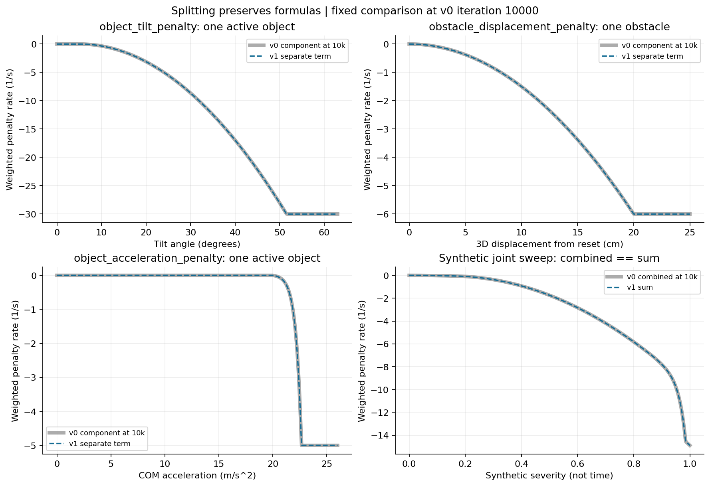
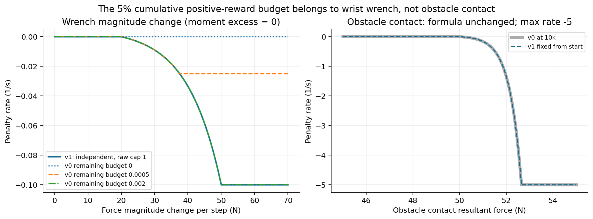
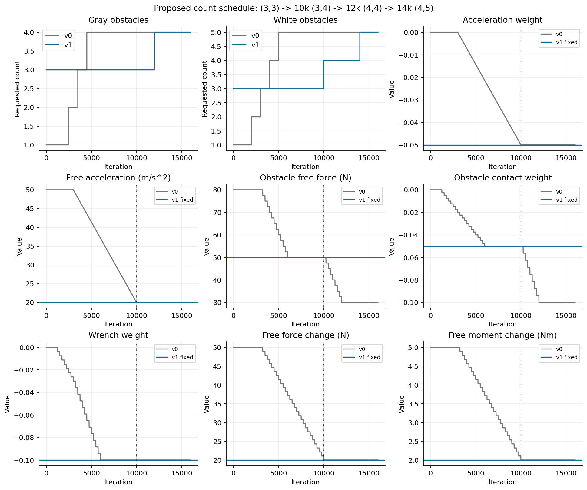
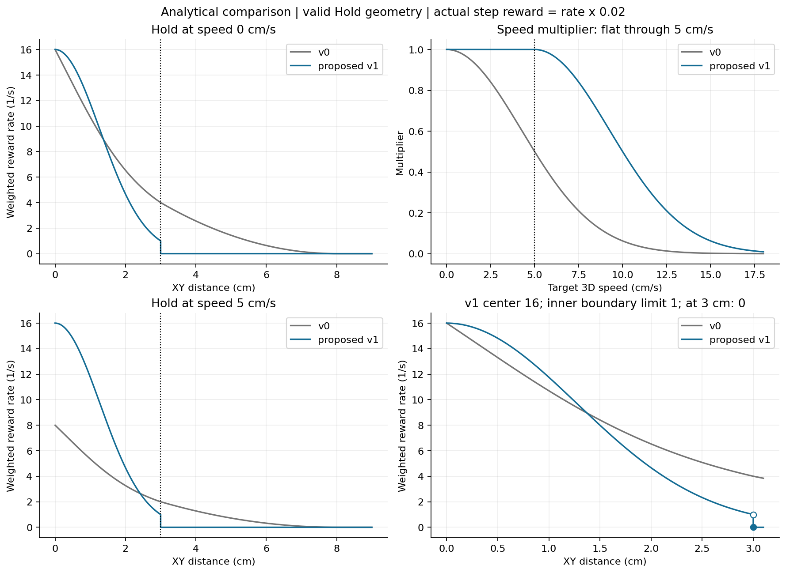
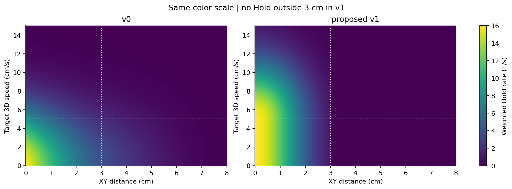
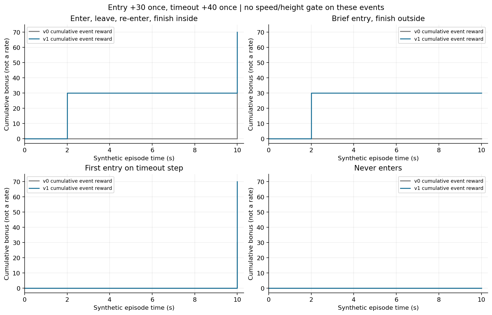

# Revision-v1 · Revision-v1-Test 개발 명세

작성일: 2026-11-02. 상태: **설계 완료, 환경 미구현**. 수식 비교용 CPU plot만 실행한다. 환경 등록·구성·학습·play·GPU 실행은 이번 작업 범위가 아니다.

[현재 Revision-v0 계약](../../02_implementation/environments/REVISION_V0_ENVIRONMENT.md) · [선행 학습 분석](../../02_implementation/logs/2026-11-02_revision_accuracy_training_analysis.md) · [명세 작성·검증 기록](../../02_implementation/logs/2026-11-02_revision_v1_spec.md)

## 1. 목적과 기준

Revision-v0를 보존하고 직접 상속한 Revision-v1을 설계한다. v1은 비용 원인의 계측 가능성을 높이고, 초기부터 일정한 비용·혼잡도를 제공하며, 목표 안으로 진입하고 중앙에 머무는 행동을 학습시키는 것이 목적이다. v1-Test는 v1의 타겟 형상만 cylinder로 고정하여 타겟 다양성의 영향을 비교한다.

기준 코드 HEAD는 `408d3d9ce947a62f094d6f8c8693be2c07e2e32d`다. 아래 수식·파라미터는 현재 Revision-v0의 실제 코드에서 확인했다. 이전 대화에서 검토한 대안은 이번 사용자 요구와 충돌하면 적용하지 않는다. 특히 Hold 속도 감쇠 삭제, 별도 progress 보상, contact 보상 수정, PPO 변경은 포함하지 않는다.

| 요청 | v1 결정 |
| --- | --- |
| Object penalty 분리 | 동일 비용을 tilt / obstacle displacement / object acceleration의 3개 term으로 분리 |
| 양의 보상 5% 제한 제거 | 실제 대상인 wrist wrench term에서 누적 보상 budget만 제거. raw 상한 1 유지 |
| 지정 커리큘럼 7개 삭제 | 정확히 iteration 10000의 값으로 초기부터 고정 |
| 장애물 증가 일정 | 사용자 확인: 3/3 → 10k 3/4 → 12k 4/4 → 14k 4/5 |
| Hold 위치 곡선 | 3cm 미만에 단일 Gaussian, 중심 최대 16, 경계 안쪽 극한 1 |
| Hold 속도 감쇠 | 0.05m/s까지 감쇠 없음, 초과 속력에만 기존 폭 0.05m/s 적용 |
| 이벤트 보상 | 최초 관측 진입 +30, 성공 timeout +40. 각 에피소드 최대 +70 |
| v1-Test | 타겟 종류만 cylinder. 나머지 v1의 설정·랜덤화·모델·보상 동일 |

## 2. 등록·상속 및 보존 범위

아래 이름은 **구현 예정 계약**이며 아직 등록되어 있지 않다. 사용자 호칭 `Revision-v1-Test`는 Gym의 version suffix 관례에 따라 task ID를 `Isaac-Inspire-Revision-Test-v1`로 한다.

| 구성 | Revision-v1 | Revision-v1-Test |
| --- | --- | --- |
| Gym ID | `Isaac-Inspire-Revision-v1` | `Isaac-Inspire-Revision-Test-v1` |
| EnvCfg | `RevisionV1EnvCfg(RevisionEnvCfg)` | `RevisionV1TestEnvCfg(RevisionV1EnvCfg)` |
| runtime | 기존 `RevisionEnv` 재사용 | v1과 동일 |
| Scene | 기존 `RevisionSceneCfg` | `RevisionV1TestSceneCfg(RevisionSceneCfg)` 또는 동등한 타겟 전용 spawn override |
| Reward CFG | `RevisionV1RewardsCfg(RevisionRewardsCfg)` | v1 그대로 상속 |
| Curriculum CFG | `RevisionV1CurriculumCfg(RevisionCurriculumCfg)` | v1 그대로 상속 |
| PPO CFG | `RevisionV1PPORunnerCfg(RevisionPPORunnerCfg)` | `RevisionV1TestPPORunnerCfg(RevisionV1PPORunnerCfg)` |
| experiment name | `inspire_revision_v1` | `inspire_revision_test_v1` |

최초 진입 상태는 RewardManager의 stateful term에 두므로 별도 runtime 변경을 기본 요구하지 않는다. 모델·rollout·학습률·entropy·gamma 등 PPO 동작은 v0와 같고 experiment name만 구분한다.

다음은 v0에서 보존한다.

- Actor 121D / Critic 124D, 관측 순서·noise·초기/현재 상태 분리·독립 장애물 encoder.
- Arm6 + Hand2 행동, OSC·action scale·effort 제한, 물리 dt 0.01s / control dt 0.02s / episode 10s.
- 물리 객체 10개, Gray4/White5 보유 용량, 장애물 관측 16슬롯.
- 8종 기준 크기 및 생성 시 단일 U(0.9,1.1) scale. 형상·scale은 생성 후 고정, reset마다 재선택하지 않는다.
- OBB 배치, Gray padding 65mm, 선반·로봇·물리 재질·질량 랜덤화, 타겟·목표 위치 및 방향 랜덤화, 부분 reset.
- 타겟 yaw는 선반 좌표 0이다. 배치 계산의 board 좌표 −π/2와 혼동하지 않는다.
- 성공 timeout의 유한 XY 거리 ≤3cm, 물체 낙하/기울기·타겟 과속·선반·Arm 속도 실패와 truncation 처리.
- `target_reaching`, `target_goal_distance`, `target_contact`, action/joint/shelf/target-speed 항의 수식·weight.
- `target_free_speed`, `target_goal_direction_deadzone` 커리큘럼. 특히 target-speed 허용값은 후기 0.02m/s로 유지한다.

## 3. 공통 표기와 dt 계약

모든 연속 보상은 아래 방식으로 RewardManager에 합산한다.

```math
r_{j,t} = w_j f_j(s_t)\Delta t,\qquad \Delta t=0.02\ \mathrm{s}.
```

그래프의 `weighted reward/penalty rate`는 $w_j f_j$이며 실제 step 기여는 여기에 0.02를 곱한다. 반면 최초 진입 +30·timeout +40은 **이벤트 지급액**이다. 해당 callable은 event/Δt를 반환하여 dt가 지급액을 줄이지 않게 한다.

- $d$: 타겟 root XY와 목표 XY의 유클리드 거리, m. 타겟 형상에 따라 임의로 중심/COM으로 바꾸지 않는다.
- $v$: 타겟 3D 선속도 norm, m/s. 손 속도나 목표 방향 속도가 아니다.
- $\mathcal A$: 실제 활성 물체, 타겟 포함. $\mathcal O$: 실제 활성 비타겟 장애물.
- $\mathrm{clip}(x,0,1)$: 0~1 제한. 비활성·주차 슬롯은 합산에서 제외한다.

## 4. Object penalty를 수식 변경 없이 3개로 분리

### 4.1 기존 비용의 정확한 분해

현재 [ObjectPenalty](../../../../src/inspire_sweep_baseline/inspire_sweep_baseline/mdp/reward_functions/final.py)는 outer weight −1 아래에서 tilt·displacement에 30을 곱하고 acceleration을 추가한다. 10k의 유효 보상률은 다음과 같다.

```math
R_{\mathrm{object},10k}=-30T-150D-0.05A.
```

```math
T=\sum_{i\in\mathcal A}
\mathrm{clip}\left(\frac{\theta_i-5\pi/180}{0.9-5\pi/180},0,1\right)^2
```

```math
D=\min\left(\sum_{i\in\mathcal O}\lVert\mathbf{p}_i-\mathbf{p}_{i,0}\rVert_2^2,\ 0.04\right)
```

```math
A=\sum_{i\in\mathcal A} E(a_i;20,100),\qquad
E(x;b,M)=\min\left(\frac{\exp(2\max(x-b,0))-1}{2},\ M\right).
```

$a_i$는 PhysX의 COM 3D acceleration norm이다. 가속과 감속을 동일하게 벌한다. reset/활성화 직후 첫 sample 무시, step cache와 활성 mask는 기존 `ObjectAccelerationPenalty` 그대로 유지한다. $D$는 물체별 cap이 아니라 **장애물 제곱 변위 합에 적용하는 cap**이다.

### 4.2 새 term과 weight

| 새 term | 적용 대상 | raw 함수 | weight | 최대 비용률의 절댓값 |
| --- | --- | --- | ---: | ---: |
| `object_tilt_penalty` | 타겟 + 활성 장애물 | T | −30 | 30 × 활성 물체 수 ≤300 |
| `obstacle_displacement_penalty` | 활성 장애물만 | D | −150 | 6 |
| `object_acceleration_penalty` | 타겟 + 활성 장애물 | A | −0.05 | 5 × 활성 물체 수 ≤50 |

`object_penalty`는 v1에서 비활성화하여 중복 합산하지 않는다. 이름 접두사는 **기존 적용 대상에 따라** 정하며, 분리를 이유로 타겟을 tilt/acceleration에서 제외하거나 displacement에 포함하지 않는다. 물체 수로 평균내는 변경도 하지 않는다.

기존 내부 `acceleration_weight=-0.05`는 새 acceleration term의 manager weight로 옮긴다. 이때 부호나 30배 계수를 추가로 적용하지 않는다. 기본 분리는 같은 파라미터에서 동일하고, v0 초반과 v1의 차이는 7개 커리큘럼 고정 요구에 따른 의도된 차이다.

수치 안정성은 기존 지수 비용의 exponent cap을 유지한다.

```math
e_{\max}=\frac{1}{2}\log(2M+1),\qquad
E=\min\left(\frac{\mathrm{expm1}(2\mathrm{clip}(x-b,0,e_{\max}))}{2},M\right).
```



회색 실선은 v0의 10k 성분, 파란 점선은 v1의 분리 성분이다. 일치가 정상이다. 우하단은 합성 상태를 동시에 변화시킨 전체 합으로, 시간 추이나 학습 결과가 아니다.

## 5. 양의 보상 budget 제거: wrist wrench만 변경

### 5.1 대상 정정

양의 보상의 5% 제한은 `obstacle_contact_penalty`가 아니라 **`wrist_wrench_change_penalty`**에 있다. 현재는 에피소드에서 이미 얻은 양의 보상 누적량과 이미 지출한 wrist penalty를 읽는다. 단순히 현재 step의 양의 보상 5%를 자르는 로직이 아니다.

```math
B_t=\max(0,0.05P_{\le t}-C_{<t}),\qquad
f_{\mathrm{old}}=\min\left(q_t,\frac{B_t}{|w|\Delta t}\right).
```

$P_{\le t}$는 앞서 계산된 양의 보상 누적량, $C_{<t}$는 이 wrist 항의 누적 비용이다. 이 때문에 모든 양의 보상 뒤에 위치해야 하는 순서 의존성도 있다.

### 5.2 새 계약

budget 계산·양의 term 검색·누적 보상 읽기·`max_positive_fraction` 설정을 v1 전용 함수에서 제거한다. 현재 wrench 변화 측정 방식, 첫 유효 sample 처리, reset, 동일 step cache는 보존한다.

```math
\Delta F=\left|\lVert\mathbf{F}_t\rVert-\lVert\mathbf{F}_{t-1}\rVert\right|,\qquad
\Delta M=\left|\lVert\mathbf{M}_t\rVert-\lVert\mathbf{M}_{t-1}\rVert\right|
```

```math
u=\mathrm{clip}\left(\max\left(\frac{\max(\Delta F-20,0)}{30},
\frac{\max(\Delta M-2,0)}{3}\right),0,1\right),\qquad
q=\frac{e^{3u}-1}{e^3-1}.
```

```math
f_{\mathrm{new}}=q\in[0,1],\qquad
R_{\mathrm{wrist}}=-0.1q.
```

- raw cap **1**, weight **−0.1** 유지: 최대 비용률 0.1/s, 실제 step 최대 비용 0.002, 10초 동안 최대 1.
- force/moment 변화 임계값 20N/2Nm, saturation ratio 2.5, sharpness 3 유지.
- 이는 벡터 차이 norm이나 힘의 시간미분이 아니라 **norm의 step 간 변화량**이다. dt로 나누어 N/s·Nm/s로 바꾸지 않는다.
- 같은 wrench 입력·history면 다른 보상액이나 reward 순서와 무관하게 동일한 비용을 반환해야 한다.
- cap을 없애거나 raw cap을 임의로 100으로 확대하지 않는다. budget 제거가 비용의 대규모 증폭을 보장하는 것도 아니다.

`obstacle_contact_penalty`는 원래부터 raw cap 100이 있으며 budget 연동이 없다. 수식은 유지하고 10k의 free force 50N·weight −0.05만 초기부터 고정한다. 최대 비용률은 5/s, 실제 step 최대 비용은 0.1이다.



좌측의 v0 곡선들은 **남은 누적 예산을 0 / 0.0005 / 0.002로 둔 예시**다. 물리 로그를 복원한 곡선이 아니다. v1은 이 예산과 무관하게 하나의 곡선을 가진다. 우측은 v0 10k와 v1의 접촉 비용이 일치함을 보인다.

## 6. 커리큘럼

### 6.1 삭제하고 iteration 10000 값으로 고정할 7개 항

| 삭제할 Curriculum term | v1에서 고정할 실제 설정 | 고정값 |
| --- | --- | ---: |
| `object_acceleration_weight` | `object_acceleration_penalty.weight` | −0.05 |
| `object_free_acceleration` | `object_acceleration_penalty.params.free_acceleration` | 20m/s² |
| `obstacle_contact_free_force` | `obstacle_contact_penalty.params.free_force` | 50N |
| `obstacle_contact_weight` | `obstacle_contact_penalty.weight` | −0.05 |
| `wrist_wrench_change_weight` | `wrist_wrench_change_penalty.weight` | −0.1 |
| `wrist_wrench_free_force_change` | `wrist_wrench_change_penalty.params.free_force_change` | 20N |
| `wrist_wrench_free_moment_change` | `wrist_wrench_change_penalty.params.free_moment_change` | 2Nm |

초기·reset·resume·iteration 되감기 모두 이 값이다. 7개 schedule을 상수 schedule로 남기지 말고 활성 CurriculumManager에서 제거한다. YAML의 고정 reward 값으로 확인할 수 있어야 한다. **12k의 obstacle 30N/−0.1을 잘못 사용하지 않는다.**

### 6.2 장애물 수: 사용자 확인 완료

| learning iteration | Gray 요청 수 | White 요청 수 | 이벤트 |
| --- | ---: | ---: | --- |
| 0–9999 | 3 | 3 | 초기 혼잡도 |
| 10000–11999 | 3 | 4 | White +1 |
| 12000–13999 | 4 | 4 | Gray +1 |
| 14000 이후 | 4 | 5 | White +1, 이후 고정 |

절대 iteration으로 재계산하여 checkpoint load/되감기에도 같은 결과가 나와야 한다. 기존 `obstacle_population_schedule`을 initial=3/3, final=4/5, white_start=10000, gray_start=12000, **각 역할 interval=4000**으로 재사용하면 이 교대 일정이 된다. 두 역할을 합친 전환 간격은 2000이다.

첫 reset 전에 object_spawn 요청값도 3/3이어야 한다. 부모 `RevisionEnvCfg.__post_init__`가 1/1을 덮어쓰므로 최종 v1 post-init에서 다시 3/3을 설정한다. 진행 중 에피소드의 장애물을 갑자기 추가하지 않고 다음 reset부터 적용한다. 배치 실패 시 실제 수가 요청보다 적을 수 있는 v0 fallback과 actual-count/layout-complete 로그는 유지한다.

### 6.3 보존할 나머지 일정

- `target_free_speed`: 기존 `(0,.1),(499,.1),(500,.09),(1900,.02)`와 interval 250 그대로.
- `target_goal_direction_deadzone`: 30도 유지 후 기존 500 iteration 간격의 5도 감소 그대로.
- Hold 반경·shape 계수·허용 속도·speed scale·Gray padding은 고정이다.



## 7. target_goal_hold

### 7.1 v0 비교식

반경 $r=0.03$m, 외곽 $o=0.08$m, speed scale $s=0.05$m/s다.

```math
P_0(d)=
\begin{cases}
2^{-(d/r)^2}\left[1+(1-d/r)^2\right],&0\le d\le r,\\
\frac12\left[\mathrm{clip}\left(\frac{o-d}{o-r},0,1\right)\right]^2,&d>r,
\end{cases}
\qquad S_0(v)=2^{-(v/s)^2}.
```

유효한 자세·bbox 바닥 조건이면 V=1, 아니면 V=0으로 두면 기존 보상은 $R_0=8VP_0S_0$이다. 유효성 판단은 기존 Revision `target_measurements`를 그대로 사용한다.

### 7.2 v1의 위치식: 안쪽 단일 Gaussian

```math
P_1(d)=\mathbf{1}_{d<r}\,2\cdot 2^{-4(d/r)^2},\qquad r=0.03\ \mathrm{m}.
```

위치 구간별로 다른 내부 수식을 이어 붙이지 않는다. **안쪽은 한 개 Gaussian**, 바깥은 지급 mask로 0이다. 사용자 허용에 따라 정확히 3cm에서 불연속이 있다.

- 기존 raw peak 2와 manager weight 8을 유지해 중심 최대 보상률 **16**을 보존한다.
- exponent 계수 **4**는 중심 대 경계 안쪽 보상을 **16:1**로 만든다. 기존 비율은 4:1이었다.
- 1.5cm는 중심 보상의 절반이다. 거리 오차가 줄수록 단조롭게 증가한다.
- 0≤d<3cm 안에서 연속·미분가능하며, XY 좌표에 대해서도 중심이 매끄럽다. d=0에서 기울기는 0이다.
- 정확히 d=3cm에서는 0, 안쪽 극한은 weighted rate 1이다. 중심보다 경계 점유가 유리한 plateau를 만들지 않는다.
- raw 범위 [0,2], weighted rate [0,16], 실제 step 기여 [0,0.32]로 유계다.

### 7.3 v1의 속도식

```math
S_1(v)=2^{-\left(\frac{\max(0,v-0.05)}{0.05}\right)^2},\qquad
R_1=8V P_1(d)S_1(v).
```

허용 속도는 **0.05m/s**이고 감쇠 폭도 **0.05m/s**로 정한다. 전자는 사용자 지정, 후자는 기존 speed scale을 보존한 선택이다. 0≤v≤0.05에서 S=1, v=0.10에서 0.5, v=0.15에서 0.0625다. 임계점 v=0.05에서 함수와 1차 미분은 이어진다. 고속에서 0으로 접근하고 발산하지 않는다.

이 속도 자유 구간은 **Hold에만** 적용한다. 보존한 `target_speed_penalty`는 후기 free_speed=0.02m/s이므로 0.05m/s까지 전체 reward가 무벌점이라는 뜻은 아니다. 이를 임의로 0.05로 변경하지 않는다. 목표 방향으로 가는 속도와 멀어지는 속도를 구분하지 않는 기존 3D speed norm도 유지한다.

### 7.4 수치 비교

| d | v0 정지 Hold rate | v1 정지 Hold rate |
| --- | ---: | ---: |
| 0cm | 16.000 | 16.000 |
| 1cm | 10.699 | 11.758 |
| 1.5cm | 8.409 | 8.000 |
| 2cm | 6.532 | 4.666 |
| 2.5cm | 5.081 | 2.333 |
| 3cm 바로 안쪽 | 약 4.000 | 약 1.000 |
| 정확히 3cm | 4.000 | 0.000 |
| 4cm | 2.560 | 0.000 |
| 6cm | 0.640 | 0.000 |

속도 0.05m/s에서 v0는 이 표의 절반, v1은 그대로다. v1이 모든 거리에서 v0보다 보상을 크게 주는 변경은 아니다. 외곽과 경계 부근의 수익을 줄이고 중앙의 상대 가치를 높이는 변경이다.





색 범위를 0~16으로 통일했다. 두 그림 모두 유효성 V=1인 상태를 가정한다. 부유·기울어짐 등으로 V=0이면 Hold는 그대로 0이다. 첫 진입 보상은 이 V를 사용하지 않는다.

## 8. 최초 진입 +30 / timeout +40

### 8.1 판정과 지급

| term | 조건 | 지급 | 속도·높이·접촉·체류 조건 |
| --- | --- | ---: | --- |
| `target_goal_first_entry_bonus` | 에피소드 중 아직 지급하지 않았고, 유한 XY 거리 **d<0.03** | +30, 한 번 | 없음 |
| `target_goal_timeout_bonus` | 기존 `target_goal_success_at_timeout` 참: timeout이며 유한 **d≤0.03** | +40, 한 번 | 기존처럼 없음 |

첫 진입에서 즉시 종료하지 않는다. 들어왔다가 나가고 재진입해도 +30은 재지급하지 않는다. 최초 진입과 timeout이 같은 step이면 +30과 +40을 모두 지급한다. 첫 진입 직후 기존 물리 실패가 같은 step에서 발생해도 이미 만족한 진입 보상은 취소하지 않는다. 이미 종료·reset된 에피소드의 이후 경로는 검사하지 않는다.

```math
e_t=\mathbf{1}_{\mathrm{finite}(d_t)}\mathbf{1}_{d_t<0.03}(1-b_t),\qquad
b_{t+1}=b_t\lor\left(\mathrm{finite}(d_t)\land d_t<0.03\right)
```

```math
r_{\mathrm{entry},t}=30e_t,\qquad
r_{\mathrm{timeout},t}=40\mathbf{1}_{\mathrm{timeout}_t\land\mathrm{finite}(d_t)\land d_t\le0.03}.
```

두 보상 합의 에피소드 상한은 **70**이다. 이는 전체 episode return의 상한이 아니다. Hold·거리 등 누적 보상과 모든 비용은 별도로 더한다. 진입 시 30, timeout 시 40으로 나눠 받으므로 70을 한 시점에 지급하는 것과 할인 return은 다르다.

### 8.2 상태 수명과 호출 계약

- `FirstGoalEntryBonus` 같은 RewardManager stateful term이 env별 bool `paid/entered`와 동일 step 결과 cache를 소유한다. reward 계산은 현재 종료 판정 뒤, 자동 reset 전에 이루어진다.
- 생성 시 false. `reset(env_ids)`에서 해당 env만 false로 만들고 나머지 env의 지급 상태는 보존한다.
- 같은 physics/control step에서 재호출해도 latch를 다시 소비하거나 지급 결과가 바뀌지 않게 한다. 실제 RewardManager 합산은 step당 한 번이다.
- reward manager weight=30, callable=event/step_dt. timeout weight=40, 기존 callable을 그대로 재사용한다.
- 새 bool을 Actor/Critic 관측에 넣지 않는다. 새 환경·새 에피소드에서 상태를 초기화하며, checkpoint model resume가 중단된 물리 에피소드의 보상 latch 복원을 의미하지 않는다.
- 판정 시점은 현재 환경의 **매 control step(0.02s), reset 직전 상태**다. 속도·높이 필터 없이 이 시점에 XY가 들어오면 공중 이동·고속 통과도 지급한다. 두 sample 사이에만 영역을 통과한 연속 궤적은 기존 reward 주기로는 검출을 보장할 수 없다. 별도 swept-path/physics-substep 검사나 보간된 가상 진입은 이번 명세에 추가하지 않는다.

### 8.3 경계와 실패 동시 발생

사용자가 명시한 첫 진입의 “미만”은 엄격히 `<`를 쓴다. Hold도 “3cm 아래”에 맞춰 `<`를 쓴다. timeout은 “지금처럼”의 기존 `≤` 성공 계약을 유지한다. 이 경계 차이를 임의로 epsilon으로 숨기지 않는다.

| 경우 | 첫 진입 | Timeout | 합계 |
| --- | ---: | ---: | ---: |
| 3cm 미만 진입 후 끝까지 내부 유지 | 30 | 40 | 70 |
| 잠시 진입했으나 timeout 때 외부 | 30 | 0 | 30 |
| 첫 진입이 timeout step | 30 | 40 | 70 |
| 한 번도 내부 진입하지 못함, timeout 외부 | 0 | 0 | 0 |
| 진입 후 이탈·재진입 반복, timeout 내부 | 30 | 40 | 70 |
| 이전 내부 진입 없음, timeout에 정확히 3cm | 0 | 40 | 40 |
| timeout 이전 실패 step에서 동시에 최초 진입 | 30 | 0 | 30 |

기존 실패 조건과 성공 timeout이 같은 step에 동시에 참이면 기존처럼 timeout term도 참일 수 있고 +40을 지급한다. 실패 우선순위를 새로 추가하지 않는다. 이 보너스만으로 부드러운 밀기를 강제하지 않으며 고속 통과 첫 보상은 사용자가 의도적으로 허용한 조건이다.



합성 거리 시나리오의 이벤트 누적액이다. 속도·물리 궤적·정책 성능을 측정한 그림이 아니다.

## 9. v1 최종 활성 RewardManager 계약

| 순서 | term | weight | v0 대비 |
| ---: | --- | ---: | --- |
| 1 | `target_reaching` | 30 | 그대로 |
| 2 | `target_goal_distance` | 3.7 | 그대로, scale 0.05m |
| 3 | `target_goal_hold` | 8 | 새 위치식·허용 속도식 |
| 4 | `target_contact` | 1.45 | 실제 접촉 AND EEF 높이<120mm 그대로 |
| 5 | `robot_action_rate_penalty` | −1 | 그대로 |
| 6 | `robot_joint_velocity_penalty` | −1 | 그대로 |
| 7 | `object_tilt_penalty` | −30 | 기존 T 분리 |
| 8 | `obstacle_displacement_penalty` | −150 | 기존 D 분리 |
| 9 | `object_acceleration_penalty` | −0.05 | 기존 A 분리, free_acceleration=20 고정 |
| 10 | `shelf_penalty` | −1 | 그대로 |
| 11 | `obstacle_contact_penalty` | −0.05 | 수식 유지, free_force=50 고정 |
| 12 | `target_goal_first_entry_bonus` | 30 | event/dt 새 term |
| 13 | `target_goal_timeout_bonus` | 40 | 기존 event/dt, weight 30→40 |
| 14 | `wrist_wrench_change_penalty` | −0.1 | budget 제거, 변화 허용량 20N/2Nm 고정 |
| 15 | `target_speed_penalty` | −5 | 기존 수식·free_speed 커리큘럼 그대로 |

활성 보상은 12개에서 15개가 된다. `object_penalty`는 활성 목록에서 없어야 한다. 분리된 3개 term이 반드시 `Episode_Reward/<term>`으로 독립 기록되어야 한다. wrist의 순서 의존성은 제거하지만 불필요한 기존 term 재배열은 피한다.

## 10. v1-Test: 타겟 형상만 cylinder

v1-Test는 `RevisionV1EnvCfg`를 직접 상속한다. 유일한 과업 조건 변경은 **물리 타겟 슬롯 0의 형상 선택을 cylinder로 고정**하는 것이다.

- 기준 cylinder는 v0/v1에 이미 있는 반지름 0.04m, 높이 0.10m 형상이다. 색·질량·마찰·관성 처리도 해당 형상의 기존 계약을 따른다.
- scale U(0.9,1.1)은 유지한다. 따라서 반지름 0.036~0.044m, 높이 0.09~0.11m이며 **크기까지 고정하지 않는다**.
- 장애물 9개 후보의 8종 균등 선택·scale, 실제 활성 개수 일정, 위치·목표·방향·물성·센서 노이즈 랜덤화는 그대로다.
- target_id=0, 10개 물리 객체, 16 관측 슬롯, Actor/Critic 차원·구조·보상·성공/실패·커리큘럼·PPO 수치 동일.
- target geometry가 바뀌면서 bbox·inertia·배치 가능 영역·실제 관측 값이 달라지는 것은 의도한 결과다. 다른 크기의 기존 배치를 강제로 재사용하지 않는다. 이는 같은 난수 분포를 유지한다는 뜻이지 모든 실제 좌표가 완전히 같다는 뜻은 아니다.
- 현재 spawner는 생성 시 kind draw 다음 scale draw를 수행한다. target override를 넣더라도 기존 kind draw를 소비한 후 선택값만 cylinder로 바꿔, seed가 같을 때 불필요하게 이후 scale/장애물 난수열을 밀지 않도록 한다. default override=None인 기존 환경 경로는 결과를 보존한다.
- override는 타겟 spawn cfg에만 설정한다. 전역 `REVISION_OBJECT_KINDS` 축소나 모든 물체를 cylinder로 만드는 변경은 금지한다. prototype cache의 geometry 공유는 유지한다.
- 진단은 타겟 종류 고정 효과이지 완전 동일 접촉 궤적의 통제 실험은 아니다. 검증 시 target kind 전수 cylinder와 장애물 다양성 보존을 별도로 확인한다.

## 11. 구현 시 파일별 변경 계획 — 이번 작업에서는 미적용

현재 역할별 디렉터리 구조를 유지하고 아래 기존 파일에 파생 클래스/함수만 추가한다. 공유 v0 함수의 기본 동작을 변경하지 않는다.

| 위치 | 예정 작업 |
| --- | --- |
| `envs/revision_envs.py` | V1/Test EnvCfg 추가. 부모 post-init 이후 v1 params·초기 개수 재설정 |
| `mdp/rewards/revision.py` | V1 RewardsCfg, object 비활성·분리 term·entry term·고정 weight |
| `mdp/reward_functions/revision.py` | V1 Hold, 최초 진입 stateful term, budget 없는 wrench term |
| `mdp/curricula/revision.py` | V1 CurriculumCfg, 7개 삭제·교대 population params |
| `assets/scenes/revision.py` | Test의 타겟 전용 spawn override |
| `assets/revision_spawners.py` | default=None의 선택적 kind override. 기존 난수 소비·메타데이터 유지 |
| `agent/revision_ppo_cfg.py` | 수치 동일한 V1/Test runner cfg, experiment name 구분 |
| `__init__.py` | V1/Test Gym 등록 추가 |
| `tests/` | 경계·분리 동등성·지급 상태·부모 보존·Test 단일 차이 검증 |

구현 주의 사항:

1. 부모 post-init이 Hold의 `outer_radius`를 주입한다. v1은 super 호출 후 `target_goal_hold.params`를 완전한 새 params로 교체해 불필요한 outer_radius를 제거한다. v1에 남는 compatibility field `goal_hold_outer_radius`는 미사용임을 명시하고 최종 값은 None으로 정한다. 부모의 0.08은 보존한다.
2. 부모 post-init의 object_spawn 1/1도 final v1 설정에서 3/3으로 덮어쓴다. 최초 reset 전 설정을 확인한다.
3. stateful reward의 reset·cache는 일부 env reset 시 다른 env에 영향을 주지 않아야 한다. 아직 호출되지 않은 term에서 state가 비어 있어도 initialization이 가능해야 한다.
4. v0의 `ObjectPenalty`와 `WrenchMagnitudeChangePenalty` 자체를 수정하여 기존 학습에 변경을 전파하지 않는다. 공통 순수 계산을 재사용하되 v1 wrapper 또는 파생 전용 callable로 변경을 한정한다.
5. 새 Test Scene 구성은 부모가 이미 만들어 둔 10개 슬롯을 존중한다. 전체 roster 재생성이나 중복 후보를 추가하지 않는다.

## 12. 구현 후 검증 기준

아래는 **앞으로 개발할 때의 필수 검증**이다. 이번 plot 검증과 구분한다.

| 항목 | 판정 기준 |
| --- | --- |
| 분리 동등성 | 같은 상태·동일 fixed params에서 v0 composite와 v1 세 항 합이 dtype 허용오차 내 일치. target/non-target mask와 cap 위치 포함 |
| 가속도 history | 첫 sample 억제, 부분 reset, 활성 전환, 동일 step 재호출이 기존과 동일 |
| Wrench 독립성 | 동일 wrench/history에서 다른 양의 reward·entry/timeout bonus·누적액·term 순서를 바꿔도 동일 값 |
| Wrench 유계성 | raw≤1, weighted step cost≤0.002. 초기·stale/invalid history는 기존 동작 유지 |
| 고정 7개 값 | iteration 0/9999/10000/12000/90000 및 load/rewind에서 동일. Curriculum 활성 term 수는 population·target_free_speed·direction의 3개 |
| 장애물 일정 | 9999/10000/11999/12000/13999/14000 양쪽 경계와 초기 3/3, 상한 4/5 |
| Hold 경계 | d=0, r−ε, r, r+ε 및 v=0,0.05−ε,0.05,0.05+ε,0.1,0.15. 정지 peak16, 경계0, 초과속 감쇠 |
| Hold 유효성 | 기존 bbox 바닥·tilt·active/finite 조건 유지. reward NaN/Inf 없음 |
| First-entry | 첫 내부 sample만 +30, 재진입 중복 없음, reset 후 재지급, 다른 env 상태 보존 |
| 보너스 합 | 최초 진입 timeout 동시 +70, 진입 후 이탈 +30, 경계 timeout +40, never-entry0 |
| 고속 진입 | 관측 시 d<r이면 speed/height/hold-valid와 무관하게 +30. 같은 step failure에도 조건 만족 시 지급 |
| dt | dt가 달라도 사건 보상은 +30/+40. 연속 항은 dt 비례 |
| Test 단일 차이 | v1 대비 target kind selector 외 모든 실험 조건 동일. target scale·장애물 종류/scale·물성·위치 랜덤화 보존 |
| 부모 보존 | 기존 v0/Final 등록과 최종 CFG·함수 결과 불변. 작업 전후 diff 대조 |
| 실제 실행 | 승인된 개발 단계에서만 초기화·부분 reset·rollout·짧은 train.py 검증. plot만으로 대체하지 않음 |

모든 시나리오에서 실패/timeout 종료와 reward 계산·자동 reset 순서를 실제 ManagerBasedRLEnv 기준으로 검증한다. 처음부터 물체 7개가 활성인 점은 새로운 난이도이며, 새 fixed 비용이 학습 안정성을 보장한다는 주장은 하지 않는다.

## 13. 이번에 수행한 수식·그림 검증

재현용 [plot_rewards.py](../../03_assets/revision_v1_spec/plot_rewards.py)는 NumPy/Matplotlib만 사용하고 Isaac Lab·torch·환경을 import하지 않는다.

```bash
CUDA_VISIBLE_DEVICES='' OMP_NUM_THREADS=1 OPENBLAS_NUM_THREADS=1 \
  /home/min/miniconda3/envs/env_isaaclab/bin/python \
  example/Contact-Rich-Manipulation-Context/03_assets/revision_v1_spec/plot_rewards.py
```

- Hold 거리·속도 조합 1,002,001개에서 finite 및 [0,16] 범위 확인.
- 3cm 안쪽 극한, 정확한 경계, 거리 단조성, 0.05m/s 이하 무감쇠와 0.1m/s half factor 확인.
- 합성 10개 물체 상태 10,000개에서 fixed-10k composite와 3개 분리 합의 일치 확인.
- population 8개 시점, 7개 고정값의 v0 10k schedule 일치 확인.
- 6개 PNG는 기존·변경 곡선을 동일 축/색 범위에서 비교한다.
- [샘플 수치 CSV](../../03_assets/revision_v1_spec/hold_samples.csv), [검증 결과 및 기준 코드 SHA256](../../03_assets/revision_v1_spec/validation.json)를 함께 저장한다.

이 검증은 **명세의 수식 계산**을 확인한다. 실제 환경 클래스 구현·Isaac Lab import·reset·실제 센서·물리·정책 성능은 미검증이다. 그림의 결과를 “학습 성공률 개선 검증”으로 해석하지 않는다.
