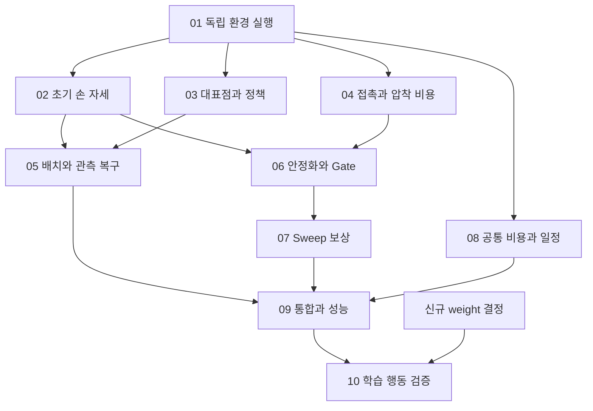

# Stabilize → Sweep Ticket 분할 검토안

2026-11-18. 상태: **사용자의 후속 `$implement` 지시로 순차 구현, Ticket 외부 미게시**. [개발 명세서](2026-11-18_stabilize_sweep_spec.md)의 확정 범위를 실행·검증 가능한 작업으로 분할한다. 이 문서는 게시 전 검토안이며 개별 Ticket 파일이나 이슈를 발행한 것이 아니다.

## 실행 상태

01–08 기능을 구현하고 09의 등록 환경 통합·접촉 계측·수식 경계 검증을 수행했다. 09의 대규모 throughput 및 학습 iteration 시간은 미검증이다. 10은 초기 weight만 선택했으며, reset IK 미수렴에 대해 사용자가 기존 조건 유지와 행동 평가 미완료 기록을 선택했다. 전체10개 완료나 학습 준비 완료로 표시하지 않는다. [검증·미완료 범위](../../02_implementation/logs/2026-11-18_stabilize_sweep_implementation.md).

아래는 합의한 원래 Ticket 범위와 의존 관계이며, 최신 weight·손 내부 겹침 예외·평가 유보는 [명세의 후속 승인 사항](2026-11-18_stabilize_sweep_spec.md)을 따른다.

## 분할 원칙과 범위

- 코드 계층별로 나누지 않고, 각 작업이 환경 실행에서 확인할 수 있는 동작과 해당 테스트까지 포함하게 한다.
- 모든 Ticket은 기존 환경·공용 함수의 동작을 보존한다. 현재 분석에서 광범위한 선행 리팩터링은 필요하지 않다. 필요한 독립 구성은 01의 실제 생성·실행 경로에 포함한다.
- 선행 Ticket 완료란 그 Ticket의 좁은 동작과 테스트 완료를 뜻한다. 01만으로 전체 환경이 완성됐다고 표시하지 않는다. 테스트 fixture와 임시 시험 weight는 제품의 새로운 reset 모드나 확정 학습 weight가 아니다.
- 계약 기준은 Spec이다. 이 분할안의 요약이 Spec의 수치·수식·제외 범위를 대체하지 않는다. 신규 요구나 추가 성능 합격선을 만들지 않는다.
- 등록된 환경의 reset·step을 주 검증 지점으로 하고, 접촉 계측·수식 경계·모델 forward/export를 보완한다. 각 Ticket에서 해당 기능을 검증하며 통합 Ticket까지 모든 테스트를 미루지 않는다.

## 검토용 Ticket

### 01. 독립 환경 생성부터 로봇 제어까지 실행

**Blocked by:** 없음.

**완료 동작:** 새 ID로 기존 환경 Cfg/runtime을 상속하지 않는 환경을 생성하고, reset → 12D 행동 → physics step → 센서/자기 상태 관측을 실행한다. 기존 로봇·자산·물성·제어·시간 계약을 보존한다.

**수용 기준:** 독립 Env/Scene/Manager/PPO 구성과 runtime 연결, 100Hz physics/50Hz policy/총10초, Runner clip·OSC scale·Last Action/action-rate, 기존 실패 종료를 검증한다. 형상 중심·실제 COM과 단계 관측 계약을 마련하고, 아직 Gate가 없는 이 단계의 phase는 Stabilize다. 후속 기능이 필요하지 않은 제어 경로는 검증 장면에서 실제 reset·step으로 확인한다. 기존 환경 격리·회귀를 대조한다.

**경계:** 합의한 자동 초기 손 배치, 대표점 관측, Gate, 신규 보상의 완료를 주장하지 않는다. 기준 환경의 Reach나 GT 관측을 새 환경의 최종 계약으로 확정하지 않는다.

**Spec 연결:** FR-01·FR-02·FR-09, T01·T02·T12·T13 중 해당 부분.

### 02. 목표 반대편 초기 손 자세로 reset

**Blocked by:** 01.

**완료 동작:** reset 시 타겟/목표를 정하고 목표 반대편에 손을 비중첩 자세로 배치해 바로 제어를 시작한다. IK 실패는 제한된 후보 안에서 진단한다.

**수용 기준:** 목표 거리6–12cm·제외각30도, 표면 간격 약5cm, XY±1cm/yaw±10도, 기존 높이·roll/pitch·손0rad를 만족한다. 같은 타겟/목표에서 최대4개 IK 후보를 검사하고 모두 실패하면 진단 후 중단한다. 초기 로봇 충돌 형상+1cm 점유 영역을 후속 배치에 제공한다. 장애물 없는 검증 장면에서 초기 자세와 부분 reset/seed 재현성을 확인한다.

**경계:** 장애물 배치·시각 실패 복구는 05에서 완성한다.

**Spec 연결:** FR-02·FR-03, T02·T03·T05의 초기 자세 부분.

### 03. 초기 대표 표면점으로 정책 행동 생성

**Blocked by:** 01.

**완료 동작:** 유효한 초기 장면을 관측하고, 대표 표면점을 현재 EEF 기준으로 변환해 Actor/Critic이 행동을 출력한다. 물체 이동은 초기 시각 점을 갱신하지 않는다.

**수용 기준:** 실제 메쉬·1mm 정면 관측·2cm/20% 필터, 타겟 최대 유효 조각1개, 비타겟 분리 조각 독립을 적용한다. valid+XYZ16슬롯/64D와 미사용0, direct67D·encoder16D·결합83D·action12D를 검증한다. 현재 GT 비유입, 월드 snapshot 고정, 부분 reset, forward/gradient/export를 확인한다.

**경계:** 유효 장면 fixture로 자체 검증 가능하며 02를 기다릴 필요가 없다. 미검출/슬롯 초과는 결과로 식별하고 자동 reset 복구는 05에서 연결한다. Gate에 의한 phase 변경은 06의 책임이다.

**Spec 연결:** FR-02·FR-04·FR-09, T04·T12.

### 04. 실제 손–타겟 접촉에서 압착 비용까지 계산

**Blocked by:** 01.

**완료 동작:** 실제 접촉을 physics 주기로 수집하여 손–타겟 합력·COM 모멘트·법선 압착 하중을 구하고, 환경 step의 압착 비용으로 반영한다.

**수용 기준:** 법선+마찰 합력, 각 접촉점/마찰 anchor의 COM 모멘트, 법선 크기 합 S와 공통5N 기준을 적용한다. 다른 반력 제외, 부호·좌표·dt·독립 인덱스·공유 버퍼·무효/누락/용량 문제를 검사한다. 반대 힘 상쇄와 substep별 비선형 계산 후 평균을 검증한다. 부분 reset은 해당 접촉 이력만 초기화한다.

**경계:** 초기 손 배치 알고리즘 대신 제어된 접촉 fixture로 검증하므로 02와 병렬 가능하다. Gate·setup 보상은 06에서 구현한다. 압착 weight는 유보 상태를 유지한다.

**Spec 연결:** FR-05·FR-07의 압착 항, T02·T06·T08의 압착 부분.

### 05. 안전한 장애물 배치와 관측 실패 복구로 reset 완성

**Blocked by:** 02, 03.

**완료 동작:** 초기 로봇 점유 공간과 기존 RED ZONE을 피해서 장애물을 배치하고, 공간·관측 문제가 있으면 합의한 감축 규칙으로 reset을 완료한다.

**수용 기준:** 요청0–6개·큰 후보 우선·후보별1회·실패 후보만 생략·성공 배치 보존을 만족한다. 슬롯 초과/타겟 미검출 시 장애물0개로 한 번 재관측하며 타겟 단독 미검출은 오류다. 일반 배치1회·관측 최대2회, 로봇 진입 전 snapshot, 선택 상태 반영 순서와 다른 환경 시간 불변을 검증한다. 요청/실제 수·감축 이유·빈 장면 비율·IK 횟수·reset/관측 시간을 기록한다.

**경계:** 02의 실제 점유 영역과 03의 관측 결과가 모두 필요하므로 두 작업이 직접 선행한다. physics 전역 step을 reset 편의용으로 추가하지 않는다.

**Spec 연결:** FR-03·FR-04·FR-09, T03·T05·T14의 기록/제한 부분.

### 06. 안정화부터 Gate 전환·완료 보상·성공 전제까지 구현

**Blocked by:** 02, 04.

**완료 동작:** 합의한 초기 자세에서 접촉을 안정화하고, 조건 연속 충족 시 다음 policy step부터 Sweep으로 전환한다. 전환 후 완료 보상을 유지하고 Gate 달성을 timeout 성공의 전제로 사용한다.

**수용 기준:** 확정 setup 수식과 초기 이동·회전 비용, 모든 Gate 임계값, 29/30 sample 경계·위반 시 초기화·영구 latch를 적용한다. 통과 step은 Stabilize 보상, 다음 관측/action은 Sweep이다. setup0–1/완료1·동일 weight·종료 시 중단을 지키고 Gate 이후 초기 자세 유지 요구를 없앤다. 총10초·현재 형상 중심 거리<3cm·실패 우선·조기 성공 없음·부분 reset을 검증한다.

**경계:** 01의 단계 관측 계약을 사용하므로 대표점 처리 완료가 이 작업을 막지는 않는다. 전체 시각 정책과의 결합은 09에서 재검증한다. 거리 보상과 접촉 count는 07에서 연결한다.

**Spec 연결:** FR-01·FR-06·FR-07의 안정화/완료 항, T07·T08·T11.

### 07. Sweep 거리·접촉·힘 방향 결합 보상 구현

**Blocked by:** 06.

**완료 동작:** Gate 후 실제 접촉을 유지하며 목표 방향으로 미는 거리 감소만 결합 보상으로 평가하고, 멀어짐은 별도로 비용 처리한다.

**수용 기준:** 이전 policy step 거리 차분, 최근3회 중2회/+1/−2/count0–20/20, 불인정 step0, 접촉0.01N·EEF12cm·수평힘1N, cosine0–1을 적용한다. 목표1cm 예외를 없애고 멀어짐은−38.91×증가거리로 계산한다. Gate 전 두 거리항0, 전환 시 거리·접촉 이력 초기화, 소급 지급 없음, dt 적용을 검증한다. 별도 Reach·접촉·방향 가산 보상을 남기지 않는다.

**경계:** 합력은 04, 전환은 06 결과를 사용한다. 04는 06을 통한 전이 의존이므로 직접 blocker에 중복 기재하지 않는다. 최종 w_sweep는 정하지 않는다.

**Spec 연결:** FR-07의 Sweep 항, T09.

### 08. 기존 공통 비용·일정 보존과 5% 상한 제거

**Blocked by:** 01.

**완료 동작:** 새 환경에서 기존 공통 비용과 일정을 유지하면서 F/T 변화 비용이 누적 양의 보상5% 예산에 제한되지 않도록 한다.

**수용 기준:** Spec의 기존 weight·params·raw cap·250 iteration 일정과 일치한다. 같은 입력의 F/T 비용이 과거 양의 보상 예산이나 보상 등록 순서에 제한되지 않음을 step 결과로 확인한다. deadzone 일정 제거와30도 고정, 기존 팔속도 일정 비활성, 기존 환경 불변을 확인한다.

**경계:** setup/Sweep 신규 항은 06·07의 책임이다. 기존 action-rate 계약은 01에서 먼저 확보하고 이 작업에서 보존 대조한다. 실제 목표 방향 표집은 02의 책임이다. 양의 보상 이력을 제어한 fixture로 검증하므로 07 완료를 기다리지 않는다.

**Spec 연결:** FR-08, T10.

### 09. 전체 환경·정책 실행과 reset 성능 통합 검증

**Blocked by:** 05, 07, 08.

**완료 동작:** 완성된 reset → 초기 관측 → 제어 → 안정화 → Sweep → 종료 → 부분 reset 경로가 실제 환경과 정책에서 함께 동작함을 입증하고 사용 방법을 정리한다.

**수용 기준:** 실제 배치 physics에서 부분 reset 격리·단계 flag·접촉 계측·보상·종료를 확인한다. 최종 관측으로 PPO forward/gradient/export와 기존 학습 진입점 연결을 검증한다. reset/관측/iteration 시간·전송 비용·장면 분포를 측정하고 반복 상한과 진단 기록을 대조한다. 기존 환경 회귀와 명세 전체 대조를 완료하고 실패·미검증 항목을 기록한다.

**경계:** 기능 테스트를 처음 작성하는 작업이 아니라 앞선 Ticket 간 상호작용을 확인하는 작업이다. 미정 weight는 명시적인 시험 설정으로만 사용하며 확정 학습값으로 취급하지 않는다. 장기 학습 성공이나 행동 품질은 10의 범위다.

**Spec 연결:** T01–T14의 통합 대조, 특히 T13·T14.

### 10. 확정 weight로 학습 행동 검증

**Blocked by:** 09. **추가 외부 조건:** 사용자의 신규 reward weight 결정.

**완료 동작:** 확정된 weight로 Gate 직전 정체·통과 후 정지·거리 왕복·조기 실패를 평가하고, 설계 의도와 실제 행동의 차이를 기록한다.

**수용 기준:** 선택된 weight와 조건을 명시하고 네 행동 양상을 확인한다. 완료 보상 항의 지급률과 전체 정책 성공을 구분한다. 계수·성공률 합격선·학습 규모를 임의로 확정하거나 관측 실패를 숨기지 않는다. 수정이 필요하면 근거와 별도 결정 사항을 남긴다.

**경계:** 현재 즉시 착수 가능한 Ticket이 아니다. 코드 의존이 끝나도 weight 결정 전에는 대기한다. 이 Ticket을 분할안에 포함하는 것은 지금 학습을 실행하라는 승인이 아니다.

**Spec 연결:** T15, Further Notes의 weight 유보.

## 의존 관계와 병렬 진행

직접 blocker만 표기한다. 완료할 때마다 선행 조건이 모두 해소된 작업을 진행하며, 아래 묶음 전체의 완료를 일괄 대기하지 않는다.

- 즉시 착수 가능한 것은 01뿐이다.
- 01 완료 후 02·03·04·08을 병렬 진행할 수 있다.
- 02+03 완료 시 05, 02+04 완료 시 06을 시작할 수 있다. 서로의 완료를 기다리지 않는다.
- 06 완료 후 07을 시작하며, 05·08은 계속 병렬 진행할 수 있다.
- 05·07·08 완료 후 09, 09 완료 및 weight 결정 후 10 순서다.
- 논리적 병렬 가능성과 파일 충돌 가능성은 다르다. runtime/reset 연결은 각 작업의 기능 책임을 유지하고, 같은 구성 선언을 바꾸는 변경은 작은 병합 단위로 조율한다. 파일을 공유한다는 이유만으로 거짓 기능 의존을 추가하지 않는다.

## 검토할 사항과 게시 상태

사용자에게 Ticket 크기가 적절한지, 직접 blocker가 실제 선행 조건인지, 합치거나 더 나눌 작업이 있는지 확인한다. 승인 전에는 개별 Ticket 파일이나 외부 이슈를 생성하지 않는다.

현재 게시 대상은 설정되지 않았다. `to-tickets`의 안내대로 `/setup-matt-pocock-skills`에서 로컬 파일 또는 외부 트래커를 설정해야 한다. 승인 후 설정된 방식으로 Ticket별로 게시하며 의존 관계를 유지한다. 10은 weight 외부 조건도 명시해 즉시 착수 가능한 것으로 오인하지 않게 한다. 기존 Spec/부모 이슈를 완료 처리하지 않는다.
