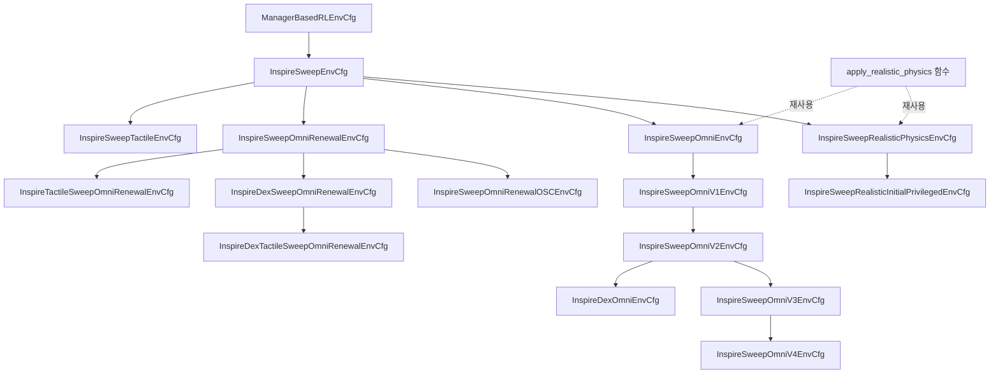
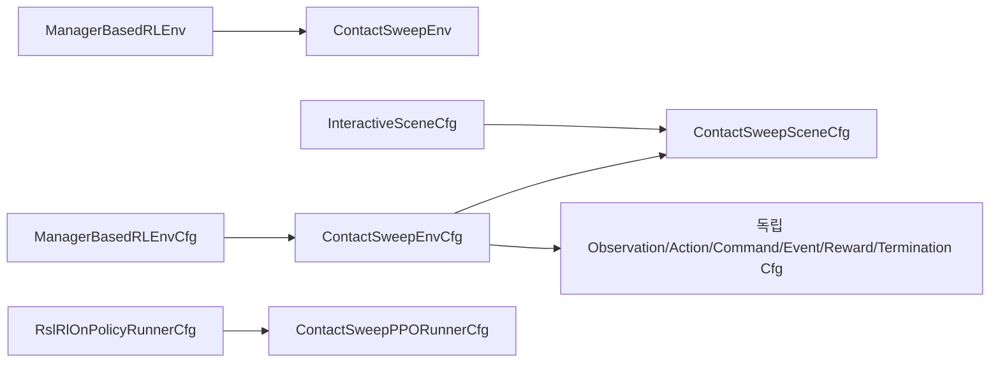
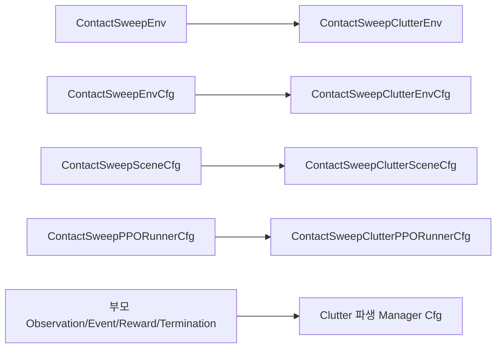
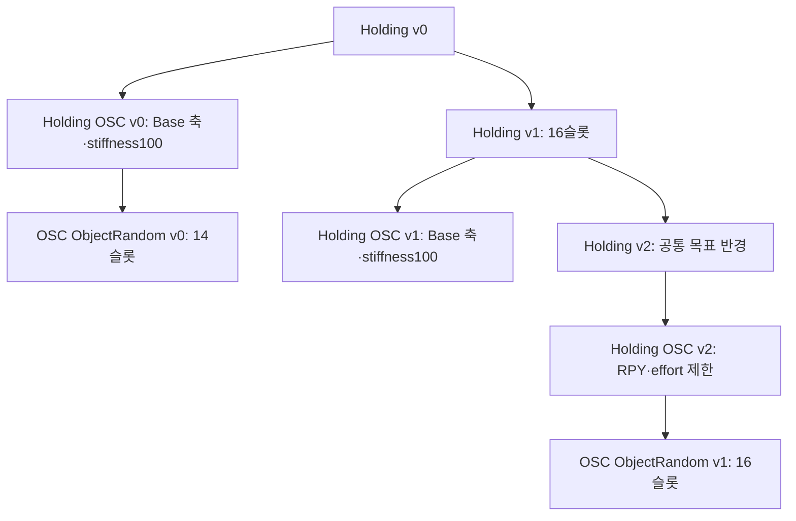

# 활성 패키지와 환경 구현 현황

2026-10-24 Windows 실행: `inspire_sweep_baseline/scripts/play.py`와 `train.py`는 Isaac Sim 5.1에서 D3D12를 기본 선택한다. Vulkan RTX 초기화 크래시를 우회하며 명시적 `--kit_args` backend 선택은 보존한다. task 등록·상속·학습 계약은 그대로다. [진단·검증 기록](logs/2026-10-24_windows_vulkan_startup.md).

등록된 Inspire Sweep 환경의 전체 변화 흐름과 개별 문서는 [환경 계층·변경 의도](environments/ENVIRONMENT_EVOLUTION.md)에서 찾는다. 2026-10-22 코드 대조로 확인한 과거 문서와의 수치 차이도 그 문서에 정리했다. 2026-10-23 구조 이관 전 실제 등록·설정 스냅샷에서는45개 task를 확인했다.

2026-10-23 파일 배치: EnvCfg는 `envs/`, PPO Cfg·모델·runner는 `agent/`, SceneCfg는 `assets/scenes/`, 실제 환경 클래스는 `runtime/`에서 관리한다. MDP는 역할별 Cfg와 `*_functions`를 분리하고 같은 계열의 버전을 같은 파일에 모은다. [환경 파일 구조 지침](../00_guidelines/12_ENVIRONMENT_FILE_STRUCTURE.md)과 [이관 검증 상태·복구 기준](logs/2026-10-23_environment_structure_migration.md)을 따른다. 이관은 task ID·환경 계약을 바꾸지 않는 구조 변경이다.

2026-10-23 재검증:45개 환경의 초기 단계 GPU reset/step·PPO 저장/복원은 통과했다. 다만 Holding OSC ObjectRandom v1과 Holding ObjectRandom Test v0는 seed42·4 environments·iteration22500의16개 장애물 reset에서 배치200회 실패가 발생하며, 이관 전 원본에서도 동일하게 재현했다. [조건·오류·검증 한계](logs/2026-10-23_environment_structure_migration.md#기존-오류-objectrandom의16개-장애물-reset)를 확인한다. 배치 규칙은 변경하지 않았다.

[문서 안내](../01_plan/README.md) · [Workspace 구성](../00_guidelines/10_WORKSPACE_GUIDE.md) · [개발 지침](../00_guidelines/09_DEVELOPMENT_GUIDE.md) · [과거 코드·장비 기록](07_CODE_AND_HARDWARE_STATUS.md)

기준일: **2026-10-15**. 이 문서는 현재 Workspace의 활성 코드를 읽어 확인한 구성, 상속 관계와 실행 방법을 기록한다. 과거 구현 보고나 발표 설계와 실제 코드가 다르면 이 문서의 코드 근거를 함께 확인한다. 코드가 존재한다는 사실, CPU 테스트 통과, 학습 성능, 실물 검증은 각각 별개의 확인 수준이다.

2026-10-18 공통 갱신: Omni 계열의 `goal_rewards.action_rate_l2`·`joint_vel_l2`는 raw 제곱합을 계산한 뒤 기본 `max_cost=100.0`으로 **함수 출력**을 제한한다. v2·OSC v2를 포함한 해당 함수를 참조하는 모든 파생 환경에 적용된다. 반환은 [0, 100], 기존 음의 가중치·dt는 이후 적용되며 입력·그룹·가중치는 유지한다. `mdp/reward_functions/sweep.py`의 별도 Baseline 동명 함수는 이번 변경 범위가 아니다. [검증 로그](logs/2026-10-18_omni_squared_cost_caps.md).

[학습 실행 UML](../03_assets/inspire-sweep-training.html)은 환경 생성부터 Isaac Lab step과 PPO 업데이트까지를, [환경 상속 UML](../03_assets/inspire-sweep-inheritance.html)은 네 Cfg의 상속과 공유 물성·MDP term 연결을 보여준다. HTML 파일은 브라우저에서 열며, 표와 코드 링크에서 정확한 설정·함수 이름을 확인할 수 있다.

## 1. 두 활성 패키지의 역할

| 패키지 | 역할 | 실행 단위와 의존성 |
| --- | --- | --- |
| [`src/inspire_sweep_baseline`](../../../src/inspire_sweep_baseline/README.md) | UR5e–Axia80 모티브 하우징–Inspire Hand의 단일 실린더 Sweeping RL 환경과 파생 실험 | Isaac Lab의 Manager-based RL, Isaac Sim, Torch, Gymnasium, RSL-RL. 로봇 USD와 MDP 함수는 패키지 내부에 포함 |
| [`src/axia80_feasibility`](../../../src/axia80_feasibility/README.md) | 고정 조인트 반력을 이용한 F/T 하중·모멘트 모델 및 측정 경로 검증 | Isaac Lab의 벡터화된 물리 Scene을 직접 실행. NumPy·SciPy·xacro·Matplotlib. PPO 학습 환경이나 Gym task 등록 패키지가 아님 |

두 패키지는 Python `pyproject.toml`로 구성되어 있다. ROS2 패키지 빌드만으로 설치되는 구조로 해석하지 않는다. 제공 스크립트가 자신의 패키지 경로를 `sys.path`에 추가하므로 checkout에서 직접 실행할 수 있다.

나머지 `src` 항목은 `src/trash`에 보관하고 `COLCON_IGNORE`로 ROS2 빌드 검색에서 제외한다. 이 중 [`Universal_Robots_ROS2_Description`](../../../src/trash/Universal_Robots_ROS2_Description)은 Axia80 시험이 UR5e xacro·mesh·설정 파일을 읽는 **보관 자산 의존성**이다. 해당 ROS 패키지를 빌드하거나 실행한다는 의미는 아니다. 자산 원본까지 삭제하면 Axia80 모델 생성이 불가능하다.

## 2. RL 환경 등록과 상속 구조

등록 근거는 [`inspire_sweep_baseline/__init__.py`](../../../src/inspire_sweep_baseline/inspire_sweep_baseline/__init__.py)다. 기존 task의 실행 클래스는 [`InspireSweepEnv`](../../../src/inspire_sweep_baseline/inspire_sweep_baseline/runtime/sweep.py)이며 `ManagerBasedRLEnv`를 상속한다. 2026-10-20 추가한 독립 기준 Contact Sweep은 별도의 `ContactSweepEnv`와 Manager별 Cfg를 사용한다. 환경별 차이는 등록된 Cfg와 PPO 설정에서 결정한다.

2026-10-19 후속 요청으로 아래 종료 진단 블록은 전체 주석 처리했다. 현재 v1·v2·OSC를 포함한 모든 환경에서 종료 진단 print가 비활성화되어 있다.

2026-10-19 종료 진단: 공통 `InspireSweepEnv._reset_idx`가 reset 직전에 active termination 중 True인 모든 항목을 print하며, 동시에 발생한 항목도 각각 표시한다. v1에서는 `time_out`, `object_drop`, `push_fast`, `shelf_collision`, `hand_velocity`(실제 Arm 속도), `shelf_displacement`를 포함한다. v2·OSC 등 모든 파생 환경에도 적용한다. 종료 판정·threshold·reset·task 등록은 바꾸지 않는다. [구현·검증](logs/2026-10-19_v1_termination_prints.md).

| Gym task ID | 환경 Cfg | PPO Cfg | 기본 로그 폴더 |
| --- | --- | --- | --- |
| `Isaac-Inspire-Contact-Sweep-v0` | `ContactSweepEnvCfg` | `ContactSweepPPORunnerCfg` | `logs/rsl_rl/inspire_contact_sweep` |
| `Isaac-Inspire-Contact-Sweep-Clutter-v0` | `ContactSweepClutterEnvCfg` | `ContactSweepClutterPPORunnerCfg` | `logs/rsl_rl/inspire_contact_sweep_clutter` |
| `Isaac-Inspire-Contact-Sweep-Clutter-v1` | `ContactSweepClutterV1EnvCfg` | `ContactSweepClutterV1PPORunnerCfg` | `logs/rsl_rl/inspire_contact_sweep_clutter_v1` |
| `Isaac-Inspire-Contact-Sweep-Clutter-Curriculum-v1` | `ContactSweepClutterV1CurriculumEnvCfg` | `ContactSweepClutterV1CurriculumPPORunnerCfg` | `logs/rsl_rl/inspire_contact_sweep_clutter_v1_curriculum` |
| `Isaac-Inspire-Contact-Sweep-Clutter-Fusion-v0` | `ContactSweepClutterFusionEnvCfg` | `ContactSweepClutterFusionPPORunnerCfg` | `logs/rsl_rl/inspire_contact_sweep_clutter_fusion` |
| `Isaac-Inspire-Contact-Sweep-Clutter-Fusion-v3` | `ContactSweepClutterFusionV3EnvCfg` | `ContactSweepClutterFusionV3PPORunnerCfg` | `logs/rsl_rl/inspire_contact_sweep_clutter_fusion_v3` |
| `Isaac-Inspire-Contact-Sweep-Clutter-Fusion-v1_0` | `ContactSweepClutterFusionV1_0EnvCfg` | `ContactSweepClutterFusionV1_0PPORunnerCfg` | `logs/rsl_rl/inspire_contact_sweep_clutter_fusion_v1_0` |
| `Isaac-Inspire-Contact-Sweep-Clutter-Fusion-Holding-v0` | `FusionHoldingV0EnvCfg` | `FusionHoldingV0PPORunnerCfg` | `logs/rsl_rl/inspire_contact_sweep_clutter_fusion_holding_v0` |
| `Isaac-Inspire-Contact-Sweep-Clutter-Fusion-Holding-OSC-v0` | `FusionHoldingOSCV0EnvCfg` | `FusionHoldingOSCV0PPORunnerCfg` | `logs/rsl_rl/inspire_contact_sweep_clutter_fusion_holding_osc_v0` |
| `Isaac-Inspire-Contact-Sweep-Clutter-Fusion-Holding-OSC-ObjectRandom-v0` | `FusionHoldingOSCObjectRandomV0EnvCfg` | `FusionHoldingOSCObjectRandomV0PPORunnerCfg` | `logs/rsl_rl/inspire_contact_sweep_clutter_fusion_holding_osc_object_random_v0` |
| `Isaac-Inspire-Contact-Sweep-Clutter-Fusion-Holding-v1` | `FusionHoldingV1EnvCfg` | `FusionHoldingV1PPORunnerCfg` | `logs/rsl_rl/inspire_contact_sweep_clutter_fusion_holding_v1` |
| `Isaac-Inspire-Contact-Sweep-Clutter-Fusion-Holding-OSC-v1` | `FusionHoldingOSCV1EnvCfg` | `FusionHoldingOSCV1PPORunnerCfg` | `logs/rsl_rl/inspire_contact_sweep_clutter_fusion_holding_osc_v1` |
| `Isaac-Inspire-Contact-Sweep-Clutter-Fusion-Holding-OSC-v2` | `FusionHoldingOSCV2EnvCfg` | `FusionHoldingOSCV2PPORunnerCfg` | `logs/rsl_rl/inspire_contact_sweep_clutter_fusion_holding_osc_v2` |
| `Isaac-Inspire-Contact-Sweep-Clutter-Fusion-Holding-OSC-ObjectRandom-v1` | `FusionHoldingOSCObjectRandomV1EnvCfg` | `FusionHoldingOSCObjectRandomV1PPORunnerCfg` | `logs/rsl_rl/inspire_contact_sweep_clutter_fusion_holding_osc_object_random_v1` |
| `Isaac-Inspire-Contact-Sweep-Clutter-Fusion-v2` | `ContactSweepClutterFusionV2EnvCfg` | `ContactSweepClutterFusionV2PPORunnerCfg` | `logs/rsl_rl/inspire_contact_sweep_clutter_fusion_v2` |
| `Isaac-Inspire-Sweep-Baseline-v0` | `InspireSweepEnvCfg` | `InspireSweepPPORunnerCfg` | `logs/rsl_rl/inspire_sweep_baseline` |
| `Isaac-Inspire-Sweep-Realistic-Physics-v0` | `InspireSweepRealisticPhysicsEnvCfg` | `InspireSweepRealisticPhysicsPPORunnerCfg` | `logs/rsl_rl/inspire_sweep_realistic_physics` |
| `Isaac-Inspire-Sweep-Realistic-Physics-Initial-Privileged-v0` | `InspireSweepRealisticInitialPrivilegedEnvCfg` | `InspireSweepRealisticInitialPrivilegedPPORunnerCfg` | `logs/rsl_rl/inspire_sweep_realistic_initial_privileged` |
| `Isaac-Inspire-Sweep-Omni-v0` | `InspireSweepOmniEnvCfg` | `InspireSweepPPORunnerCfg` | Baseline과 동일. CLI로 `inspire_sweep_omni` 지정 권장 |
| `Isaac-Inspire-Sweep-Omni-v1` | `InspireSweepOmniV1EnvCfg` | `InspireSweepPPORunnerCfg` | Baseline과 동일. CLI로 `inspire_sweep_omni_v1` 지정 권장 |
| `Isaac-Inspire-Sweep-Omni-v2` | `InspireSweepOmniV2EnvCfg` | `InspireSweepPPORunnerCfg` | Baseline과 동일. CLI로 `inspire_sweep_omni_v2` 지정 권장 |
| `Isaac-Inspire-Sweep-Omni-v3` | `InspireSweepOmniV3EnvCfg` | `InspireSweepPPORunnerCfg` | Baseline과 동일. CLI로 `inspire_sweep_omni_v3` 지정 권장 |
| `Isaac-Inspire-Sweep-Omni-v4` | `InspireSweepOmniV4EnvCfg` | `InspireSweepPPORunnerCfg` | Baseline과 동일. CLI로 `inspire_sweep_omni_v4` 지정 권장 |
| `Isaac-Inspire-Sweep-Omni-Renewal-v0` | `InspireSweepOmniRenewalEnvCfg` | `InspireSweepPPORunnerCfg` | CLI로 `inspire_sweep_omni_renewal` 지정 권장 |
| `Isaac-Inspire-Sweep-Omni-Renewal-OSC-v0` | `InspireSweepOmniRenewalOSCEnvCfg` | `InspireSweepPPORunnerCfg` | CLI로 `inspire_sweep_omni_renewal_osc` 지정 권장 |
| `Isaac-Inspire-Dex-Sweep-Omni-Renewal-v0` | `InspireDexSweepOmniRenewalEnvCfg` | `InspireSweepPPORunnerCfg` | CLI로 `inspire_dex_sweep_omni_renewal` 지정 권장 |
| `Isaac-Inspire-Tactile-Sweep-Omni-Renewal-v0` | `InspireTactileSweepOmniRenewalEnvCfg` | `InspireTactileSweepOmniRenewalPPORunnerCfg` | `logs/rsl_rl/inspire_tactile_sweep_omni_renewal` |
| `Isaac-Inspire-Dex-Tactile-Sweep-Omni-Renewal-v0` | `InspireDexTactileSweepOmniRenewalEnvCfg` | `InspireDexTactileSweepOmniRenewalPPORunnerCfg` | `logs/rsl_rl/inspire_dex_tactile_sweep_omni_renewal` |
| `Isaac-Inspire-Dex-Tactile-Sweep-Omni-Renewal-v1` | `InspireDexTactileSweepOmniRenewalV1EnvCfg` | `InspireDexTactileSweepOmniRenewalV1PPORunnerCfg` | `logs/rsl_rl/inspire_dex_tactile_sweep_omni_renewal_v1` |
| `Isaac-Inspire-Dex-Tactile-Sweep-Omni-Renewal-v2` | `InspireDexTactileSweepOmniRenewalV2EnvCfg` | `InspireDexTactileSweepOmniRenewalV2PPORunnerCfg` | `logs/rsl_rl/inspire_dex_tactile_sweep_omni_renewal_v2` |
| `Isaac-Inspire-Dex-Tactile-Sweep-Omni-Renewal-OSC-v2` | `InspireDexTactileSweepOmniRenewalV2OSCEnvCfg` | `InspireDexTactileSweepOmniRenewalV2OSCPPORunnerCfg` | `logs/rsl_rl/inspire_dex_tactile_sweep_omni_renewal_v2_osc` |
| `Isaac-Inspire-Dex-Omni-v0` | `InspireDexOmniEnvCfg` | `InspireSweepPPORunnerCfg` | Baseline과 동일. CLI로 `inspire_dex_omni` 지정 권장 |
| `Isaac-Inspire-Sweep-Baseline-Tactile-v0` | `InspireSweepTactileEnvCfg` | `InspireSweepTactilePPORunnerCfg` | `logs/rsl_rl/inspire_sweep_tactile` |



Omni는 Realistic Physics Cfg의 자식이 아니다. Baseline Cfg를 직접 상속하면서 `apply_realistic_physics()`와 Realistic Physics의 Event Cfg를 재사용한다. Initial-Privileged는 Realistic Physics Cfg를 상속하며 관측 경로를 바꾼다. Dex Omni는 Omni v2에서 보상 두 항만 바꾸며, 보상 설정의 상속은 `OmniRewardsCfg → OmniV2RewardsCfg → DexOmniRewardsCfg`다.

PPO 상속은 `RslRlOnPolicyRunnerCfg → InspireSweepPPORunnerCfg → InspireSweepRealisticPhysicsPPORunnerCfg → InspireSweepRealisticInitialPrivilegedPPORunnerCfg`다. Realistic Physics는 실험 폴더 이름을, Initial-Privileged는 폴더 이름과 actor/critic 관측 그룹 연결을 변경한다. Omni는 Baseline PPO 클래스를 그대로 등록한다.

### 2.1 Manager와 코드의 책임

| 구성 | 책임 | 주요 구현 |
| --- | --- | --- |
| Scene | 로봇·선반·실린더, EEF·가상 finger/wrist frame, 손바닥 ContactSensor 구성 | [`assets/scenes/sweep.py`](../../../src/inspire_sweep_baseline/inspire_sweep_baseline/assets/scenes/sweep.py), `assets/` |
| Action Manager | Arm 6개 관절 위치 명령, Hand 굽힘·엄지 opposition 2개 입력의 관절 매핑 | `mdp/actions/sweep.py`, [`mdp/action_functions/hand_openness.py`](../../../src/inspire_sweep_baseline/inspire_sweep_baseline/mdp/action_functions/hand_openness.py) |
| Observation Manager | 관측 순서·노이즈, 초기 물체 위치 캐시, critic의 privileged 관측 | `mdp/observations/sweep.py`, [`mdp/observation_functions/asymmetric_observations.py`](../../../src/inspire_sweep_baseline/inspire_sweep_baseline/mdp/observation_functions/asymmetric_observations.py) |
| Command Manager | 리셋된 물체 상태를 저장하고 에피소드 동안 고정된 목표 위치·자세 유지 | `mdp/commands/sweep.py`, [`mdp/command_functions/sweep_goal.py`](../../../src/inspire_sweep_baseline/inspire_sweep_baseline/mdp/command_functions/sweep_goal.py) |
| Event Manager | 기본 Scene 리셋, 물체·목표 샘플링, startup 물성 버퍼 준비와 에피소드 물성 변경 | `mdp/events/`, `mdp/event_functions/sweep.py`, `goal_events.py`, `realistic_physics.py` |
| Reward Manager | 보상 term에 가중치와 제어 주기 적용, 상태를 갖는 접근·목표 진척 계산 | `mdp/rewards/`, `mdp/reward_functions/sweep.py`, `goal_rewards.py`, `dex_rewards.py` |
| Termination Manager | 시간 제한, 실패, Omni의 안정된 목표 도달 및 유지 시간 검사 | `mdp/terminations/`, `mdp/termination_functions/sweep.py`, `goal_terminations.py` |
| Curriculum Manager | 학습 iteration에 따른 기존 보상·목표·물체 개수 일정 | `mdp/curricula/`, `mdp/curriculum_functions/` |
| EnvCfg | 기존 부모 설정을 상속하고 Scene·Manager를 조합 | `envs/` |
| 환경 실행 클래스 | Manager가 사용할 target·sensor 상태 준비, 리셋된 센서값 무효화, Hand action 이력을 OPEN으로 초기화 | `runtime/sweep.py`의 `InspireSweepEnv`, Contact 계열의 `runtime/` 구현 |
| PPO runner·스크립트 | task 등록과 Cfg 로딩, CLI override, rollout·체크포인트·영상 기록 | `agent/`, [`scripts/train.py`](../../../src/inspire_sweep_baseline/scripts/train.py), [`scripts/play.py`](../../../src/inspire_sweep_baseline/scripts/play.py) |

물리 주기는 0.01초, decimation은 2, 정책 제어 주기는 0.02초(50 Hz), 최대 에피소드는 10초다. 파생 환경 모두 Baseline의 이 설정을 사용한다.

### 2.2 현재 관측·제어와 연구 목표의 차이

| 환경 | Actor | Critic | 변경 내용 |
| --- | --- | --- | --- |
| Baseline | 현재 물체 위치를 포함한 `policy` 41D | 같은 41D | 단일 1 kg 실린더, 좌/우 18 cm 목표, Reaching과 Homing 포함 |
| Realistic Physics | Baseline과 같은 41D | 같은 41D | 질량·마찰 랜덤화와 생성 시 접촉 재질 바인딩 |
| Initial-Privileged | 물체 위치 3D만 에피소드 초기 측정값으로 고정한 41D | `policy` 41D + 현재 물체 상태 13D = 54D | 초기 위치 관측 오차를 리셋당 한 번 샘플링. Critic은 현재 위치·quaternion·선속도·각속도를 사용 |
| Omni | Baseline과 같은 현재 물체 위치 포함 41D | 같은 41D | 원판 스폰, 전방향 목표, 목표 거리 비용·접근 진척·성공/실패 보상·안정 성공 종료 |
| Omni v1 | Omni v0와 같은 41D | 같은 41D | Arm 속도 종료 기준만 변경. 현재 3.0 rad/s |
| Omni v2 | Omni v1과 같은 41D | 같은 41D | 현재 물체 접근·XY 목표 거리의 최소 기록 갱신을 초기 거리로 정규화해 보상. 시간·성공·실패 보상과 성공 종료 제거 |
| Omni v3 | 현재 물체 위치 포함 41D | 같은 41D | 높이 조건부 XY 접근 진행 보상 |
| Omni v4 | 현재 물체 위치 포함 41D | 같은 41D | V3 상속, Arm 속도 5.0·물체 속도 0.5 종료, 외곽·성공 종료 제거, 제곱 pushing 속도 비용 |
| Sweep Omni Renewal | 현재 물체 위치 포함 41D | 같은 41D | V4와 같은 전체 동작을 Baseline에서 명시적으로 재구성 |
| Dex Sweep Omni Renewal | 현재 물체 위치 포함 41D | 같은 41D | Renewal 상속, Dex 접근·목표 보상과 지수 속도 비용 |
| Dex Omni | Omni v2와 같은 41D | 같은 41D | 과거 최소 접근·목표 거리를 새로 줄인 실제 거리(m)에 보상. 초기 거리 정규화 제거; 나머지 설정은 v2 상속 |
| Baseline Tactile | 17개 tactile bit를 포함한 `policy` 57D | 같은 57D | 원본 충돌 형상 유지, 직접 pad 접촉과 부모 접촉점의 센서 영역 분류 |

41D의 순서는 Arm 상대 위치 6, 상대 속도 6, 직전 Action 8, 물체 위치 3, 반지름 1, EEF pose 7, 목표 위치 3, 손바닥 접촉 1, EEF wrench 6이다. 기존 환경의 접촉 관측은 손바닥 **한 영역**의 Boolean이다. 새 Baseline Tactile은 이 위치의 1D만 17D로 교체하여 57D가 된다. 실물의 압력·변형 모델을 재현한 것은 아니다. F/T는 고정 조인트 반력을 EEF 좌표·기준점으로 변환한 값으로, tare나 중력 보상을 적용하지 않는다. 리셋 직후 오래된 센서값은 0으로 마스킹한다.

모든 환경의 Action은 **Arm Joint Position 6D + Hand openness 2D = 8D**다. Arm 목표는 초기 관절 위치에 `0.5 × action`을 더한 값이다. Hand 입력은 `[0, 1]`로 제한해 12개 관절에 매핑하며, 1이 편 상태다. 현재 활성 코드에서 Arm OSC 또는 Diff-IK 제어를 확인한 것은 아니다.

Baseline·Realistic Physics·Omni의 actor는 실행 중 물체 GT 위치를 받는다. 따라서 이 환경들의 학습 성과를 그대로 최종 Blind 정책 성과라고 쓰면 안 된다. Initial-Privileged는 초기 위치 actor/현재 상태 critic을 구분한 실험이지만, 실물 센싱·초기 perception·접근 완료 후 시작 조건까지 검증했다는 뜻은 아니다. 현재 초기 관절에서 접근하는 시험 환경과 연구의 접근 후 하위 정책 설계를 구분한다.

### 2.3 파생 환경의 중요한 동작

Realistic Physics의 물체 질량은 평균 0.365 kg, 표준편차 0.0675 kg의 Gaussian을 0.230–0.500 kg로 제한한다. 선반·물체·Hand의 정적/동적 마찰은 역할별 유한 재질 풀에서 리셋마다 샘플링한다. 질량과 마찰 정답을 actor 관측에 추가하지 않는다. Arm 및 Axia80 하우징의 마찰과 기존 restitution은 유지한다. 근거는 [`envs/sweep_envs.py`](../../../src/inspire_sweep_baseline/inspire_sweep_baseline/envs/sweep_envs.py)와 [`mdp/common/realistic_physics.py`](../../../src/inspire_sweep_baseline/inspire_sweep_baseline/mdp/common/realistic_physics.py)다.

Omni 계열은 선반 중앙의 반지름 2 cm 원판에서 물체를 스폰하고 임의 수평 방향으로 최대 15 cm 목표를 정한다. 가장자리 여유가 부족하면 목표 이동 거리를 줄인다. Omni v0/v1은 목표 오차 1 cm 미만, 평면 속도 2 cm/s 미만, 기울기 10° 이하, 기하학적으로 추정한 상판 지지 및 실패 없음이 0.3초 연속 유지되면 성공으로 종료한다. v2와 Dex Omni는 `terminations.success=None`으로 이 성공 종료를 사용하지 않는다. Homing을 요구하지 않는다. v0/v1의 보상·실패 임계값과 각 항의 단위는 [Omni 환경 상세](environments/OMNI_ENVIRONMENT.md)에, 그 설계 제안은 [보상 초안](../01_plan/environments/OMNI_REWARD_PLAN.md)에 보존한다.

Omni v2의 접근·목표 보상은 각각 초기 유효 거리로 정규화한 최소 기록 개선량에 +30/+40을 곱한다. 접근은 현재 물체 바닥 원점과 EEF의 XYZ 거리에서 10 cm를, 목표는 물체–목표 XY 거리에서 1 cm를 뺀 양의 부분을 사용한다. 시간·성공·실패 보상은 `None`이며, 실패·시간 제한 종료는 v1과 같다. 근거는 [`envs/sweep_omni_envs.py`](../../../src/inspire_sweep_baseline/inspire_sweep_baseline/envs/sweep_omni_envs.py)다.

Dex Omni의 [`envs/sweep_omni_envs.py`](../../../src/inspire_sweep_baseline/inspire_sweep_baseline/envs/sweep_omni_envs.py)는 같은 거리 정의에 `DexReachProgress`(+30 reward/m)와 `DexPlanarGoalProgress`(+300 reward/m)를 적용한다. 각 step에서 `max(직전 최소 거리 − 현재 거리, 0)`을 지급하고 기록을 갱신하며, 초기 거리로 정규화하지 않는다. 함수 내부의 `/step_dt`는 RewardManager의 시간 곱셈을 상쇄한다. 따라서 대기·후퇴·기존 최소 거리 복귀에는 추가 보상이 없고, 새로 1 cm를 줄이면 접근 +0.3 또는 목표 이동 +3을 받는다. 기록은 환경별 리셋 시 초기화한다.

DexTouch IV-B 식 (1)과 식 (2)의 목표 거리 항(PDF 4쪽, 인쇄 페이지 10775)에서 과거 최고 상태 갱신에만 보상하는 원칙을 가져왔다. 논문의 손가락별 거리 합은 기존 고정 EEF의 접근 거리로 대체하고, grasp·lift·rotation 태스크와 L1 관절 속도 비용은 도입하지 않는다. **30/300은 논문 계수가 아닌 Sweeping 실험 기본값**이다. 원문 대응·검증·미실행 항목은 [Dex Omni 개발 로그](logs/2026-10-15_dex_omni_rewards.md)를 따른다.

Dex Omni는 v2의 Arm action rate/velocity 비용(각각 −0.03, 제곱합), Hand action rate/velocity 비용(−0.03/−0.01, 제곱평균), 물체 기울기(−2)·선반 충돌(−0.5) 비용을 유지한다. 선반 이동·충돌을 포함한 모든 종료 조건, 성공 종료 없음, 단일 실린더(반지름 4 cm·높이 10 cm), 물체·목표 스폰, 물성, 관측·제어·PPO도 상속한다. 이 변경은 실제 학습 성능 향상을 검증한 결과가 아니다.

## 3. RL 학습·재생 명령

Baseline Tactile은 로봇·물체·스폰·보상·종료·제어를 Baseline에서 상속하고 관측만 17채널 tactile로 바꾼다. 원본 USD·URDF·mesh를 수정하지 않았고 collider나 physics body를 추가하지 않았다. 직접 패드 접촉 외에 기존 부모 body의 실제 개별 접촉점을 원본 패드 footprint에 분류해 가려진 영역을 보완한다. [센서 순서·설정·한계](environments/TACTILE_ENVIRONMENT.md)와 [구현·검증 로그](logs/2026-10-14_baseline_tactile17.md)에 근거를 기록한다. PPO는 Baseline의 수치를 그대로 상속하고 로그 이름만 구분한다.

2026-10-15 경고 수정 이후 부모 접촉점의 GPU 필터는 지원되는 실린더 하나로 제한한다. 17개 직접 pad의 unfiltered 접촉과 실린더에 대한 17개 영역 분류는 유지하며, 부모 링크의 선반·바닥 접촉은 이 보완 경로로 읽지 않는다. Tactile 환경에서만 EEF 좌표축 디버그 표시를 비활성화한다. 관측은 계속 57D이고 기존 physics 설정은 유지한다. [원인·회귀 검증](logs/2026-10-15_tactile_gpu_filter_fix.md)을 참고한다.

```bash
./IsaacLab/isaaclab.sh -p src/inspire_sweep_baseline/scripts/train.py \
  --task Isaac-Inspire-Sweep-Baseline-Tactile-v0 \
  --num_envs 2048 --sweep-direction both --run_name tactile17 --headless

./IsaacLab/isaaclab.sh -p src/inspire_sweep_baseline/scripts/play.py \
  --task Isaac-Inspire-Sweep-Baseline-Tactile-v0 \
  --num_envs 1 --checkpoint "<57D_tactile_checkpoint.pt>" --real-time
```

Omni v1은 v0를 상속하고 `hand_velocity`라는 이름의 Arm 6개 관절 속도 종료 기준만 변경한다. 최초 추가값은 2.0 rad/s였으며 현재 코드는 3.0 rad/s다. 현재 v1은 절대 속도 3.0 rad/s 초과 시 종료하며 v0는 1.0 rad/s를 유지한다. 관측·행동·보상·actuator 설정·스폰·목표·물성·나머지 종료 조건·PPO는 v0와 동일하다. [추가 당시 로그](logs/2026-10-14_omni_v1_arm_velocity.md)의 과거 값과 현재 코드를 구분한다. 상단 HTML UML은 v1 추가 이전의 네 Cfg 스냅샷이다.

Omni v0와 v1의 Arm 비용은 후속 사용자 요청으로 Baseline 수준에 맞췄다. Action 변화는 `−0.03 × sum(Δaction_arm²)`, 관절 속도는 `−0.03 × sum(qdot_arm²)`다. 이전 Omni 대비 각각 6배/18배 강화되며 당시 Hand 비용은 평균 방식이었으며, 2026-10-15 아래 공통 규칙으로 대체했다. [보상 변경·검증 로그](logs/2026-10-14_omni_arm_costs_baseline.md)에 실제 검사와 미실행 범위를 기록했다.

```bash
./IsaacLab/isaaclab.sh -p src/inspire_sweep_baseline/scripts/train.py \
  --task Isaac-Inspire-Sweep-Omni-v1 --num_envs 2048 \
  --experiment_name inspire_sweep_omni_v1 \
  --run_name centered_spawn_goal15cm_arm3rad --headless

./IsaacLab/isaaclab.sh -p src/inspire_sweep_baseline/scripts/play.py \
  --task Isaac-Inspire-Sweep-Omni-v1 --num_envs 1 \
  --checkpoint /home/min/7cmdehdrb/grad/logs/TEMP/2026-10-14_16-16-28_centered_spawn_goal15cm/model_4100.pt \
  --real-time
```

아래 명령은 **Workspace 루트에서 실행**한다. 선반 자산을 읽을 수 있는 Isaac Lab/Isaac Sim 환경이 필요하다. `train.py`는 RSL-RL 최소 버전 `3.0.1`을 검사한다. 패키지의 pip 의존성 목록만으로 Isaac Sim 전체 설치가 완료되는 것은 아니다.

Omni v2와 Dex Omni도 기존 runtime·PPO를 사용한다. 다음 명령의 `--experiment_name`으로 로그를 구분하고 전방향 목표와 충돌하는 `--sweep-direction`은 생략한다. 이 명령은 실행 안내이며 이번 변경에서 실제 train/play를 수행했다는 뜻은 아니다.

```bash
# 초기 거리로 정규화한 최고 기록 보상
./IsaacLab/isaaclab.sh -p src/inspire_sweep_baseline/scripts/train.py \
  --task Isaac-Inspire-Sweep-Omni-v2 --num_envs 2048 \
  --experiment_name inspire_sweep_omni_v2 \
  --run_name live_reach30_sweep40 --headless

./IsaacLab/isaaclab.sh -p src/inspire_sweep_baseline/scripts/play.py \
  --task Isaac-Inspire-Sweep-Omni-v2 --num_envs 1 \
  --experiment_name inspire_sweep_omni_v2 \
  --checkpoint "<v2-checkpoint.pt>" --real-time

# 실제 개선 거리(m)에 비례하는 DexTouch 방식 보상
./IsaacLab/isaaclab.sh -p src/inspire_sweep_baseline/scripts/train.py \
  --task Isaac-Inspire-Dex-Omni-v0 --num_envs 2048 \
  --experiment_name inspire_dex_omni \
  --run_name dex_best_distance --headless

./IsaacLab/isaaclab.sh -p src/inspire_sweep_baseline/scripts/play.py \
  --task Isaac-Inspire-Dex-Omni-v0 --num_envs 1 \
  --experiment_name inspire_dex_omni \
  --checkpoint "<dex-omni-checkpoint.pt>" --real-time
```

```bash
# Baseline
./IsaacLab/isaaclab.sh -p src/inspire_sweep_baseline/scripts/train.py \
  --task Isaac-Inspire-Sweep-Baseline-v0 --num_envs 2048 \
  --sweep-direction both --run_name baseline --headless

# 질량·마찰 랜덤화
./IsaacLab/isaaclab.sh -p src/inspire_sweep_baseline/scripts/train.py \
  --task Isaac-Inspire-Sweep-Realistic-Physics-v0 --num_envs 2048 \
  --sweep-direction both --run_name realistic_mass_friction --headless

# 초기 위치 Actor + privileged Critic
./IsaacLab/isaaclab.sh -p src/inspire_sweep_baseline/scripts/train.py \
  --task Isaac-Inspire-Sweep-Realistic-Physics-Initial-Privileged-v0 \
  --num_envs 2048 --sweep-direction both \
  --run_name realistic_initial_privileged --headless

# 전방향 목표
./IsaacLab/isaaclab.sh -p src/inspire_sweep_baseline/scripts/train.py \
  --task Isaac-Inspire-Sweep-Omni-v0 --num_envs 2048 \
  --experiment_name inspire_sweep_omni --run_name omni_goal15cm --headless
```

앞의 세 환경은 `--sweep-direction left` 또는 `right`로 방향을 고정할 수 있다. Omni에 해당 옵션을 전달하면 오류가 발생하므로 생략한다. Omni의 PPO 기본 로그 폴더는 Baseline과 같아 `--experiment_name`으로 구분한다.

재생은 학습과 동일한 task ID 및 해당 관측 차원으로 학습한 체크포인트를 선택한다. 다음 예의 task를 위 등록 표의 다른 ID로 바꾸면 해당 환경을 재생한다.

```bash
./IsaacLab/isaaclab.sh -p src/inspire_sweep_baseline/scripts/play.py \
  --task Isaac-Inspire-Sweep-Omni-v0 --num_envs 1 \
  --checkpoint "<checkpoint.pt>"

# 한 개 영상 기록 후 종료
./IsaacLab/isaaclab.sh -p src/inspire_sweep_baseline/scripts/play.py \
  --task Isaac-Inspire-Sweep-Omni-v0 --num_envs 1 \
  --checkpoint "<checkpoint.pt>" --video --video_length 500 --headless
```

학습 run은 `logs/rsl_rl/<experiment_name>/<timestamp>_<run_name>`에 저장한다. 학습 스크립트가 저장하는 `params/env.yaml`, `params/agent.yaml`과 실제 명령, seed, 코드 상태를 함께 기록해야 재현할 수 있다. 영상은 run의 `videos/train` 또는 체크포인트 디렉터리의 `videos/play`에 저장한다.

선반 자산은 `INSPIRE_SWEEP_SHELF_USD_PATH`로 USD 경로를 직접 지정하거나 `INSPIRE_SWEEP_ASSET_ROOT`로 자산 root를 지정한다. 기존 `SWEEP_POLICY_*` 변수도 호환하지만 Sweep-Policy 패키지를 import하지는 않는다. 경로 선택의 근거는 [`assets/paths.py`](../../../src/inspire_sweep_baseline/inspire_sweep_baseline/assets/paths.py)다. 자산을 바꾸면 Omni가 가정한 상판 크기·높이도 함께 확인한다.

## 4. Axia80 하중 진단 구성과 실행

Axia80 시험은 Manager-based RL 환경 상속 구조가 없다. `model.py`의 UR5e 모델 확장·공통 형상 함수를 cantilever 변형이 재사용하고, tilted/wrist 변형이 `build_cantilever_model()`을 호출한다. 기본 [`scene.py`](../../../src/axia80_feasibility/axia80_feasibility/scene.py)의 Scene 팩토리를 tilted/wrist Scene 팩토리가 재사용하며 접촉 마찰을 변경한다. 공통 모델과 수치 처리, Scene 구성, 실행 스크립트가 분리되어 있다.

| 시험 | 실행 스크립트 | 확인하려는 반응 |
| --- | --- | --- |
| 수평 넓은 면 장착 | `run_payload_test.py` | 10–500 g 하중의 `Fz ≈ mg`, tare 및 안정화 |
| 얇은 끝면 cantilever 장착 | `run_cantilever_payload_test.py` | 수직 하중의 `Fx`와 레버 암에 따른 `My` |
| wrist3 +10° cantilever | `run_tilted_cantilever_payload_test.py` | 경사에 따른 힘·모멘트 축 분산과 미끄럼·상대 자세 |
| 고정 500 g Roll × Tilt | `run_wrist_angle_sweep.py` | 기본 5 × 5 각도 격자에서 실제 자세 기반 6축 예측과 측정 비교 |

현재 코드의 네 시험을 다시 실행하는 명령이다. 새로운 출력 디렉터리를 지정해 기존 실험 결과와 구분한다. `--strict`는 측정 후 수용 지표가 실패하면 non-zero exit code를 반환하게 한다.

```bash
./IsaacLab/isaaclab.sh -p src/axia80_feasibility/scripts/run_payload_test.py \
  --headless --device cuda:0 --strict \
  --output_dir src/axia80_feasibility/results/payload_rerun_20261014

./IsaacLab/isaaclab.sh -p src/axia80_feasibility/scripts/run_cantilever_payload_test.py \
  --headless --device cuda:0 --strict \
  --output_dir src/axia80_feasibility/results/cantilever_rerun_20261014

./IsaacLab/isaaclab.sh -p src/axia80_feasibility/scripts/run_tilted_cantilever_payload_test.py \
  --headless --device cuda:0 --strict \
  --output_dir src/axia80_feasibility/results/tilted_rerun_20261014

./IsaacLab/isaaclab.sh -p src/axia80_feasibility/scripts/run_wrist_angle_sweep.py \
  --headless --device cuda:0 --strict \
  --output_dir src/axia80_feasibility/results/wrist_rerun_20261014
```

각 스크립트의 기본 출력 경로와 모든 CLI 인자는 소스·패키지 README를 확인한다. 출력에는 summary CSV, 개별 sample CSV, 그래프, 모델/실행 metadata가 포함되며 변형별 run log도 기록된다. 모델 생성 파일은 `src/axia80_feasibility/generated/`에 저장한다. 정적 반력의 수용 판정과 실물 Axia80의 노이즈·캘리브레이션·대역폭·지연 검증은 구분한다.

`generated/`는 다시 만들 수 있는 URDF/USD 캐시다. URDF에는 mesh의 절대 경로가 들어가므로 Workspace나 보관 자산 경로가 바뀌면 모델을 다시 생성해야 한다. 실행 스크립트는 모델 생성 함수를 먼저 호출한다. 기존 USD 캐시까지 재변환해야 할 때는 `--force_conversion`을 추가한다.

## 5. 확인한 테스트와 남은 검증

2026-10-14에 아래 명령으로 활성 패키지 관련 CPU·모델·USD 계약 검사를 실행했다. 결과는 **114 passed, 17 subtests passed**였다. 테스트는 실제 MDP 수치 함수, RSL-RL의 actor/critic 입력 연결, 초기 위치 캐시·리셋, 보상·종료, 물성 설정, 로컬 USD 자산, Axia80 URDF·측정 수치 및 산출물 계약을 확인한다. Isaac Sim 학습 실행이나 실물 시험을 대신하지 않는다.

```bash
env -u PYTHONPATH -u ROS_PACKAGE_PATH -u AMENT_PREFIX_PATH \
  PYTEST_DISABLE_PLUGIN_AUTOLOAD=1 PYTHONDONTWRITEBYTECODE=1 \
  /home/min/miniconda3/envs/env_isaaclab/bin/python -B -m pytest \
  -q -p no:cacheprovider src/inspire_sweep_baseline/tests \
  tests/test_axia80_feasibility.py \
  tests/test_axia80_cantilever_feasibility.py \
  tests/test_axia80_tilted_cantilever.py \
  tests/test_axia80_wrist_angle_sweep.py
```

이 Workspace의 일반 shell에는 ROS 환경이 섞일 수 있다. 최초 실행에서는 ROS `launch_testing` pytest plugin의 `lark` 의존성 누락으로 테스트 수집 전 실패했다. 위 명령은 ROS 검색 경로를 제거하고 pytest 외부 plugin 자동 로딩을 차단해 별도 환경 설치 변경 없이 검증한다.

USD 검사에는 `pxr`를 제공하는 Python이 필요하다. 기본 탐색 경로가 없으면 테스트가 skip되며, `INSPIRE_SWEEP_USD_TEST_PYTHON`으로 해당 Python 실행 파일을 지정할 수 있다. Baseline 설정 비교 테스트는 `example/Sweep-Policy`의 기존 Cfg를 읽으므로 reference submodule이 초기화되어 있어야 한다.

이번 문서 정리에서는 네 RL task의 실제 시뮬레이터 생성, GPU 물성 업데이트, 선반 자산 서버 접속, train/play, 새 checkpoint 성능, Axia80 하중 시뮬레이션 재실행, 실물 센서·로봇 제어를 수행하지 않았다. 관련 과거 결과는 [실험 문서 목록](../01_plan/README.md)과 저장된 metadata·로그를 확인하되, 이번 테스트 결과와 혼합하지 않는다.

이동과 자산 경로 수정 이후 루트 `pytest.ini`의 기본 탐색으로 Scene 기하 검사까지 함께 실행한 결과는 **135 passed, 26 subtests passed**였다. 최종 명령과 Workspace 제외 검증은 [정리 개발 로그](logs/2026-10-14_workspace_cleanup.md)에 기록한다.

## Contact Sweep v0 — 2026-10-20 독립 기준 환경

두 환경의 상세 계약은 [Contact Sweep와 Clutter 통합 설명](environments/CONTACT_SWEEP_ENVIRONMENTS.md)을 따른다.

사용자가 Renewal v3를 새 기준점으로 정리하도록 요청했다. 새 [contact_sweep/](../../../src/inspire_sweep_baseline/inspire_sweep_baseline/envs/contact_sweep_envs.py) 디렉터리에 Observation, Action, Command, Event, Reward, Termination, Scene, Env, PPO 클래스를 직접 선언한다. 기존 환경 Cfg·runtime·PPO를 상속하지 않으며 기존 v3는 유지한다. 자산·관절 mapping·MDP 함수는 공통 유틸리티로 재사용한다.



등록 task는 `Isaac-Inspire-Contact-Sweep-v0`, runtime은 `inspire_sweep_baseline.contact_sweep.env:ContactSweepEnv`, 환경 entry point는 `contact_sweep.env_cfg:ContactSweepEnvCfg`, runner는 `contact_sweep.ppo_cfg:ContactSweepPPORunnerCfg`다. 실험 폴더는 `logs/rsl_rl/inspire_contact_sweep`다.

Actor/Critic은 policy 57D(현재 물체 GT·17 tactile bit·F/T 포함), Action은 Joint Position Arm 6D+Hand 2D다. v3의 최종 값인 reaching=30, goal_distance=94, pushing_speed free_speed=0.2/weight=−2, cap=100, 질량 중심 0.5475 kg·범위 0.345–0.750 kg, 기존 마찰 분포·리셋·제어 주기 0.02초·에피소드 10초·실패 종료를 명시한다. success/goal_hold는 활성화하지 않는다. 필수 네 운동 페널티는 기존 로컬 callable·계수·Arm/Hand 구분을 유지한다.

```bash
./IsaacLab/isaaclab.sh -p src/inspire_sweep_baseline/scripts/train.py \
  --task Isaac-Inspire-Contact-Sweep-v0 --num_envs 2048 --headless

./IsaacLab/isaaclab.sh -p src/inspire_sweep_baseline/scripts/play.py \
  --task Isaac-Inspire-Contact-Sweep-v0 --num_envs 1 \
  --checkpoint "<checkpoint.pt>" --real-time
```

CPU 관련 검사 131개, GPU 8 env·PPO 1 iteration을 통과했다. 저장 환경 YAML과 Manager/관측 순서는 v3와 log_dir 외 동일하고 PPO도 experiment/run 이름 외 동일하다. 동일 seed·1 iteration 후 Actor/Critic tensor가 전부 일치했다. 장시간 학습과 실물 성능은 미검증이다. [검증·재현 로그](logs/2026-10-20_contact_sweep_reference.md).

## Contact Sweep Clutter v0 — 2026-10-20

사용자 요청으로 Contact Sweep을 상속하는 장애물 환경을 추가했다. 기존 Contact Sweep·Renewal v3는 보존한다. 같은 날 후속 요청으로 v0 ID를 유지하며 장애물을 6→3개로 줄이고 RED 제외 반경을 8.3→10.3 cm로 확대했다. RED 형태·전면 방향 확장은 유지하며 여유값만 0.3→2.3 cm로 변경했다. [후속 검증](logs/2026-10-20_clutter_red_expansion.md).



등록 entry point는 `inspire_sweep_baseline.contact_sweep_clutter.env:ContactSweepClutterEnv`, 환경 Cfg는 `contact_sweep_clutter.env_cfg:ContactSweepClutterEnvCfg`, runner는 `contact_sweep_clutter.ppo_cfg:ContactSweepClutterPPORunnerCfg`다.

명시적으로 확인한 사용자 선택은 **부모 타겟·목표 분포 및 초기 관절 자세 유지**, **모든 물체의 촉각 접촉 반영**, **장애물 위치에 reset당 한 번 ±1 cm 노이즈 적용**이다. `scene_randomization`의 배치 규칙을 재사용하되 360°·5–20 cm 명령 분포를 가져오지 않는다. 목표 확정 후 장애물 3개를 배치하며 타겟·목표를 재샘플링하지 않는다. 뒤쪽 GRAY 1개·WHITE 2개, RED와 손목 점유 회피, 간격·밀도·접근 경로 조건을 지킨다. 참조 cm 좌표를 현재 선반 m 좌표로 회전·이동해 front 방향을 보존한다.

모든 실린더는 타겟과 같은 크기·물성이고, 환경별 질량·마찰 샘플도 공유한다. 타겟은 파란색, 장애물은 주황색이다. `object_tilt`는 기존 물체별 비용의 합, `object_drop`는 물체 중 하나라도 기존 낙하·전도 조건에 해당하면 True다. 나머지 보상·종료·물리적 관절 속도 제한은 부모를 상속한다.

Actor/Critic 모두 기존 policy 57D와 장애물 초기 위치 40D를 받는다. 장애물만 `[HEADER, x, y, z] × 10`으로 넣고 실제 3칸·더미 7칸을 사용한다. robot-root frame의 초기 위치와 노이즈를 episode 동안 유지한다. 별도 Actor/Critic MLP `40 → 32(ReLU) → 16`을 PPO로 학습하며, 57D+16D=73D로 연결한다. rollout과 JIT/ONNX 외부 입력은 원시 97D다. 타겟의 현재 위치 관측이 남으므로 완전한 Blind 환경은 아니다.

```bash
./IsaacLab/isaaclab.sh -p src/inspire_sweep_baseline/scripts/train.py \
  --task Isaac-Inspire-Contact-Sweep-Clutter-v0 --num_envs 2048 --headless

./IsaacLab/isaaclab.sh -p src/inspire_sweep_baseline/scripts/play.py \
  --task Isaac-Inspire-Contact-Sweep-Clutter-v0 --num_envs 1 \
  --checkpoint "<clutter-checkpoint.pt>" --real-time
```

[패키지 상세 계약](../../../src/inspire_sweep_baseline/README.md#contact-sweep-clutter-v0--장애물-초기-관측과-mlp-임베딩) · [구현·검증 로그](logs/2026-10-20_contact_sweep_clutter.md).

## Contact Sweep Clutter v1 — 2026-10-20

2026-10-20 후속 수정: `shelf_collision` 실패의 마지막 step에 `shelf_failure` 비용 **−3을 한 번** 추가한다. 현재 실패 판정값을 사용해 reset 전에 보상에 반영하고, 시간 배율을 상쇄하여 실제 차감액을 −3으로 유지한다. Timeout이나 다른 실패만으로는 부과하지 않는다. 이 보상은 v1을 상속하는 v2에도 적용된다. [변경·검증 기록](logs/2026-10-20_clutter_v1_shelf_failure.md).

사용자 요청으로 `Isaac-Inspire-Contact-Sweep-Clutter-v0`를 직접 상속한 `Isaac-Inspire-Contact-Sweep-Clutter-v1`를 추가했다. Runtime은 `contact_sweep_clutter_v1.env:ContactSweepClutterV1Env`, 환경 설정은 `contact_sweep_clutter_v1.env_cfg:ContactSweepClutterV1EnvCfg`, runner는 `contact_sweep_clutter_v1.ppo_cfg:ContactSweepClutterV1PPORunnerCfg`다. 모두 `inspire_sweep_baseline` 패키지 아래이며 부모 Env·Cfg·관측·보상·runner를 상속한다. [구현 소스](../../../src/inspire_sweep_baseline/inspire_sweep_baseline/envs/contact_sweep_clutter_envs.py).

Actor의 타겟 위치 3D는 reset 당시 robot-root frame 좌표로 고정하고 reset당 ±1 cm 관측 오차를 한 번만 적용한다. Critic은 별도 `privileged` 그룹으로 현재 타겟 robot-root 위치 3D를 매 step 받는다. `initial_privileged_ppo_cfg.py`의 Actor/Critic 분리 방식을 참조하며, 실시간 타겟 위치는 Actor 입력으로 연결하지 않는다.

Actor는 원시 `policy57 + obstacles40`에서 장애물 인코더 후 **73D**, Critic은 `policy57 + privileged3 + obstacles40`에서 **76D**다. 장애물 관측·10개 슬롯 중 실제 3개·초기 관측 노이즈·개별 40→32→16 인코더는 v0에서 상속한다. 장애물 비용용 초기 위치는 reset 배치 완료 뒤 실제 월드 XYZ를 따로 저장하며 관측 노이즈가 없다. 부분·자동 reset에서도 해당 환경의 초기값만 갱신한다.

| 보상 | 계수와 적용 조건 |
| --- | --- |
| Reaching / Goal distance | 기존 progress 함수, 각각 30 / 100 |
| Goal 유지 | `goal_hold=0.9`; 월드 XY 목표 반경 1 cm에서 일정한 +0.9/초 |
| Contact | `contact_any=0.16`, `contact_count=0.16`; 동일한 현재 tactile bit에서 하나 이상 ON과 `min(개수,5)/5` |
| 장애물 이동 | `obstacle_displacement=-5`; 타겟 제외 초기 대비 XYZ 이동 거리 제곱합을 0.04 m²로 제한 |
| 속도 비용 | pushing free speed 1.0 m/s, arm free speed 0.5 rad/s; 기존 가중치·상한 유지 |

Goal 유지는 높이·속도·연속 체류 시간에 의존하지 않는 일정 보상률이다. 조건 안에서 5초면 +4.5, 5개 접촉을 7초면 두 contact 항 합 +2.24다. 장애물 2개가 각각 10 cm 이동한 상태로 10초 있으면 −1.0이며 최대 비용은 초당 −0.2다. Arm/Hand action·velocity 네 필수 페널티의 로컬 함수와 raw 제곱합·계수는 그대로 상속한다.

v0 run `logs/backup/Isaac-Inspire-Contact-Sweep-Clutter-v0/2026-10-20_14-04-31` 전체 9,655개를 재가중한 양의 보상 비중은 **34.92/34.61/20.35/10.13%**, 마지막 1,000개는 **33.88/36.91/19.50/9.71%**다. 순서는 Reaching/Goal distance/Goal 유지/Contact이며, 유지 5초·접촉 7초를 가정한다. 분모는 양의 네 그룹 합이고 페널티는 별도로 보고한다. 새 정책의 실제 달성 비율은 학습 뒤 대조한다.

부모의 reset·배치·물성·Arm 6D+Hand 2D Joint Position action·0.02초 제어·10초 timeout·실패 종료를 상속한다. 성공 종료는 추가하지 않으며 `push_fast` 0.8 m/s 종료도 유지한다. 보상의 free speed 변경과 종료 threshold는 별개의 설정이다.

```bash
./IsaacLab/isaaclab.sh -p src/inspire_sweep_baseline/scripts/train.py \
  --task Isaac-Inspire-Contact-Sweep-Clutter-v1 --num_envs 2048 --headless

./IsaacLab/isaaclab.sh -p src/inspire_sweep_baseline/scripts/play.py \
  --task Isaac-Inspire-Contact-Sweep-Clutter-v1 --num_envs 1 \
  --checkpoint "<clutter-v1-checkpoint.pt>" --real-time

python src/inspire_sweep_baseline/scripts/analyze_clutter_rewards.py \
  --log-dir logs/backup/Isaac-Inspire-Contact-Sweep-Clutter-v0/2026-10-20_14-04-31 --last-n 1000
```

분석 스크립트는 TensorBoard만 사용하는 독립 실행 경로이며, v1 run에서는 측정된 신규 보상 비중도 출력한다. CPU 320개, 실제 GPU lifecycle 4환경과 PPO 8환경·2 iteration이 통과했다. 장기 학습과 보상 비중의 실제 수렴·실물 성능은 미검증이다. [패키지 상세 계약](../../../src/inspire_sweep_baseline/README.md#contact-sweep-clutter-v1--초기-타겟-관측과-보상-균형) · [계수 산정·실제 검사·미검증 범위](logs/2026-10-20_contact_sweep_clutter_v1.md).

## Contact Sweep Clutter Curriculum v1 — 2026-10-20

현재 v1을 직접 상속한 `Isaac-Inspire-Contact-Sweep-Clutter-Curriculum-v1`를 추가했다. `inspire_sweep_baseline.contact_sweep_clutter_v1_curriculum` 아래의 `env:ContactSweepClutterV1CurriculumEnv`, `env_cfg:ContactSweepClutterV1CurriculumEnvCfg`, `rewards_cfg:ContactSweepClutterV1CurriculumRewardsCfg`, `ppo_cfg:ContactSweepClutterV1CurriculumPPORunnerCfg`는 각각 v1을 상속한다. `curriculum_cfg:ContactSweepClutterV1CurriculumCfg`가 네 항을 정의하며, 실제 runner는 `inspire_sweep_baseline.agents.curriculum_runner:CurriculumOnPolicyRunner`로 RSL-RL `OnPolicyRunner`를 상속한다.

| 항 | 일정 |
| --- | --- |
| 물체 free speed | 0.1 m/s에서 매 3,000 Learning iteration마다 0.01 감소, 15,000부터 0.05 고정 |
| Arm free speed | 1.0 rad/s에서 매 5,000 iteration마다 0.05 감소, 20,000부터 0.8 고정 |
| Arm action-rate / joint-velocity 가중치 | 각각 −0.03에서 매 3,000 iteration마다 0.005 감소, 18,000부터 −0.06 고정 |

사용자 명시 요청에 따른 Arm 가중치 변형이다. Hand −0.03/−0.01과 로컬 raw 제곱합 함수·출력 상한·dt 규칙은 유지한다. Actor `policy57 + obstacles40` / Critic `policy57 + privileged3 + obstacles40`, Arm Joint Position 6D + Hand 2D, 0.02초 제어, 장면·물성·분포·reset·실패 종료·10초 timeout·나머지 보상은 현재 v1 상속이다.

시점은 로그의 0-based Learning iteration이다. 새 rollout 전에 모든 환경의 보상 설정을 갱신하며, reset마다 동일 절대값을 재계산한다. Runner의 시작 iteration과 실제 rollout 길이를 사용하고 `common_step_counter`를 학습 iteration으로 가정하지 않는다. Checkpoint 재개와 재생은 내부 `iter`를 반영하고, 재생 중에는 고정한다. 기본 train/play가 전용 runner를 선택한다.

```bash
./IsaacLab/isaaclab.sh -p src/inspire_sweep_baseline/scripts/train.py \
  --task Isaac-Inspire-Contact-Sweep-Clutter-Curriculum-v1 --num_envs 2048 --headless

./IsaacLab/isaaclab.sh -p src/inspire_sweep_baseline/scripts/play.py \
  --task Isaac-Inspire-Contact-Sweep-Clutter-Curriculum-v1 --num_envs 1 \
  --checkpoint "<curriculum-checkpoint.pt>" --real-time
```

[패키지 실행·재개 안내](../../../src/inspire_sweep_baseline/README.md#contact-sweep-clutter-curriculum-v1--learning-iteration-기반-보상) · [개발·검증 기록](logs/2026-10-20_clutter_v1_curriculum.md). CPU PPO runner 검사와 실제 GPU·장기 학습 검증을 구분한다.

## Contact Sweep Clutter v2 — 2026-10-20

`Isaac-Inspire-Contact-Sweep-Clutter-v2`는 Clutter v1을 직접 상속하며, 기존 손목 F/T 6D 관측을 Hand 자체 하중이 제거된 wrench로 교체하고 `wrench_change` 비용 하나를 추가한다. Runtime·환경 Cfg·PPO runner는 `inspire_sweep_baseline.contact_sweep_clutter_v2` 아래의 `ContactSweepClutterV2Env`·`ContactSweepClutterV2EnvCfg`·`ContactSweepClutterV2PPORunnerCfg`이며 각각 v1 클래스를 상속한다. 로그는 `logs/rsl_rl/inspire_contact_sweep_clutter_v2`에 저장한다.

| 항목 | v2 계약 |
| --- | --- |
| Actor / Critic | 원시 97D / 100D, 장애물 인코더 후 73D / 76D 유지. Actor는 초기 타겟 위치, Critic만 추가 현재 위치 사용 |
| F/T 관측 | `policy.wrist_wrench`: EEF 기준점·EEF 축의 `[Fx,Fy,Fz,Mx,My,Mz]`, N/N·m |
| 하중 보정 | fixed-joint 반력에서 하류 Hand 13개 링크·tactile pad 17개의 현재 중력·관성 지지 wrench를 차감 |
| 힘·모멘트 변화 비용 | 월드 축으로 표현한 연속 제어 step 사이 차이. 힘 0.5 N·모멘트 0.01 N·m까지 무비용, 초과분을 각각 5 N·0.1 N·m로 나눈 제곱합의 절반, raw 상한 1 |
| 비용 계수·한도 | weight −0.1, 초당 최대 −0.1·10초당 최대 −1. 추가로 매 시점 실제 누적 양의 보상 합의 5% 이내로 제한 |
| 유지 사항 | v1의 14개 보상, Arm/Hand 네 운동 비용·계수, 8D Joint Position/Hand action, 물성·배치·reset·종료, 0.02초 제어·10초 timeout |

`axia80_feasibility`의 tool-only 하중 차감 원리를 참조하되, 동작하는 Hand에는 고정 tare 대신 현재 질량중심 가속도·각속도·각가속도와 실제 질량·관성을 사용한다. 관측은 외력에 대한 반력 부호를 유지한다. 물체 위치나 접촉 대상 ID는 보정 입력에 포함하지 않는다. 이 값은 simulator의 Hand 모델과 운동 상태를 이용한 외부 하중 추정값이며, solver·수치 오차까지 없는 이상적인 센서 출력을 보장하지는 않는다.

관측·보상은 동일한 보정 표본을 공유한다. 변화 비용은 EEF 기준점에서 월드 축으로 비교해 관측 축 회전만으로 발생하는 성분 변화를 제외한다. reset 직후 미갱신 관측은 0이며 첫 유효 표본에는 변화 비용을 부과하지 않는다. 부분 reset은 해당 환경의 이력·누적 비용만 초기화한다.

5%의 분모는 기존 페널티를 차감하기 전 **실제 양의 보상 합**이다. 양의 보상을 아직 얻지 못했다면 비용도 0이고, 조기 종료에도 한도를 유지한다. 일정한 힘이나 작은 변화에는 비용이 없으며, 허용 범위·계수는 부드러운 밀기를 허용하기 위한 초기 설정이다. 학습 후 충돌 회피로 편향되는지는 별도 평가한다.

```bash
./IsaacLab/isaaclab.sh -p src/inspire_sweep_baseline/scripts/train.py \
  --task Isaac-Inspire-Contact-Sweep-Clutter-v2 --num_envs 2048 --headless

./IsaacLab/isaaclab.sh -p src/inspire_sweep_baseline/scripts/play.py \
  --task Isaac-Inspire-Contact-Sweep-Clutter-v2 --num_envs 1 \
  --checkpoint "<clutter-v2-checkpoint.pt>" --real-time
```

입력 차원은 v1과 같지만 F/T의 의미가 바뀌므로 v2 학습 checkpoint를 사용한다. [환경 설정](../../../src/inspire_sweep_baseline/inspire_sweep_baseline/envs/contact_sweep_clutter_envs.py) · [하중 보정](../../../src/inspire_sweep_baseline/inspire_sweep_baseline/mdp/common/compensated_wrench.py) · [계산식·실제 검증·미검증 범위](logs/2026-10-20_contact_sweep_clutter_v2.md).

## Dex Tactile Renewal v3 — 2026-10-20

| 항목 | 값 |
| --- | --- |
| Gym 등록 | `Isaac-Inspire-Dex-Tactile-Sweep-Omni-Renewal-v3` |
| 실행 클래스 | `InspireSweepEnv` → `ManagerBasedRLEnv` |
| 환경 Cfg | `InspireDexTactileSweepOmniRenewalV3EnvCfg` → **`InspireDexTactileSweepOmniRenewalV1EnvCfg` 직접 상속** |
| PPO Cfg | `InspireDexTactileSweepOmniRenewalV3PPORunnerCfg` → v1 runner |
| 실험 폴더 | `logs/rsl_rl/inspire_dex_tactile_sweep_omni_renewal_v3` |
| 관측·행동 | Actor/Critic policy 57D(현재 물체 GT 포함), Arm Joint Position 6D + Hand 2D |
| 제어·종료 | 0.02 s 정책 주기, 최대 10초, 기존 v1 실패·timeout 종료 |

부모 대비 pushing_speed free_speed 0.3→0.2 m/s, weight −1→−2, goal_distance weight 300→94다. Reaching은 30을 유지한다. `logs/2026-10-19_12-15-47`의 39027–39036 평균 reaching 0.7783182442, goal_distance 3.3145449400으로부터 `300 × (4/3) × reaching / goal_distance ≈ 93.9276`을 사용했다. 기존 궤적을 가정한 경험적 3:4 보정이며 새 학습 결과의 기여 비율을 보장하지 않는다.

생성 질량과 reset 샘플의 1.5배 적용으로 질량 중심 0.5475 kg, 범위 0.345–0.750 kg다. 새 reset callable `randomize_scaled_episode_physics(env, env_ids, mass_scale=1.5)`가 기존 물성 갱신 경로를 재사용하고 관성을 일관되게 갱신한다. 기본 reset callable은 기존 인터페이스를 유지한다. 마찰·센서·관측·네 운동 페널티·다른 보상·종료 조건과 PPO hyperparameter는 v1에서 상속한다. v2 success/goal_hold 추가는 적용하지 않는다.

```bash
./IsaacLab/isaaclab.sh -p src/inspire_sweep_baseline/scripts/train.py \
  --task Isaac-Inspire-Dex-Tactile-Sweep-Omni-Renewal-v3 --num_envs 2048 --headless

./IsaacLab/isaaclab.sh -p src/inspire_sweep_baseline/scripts/play.py \
  --task Isaac-Inspire-Dex-Tactile-Sweep-Omni-Renewal-v3 \
  --num_envs 1 --checkpoint "<v3-checkpoint.pt>" --real-time
```

[설정 소스](../../../src/inspire_sweep_baseline/inspire_sweep_baseline/envs/sweep_omni_renewal_envs.py) · [실제 검증·미검증 범위](logs/2026-10-20_renewal_v3_reward_mass.md).

## 6. 다음 변경에서 남길 개발 기록

환경을 추가하거나 변경할 때는 task ID, runtime 클래스, Cfg 부모, 재사용한 함수·Manager term, actor/critic 관측 차원과 GT 범위, Action 의미, 제어 주기, 보상·종료 차이를 함께 기록한다. 새 task를 등록하는 것만으로 별도 PPO 설정이나 로그 폴더가 생기는 것은 아니다.

실험 기록에는 실제 실행 명령, seed, 코드 상태·submodule revision, 적용 YAML, run·checkpoint·산출물 경로, 수행한 검증과 수행하지 않은 검증을 남긴다. 작성 형식과 OOP·Manager 경계는 [개발 지침](../00_guidelines/09_DEVELOPMENT_GUIDE.md), 문서의 보관 위치는 [Workspace 안내](../00_guidelines/10_WORKSPACE_GUIDE.md)를 따른다.

## v2 보상 계약

현재 EEF 위치를 `e_t`, 현재 물체 바닥 중심을 `p_t`, reset 거리를 `D_0`라고 할 때:

```math
D_t = \max(\|e_t-p_t\|_2-0.10,0)
```

```math
B_t = \min(B_{t-1},D_t), \qquad R_{\mathrm{reach},t}=30\frac{B_{t-1}-B_t}{\max(D_0,10^{-6})}
```

`B_0=D_0`이다. 누적 최대 +30이며 초기에 이미 10cm 이내이면 접근 보상 budget은 0이다. 물체와 EEF가 같은 거리를 유지하거나 후퇴 후 이전 기록까지만 돌아오면 지급하지 않는다. 물체가 손 쪽으로 접근해도 상대 거리 감소로 기록된다.

목표 `g`까지 초기 XY 거리를 `L_0`, 현재 거리를 `L_t`라고 할 때:

```math
Q_t=\min\left(1,\max\left(0,\frac{L_0-L_t}{\max(L_0-0.01,10^{-6})}\right)\right)
```

```math
H_t=\max(H_{t-1},Q_t), \qquad R_{\mathrm{sweep},t}=40(H_t-H_{t-1})
```

`H_0=0`이며 초기에 목표 허용 오차 안이면 보상을 지급하지 않는다. `L_0`는 reward reset 때 저장한 물체 위치와 새 episode의 목표로 계산해 command reset 순서의 영향을 피하고 첫 transition의 이동도 반영한다. 두 progress 함수는 정규화한 진전 증가량을 `step_dt`로 나눠 반환한다. RewardManager의 `weight * step_dt` 적용 후 위 지급 식이 된다.

Reaching +30과 Sweeping +40은 실험 기본값이다. 접촉 전 접근에 양의 신호를 주고, 접근 이후에는 물체 목표 진전으로 추가 보상을 얻도록 설계했다. 행동 변화·관절 속도 비용은 v1과 동일하게 상속하며 변경하지 않는다. 자세한 계수는 [패키지 안내](../../../src/inspire_sweep_baseline/README.md#omni-v2-현재-물체-접근과-목표-이동-진전)를 따른다. `time`, `success`, `failure` 보상은 `None`이다. 후속 사용자 요청에 따라 v2는 `terminations.success=None`으로 성공 종료도 제거한다. 목표 도달 후에도 계속 실행하며 실패·시간 초과 종료 조건은 유지한다. v0/v1의 성공 종료는 유지한다.


## v3: 높이 조건과 XY 접근

현재 코드에서 v2의 Reaching/Goal weight는 30/40이다. 이전 개발 로그의 200/400은 과거 구현 기록이며 병합 중 복원하지 않는다. v3는 작업 시점 v2 전체 설정을 상속하고 Reaching의 함수와 Z 파라미터만 변경한다.

`HeightGatedPlanarReachProgress`는 현재 물체 바닥 Z + 9cm를 EEF 목표 높이로 사용한다. 허용 오차 ±2cm 안에서 `max(현재 물체와 EEF의 XY 거리 − 10cm, 0)`의 episode 최소 기록을 갱신할 때만 정규화한 진전 보상을 지급한다. 초기 거리도 XY 기준이다. 9cm는 참고 Sweep 기본 Reaching의 높이 오프셋이며, 2cm는 이번 구현의 실험 허용 오차다.

높이 밖에서 만든 XY 기록도 저장하되 보상하지 않는다. 높이만 뒤늦게 맞추거나 높이 범위를 반복 출입해 과거 접근 진전을 보상받는 것을 막는다. Reaching 가중치·Goal·운동 패널티·종료 조건·PPO는 v2와 동일하다. 성공 종료 제거도 상속한다. [상세 개발 로그](logs/2026-10-15_omni_v3_height_gated_reaching.md).

```bash
./IsaacLab/isaaclab.sh -p src/inspire_sweep_baseline/scripts/train.py \
  --task Isaac-Inspire-Sweep-Omni-v3 --num_envs 2048 \
  --experiment_name inspire_sweep_omni_v3 \
  --run_name height_gated_xy_reach --headless

./IsaacLab/isaaclab.sh -p src/inspire_sweep_baseline/scripts/play.py \
  --task Isaac-Inspire-Sweep-Omni-v3 --num_envs 1 \
  --experiment_name inspire_sweep_omni_v3 \
  --checkpoint "<v3-checkpoint.pt>" --real-time
```

## Omni 공통 운동 페널티 — 2026-10-15

Omni v0/v1/v2/v3와 Dex Omni v0는 공통 `OmniRewardsCfg`의 로컬 `goal_rewards.action_rate_l2`·`joint_vel_l2`를 상속한다. Arm/Hand Action Rate는 raw 입력 변화량의 제곱합이며 각 −0.03이다. Arm 6개/Hand 12개 실제 관절 속도는 이름으로 선택한 관절의 제곱합이며 각각 −0.03/−0.01이다. 평균·정규화·Hand 보상 입력 clamp를 제거했다. 참고 환경의 runtime import는 없다. 기존 Gym 등록·실행 명령·PPO·종료 조건은 유지한다. 향후 파생에도 [개발 지침의 필수 규칙](../00_guidelines/09_DEVELOPMENT_GUIDE.md)을 적용한다. [검증 로그](logs/2026-10-15_omni_penalty_contract.md).

## Omni v4: 종료 기준 완화와 pushing 속도 비용

`Isaac-Inspire-Sweep-Omni-v4`는 `InspireSweepOmniV4EnvCfg(InspireSweepOmniV3EnvCfg)`로 등록한다. Runtime은 `InspireSweepEnv`, PPO는 `InspireSweepPPORunnerCfg`다. V3의 41D Actor/Critic 관측, 8D Joint Position/Hand action, 높이 조건부 XY reaching(+30), 목표 진행(+40), 물체·목표 스폰, 질량·마찰 및 0.02 s 정책 주기를 상속한다.

| 설정 | V4 값 |
| --- | --- |
| `hand_velocity` | Arm 6개 중 절대 관절속도 **5.0 rad/s 초과** 시 종료. 이름과 달리 Arm 대상 |
| `object_outside_shelf` | `None`, 비활성 |
| `success` | `None`, 비활성 |
| `push_fast` | 대상 물체 3D 선속도 norm **0.5 m/s 초과** 시 종료 |
| `rewards.pushing_speed` | `goal_rewards.pushing_speed_cost`, weight **−0.05**, `free_speed=0.3`, `reference_speed=0.5` |

`object_drop`, 선반 충돌·선반 이동·timeout 종료는 유지한다. 선반 외곽 종료를 제거해도 물체 낙하·전도에 대한 종료는 남는다. 이벤트의 안전 목표 영역과 스폰은 그대로다. Arm/Hand action 변화와 실제 관절속도 네 비용은 기존 함수·계수(−0.03/−0.03/−0.03/−0.01)를 유지한다.

2026-10-15 후속 요청으로 `2026-10-15_16-53-58_height_gated_xy_reach/params/env.yaml`의 공통 파라미터를 대조해 Arm 속도 threshold **5.0**을 코드에 적용했다. 기존 관측·action·actuator·접근/목표 보상·물성 설정은 저장 run과 같아 상속을 유지한다. V4 전용 물체 속도 0.5·외곽/성공 종료 비활성·속도 비용은 유지한다. [적용·검증 로그](logs/2026-10-15_omni_v4_saved_parameters.md).

물체 속도 `v`는 `push_fast`와 같은 월드 선속도 **3D norm(m/s)**이다. 새 비용 함수는 `max(v−0.3, 0)² / (0.5−0.3)²`를 반환한다. 가중치 적용 후 값은 다음과 같다.

```math
c(v)=-0.05\left(\frac{\max(v-0.3,0)}{0.2}\right)^2.
```

0.3 m/s 이하는 비용이 없고 초과 구간에서는 제곱으로 증가한다. 함수는 상한 clamp를 두지 않으므로 종료 threshold를 넘는 transition도 실제 속도의 비용을 받는다. 요청의 −0.05는 **weight 적용 후, RewardManager의 시간 곱셈 전**으로 해석했다. 기존 dense 비용과 같이 `/step_dt`로 상쇄하지 않아 실제 step 기여는 `c(v) × step_dt`다.

| 속도(m/s) | 가중치 적용 후 `c(v)` | 기본 0.02 s step 기여 |
| --- | --- | --- |
| 0.30 이하 | 0 | 0 |
| 0.35 | −0.003125 | −0.0000625 |
| 0.40 | −0.0125 | −0.00025 |
| 0.45 | −0.028125 | −0.0005625 |
| 0.50 | **−0.05** | **−0.001** |

Workspace 루트에서 실행한다. Omni에는 `--sweep-direction`을 지정하지 않는다. 다음은 실행 안내이며 이번 구현에서 train/play를 수행한 것은 아니다.

```bash
./IsaacLab/isaaclab.sh -p src/inspire_sweep_baseline/scripts/train.py \
  --task Isaac-Inspire-Sweep-Omni-v4 --num_envs 2048 \
  --experiment_name inspire_sweep_omni_v4 \
  --run_name quadratic_push_speed --headless

./IsaacLab/isaaclab.sh -p src/inspire_sweep_baseline/scripts/play.py \
  --task Isaac-Inspire-Sweep-Omni-v4 --num_envs 1 \
  --experiment_name inspire_sweep_omni_v4 \
  --checkpoint "<v4-checkpoint.pt>" --real-time
```

[추가·검증 로그](logs/2026-10-15_omni_v4_speed_penalty.md)에 실제 검사 명령과 결과를 기록했다.

### 추가 Arm 속도 페널티: `arm_speed_excess`

V4는 기존 `joint_vel_l2` 등 모든 비용을 유지하면서 `goal_rewards.joint_speed_cost`를 추가한다. `terminations.hand_velocity`와 같은 Arm 6개 관절의 실제 절대속도를 검사하며, 어느 관절이든 빠르면 비용이 발생하도록 **최대 절대속도**를 사용한다. Hand 관절은 검사 대상이 아니다.

```math
v_{\max}=\max_{j\in\mathrm{Arm}}|\dot{q}_j|,\qquad c=-0.03\left(\frac{\max(v_{\max}-1.0,0)}{2.0-1.0}\right)^2.
```

설정은 `rewards.arm_speed_excess`, weight **−0.03**, `free_speed=1.0`, `reference_speed=2.0`, `asset_cfg=_arm()`이다. 1.0 rad/s 이하는 비용 0이며 초과 구간에서 제곱으로 증가한다. 음수 속도도 절댓값으로 처리하고, 2.0 이후에도 상한 없이 증가한다.

| Arm 최대 절대속도(rad/s) | 가중치 적용 값 | 기본 0.02 s step 기여 |
| --- | --- | --- |
| 1.0 이하 | 0 | 0 |
| 1.5 | −0.0075 | −0.00015 |
| 2.0 | **−0.03** | **−0.0006** |
| 3.0 | −0.12 | −0.0024 |
| 5.0 | −0.48 | −0.0096 |

`pushing_speed_cost`와 같이 dense 비용이므로 RewardManager의 시간 곱셈을 상쇄하지 않는다. 위 −0.03은 **weight 적용 후, 시간 곱셈 전**이다. 기존 `arm_joint_velocity`는 Arm 속도 전체의 제곱합에 비용을 주고, 이 새 항은 가장 빠른 관절의 1.0 초과 구간에 추가 비용을 준다. 두 항은 함께 적용된다. 종료 기준은 기존 **5.0 rad/s 초과**로 유지하며 이 새 항 자체는 종료시키지 않는다.

[추가·검증 로그](logs/2026-10-15_omni_v4_arm_speed_excess.md).

## Omni Renewal 환경

Renewal은 Baseline 위에 장면·보상·종료·이벤트를 구성하고 현재 지수 속도 비용을 사용한다. V4와 환경 상속 체인은 별개다.

| Gym ID | 환경 설정 | 보상 설정 |
| --- | --- | --- |
| `Isaac-Inspire-Sweep-Omni-Renewal-v0` | `InspireSweepOmniRenewalEnvCfg` | `OmniRenewalRewardsCfg` |
| `Isaac-Inspire-Dex-Sweep-Omni-Renewal-v0` | `InspireDexSweepOmniRenewalEnvCfg` | `DexOmniRenewalRewardsCfg` |

환경 상속은 `InspireSweepEnvCfg → InspireSweepOmniRenewalEnvCfg → InspireDexSweepOmniRenewalEnvCfg`다. Renewal은 Baseline 장면·관측·action·command·주기 위에 `OmniRenewalEventsCfg`, `OmniRenewalRewardsCfg`, `OmniRenewalTerminationsCfg`를 구성하며, V1→V2→V3→V4의 설정 변경 체인을 상속하지 않는다. 선반 기하 상수와 기존 로컬 함수, `RealisticPhysicsEventsCfg` 및 `apply_realistic_physics`를 재사용한다. Dex Renewal은 Renewal을 직접 상속하며 Dex 접근·목표 보상과 공통 지수 속도 비용 두 항을 사용한다. 보상 Cfg 상속은 `OmniRenewalRewardsCfg → DexOmniRenewalRewardsCfg`다.

두 환경의 runtime은 `InspireSweepEnv`, PPO는 `InspireSweepPPORunnerCfg`다. Actor/Critic은 현재 물체 GT를 포함하는 같은 41D, action은 Arm Joint Position 6D + Hand 2D, 정책 주기는 0.02 s, episode 제한은 10 s다. 물체·목표 스폰과 질량·마찰, 센서·초기 상태는 현재 V4와 동일하다.

| 보상·종료 | Sweep Renewal | Dex Sweep Renewal |
| --- | --- | --- |
| `reaching` | `HeightGatedPlanarReachProgress`, +30; XY·초기 거리 정규화·Z +9 cm / ±2 cm gate | `DexReachProgress`, +30 reward/m; 3D 실제 기록 개선 거리, 높이 gate 없음 |
| `goal_distance` | `PlanarGoalProgress`, +40; 초기 목표 거리 정규화 | `DexPlanarGoalProgress`, +300 reward/m; 실제 XY 기록 개선 거리 |
| 네 필수 운동 비용 | Arm/Hand raw action 변화 제곱합 −0.03/−0.03, 실제 관절속도 제곱합 −0.03/−0.01 | 동일 |
| `object_tilt`, `shelf_collision` | 기존 함수·계수 −2.0 / −0.5 | 동일 |
| `pushing_speed` | free_speed 0.3의 지수 비용, weight −1.0 | 동일 |
| `arm_speed_excess` | 최대 Arm 절대속도, free_speed 1.0의 지수 비용, weight −1.0 | 동일 |
| Arm 속도 종료 | 최대 절대속도 5.0 rad/s 초과 | 동일 |
| 물체 속도 종료 | 3D 선속도 0.8 m/s 초과 | 동일 |
| 외곽·성공 종료 | 비활성 | 동일 |
| 기타 종료 | 물체 낙하·전도, 선반 충돌·변위, timeout 유지 | 동일 |

두 환경은 활성 reward 10개를 사용한다. 시간 비용·성공/실패 terminal reward는 비활성이다. Dense 비용에는 RewardManager가 `weight × step_dt`를 적용하며, 진행 보상 함수는 기존 구현대로 시간 곱셈을 상쇄한다. Dex Renewal의 접근·목표 두 항은 `DexOmniRewardsCfg`의 함수·가중치·params와 동일하다. 이후 부모의 `__post_init__`가 이 두 항을 높이 gate 보상으로 다시 바꾸지 않는 구조다.

Workspace 루트에서 실행한다. `--sweep-direction`은 생략한다. 기본 PPO 로그 폴더를 공유하므로 명령의 `--experiment_name`으로 구분한다.

```bash
./IsaacLab/isaaclab.sh -p src/inspire_sweep_baseline/scripts/train.py \
  --task Isaac-Inspire-Sweep-Omni-Renewal-v0 --num_envs 2048 \
  --experiment_name inspire_sweep_omni_renewal --run_name renewal_v0 --headless

./IsaacLab/isaaclab.sh -p src/inspire_sweep_baseline/scripts/play.py \
  --task Isaac-Inspire-Sweep-Omni-Renewal-v0 --num_envs 1 \
  --experiment_name inspire_sweep_omni_renewal \
  --checkpoint "<renewal-checkpoint.pt>" --real-time

./IsaacLab/isaaclab.sh -p src/inspire_sweep_baseline/scripts/train.py \
  --task Isaac-Inspire-Dex-Sweep-Omni-Renewal-v0 --num_envs 2048 \
  --experiment_name inspire_dex_sweep_omni_renewal --run_name dex_renewal_v0 --headless

./IsaacLab/isaaclab.sh -p src/inspire_sweep_baseline/scripts/play.py \
  --task Isaac-Inspire-Dex-Sweep-Omni-Renewal-v0 --num_envs 1 \
  --experiment_name inspire_dex_sweep_omni_renewal \
  --checkpoint "<dex-renewal-checkpoint.pt>" --real-time
```

위 명령은 실행 안내이며 이번 추가 작업에서 새 학습·재생을 수행하지 않았다.

코드: [Renewal 설정](../../../src/inspire_sweep_baseline/inspire_sweep_baseline/envs/sweep_omni_renewal_envs.py), [Dex Renewal 설정](../../../src/inspire_sweep_baseline/inspire_sweep_baseline/envs/sweep_omni_renewal_envs.py). [구현·검증 로그](logs/2026-10-15_omni_renewal_environments.md).

## 2026-10-15 reaching 이탈 페널티 정정

`HeightGatedPlanarReachProgress`를 사용하는 Omni v3, v4, Sweep Renewal은 현재 물체와 EEF의 XY 거리에서 10cm를 뺀 값을 0 이상으로 제한한다. 이전 episode 최소 거리보다 작아지면 Z gate 안에서 보상하고, 커지면 Z gate와 관계없이 매 step 페널티를 적용한다. 10cm 이내는 모두 0이며, 물체가 움직여 반경 밖으로 나가도 이탈로 계산한다. 이전 기록 복귀에는 재보상이 없다. 위의 기존 진전 전용 설명은 이 변경으로 대체한다. Dex 계열의 별도 reaching 함수는 변경하지 않았다.

물체 원점은 바닥 중심이므로 Z offset 0.09m를 유지한다. 직립한 높이 10cm 물체의 기하학적 중심보다 4cm 위다. 초기 남은 거리로 정규화하며, 초기부터 반경 안이면 0.1m를 분모로 사용한다. 함수의 step_dt 나눗셈을 유지하므로 가중치 적용 후 이탈 페널티는 매 step 부과된다. [변경 및 검증 기록](logs/2026-10-15_reaching_regression.md).

## Renewal OSC 환경

`Isaac-Inspire-Sweep-Omni-Renewal-OSC-v0`는 `InspireSweepOmniRenewalOSCEnvCfg(InspireSweepOmniRenewalEnvCfg)`다. Arm을 Isaac Lab `OperationalSpaceControllerActionCfg`로 교체하고 부모 `OmniRenewalRewardsCfg`의 지수 속도 비용 두 항을 상속한다. 제어점은 `scene.ee_frame`의 첫 target과 같은 body(`axia80_link`), 위치 및 quaternion offset을 사용한다.

- Arm action: relative pose 6D (`pose_rel`), fixed impedance. 위치 scale 0.05m, axis-angle 회전 scale 0.1rad. task frame 미지정으로 robot root 좌표계를 사용한다.
- OSC: 모든 6축 stiffness 200, damping ratio 1, 관성 보정 및 중력 보상 사용.
- 토크 출력과 중복되지 않도록 Arm implicit actuator stiffness/damping은 0. 노력·속도 제한은 부모 설정을 상속한다.
- Hand 2D와 관측 41D, 속도 비용 두 항 외 reward, termination/event, 물성, reset, PPO는 부모와 같다. raw Arm action 페널티는 Cartesian 6D 입력 변화량에 적용된다.

Workspace 루트에서 실행:

```bash
./IsaacLab/isaaclab.sh -p src/inspire_sweep_baseline/scripts/train.py \
  --task Isaac-Inspire-Sweep-Omni-Renewal-OSC-v0 --num_envs 2048 \
  --experiment_name inspire_sweep_omni_renewal_osc --run_name renewal_osc_v0 --headless
```

Joint Position 정책과 action 의미가 달라 새 정책으로 학습한다. 현재 지수 비용 적용과 상속을 CPU에서 검증했으며 실제 실행 및 장시간 학습 검증 범위는 최신 개발 로그를 따른다.

[OSC 환경 개발 로그](logs/2026-10-15_renewal_osc.md).

### Renewal 계열 선반 종료와 목표 시각화 (2026-10-16)

`OmniRenewalTerminationsCfg`에서 `terminations.shelf_collision.params["check_fingers"] = False`를 설정한다. Renewal과 OSC·Dex Renewal을 포함한 모든 파생 환경에 적용된다. 선반 root 6D 속도 norm > 0.1 또는 손목 frame Z가 선반 root Z +1.05m 기준 7cm 미만이면 종료한다. 손가락 frame 높이는 종료에 사용하지 않는다. Renewal 계열 밖의 환경은 기본값 True로 기존 판정을 유지하며 선반 보상 항은 변경하지 않았다.

Renewal 부모의 `commands.target_goal_pos.debug_vis=True`를 모든 파생 환경이 상속하여 현재 목표 월드 위치에 반지름 2.5cm 초록색 구형 마커를 표시한다. reset 이후 command 위치를 따라 갱신되며 충돌용 형상이 아니다. 현재 사용자 설정인 OSC 위치/회전 scale 1.0/1.0은 유지했다.

## Inspire Hand 촉각 standalone 검증

2026-10-16 사용자 요청으로 새 활성 패키지 `src/inspire_tactile_validation`을 추가했다. Gym 환경이나 PPO가 아닌 Isaac Lab standalone이며, 기존 Tactile의 Hand 충돌 자산과 `ProjectedTactileContactBits`를 그대로 재사용한다. Arm 없이 고정 palm-up/open Hand에 막대를 접근·유지·복귀시키고, 17채널의 중앙·네 모서리 × 반복을 벡터화해 수집한다.

```bash
./IsaacLab/isaaclab.sh -p src/inspire_tactile_validation/scripts/run_probe_test.py \
  --num-envs 85 --repeats 3 --headless
```

기본 출력은 `outputs/inspire_tactile_validation/<날짜_시각>/`이며 원시 frame, 위치별 판정, 혼동행렬, 집계 JSON을 저장한다. 독립 막대 접촉력과 외력·가속도 평형을 함께 확인한다. 실제 255회 실행에서 검출 66회·기준 불일치 186회·오접촉 3회가 관찰되어 전체 판정은 보류다. 상세 계약은 [패키지 안내](../../../src/inspire_tactile_validation/README.md), 재현과 검증은 [개발 로그](logs/2026-10-16_tactile_validation.md)를 따른다. 기존 Tactile·Renewal 환경의 센서나 RL 설정은 변경하지 않았다.

### 촉각 검증 수정 결과 (2026-10-16)

검증 standalone의 physics/render 시간 불일치를 수정하고 무중력 조건을 명시했다. 기본 원본 패드 배치에서 255/255 trial 검출, 유효 frame 8430/8475(99.47%)를 확인했다. 선택적 `--pad-layout exposed`는 시험용 패드 부착 위치만 변경하며 255/255 trial 및 8130/8130 유효 frame 검출이었다. trial 통과와 frame 검출률을 구분한다. 기존 Sweep 자산·환경은 변경하지 않았다. [구현·명령·검증 기록](logs/2026-10-16_tactile_validation_correction.md).

### Renewal 촉각 파생 환경 (2026-10-16)

`InspireTactileSweepOmniRenewalEnvCfg`는 Sweep Renewal을, `InspireDexTactileSweepOmniRenewalEnvCfg`는 Dex Sweep Renewal을 직접 상속한다. 원본 Hand와 검증 standalone의 기본 `original` 배치 판독기를 재사용하여 tactile 1D를 17D로 교체한다. Actor/Critic policy는 57D, Action은 기존 8D다. 센서 순서는 palm → thumb 1–4 → index/middle/ring/little 각각 1–3이다.

각 패드 직접 NetForce 또는 해당 센서 영역으로 투영한 부모 접촉력 벡터합의 크기가 0.01 N 이상이면 1.0, 아니면 0.0이다. 두 경로는 OR로 결합하며 reset 직후 미갱신 행은 0이다. 직접 접촉은 모든 상대를, 부모 영역 투영은 GPU에서 지원되는 `mass_cylinder`만 읽는다. standalone의 `exposed` 배치, 무중력, 고정 자세는 RL에 적용하지 않는다. 지수 속도 비용 두 항 외 보상·종료·이벤트·제어·물성과 다른 관측은 각 부모와 같다.

```bash
./IsaacLab/isaaclab.sh -p src/inspire_sweep_baseline/scripts/train.py \
  --task Isaac-Inspire-Tactile-Sweep-Omni-Renewal-v0 \
  --num_envs 2048 --run_name tactile_renewal_v0 --headless

./IsaacLab/isaaclab.sh -p src/inspire_sweep_baseline/scripts/train.py \
  --task Isaac-Inspire-Dex-Tactile-Sweep-Omni-Renewal-v0 \
  --num_envs 2048 --run_name dex_tactile_renewal_v0 --headless
```

PPO는 부모 설정을 상속하고 위 등록 표의 기본 실험 폴더만 분리한다. 실제 GPU 검증은 각 8개 환경·1 iteration이며 양쪽 모두 완료했다. 장시간 학습·2048개 환경 성능은 미검증이다. [코드](../../../src/inspire_sweep_baseline/inspire_sweep_baseline/envs/sweep_omni_renewal_envs.py) · [개발·검증 기록](logs/2026-10-16_tactile_renewal_environments.md).

### Renewal 네 환경의 지수 속도 비용 및 v1 정리 (2026-10-16)

Sweep Renewal v0, Dex Renewal v0, Tactile Renewal v0, Dex Tactile Renewal v0 모두 Renewal 부모의 지수 비용을 사용한다. OSC도 exp다. Renewal 밖의 Omni v4는 기존 제곱 속도 비용을 유지한다. `ExponentialSpeedRewardsCfg`는 삭제했으며 `OmniRenewalRewardsCfg`가 두 exp 항을 직접 정의한다. 물체 속도 0.3m/s, Arm 6개 관절의 최대 절대 속도 1.0rad/s를 임계값으로 `expm1(2 * max(x - t, 0)) / 2`를 계산하고 두 항의 weight는 -1.0이다. 기존 RewardManager의 step_dt 곱셈을 유지한다. 임계값 이하에서 0, 초과하면 지수적으로 증가하는 비용이며 상한·reference_speed 정규화는 없다.

일반 촉각 v0와 OSC는 Renewal 부모에서, Dex 촉각 v0는 Dex 부모에서 rewards를 상속한다. 당시 두 Tactile v1은 중복이므로 Gym ID·Cfg·전용 PPO를 삭제했다. 이후 아래의 독립적인 변경 조건을 갖춘 Dex Tactile v1을 새로 등록했다. 위의 촉각 v0 명령으로 학습한다. 각 환경의 하위 클래스도 지수 비용을 상속하며, 센서·관측·제어·종료·나머지 보상은 그대로다. 기존 제곱 함수는 보존하며 일반 Sweep Renewal v0도 지수 속도 비용으로 통일했다.

[촉각 Cfg](../../../src/inspire_sweep_baseline/inspire_sweep_baseline/envs/sweep_omni_renewal_envs.py) · [정리·검증 로그](logs/2026-10-16_tactile_v0_exponential_cleanup.md). 앞선 v1 추가와 부모 적용 정정은 개발 로그에 당시 기록으로 보존한다. 장시간 학습과 실물 성능은 미검증이다.

[Renewal 계열 속도 초과 비용의 exp 통일·검증 기록](logs/2026-10-16_renewal_only_exponential.md). `joint_vel_l2` 등 별도 운동 제곱합 페널티는 기존 규칙대로 유지한다.


### Dex Tactile Renewal v1 — 비용 상한·손목 높이·목표 방향 (2026-10-16)

앞으로의 파생 작업 기준은 사용자 지정 `Isaac-Inspire-Dex-Tactile-Sweep-Omni-Renewal-v0`다. 기존 실행기의 기본 task를 바꾸라는 의미가 아니며, 이번 v1은 `InspireDexTactileSweepOmniRenewalV1EnvCfg(InspireDexTactileSweepOmniRenewalEnvCfg)`로 직접 상속한다. 등록 runtime은 `InspireSweepEnv`, runner는 `InspireDexTactileSweepOmniRenewalV1PPORunnerCfg`이며 v0 PPO 설정에서 실험 폴더만 분리한다.

| 항목 | v0 | v1 |
| --- | --- | --- |
| `rewards.pushing_speed.func` | `exponential_pushing_speed_cost` | `exponential_pushing_speed_cost_limit`, `max_cost=100.0` |
| `rewards.arm_speed_excess.func` | `exponential_joint_speed_cost` | `exponential_joint_speed_cost_limit`, `max_cost=100.0` |
| 손목 높이 종료 | 선반면 상대 높이 < 0.07 m | `wrist_clearance=0.03`: 상대 높이 < 0.03 m |
| 목표 방향 | 선반 로컬 XY 전방향 균등 | 로컬 +X와 −X 각각 ±15° 제외, 남은 300°에서 균등 |
| Arm `velocity_limit_sim` (2026-10-19) | 앞 3개 3.14 / 손목3개 6.28 rad/s | shoulder pan/lift·elbow 2.0 / wrist 1/2/3 4.0 rad/s |

2026-10-19 Arm 속도 제한은 v1 `__post_init__`에서 이름으로 매핑하며 v2·OSC v2에도 상속된다. `joint_vel` 종료 판정과 동일한 rad/s 단위다. 위치 목표·관절 가동 범위와 >5.0 rad/s 종료 조건은 유지한다. PhysX solver 제한이며 순간 초과까지 보장하는 상태 clamp는 아니다. 실제 재생에서 과속 종료 해소 여부는 미검증이다. [변경·검증 로그](logs/2026-10-19_v1_arm_velocity_limits.md).

두 비용의 임계 속도 0.3 m/s·1.0 rad/s와 weight −1.0은 유지한다. 제한 함수는 기존 지수 비용을 최대 100으로 제한하며, 지수 계산 전 초과 속도를 역함수로 구한 포화점까지 제한해 큰 입력에서도 exp overflow를 방지한다. 비용 $c$와 최종 스텝 기여 $R$은 다음과 같다.

```math
c(v)=\min\left(100,\frac{\exp(2\max(v-v_{\mathrm{free}},0))-1}{2}\right),\qquad R=-c(v)\Delta t.
```

따라서 −100은 weight 적용 후·시간 곱셈 전의 각 항 하한이다. 현재 제어 주기 0.02 s에서는 각 항 스텝 기여 하한이 −2이며 두 항 합은 −4다. 다른 운동 비용에는 이 상한을 적용하지 않는다. 기존 무제한 함수와 v0의 보상 설정은 유지한다.

손목 기준은 기존 **0.07 m**에서 **0.03 m**로 낮췄다. 같은 높이에서 종료가 덜 발생하여 선반에 더 가까워질 수 있다. 선반 root 6D 속도 norm >0.1 검사, `check_fingers=False`, 선반 변위 0.05 m 종료와 나머지 종료는 상속한다. 손목 높이는 기존처럼 `wrist_frame`의 월드 Z에서 `shelf.root_pos_w.z + 1.05`를 뺀 값이다.

목표 방향은 사용자의 추가 답변에 따라 **선반 로컬 ±X**를 제외하며 기존 좌·우 ±Y는 허용한다. 각도는 로컬 +X를 0°로 하여 허용 구간 [15°,165°], [195°,345°]에서 균등 샘플링한다. 명시된 ±15°를 적용하며 시계 11–1시의 엄밀한 ±30°로 확장하지 않는다. 원판 물체 스폰은 기존 반경 2 cm, 목표 거리는 최대 15 cm이며 선반 가장자리에서는 방향을 유지한 채 거리만 단축한다. `excluded_x_half_angle`은 radian 단위이고 기본값 0이므로 v0는 전방향이다.

관측 57D(현재 물체 GT 포함), 17개 촉각 채널·0.01 N 판정, Arm Joint Position 6D + Hand 2D, 물성·reset 순서·명령, Dex 접근·목표 보상, 네 필수 운동 비용과 나머지 설정은 v0에서 상속한다. 최종 Blind actor와 구분한다.

Workspace 루트에서 실행한다.

```bash
./IsaacLab/isaaclab.sh -p src/inspire_sweep_baseline/scripts/train.py \
  --task Isaac-Inspire-Dex-Tactile-Sweep-Omni-Renewal-v1 \
  --num_envs 2048 --headless

./IsaacLab/isaaclab.sh -p src/inspire_sweep_baseline/scripts/play.py \
  --task Isaac-Inspire-Dex-Tactile-Sweep-Omni-Renewal-v1 \
  --num_envs 1 --checkpoint "<v1-checkpoint.pt>" --real-time
```

[v1 설정](../../../src/inspire_sweep_baseline/inspire_sweep_baseline/envs/sweep_omni_renewal_envs.py) · [실행·검증 로그](logs/2026-10-16_dex_tactile_renewal_v1.md). 전체 CPU 검증은 299 passed·17 subtests passed다. GPU 8개 환경·1 iteration 학습을 완료했으며 장시간 학습·실물 성능은 미검증이다. 정확한 명령과 산출물은 로그에 기록한다.

## Dex Tactile Renewal v2: 목표 유지·성공 보상 (2026-10-18)

`InspireDexTactileSweepOmniRenewalV2EnvCfg(InspireDexTactileSweepOmniRenewalV1EnvCfg)`는 사용자 후속 지시에 따라 **v1을 직접 상속**한다. Runtime은 공통 `InspireSweepEnv`, Reward Cfg는 `DexTactileOmniRenewalV2RewardsCfg(DexOmniRenewalRewardsCfg)`, Termination Cfg는 `DexTactileOmniRenewalV2TerminationsCfg(OmniRenewalTerminationsCfg)`다. v1의 `__post_init__`가 v2의 실제 reward/termination/event 설정에도 적용되어 지수 속도 비용 상한 100·손목 높이 종료 기준 0.03 m·선반 로컬 ±X 각각 ±15° 목표 방향 제외를 유지한다. Runner도 v1 runner를 상속하며 experiment 이름만 v2로 분리한다.

v1 위에 양의 보상 두 항을 추가하고 성공 종료는 비활성화했다. 성공 보너스를 받은 후에도 기존 실패 조건 또는 10초 timeout까지 환경을 유지한다. 관측 순서·57D Actor/Critic(현재 물체 GT 포함), 촉각 17채널/0.01 N, F/T, Arm Joint Position 6D+Hand 2D, 제어 주기 0.02초, 장면·물성·reset·기존 10개 보상·실패/timeout은 v1과 같다. 물체 스폰 반경 2 cm·목표 거리 최대 15 cm는 유지하며, v1의 방향 제한으로 목표를 샘플링한다. 네 필수 운동 비용의 callable·raw 제곱합·계수와 공통 출력 상한 100도 유지한다. 별도의 새 속도·지나간 위치 오차 비용이나 Joint Position 액션 clipping은 없다.

| 추가 항목 | 계약 |
| --- | --- |
| `terminations.success` | `None`. 성공 시 termination이나 reset이 발생하지 않음 |
| `rewards.success` | `StableGoalAchievement`, weight +100. 목표 XY 오차 <0.01 m, XY 속도 <0.02 m/s, 선반 법선 대비 기울기 ≤10°, 바닥 지지 높이 오차 ≤0.01 m, 선반 경계 안에 반경 0.04 m의 물체가 들어오는 조건을 0.5초 연속 유지하면 최초 한 번 지급. 활성 실패 플래그가 있으면 무효. dt 상쇄·episode latch로 이탈/재진입 시 중복 지급 방지 |
| `rewards.goal_hold` | `goal_rewards.stable_goal_hold`, weight +20. reward manager의 success term에서 `hold_duration_s`를 읽어 `min(h/0.5, 1)` 반환. 성공 이후에도 계속 지급. RewardManager가 dt를 한 번 곱함 |

실패 term은 `object_drop`, `push_fast`, `shelf_collision`, `hand_velocity`, `shelf_displacement`다. termination manager가 먼저 계산하고 reward manager는 success, goal_hold 순서로 계산한다. 비활성 `object_outside_shelf`는 참조하지 않는다. 위치 이탈·속도·기울기·지지·실패 조건 중 하나라도 만족하지 못하면 연속 카운터가 0으로 돌아가지만 bonus 지급 이력은 episode 동안 유지한다. 부분 reset은 해당 환경의 시간과 지급 이력만 초기화한다. 목표를 고속 통과하는 것만으로 두 보상을 얻지 못한다. 기존 속도 비용은 그대로 유지되며 속도는 새 성공/유지 자격 조건에만 사용한다.

50 Hz에서 체류 보상은 +0.016, +0.032, …, +0.4로 증가하여 첫 25스텝 합계 +5.2가 되고, +100 보너스를 지급한 후에도 조건을 만족하는 매 스텝 +0.4를 계속 지급한다. episode 시작부터 10초 유지하면 체류 보상 +195.2·bonus +100이다. 이탈하면 유지 보상은 0이고 재진입 시 처음부터 증가하지만 +100은 다시 지급하지 않는다. 기존 실패나 timeout에서만 reset한다. 계수는 초기 실험값이며 성능 최적값으로 검증하지 않았다. 물체 GT 기반의 학습/평가 보상이며 실물 Blind 종료 구현과 구분한다.

```bash
./IsaacLab/isaaclab.sh -p src/inspire_sweep_baseline/scripts/train.py \
  --task Isaac-Inspire-Dex-Tactile-Sweep-Omni-Renewal-v2 \
  --num_envs 2048 --headless

./IsaacLab/isaaclab.sh -p src/inspire_sweep_baseline/scripts/play.py \
  --task Isaac-Inspire-Dex-Tactile-Sweep-Omni-Renewal-v2 \
  --num_envs 1 --checkpoint "<v2-checkpoint.pt>" --real-time
```

[v2 설정](../../../src/inspire_sweep_baseline/inspire_sweep_baseline/envs/sweep_omni_renewal_envs.py) · [개발·검증과 미검증 범위](logs/2026-10-18_dex_tactile_renewal_v2_goal_hold.md).

성공 종료를 제거하고 timeout까지 유지하도록 한 후속 변경·검증은 [timeout 유지 수정 로그](logs/2026-10-18_v2_goal_hold_until_timeout.md)를 따른다. OSC v2도 아래 상속 관계를 통해 같은 동작을 적용한다.

현행 상속 구조는 `v0 → v1 → v2 → OSC v2`다. 초기 기록의 v0 직접 상속에서 전환한 내역과 실제 Cfg 검사 결과는 [v1 상속 전환 로그](logs/2026-10-18_v2_inherits_v1.md)를 따른다. 환경 ID와 train/play 명령은 바꾸지 않았다.

## Dex Tactile Renewal OSC v2 (2026-10-18)

`InspireDexTactileSweepOmniRenewalV2OSCEnvCfg(InspireDexTactileSweepOmniRenewalV2EnvCfg)`가 v2의 모든 보상·성공/실패·timeout·물성·스폰·Hand·촉각·F/T·관측 순서와 57D/8D 크기를 상속하고 Arm 제어만 교체한다. Runtime은 공통 `InspireSweepEnv`다. Runner는 `InspireDexTactileSweepOmniRenewalV2OSCPPORunnerCfg`가 v2 PPO를 상속하며 experiment 이름만 바꾼다.

참고 구현은 `envs/sweep_omni_renewal_envs.py`다. OSC는 `target_types=["pose_rel"]`, fixed impedance, stiffness **100.0**, damping ratio 1.0, 중력 보상·관성 decoupling을 사용한다. 기존 EEF와 같은 `axia80_link`와 body-local pose offset을 사용하고 명령은 robot root frame의 현재 EEF에 대한 상대 위치·axis-angle 회전이다. 정책 주기 0.02초, 물리 주기 0.01초를 유지한다. Arm의 implicit joint PD stiffness/damping만 기존 OSC처럼 0으로 바꾸며 effort·velocity limit은 상속한다.

`BoundedOperationalSpaceControllerAction`은 upstream OSC의 전처리 뒤, controller `set_command` 전에 물리 단위의 두 벡터를 제한한다. `position_scale=0.005`, `orientation_scale=0.025`를 적용한 다음 translation norm을 **0.005 m**, rotation-vector norm을 **0.025 rad**로 각각 제한한다. norm이 상한 이하면 선형 입력을 유지하고 초과하면 방향을 보존해 축소한다. raw policy action·이전 action 관측·필수 raw 제곱합 비용 입력은 제한 전 값으로 유지한다. Hand에는 이 제한을 적용하지 않는다. upstream OSC는 `clip` 필드가 있어도 실제 pose 전처리에 적용하지 않으므로 이 전용 action term이 필요하다.

정책 스텝마다 현재 pose에 새 증분을 더하므로 도달 가능한 누적 작업영역을 제한하지 않는다. 1.5 rad/s는 명령 상한 선택을 위한 목표이며 관절 속도 hard limit이나 새 종료 기준이 아니다. 기존 `hand_velocity`의 Arm 기준 **5.0 rad/s**와 비용은 그대로 유지한다. 네 필수 운동 비용의 callable·raw 제곱합·계수, v2의 +100 및 유지 보상도 바꾸지 않는다.

64개 환경·seed 42에서 초기 0.1초 포화 명령의 Arm 최대속도는 약 0.891 rad/s, 표준정규 무작위 명령은 약 0.691 rad/s였다. 그러나 2초 실행에서는 0 명령에서도 과속 종료가 재현되므로 전체 OSC 동작 안정성은 미해결이다. 정확한 대조군 결과와 검증 범위는 [개발 로그](logs/2026-10-18_dex_tactile_renewal_v2_osc.md)에 기록한다.

```bash
./IsaacLab/isaaclab.sh -p src/inspire_sweep_baseline/scripts/train.py \
  --task Isaac-Inspire-Dex-Tactile-Sweep-Omni-Renewal-OSC-v2 \
  --num_envs 2048 --headless

./IsaacLab/isaaclab.sh -p src/inspire_sweep_baseline/scripts/play.py \
  --task Isaac-Inspire-Dex-Tactile-Sweep-Omni-Renewal-OSC-v2 \
  --num_envs 1 --checkpoint "<osc-v2-checkpoint.pt>" --real-time
```

[OSC v2 설정](../../../src/inspire_sweep_baseline/inspire_sweep_baseline/envs/sweep_omni_renewal_envs.py) · [제한 action 구현](../../../src/inspire_sweep_baseline/inspire_sweep_baseline/mdp/action_functions/bounded_osc.py).

## Clutter FT 테스트 — 2026-10-21

`Isaac-Inspire-Contact-Sweep-Clutter-FT-Test-v0`는 Curriculum v1의 정책 입력·보상·종료를 유지하면서 Clutter v2의 보정 F/T를 별도로 수집하는 진단 분기다. [독립 환경 설명](environments/CONTACT_SWEEP_CLUTTER_FT_TEST_ENVIRONMENT.md)에서 관측·전체 보상·종료·커리큘럼을, [수집 기록](logs/2026-10-21_clutter_ft_collection.md)에서 당시 데이터와 검증 범위를 확인한다.

## Contact Sweep Clutter Fusion v2 — 2026-10-21

`Isaac-Inspire-Contact-Sweep-Clutter-Fusion-v2`는 Fusion v0를 직접 상속하여 `rewards.eef_orientation=None`만 적용한다. Env는 기존 `contact_sweep_clutter_fusion.env:ContactSweepClutterFusionEnv`를 재사용한다. 새 `contact_sweep_clutter_fusion_v2.env_cfg:ContactSweepClutterFusionV2EnvCfg`와 `ppo_cfg:ContactSweepClutterFusionV2PPORunnerCfg`는 각각 v0의 Cfg와 PPO Cfg를 상속한다. PPO의 experiment 이름만 `inspire_contact_sweep_clutter_fusion_v2`로 분리한다.

직접 연결된 EEF 자세 termination은 없으며 모든 종료 조건을 유지한다. 물체 전도·낙하 및 손목 높이는 별도 조건이다. 관측·Action·Scene·reset·나머지 보상·커리큘럼·PPO 동작은 v0를 상속한다. `push_fast.speed_condition=0.8`, v0의 5개 커리큘럼을 사용하며 v3의 contact·wrench 일정은 없다. [구현·검증 기록](logs/2026-10-21_clutter_fusion_v2.md)과 [실행 안내](../../../src/inspire_sweep_baseline/README.md#contact-sweep-clutter-fusion-v2--eef-자세-보상-제거)를 확인한다.

```bash
./IsaacLab/isaaclab.sh -p src/inspire_sweep_baseline/scripts/train.py \
  --task Isaac-Inspire-Contact-Sweep-Clutter-Fusion-v2 --num_envs 2048 --headless

./IsaacLab/isaaclab.sh -p src/inspire_sweep_baseline/scripts/play.py \
  --task Isaac-Inspire-Contact-Sweep-Clutter-Fusion-v2 --num_envs 1 \
  --checkpoint "<fusion-v2-checkpoint.pt>"
```

## Contact Sweep Clutter Fusion v1.0 — 2026-10-22

2026-10-23 종료 원인·매 step 속도 모니터링을 추가했으나 후속 사용자 요청으로 관련 코드를 모두 주석 처리했다. 현재 모니터링 출력은 비활성이고 기존 종료 판정·임계값·자동 reset은 유지한다. [변경·검증 기록](logs/2026-10-23_fusion_v1_0_termination_prints.md)을 따른다.

현재 구성 전체는 [v1_0 독립 환경 설명](environments/CONTACT_SWEEP_CLUTTER_FUSION_V1_0_ENVIRONMENT.md), 단계별 차이는 [v0 → v2 → v3 → v1_0 비교](environments/CONTACT_SWEEP_CLUTTER_FUSION_VERSIONS.md)에서 확인한다.

`Isaac-Inspire-Contact-Sweep-Clutter-Fusion-v1_0`의 Env/PPO Cfg는 v3을 직접 상속한다. 전체 체인은 **v0 → v2 → v3 → v1_0**이며 이후 v1_1의 기반이다. 보상·종료·커리큘럼은 각각 독립 `ContactSweepClutterFusionV1_0*Cfg` 클래스를 새로 선언하고, 실행 클래스는 `ContactSweepClutterFusionV1_0Env` → `ContactSweepClutterFusionEnv`, runner는 `CurriculumOnPolicyRunner`다. Experiment 이름은 `inspire_contact_sweep_clutter_fusion_v1_0`이다.

관측55/40/3D·Action8D·기존 tactile17D와 제어를 유지한다. 30개 Hand 바디 전체의 resultant normal contact force≥0.01N에 rate+0.29를 지급하되, 현재 Goal hold tolerance 안에서는0, 그 경계+1.5cm에서1이 되는 선형 alpha를 곱한다. 물체별 필터로 타겟 외 장애물의 Net Force>20N에 지수 비용을 부여한다. F/T는 관측과 같은 EEF 기준점에서 Force/Moment 크기의 절대 변화량을 사용한다. 타겟 포함 활성 물체별 가속도 크기에 지수 비용을 합산하며 급감속도 포함한다. Isaac Lab `object_com_lin_acc_w`의 마지막 물리 step COM 선가속도를 직접 사용하며 물체당 raw 비용 상한100(최종7개 합700)을 유지한다. [가속도 상한·native API 검증](logs/2026-10-22_clutter_fusion_v1_0_native_acceleration.md)을 따른다. raw 운동 페널티 네 항은 로컬 함수·고정 계수로 분리하며, 기존 tactile 두 보상과 weight 커리큘럼·통합 action-rate weight 커리큘럼은 새 CFG에서 제외한다. Termination 여섯 항은 v3 기준을 사용하되 물체 낙하·기울기는 활성 물체만 검사하며 push_fast=0.8이다.

Deadzone30°·hold3000·500마다5° 감소(첫3500), Goal hold tolerance0.03→0.01m(1000부터500마다0.01), wrench 변화량50→10N 및5→1N·m(1000부터250마다1/0.1), 가속도1.0→0.1m/s²(1000부터250마다0.02)를 적용한다. 기존 v3의 pushing/Arm/EEF free-speed 일정은 유지한다. [전체 계약·계수 근거·CPU/GPU 검증](logs/2026-10-22_clutter_fusion_v1_0.md)을 따른다.

후속 수정의 장애물 개수는 Gray1/White1에서 시작하여 White는3000·6000, Gray는4500·7500에서 늘어나 최종 Gray3/White3/Target1이다. 장애물 관측은 가시성 판정 후 노이즈 포함 root 좌표의−Y 오름차순으로 앞쪽에 압축하고, 점유된 인접 쌍만 왼쪽부터10% 확률로 순차 교환한다. 마스크는 항상1의 연속 구간 뒤에0이 오며 episode 동안 고정한다. 최대 capacity는 EnvCfg의 `max_gray_obstacles`·`max_white_obstacles`, 일정은 `curriculum.obstacle_population.params`에서 조정한다. 기존40D의10개 슬롯을 유지하고 비활성 물체는 관측·가림·보상·종료에서 제외한다. [최신 변경·복구 검증](logs/2026-10-22_clutter_fusion_v1_0_population_recovery.md)이 최초 v1.0 계약 중 관련 항목을 대체한다.

손 접촉 보상의 `goal_contact_fade_width=0.0`은 거리 감쇠를 끄고 alpha=1로 처리한다. 양수는 기존 선형 감쇠를 사용하며 접촉력·센서 유효성 조건은 두 모드 모두 유지한다.

자동 복구는 `scripts/train_resilient.py --task Isaac-Inspire-Contact-Sweep-Clutter-Fusion-v1_0 --max_iterations 90000 --headless`를 Isaac Lab Python으로 실행한다. 최신 checkpoint−500 이하의 유효 파일에서 새 프로세스로 재개하고, checkpoint iteration의 커리큘럼을 적용한 뒤 reset한다. 절대 목표·기본 최대10회 재시작·Ctrl+C 종료·독립 attempt 폴더와 기존 파일 보존 규칙을 사용한다. 저장 위치는 `logs/resilient/<task>/<UTC시각_uuid>`이며 일반 train.py의 experiment 경로와 구분한다.

```bash
./IsaacLab/isaaclab.sh -p src/inspire_sweep_baseline/scripts/train.py \
  --task Isaac-Inspire-Contact-Sweep-Clutter-Fusion-v1_0 --num_envs 2048 --headless

./IsaacLab/isaaclab.sh -p src/inspire_sweep_baseline/scripts/play.py \
  --task Isaac-Inspire-Contact-Sweep-Clutter-Fusion-v1_0 --num_envs 1 \
  --checkpoint "<v1_0-checkpoint.pt>"
```

## Contact Sweep Clutter Fusion v3 — 2026-10-21

2026-10-22 추가: 지정 `model_7200.pt`의 16환경 F/T·물체 선속도 수집은 [`collect_fusion_telemetry.py`](../../../src/inspire_sweep_baseline/scripts/collect_fusion_telemetry.py)를 사용한다. v3 등록 Cfg·`CurriculumOnPolicyRunner`와 checkpoint iteration을 유지하고, 실행 클래스만 `ContactSweepClutterFusionEnv` → `ContactSweepClutterFusionTelemetryEnv`로 확장한다. 등록 ID·Manager 구성·관측·보상은 동일하며 전체 step loop를 복제하지 않는다. 매 제어 step(0.02초)에 월드·EEF 축 보정 F/T와 Target·장애물 3개의 월드 축 선속도를 환경별 열로 저장한다. 종료 표본을 reset 전에 보존하고 `episodes.csv`로 차분 경계를 구분한다. [실행·CSV 계약](../../../src/inspire_sweep_baseline/README.md#fusion-v3-ft물체-선속도-csv-수집), [수집·검증 기록](logs/2026-10-22_fusion_telemetry.md)을 따른다.

현재 상속은 **Fusion v0 → v2 → v3**다. v2는 v0의 EEF orientation 보상만 제거한다. v3은 v2에서 커리큘럼만 변경한다. push_fast는 v0·v2·v3 모두 0.8로 고정한다. 기존 Fusion v1의 패키지·클래스·task ID·experiment 이름을 v3으로 변경했으며 v1 task 등록은 제거했다. 기존 학습 로그·checkpoint는 이동하거나 삭제하지 않았다.

`contact_sweep_clutter_fusion_v3.env_cfg:ContactSweepClutterFusionV3EnvCfg`는 v2 Env Cfg를 상속하고 curriculum을 교체한다. push_fast=0.8을 유지한다. `ppo_cfg:ContactSweepClutterFusionV3PPORunnerCfg`도 v2 PPO Cfg를 상속하고 experiment 이름을 `inspire_contact_sweep_clutter_fusion_v3`로 지정한다. Runtime과 runner는 기존 Fusion Env·`CurriculumOnPolicyRunner`를 재사용한다. `curriculum_cfg:ContactSweepClutterFusionV3CurriculumCfg`는 v2가 사용하는 v0 Curriculum Cfg를 확장한다.

기존 v1의 사용자 수정 커리큘럼을 보존했다. 보상 일정은 500에서 첫 증감 후 200 간격이다. Pushing 0.1→0.03(−0.01), Arm 1.0→0.7(−0.02), action weight −0.03→−0.06(−0.005), EEF 1.5→0.3(−0.02), contact 두 항 각각 0.4→2.0(+0.02)를 적용한다. Wrench free force/moment는 2000/100→1000/50(−50/−2.5), saturation force/moment는 5000/250→2500/125(−125/−6.25)다. Goal deadzone은 ±60°·1000 유지·100 간격으로 1100부터 줄어 7000에 제거된다.

`eef_orientation=None`과 나머지 보상·종료·관측·Action·Scene·reset은 v2를 상속한다. push_fast는 모든 버전에서 0.8로 고정한다. [버전별 변경 비교](environments/CONTACT_SWEEP_CLUTTER_FUSION_VERSIONS.md)를 따른다. [수치·검증 기록](logs/2026-10-21_clutter_fusion_v3.md)과 [실행 안내](../../../src/inspire_sweep_baseline/README.md#contact-sweep-clutter-fusion-v3--수치-일정-변경)를 따른다.

```bash
./IsaacLab/isaaclab.sh -p src/inspire_sweep_baseline/scripts/train.py \
  --task Isaac-Inspire-Contact-Sweep-Clutter-Fusion-v3 --num_envs 2048 --headless

./IsaacLab/isaaclab.sh -p src/inspire_sweep_baseline/scripts/play.py \
  --task Isaac-Inspire-Contact-Sweep-Clutter-Fusion-v3 --num_envs 1 \
  --checkpoint "<fusion-v3-checkpoint.pt>"
```

사용자 요청에 따라 `Isaac-Inspire-Contact-Sweep-Clutter-FT-Test-v0`를 추가했다. `contact_sweep_clutter_ft_test.env:ContactSweepClutterFTTestEnv`는 Curriculum v1 runtime을, `env_cfg:ContactSweepClutterFTTestEnvCfg`는 Curriculum v1 Cfg를 직접 상속한다. 등록된 runner Cfg는 기존 `ContactSweepClutterV1CurriculumPPORunnerCfg`이며, checkpoint의 iteration을 그대로 복원한다.

Actor/Critic 관측·학습된 원본 F/T·15개 기존 보상·Action 8D·물리·초기 배치·실패 종료는 Curriculum v1 그대로다. v2의 `PureWrenchReader`만 별도 telemetry로 결합한다. 별도 관측 그룹이나 추가 reward term 없이 원본/보정 F/T를 수집하고, 전체 episode step loop는 복사하지 않는다. 종료 행은 `_reset_idx`의 부모 reset 전에, 나머지는 부모 step 직후에 읽어 한 제어 step당 환경별 한 행을 구성한다. 추가 noisy observation 계산을 호출하지 않는다.

```bash
./IsaacLab/isaaclab.sh -p src/inspire_sweep_baseline/scripts/collect_clutter_ft.py --headless --num_envs 16 --steps 5000 --checkpoint logs/backup/Isaac-Inspire-Contact-Sweep-Clutter-Curriculum-v1/2026-10-20_22-49-30
python src/inspire_sweep_baseline/scripts/validate_clutter_ft.py <output-directory>
```

CSV는 `outputs/clutter_ft/<UTC timestamp>/wrench.csv`에 생성한다. 50 Hz 제어 step 말단 표본이며 physics substep 전체를 기록하지 않는다. 원본 v1 transform과 v2 transform은 구분된 열로 저장한다. 보정값은 EEF 기준점·EEF/월드 축의 N/N·m이며, parent-on-child 반력 부호다. `delta_valid=0`은 첫 표본 또는 reset 직후로 변화량 분석에서 제외한다. 새 보상 계수 선택·통합 학습은 후속 작업이다.

[패키지 계약·CSV 열](../../../src/inspire_sweep_baseline/README.md#clutter-ft-테스트--curriculum-v1-정책과-v2-하중-보정) · [실제 수집·검증 기록](logs/2026-10-21_clutter_ft_collection.md).

## Contact Sweep Clutter Fusion — 2026-10-21

[환경 자체의 구성·관측·행동·보상·종료·커리큘럼 설명](environments/CONTACT_SWEEP_CLUTTER_FUSION_ENVIRONMENT.md)을 별도 문서로 제공한다.

`Isaac-Inspire-Contact-Sweep-Clutter-Fusion-v0`는 기존 Curriculum v1 및 v2 Cfg 상속을 끊은 독립 환경이다. 소스는 [`contact_sweep_clutter_fusion`](../../../src/inspire_sweep_baseline/inspire_sweep_baseline/envs/contact_sweep_clutter_fusion_envs.py)이며 `env:ContactSweepClutterFusionEnv`→`ManagerBasedRLEnv`, `env_cfg:ContactSweepClutterFusionEnvCfg`→`ManagerBasedRLEnvCfg`, Scene→`InteractiveSceneCfg`, PPO→`RslRlOnPolicyRunnerCfg`다. 나머지 Manager Cfg도 새로 선언하고 기존 MDP·센서 함수·장면 생성기·`CurriculumOnPolicyRunner`를 재사용한다.

policy 55D·초기 장애물 40D·Critic 전용 현재 타겟 3D를 사용한다. v2의 Hand 하중 보정 F/T를 사용하고 target width를 제거했다. 초기 타겟→goal 변위를 기존 root 축의 distance/theta로 바꾸되 실제 목표를 유지한다. 장애물은 reset 시 전면 가시 폭 35% 이상일 때 관측하며 물체별 1% flip을 적용한다. Actor 71D·Critic 74D는 장애물 16D encoder를 포함한 신경망 입력이고 raw Actor는 95D다.

Action rate·joint velocity·object cost를 각각 통합하고 기존 내부 상한과 상대 비율을 유지한다. Contact 두 항의 가중치는 각각 0.4이며, tilt/displacement 각각 15배에 해당하는 weight를 사용한다. EEF 실제 점 속도 지수 비용·위쪽 +Z orientation 비용·보정 F/T 변화율의 유한 지수 비용을 추가한다. Joint velocity의 이전 curriculum은 제거했다.

물체 free speed 0.1→0.05(−0.01), Arm 1.0→0.8(−0.02), 통합 action weight −0.03→−0.06(−0.005), EEF 1.5→0.7(−0.02)는 모두 300 iteration 주기다. Goal ±X deadzone은 각각 ±60°로 시작하여 500까지 유지하고, 700부터 200마다 1° 줄어 12500에 사라진다. 변경은 다음 reset의 분포에만 적용된다. Arm/Hand 제어·기본 물리·실패 종료는 기존과 같다.

```bash
./IsaacLab/isaaclab.sh -p src/inspire_sweep_baseline/scripts/train.py \
  --task Isaac-Inspire-Contact-Sweep-Clutter-Fusion-v0 --num_envs 2048 --headless

./IsaacLab/isaaclab.sh -p src/inspire_sweep_baseline/scripts/play.py \
  --task Isaac-Inspire-Contact-Sweep-Clutter-Fusion-v0 --num_envs 1 \
  --checkpoint "<fusion-v0-checkpoint.pt>"
```

## Contact Sweep Clutter Fusion v1_1 / v1_2 — 2026-10-22

등록 ID는 `Isaac-Inspire-Contact-Sweep-Clutter-Fusion-v1_1`, `Isaac-Inspire-Contact-Sweep-Clutter-Fusion-v1_2`다. EnvCfg 상속은 v1_0→v1_1→v1_2이며 공용 runtime `ContactSweepClutterFusionV1_0Env`를 사용한다. 독립 Reward·Curriculum CFG를 주입하고 Scene·관측·Action·Event·Termination은 유지한다. PPOCfg도 같은 순서로 상속하며 experiment 이름만 분리한다.

v1_1은 Goal hold 1cm 고정, fade 0, 장애물 힘 100→50N(10000), 가속도 100→5m/s²(20000), wrench 500→5N/50→0.5Nm(20000)이다. v1_2는 Goal 2→1cm(5000)→0.5cm(10000), fade 1cm를 추가한다. 새 감소 일정은 1000에서 첫 적용·주기250이며 종료 iteration에서 정확히 최종값에 도달한다.

`train_resilient.py --task Isaac-Inspire-Contact-Sweep-Clutter-Fusion-v1_1 --num_envs 2048 --headless --max_iterations 90000`를 Isaac Lab Python으로 실행한다. v1_2는 task 접미사만 교체한다. Play는 `scripts/play.py --task <task-ID> --checkpoint <절대경로> --num_envs 1`이다. 실제 실행은 수행하지 않았다.

[독립 v1_1 설명](environments/CONTACT_SWEEP_CLUTTER_FUSION_V1_1_ENVIRONMENT.md) · [독립 v1_2 설명](environments/CONTACT_SWEEP_CLUTTER_FUSION_V1_2_ENVIRONMENT.md) · [개발 로그](logs/2026-10-22_clutter_fusion_v1_1_v1_2.md)

## Contact Sweep Clutter Fusion v1_1_1 — 2026-10-22

`Isaac-Inspire-Contact-Sweep-Clutter-Fusion-v1_1_1`의 EnvCfg/PPORunnerCfg는 v1_1을 상속한다. 독립 RewardsCfg/CurriculumCfg와 공용 v1_0 runtime을 사용한다. Goal1cm·fade0·가속도100→5 일정은 유지하고 장애물 힘2000N·wrench5000N/500Nm는 커리큘럼 없이 고정한다. 나머지 물리·관측·행동·보상·종료·PPO는 유지한다. v1_2와는 별도 분기다.

Workspace 루트에서 `./IsaacLab/isaaclab.sh -p src/inspire_sweep_baseline/scripts/train_resilient.py --task Isaac-Inspire-Contact-Sweep-Clutter-Fusion-v1_1_1 --num_envs 2048 --headless --max_iterations 90000`를 사용한다. Play는 `scripts/play.py --task Isaac-Inspire-Contact-Sweep-Clutter-Fusion-v1_1_1 --checkpoint <절대경로> --num_envs 1`이다. 이번에는 simulator를 실행하지 않았다.

[환경 구성](environments/CONTACT_SWEEP_CLUTTER_FUSION_V1_1_1_ENVIRONMENT.md) · [개발 로그](logs/2026-10-22_clutter_fusion_v1_1_1.md)

## Contact Sweep Clutter Fusion v1_1_2 — 2026-10-22

`Isaac-Inspire-Contact-Sweep-Clutter-Fusion-v1_1_2`: v1_1 EnvCfg/PPORunnerCfg를 상속하고 독립 RewardsCfg/CurriculumCfg를 사용한다. Runtime은 공용 v1_0이다. Goal1cm·fade0·장애물 힘100→50N·wrench500→5N/50→0.5Nm 일정은 v1_1과 동일하다. 가속도 무료 기준만1,000,000m/s² 고정이며 가속도 커리큘럼은 없다. PPO는 experiment 이름만 바뀐다.

Workspace 루트에서 `./IsaacLab/isaaclab.sh -p src/inspire_sweep_baseline/scripts/train_resilient.py --task Isaac-Inspire-Contact-Sweep-Clutter-Fusion-v1_1_2 --num_envs 2048 --headless --max_iterations 90000`를 사용한다. Play는 `scripts/play.py --task Isaac-Inspire-Contact-Sweep-Clutter-Fusion-v1_1_2 --checkpoint <절대경로> --num_envs 1`이다.

[환경 구성](environments/CONTACT_SWEEP_CLUTTER_FUSION_V1_1_2_ENVIRONMENT.md) · [검증 기록](logs/2026-10-22_clutter_fusion_v1_1_2.md)

## Contact Sweep Clutter Fusion v1_3 — 2026-10-22

`Isaac-Inspire-Contact-Sweep-Clutter-Fusion-v1_3`은 v1_1 EnvCfg/PPOCfg를 직접 상속하며 독립 Reward/Curriculum CFG와 공용 v1_0 runtime을 사용한다. 장애물 힘·wrench 힘/모멘트·가속도 무료 기준을 point 기반 선형 보간으로 교체한다. Goal1cm 고정·fade0·나머지 커리큘럼·보상·종료는 유지한다. PPO는 experiment 이름만 바꾼다. 상세 point는 [환경 구성](environments/CONTACT_SWEEP_CLUTTER_FUSION_V1_3_ENVIRONMENT.md)을 따른다.

Workspace 루트에서 `./IsaacLab/isaaclab.sh -p src/inspire_sweep_baseline/scripts/train_resilient.py --task Isaac-Inspire-Contact-Sweep-Clutter-Fusion-v1_3 --num_envs 2048 --headless --max_iterations 90000`를 사용한다. Play는 `scripts/play.py --task Isaac-Inspire-Contact-Sweep-Clutter-Fusion-v1_3 --checkpoint <절대경로> --num_envs 1`이다. [검증 기록](logs/2026-10-22_clutter_fusion_v1_3.md).

## Contact Sweep Clutter Fusion v1_3_1 — 2026-10-22

`Isaac-Inspire-Contact-Sweep-Clutter-Fusion-v1_3_1`: v1_3 EnvCfg/PPOCfg를 직접 상속하고 독립 RewardsCfg/CurriculumCfg를 사용한다. Runtime은 공용 v1_0이다. Goal hold2cm와 fade1mm를5000까지 유지한다. 이후 Goal hold는10000에서1cm·20000에서0.5cm, fade는10000에서1cm로 매 iteration 선형 변화한다. 현재 Goal 반경을 읽어 접촉 alpha를 동기화한다. 기존9개 커리큘럼·나머지 보상·종료·PPO는 유지한다.

Workspace 루트에서 `./IsaacLab/isaaclab.sh -p src/inspire_sweep_baseline/scripts/train_resilient.py --task Isaac-Inspire-Contact-Sweep-Clutter-Fusion-v1_3_1 --num_envs 2048 --headless --max_iterations 90000`를 사용한다. Play는 `scripts/play.py --task Isaac-Inspire-Contact-Sweep-Clutter-Fusion-v1_3_1 --checkpoint <절대경로> --num_envs 1`이다.

페널티 입력 수집은 `scripts/collect_fusion_reward_inputs.py --headless --num_envs 16 --steps 25000`를 Isaac Lab Python으로 실행한다. 기본 checkpoint는 지정된 `model_14500.pt`이며 별도 계측 runtime은 v1_0을 상속한다. 환경별 표본과 reset 원인·episode 경계를 CSV로 보존한다. [측정 계약·실행·검증](logs/2026-10-23_fusion_v1_3_1_reward_inputs.md).

[환경 구성](environments/CONTACT_SWEEP_CLUTTER_FUSION_V1_3_1_ENVIRONMENT.md) · [검증 기록](logs/2026-10-22_clutter_fusion_v1_3_1.md)

## Contact Sweep Clutter Fusion v1_4 — 2026-10-23

`Isaac-Inspire-Contact-Sweep-Clutter-Fusion-v1_4`: `ContactSweepClutterFusionV1_4EnvCfg`/`ContactSweepClutterFusionV1_4PPORunnerCfg`는 v1_0을 직접 상속한다. Runtime은 `ContactSweepClutterFusionV1_0Env`, runner는 `CurriculumOnPolicyRunner`, experiment는 `inspire_contact_sweep_clutter_fusion_v1_4`다. v1_0_x 및 v1_1–v1_3 계열과 독립된 분기다.

Arm·EEF·Pushing은 기존 감소율을 250 간격으로 적용하고 최종값은 각각 0.7/0.2/0.02다. 후반 가속도·Wrench 계단 및 ramp, Goal 반경0→0.01→0.005, 장애물 최대 Gray5/White5/Target1, Goal hold9.0·Hand contact1.45, push_fast1.0과 연속 Goal hold3초 성공 종료를 적용한다. 관측·Action·제어·물성과 네 운동 페널티는 v1_0에서 계승한다. 세부 경계·해석은 [환경 설명](environments/CONTACT_SWEEP_CLUTTER_FUSION_V1_4_ENVIRONMENT.md), 구현·검증은 [개발 로그](logs/2026-10-23_clutter_fusion_v1_4.md)를 따른다.

Workspace 루트에서 `./IsaacLab/isaaclab.sh -p src/inspire_sweep_baseline/scripts/train.py --task Isaac-Inspire-Contact-Sweep-Clutter-Fusion-v1_4 --num_envs 2048 --headless --resume --load_run <v1_0-run-절대경로> --checkpoint <model_ITER.pt>`를 사용한다. Resume 시 절대 iteration을 유지한다. Play는 `scripts/play.py --task Isaac-Inspire-Contact-Sweep-Clutter-Fusion-v1_4 --num_envs 1 --checkpoint <checkpoint-절대경로.pt>`다. CPU47개 검사를 통과했으며 GPU driver 접근 불가로 실제 checkpoint/PPO 실행은 미검증이다.

## Fusion v1_0 체크포인트 계측 — 2026-10-23

`collect_fusion_reward_inputs.py --task Isaac-Inspire-Contact-Sweep-Clutter-Fusion-v1_0 --checkpoint <model.pt> --num_envs 16 --steps 3000 --headless`로 환경당60초를 수집한다. 기존 등록 ID와 Cfg/runner를 유지하고 `RewardTelemetryEnv`가 v1_0 runtime을 상속하여 reset 전 종료 표본을 기록한다. [model_10000/model_16400 실행·분석 기록](logs/2026-10-23_fusion_v1_0_checkpoint_comparison.md).

## Fusion Holding v0 — 2026-10-23

`Isaac-Inspire-Contact-Sweep-Clutter-Fusion-Holding-v0`: `FusionHoldingV0EnvCfg`는 v1_0 EnvCfg를 직접 상속하며 기존 v1_0 runtime을 사용한다. 독립 Reward/Termination/Curriculum CFG와 v1_0 파생 PPO 설정을 주입한다. 목표 progress tolerance0, 거리·속도 정착 보상,1000까지 충격 페널티weight0 및 이후 강화, 고정0.5cm·0.01m/s·3초 성공을 추가한다. 속도3일정은 논의 기준 v1_4 그대로, 관측·Action은 v1_0이다. 후속 요청으로 Hand contact weight1.45·push_fast1.0m/s를 적용했다. 후속 변경으로 object 변위 계수5.0·최대Gray5/White5를 적용하며 White12000/Gray13500에서각5개에 도달한다. [실행·검증·전체 계약](logs/2026-10-23_fusion_holding_v0.md).

Holding의 전체 Scene·관측·Action·보상식·성공 판정·커리큘럼·실행은 [상세 환경 설명](environments/CONTACT_SWEEP_CLUTTER_FUSION_HOLDING_V0_ENVIRONMENT.md)을 따른다. EnvCfg의 직접 부모는 v1_0이며 runtime도 v1_0을 재사용한다. v1_4는 부모가 아닌 형제 분기다. [전체 상속도](environments/ENVIRONMENT_EVOLUTION.md)에 이 관계를 표시했다.

## Fusion Holding OSC v0 — 2026-10-23

Holding v0 직접 상속으로 Arm Action을 pose_rel·fixed impedance·stiffness100·damping ratio1·관성 분리·중력 보상 OSC로 교체한다. Arm 관절 PD gain은0이며 Hand·보상·종료·관측·커리큘럼은 Holding 그대로다. Runtime은 v1_0을 재사용한다. [상세 환경·실행](environments/CONTACT_SWEEP_CLUTTER_FUSION_HOLDING_OSC_V0_ENVIRONMENT.md) · [최신 제어 변경·검증 기록](logs/2026-10-23_fusion_holding_v1.md).

2026-10-23 후속 요청으로 Holding OSC v0의 이동·회전 명령을 EEF 로컬 축에서 Robot Base 축으로 변경하고 stiffness를200에서100으로 낮췄다. `OperationalSpaceControllerActionCfg`로 현재 EEF pose에 base 기준 상대 목표를 만든다. ObjectRandom v0에도 상속되며 기존 EEF 기준 checkpoint와 명령 의미가 달라진다.

## Holding OSC ObjectRandom v0 — 2026-10-23

`Isaac-Inspire-Contact-Sweep-Clutter-Fusion-Holding-OSC-ObjectRandom-v0`: `FusionHoldingOSCObjectRandomV0EnvCfg` → Holding OSC v0 직접 상속. runtime v1_0 재사용, PPO experiment `inspire_contact_sweep_clutter_fusion_holding_osc_object_random_v0`. NVIDIA YCB4종×균일크기3단계, 생성 시 종류·크기 선택과 reset 시yaw·위치·물성 랜덤화. 장애물은 원형 외접반경6cm 내로 제한하고 실제 OBB 비겹침을 검사하며 형상별 관성을 보존한다. 타겟은 기존4cm 반경 실린더다. [상세 환경·실행](environments/CONTACT_SWEEP_CLUTTER_FUSION_HOLDING_OSC_OBJECT_RANDOM_V0_ENVIRONMENT.md) · [검증](logs/2026-10-23_holding_osc_object_random_v0.md).

ObjectRandom v0 후속 변경: 물체를 기존 대비1.5배 균일 확대, 실제 OBB 간2mm 여유·선반 경계 검사를 추가했다. population curriculum은 해당 파생에서만 임시 비활성화하고 iteration0부터Gray7/White7/Target1을 사용한다. 장애물 관측은14슬롯56D·encoder56→32→16으로 확장하며 부모10슬롯은 유지한다. 자산 상방−Y를+Z로 변환하여 거꾸로 스폰되던 문제를 수정했다. reset은 미리 생성한 물체의 pose·속도 갱신이다.

ObjectRandom 초기 흔들림 후속: 스캔 메시의 불규칙한 밑면 대신 시각 크기에 맞춘 평평한 상자·32각 원통 충돌 프록시를 사용한다. 질량·마찰·배치와 타겟 실린더는 유지하며 자세·속도를 강제로 고정하지 않는다. [검증 기록](logs/2026-10-23_holding_osc_object_random_v0.md).

## Fusion Holding v1 계열 — 2026-10-23

기존 Holding·OSC·ObjectRandom v0 등록을 보존하고 다음 세 환경을 추가했다. Runtime은 모두 `ContactSweepClutterFusionV1_0Env`, runner는 `CurriculumOnPolicyRunner`다. 새 PPO Cfg는 각각의 v1 experiment 이름을 사용한다.



| 새 환경 ID | EnvCfg 직접 부모 | 관측·Scene·제어 차이 |
| --- | --- | --- |
| `Isaac-Inspire-Contact-Sweep-Clutter-Fusion-Holding-v1` | `FusionHoldingV0EnvCfg` | 장애물16×4=64D, encoder64→32→16D. 기존 최대Gray5/White5·개수 curriculum과 Joint Position 제어 유지 |
| `Isaac-Inspire-Contact-Sweep-Clutter-Fusion-Holding-OSC-v1` | `FusionHoldingV1EnvCfg` | Holding v1 관측, OSC v0과 동일한 Robot Base 기준·stiffness100 Arm 제어 |
| `Isaac-Inspire-Contact-Sweep-Clutter-Fusion-Holding-OSC-ObjectRandom-v1` | `FusionHoldingOSCV2EnvCfg` | ObjectRandom v0 자산·배치·물성 재사용, 부모 개수 일정을1/1→8/8로 확장하여16슬롯 사용 |

Actor/Critic 원시 입력은119D/122D, 장애물 압축 후 MLP 입력은71D/74D다. 초기 장애물의 `[present,x,y,z]`·가림·노이즈·정렬과 policy55D·Critic 전용 현재 타겟XYZ3D는 상속한다. 관측 용량 확대는 실제 물체 수 확대가 아니다. Holding-v1/OSC-v1의 보상·종료·커리큘럼은 유지한다. ObjectRandom-v1은 후속 변경으로 Holding-v2의 공통 목표 반경·접촉 보상과 OSC-v2 제어를 상속한다. 로컬 raw Action/실제 관절속도 제곱합의 네 고정 계수는 모두 유지한다. v0의40D/56D encoder checkpoint는 v1과 직접 호환되지 않는다.

Workspace 루트에서 다음 명령을 사용한다. `--num_envs`는 실행 예시이며 대규모 성능 검증값이 아니다.

```bash
./IsaacLab/isaaclab.sh -p src/inspire_sweep_baseline/scripts/train.py \
  --task Isaac-Inspire-Contact-Sweep-Clutter-Fusion-Holding-v1 --num_envs 2048 --headless

./IsaacLab/isaaclab.sh -p src/inspire_sweep_baseline/scripts/train.py \
  --task Isaac-Inspire-Contact-Sweep-Clutter-Fusion-Holding-OSC-v1 --num_envs 2048 --headless

./IsaacLab/isaaclab.sh -p src/inspire_sweep_baseline/scripts/train.py \
  --task Isaac-Inspire-Contact-Sweep-Clutter-Fusion-Holding-OSC-ObjectRandom-v1 --num_envs 256 --headless
```

Play는 같은 launcher에서 `src/inspire_sweep_baseline/scripts/play.py --task <위의-task-ID> --num_envs 1 --checkpoint <해당-v1-checkpoint.pt> --real-time`으로 실행한다. [Holding v1 상세](environments/CONTACT_SWEEP_CLUTTER_FUSION_HOLDING_V1_ENVIRONMENT.md) · [OSC v1 상세](environments/CONTACT_SWEEP_CLUTTER_FUSION_HOLDING_OSC_V1_ENVIRONMENT.md) · [ObjectRandom v1 상세](environments/CONTACT_SWEEP_CLUTTER_FUSION_HOLDING_OSC_OBJECT_RANDOM_V1_ENVIRONMENT.md) · [실제 검증·미검증 범위](logs/2026-10-23_fusion_holding_v1.md).

## Fusion Holding OSC v2 — 2026-10-23

`Isaac-Inspire-Contact-Sweep-Clutter-Fusion-Holding-OSC-v2`의 `FusionHoldingOSCV2EnvCfg`는 **Holding v2를 직접 상속**한다. runtime은 `ContactSweepClutterFusionV1_0Env`, PPO는 `FusionHoldingOSCV2PPORunnerCfg`, experiment는 `inspire_contact_sweep_clutter_fusion_holding_osc_v2`다.

UR10 Reach의 Action 구현을 활성 패키지 내부로 이식하여 RPY→axis-angle 변환, nonfinite 토크 행의0 처리와 실제 관절 effort limit×1.0 제한을 유지한다. Arm6관절만 선택하며 제어점은 부모 `scene.ee_frame.target_frames[0]`의 body·position/rotation offset이다. 명령 축은 Robot Base다. pose_rel·fixed impedance, 위치 stiffness80/회전25, damping ratio1, 위치 scale0.03m/회전 RPY scale0.15rad, 전체6축 motion 제어, wrench 제어0, 관성 분리·부분 관성 분리·중력 보상 false, nullspace none을 적용한다. Arm implicit PD gain은0이다.

Hand·64→32→16 장애물 인코더·관측·보상·종료·Scene 중력·reset·curriculum은 Holding v2를 유지한다. Reach 예제의 Scene 중력 비활성화는 이식하지 않는다. 기존 OSC v0/v1의 설정은 유지한다. [구현·실행 검증](logs/2026-10-23_fusion_holding_osc_v2.md).

```bash
./IsaacLab/isaaclab.sh -p src/inspire_sweep_baseline/scripts/train.py \
  --task Isaac-Inspire-Contact-Sweep-Clutter-Fusion-Holding-OSC-v2 --num_envs 2048 --headless
```

## Fusion Holding v2 — 2026-10-23

`Isaac-Inspire-Contact-Sweep-Clutter-Fusion-Holding-v2`의 `FusionHoldingV2EnvCfg`는 Holding-v1을 직접 상속한다. Runtime은 `ContactSweepClutterFusionV1_0Env`, PPO는 `FusionHoldingV2PPORunnerCfg`, runner는 `CurriculumOnPolicyRunner`, experiment는 `inspire_contact_sweep_clutter_fusion_holding_v2`다.

성공·목표 보상·접촉 간주 반경을2cm(5,000까지)→1cm(10,000)→0.5cm(20,000)로 통일하고 iteration마다 선형 감소시킨다. goal_hold 계수는4, 손 접촉 보상은0.01N 이상 또는 공통 목표 반경 내일 때1.45/초다. 새 함수에는 fade가 없으며, 성공에는 기존0.01m/s·연속3초 조건을 유지한다. OSC-v2→Holding-v2, ObjectRandom-v1→OSC-v2로 직접 부모와 PPO를 변경했다. ObjectRandom의 자체 커리큘럼에도 이 일정을 전달한다. 후속 요청으로 개수 일정은 부모와 같은 초기1/1·White3,000·Gray4,500부터 각3,000 간격을 사용하며 상한만8/8로 확장했다.22,500부터 최대16개 장애물을 활성화한다. [개수 일정 검증](logs/2026-10-23_object_random_v1_population.md).

```bash
./IsaacLab/isaaclab.sh -p src/inspire_sweep_baseline/scripts/train.py \
  --task Isaac-Inspire-Contact-Sweep-Clutter-Fusion-Holding-v2 --num_envs 2048 --headless

./IsaacLab/isaaclab.sh -p src/inspire_sweep_baseline/scripts/play.py \
  --task Isaac-Inspire-Contact-Sweep-Clutter-Fusion-Holding-v2 \
  --num_envs 1 --checkpoint "<Holding-v2-checkpoint.pt>" --real-time
```

[전체 계약·상속·실행](environments/CONTACT_SWEEP_CLUTTER_FUSION_HOLDING_V2_ENVIRONMENT.md) · [검증 기록](logs/2026-10-23_fusion_holding_v2.md). 기존 OSC-v2 GPU 기록은 Holding-v1을 부모로 삼았던 당시 결과이며 이번 변경의 GPU 검증과 구분한다.

## Holding ObjectRandom Test v0 — 2026-10-23

`Isaac-Inspire-Contact-Sweep-Clutter-Fusion-Holding-ObjectRandom-Test-v0`를 추가했다. `FusionHoldingObjectRandomTestV0EnvCfg`는 **Holding-v2를 직접 상속**하며 Arm Joint Position 제어와 기존 관절 PD를 유지한다. Runtime은 `ContactSweepClutterFusionV1_0Env`, PPO는 `FusionHoldingObjectRandomTestV0PPORunnerCfg`, runner는 `CurriculumOnPolicyRunner`, experiment는 `inspire_contact_sweep_clutter_fusion_holding_object_random_test_v0`다.

OSC-ObjectRandom-v1과 동일한 Scene/Event/Curriculum 클래스로 물체 자산·배치·물성·초기1/1→최대8/8을 재사용한다. 목적은 OSC 안정화와 별개로 Joint Position 제어에서 복잡한 물체 환경의 학습 가능성을 검증하는 것이다. 구현만으로 학습 성공을 확인한 것은 아니다.

```bash
./IsaacLab/isaaclab.sh -p src/inspire_sweep_baseline/scripts/train.py \
  --task Isaac-Inspire-Contact-Sweep-Clutter-Fusion-Holding-ObjectRandom-Test-v0 \
  --num_envs 256 --headless
```

Play는 `scripts/play.py`와 동일 task ID, 이 환경에서 학습한 checkpoint를 사용한다. [전체 계약·train/play](environments/CONTACT_SWEEP_CLUTTER_FUSION_HOLDING_OBJECT_RANDOM_TEST_V0_ENVIRONMENT.md) · [검증 기록](logs/2026-10-23_holding_object_random_test_v0.md).
