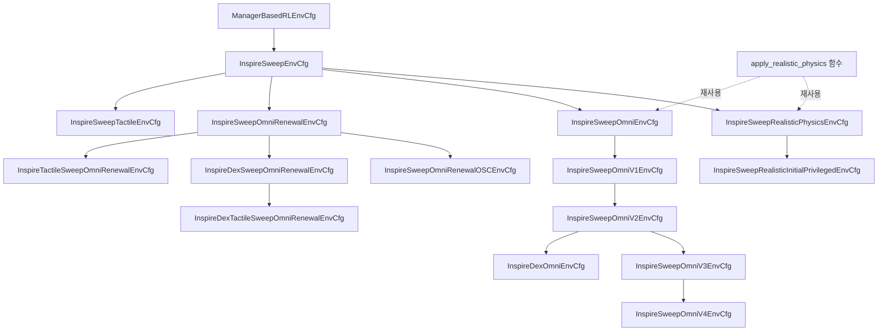

# 활성 패키지와 환경 구현 현황

[문서 안내](../01_plan/README.md) · [Workspace 구성](../00_guidelines/10_WORKSPACE_GUIDE.md) · [개발 지침](../00_guidelines/09_DEVELOPMENT_GUIDE.md) · [과거 코드·장비 기록](07_CODE_AND_HARDWARE_STATUS.md)

기준일: **2026-10-15**. 이 문서는 현재 Workspace의 활성 코드를 읽어 확인한 구성, 상속 관계와 실행 방법을 기록한다. 과거 구현 보고나 발표 설계와 실제 코드가 다르면 이 문서의 코드 근거를 함께 확인한다. 코드가 존재한다는 사실, CPU 테스트 통과, 학습 성능, 실물 검증은 각각 별개의 확인 수준이다.

[학습 실행 UML](../03_assets/inspire-sweep-training.html)은 환경 생성부터 Isaac Lab step과 PPO 업데이트까지를, [환경 상속 UML](../03_assets/inspire-sweep-inheritance.html)은 네 Cfg의 상속과 공유 물성·MDP term 연결을 보여준다. HTML 파일은 브라우저에서 열며, 표와 코드 링크에서 정확한 설정·함수 이름을 확인할 수 있다.

## 1. 두 활성 패키지의 역할

| 패키지 | 역할 | 실행 단위와 의존성 |
| --- | --- | --- |
| [`src/inspire_sweep_baseline`](../../../src/inspire_sweep_baseline/README.md) | UR5e–Axia80 모티브 하우징–Inspire Hand의 단일 실린더 Sweeping RL 환경과 파생 실험 | Isaac Lab의 Manager-based RL, Isaac Sim, Torch, Gymnasium, RSL-RL. 로봇 USD와 MDP 함수는 패키지 내부에 포함 |
| [`src/axia80_feasibility`](../../../src/axia80_feasibility/README.md) | 고정 조인트 반력을 이용한 F/T 하중·모멘트 모델 및 측정 경로 검증 | Isaac Lab의 벡터화된 물리 Scene을 직접 실행. NumPy·SciPy·xacro·Matplotlib. PPO 학습 환경이나 Gym task 등록 패키지가 아님 |

두 패키지는 Python `pyproject.toml`로 구성되어 있다. ROS2 패키지 빌드만으로 설치되는 구조로 해석하지 않는다. 제공 스크립트가 자신의 패키지 경로를 `sys.path`에 추가하므로 checkout에서 직접 실행할 수 있다.

나머지 `src` 항목은 `src/trash`에 보관하고 `COLCON_IGNORE`로 ROS2 빌드 검색에서 제외한다. 이 중 [`Universal_Robots_ROS2_Description`](../../../src/trash/Universal_Robots_ROS2_Description)은 Axia80 시험이 UR5e xacro·mesh·설정 파일을 읽는 **보관 자산 의존성**이다. 해당 ROS 패키지를 빌드하거나 실행한다는 의미는 아니다. 자산 원본까지 삭제하면 Axia80 모델 생성이 불가능하다.

## 2. RL 환경 등록과 상속 구조

등록 근거는 [`inspire_sweep_baseline/__init__.py`](../../../src/inspire_sweep_baseline/inspire_sweep_baseline/__init__.py)다. 아래 task의 실행 클래스는 모두 [`InspireSweepEnv`](../../../src/inspire_sweep_baseline/inspire_sweep_baseline/env.py)이며 `ManagerBasedRLEnv`를 상속한다. 환경별 차이는 등록된 Cfg와 PPO 설정에서 결정한다.

| Gym task ID | 환경 Cfg | PPO Cfg | 기본 로그 폴더 |
| --- | --- | --- | --- |
| `Isaac-Inspire-Sweep-Baseline-v0` | `InspireSweepEnvCfg` | `InspireSweepPPORunnerCfg` | `logs/rsl_rl/inspire_sweep_baseline` |
| `Isaac-Inspire-Sweep-Realistic-Physics-v0` | `InspireSweepRealisticPhysicsEnvCfg` | `InspireSweepRealisticPhysicsPPORunnerCfg` | `logs/rsl_rl/inspire_sweep_realistic_physics` |
| `Isaac-Inspire-Sweep-Realistic-Physics-Initial-Privileged-v0` | `InspireSweepRealisticInitialPrivilegedEnvCfg` | `InspireSweepRealisticInitialPrivilegedPPORunnerCfg` | `logs/rsl_rl/inspire_sweep_realistic_initial_privileged` |
| `Isaac-Inspire-Sweep-Omni-v0` | `InspireSweepOmniEnvCfg` | `InspireSweepPPORunnerCfg` | Baseline과 동일. CLI로 `inspire_sweep_omni` 지정 권장 |
| `Isaac-Inspire-Sweep-Omni-v1` | `InspireSweepOmniV1EnvCfg` | `InspireSweepPPORunnerCfg` | Baseline과 동일. CLI로 `inspire_sweep_omni_v1` 지정 권장 |
| `Isaac-Inspire-Sweep-Omni-v2` | `InspireSweepOmniV2EnvCfg` | `InspireSweepPPORunnerCfg` | Baseline과 동일. CLI로 `inspire_sweep_omni_v2` 지정 권장 |
| `Isaac-Inspire-Sweep-Omni-v3` | `InspireSweepOmniV3EnvCfg` | `InspireSweepPPORunnerCfg` | Baseline과 동일. CLI로 `inspire_sweep_omni_v3` 지정 권장 |
| `Isaac-Inspire-Sweep-Omni-v4` | `InspireSweepOmniV4EnvCfg` | `InspireSweepPPORunnerCfg` | Baseline과 동일. CLI로 `inspire_sweep_omni_v4` 지정 권장 |
| `Isaac-Inspire-Sweep-Omni-Renewal-v0` | `InspireSweepOmniRenewalEnvCfg` | `InspireSweepPPORunnerCfg` | CLI로 `inspire_sweep_omni_renewal` 지정 권장 |
| `Isaac-Inspire-Sweep-Omni-Renewal-OSC-v0` | `InspireSweepOmniRenewalOSCEnvCfg` | `InspireSweepPPORunnerCfg` | CLI로 `inspire_sweep_omni_renewal_osc` 지정 권장 |
| `Isaac-Inspire-Dex-Sweep-Omni-Renewal-v0` | `InspireDexSweepOmniRenewalEnvCfg` | `InspireSweepPPORunnerCfg` | CLI로 `inspire_dex_sweep_omni_renewal` 지정 권장 |
| `Isaac-Inspire-Tactile-Sweep-Omni-Renewal-v0` | `InspireTactileSweepOmniRenewalEnvCfg` | `InspireTactileSweepOmniRenewalPPORunnerCfg` | `logs/rsl_rl/inspire_tactile_sweep_omni_renewal` |
| `Isaac-Inspire-Dex-Tactile-Sweep-Omni-Renewal-v0` | `InspireDexTactileSweepOmniRenewalEnvCfg` | `InspireDexTactileSweepOmniRenewalPPORunnerCfg` | `logs/rsl_rl/inspire_dex_tactile_sweep_omni_renewal` |
| `Isaac-Inspire-Dex-Omni-v0` | `InspireDexOmniEnvCfg` | `InspireSweepPPORunnerCfg` | Baseline과 동일. CLI로 `inspire_dex_omni` 지정 권장 |
| `Isaac-Inspire-Sweep-Baseline-Tactile-v0` | `InspireSweepTactileEnvCfg` | `InspireSweepTactilePPORunnerCfg` | `logs/rsl_rl/inspire_sweep_tactile` |



Omni는 Realistic Physics Cfg의 자식이 아니다. Baseline Cfg를 직접 상속하면서 `apply_realistic_physics()`와 Realistic Physics의 Event Cfg를 재사용한다. Initial-Privileged는 Realistic Physics Cfg를 상속하며 관측 경로를 바꾼다. Dex Omni는 Omni v2에서 보상 두 항만 바꾸며, 보상 설정의 상속은 `OmniRewardsCfg → OmniV2RewardsCfg → DexOmniRewardsCfg`다.

PPO 상속은 `RslRlOnPolicyRunnerCfg → InspireSweepPPORunnerCfg → InspireSweepRealisticPhysicsPPORunnerCfg → InspireSweepRealisticInitialPrivilegedPPORunnerCfg`다. Realistic Physics는 실험 폴더 이름을, Initial-Privileged는 폴더 이름과 actor/critic 관측 그룹 연결을 변경한다. Omni는 Baseline PPO 클래스를 그대로 등록한다.

### 2.1 Manager와 코드의 책임

| 구성 | 책임 | 주요 구현 |
| --- | --- | --- |
| Scene | 로봇·선반·실린더, EEF·가상 finger/wrist frame, 손바닥 ContactSensor 구성 | [`env_cfg.py`](../../../src/inspire_sweep_baseline/inspire_sweep_baseline/env_cfg.py), `assets/` |
| Action Manager | Arm 6개 관절 위치 명령, Hand 굽힘·엄지 opposition 2개 입력의 관절 매핑 | `ActionsCfg`, [`mdp/actions.py`](../../../src/inspire_sweep_baseline/inspire_sweep_baseline/mdp/actions.py) |
| Observation Manager | 관측 순서·노이즈, 초기 물체 위치 캐시, critic의 privileged 관측 | `ObservationsCfg`, [`mdp/asymmetric_observations.py`](../../../src/inspire_sweep_baseline/inspire_sweep_baseline/mdp/asymmetric_observations.py) |
| Command Manager | 리셋된 물체 상태를 저장하고 에피소드 동안 고정된 목표 위치·자세 유지 | [`mdp/commands.py`](../../../src/inspire_sweep_baseline/inspire_sweep_baseline/mdp/commands.py) |
| Event Manager | 기본 Scene 리셋, 물체·목표 샘플링, startup 물성 버퍼 준비와 에피소드 물성 변경 | `mdp/events.py`, `mdp/goal_events.py`, `mdp/realistic_physics.py` |
| Reward Manager | 보상 term에 가중치와 제어 주기 적용, 상태를 갖는 접근·목표 진척 계산 | `mdp/rewards.py`, `mdp/goal_rewards.py`, `mdp/dex_rewards.py` |
| Termination Manager | 시간 제한, 실패, Omni의 안정된 목표 도달 및 유지 시간 검사 | `mdp/terminations.py`, `mdp/goal_terminations.py` |
| 환경 실행 클래스 | Manager가 사용할 target·sensor 상태 준비, 리셋된 센서값 무효화, Hand action 이력을 OPEN으로 초기화 | `InspireSweepEnv` |
| PPO runner·스크립트 | task 등록과 Cfg 로딩, CLI override, rollout·체크포인트·영상 기록 | `agents/`, [`scripts/train.py`](../../../src/inspire_sweep_baseline/scripts/train.py), [`scripts/play.py`](../../../src/inspire_sweep_baseline/scripts/play.py) |

물리 주기는 0.01초, decimation은 2, 정책 제어 주기는 0.02초(50 Hz), 최대 에피소드는 10초다. 파생 환경 모두 Baseline의 이 설정을 사용한다.

### 2.2 현재 관측·제어와 연구 목표의 차이

| 환경 | Actor | Critic | 변경 내용 |
| --- | --- | --- | --- |
| Baseline | 현재 물체 위치를 포함한 `policy` 41D | 같은 41D | 단일 1 kg 실린더, 좌/우 18 cm 목표, Reaching과 Homing 포함 |
| Realistic Physics | Baseline과 같은 41D | 같은 41D | 질량·마찰 랜덤화와 생성 시 접촉 재질 바인딩 |
| Initial-Privileged | 물체 위치 3D만 에피소드 초기 측정값으로 고정한 41D | `policy` 41D + 현재 물체 상태 13D = 54D | 초기 위치 관측 오차를 리셋당 한 번 샘플링. Critic은 현재 위치·quaternion·선속도·각속도를 사용 |
| Omni | Baseline과 같은 현재 물체 위치 포함 41D | 같은 41D | 원판 스폰, 전방향 목표, 목표 거리 비용·접근 진척·성공/실패 보상·안정 성공 종료 |
| Omni v1 | Omni v0와 같은 41D | 같은 41D | Arm 속도 종료 기준만 변경. 현재 3.0 rad/s |
| Omni v2 | Omni v1과 같은 41D | 같은 41D | 현재 물체 접근·XY 목표 거리의 최소 기록 갱신을 초기 거리로 정규화해 보상. 시간·성공·실패 보상과 성공 종료 제거 |
| Omni v3 | 현재 물체 위치 포함 41D | 같은 41D | 높이 조건부 XY 접근 진행 보상 |
| Omni v4 | 현재 물체 위치 포함 41D | 같은 41D | V3 상속, Arm 속도 5.0·물체 속도 0.5 종료, 외곽·성공 종료 제거, 제곱 pushing 속도 비용 |
| Sweep Omni Renewal | 현재 물체 위치 포함 41D | 같은 41D | V4와 같은 전체 동작을 Baseline에서 명시적으로 재구성 |
| Dex Sweep Omni Renewal | 현재 물체 위치 포함 41D | 같은 41D | Renewal 상속, Dex 접근·목표 보상과 지수 속도 비용 |
| Dex Omni | Omni v2와 같은 41D | 같은 41D | 과거 최소 접근·목표 거리를 새로 줄인 실제 거리(m)에 보상. 초기 거리 정규화 제거; 나머지 설정은 v2 상속 |
| Baseline Tactile | 17개 tactile bit를 포함한 `policy` 57D | 같은 57D | 원본 충돌 형상 유지, 직접 pad 접촉과 부모 접촉점의 센서 영역 분류 |

41D의 순서는 Arm 상대 위치 6, 상대 속도 6, 직전 Action 8, 물체 위치 3, 반지름 1, EEF pose 7, 목표 위치 3, 손바닥 접촉 1, EEF wrench 6이다. 기존 환경의 접촉 관측은 손바닥 **한 영역**의 Boolean이다. 새 Baseline Tactile은 이 위치의 1D만 17D로 교체하여 57D가 된다. 실물의 압력·변형 모델을 재현한 것은 아니다. F/T는 고정 조인트 반력을 EEF 좌표·기준점으로 변환한 값으로, tare나 중력 보상을 적용하지 않는다. 리셋 직후 오래된 센서값은 0으로 마스킹한다.

모든 환경의 Action은 **Arm Joint Position 6D + Hand openness 2D = 8D**다. Arm 목표는 초기 관절 위치에 `0.5 × action`을 더한 값이다. Hand 입력은 `[0, 1]`로 제한해 12개 관절에 매핑하며, 1이 편 상태다. 현재 활성 코드에서 Arm OSC 또는 Diff-IK 제어를 확인한 것은 아니다.

Baseline·Realistic Physics·Omni의 actor는 실행 중 물체 GT 위치를 받는다. 따라서 이 환경들의 학습 성과를 그대로 최종 Blind 정책 성과라고 쓰면 안 된다. Initial-Privileged는 초기 위치 actor/현재 상태 critic을 구분한 실험이지만, 실물 센싱·초기 perception·접근 완료 후 시작 조건까지 검증했다는 뜻은 아니다. 현재 초기 관절에서 접근하는 시험 환경과 연구의 접근 후 하위 정책 설계를 구분한다.

### 2.3 파생 환경의 중요한 동작

Realistic Physics의 물체 질량은 평균 0.365 kg, 표준편차 0.0675 kg의 Gaussian을 0.230–0.500 kg로 제한한다. 선반·물체·Hand의 정적/동적 마찰은 역할별 유한 재질 풀에서 리셋마다 샘플링한다. 질량과 마찰 정답을 actor 관측에 추가하지 않는다. Arm 및 Axia80 하우징의 마찰과 기존 restitution은 유지한다. 근거는 [`realistic_physics_env_cfg.py`](../../../src/inspire_sweep_baseline/inspire_sweep_baseline/realistic_physics_env_cfg.py)와 [`mdp/realistic_physics.py`](../../../src/inspire_sweep_baseline/inspire_sweep_baseline/mdp/realistic_physics.py)다.

Omni 계열은 선반 중앙의 반지름 2 cm 원판에서 물체를 스폰하고 임의 수평 방향으로 최대 15 cm 목표를 정한다. 가장자리 여유가 부족하면 목표 이동 거리를 줄인다. Omni v0/v1은 목표 오차 1 cm 미만, 평면 속도 2 cm/s 미만, 기울기 10° 이하, 기하학적으로 추정한 상판 지지 및 실패 없음이 0.3초 연속 유지되면 성공으로 종료한다. v2와 Dex Omni는 `terminations.success=None`으로 이 성공 종료를 사용하지 않는다. Homing을 요구하지 않는다. v0/v1의 보상·실패 임계값과 각 항의 단위는 [Omni 환경 상세](environments/OMNI_ENVIRONMENT.md)에, 그 설계 제안은 [보상 초안](../01_plan/environments/OMNI_REWARD_PLAN.md)에 보존한다.

Omni v2의 접근·목표 보상은 각각 초기 유효 거리로 정규화한 최소 기록 개선량에 +30/+40을 곱한다. 접근은 현재 물체 바닥 원점과 EEF의 XYZ 거리에서 10 cm를, 목표는 물체–목표 XY 거리에서 1 cm를 뺀 양의 부분을 사용한다. 시간·성공·실패 보상은 `None`이며, 실패·시간 제한 종료는 v1과 같다. 근거는 [`omni_env_cfg.py`](../../../src/inspire_sweep_baseline/inspire_sweep_baseline/omni_env_cfg.py)다.

Dex Omni의 [`dex_omni_env_cfg.py`](../../../src/inspire_sweep_baseline/inspire_sweep_baseline/dex_omni_env_cfg.py)는 같은 거리 정의에 `DexReachProgress`(+30 reward/m)와 `DexPlanarGoalProgress`(+300 reward/m)를 적용한다. 각 step에서 `max(직전 최소 거리 − 현재 거리, 0)`을 지급하고 기록을 갱신하며, 초기 거리로 정규화하지 않는다. 함수 내부의 `/step_dt`는 RewardManager의 시간 곱셈을 상쇄한다. 따라서 대기·후퇴·기존 최소 거리 복귀에는 추가 보상이 없고, 새로 1 cm를 줄이면 접근 +0.3 또는 목표 이동 +3을 받는다. 기록은 환경별 리셋 시 초기화한다.

DexTouch IV-B 식 (1)과 식 (2)의 목표 거리 항(PDF 4쪽, 인쇄 페이지 10775)에서 과거 최고 상태 갱신에만 보상하는 원칙을 가져왔다. 논문의 손가락별 거리 합은 기존 고정 EEF의 접근 거리로 대체하고, grasp·lift·rotation 태스크와 L1 관절 속도 비용은 도입하지 않는다. **30/300은 논문 계수가 아닌 Sweeping 실험 기본값**이다. 원문 대응·검증·미실행 항목은 [Dex Omni 개발 로그](logs/2026-10-15_dex_omni_rewards.md)를 따른다.

Dex Omni는 v2의 Arm action rate/velocity 비용(각각 −0.03, 제곱합), Hand action rate/velocity 비용(−0.03/−0.01, 제곱평균), 물체 기울기(−2)·선반 충돌(−0.5) 비용을 유지한다. 선반 이동·충돌을 포함한 모든 종료 조건, 성공 종료 없음, 단일 실린더(반지름 4 cm·높이 10 cm), 물체·목표 스폰, 물성, 관측·제어·PPO도 상속한다. 이 변경은 실제 학습 성능 향상을 검증한 결과가 아니다.

## 3. RL 학습·재생 명령

Baseline Tactile은 로봇·물체·스폰·보상·종료·제어를 Baseline에서 상속하고 관측만 17채널 tactile로 바꾼다. 원본 USD·URDF·mesh를 수정하지 않았고 collider나 physics body를 추가하지 않았다. 직접 패드 접촉 외에 기존 부모 body의 실제 개별 접촉점을 원본 패드 footprint에 분류해 가려진 영역을 보완한다. [센서 순서·설정·한계](environments/TACTILE_ENVIRONMENT.md)와 [구현·검증 로그](logs/2026-10-14_baseline_tactile17.md)에 근거를 기록한다. PPO는 Baseline의 수치를 그대로 상속하고 로그 이름만 구분한다.

2026-10-15 경고 수정 이후 부모 접촉점의 GPU 필터는 지원되는 실린더 하나로 제한한다. 17개 직접 pad의 unfiltered 접촉과 실린더에 대한 17개 영역 분류는 유지하며, 부모 링크의 선반·바닥 접촉은 이 보완 경로로 읽지 않는다. Tactile 환경에서만 EEF 좌표축 디버그 표시를 비활성화한다. 관측은 계속 57D이고 기존 physics 설정은 유지한다. [원인·회귀 검증](logs/2026-10-15_tactile_gpu_filter_fix.md)을 참고한다.

```bash
./IsaacLab/isaaclab.sh -p src/inspire_sweep_baseline/scripts/train.py \
  --task Isaac-Inspire-Sweep-Baseline-Tactile-v0 \
  --num_envs 2048 --sweep-direction both --run_name tactile17 --headless

./IsaacLab/isaaclab.sh -p src/inspire_sweep_baseline/scripts/play.py \
  --task Isaac-Inspire-Sweep-Baseline-Tactile-v0 \
  --num_envs 1 --checkpoint "<57D_tactile_checkpoint.pt>" --real-time
```

Omni v1은 v0를 상속하고 `hand_velocity`라는 이름의 Arm 6개 관절 속도 종료 기준만 변경한다. 최초 추가값은 2.0 rad/s였으며 현재 코드는 3.0 rad/s다. 현재 v1은 절대 속도 3.0 rad/s 초과 시 종료하며 v0는 1.0 rad/s를 유지한다. 관측·행동·보상·actuator 설정·스폰·목표·물성·나머지 종료 조건·PPO는 v0와 동일하다. [추가 당시 로그](logs/2026-10-14_omni_v1_arm_velocity.md)의 과거 값과 현재 코드를 구분한다. 상단 HTML UML은 v1 추가 이전의 네 Cfg 스냅샷이다.

Omni v0와 v1의 Arm 비용은 후속 사용자 요청으로 Baseline 수준에 맞췄다. Action 변화는 `−0.03 × sum(Δaction_arm²)`, 관절 속도는 `−0.03 × sum(qdot_arm²)`다. 이전 Omni 대비 각각 6배/18배 강화되며 당시 Hand 비용은 평균 방식이었으며, 2026-10-15 아래 공통 규칙으로 대체했다. [보상 변경·검증 로그](logs/2026-10-14_omni_arm_costs_baseline.md)에 실제 검사와 미실행 범위를 기록했다.

```bash
./IsaacLab/isaaclab.sh -p src/inspire_sweep_baseline/scripts/train.py \
  --task Isaac-Inspire-Sweep-Omni-v1 --num_envs 2048 \
  --experiment_name inspire_sweep_omni_v1 \
  --run_name centered_spawn_goal15cm_arm3rad --headless

./IsaacLab/isaaclab.sh -p src/inspire_sweep_baseline/scripts/play.py \
  --task Isaac-Inspire-Sweep-Omni-v1 --num_envs 1 \
  --checkpoint /home/min/7cmdehdrb/grad/logs/TEMP/2026-10-14_16-16-28_centered_spawn_goal15cm/model_4100.pt \
  --real-time
```

아래 명령은 **Workspace 루트에서 실행**한다. 선반 자산을 읽을 수 있는 Isaac Lab/Isaac Sim 환경이 필요하다. `train.py`는 RSL-RL 최소 버전 `3.0.1`을 검사한다. 패키지의 pip 의존성 목록만으로 Isaac Sim 전체 설치가 완료되는 것은 아니다.

Omni v2와 Dex Omni도 기존 runtime·PPO를 사용한다. 다음 명령의 `--experiment_name`으로 로그를 구분하고 전방향 목표와 충돌하는 `--sweep-direction`은 생략한다. 이 명령은 실행 안내이며 이번 변경에서 실제 train/play를 수행했다는 뜻은 아니다.

```bash
# 초기 거리로 정규화한 최고 기록 보상
./IsaacLab/isaaclab.sh -p src/inspire_sweep_baseline/scripts/train.py \
  --task Isaac-Inspire-Sweep-Omni-v2 --num_envs 2048 \
  --experiment_name inspire_sweep_omni_v2 \
  --run_name live_reach30_sweep40 --headless

./IsaacLab/isaaclab.sh -p src/inspire_sweep_baseline/scripts/play.py \
  --task Isaac-Inspire-Sweep-Omni-v2 --num_envs 1 \
  --experiment_name inspire_sweep_omni_v2 \
  --checkpoint "<v2-checkpoint.pt>" --real-time

# 실제 개선 거리(m)에 비례하는 DexTouch 방식 보상
./IsaacLab/isaaclab.sh -p src/inspire_sweep_baseline/scripts/train.py \
  --task Isaac-Inspire-Dex-Omni-v0 --num_envs 2048 \
  --experiment_name inspire_dex_omni \
  --run_name dex_best_distance --headless

./IsaacLab/isaaclab.sh -p src/inspire_sweep_baseline/scripts/play.py \
  --task Isaac-Inspire-Dex-Omni-v0 --num_envs 1 \
  --experiment_name inspire_dex_omni \
  --checkpoint "<dex-omni-checkpoint.pt>" --real-time
```

```bash
# Baseline
./IsaacLab/isaaclab.sh -p src/inspire_sweep_baseline/scripts/train.py \
  --task Isaac-Inspire-Sweep-Baseline-v0 --num_envs 2048 \
  --sweep-direction both --run_name baseline --headless

# 질량·마찰 랜덤화
./IsaacLab/isaaclab.sh -p src/inspire_sweep_baseline/scripts/train.py \
  --task Isaac-Inspire-Sweep-Realistic-Physics-v0 --num_envs 2048 \
  --sweep-direction both --run_name realistic_mass_friction --headless

# 초기 위치 Actor + privileged Critic
./IsaacLab/isaaclab.sh -p src/inspire_sweep_baseline/scripts/train.py \
  --task Isaac-Inspire-Sweep-Realistic-Physics-Initial-Privileged-v0 \
  --num_envs 2048 --sweep-direction both \
  --run_name realistic_initial_privileged --headless

# 전방향 목표
./IsaacLab/isaaclab.sh -p src/inspire_sweep_baseline/scripts/train.py \
  --task Isaac-Inspire-Sweep-Omni-v0 --num_envs 2048 \
  --experiment_name inspire_sweep_omni --run_name omni_goal15cm --headless
```

앞의 세 환경은 `--sweep-direction left` 또는 `right`로 방향을 고정할 수 있다. Omni에 해당 옵션을 전달하면 오류가 발생하므로 생략한다. Omni의 PPO 기본 로그 폴더는 Baseline과 같아 `--experiment_name`으로 구분한다.

재생은 학습과 동일한 task ID 및 해당 관측 차원으로 학습한 체크포인트를 선택한다. 다음 예의 task를 위 등록 표의 다른 ID로 바꾸면 해당 환경을 재생한다.

```bash
./IsaacLab/isaaclab.sh -p src/inspire_sweep_baseline/scripts/play.py \
  --task Isaac-Inspire-Sweep-Omni-v0 --num_envs 1 \
  --checkpoint "<checkpoint.pt>"

# 한 개 영상 기록 후 종료
./IsaacLab/isaaclab.sh -p src/inspire_sweep_baseline/scripts/play.py \
  --task Isaac-Inspire-Sweep-Omni-v0 --num_envs 1 \
  --checkpoint "<checkpoint.pt>" --video --video_length 500 --headless
```

학습 run은 `logs/rsl_rl/<experiment_name>/<timestamp>_<run_name>`에 저장한다. 학습 스크립트가 저장하는 `params/env.yaml`, `params/agent.yaml`과 실제 명령, seed, 코드 상태를 함께 기록해야 재현할 수 있다. 영상은 run의 `videos/train` 또는 체크포인트 디렉터리의 `videos/play`에 저장한다.

선반 자산은 `INSPIRE_SWEEP_SHELF_USD_PATH`로 USD 경로를 직접 지정하거나 `INSPIRE_SWEEP_ASSET_ROOT`로 자산 root를 지정한다. 기존 `SWEEP_POLICY_*` 변수도 호환하지만 Sweep-Policy 패키지를 import하지는 않는다. 경로 선택의 근거는 [`assets/paths.py`](../../../src/inspire_sweep_baseline/inspire_sweep_baseline/assets/paths.py)다. 자산을 바꾸면 Omni가 가정한 상판 크기·높이도 함께 확인한다.

## 4. Axia80 하중 진단 구성과 실행

Axia80 시험은 Manager-based RL 환경 상속 구조가 없다. `model.py`의 UR5e 모델 확장·공통 형상 함수를 cantilever 변형이 재사용하고, tilted/wrist 변형이 `build_cantilever_model()`을 호출한다. 기본 [`scene.py`](../../../src/axia80_feasibility/axia80_feasibility/scene.py)의 Scene 팩토리를 tilted/wrist Scene 팩토리가 재사용하며 접촉 마찰을 변경한다. 공통 모델과 수치 처리, Scene 구성, 실행 스크립트가 분리되어 있다.

| 시험 | 실행 스크립트 | 확인하려는 반응 |
| --- | --- | --- |
| 수평 넓은 면 장착 | `run_payload_test.py` | 10–500 g 하중의 `Fz ≈ mg`, tare 및 안정화 |
| 얇은 끝면 cantilever 장착 | `run_cantilever_payload_test.py` | 수직 하중의 `Fx`와 레버 암에 따른 `My` |
| wrist3 +10° cantilever | `run_tilted_cantilever_payload_test.py` | 경사에 따른 힘·모멘트 축 분산과 미끄럼·상대 자세 |
| 고정 500 g Roll × Tilt | `run_wrist_angle_sweep.py` | 기본 5 × 5 각도 격자에서 실제 자세 기반 6축 예측과 측정 비교 |

현재 코드의 네 시험을 다시 실행하는 명령이다. 새로운 출력 디렉터리를 지정해 기존 실험 결과와 구분한다. `--strict`는 측정 후 수용 지표가 실패하면 non-zero exit code를 반환하게 한다.

```bash
./IsaacLab/isaaclab.sh -p src/axia80_feasibility/scripts/run_payload_test.py \
  --headless --device cuda:0 --strict \
  --output_dir src/axia80_feasibility/results/payload_rerun_20261014

./IsaacLab/isaaclab.sh -p src/axia80_feasibility/scripts/run_cantilever_payload_test.py \
  --headless --device cuda:0 --strict \
  --output_dir src/axia80_feasibility/results/cantilever_rerun_20261014

./IsaacLab/isaaclab.sh -p src/axia80_feasibility/scripts/run_tilted_cantilever_payload_test.py \
  --headless --device cuda:0 --strict \
  --output_dir src/axia80_feasibility/results/tilted_rerun_20261014

./IsaacLab/isaaclab.sh -p src/axia80_feasibility/scripts/run_wrist_angle_sweep.py \
  --headless --device cuda:0 --strict \
  --output_dir src/axia80_feasibility/results/wrist_rerun_20261014
```

각 스크립트의 기본 출력 경로와 모든 CLI 인자는 소스·패키지 README를 확인한다. 출력에는 summary CSV, 개별 sample CSV, 그래프, 모델/실행 metadata가 포함되며 변형별 run log도 기록된다. 모델 생성 파일은 `src/axia80_feasibility/generated/`에 저장한다. 정적 반력의 수용 판정과 실물 Axia80의 노이즈·캘리브레이션·대역폭·지연 검증은 구분한다.

`generated/`는 다시 만들 수 있는 URDF/USD 캐시다. URDF에는 mesh의 절대 경로가 들어가므로 Workspace나 보관 자산 경로가 바뀌면 모델을 다시 생성해야 한다. 실행 스크립트는 모델 생성 함수를 먼저 호출한다. 기존 USD 캐시까지 재변환해야 할 때는 `--force_conversion`을 추가한다.

## 5. 확인한 테스트와 남은 검증

2026-10-14에 아래 명령으로 활성 패키지 관련 CPU·모델·USD 계약 검사를 실행했다. 결과는 **114 passed, 17 subtests passed**였다. 테스트는 실제 MDP 수치 함수, RSL-RL의 actor/critic 입력 연결, 초기 위치 캐시·리셋, 보상·종료, 물성 설정, 로컬 USD 자산, Axia80 URDF·측정 수치 및 산출물 계약을 확인한다. Isaac Sim 학습 실행이나 실물 시험을 대신하지 않는다.

```bash
env -u PYTHONPATH -u ROS_PACKAGE_PATH -u AMENT_PREFIX_PATH \
  PYTEST_DISABLE_PLUGIN_AUTOLOAD=1 PYTHONDONTWRITEBYTECODE=1 \
  /home/min/miniconda3/envs/env_isaaclab/bin/python -B -m pytest \
  -q -p no:cacheprovider src/inspire_sweep_baseline/tests \
  tests/test_axia80_feasibility.py \
  tests/test_axia80_cantilever_feasibility.py \
  tests/test_axia80_tilted_cantilever.py \
  tests/test_axia80_wrist_angle_sweep.py
```

이 Workspace의 일반 shell에는 ROS 환경이 섞일 수 있다. 최초 실행에서는 ROS `launch_testing` pytest plugin의 `lark` 의존성 누락으로 테스트 수집 전 실패했다. 위 명령은 ROS 검색 경로를 제거하고 pytest 외부 plugin 자동 로딩을 차단해 별도 환경 설치 변경 없이 검증한다.

USD 검사에는 `pxr`를 제공하는 Python이 필요하다. 기본 탐색 경로가 없으면 테스트가 skip되며, `INSPIRE_SWEEP_USD_TEST_PYTHON`으로 해당 Python 실행 파일을 지정할 수 있다. Baseline 설정 비교 테스트는 `example/Sweep-Policy`의 기존 Cfg를 읽으므로 reference submodule이 초기화되어 있어야 한다.

이번 문서 정리에서는 네 RL task의 실제 시뮬레이터 생성, GPU 물성 업데이트, 선반 자산 서버 접속, train/play, 새 checkpoint 성능, Axia80 하중 시뮬레이션 재실행, 실물 센서·로봇 제어를 수행하지 않았다. 관련 과거 결과는 [실험 문서 목록](../01_plan/README.md)과 저장된 metadata·로그를 확인하되, 이번 테스트 결과와 혼합하지 않는다.

이동과 자산 경로 수정 이후 루트 `pytest.ini`의 기본 탐색으로 Scene 기하 검사까지 함께 실행한 결과는 **135 passed, 26 subtests passed**였다. 최종 명령과 Workspace 제외 검증은 [정리 개발 로그](logs/2026-10-14_workspace_cleanup.md)에 기록한다.

## 6. 다음 변경에서 남길 개발 기록

환경을 추가하거나 변경할 때는 task ID, runtime 클래스, Cfg 부모, 재사용한 함수·Manager term, actor/critic 관측 차원과 GT 범위, Action 의미, 제어 주기, 보상·종료 차이를 함께 기록한다. 새 task를 등록하는 것만으로 별도 PPO 설정이나 로그 폴더가 생기는 것은 아니다.

실험 기록에는 실제 실행 명령, seed, 코드 상태·submodule revision, 적용 YAML, run·checkpoint·산출물 경로, 수행한 검증과 수행하지 않은 검증을 남긴다. 작성 형식과 OOP·Manager 경계는 [개발 지침](../00_guidelines/09_DEVELOPMENT_GUIDE.md), 문서의 보관 위치는 [Workspace 안내](../00_guidelines/10_WORKSPACE_GUIDE.md)를 따른다.

## v2 보상 계약

현재 EEF 위치를 `e_t`, 현재 물체 바닥 중심을 `p_t`, reset 거리를 `D_0`라고 할 때:

```math
D_t = \max(\|e_t-p_t\|_2-0.10,0)
```

```math
B_t = \min(B_{t-1},D_t), \qquad R_{\mathrm{reach},t}=30\frac{B_{t-1}-B_t}{\max(D_0,10^{-6})}
```

`B_0=D_0`이다. 누적 최대 +30이며 초기에 이미 10cm 이내이면 접근 보상 budget은 0이다. 물체와 EEF가 같은 거리를 유지하거나 후퇴 후 이전 기록까지만 돌아오면 지급하지 않는다. 물체가 손 쪽으로 접근해도 상대 거리 감소로 기록된다.

목표 `g`까지 초기 XY 거리를 `L_0`, 현재 거리를 `L_t`라고 할 때:

```math
Q_t=\min\left(1,\max\left(0,\frac{L_0-L_t}{\max(L_0-0.01,10^{-6})}\right)\right)
```

```math
H_t=\max(H_{t-1},Q_t), \qquad R_{\mathrm{sweep},t}=40(H_t-H_{t-1})
```

`H_0=0`이며 초기에 목표 허용 오차 안이면 보상을 지급하지 않는다. `L_0`는 reward reset 때 저장한 물체 위치와 새 episode의 목표로 계산해 command reset 순서의 영향을 피하고 첫 transition의 이동도 반영한다. 두 progress 함수는 정규화한 진전 증가량을 `step_dt`로 나눠 반환한다. RewardManager의 `weight * step_dt` 적용 후 위 지급 식이 된다.

Reaching +30과 Sweeping +40은 실험 기본값이다. 접촉 전 접근에 양의 신호를 주고, 접근 이후에는 물체 목표 진전으로 추가 보상을 얻도록 설계했다. 행동 변화·관절 속도 비용은 v1과 동일하게 상속하며 변경하지 않는다. 자세한 계수는 [패키지 안내](../../../src/inspire_sweep_baseline/README.md#omni-v2-현재-물체-접근과-목표-이동-진전)를 따른다. `time`, `success`, `failure` 보상은 `None`이다. 후속 사용자 요청에 따라 v2는 `terminations.success=None`으로 성공 종료도 제거한다. 목표 도달 후에도 계속 실행하며 실패·시간 초과 종료 조건은 유지한다. v0/v1의 성공 종료는 유지한다.


## v3: 높이 조건과 XY 접근

현재 코드에서 v2의 Reaching/Goal weight는 30/40이다. 이전 개발 로그의 200/400은 과거 구현 기록이며 병합 중 복원하지 않는다. v3는 작업 시점 v2 전체 설정을 상속하고 Reaching의 함수와 Z 파라미터만 변경한다.

`HeightGatedPlanarReachProgress`는 현재 물체 바닥 Z + 9cm를 EEF 목표 높이로 사용한다. 허용 오차 ±2cm 안에서 `max(현재 물체와 EEF의 XY 거리 − 10cm, 0)`의 episode 최소 기록을 갱신할 때만 정규화한 진전 보상을 지급한다. 초기 거리도 XY 기준이다. 9cm는 참고 Sweep 기본 Reaching의 높이 오프셋이며, 2cm는 이번 구현의 실험 허용 오차다.

높이 밖에서 만든 XY 기록도 저장하되 보상하지 않는다. 높이만 뒤늦게 맞추거나 높이 범위를 반복 출입해 과거 접근 진전을 보상받는 것을 막는다. Reaching 가중치·Goal·운동 패널티·종료 조건·PPO는 v2와 동일하다. 성공 종료 제거도 상속한다. [상세 개발 로그](logs/2026-10-15_omni_v3_height_gated_reaching.md).

```bash
./IsaacLab/isaaclab.sh -p src/inspire_sweep_baseline/scripts/train.py \
  --task Isaac-Inspire-Sweep-Omni-v3 --num_envs 2048 \
  --experiment_name inspire_sweep_omni_v3 \
  --run_name height_gated_xy_reach --headless

./IsaacLab/isaaclab.sh -p src/inspire_sweep_baseline/scripts/play.py \
  --task Isaac-Inspire-Sweep-Omni-v3 --num_envs 1 \
  --experiment_name inspire_sweep_omni_v3 \
  --checkpoint "<v3-checkpoint.pt>" --real-time
```

## Omni 공통 운동 페널티 — 2026-10-15

Omni v0/v1/v2/v3와 Dex Omni v0는 공통 `OmniRewardsCfg`의 로컬 `goal_rewards.action_rate_l2`·`joint_vel_l2`를 상속한다. Arm/Hand Action Rate는 raw 입력 변화량의 제곱합이며 각 −0.03이다. Arm 6개/Hand 12개 실제 관절 속도는 이름으로 선택한 관절의 제곱합이며 각각 −0.03/−0.01이다. 평균·정규화·Hand 보상 입력 clamp를 제거했다. 참고 환경의 runtime import는 없다. 기존 Gym 등록·실행 명령·PPO·종료 조건은 유지한다. 향후 파생에도 [개발 지침의 필수 규칙](../00_guidelines/09_DEVELOPMENT_GUIDE.md)을 적용한다. [검증 로그](logs/2026-10-15_omni_penalty_contract.md).

## Omni v4: 종료 기준 완화와 pushing 속도 비용

`Isaac-Inspire-Sweep-Omni-v4`는 `InspireSweepOmniV4EnvCfg(InspireSweepOmniV3EnvCfg)`로 등록한다. Runtime은 `InspireSweepEnv`, PPO는 `InspireSweepPPORunnerCfg`다. V3의 41D Actor/Critic 관측, 8D Joint Position/Hand action, 높이 조건부 XY reaching(+30), 목표 진행(+40), 물체·목표 스폰, 질량·마찰 및 0.02 s 정책 주기를 상속한다.

| 설정 | V4 값 |
| --- | --- |
| `hand_velocity` | Arm 6개 중 절대 관절속도 **5.0 rad/s 초과** 시 종료. 이름과 달리 Arm 대상 |
| `object_outside_shelf` | `None`, 비활성 |
| `success` | `None`, 비활성 |
| `push_fast` | 대상 물체 3D 선속도 norm **0.5 m/s 초과** 시 종료 |
| `rewards.pushing_speed` | `goal_rewards.pushing_speed_cost`, weight **−0.05**, `free_speed=0.3`, `reference_speed=0.5` |

`object_drop`, 선반 충돌·선반 이동·timeout 종료는 유지한다. 선반 외곽 종료를 제거해도 물체 낙하·전도에 대한 종료는 남는다. 이벤트의 안전 목표 영역과 스폰은 그대로다. Arm/Hand action 변화와 실제 관절속도 네 비용은 기존 함수·계수(−0.03/−0.03/−0.03/−0.01)를 유지한다.

2026-10-15 후속 요청으로 `2026-10-15_16-53-58_height_gated_xy_reach/params/env.yaml`의 공통 파라미터를 대조해 Arm 속도 threshold **5.0**을 코드에 적용했다. 기존 관측·action·actuator·접근/목표 보상·물성 설정은 저장 run과 같아 상속을 유지한다. V4 전용 물체 속도 0.5·외곽/성공 종료 비활성·속도 비용은 유지한다. [적용·검증 로그](logs/2026-10-15_omni_v4_saved_parameters.md).

물체 속도 `v`는 `push_fast`와 같은 월드 선속도 **3D norm(m/s)**이다. 새 비용 함수는 `max(v−0.3, 0)² / (0.5−0.3)²`를 반환한다. 가중치 적용 후 값은 다음과 같다.

```math
c(v)=-0.05\left(\frac{\max(v-0.3,0)}{0.2}\right)^2.
```

0.3 m/s 이하는 비용이 없고 초과 구간에서는 제곱으로 증가한다. 함수는 상한 clamp를 두지 않으므로 종료 threshold를 넘는 transition도 실제 속도의 비용을 받는다. 요청의 −0.05는 **weight 적용 후, RewardManager의 시간 곱셈 전**으로 해석했다. 기존 dense 비용과 같이 `/step_dt`로 상쇄하지 않아 실제 step 기여는 `c(v) × step_dt`다.

| 속도(m/s) | 가중치 적용 후 `c(v)` | 기본 0.02 s step 기여 |
| --- | --- | --- |
| 0.30 이하 | 0 | 0 |
| 0.35 | −0.003125 | −0.0000625 |
| 0.40 | −0.0125 | −0.00025 |
| 0.45 | −0.028125 | −0.0005625 |
| 0.50 | **−0.05** | **−0.001** |

Workspace 루트에서 실행한다. Omni에는 `--sweep-direction`을 지정하지 않는다. 다음은 실행 안내이며 이번 구현에서 train/play를 수행한 것은 아니다.

```bash
./IsaacLab/isaaclab.sh -p src/inspire_sweep_baseline/scripts/train.py \
  --task Isaac-Inspire-Sweep-Omni-v4 --num_envs 2048 \
  --experiment_name inspire_sweep_omni_v4 \
  --run_name quadratic_push_speed --headless

./IsaacLab/isaaclab.sh -p src/inspire_sweep_baseline/scripts/play.py \
  --task Isaac-Inspire-Sweep-Omni-v4 --num_envs 1 \
  --experiment_name inspire_sweep_omni_v4 \
  --checkpoint "<v4-checkpoint.pt>" --real-time
```

[추가·검증 로그](logs/2026-10-15_omni_v4_speed_penalty.md)에 실제 검사 명령과 결과를 기록했다.

### 추가 Arm 속도 페널티: `arm_speed_excess`

V4는 기존 `joint_vel_l2` 등 모든 비용을 유지하면서 `goal_rewards.joint_speed_cost`를 추가한다. `terminations.hand_velocity`와 같은 Arm 6개 관절의 실제 절대속도를 검사하며, 어느 관절이든 빠르면 비용이 발생하도록 **최대 절대속도**를 사용한다. Hand 관절은 검사 대상이 아니다.

```math
v_{\max}=\max_{j\in\mathrm{Arm}}|\dot{q}_j|,\qquad c=-0.03\left(\frac{\max(v_{\max}-1.0,0)}{2.0-1.0}\right)^2.
```

설정은 `rewards.arm_speed_excess`, weight **−0.03**, `free_speed=1.0`, `reference_speed=2.0`, `asset_cfg=_arm()`이다. 1.0 rad/s 이하는 비용 0이며 초과 구간에서 제곱으로 증가한다. 음수 속도도 절댓값으로 처리하고, 2.0 이후에도 상한 없이 증가한다.

| Arm 최대 절대속도(rad/s) | 가중치 적용 값 | 기본 0.02 s step 기여 |
| --- | --- | --- |
| 1.0 이하 | 0 | 0 |
| 1.5 | −0.0075 | −0.00015 |
| 2.0 | **−0.03** | **−0.0006** |
| 3.0 | −0.12 | −0.0024 |
| 5.0 | −0.48 | −0.0096 |

`pushing_speed_cost`와 같이 dense 비용이므로 RewardManager의 시간 곱셈을 상쇄하지 않는다. 위 −0.03은 **weight 적용 후, 시간 곱셈 전**이다. 기존 `arm_joint_velocity`는 Arm 속도 전체의 제곱합에 비용을 주고, 이 새 항은 가장 빠른 관절의 1.0 초과 구간에 추가 비용을 준다. 두 항은 함께 적용된다. 종료 기준은 기존 **5.0 rad/s 초과**로 유지하며 이 새 항 자체는 종료시키지 않는다.

[추가·검증 로그](logs/2026-10-15_omni_v4_arm_speed_excess.md).

## Omni Renewal 환경

Renewal은 Baseline 위에 장면·보상·종료·이벤트를 구성하고 현재 지수 속도 비용을 사용한다. V4와 환경 상속 체인은 별개다.

| Gym ID | 환경 설정 | 보상 설정 |
| --- | --- | --- |
| `Isaac-Inspire-Sweep-Omni-Renewal-v0` | `InspireSweepOmniRenewalEnvCfg` | `OmniRenewalRewardsCfg` |
| `Isaac-Inspire-Dex-Sweep-Omni-Renewal-v0` | `InspireDexSweepOmniRenewalEnvCfg` | `DexOmniRenewalRewardsCfg` |

환경 상속은 `InspireSweepEnvCfg → InspireSweepOmniRenewalEnvCfg → InspireDexSweepOmniRenewalEnvCfg`다. Renewal은 Baseline 장면·관측·action·command·주기 위에 `OmniRenewalEventsCfg`, `OmniRenewalRewardsCfg`, `OmniRenewalTerminationsCfg`를 구성하며, V1→V2→V3→V4의 설정 변경 체인을 상속하지 않는다. 선반 기하 상수와 기존 로컬 함수, `RealisticPhysicsEventsCfg` 및 `apply_realistic_physics`를 재사용한다. Dex Renewal은 Renewal을 직접 상속하며 Dex 접근·목표 보상과 공통 지수 속도 비용 두 항을 사용한다. 보상 Cfg 상속은 `OmniRenewalRewardsCfg → DexOmniRenewalRewardsCfg`다.

두 환경의 runtime은 `InspireSweepEnv`, PPO는 `InspireSweepPPORunnerCfg`다. Actor/Critic은 현재 물체 GT를 포함하는 같은 41D, action은 Arm Joint Position 6D + Hand 2D, 정책 주기는 0.02 s, episode 제한은 10 s다. 물체·목표 스폰과 질량·마찰, 센서·초기 상태는 현재 V4와 동일하다.

| 보상·종료 | Sweep Renewal | Dex Sweep Renewal |
| --- | --- | --- |
| `reaching` | `HeightGatedPlanarReachProgress`, +30; XY·초기 거리 정규화·Z +9 cm / ±2 cm gate | `DexReachProgress`, +30 reward/m; 3D 실제 기록 개선 거리, 높이 gate 없음 |
| `goal_distance` | `PlanarGoalProgress`, +40; 초기 목표 거리 정규화 | `DexPlanarGoalProgress`, +300 reward/m; 실제 XY 기록 개선 거리 |
| 네 필수 운동 비용 | Arm/Hand raw action 변화 제곱합 −0.03/−0.03, 실제 관절속도 제곱합 −0.03/−0.01 | 동일 |
| `object_tilt`, `shelf_collision` | 기존 함수·계수 −2.0 / −0.5 | 동일 |
| `pushing_speed` | free_speed 0.3의 지수 비용, weight −1.0 | 동일 |
| `arm_speed_excess` | 최대 Arm 절대속도, free_speed 1.0의 지수 비용, weight −1.0 | 동일 |
| Arm 속도 종료 | 최대 절대속도 5.0 rad/s 초과 | 동일 |
| 물체 속도 종료 | 3D 선속도 0.8 m/s 초과 | 동일 |
| 외곽·성공 종료 | 비활성 | 동일 |
| 기타 종료 | 물체 낙하·전도, 선반 충돌·변위, timeout 유지 | 동일 |

두 환경은 활성 reward 10개를 사용한다. 시간 비용·성공/실패 terminal reward는 비활성이다. Dense 비용에는 RewardManager가 `weight × step_dt`를 적용하며, 진행 보상 함수는 기존 구현대로 시간 곱셈을 상쇄한다. Dex Renewal의 접근·목표 두 항은 `DexOmniRewardsCfg`의 함수·가중치·params와 동일하다. 이후 부모의 `__post_init__`가 이 두 항을 높이 gate 보상으로 다시 바꾸지 않는 구조다.

Workspace 루트에서 실행한다. `--sweep-direction`은 생략한다. 기본 PPO 로그 폴더를 공유하므로 명령의 `--experiment_name`으로 구분한다.

```bash
./IsaacLab/isaaclab.sh -p src/inspire_sweep_baseline/scripts/train.py \
  --task Isaac-Inspire-Sweep-Omni-Renewal-v0 --num_envs 2048 \
  --experiment_name inspire_sweep_omni_renewal --run_name renewal_v0 --headless

./IsaacLab/isaaclab.sh -p src/inspire_sweep_baseline/scripts/play.py \
  --task Isaac-Inspire-Sweep-Omni-Renewal-v0 --num_envs 1 \
  --experiment_name inspire_sweep_omni_renewal \
  --checkpoint "<renewal-checkpoint.pt>" --real-time

./IsaacLab/isaaclab.sh -p src/inspire_sweep_baseline/scripts/train.py \
  --task Isaac-Inspire-Dex-Sweep-Omni-Renewal-v0 --num_envs 2048 \
  --experiment_name inspire_dex_sweep_omni_renewal --run_name dex_renewal_v0 --headless

./IsaacLab/isaaclab.sh -p src/inspire_sweep_baseline/scripts/play.py \
  --task Isaac-Inspire-Dex-Sweep-Omni-Renewal-v0 --num_envs 1 \
  --experiment_name inspire_dex_sweep_omni_renewal \
  --checkpoint "<dex-renewal-checkpoint.pt>" --real-time
```

위 명령은 실행 안내이며 이번 추가 작업에서 새 학습·재생을 수행하지 않았다.

코드: [Renewal 설정](../../../src/inspire_sweep_baseline/inspire_sweep_baseline/omni_renewal_env_cfg.py), [Dex Renewal 설정](../../../src/inspire_sweep_baseline/inspire_sweep_baseline/dex_omni_renewal_env_cfg.py). [구현·검증 로그](logs/2026-10-15_omni_renewal_environments.md).

## 2026-10-15 reaching 이탈 페널티 정정

`HeightGatedPlanarReachProgress`를 사용하는 Omni v3, v4, Sweep Renewal은 현재 물체와 EEF의 XY 거리에서 10cm를 뺀 값을 0 이상으로 제한한다. 이전 episode 최소 거리보다 작아지면 Z gate 안에서 보상하고, 커지면 Z gate와 관계없이 매 step 페널티를 적용한다. 10cm 이내는 모두 0이며, 물체가 움직여 반경 밖으로 나가도 이탈로 계산한다. 이전 기록 복귀에는 재보상이 없다. 위의 기존 진전 전용 설명은 이 변경으로 대체한다. Dex 계열의 별도 reaching 함수는 변경하지 않았다.

물체 원점은 바닥 중심이므로 Z offset 0.09m를 유지한다. 직립한 높이 10cm 물체의 기하학적 중심보다 4cm 위다. 초기 남은 거리로 정규화하며, 초기부터 반경 안이면 0.1m를 분모로 사용한다. 함수의 step_dt 나눗셈을 유지하므로 가중치 적용 후 이탈 페널티는 매 step 부과된다. [변경 및 검증 기록](logs/2026-10-15_reaching_regression.md).

## Renewal OSC 환경

`Isaac-Inspire-Sweep-Omni-Renewal-OSC-v0`는 `InspireSweepOmniRenewalOSCEnvCfg(InspireSweepOmniRenewalEnvCfg)`다. Arm을 Isaac Lab `OperationalSpaceControllerActionCfg`로 교체하고 부모 `OmniRenewalRewardsCfg`의 지수 속도 비용 두 항을 상속한다. 제어점은 `scene.ee_frame`의 첫 target과 같은 body(`axia80_link`), 위치 및 quaternion offset을 사용한다.

- Arm action: relative pose 6D (`pose_rel`), fixed impedance. 위치 scale 0.05m, axis-angle 회전 scale 0.1rad. task frame 미지정으로 robot root 좌표계를 사용한다.
- OSC: 모든 6축 stiffness 200, damping ratio 1, 관성 보정 및 중력 보상 사용.
- 토크 출력과 중복되지 않도록 Arm implicit actuator stiffness/damping은 0. 노력·속도 제한은 부모 설정을 상속한다.
- Hand 2D와 관측 41D, 속도 비용 두 항 외 reward, termination/event, 물성, reset, PPO는 부모와 같다. raw Arm action 페널티는 Cartesian 6D 입력 변화량에 적용된다.

Workspace 루트에서 실행:

```bash
./IsaacLab/isaaclab.sh -p src/inspire_sweep_baseline/scripts/train.py \
  --task Isaac-Inspire-Sweep-Omni-Renewal-OSC-v0 --num_envs 2048 \
  --experiment_name inspire_sweep_omni_renewal_osc --run_name renewal_osc_v0 --headless
```

Joint Position 정책과 action 의미가 달라 새 정책으로 학습한다. 현재 지수 비용 적용과 상속을 CPU에서 검증했으며 실제 실행 및 장시간 학습 검증 범위는 최신 개발 로그를 따른다.

[OSC 환경 개발 로그](logs/2026-10-15_renewal_osc.md).

### Renewal 계열 선반 종료와 목표 시각화 (2026-10-16)

`OmniRenewalTerminationsCfg`에서 `terminations.shelf_collision.params["check_fingers"] = False`를 설정한다. Renewal과 OSC·Dex Renewal을 포함한 모든 파생 환경에 적용된다. 선반 root 6D 속도 norm > 0.1 또는 손목 frame Z가 선반 root Z +1.05m 기준 7cm 미만이면 종료한다. 손가락 frame 높이는 종료에 사용하지 않는다. Renewal 계열 밖의 환경은 기본값 True로 기존 판정을 유지하며 선반 보상 항은 변경하지 않았다.

Renewal 부모의 `commands.target_goal_pos.debug_vis=True`를 모든 파생 환경이 상속하여 현재 목표 월드 위치에 반지름 2.5cm 초록색 구형 마커를 표시한다. reset 이후 command 위치를 따라 갱신되며 충돌용 형상이 아니다. 현재 사용자 설정인 OSC 위치/회전 scale 1.0/1.0은 유지했다.

## Inspire Hand 촉각 standalone 검증

2026-10-16 사용자 요청으로 새 활성 패키지 `src/inspire_tactile_validation`을 추가했다. Gym 환경이나 PPO가 아닌 Isaac Lab standalone이며, 기존 Tactile의 Hand 충돌 자산과 `ProjectedTactileContactBits`를 그대로 재사용한다. Arm 없이 고정 palm-up/open Hand에 막대를 접근·유지·복귀시키고, 17채널의 중앙·네 모서리 × 반복을 벡터화해 수집한다.

```bash
./IsaacLab/isaaclab.sh -p src/inspire_tactile_validation/scripts/run_probe_test.py \
  --num-envs 85 --repeats 3 --headless
```

기본 출력은 `outputs/inspire_tactile_validation/<날짜_시각>/`이며 원시 frame, 위치별 판정, 혼동행렬, 집계 JSON을 저장한다. 독립 막대 접촉력과 외력·가속도 평형을 함께 확인한다. 실제 255회 실행에서 검출 66회·기준 불일치 186회·오접촉 3회가 관찰되어 전체 판정은 보류다. 상세 계약은 [패키지 안내](../../../src/inspire_tactile_validation/README.md), 재현과 검증은 [개발 로그](logs/2026-10-16_tactile_validation.md)를 따른다. 기존 Tactile·Renewal 환경의 센서나 RL 설정은 변경하지 않았다.

### 촉각 검증 수정 결과 (2026-10-16)

검증 standalone의 physics/render 시간 불일치를 수정하고 무중력 조건을 명시했다. 기본 원본 패드 배치에서 255/255 trial 검출, 유효 frame 8430/8475(99.47%)를 확인했다. 선택적 `--pad-layout exposed`는 시험용 패드 부착 위치만 변경하며 255/255 trial 및 8130/8130 유효 frame 검출이었다. trial 통과와 frame 검출률을 구분한다. 기존 Sweep 자산·환경은 변경하지 않았다. [구현·명령·검증 기록](logs/2026-10-16_tactile_validation_correction.md).

### Renewal 촉각 파생 환경 (2026-10-16)

`InspireTactileSweepOmniRenewalEnvCfg`는 Sweep Renewal을, `InspireDexTactileSweepOmniRenewalEnvCfg`는 Dex Sweep Renewal을 직접 상속한다. 원본 Hand와 검증 standalone의 기본 `original` 배치 판독기를 재사용하여 tactile 1D를 17D로 교체한다. Actor/Critic policy는 57D, Action은 기존 8D다. 센서 순서는 palm → thumb 1–4 → index/middle/ring/little 각각 1–3이다.

각 패드 직접 NetForce 또는 해당 센서 영역으로 투영한 부모 접촉력 벡터합의 크기가 0.01 N 이상이면 1.0, 아니면 0.0이다. 두 경로는 OR로 결합하며 reset 직후 미갱신 행은 0이다. 직접 접촉은 모든 상대를, 부모 영역 투영은 GPU에서 지원되는 `mass_cylinder`만 읽는다. standalone의 `exposed` 배치, 무중력, 고정 자세는 RL에 적용하지 않는다. 지수 속도 비용 두 항 외 보상·종료·이벤트·제어·물성과 다른 관측은 각 부모와 같다.

```bash
./IsaacLab/isaaclab.sh -p src/inspire_sweep_baseline/scripts/train.py \
  --task Isaac-Inspire-Tactile-Sweep-Omni-Renewal-v0 \
  --num_envs 2048 --run_name tactile_renewal_v0 --headless

./IsaacLab/isaaclab.sh -p src/inspire_sweep_baseline/scripts/train.py \
  --task Isaac-Inspire-Dex-Tactile-Sweep-Omni-Renewal-v0 \
  --num_envs 2048 --run_name dex_tactile_renewal_v0 --headless
```

PPO는 부모 설정을 상속하고 위 등록 표의 기본 실험 폴더만 분리한다. 실제 GPU 검증은 각 8개 환경·1 iteration이며 양쪽 모두 완료했다. 장시간 학습·2048개 환경 성능은 미검증이다. [코드](../../../src/inspire_sweep_baseline/inspire_sweep_baseline/tactile_omni_renewal_env_cfg.py) · [개발·검증 기록](logs/2026-10-16_tactile_renewal_environments.md).

### Renewal 네 환경의 지수 속도 비용 및 v1 정리 (2026-10-16)

Sweep Renewal v0, Dex Renewal v0, Tactile Renewal v0, Dex Tactile Renewal v0 모두 Renewal 부모의 지수 비용을 사용한다. OSC도 exp다. Renewal 밖의 Omni v4는 기존 제곱 속도 비용을 유지한다. `ExponentialSpeedRewardsCfg`는 삭제했으며 `OmniRenewalRewardsCfg`가 두 exp 항을 직접 정의한다. 물체 속도 0.3m/s, Arm 6개 관절의 최대 절대 속도 1.0rad/s를 임계값으로 `expm1(2 * max(x - t, 0)) / 2`를 계산하고 두 항의 weight는 -1.0이다. 기존 RewardManager의 step_dt 곱셈을 유지한다. 임계값 이하에서 0, 초과하면 지수적으로 증가하는 비용이며 상한·reference_speed 정규화는 없다.

일반 촉각 v0와 OSC는 Renewal 부모에서, Dex 촉각 v0는 Dex 부모에서 rewards를 상속한다. 두 Tactile v1은 중복이므로 Gym ID·Cfg·전용 PPO를 삭제했다. 위의 촉각 v0 명령으로 학습한다. 각 환경의 하위 클래스도 지수 비용을 상속하며, 센서·관측·제어·종료·나머지 보상은 그대로다. 기존 제곱 함수는 보존하며 일반 Sweep Renewal v0도 지수 속도 비용으로 통일했다.

[촉각 Cfg](../../../src/inspire_sweep_baseline/inspire_sweep_baseline/tactile_omni_renewal_env_cfg.py) · [정리·검증 로그](logs/2026-10-16_tactile_v0_exponential_cleanup.md). 앞선 v1 추가와 부모 적용 정정은 개발 로그에 당시 기록으로 보존한다. 장시간 학습과 실물 성능은 미검증이다.

[Renewal 계열 속도 초과 비용의 exp 통일·검증 기록](logs/2026-10-16_renewal_only_exponential.md). `joint_vel_l2` 등 별도 운동 제곱합 페널티는 기존 규칙대로 유지한다.
