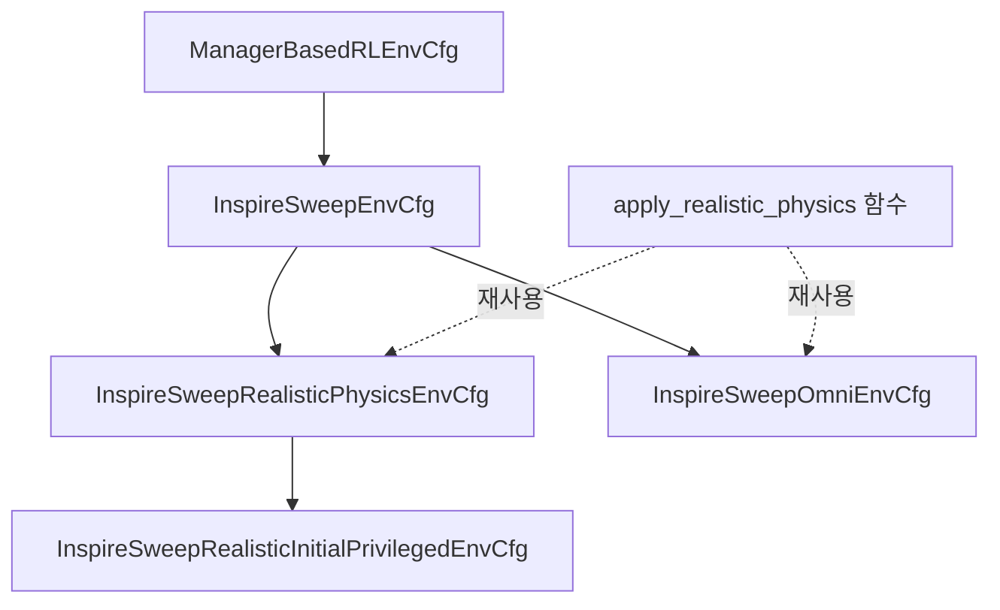

# 활성 패키지와 환경 구현 현황

[문서 안내](../01_plan/README.md) · [Workspace 구성](../00_guidelines/10_WORKSPACE_GUIDE.md) · [개발 지침](../00_guidelines/09_DEVELOPMENT_GUIDE.md) · [과거 코드·장비 기록](07_CODE_AND_HARDWARE_STATUS.md)

기준일: **2026-10-14**. 이 문서는 현재 Workspace의 활성 코드를 읽어 확인한 구성, 상속 관계와 실행 방법을 기록한다. 과거 구현 보고나 발표 설계와 실제 코드가 다르면 이 문서의 코드 근거를 함께 확인한다. 코드가 존재한다는 사실, CPU 테스트 통과, 학습 성능, 실물 검증은 각각 별개의 확인 수준이다.

[학습 실행 UML](../03_assets/inspire-sweep-training.html)은 환경 생성부터 Isaac Lab step과 PPO 업데이트까지를, [환경 상속 UML](../03_assets/inspire-sweep-inheritance.html)은 네 Cfg의 상속과 공유 물성·MDP term 연결을 보여준다. HTML 파일은 브라우저에서 열며, 표와 코드 링크에서 정확한 설정·함수 이름을 확인할 수 있다.

## 1. 두 활성 패키지의 역할

| 패키지 | 역할 | 실행 단위와 의존성 |
| --- | --- | --- |
| [`src/inspire_sweep_baseline`](../../../src/inspire_sweep_baseline/README.md) | UR5e–Axia80 모티브 하우징–Inspire Hand의 단일 실린더 Sweeping RL 환경과 파생 실험 | Isaac Lab의 Manager-based RL, Isaac Sim, Torch, Gymnasium, RSL-RL. 로봇 USD와 MDP 함수는 패키지 내부에 포함 |
| [`src/axia80_feasibility`](../../../src/axia80_feasibility/README.md) | 고정 조인트 반력을 이용한 F/T 하중·모멘트 모델 및 측정 경로 검증 | Isaac Lab의 벡터화된 물리 Scene을 직접 실행. NumPy·SciPy·xacro·Matplotlib. PPO 학습 환경이나 Gym task 등록 패키지가 아님 |

두 패키지는 Python `pyproject.toml`로 구성되어 있다. ROS2 패키지 빌드만으로 설치되는 구조로 해석하지 않는다. 제공 스크립트가 자신의 패키지 경로를 `sys.path`에 추가하므로 checkout에서 직접 실행할 수 있다.

나머지 `src` 항목은 `src/trash`에 보관하고 `COLCON_IGNORE`로 ROS2 빌드 검색에서 제외한다. 이 중 [`Universal_Robots_ROS2_Description`](../../../src/trash/Universal_Robots_ROS2_Description)은 Axia80 시험이 UR5e xacro·mesh·설정 파일을 읽는 **보관 자산 의존성**이다. 해당 ROS 패키지를 빌드하거나 실행한다는 의미는 아니다. 자산 원본까지 삭제하면 Axia80 모델 생성이 불가능하다.

## 2. RL 환경 등록과 상속 구조

등록 근거는 [`inspire_sweep_baseline/__init__.py`](../../../src/inspire_sweep_baseline/inspire_sweep_baseline/__init__.py)다. 아래 네 task의 실행 클래스는 모두 [`InspireSweepEnv`](../../../src/inspire_sweep_baseline/inspire_sweep_baseline/env.py)이며 `ManagerBasedRLEnv`를 상속한다. 환경별 차이는 등록된 Cfg와 PPO 설정에서 결정한다.

| Gym task ID | 환경 Cfg | PPO Cfg | 기본 로그 폴더 |
| --- | --- | --- | --- |
| `Isaac-Inspire-Sweep-Baseline-v0` | `InspireSweepEnvCfg` | `InspireSweepPPORunnerCfg` | `logs/rsl_rl/inspire_sweep_baseline` |
| `Isaac-Inspire-Sweep-Realistic-Physics-v0` | `InspireSweepRealisticPhysicsEnvCfg` | `InspireSweepRealisticPhysicsPPORunnerCfg` | `logs/rsl_rl/inspire_sweep_realistic_physics` |
| `Isaac-Inspire-Sweep-Realistic-Physics-Initial-Privileged-v0` | `InspireSweepRealisticInitialPrivilegedEnvCfg` | `InspireSweepRealisticInitialPrivilegedPPORunnerCfg` | `logs/rsl_rl/inspire_sweep_realistic_initial_privileged` |
| `Isaac-Inspire-Sweep-Omni-v0` | `InspireSweepOmniEnvCfg` | `InspireSweepPPORunnerCfg` | Baseline과 동일. CLI로 `inspire_sweep_omni` 지정 권장 |



Omni는 Realistic Physics Cfg의 자식이 아니다. Baseline Cfg를 직접 상속하면서 `apply_realistic_physics()`와 Realistic Physics의 Event Cfg를 재사용한다. Initial-Privileged는 Realistic Physics Cfg를 상속하며 관측 경로를 바꾼다.

PPO 상속은 `RslRlOnPolicyRunnerCfg → InspireSweepPPORunnerCfg → InspireSweepRealisticPhysicsPPORunnerCfg → InspireSweepRealisticInitialPrivilegedPPORunnerCfg`다. Realistic Physics는 실험 폴더 이름을, Initial-Privileged는 폴더 이름과 actor/critic 관측 그룹 연결을 변경한다. Omni는 Baseline PPO 클래스를 그대로 등록한다.

### 2.1 Manager와 코드의 책임

| 구성 | 책임 | 주요 구현 |
| --- | --- | --- |
| Scene | 로봇·선반·실린더, EEF·가상 finger/wrist frame, 손바닥 ContactSensor 구성 | [`env_cfg.py`](../../../src/inspire_sweep_baseline/inspire_sweep_baseline/env_cfg.py), `assets/` |
| Action Manager | Arm 6개 관절 위치 명령, Hand 굽힘·엄지 opposition 2개 입력의 관절 매핑 | `ActionsCfg`, [`mdp/actions.py`](../../../src/inspire_sweep_baseline/inspire_sweep_baseline/mdp/actions.py) |
| Observation Manager | 관측 순서·노이즈, 초기 물체 위치 캐시, critic의 privileged 관측 | `ObservationsCfg`, [`mdp/asymmetric_observations.py`](../../../src/inspire_sweep_baseline/inspire_sweep_baseline/mdp/asymmetric_observations.py) |
| Command Manager | 리셋된 물체 상태를 저장하고 에피소드 동안 고정된 목표 위치·자세 유지 | [`mdp/commands.py`](../../../src/inspire_sweep_baseline/inspire_sweep_baseline/mdp/commands.py) |
| Event Manager | 기본 Scene 리셋, 물체·목표 샘플링, startup 물성 버퍼 준비와 에피소드 물성 변경 | `mdp/events.py`, `mdp/goal_events.py`, `mdp/realistic_physics.py` |
| Reward Manager | 보상 term에 가중치와 제어 주기 적용, 상태를 갖는 접근 진척 계산 | `mdp/rewards.py`, `mdp/goal_rewards.py` |
| Termination Manager | 시간 제한, 실패, Omni의 안정된 목표 도달 및 유지 시간 검사 | `mdp/terminations.py`, `mdp/goal_terminations.py` |
| 환경 실행 클래스 | Manager가 사용할 target·sensor 상태 준비, 리셋된 센서값 무효화, Hand action 이력을 OPEN으로 초기화 | `InspireSweepEnv` |
| PPO runner·스크립트 | task 등록과 Cfg 로딩, CLI override, rollout·체크포인트·영상 기록 | `agents/`, [`scripts/train.py`](../../../src/inspire_sweep_baseline/scripts/train.py), [`scripts/play.py`](../../../src/inspire_sweep_baseline/scripts/play.py) |

물리 주기는 0.01초, decimation은 2, 정책 제어 주기는 0.02초(50 Hz), 최대 에피소드는 10초다. 파생 환경 모두 Baseline의 이 설정을 사용한다.

### 2.2 현재 관측·제어와 연구 목표의 차이

| 환경 | Actor | Critic | 변경 내용 |
| --- | --- | --- | --- |
| Baseline | 현재 물체 위치를 포함한 `policy` 41D | 같은 41D | 단일 1 kg 실린더, 좌/우 18 cm 목표, Reaching과 Homing 포함 |
| Realistic Physics | Baseline과 같은 41D | 같은 41D | 질량·마찰 랜덤화와 생성 시 접촉 재질 바인딩 |
| Initial-Privileged | 물체 위치 3D만 에피소드 초기 측정값으로 고정한 41D | `policy` 41D + 현재 물체 상태 13D = 54D | 초기 위치 관측 오차를 리셋당 한 번 샘플링. Critic은 현재 위치·quaternion·선속도·각속도를 사용 |
| Omni | Baseline과 같은 현재 물체 위치 포함 41D | 같은 41D | 원판 스폰, 전방향 목표, 목표 거리 비용·접근 진척·성공/실패 보상·안정 성공 종료 |

41D의 순서는 Arm 상대 위치 6, 상대 속도 6, 직전 Action 8, 물체 위치 3, 반지름 1, EEF pose 7, 목표 위치 3, 손바닥 접촉 1, EEF wrench 6이다. 접촉 관측은 손바닥 **한 영역**의 Boolean이며 실물 Hand의 17개 영역 전체 모델이 아니다. F/T는 고정 조인트 반력을 EEF 좌표·기준점으로 변환한 값으로, tare나 중력 보상을 적용하지 않는다. 리셋 직후 오래된 센서값은 0으로 마스킹한다.

모든 환경의 Action은 **Arm Joint Position 6D + Hand openness 2D = 8D**다. Arm 목표는 초기 관절 위치에 `0.5 × action`을 더한 값이다. Hand 입력은 `[0, 1]`로 제한해 12개 관절에 매핑하며, 1이 편 상태다. 현재 활성 코드에서 Arm OSC 또는 Diff-IK 제어를 확인한 것은 아니다.

Baseline·Realistic Physics·Omni의 actor는 실행 중 물체 GT 위치를 받는다. 따라서 이 환경들의 학습 성과를 그대로 최종 Blind 정책 성과라고 쓰면 안 된다. Initial-Privileged는 초기 위치 actor/현재 상태 critic을 구분한 실험이지만, 실물 센싱·초기 perception·접근 완료 후 시작 조건까지 검증했다는 뜻은 아니다. 현재 초기 관절에서 접근하는 시험 환경과 연구의 접근 후 하위 정책 설계를 구분한다.

### 2.3 파생 환경의 중요한 동작

Realistic Physics의 물체 질량은 평균 0.365 kg, 표준편차 0.0675 kg의 Gaussian을 0.230–0.500 kg로 제한한다. 선반·물체·Hand의 정적/동적 마찰은 역할별 유한 재질 풀에서 리셋마다 샘플링한다. 질량과 마찰 정답을 actor 관측에 추가하지 않는다. Arm 및 Axia80 하우징의 마찰과 기존 restitution은 유지한다. 근거는 [`realistic_physics_env_cfg.py`](../../../src/inspire_sweep_baseline/inspire_sweep_baseline/realistic_physics_env_cfg.py)와 [`mdp/realistic_physics.py`](../../../src/inspire_sweep_baseline/inspire_sweep_baseline/mdp/realistic_physics.py)다.

Omni는 선반 중앙의 반지름 2 cm 원판에서 물체를 스폰하고 임의 수평 방향으로 최대 15 cm 목표를 정한다. 가장자리 여유가 부족하면 목표 이동 거리를 줄인다. 목표 오차 1 cm 미만, 평면 속도 2 cm/s 미만, 기울기 10° 이하, 기하학적으로 추정한 상판 지지 및 실패 없음이 0.3초 연속 유지되면 성공으로 종료한다. Homing을 요구하지 않는다. 보상·실패 임계값과 각 항의 단위는 [Omni 환경 상세](environments/OMNI_ENVIRONMENT.md)에, 그 설계 제안은 [보상 초안](../01_plan/environments/OMNI_REWARD_PLAN.md)에 보존한다.

## 3. RL 학습·재생 명령

아래 명령은 **Workspace 루트에서 실행**한다. 선반 자산을 읽을 수 있는 Isaac Lab/Isaac Sim 환경이 필요하다. `train.py`는 RSL-RL 최소 버전 `3.0.1`을 검사한다. 패키지의 pip 의존성 목록만으로 Isaac Sim 전체 설치가 완료되는 것은 아니다.

```bash
# Baseline
./IsaacLab/isaaclab.sh -p src/inspire_sweep_baseline/scripts/train.py \
  --task Isaac-Inspire-Sweep-Baseline-v0 --num_envs 2048 \
  --sweep-direction both --run_name baseline --headless

# 질량·마찰 랜덤화
./IsaacLab/isaaclab.sh -p src/inspire_sweep_baseline/scripts/train.py \
  --task Isaac-Inspire-Sweep-Realistic-Physics-v0 --num_envs 2048 \
  --sweep-direction both --run_name realistic_mass_friction --headless

# 초기 위치 Actor + privileged Critic
./IsaacLab/isaaclab.sh -p src/inspire_sweep_baseline/scripts/train.py \
  --task Isaac-Inspire-Sweep-Realistic-Physics-Initial-Privileged-v0 \
  --num_envs 2048 --sweep-direction both \
  --run_name realistic_initial_privileged --headless

# 전방향 목표
./IsaacLab/isaaclab.sh -p src/inspire_sweep_baseline/scripts/train.py \
  --task Isaac-Inspire-Sweep-Omni-v0 --num_envs 2048 \
  --experiment_name inspire_sweep_omni --run_name omni_goal15cm --headless
```

앞의 세 환경은 `--sweep-direction left` 또는 `right`로 방향을 고정할 수 있다. Omni에 해당 옵션을 전달하면 오류가 발생하므로 생략한다. Omni의 PPO 기본 로그 폴더는 Baseline과 같아 `--experiment_name`으로 구분한다.

재생은 학습과 동일한 task ID 및 해당 관측 차원으로 학습한 체크포인트를 선택한다. 다음 예의 task를 위 등록 표의 다른 ID로 바꾸면 해당 환경을 재생한다.

```bash
./IsaacLab/isaaclab.sh -p src/inspire_sweep_baseline/scripts/play.py \
  --task Isaac-Inspire-Sweep-Omni-v0 --num_envs 1 \
  --checkpoint "<checkpoint.pt>"

# 한 개 영상 기록 후 종료
./IsaacLab/isaaclab.sh -p src/inspire_sweep_baseline/scripts/play.py \
  --task Isaac-Inspire-Sweep-Omni-v0 --num_envs 1 \
  --checkpoint "<checkpoint.pt>" --video --video_length 500 --headless
```

학습 run은 `logs/rsl_rl/<experiment_name>/<timestamp>_<run_name>`에 저장한다. 학습 스크립트가 저장하는 `params/env.yaml`, `params/agent.yaml`과 실제 명령, seed, 코드 상태를 함께 기록해야 재현할 수 있다. 영상은 run의 `videos/train` 또는 체크포인트 디렉터리의 `videos/play`에 저장한다.

선반 자산은 `INSPIRE_SWEEP_SHELF_USD_PATH`로 USD 경로를 직접 지정하거나 `INSPIRE_SWEEP_ASSET_ROOT`로 자산 root를 지정한다. 기존 `SWEEP_POLICY_*` 변수도 호환하지만 Sweep-Policy 패키지를 import하지는 않는다. 경로 선택의 근거는 [`assets/paths.py`](../../../src/inspire_sweep_baseline/inspire_sweep_baseline/assets/paths.py)다. 자산을 바꾸면 Omni가 가정한 상판 크기·높이도 함께 확인한다.

## 4. Axia80 하중 진단 구성과 실행

Axia80 시험은 Manager-based RL 환경 상속 구조가 없다. `model.py`의 UR5e 모델 확장·공통 형상 함수를 cantilever 변형이 재사용하고, tilted/wrist 변형이 `build_cantilever_model()`을 호출한다. 기본 [`scene.py`](../../../src/axia80_feasibility/axia80_feasibility/scene.py)의 Scene 팩토리를 tilted/wrist Scene 팩토리가 재사용하며 접촉 마찰을 변경한다. 공통 모델과 수치 처리, Scene 구성, 실행 스크립트가 분리되어 있다.

| 시험 | 실행 스크립트 | 확인하려는 반응 |
| --- | --- | --- |
| 수평 넓은 면 장착 | `run_payload_test.py` | 10–500 g 하중의 `Fz ≈ mg`, tare 및 안정화 |
| 얇은 끝면 cantilever 장착 | `run_cantilever_payload_test.py` | 수직 하중의 `Fx`와 레버 암에 따른 `My` |
| wrist3 +10° cantilever | `run_tilted_cantilever_payload_test.py` | 경사에 따른 힘·모멘트 축 분산과 미끄럼·상대 자세 |
| 고정 500 g Roll × Tilt | `run_wrist_angle_sweep.py` | 기본 5 × 5 각도 격자에서 실제 자세 기반 6축 예측과 측정 비교 |

현재 코드의 네 시험을 다시 실행하는 명령이다. 새로운 출력 디렉터리를 지정해 기존 실험 결과와 구분한다. `--strict`는 측정 후 수용 지표가 실패하면 non-zero exit code를 반환하게 한다.

```bash
./IsaacLab/isaaclab.sh -p src/axia80_feasibility/scripts/run_payload_test.py \
  --headless --device cuda:0 --strict \
  --output_dir src/axia80_feasibility/results/payload_rerun_20261014

./IsaacLab/isaaclab.sh -p src/axia80_feasibility/scripts/run_cantilever_payload_test.py \
  --headless --device cuda:0 --strict \
  --output_dir src/axia80_feasibility/results/cantilever_rerun_20261014

./IsaacLab/isaaclab.sh -p src/axia80_feasibility/scripts/run_tilted_cantilever_payload_test.py \
  --headless --device cuda:0 --strict \
  --output_dir src/axia80_feasibility/results/tilted_rerun_20261014

./IsaacLab/isaaclab.sh -p src/axia80_feasibility/scripts/run_wrist_angle_sweep.py \
  --headless --device cuda:0 --strict \
  --output_dir src/axia80_feasibility/results/wrist_rerun_20261014
```

각 스크립트의 기본 출력 경로와 모든 CLI 인자는 소스·패키지 README를 확인한다. 출력에는 summary CSV, 개별 sample CSV, 그래프, 모델/실행 metadata가 포함되며 변형별 run log도 기록된다. 모델 생성 파일은 `src/axia80_feasibility/generated/`에 저장한다. 정적 반력의 수용 판정과 실물 Axia80의 노이즈·캘리브레이션·대역폭·지연 검증은 구분한다.

`generated/`는 다시 만들 수 있는 URDF/USD 캐시다. URDF에는 mesh의 절대 경로가 들어가므로 Workspace나 보관 자산 경로가 바뀌면 모델을 다시 생성해야 한다. 실행 스크립트는 모델 생성 함수를 먼저 호출한다. 기존 USD 캐시까지 재변환해야 할 때는 `--force_conversion`을 추가한다.

## 5. 확인한 테스트와 남은 검증

2026-10-14에 아래 명령으로 활성 패키지 관련 CPU·모델·USD 계약 검사를 실행했다. 결과는 **114 passed, 17 subtests passed**였다. 테스트는 실제 MDP 수치 함수, RSL-RL의 actor/critic 입력 연결, 초기 위치 캐시·리셋, 보상·종료, 물성 설정, 로컬 USD 자산, Axia80 URDF·측정 수치 및 산출물 계약을 확인한다. Isaac Sim 학습 실행이나 실물 시험을 대신하지 않는다.

```bash
env -u PYTHONPATH -u ROS_PACKAGE_PATH -u AMENT_PREFIX_PATH \
  PYTEST_DISABLE_PLUGIN_AUTOLOAD=1 PYTHONDONTWRITEBYTECODE=1 \
  /home/min/miniconda3/envs/env_isaaclab/bin/python -B -m pytest \
  -q -p no:cacheprovider src/inspire_sweep_baseline/tests \
  tests/test_axia80_feasibility.py \
  tests/test_axia80_cantilever_feasibility.py \
  tests/test_axia80_tilted_cantilever.py \
  tests/test_axia80_wrist_angle_sweep.py
```

이 Workspace의 일반 shell에는 ROS 환경이 섞일 수 있다. 최초 실행에서는 ROS `launch_testing` pytest plugin의 `lark` 의존성 누락으로 테스트 수집 전 실패했다. 위 명령은 ROS 검색 경로를 제거하고 pytest 외부 plugin 자동 로딩을 차단해 별도 환경 설치 변경 없이 검증한다.

USD 검사에는 `pxr`를 제공하는 Python이 필요하다. 기본 탐색 경로가 없으면 테스트가 skip되며, `INSPIRE_SWEEP_USD_TEST_PYTHON`으로 해당 Python 실행 파일을 지정할 수 있다. Baseline 설정 비교 테스트는 `example/Sweep-Policy`의 기존 Cfg를 읽으므로 reference submodule이 초기화되어 있어야 한다.

이번 문서 정리에서는 네 RL task의 실제 시뮬레이터 생성, GPU 물성 업데이트, 선반 자산 서버 접속, train/play, 새 checkpoint 성능, Axia80 하중 시뮬레이션 재실행, 실물 센서·로봇 제어를 수행하지 않았다. 관련 과거 결과는 [실험 문서 목록](../01_plan/README.md)과 저장된 metadata·로그를 확인하되, 이번 테스트 결과와 혼합하지 않는다.

이동과 자산 경로 수정 이후 루트 `pytest.ini`의 기본 탐색으로 Scene 기하 검사까지 함께 실행한 결과는 **135 passed, 26 subtests passed**였다. 최종 명령과 Workspace 제외 검증은 [정리 개발 로그](logs/2026-10-14_workspace_cleanup.md)에 기록한다.

## 6. 다음 변경에서 남길 개발 기록

환경을 추가하거나 변경할 때는 task ID, runtime 클래스, Cfg 부모, 재사용한 함수·Manager term, actor/critic 관측 차원과 GT 범위, Action 의미, 제어 주기, 보상·종료 차이를 함께 기록한다. 새 task를 등록하는 것만으로 별도 PPO 설정이나 로그 폴더가 생기는 것은 아니다.

실험 기록에는 실제 실행 명령, seed, 코드 상태·submodule revision, 적용 YAML, run·checkpoint·산출물 경로, 수행한 검증과 수행하지 않은 검증을 남긴다. 작성 형식과 OOP·Manager 경계는 [개발 지침](../00_guidelines/09_DEVELOPMENT_GUIDE.md), 문서의 보관 위치는 [Workspace 안내](../00_guidelines/10_WORKSPACE_GUIDE.md)를 따른다.
