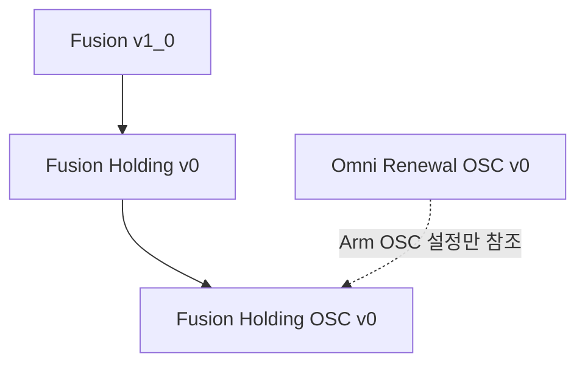

# Contact Sweep Clutter Fusion Holding OSC v0

[환경 안내](README.md) · [상속 관계](ENVIRONMENT_EVOLUTION.md) · [Holding v0 전체 계약](CONTACT_SWEEP_CLUTTER_FUSION_HOLDING_V0_ENVIRONMENT.md) · [개발 기록](../logs/2026-10-23_fusion_holding_osc_v0.md)

기준일: 2026-10-23. 등록 ID는 `Isaac-Inspire-Contact-Sweep-Clutter-Fusion-Holding-OSC-v0`다. Holding v0을 직접 상속하고 Arm Controller만 Joint Position에서 OSC로 바꾼다. 참조는 `Isaac-Inspire-Sweep-Omni-Renewal-OSC-v0`이며, 그 환경의 보상·종료·장면은 가져오지 않는다.

## 상속과 실행 클래스



`FusionHoldingOSCV0EnvCfg`는 `FusionHoldingV0EnvCfg`를 직접 상속하고 부모 초기화를 완료한 뒤 Arm action과 Arm actuator의 관절 PD gain만 변경한다. Runtime은 `ContactSweepClutterFusionV1_0Env`를 그대로 사용한다. PPO는 `FusionHoldingV0PPORunnerCfg`를 상속하며 experiment 이름만 `inspire_contact_sweep_clutter_fusion_holding_osc_v0`로 분리한다.

## Arm 제어 변경

| 항목 | Holding v0 | Holding OSC v0 |
| --- | --- | --- |
| Arm Action 6D | 기본 관절각 대비 위치 offset | 현재 EEF 대비 상대 pose |
| Action term | JointPositionActionCfg | EEFRelativeOSCActionCfg (OSC 파생) |
| 명령 변환 | 기본각 + 0.5 × raw action | 이동 3D ×1.0, 회전벡터 3D ×1.0 |
| 물리 제어 출력 | 관절 위치 목표 | OSC 계산 관절 effort |
| Arm 관절 PD | 부모 설정 | stiffness=0, damping=0 |
| Hand Action 2D | 열림·엄지 대립 | 동일 |

OSC는 `target_types=["pose_rel"]`, `impedance_mode="fixed"`, `motion_stiffness_task=200.0`, `motion_damping_ratio_task=1.0`, `inertial_dynamics_decoupling=True`, `gravity_compensation=True`다. 제어 body와 offset은 기존 `scene.ee_frame.target_frames[0]`에서 가져오므로 Holding의 EEF 기준점을 유지한다.

Arm 0~2번 출력은 상대 이동(m), 3~5번은 axis-angle 회전벡터(rad)다. 명령의 task frame은 각 정책 step에서 측정한 현재 EEF pose(body offset 포함)다. 이동·회전벡터 모두 EEF 로컬 축 기준이며, EEF가 base 대비 Z축으로90° 회전한 상태에서 로컬+X 명령은 base+Y 방향 목표가 된다. 각 정책 step의 현재 EEF pose를 복사해 기준을 고정한 뒤 목표를 만들고 물리 substep에서 OSC effort를 적용한다. 다음 정책 명령에서 새 EEF pose로 기준을 갱신한다. 따라서 한 명령의 목표가 substep마다 손을 따라 이동하지 않는다. Hand는 기존 6~7번 채널을 사용한다. 총 Action 차원은8D, 제어 주기는0.02초, 물리 주기는0.01초다.

참조 Renewal OSC v0과 동일하게 position/orientation scale은1.0이며 별도 명령 norm 제한을 추가하지 않는다. 다른 OSC v2의 bounded action이나5mm/0.025rad 제한을 가져오지 않았다. 예를 들어 이동 raw action0.001은1mm이고1.0은1m의 상대 목표다. 실제 EEF가 한 step에 그 거리를 이동한다는 뜻은 아니다. Gaussian raw action과 기존 raw Action 변화 제곱합 비용은 유지하므로, Arm Action의 차원은 같지만 정책 출력의 물리적 의미가 바뀐다.

## 유지하는 Holding 계약

보상·종료·커리큘럼·관측·Hand·물성·목표 분포는 [Holding 상세 문서](CONTACT_SWEEP_CLUTTER_FUSION_HOLDING_V0_ENVIRONMENT.md)를 그대로 따른다. 특히 Hand contact weight1.45, push_fast1.0m/s, object 변위계수5.0, 최대Gray5/White5, 1000까지 충격weight0, 거리·속도 정착 보상, 0.5cm·0.01m/s·3초 성공을 유지한다. Actor95D/Critic98D, 실행 중 타겟GT의 Critic 전용 경계도 같다.

Joint Position용 checkpoint는 같은8D 출력이라도 OSC에서 의미가 다르므로 동일 정책 재생으로 간주하지 않는다. 아래 명령은 새 OSC 정책 학습을 시작한다. 장기 안정성·수렴·접촉 성능은 별도 평가 대상이다.

## 학습·재생

Windows PowerShell, Workspace 루트:

```powershell
.\IsaacLab\isaaclab.bat -p .\src\inspire_sweep_baseline\scripts\train.py `
  --task Isaac-Inspire-Contact-Sweep-Clutter-Fusion-Holding-OSC-v0 `
  --num_envs 2048 --headless --max_iterations 90000
```

Linux, Workspace 루트:

```bash
./IsaacLab/isaaclab.sh -p src/inspire_sweep_baseline/scripts/train.py \
  --task Isaac-Inspire-Contact-Sweep-Clutter-Fusion-Holding-OSC-v0 \
  --num_envs 2048 --headless --max_iterations 90000
```

재생은 해당 OS launcher에서 `scripts/play.py --task Isaac-Inspire-Contact-Sweep-Clutter-Fusion-Holding-OSC-v0 --num_envs 1 --checkpoint <OSC-checkpoint.pt> --real-time`을 사용한다. 학습 실행 정책에 따라 `train.py`를 사용하며 자동 복구 실행기는 사용하지 않는다.

이 명령 Frame 변경은 Holding OSC v0에만 적용한다. 기존 Renewal OSC v0은 base 기준을 유지한다. 토크 제한 설정이나 출력 clamp는 이번 변경 대상이 아니다.

## 구현 근거

- [EEF 로컬 Action](../../../../src/inspire_sweep_baseline/inspire_sweep_baseline/contact_sweep_clutter_fusion_holding_osc_v0/actions.py).
- [환경 설정](../../../../src/inspire_sweep_baseline/inspire_sweep_baseline/contact_sweep_clutter_fusion_holding_osc_v0/env_cfg.py), [PPO 설정](../../../../src/inspire_sweep_baseline/inspire_sweep_baseline/contact_sweep_clutter_fusion_holding_osc_v0/ppo_cfg.py).
- [참조 Renewal OSC](../../../../src/inspire_sweep_baseline/inspire_sweep_baseline/omni_renewal_osc_env_cfg.py).
- [검증 명령·결과와 미검증 범위](../logs/2026-10-23_fusion_holding_osc_v0.md).
