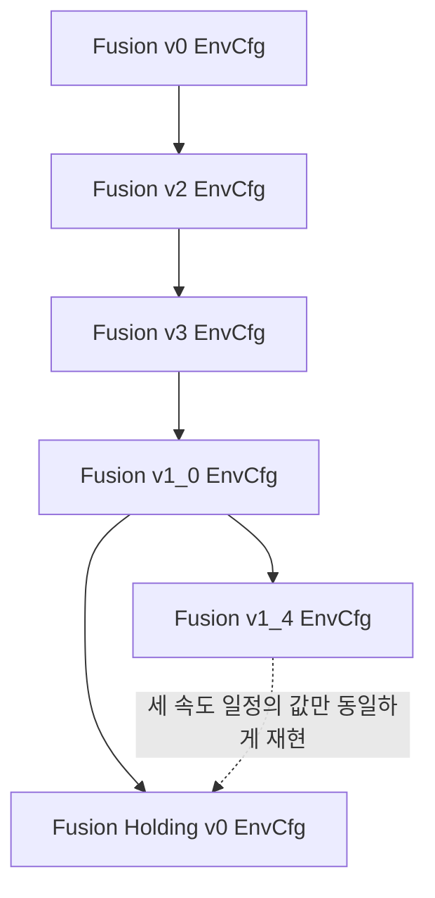

# Contact Sweep Clutter Fusion Holding v0 환경 설명

[환경 문서 안내](README.md) · [환경 계층과 변경 의도](ENVIRONMENT_EVOLUTION.md) · [활성 환경](../08_ACTIVE_ENVIRONMENTS.md) · [구현·검증 기록](../logs/2026-10-23_fusion_holding_v0.md)

**대상:** `Isaac-Inspire-Contact-Sweep-Clutter-Fusion-Holding-v0`  
**기준일:** 2026-10-23  
**기준 코드:** Workspace commit `870750df2520a5e486240fa498677dfcd0494532`의 Holding 및 상속 경로. 이 문서는 현재 구현 계약을 설명한다. 수식 예시는 실측 학습 성과가 아니다.

이 환경은 **타겟을 목표까지 실제로 이동시킨 뒤 속도를 낮추어 정확한 위치에 정착시키는 것**을 학습한다. 초기부터 강한 충격 비용을 부과하면 아예 밀지 않는 정책으로 수렴할 수 있다는 사용자 관찰을 바탕으로, 처음 1,000 iteration에는 세 충격 페널티를 끄고 이후 점진적으로 켠다. 동시에 이진 Goal hold를 거리·속도에 따라 점진적으로 커지는 정착 보상으로 바꾼다. 이 변경이 실제 비발사 행동이나 성공률 개선을 달성했는지는 아직 검증하지 않았다.

| 기본 구성 | 적용값 |
| --- | --- |
| 직접 부모 EnvCfg | `ContactSweepClutterFusionV1_0EnvCfg` |
| 새 EnvCfg / PPOCfg | `FusionHoldingV0EnvCfg` / `FusionHoldingV0PPORunnerCfg` |
| 실행 클래스 | 기존 `ContactSweepClutterFusionV1_0Env` |
| Robot / Action | UR5e + Inspire Hand / Joint Position Arm 6D + Hand 2D |
| Actor / Critic 원시 입력 | 95D / 98D, 실행 중 타겟 GT는 Critic에만 제공 |
| 물체 | 타겟 1개 + Gray 1→3개 + White 1→3개 |
| 물리 / 제어 주기 | 0.01초 / 0.02초 |
| Episode | 최대 10초, 실패 또는 3초 정착 성공 시 조기 종료 |
| 보상 / 종료 / 커리큘럼 | 정의된 보상 17개(초기 3개 weight 0), 종료 7개, 커리큘럼 14개 |

## 0. 상속과 변경 범위



실선은 Python EnvCfg 상속이고 점선은 설정값의 대응 관계다. Holding은 v1_4를 import하거나 상속하지 않는다. v1_4의 최대 11개 물체, Hand contact 1.45, Goal hold 9, push_fast 1.0을 가져오지 않는다.

| 구성요소 | Holding의 처리 | 유지·변경 내용 |
| --- | --- | --- |
| EnvCfg | v1_0 직접 상속 | 아래 세 Manager Cfg 교체 |
| Scene / Events / Commands | 상속 | 최대 7개 물체, 배치·물성·초기 관측·목표 생성 유지 |
| Observations / Actions | 상속 | 차원·순서·GT 경계·Joint Position 제어 유지 |
| RewardsCfg | v1_0 RewardsCfg 상속 | goal_distance, goal_hold, 충격 세 항의 설정 변경 |
| TerminationsCfg | v1_0 TerminationsCfg 상속 | 기존 실패·timeout에 독립 `success` 추가 |
| CurriculumCfg | v1_0 CurriculumCfg 상속 | 인구·방향 일정 유지, 속도·충격·정착 일정 구성 |
| PPOCfg | v1_0 PPOCfg 상속 | experiment 이름만 분리 |
| Runtime | v1_0 클래스 그대로 등록 | 새 step/reset override 없음 |

v1_0의 과거 환경 문서에는 이후 긴급 조정 이전의 Goal 반경·접촉 fade·충격 기준 설명이 남아 있다. **Holding의 최종 적용값은 본문의 Holding 설정과 실제 코드가 기준**이다. 공통 Scene·Observation·Action은 아래에 독립적으로 다시 설명한다.

## 1. Scene 구성

### 1.1 구성 의도

Scene은 물체를 움직이는 능력과 접촉 과정의 안정성을 함께 학습하도록 구성한다. 타겟만 목표로 이동하면 되는 것이 아니라, 가려져서 관측하지 못한 장애물도 실제 공간에는 남아 있다. 따라서 초기 위치 정보만 따라 움직이는 것으로는 충분하지 않으며, 접촉 중 센서 신호를 이용하는 정책이 필요하다.

각 episode에서는 타겟의 초기 위치와 목표를 먼저 정하고 그 주변에 장애물을 배치한다. 로봇은 선반을 향한 고정된 초기 자세에서 시작하고 손은 열린 상태다. 이 환경에서 별도의 상위 물체 선택이나 이동 경로 계획을 학습하지 않는다. 타겟과 목표가 주어진 조건에서 근접 조작을 수행하는 것이 범위다.

### 1.2 Robot

UR5e의 여섯 관절로 손의 위치와 방향을 조절한다. 정책은 각 관절의 목표 위치를 지정하고, 관절 위치 제어기가 이를 추종한다. 손끝의 Cartesian 이동량을 직접 출력하는 구조는 아니다.

로봇 base는 고정되어 있다. 각 episode의 Arm 초기 관절각은 `[0, −2.2, 2.2, 0, 1.57, 0.785]` rad이며 순서는 shoulder pan, shoulder lift, elbow, wrist 1, wrist 2, wrist 3이다. 이를 일정하게 유지해 학습의 주요 변동이 물체 배치·목표 방향·접촉 물성에서 발생하게 한다.

Arm의 시뮬레이션 구동 속도 제한은 앞 세 관절 2 rad/s, 손목 세 관절 4 rad/s다. 이 값은 Action의 출력 범위와 별개이며, 빠른 움직임을 억제하는 보상과 과속 종료도 별도로 존재한다.

### 1.3 Hand

Inspire Hand는 손바닥과 여러 손가락으로 물체를 접촉한다. 목적은 정밀한 손가락별 자세를 모두 독립적으로 탐색하는 것이 아니라, **Arm의 이동과 손의 열림 정도를 함께 조절하여 밀기에 유효한 접촉을 만드는 것**이다.

물리 모델의 Hand 관절은 12개지만 정책의 Hand Action은 두 개다. 하나는 손가락 굽힘 관절들의 공통 열림 정도를, 다른 하나는 엄지의 대립 방향 관절을 조절한다. 손을 넓게 펴거나 굽히는 동작을 적은 입력으로 표현한다. Hand의 관절 구동 속도 제한은 1 rad/s다.

### 1.4 Sensor

**손목 F/T:** Arm과 Hand 사이의 6축 반력으로 손 전체에 전달되는 외부 접촉의 영향을 관측한다. Hand 자체의 중력 및 관성 하중을 모델로 추정하여 제거한 값을 사용하므로, 단순히 손을 지지하거나 움직이면서 발생하는 하중과 외부 접촉을 구분하려는 의도다. 센서는 특정 물체의 ID나 접촉 위치를 직접 알려주지 않는다.

관측은 EEF 기준점에서 표현한 힘 3축과 모멘트 3축이다. 부호는 Hand를 지지하는 쪽에서 Hand에 전달하는 반력 관례를 따른다. 따라서 이를 Hand에 가해진 외력과 같은 부호의 값으로 해석하지 않는다. 보정은 시뮬레이션의 Hand 물성·운동 상태에 의존하며, 실물 캔슬레이션 정확도를 보장하는 명세는 아니다.

**촉각:** 손바닥 1개, 엄지 4개, 나머지 네 손가락 각각 3개로 총 17개 영역을 사용한다. 각 영역은 힘의 크기를 연속값으로 전달하지 않고 접촉 여부를 bit로 전달한다. 해당 영역의 힘 크기가 0.01 N 이상이면 1이다. 힘 정보는 F/T가, 손의 어느 영역이 닿았는지는 촉각이 담당한다.

촉각 패드의 직접 접촉과 패드 영역에 해당하는 Hand 표면의 물체 접촉을 반영한다. 패드 바깥의 모든 Hand 접촉을 촉각이 감지하는 것은 아니다. 또한 채널은 접촉 상대가 타겟인지 장애물인지 구분하지 않는다. Scene에는 정책에 이미지를 제공하는 카메라 관측이 없으며, 초기 시각 정보는 기하학적 가시성 판정과 위치 오차로 모델링한다.

**손 전체 접촉력:** Hand base·손가락 링크·패드 등 30개 body의 월드 접촉력 벡터를 합해 손에 작용하는 합력을 계산한다. 손 전체 보상은 타겟·장애물·선반·바닥 등 접촉 상대를 가리지 않는다. 별도의 물체별 필터는 타겟을 제외한 활성 장애물과 손 사이의 힘만 모아 장애물 접촉 비용에 사용한다. 이러한 접촉 identity와 합력은 보상 계산용이며 Actor에 추가 관측으로 전달하지 않는다.

ContactSensor의 힘은 **법선 접촉력**이며 접선 마찰력을 포함한 완전한 접촉 wrench가 아니다. 여러 body·물체의 벡터를 먼저 더하므로 서로 반대인 힘은 상쇄될 수 있다. 각 힘의 크기를 더하는 방식과 다르며, 촉각 17개 bit 및 보정 F/T와도 별도의 값이다.

### 1.5 Shelf

작업 영역은 좌우 폭 1.0 m, 앞뒤 깊이 0.4 m인 선반 면이다. 초기 작업면 높이는 월드의 각 환경 원점 기준 1.05 m다. 선반은 물체를 지지하는 동시에 손목·손가락이 침범하지 않아야 하는 경계다.

선반의 움직임도 상태로 검사한다. 정책이 선반을 밀거나 손목을 지나치게 낮추는 행동은 비용 또는 종료로 연결된다. 바닥과 조명은 Scene의 지지·표시를 구성하며 정책의 이미지 입력은 아니다.

### 1.6 Object와 초기 배치

타겟과 장애물은 모두 반지름 4 cm, 높이 10 cm의 원기둥이다. 물체 위치로 사용하는 기준점은 **기하학적 중심이 아니라 밑면 중심**이다. 따라서 똑바로 선 물체의 위치 Z는 초기 작업면과 같은 1.05 m이고 기하학적 중심 높이는 1.10 m다.

질량의 80%는 아래쪽 높이 20%에, 나머지 20%는 위쪽 높이 80%에 분포한다고 모델링한다. 무게중심은 밑면에서 2 cm 위로 낮게 놓인다. 물체가 쉽게 넘어지기만 하는 과제가 되지 않게 하면서, 강한 접촉으로 발생하는 기울기와 전도는 계속 학습 대상으로 남기는 구성이다.

타겟은 선반 중앙을 중심으로 반지름 2 cm 원판 안에 면적 균일하게 배치한다. 목표는 타겟 초기 위치에서 최대 15 cm 떨어진 평면상의 점이다. 타겟 반지름과 추가 여유 2 cm가 선반 안에 남도록, 가장자리를 향하는 방향에서는 이동 거리를 줄인다. 목표 방향의 허용 범위는 6절의 curriculum이 정한다. 생성한 목표는 episode 동안 고정한다.

Zone은 장애물 **중심 위치**를 분류하는 평면 영역이다. Red는 타겟–Goal 경로의 반경 10.3 cm 캡슐을 로봇 쪽 선반 전면까지 확장한 장애물 금지 영역이다. 반경에는 물체 두 개의 반지름 합 8 cm와 여유 2.3 cm가 포함된다. Gray는 반경 14 cm의 넓은 경로 영역을 전면으로 확장한 공간과 타겟 뒤쪽 접근 직사각형에서 Red를 뺀 영역이다. 뒤쪽 직사각형은 밀기 반대 방향 16 cm, 좌우 각각 11 cm까지다. White는 물체 중심의 배치 가능 영역 중 Red와 Gray 밖의 공간이다.

장애물은 타겟·목표를 확정한 뒤 Gray Zone과 White Zone에 배치한다. Gray 중 첫 1개는 밀기 반대쪽의 후방 조건을 만족시키고, 추가 Gray는 일반 Gray 영역을 사용한다. White는 타겟 주변·밀기 경로의 Red 제외 영역 및 Gray 영역 밖에 둔다. 물체 사이 간격·밀집도·손과 손목의 접근 공간도 검사한다. 배치 실패를 이유로 타겟이나 목표를 다시 뽑지 않는다. 이 기하 조건이 로봇 IK나 접촉 성공을 보장하지는 않는다.

처음에는 Gray 1개·White 1개이고, 커리큘럼에 따라 각각 3개까지 늘어난다. Scene에는 최대 타겟 1개·장애물 6개를 준비하고 episode별 활성 mask로 실제 참여 물체를 정한다. 장애물 수의 변경은 다음 reset 때 적용하며 진행 중 episode의 물체를 추가하거나 제거하지 않는다.

비활성 물체는 선반 로컬 높이 100 m에 서로 떨어뜨려 두고 속도를 0으로 초기화하며 중력을 끈다. 가림·관측·물체 비용·장애물 접촉 비용·낙하/전도 종료에서 제외한다. 활성화할 때는 선반에 배치하고 중력을 켠다. **활성 상태지만 가려져 보이지 않는 장애물**은 계속 물리·보상·종료의 대상이므로 비활성 슬롯과 구분한다.

질량과 마찰은 episode마다 바꾼다. 질량은 중심 0.5475 kg, clamp 이전 표준편차 0.10125 kg의 분포를 사용하며 0.345–0.75 kg로 제한한다. 한 환경의 물체 컬렉션 전체에는 같은 질량·물체 마찰 표본을 적용한다. 물체마다 독립적인 물성을 주는 방식은 아니다.

| 재질 역할 | 정지 마찰계수 분포 중심 / 표준편차 | 동마찰계수 분포 중심 / 표준편차 |
| --- | --- | --- |
| 선반 | 0.315 / 0.051 | 0.252 / 0.041 |
| 물체 | 0.315 / 0.040 | 0.252 / 0.032 |
| Hand 접촉면 | 0.585 / 0.145 | 0.468 / 0.116 |

마찰 표본은 위 분포를 근사한 유한 후보군에서 선택하며 음수가 되지 않게 제한한다. 이 랜덤화의 의도는 같은 움직임이 항상 같은 미끄러짐과 접촉력을 만든다는 가정에 정책이 의존하지 않게 하는 것이다. 물성값은 Actor의 직접 관측에 포함하지 않는다.

## 2. Observation

### 2.1 기준 Frame

| Frame | 의미와 사용처 |
| --- | --- |
| World | 중력의 하늘 방향이 +Z인 공통 축. 목표 도달의 XY 거리, 속도·가속도·물체 이동 비용과 접촉력 합산에 사용 |
| Robot root | 고정된 로봇 base 원점과 축. 초기 타겟·장애물 위치, 현재 EEF pose, Critic 타겟 위치를 표현 |
| Shelf local | 선반 중앙을 기준으로 물체와 목표를 배치하는 축. 앞뒤 half extent 0.20 m, 좌우 half extent 0.50 m |
| EEF | 손목에 고정된 조작 기준점과 회전축. 손바닥 기준으로 정의한 위치이며 손가락만 굽혀도 기준점 자체는 움직이지 않음. F/T 관측의 축·모멘트 기준점 |

현재 배치에서 robot-root +X는 로봇에서 선반 안쪽으로 밀어 넣는 방향, −Y는 선반을 정면으로 바라볼 때 오른쪽, +Z는 위쪽이다. EEF 위치는 Hand base의 로컬 Z 방향으로 13 cm인 점과 일치한다. EEF +Z는 손바닥 법선의 반대 방향으로 해석하므로, EEF +Z가 위로 향하면 손바닥은 아래를 향한다.

### 2.2 공통 policy 관측 — 55D

Actor와 Critic은 다음 55차원 벡터를 공통으로 사용한다. 표의 순서가 입력의 순서다.

| 관측 | 차원 | 의미·단위·Frame | 갱신과 노이즈 |
| --- | ---: | --- | --- |
| Arm joint position | 6 | 초기 기본 관절각을 뺀 현재 Arm 관절각, rad. Cartesian Frame이 아닌 관절 좌표 | 매 step, 추가 노이즈 없음 |
| Arm joint velocity | 6 | 기본 속도 0을 뺀 현재 Arm 관절 속도, rad/s | 매 step, 추가 노이즈 없음 |
| Last action | 8 | 직전에 환경에 적용한 raw Arm 6D·Hand 2D 명령. Hand 처리 전 값 포함 | 매 step, 추가 노이즈 없음 |
| Initial target position | 3 | 타겟 밑면 중심의 초기 XYZ, m, robot-root 기준 | reset 때 저장. 축별 독립 균일 오차 ±0.01 m를 한 번 적용하고 episode 내 고정 |
| EEF pose | 7 | 현재 EEF 위치 XYZ(m) + 회전 quaternion(w,x,y,z), robot-root 기준 | 매 step, 추가 노이즈 없음 |
| Goal distance / theta | 2 | 초기 타겟→목표의 XY 거리(m)와 시계방향 각도(rad). 벡터의 축은 robot-root | episode 고정, 추가 노이즈 없음 |
| Tactile | 17 | 각 접촉 영역의 0/1 bit. 상대 물체 ID는 없음 | 매 step, 별도 랜덤 bit noise 없음 |
| Compensated F/T | 6 | `[Fx,Fy,Fz,Mx,My,Mz]`, 힘 N·모멘트 N·m. EEF 기준점 및 EEF 축 | 매 step, 별도 합성 노이즈 없음. reset 직후 유효 측정 전에는 0 |
| 합계 | **55** |  |  |

타겟의 폭·반지름 관측, 현재 타겟 위치, 현재 장애물 위치, Hand 관절의 개별 위치·속도는 이 55D 벡터에 없다. 센서와 proprioception은 현재값을 제공하지만, 물체 위치 정보는 초기값을 유지한다.

센서 관측은 각 제어 step의 현재 표본이며 여러 시점의 history를 쌓아서 입력하지 않는다. 기본 Actor/Critic 입력 정규화도 사용하지 않으므로 표에 적은 물리 단위와 스케일의 값이 입력된다.

초기 타겟 위치의 ±1 cm는 매 step 다시 흔드는 white noise가 아니라 **episode별 고정 측정 오차**다. Goal distance/theta에는 이 위치 오차를 다시 더하지 않는다. 따라서 목표 조건은 정확하게 제공하고 초기 위치 측정은 오차를 갖는 입력 구성이다. 추가 노이즈가 없다는 것은 해당 값에 합성 노이즈를 넣지 않는다는 의미이며, 물리 계산이나 보정 잔차까지 없다는 뜻은 아니다.

### 2.3 Goal distance / theta의 의미

distance는 현재 물체가 목표까지 남겨 둔 거리가 아니라 **episode 시작 시 요구된 밀기 거리**다. 물체를 밀어도 줄어들지 않는다. theta도 고정된 목표 방향이며 현재 손끝에서 목표를 바라본 각도가 아니다.

| 방향 | theta |
| --- | ---: |
| 로봇에서 선반 안쪽으로 밀기 | 0 |
| 정면에서 본 오른쪽 | π/2 ≈ 1.571 |
| 로봇 쪽으로 당기기 | π ≈ 3.142 |
| 정면에서 본 왼쪽 | 3π/2 ≈ 4.712 |

각도 범위는 `[0, 2π)`다. 원점의 의미는 초기 타겟이고 축의 기준은 robot-root다. 실제 목표점은 절대 위치로 고정되어 있으며 관측의 표현만 거리·방향이다. Actor는 이 입력으로 물체의 실제 이동 진척도를 직접 알 수 없다.

### 2.4 주변 장애물 관측 — 40D

장애물 관측은 10개의 슬롯이며 슬롯마다 `[present, x, y, z]` 네 값을 갖는다. XYZ는 robot-root 기준 초기 밑면 중심 위치다. 활성 장애물 수는 2→6개다. 관측 대상으로 남은 물체만 앞쪽에 연속 배치하고, 나머지 슬롯은 모두 0이다. 관측 슬롯은 Gray/White나 물체 ID에 고정 대응하지 않는다. 타겟은 이 그룹에 넣지 않는다.

reset 시 로봇이 있는 정면에서 선반을 보는 평행 투영으로 가시성을 계산한다. 타겟과 활성 장애물들이 다른 물체를 가릴 수 있다. 비활성 물체는 가림 판정에 참여하지 않는다. 원기둥의 정면 투영 폭 중 보이는 비율이 **35% 이상**이면 관측 대상으로 정한다. RGB 영상·카메라 거리·높이별 부분 가림을 렌더링하는 모델은 아니며, 같은 높이의 원기둥을 대상으로 한 초기 가시성 모델이다.

그다음 활성 장애물 각각의 가시성 판정을 1% 확률로 뒤집는다. 가려진 장애물이 관측되는 경우와 보이는 장애물이 누락되는 경우를 모두 만든다. 관측하는 장애물에는 XYZ 각 축에 독립적인 ±1 cm 균일 오차를 적용한다. 판정과 오차는 reset 때 한 번만 정하고 episode 동안 유지한다.

가시성 판정과 1% 반전 이후, 관측되는 물체를 **노이즈 포함 robot-root 초기 Y 좌표의 내림차순**, 즉 `−Y` 오름차순으로 정렬한다. 로봇이 선반을 바라볼 때 +Y가 왼쪽이므로 왼쪽→오른쪽 순서다. 같은 좌표는 기존 순서를 유지한다. 가려진 물체의 정답 좌표를 정렬 키로 사용하지 않는다.

정렬 후 마스크1인 물체들 사이에서 `(0,1) → (1,2) → (2,3) → …` 인접 쌍을 왼쪽부터 한 번씩 순회한다. 각 쌍은 독립적으로10% 확률로 전체 `[present,x,y,z]`를 교환하며, 다음 쌍은 직전 교환 결과를 사용한다. `A B C D`에서 첫 교환이 발생하면 `B A C D`이고, 다음 검사는 A와 C다. 모든 교환이 발생하면 `B C D A`가 된다. 한 물체가 여러 칸 이동할 수 있지만 빈 슬롯과는 교환하지 않는다.

이후 마스크는 항상 `1,1,…,1,0,…,0`이며 중간에0이 낄 수 없다. 스왑 후에는 완전한 좌우 정렬이 일부 흐트러질 수 있다. 순서도 reset 때 한 번 정해 Actor/Critic의 공통 장애물 입력으로 episode 동안 고정한다. 확률은 `events.object_spawn.params.observation_swap_probability=0.1`로 설정하며 가시성 반전 확률0.01과 별개다.

관측하지 않는 슬롯은 presence뿐 아니라 XYZ까지 모두 0이다. 비활성 슬롯과 padding은 반전으로 켜지지 않는다. 관측에서 빠진 장애물도 물리적으로 존재하며 충돌·전도·이동 비용에 계속 영향을 준다. 이미 가려진 물체도 다른 물체를 가리는 효과는 유지한다.

### 2.5 Actor와 Critic의 차이

| 구분 | 입력 그룹 | 원시 입력 합계 | 장애물 인코딩 후 입력 |
| --- | --- | ---: | ---: |
| Actor | policy 55D + obstacles 40D | **95D** | 55 + 16 = **71D** |
| Critic | policy 55D + 현재 타겟 3D + obstacles 40D | **98D** | 55 + 3 + 16 = **74D** |

장애물 40D는 학습 가능한 인코더를 통해 16D로 압축한다. Actor와 Critic은 각각 자신의 인코더를 학습한다. 16D는 추가 센서 측정이 아니라 주어진 40D 정보의 학습된 표현이다.

Critic 전용 3D는 **현재 타겟 밑면 중심의 robot-root XYZ**이며 추가 노이즈가 없는 시뮬레이션 상태다. 가치 추정 학습에는 실제 진척도를 사용할 수 있게 하고, 행동을 만드는 Actor에는 실행 중 시각적 타겟 추적을 제공하지 않는 비대칭 구성이다. Critic에도 실시간 장애물 위치가 추가되지는 않는다.

## 3. Action

### 3.1 8D 명령의 정의

| 채널 | 대상 | 명령의 의미 |
| --- | --- | --- |
| 0–5 | UR5e Arm 여섯 관절 | 기본 관절각에서의 목표 위치 offset |
| 6 | Hand 굽힘 관절 | 공통 열림 정도. 0은 닫힘, 1은 열림 |
| 7 | 엄지 대립 관절 | 엄지 대립 방향의 열림 정도. 0은 닫힘, 1은 열림 |

Arm 목표각은 다음과 같다.

```math
q_i^{\mathrm{target}}=q_i^{\mathrm{default}}+0.5a_i.
```

따라서 `a=1`은 기본각에서 +0.5 rad, `a=−1`은 −0.5 rad다. 이전 step의 목표각에 0.5a를 누적하는 명령이 아니다. 같은 action을 유지하면 같은 목표 관절각을 계속 추종한다.

Hand는 각 채널을 `[0,1]`로 제한한 뒤 열린 자세와 닫힌 자세 사이를 선형 보간한다. 엄지 대립을 제외한 11개 관절은 채널 6을 공유하며, 엄지 대립 관절 하나는 채널 7을 사용한다.

### 3.2 최대로 나올 수 있는 Action

**현재 기본 정책의 raw Action에는 유한한 최대 절댓값이 없다.** 정책은 Gaussian 출력을 사용하고 전체 action clipping 및 Arm action clipping을 설정하지 않는다. 그러므로 raw Action이 항상 `[-1,1]`이라고 가정하거나 Arm 최대 offset을 ±0.5 rad라고 표현하면 틀리다. 예를 들어 Arm `a=2`도 목표 offset +1.0 rad로 변환된다.

| 구분 | 실제 적용 범위 |
| --- | --- |
| Gaussian raw Action 8D | 수학적으로 상·하한 없음 |
| Arm 목표 offset | `0.5 × raw action` rad, Action 변환 자체의 상·하한 없음 |
| Hand 처리 후 Action 2D | 각 채널 0–1 |
| 실제 Arm 구동 속도 설정 | 앞 세 관절 2 rad/s, 손목 세 관절 4 rad/s |
| 실제 Hand 구동 속도 설정 | 각 관절 1 rad/s |

관절 가동 범위와 구동 속도·힘 제한은 물리 모델에 속하며 raw Action 범위를 뜻하지 않는다. Hand raw 출력은 처리 단계에서 범위 안으로 잘리지만, last action 관측과 action-rate 비용은 그 처리 전 값을 사용한다.

Hand의 열린 목표각은 모두 0 rad다. 닫힌 목표각은 엄지 대립 1.1641 rad, 나머지 엄지 세 관절 약 0.5864 / 0.4705 / 0.4464 rad, 다른 네 손가락의 두 관절은 각각 약 1.4381 / 1.5593 rad다. 이는 목표 자세의 끝점이며 모든 관절이 실제로 그 자세에 도달한다는 보장은 아니다.

## 4. Reward

### 4.1 합산 방식과 전체 항목

기본 보상은 `step_dt × weight × raw`를 합산한다. 제어 주기는 0.02초다. `reaching`과 `goal_distance`는 함수 안에서 dt를 상쇄하여 거리 개선량당 보상을 주며, `shelf_failure`도 종료 transition에 −3을 한 번 지급한다. 나머지는 해당 상태가 지속되면 초당 보상·비용으로 해석할 수 있다.

| Term | Weight | 실제 입력·역할 |
| --- | ---: | --- |
| `reaching` | +30 | EEF–타겟 3D 접근 거리의 최단 기록 개선 |
| `goal_distance` | +100 | 타겟–목표 XY 거리의 최단 기록 개선, 허용 반경 0 |
| `goal_hold` | +2 | 목표 거리와 타겟 속력에 따른 정착 점수 |
| `hand_contact` | +0.29 | 손 전체 법선 합력 ≥0.01 N, 거리 fade 없음 |
| `arm_action_rate` | −0.03 | Arm raw Action 변화량 제곱합 |
| `hand_action_rate` | −0.03 | Hand raw Action 변화량 제곱합 |
| `arm_joint_velocity` | −0.03 | 실제 Arm 6관절 속도 제곱합 |
| `hand_joint_velocity` | −0.01 | 실제 Hand 12관절 속도 제곱합 |
| `object` | −30 | 활성 물체 기울기 + 2.5 × 장애물 변위 제곱합(상한 적용) |
| `shelf_collision` | −0.5 | 선반 이동·속도 및 손·손목 높이 비용 |
| `pushing_speed` | −5 | 타겟 3D 속력의 무료 기준 초과 |
| `arm_speed_excess` | −1 | Arm 최대 절대 관절 속도의 무료 기준 초과 |
| `shelf_failure` | −3 | shelf_collision 종료에 대한 일회성 비용 |
| `eef_linear_speed` | −1 | 실제 EEF 점의 3D 속력 초과 |
| `obstacle_contact` | 0 → −0.1 | 비타겟 활성 물체가 손에 가하는 법선 합력 초과 |
| `object_acceleration` | 0 → −0.05 | 활성 물체별 COM 선가속도 비용의 합 |
| `wrench_change` | 0 → −0.1 | 보정 F/T의 힘·모멘트 크기 변화, 예산 제한 적용 |

`eef_orientation`은 비활성이다. RewardManager는 weight 0인 세 충격 항의 계산을 생략한다. 초기에는 세 항의 비용이 없지만 물체 기울기·장애물 변위·속도·선반·관절 비용과 실패 종료는 계속 작동한다.

### 4.2 Goal distance: 목표점까지의 진전

타겟 밑면 기준점과 목표의 world XY 거리 d를 계산하고, episode에서 이전에 기록한 최소 거리 b보다 더 가까워진 양만 보상한다.

```math
\Delta d_t=\max(b_{t-1}-d_t,0),\qquad
b_t=\min(b_{t-1},d_t),\qquad
r_t^{\mathrm{progress}}=100\Delta d_t.
```

초기 기준은 초기 거리다. 허용 반경이 0이므로 목표에서 1cm 이내라도 더 가까워지면 계속 보상한다. 1cm의 새 개선은 +1, 1mm의 새 개선은 +0.1이다. 초기 15cm에서 0까지 접근하면 이 항의 누적 최대는 +15다. 멀어졌다가 이전 최단 거리로 돌아오는 것만으로 재지급하지 않는다.

이 항은 `reaching`과 다르다. `reaching`은 EEF가 타겟으로 접근하는 신호이고, `goal_distance`는 실제 타겟이 목표로 이동하는 신호다. 허용 반경 0은 부동소수점 위치가 정확히 일치해야 episode가 성공한다는 뜻이 아니다. 성공 종료는 별도의 0.5cm 허용 오차를 사용한다.

### 4.3 Goal hold: 거리와 속도를 함께 평가하는 정착 보상

d는 world XY 목표 오차(m), v는 타겟 `object_lin_vel_w`의 3D norm(m/s), r은 위치 척도(m), s는 속도 척도(m/s)다. 유효 상태에서 d < 3r일 때 다음 점수를 지급한다.

```math
h(d,v)=\exp\left[-\ln(2)\left(\left(\frac{d}{r}\right)^2+
\left(\frac{v}{s}\right)^2\right)\right],\qquad
r_t^{\mathrm{hold}}=0.02\times2h(d,v).
```

d ≥ 3r이거나 아래 정상 상태 검사를 통과하지 못하면 점수는 0이다. r은 성공 반경이 아니라 **정지한 물체의 점수가 절반이 되는 거리**다. s도 목표점에서 점수가 절반이 되는 속력이다. 속도에는 Z 성분도 포함되므로 목표 XY 위로 빠르게 튀는 상태에 최대 보상을 주지 않는다.

| 상태(정상 상태 가정) | h | 초당 보상 | 한 step 보상 |
| --- | ---: | ---: | ---: |
| d=0, v=0 | 1 | +2 | +0.04 |
| d=r, v=0 | 0.5 | +1 | +0.02 |
| d=0, v=s | 0.5 | +1 | +0.02 |
| d=r, v=s | 0.25 | +0.5 | +0.01 |
| d=2r, v=0 | 0.0625 | +0.125 | +0.0025 |
| d=3r 이상 | 0 | 0 | 0 |

위 표는 수식 예시다. 목표 통과 속도가 빠르면 점수가 줄고, 목표 가까이 감속하면 점수가 커진다. 오래 유지할수록 누적 보상이 늘지만 점수 자체가 체류 시간에 따라 증가하는 ramp는 아니다. 별도 성공 보너스도 없다. 정확한 목표에서 정지한 상태를 3초 유지하면 정착 보상만 +6이고 성공 종료된다.

**정상 상태 조건:** 실제 선반 pose로 타겟 밑면 위치를 shelf-local로 변환하여 아래를 모두 검사한다.

| 검사 | 조건 | 의미 |
| --- | --- | --- |
| 수치 유효성 | 타겟 위치·속도, 목표 XY, 축 내적이 finite | NaN/Inf 상태의 보상 배제 |
| 평면 위치 | abs(local X) ≤0.16m, abs(local Y) ≤0.46m | 물체 반지름 4cm를 뺀 선반 범위 |
| 높이 | 1.04 ≤local Z≤1.07m | 선반 면 1.05m 주변의 밑면 기준점 |
| 기울기 | 타겟 상방 축·선반 상방 축의 내적 ≥cos(0.9) | 선반 대비 과도한 기울기 배제 |

높이 1.10m는 원기둥 기하학적 중심의 정상 높이이고, 검사하는 밑면 기준점의 정상 높이가 아니다. 위치·속도는 Actor 입력을 추가한 것이 아니라 보상용 GT다. 이 조건은 접촉센서로 선반 지지를 증명하는 조건이 아니며, 제한된 높이·자세 범위로 근사한다. 또한 `goal_hold` 자체는 실패 term 목록을 읽지 않는다. 실패와 동시의 성공을 배제하는 처리는 `success`에서 별도로 수행한다.

### 4.4 처음부터 움직이지 않고 보상을 받을 수 있는가

기본 배치에서 타겟 초기 위치는 선반 중앙 반지름 2cm 원판이고, 목표는 그 위치에서 최대 15cm 방향 이동으로 만든다. 목표가 존재할 수 있는 X half extent는 `0.20−0.04−0.02=0.14m`다. 초기점의 X 절댓값은 최대 0.02m이므로 가장 가까운 경계도 최소 0.12m 떨어진다. Y 경계는 더 멀다. 따라서 기본 설정의 초기 목표 거리는 기하적으로 **12~15cm**이며, 0~2cm 목표를 생성하는 구조가 아니다.

정착 보상이 지원되는 최대 거리는 가장 넓은 단계에서도 3×2cm=6cm다. 따라서 물체가 초기 위치에 그대로 있으면 `goal_hold=0`이다. 초기 위치에서 최소 6cm 이상 목표 쪽으로 가까워져야 가장 넓은 단계의 정착 보상에 진입할 수 있다. 양의 점수는 경계 바로 안쪽에서 매우 작다.

이는 **초기 무이동 상태의 Goal hold 수령을 막는 조건**이다. 전체 정책이 멈추는 해를 제거했다는 보장은 아니다. 접근·접촉 보상을 받은 뒤 물체를 충분히 밀지 않거나, 비용을 회피할 가능성은 남는다. 접촉 이력이나 최소 누적 이동량을 별도 gate로 검사하지 않으며, 향후 목표 생성 범위를 바꾸면 이 기하적 보장도 다시 확인해야 한다.

### 4.5 접촉 보상과 장애물 힘 비용

`hand_contact`는 손 전체 body의 world 법선 접촉력 벡터를 더한 뒤 norm이 0.01N 이상이면 +0.29/초다. 목표·장애물뿐 아니라 선반·바닥 접촉도 포함한다. 센서 표본이 fresh하고 finite여야 한다. 17개 tactile bit의 합을 보상하지 않는다. `goal_contact_fade_width=0`이므로 목표 부근에서도 접촉 보상은 유지된다.

`obstacle_contact`는 물체별 Hand 필터 접촉력을 읽고 반력을 뒤집어 손에 작용하는 힘으로 만든다. **타겟과 비활성 물체를 제외한 뒤 world 벡터를 모두 더하고 norm을 한 번 계산한다.** 이를 N 단위 무료 기준과 비교한다. 장애물별 norm의 합이나 최대값이 아니며 반대 방향 힘은 상쇄될 수 있다. 물체–선반 접촉력이나 접선 마찰력까지 포함한 완전한 합력이 아니다.

```math
F_{\mathrm{obs}}=\left\|\sum_{i\in\mathrm{active\ obstacles}}\mathbf{F}_{i\rightarrow\mathrm{hand}}\right\|_2.
```

장애물당 힘 그래프를 분석할 때 이 합산 방식과 구분해야 한다. 무료 기준은 80→50→30N으로 좁히고 weight는 0→−0.1로 강화한다. 이 항은 센서가 fresh하지 않으면 0이다.

### 4.6 속도·가속도·장애물 힘의 공통 지수 비용

무료 기준 t, 입력 x에 대해 다음 비용을 사용한다. 물리 단위가 다른 항들에도 동일한 수치 형태를 적용하므로 실제 허용 폭은 각각의 단위로 해석한다.

```math
e=\min\left(\max(x-t,0),\frac{\ln(201)}{2}\right),\qquad
C(x,t)=\min\left(\frac{\exp(2e)-1}{2},100\right).
```

초과량 0에서 raw 0, 1에서 약 3.1945, 약 2.65165에서 raw 100으로 포화한다. exp 이전에 입력을 제한한다. 예를 들어 최종 장애물 기준 30N에서는 합력 약 32.652N에서 raw 상한에 도달한다. 무료 기준을 넘은 뒤 매우 빠르게 포화하는 비용임을 고려해야 한다.

| 항 | x | Weight / raw 상한 |
| --- | --- | --- |
| pushing_speed | 타겟 3D 선속력 | −5 / 100 |
| arm_speed_excess | Arm 6관절 최대 절대 속도 | −1 / 100 |
| eef_linear_speed | 실제 EEF 점의 3D 속력 | −1 / 100 |
| obstacle_contact | 비타겟 활성 물체→Hand 법선 합력 norm | 0→−0.1 / 전체 합력에 100 |
| object_acceleration | 활성 물체별 COM 3D 선가속도 norm | 0→−0.05 / 물체마다 100 후 합산 |

EEF 속도는 `link_linear_velocity + angular_velocity × (eef_position−link_position)`로 구한다. 손목 회전으로 EEF 점이 이동하는 효과를 포함하며 COM 속도나 위치 차분으로 대체하지 않는다.

가속도는 PhysX가 제공하는 `object_com_lin_acc_w`의 마지막 물리 substep 값이다. 제어 주기 0.02초의 속도 차분이나 두 substep 평균이 아니다. **타겟도 포함**한 활성 물체마다 비용을 구해 합하므로 가속·감속 모두 비용이고, 물체 수 증가도 총비용에 영향을 준다. reset/활성화 직후 첫 표본은 제외한다. 유효 활성 표본의 비유한 가속도는 상한 비용으로 처리한다.

최종 가속도 free=20m/s², weight=−0.05에서 물체 하나의 최대 비용은 −5/초, 활성 7개가 모두 포화하면 −35/초다. 최종 장애물 합력 비용의 최대는 −10/초다. 이는 수식상 상한이며 장기 실측 평균이 아니다.

### 4.7 Wrench change: 힘·모멘트 크기의 step 변화

입력은 **Actor와 동일한 보정 F/T 표본**이며 EEF 기준점·축을 사용한다. RAW F/T의 절대 힘이나 변화율을 비용으로 쓰지 않는다.

```math
\delta_F=\left|\|\mathbf{F}_t\|_2-\|\mathbf{F}_{t-1}\|_2\right|,\qquad
\delta_M=\left|\|\mathbf{M}_t\|_2-\|\mathbf{M}_{t-1}\|_2\right|.
```

단위는 N, N·m이고 dt로 나누지 않는다. `norm(current−previous)`와도 다르다. 크기가 일정한 방향 변화나 큰 힘의 정적 유지는 이 비용을 만들지 않는다.

무료 기준을 T_F, T_M이라 하면 포화점은 각각 2.5배다. 두 변화의 정규화 초과량 중 큰 것을 사용한다.

```math
z=\min\left(1,\max\left(0,
\frac{\delta_F-T_F}{1.5T_F},
\frac{\delta_M-T_M}{1.5T_M}\right)\right),\qquad
c_W=\frac{\exp(3z)-1}{\exp(3)-1}.
```

raw 상한은 1이다. 최종 free 20N/2N·m에서는 50N/5N·m가 포화점이다. 최종 weight −0.1이면 최대 −0.1/초, −0.002/step이며 힘과 모멘트의 비용을 더하지 않는다.

추가로 episode에서 이미 획득한 양의 보상 합의 5%를 누적 Wrench 비용 예산으로 제한한다. 양의 보상이 없으면 예산도 0이다. 5%를 반드시 부과하는 규칙이나 전체 페널티 합의 상한은 아니다. 가속도와 장애물 힘 비용에는 이 예산 제한이 없다.

weight 0인 동안에는 함수가 호출되지 않는다. 0↔음수 전환 때 stateful term의 이력을 초기화하여 활성화 직후 과거 표본과의 큰 차분을 만들지 않는다. 첫 유효 표본은 기준만 설정하고, 부분 reset은 해당 환경의 이력만 초기화한다.

### 4.8 물체·선반 보존과 관절 비용

`object`는 활성 물체별 기울기 비용과 비타겟 장애물 변위 비용을 합한다. 기울기는 선반 법선 대비 5°까지 무료이고 0.9rad에서 물체당 raw 1, 중간은 정규화 초과량의 제곱이다. 장애물 변위는 실제 초기 위치에서 현재 위치까지 3D 거리 제곱합을 0.04로 제한한 뒤 2.5를 곱한다. 전체 weight는 −30이다. 타겟에는 기울기 비용만 적용하고 가려진 활성 장애물도 포함한다.

장애물 하나가 10cm 이동한 채 머물면 변위 부분은 −0.75/초다. 변위 부분 전체 상한은 −3/초, 최종 7개 물체의 기울기 비용 상한은 −210/초다. 실제 큰 기울기는 종료도 유발한다.

`shelf_collision`은 선반 이동·속도와 가상 손가락·손목 높이를 평가한다. raw 상한 4, weight −0.5로 최대 −2/초다. 높이 비용은 EEF가 선반 기준점 3D 반경 20cm 안일 때 적용하고 기준면은 root Z+1.06m다. 손가락 2cm·손목 8cm 여유를 사용한다. 선반 움직임 판단의 0.005는 변위 norm과 6D 속도 norm을 합한 휴리스틱이다. `shelf_failure`의 일회성 −3은 shelf_collision 종료에만 대응한다.

`reaching`은 EEF–타겟 밑면의 3D 거리에서 10cm를 뺀 양수 부분의 최단 기록 개선을 보상한다. 새로운 접근 1cm당 +0.3이다. 타겟 자체가 손 쪽으로 이동해도 거리가 줄 수 있다.

Arm/Hand 네 운동 비용은 각각 raw Action 변화량·실제 관절 속도의 **제곱합**을 사용하고 항마다 raw 100으로 제한한다. 평균·정규화·dt 나눗셈·Hand clamp를 보상 계산에 도입하지 않는다. 계수 −0.03/−0.03/−0.03/−0.01은 고정이다.

## 5. Termination과 reset

### 5.1 일곱 종료 조건

| Term | 조건 | 분류 |
| --- | --- | --- |
| time_out | 최대 10초, 500 control step | timeout/truncated |
| object_drop | 활성 물체 밑면 높이 <1.04m(환경 원점 기준) 또는 선반 대비 기울기 ≥0.9rad | 실패 |
| push_fast | 타겟 3D 속력 >0.8m/s | 실패 |
| shelf_collision | 선반 선속도·각속도 6D norm >0.1 또는 손목 높이 <선반 root Z+1.05+0.03m | 실패 |
| hand_velocity | Arm 6관절 중 절대 속도 >5rad/s | 실패; 이름은 기존 키 유지 |
| shelf_displacement | 선반 초기 위치 대비 3D 이동 >0.05m | 실패 |
| success | 정상 타겟·XY 오차 ≤0.005m·3D 속력 ≤0.01m/s·실패 없음이 연속 3초 | 성공/terminated |

물체 XY 선반 이탈만 검사하는 별도 종료는 비활성이고 손가락 높이만으로 종료하는 옵션도 꺼져 있다. Wrench·가속도·EEF 속도에는 독립 종료가 없다. 선반 6D 속도 기준은 단일 m/s 값으로 해석할 수 없다.

### 5.2 성공은 정착 보상과 독립 판정

`HoldingSuccess`는 4.3절과 같은 타겟 정상 상태를 검사하고, 고정 위치·속도 조건 및 다섯 실패 term이 모두 false인지 확인한다. 조건을 만족하면 환경별 counter를 1 늘리고, 깨지면 즉시 0으로 돌린다. 0.02초 제어 주기에서 150회 연속 만족해야 성공하며 149회에는 종료하지 않는다. 부분 reset 시 해당 환경 counter만 지운다.

정착 보상이 양수라는 사실을 bool로 바꿔 성공으로 사용하지 않는다. 예를 들어 목표 오차 8mm는 정착 보상을 받을 수 있어도 고정 성공 반경 5mm를 넘으므로 성공 시간이 쌓이지 않는다. 성공 기준은 curriculum의 r·s 변화와 무관하다.

실패 term에 timeout은 포함되지 않는다. 마지막 timeout step에서 150번째 성공 조건을 만족하면 timeout과 success가 동시에 기록될 수 있다. 일반적인 실패와 success는 동시에 성립하지 않도록 다섯 실패를 확인한다. 성공 판정도 GT 기반 시뮬레이션 종료이며 실물 Blind 종료 추정기를 구현한 것은 아니다.

### 5.3 한 step과 reset 경계

정책 action을 적용하고 물리 substep을 진행한 뒤 종료를 판정하고 보상을 계산한다. 종료 transition의 보상까지 기록한 후 해당 환경을 reset한다. reset은 장면 상태, 새 목표·물체 배치·활성 mask, 물성·초기 관측과 Manager 이력을 갱신한다. 진행 중인 다른 환경의 counter·물체 수는 그대로 유지된다.

보상 기준은 learning iteration 갱신 시 진행 중 episode에도 바뀔 수 있다. 인구·목표 방향의 변경은 다음 reset에서만 장면에 반영한다. 기존 실시간 종료·속도 print 모니터링은 v1_0 runtime에서 주석 처리된 상태이며 Holding이 별도로 켜지 않는다.

## 6. Curriculum

### 6.1 진행 단위와 보간 규칙

`CurriculumOnPolicyRunner`의 절대 learning iteration을 사용한다. 한 iteration은 환경당 36 control step, 즉 rollout 0.72초다. episode reset 횟수나 벽시계 초로 진행하지 않는다. 절대 iteration에서 설정을 다시 계산하므로 checkpoint load와 이전 iteration으로의 복원을 지원한다.

Holding의 `scheduled_value`는 구간 시작 iteration을 기준으로 경과량을 250 단위로 내림한 뒤 선형 보간한다. 매 iteration 연속적으로 바뀌는 보간이 아니다. 구간 끝에 도달하면 명시한 끝값을 적용한다. 예를 들어 weight 구간 1000→3000에서는 1000~1249가 0이고 **1250이 첫 음수 가중치**다. 물체 수·방향은 상속된 별도 일정이다.

### 6.2 충격 억제 일정

| Iteration | Wrench free N / N·m | Wrench weight | Accel free m/s² | Accel weight | Obstacle free N | Obstacle weight |
| --- | --- | ---: | ---: | ---: | ---: | ---: |
| 0~1000 | 50 / 5 | 0 | 50 | 0 | 80 | 0 |
| 1250 | 50 / 5 | −0.00375 | 50 | −0.00125 | 80 | −0.0025 |
| 3000 | 50 / 5 | −0.03 | 50 | −0.01 | 80 | −0.02 |
| 6000~10000 | 30 / 3 | −0.1 | 30 | −0.03 | 50 | −0.05 |
| 12000 이후 | 20 / 2 | −0.1 | 20 | −0.05 | 30 | −0.1 |

0~1000은 접촉·이동 탐색, 1000~3000은 무료 기준을 고정한 채 weight 활성화, 3000~6000은 무료 기준과 weight를 함께 강화한다. 6000~10000은 충격 기준을 고정하고 정착 척도를 좁힌다. 10000~12000은 정착 척도를 고정하고 충격 기준을 다시 강화한다. 12000~16000은 충격 기준을 고정하고 위치 정밀도를 마지막으로 좁힌다. 이러한 단계의 학습 효과는 설계 의도이며 확인된 수렴 결과가 아니다.

### 6.3 정착 척도 일정

| Iteration | 위치 r | 속도 s | 정착 보상 지원 거리 d<3r | 고정 성공 조건 |
| --- | ---: | ---: | ---: | --- |
| 0 | 1cm | 0.05m/s | 3cm | 0.5cm·0.01m/s·3초 |
| 1000 | 2cm | 0.05m/s | 6cm | 동일 |
| 6000 | 2cm | 0.05m/s | 6cm | 동일 |
| 10000 | 1cm | 0.02m/s | 3cm | 동일 |
| 12000 | 1cm | 0.02m/s | 3cm | 동일 |
| 16000 이후 | 0.5cm | 0.02m/s | 1.5cm | 동일 |

0→1000에서 위치 척도를 넓혔다가 6000 이후 좁힌다. Goal distance tolerance는 모든 단계에서 0이고 Goal hold weight는 모든 단계에서 2다. 두 항의 거리 설정을 묶어 변경하는 curriculum은 없다.

### 6.4 유지한 세 속도 일정

v1_4의 실제 일정과 0~17000의 모든 정수 iteration에서 일치하는지 기존 CPU 테스트가 확인했다. 구간별 250 보간과 마지막 끝값 적용 때문에 단순히 기존 decrement를 250마다 빼는 규칙과는 다르다.

| 항 | 0~499 | 500 | 최종 | 최종 도달 iteration |
| --- | ---: | ---: | ---: | ---: |
| Arm free speed | 1.0rad/s | 0.98 | 0.7 | 3300 |
| EEF free speed | 1.5m/s | 1.48 | 0.2 | 13300 |
| Pushing free speed | 0.10m/s | 0.09 | 0.02 | 1900 |

500 이후 각각 `0.98→0.7 / 2800 iteration`, `1.48→0.2 / 12800 iteration`, `0.09→0.02 / 1400 iteration`의 기울기로 구간 내 경과량을 250 단위로 양자화한다. v1_0의 원래 속도 일정과는 구분하며, 비용 weight와 수식은 유지한다.

### 6.5 목표 방향과 장애물 수

목표 방향은 앞뒤 축 주변의 제외 반각을 30°로 시작하고 3500부터 500 iteration마다 5°씩 줄여 6000에서 0°가 된다. 방향 확대는 다음 목표 생성에 적용한다.

| Iteration | 앞뒤 각각 제외 반각 |
| --- | ---: |
| 0~3499 | 30° |
| 3500 / 4000 / 4500 | 25° / 20° / 15° |
| 5000 / 5500 / 6000 이후 | 10° / 5° / 0° |

| Iteration | Gray | White | 타겟 포함 활성 물체 |
| --- | ---: | ---: | ---: |
| 0~2999 | 1 | 1 | 3 |
| 3000~4499 | 1 | 2 | 4 |
| 4500~5999 | 2 | 2 | 5 |
| 6000~7499 | 2 | 3 | 6 |
| 7500 이후 | 3 | 3 | 7 |

커리큘럼 14개는 인구 1, 방향 1, 속도 기준 3, 충격 무료 기준 4, 충격 weight 3, 정착 척도 2로 구성된다. Arm/Hand Action·관절 속도 weight 커리큘럼은 없다.

## 7. 정책과 실행

Actor/Critic은 독립적인 장애물 MLP `40→32→16`(ReLU)을 사용한다. 공통 policy와 결합한 뒤 hidden `256→128→64`(ELU)를 통과한다. 초기 Gaussian 표준편차는 1.0이며 입력 정규화와 전역 Action clipping은 사용하지 않는다.

| 설정 | 값 |
| --- | --- |
| 기본 num_envs / spacing | 4096 / 2.5m |
| Runner / rollout | CurriculumOnPolicyRunner / 36 step |
| max_iterations / save_interval | 90000 / 50 |
| PPO epochs / mini-batches | 8 / 4 |
| Learning rate / schedule | 0.001 / adaptive |
| Gamma / lambda | 0.98 / 0.95 |
| Clip / desired KL | 0.2 / 0.02 |
| Entropy / max grad norm | 0.005 / 1.0 |
| Value loss | coefficient 1.0, clipped value loss |
| experiment_name | inspire_contact_sweep_clutter_fusion_holding_v0 |

Workspace 루트에서 신규 학습:

```bash
cd /home/min/7cmdehdrb/grad
./IsaacLab/isaaclab.sh -p src/inspire_sweep_baseline/scripts/train_resilient.py \
  --task Isaac-Inspire-Contact-Sweep-Clutter-Fusion-Holding-v0 \
  --num_envs 2048 --headless --max_iterations 90000
```

자동 복구 로그는 `logs/resilient/<task>/<UTC시각_uuid>/attempt_*`다. `--max_iterations`는 전체 절대 목표이며 복구마다 추가할 횟수가 아니다. 기존 실행기의 checkpoint·optimizer 복원 후 reset 경로를 재사용한다. `--resume-checkpoint /absolute/path/model_ITER.pt`를 주면 그 iteration의 커리큘럼으로 시작하므로 **1000보다 큰 checkpoint를 복원해도 warmup이 다시 시작되지 않는다.** 새 warmup을 원한다면 신규 학습과 resume를 혼동하지 않아야 한다.

일반 학습은 같은 task로 `scripts/train.py`를 사용하며 기본 experiment 경로는 `logs/rsl_rl/inspire_contact_sweep_clutter_fusion_holding_v0`다. 재생:

```bash
./IsaacLab/isaaclab.sh -p src/inspire_sweep_baseline/scripts/play.py \
  --task Isaac-Inspire-Contact-Sweep-Clutter-Fusion-Holding-v0 \
  --num_envs 1 --checkpoint /absolute/path/model_ITER.pt --real-time
```

play에서 복원한 iteration의 값은 유지되고 학습처럼 계속 증가하지 않는다. 관측·모델 구조는 v1_0과 같지만 다른 환경 checkpoint를 평가하면 reward·성공 기준은 Holding의 것으로 바뀐다. 이를 기존 학습 환경의 동일 조건 재생 결과로 기록하면 안 된다.

## 8. 구현 근거·검증 범위·후속 해석

### 8.1 코드 위치

| 책임 | 근거 |
| --- | --- |
| 등록 | [패키지 등록](../../../../src/inspire_sweep_baseline/inspire_sweep_baseline/__init__.py) |
| EnvCfg / PPOCfg | [env_cfg.py](../../../../src/inspire_sweep_baseline/inspire_sweep_baseline/contact_sweep_clutter_fusion_holding_v0/env_cfg.py), [ppo_cfg.py](../../../../src/inspire_sweep_baseline/inspire_sweep_baseline/contact_sweep_clutter_fusion_holding_v0/ppo_cfg.py) |
| 정착·성공 | [mdp.py](../../../../src/inspire_sweep_baseline/inspire_sweep_baseline/contact_sweep_clutter_fusion_holding_v0/mdp.py), [terminations_cfg.py](../../../../src/inspire_sweep_baseline/inspire_sweep_baseline/contact_sweep_clutter_fusion_holding_v0/terminations_cfg.py) |
| 보상 override | [rewards_cfg.py](../../../../src/inspire_sweep_baseline/inspire_sweep_baseline/contact_sweep_clutter_fusion_holding_v0/rewards_cfg.py) |
| 절대 일정·weight 전환 | [curriculum.py](../../../../src/inspire_sweep_baseline/inspire_sweep_baseline/contact_sweep_clutter_fusion_holding_v0/curriculum.py), [curriculum_cfg.py](../../../../src/inspire_sweep_baseline/inspire_sweep_baseline/contact_sweep_clutter_fusion_holding_v0/curriculum_cfg.py) |
| 접촉·가속도·Wrench | [부모 reward_functions.py](../../../../src/inspire_sweep_baseline/inspire_sweep_baseline/contact_sweep_clutter_fusion_v1_0/reward_functions.py), [contacts.py](../../../../src/inspire_sweep_baseline/inspire_sweep_baseline/contact_sweep_clutter_fusion_v1_0/contacts.py) |
| 배치·물성·활성 물체 | [events_cfg.py](../../../../src/inspire_sweep_baseline/inspire_sweep_baseline/contact_sweep_clutter_fusion_v1_0/events_cfg.py), [events.py](../../../../src/inspire_sweep_baseline/inspire_sweep_baseline/contact_sweep_clutter_fusion_v1_0/events.py), [population.py](../../../../src/inspire_sweep_baseline/inspire_sweep_baseline/contact_sweep_clutter_fusion_v1_0/population.py) |
| 공통 관측·제어·물리 | [Fusion observations_cfg.py](../../../../src/inspire_sweep_baseline/inspire_sweep_baseline/contact_sweep_clutter_fusion/observations_cfg.py), [actions_cfg.py](../../../../src/inspire_sweep_baseline/inspire_sweep_baseline/contact_sweep_clutter_fusion/actions_cfg.py), [physics.py](../../../../src/inspire_sweep_baseline/inspire_sweep_baseline/contact_sweep_clutter/physics.py) |
| CPU 테스트 | [test_fusion_holding_v0.py](../../../../src/inspire_sweep_baseline/tests/test_fusion_holding_v0.py) |

### 8.2 확인된 것과 확인하지 않은 것

구현 시 CPU 18개 검사와 GPU 2환경·총 72 control step 검증을 통과했다. CPU는 초기 무이동 보상 0, 거리·속도 점수, 비정상 높이·비유한 상태, 149/150 성공 경계, 실패·부분 reset, weight warmup·rewind·이력 초기화, 세 속도 일정 일치와 구간 끝값을 검사했다. GPU는 iteration 0/1000/1250/3000/6000/10000/12000/16000/0에서 실제 환경을 실행하여 유한 보상과 설정 전환·복원을 검사했다. 재현 명령과 산출물은 [구현 로그](../logs/2026-10-23_fusion_holding_v0.md)에 있다.

이번 상세 문서 작업에서는 코드·문서 대조와 문서 링크·수식 검사를 수행한다. 새로운 PPO 학습·학습된 정책 재생·장기 성공률 평가를 수행한 것은 아니다. smoke 테스트는 정책이 부드럽게 민다거나 정착 성공률이 높아졌다는 근거가 아니다.

평가 시 Goal hold 평균만으로 성공을 판단하지 않는다. 정착 보상 양수인 시간과 엄격한 성공 시간은 다르며 r이 좁아지면 같은 궤적도 점수가 달라진다. 물체 수 증가에 따라 합산 가속도·기울기 비용도 달라진다. 단계별 raw 거리·속력·충격 분포와 가중 보상을 함께 비교해야 한다.

초기 무이동 Goal hold는 차단했지만 Hand contact만 얻는 행동, 성공 반경 바로 밖에서 정착 보상을 받는 행동, 큰 정적 힘이 Wrench 변화 비용을 피하는 행동까지 제거했다고 볼 수 없다. 성공에는 각속도 별도 제한이 없으며 기울기와 선속도로 안정성을 평가한다. 이러한 한계를 현재 구현 계약으로 명시하고 실제 궤적에서 확인한다.
