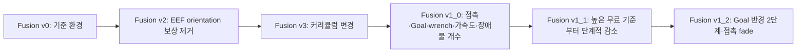

# Contact Sweep Clutter Fusion 버전 비교 — v0 → v2 → v3 → v1_0 → v1_1 → v1_2

[Fusion 기본 환경](CONTACT_SWEEP_CLUTTER_FUSION_ENVIRONMENT.md) · [구현 문서 안내](../README.md) · [활성 환경](../08_ACTIVE_ENVIRONMENTS.md) · [개발·검증 기록](../logs/2026-10-21_clutter_fusion_v3.md)

**기준일: 2026-10-22.** 현재 코드의 상속 순서는 **v0 → v2 → v3 → v1_0 → v1_1 → v1_2**이다. 아래 기존 v1_0 표는 긴급 완화 이전의 기록이며, 최신 파라미터 분기는 마지막 절을 따른다. v1_0의 장애물 개수·접촉 alpha·PhysX 직접 가속도·자동 복구 후속 수정까지 포함한다. 환경 자체의 구성은 [v0 설명서](CONTACT_SWEEP_CLUTTER_FUSION_ENVIRONMENT.md)와 [v1_0 독립 설명서](CONTACT_SWEEP_CLUTTER_FUSION_V1_0_ENVIRONMENT.md)를 읽고, 이 문서에서는 단계별 변경을 확인한다. **네 버전 모두 push_fast 종료 기준은 0.8 m/s**이며 비용의 free speed 커리큘럼과 구분한다.

## 1. 버전의 역할과 상속



| 구분 | v0 | v2 | v3 | v1_0 |
| --- | --- | --- | --- | --- |
| Gym ID의 Fusion 접미사 | `-v0` | `-v2` | `-v3` | `-v1_0` |
| Env Cfg 부모 | Isaac Lab `ManagerBasedRLEnvCfg` | v0 Cfg | v2 Cfg | v3 Cfg |
| EEF orientation 비용 | −0.02 | 제거 | 없음 | 없음 |
| 활성 보상 / 커리큘럼 / 종료 수 | 15 / 5 / 6 | 14 / 5 / 6 | 14 / 11 / 6 | 17 / 9 / 6 |
| 활성 장애물 Gray / White | 1 / 2 고정 | 1 / 2 고정 | 1 / 2 고정 | 1 / 1 → 3 / 3 |
| Goal hold 반경 | 1 cm 고정 | 1 cm 고정 | 1 cm 고정 | 3→1 cm |
| 접촉 보상 | tactile any + count | 동일 | 두 weight 증가 | 손 전체 합력 + Goal 거리 alpha |
| push_fast 종료 속도 | 0.8 m/s | 0.8 m/s | 0.8 m/s | 0.8 m/s |
| Experiment 이름 | `inspire_contact_sweep_clutter_fusion` | `inspire_contact_sweep_clutter_fusion_v2` | `inspire_contact_sweep_clutter_fusion_v3` | `inspire_contact_sweep_clutter_fusion_v1_0` |

모든 Gym ID의 공통 앞부분은 `Isaac-Inspire-Contact-Sweep-Clutter-Fusion`이다. v1_0은 v3을 상속하지만 Reward·Termination·Curriculum CFG는 부모 클래스에서 상속하지 않고 독립 클래스로 선언한다. Scene·Event·runtime은 가변 개수의 활성 물체를 관리하도록 구성한다.

기존 Fusion v1은 v3으로 재작명했으며 현재 v1 task 등록은 없다. 기존 v1의 로그·checkpoint는 당시 조건의 결과로 보존한다. v3은 orientation 보상과 커리큘럼 조건이 달라 과거 v1 학습 결과와 같은 실험으로 취급하지 않는다.

## 2. v0 → v2: EEF orientation 보상 제거

v0의 `eef_orientation`은 EEF의 +Z축이 월드 위쪽을 향하는 정도를 평가하는 보조 비용이다. 두 축 사이 각도가 60°보다 작아지는 구간에서 비용을 주고, weight는 −0.02다. 정확한 함수와 수치는 [기본 환경의 보상 설명](CONTACT_SWEEP_CLUTTER_FUSION_ENVIRONMENT.md#47-작은-자세센서-변화-보조-비용)을 따른다.

v2는 `self.rewards.eef_orientation = None`으로 이 텀을 비활성화한다. Weight를 0으로 설정하는 방식이 아니라 RewardManager의 활성 항목에서 제외하므로 해당 보상 함수를 호출하지 않는다. 이 항목만 제거되어 활성 보상은 v0의 15개에서 v2·v3의 14개가 된다. 관측에서 EEF 자세를 제거하거나 Action의 회전을 제한하는 변경은 아니다.

직접 연결된 EEF 자세 termination은 없다. 기존 물체 낙하·전도, 선반 이동, 손목 높이, Arm 속도, 타겟 속도와 timeout 종료를 유지한다. 물체 전도는 물체 자세, 손목 높이는 위치 조건이므로 EEF orientation 보상과 함께 제거하지 않는다.

v2의 커리큘럼과 나머지 보상·관측·제어·Scene·reset은 v0와 같다.

## 3. v2 → v3: 커리큘럼 변경

v3은 v2의 보상 함수와 종료 조건을 유지하면서, 속도 허용 구간·action rate 가중치·목표 방향·접촉 보상 가중치·wrench 변화율 임계값의 일정을 바꾼다. 초기 Scene이나 물체 수를 변경하는 버전이 아니다.

### 3.1 진행 단위와 시작 시점

일정의 단위는 0부터 시작하는 **PPO Learning iteration**이다. Environment step이나 episode 횟수가 아니다. 현재 runner의 기본 rollout은 iteration당 환경별 36 control step이다.

- **v0·v2의 속도/action 일정:** iteration 300에서 첫 변경, 이후 300마다 갱신한다.
- **v3의 보상 일정 10개:** iteration 499까지 초기값, 500에서 첫 증감, 이후 200마다 갱신한다. 즉 500·700·900·…에서 값이 바뀐다.
- **goal deadzone:** 별도 hold·interval 규칙을 사용하며 아래에서 비교한다.

v3의 `delayed_reward_schedule`은 현재 리워드 값에서 반복해서 빼거나 더하지 않는다. `start`와 현재 iteration으로 값을 다시 계산하여 최종값에서 멈춘다. 리워드 초기 설정과 `start`가 달라도 커리큘럼 적용 시 `start` 기반 값으로 덮어쓴다. `parameter="free_speed"`처럼 지정하면 해당 reward parameter를, `parameter`를 생략하면 해당 텀의 `weight`를 변경한다.

### 3.2 속도와 Action rate

| 항목 | 초기값 | v0·v2 일정 | v3 일정 | 최종 도달 iteration: v0·v2 / v3 |
| --- | --- | --- | --- | --- |
| `pushing_speed.free_speed` | 0.1 m/s | 300마다 −0.01, 최저 0.05 | 500부터 200마다 −0.01, 최저 0.03 | 1500 / 1700 |
| `arm_speed_excess.free_speed` | 1.0 rad/s | 300마다 −0.02, 최저 0.8 | 500부터 200마다 −0.02, 최저 0.7 | 3000 / 3300 |
| `action_rate.weight` | −0.03 | 300마다 −0.005, 최종 −0.06 | 500부터 200마다 −0.005, 최종 −0.06 | 1800 / 1500 |
| `eef_linear_speed.free_speed` | 1.5 m/s | 300마다 −0.02, 최저 0.7 | 500부터 200마다 −0.02, 최저 0.3 | 12000 / 12300 |

v3에서는 물체·Arm·EEF의 최종 무료 속도가 더 낮다. Action rate는 최종 가중치가 같지만 더 짧은 갱신 간격 때문에 최종값에 먼저 도달한다. 지수 비용 함수와 출력 상한, raw Action 변화량의 계산 방식은 유지한다. `joint_velocity`의 가중치와 Arm/Hand 기여 비율에는 새 커리큘럼을 추가하지 않는다.

### 3.3 Contact 보상 가중치 추가

v0·v2의 `contact_any`와 `contact_count` 가중치는 각각 0.4로 고정이다. v3에서는 두 항을 별도로 같은 일정으로 증가시킨다.

| 항목 | 초기값 | v3 첫 변경 | 이후 증가 | 최종값·도달 iteration |
| --- | --- | --- | --- | --- |
| `contact_any.weight` | 0.4 | 500에서 0.42 | 200마다 +0.02 | 2.0, iteration 16300 |
| `contact_count.weight` | 0.4 | 500에서 0.42 | 200마다 +0.02 | 2.0, iteration 16300 |

접촉 판정과 접촉 수의 포화 규칙은 바꾸지 않는다. 동일한 접촉 상태에 지급하는 가중치를 최대 5배로 높이는 일정이다. 실제 접촉 시간·학습된 행동이 같아진다는 뜻은 아니다.

### 3.4 Wrench 변화율 임계값 추가

v0·v2에서는 아래 네 임계값이 고정이다. v3은 iteration 500에서 첫 감소 후 200마다 줄이며, 네 항 모두 iteration 4300에 최종값에 도달한다.

| `wrench_change` parameter | v0·v2 고정값 / v3 초기값 | v3 감소량 / 200 iteration | v3 최종값 |
| --- | --- | --- | --- |
| `free_force_rate` | 2000 N/s | −50 N/s | 1000 N/s |
| `free_moment_rate` | 100 N·m/s | −2.5 N·m/s | 50 N·m/s |
| `saturation_force_rate` | 5000 N/s | −125 N/s | 2500 N/s |
| `saturation_moment_rate` | 250 N·m/s | −6.25 N·m/s | 125 N·m/s |

이 값은 힘·모멘트 자체의 크기가 아니라 **보정 wrench의 시간 변화율** 기준이다. 무료 구간과 포화 구간을 함께 낮춰 더 작은 급격한 변화에도 비용이 발생하게 한다. 별도 wrench termination을 추가하지 않는다.

보상 가중치 −0.1, 지수 형태·sharpness=3, 최대 비용 −0.1/초, episode 누적 양의 보상 대비 최대 5% 예산은 유지한다. 따라서 임계값 감소를 비용 상한 증가로 해석하지 않는다.

### 3.5 Goal deadzone 일정

앞·뒤 축 주변에 목표를 만들지 않는 각도 반폭을 60°에서 0°로 줄이는 방식은 같다. v3은 유지 구간이 길지만 감소 간격이 짧아 전체 방향을 더 이른 iteration에 허용한다.

| 항목 | v0·v2 | v3 |
| --- | --- | --- |
| 초기 deadzone 반각 | ±60° | ±60° |
| `hold_iterations` | 500 | 1000 |
| 감소 간격 | 200 | 100 |
| 감소량 | 1° | 1° |
| 첫 감소 | 700에서 59° | 1100에서 59° |
| 0° 도달 | 12500 | 7000 |

속도·보상 가중치는 rollout 전에 갱신하여 진행 중 episode에도 적용한다. Goal 일정은 다음 reset의 목표 샘플링에만 적용하며 이미 생성된 목표점은 바꾸지 않는다. 반복 reset으로 일정이 중복 진행되지 않는다. Checkpoint 로드 시 저장된 iteration의 단계를 복원하고 재생 중에는 그 단계로 유지한다.

## 4. v3 → v1_0: 보상 입력·물체 수·Goal 허용 범위 변경

v1_0은 v3의 Env/PPO 설정을 기반으로 하되 보상·종료·커리큘럼 CFG를 독립 선언한다. 명시되지 않은 부모 항이 자동으로 남는 구성이 아니다. 아래 표는 현재 최종 구현 기준이며, v1_0을 처음 만든 뒤 같은 task에 적용한 추가 수정까지 포함한다.

### 4.1 Scene과 접촉 관측·보상

| 항목 | v3 | v1_0 |
| --- | --- | --- |
| 장애물 수 | Gray1 + White2 고정 | Gray1 + White1로 시작, 최종 Gray3 + White3 |
| White 증가 | 없음 | 3000·6000에서 1개씩 증가 |
| Gray 증가 | 없음 | 4500·7500에서 1개씩 증가 |
| 장애물 관측 순서 | 고정 물체 슬롯, 가림에 따른 중간0 가능 | 관측 물체를 좌→우 정렬·앞쪽 압축 후 인접 쌍10% 순차 교환. 마스크는1의 prefix와0의 suffix |
| 물체 활성 관리 | 타겟 포함 4개 항상 참여 | 최대 7개 중 episode별 active mask. 다음 reset에서 수 변경 |
| 가림·보상·물체 종료 | 모든 물체 참여 | 활성 물체만 참여. 가려진 활성 장애물은 계속 비용/종료 대상 |
| 촉각 17D | 관측과 any/count 보상 | 관측 전용 |
| 접촉 유지 | tactile ON 여부 | 손 전체 30개 body의 합력 norm ≥ 0.01 N |
| 접촉 수 보상 | `contact_count`, 5개에서 포화 | 삭제 |
| 접촉 weight 일정 | 각 0.4→2.0 | 삭제, `hand_contact` weight 0.29 고정 |
| 목표 근처 접촉 감쇠 | 없음 | `alpha=clamp((d-r)/0.015,0,1)` 곱셈 |
| 비타겟 접촉력 비용 | 별도 항 없음 | 활성 장애물→손 합력 norm > 20 N부터 지수 비용, raw cap100 |

r은 현재 Goal hold 인정 반경이다. 따라서 목표 반경 안에서는 접촉 유지 보상이0, 반경+1.5cm 바깥에서는 최대이며 Goal 커리큘럼과 자동 동기화된다. 손 전체 접촉 보상은 타겟·장애물·선반·바닥을 구분하지 않지만, 비타겟 접촉 비용은 타겟·선반·바닥을 제외한 활성 원기둥들만 계산한다. 두 접촉력은 법선력 벡터를 먼저 합한 뒤 norm을 구한다.

최대 Gray/White 용량과 일정은 설정으로 조정하며 장애물 관측은 계속40D다. 비활성 슬롯은0으로 만들고 가림·1% visibility flip·비용·낙하/전도 판정에서 제외한다. 추가 Gray는 모두 뒤쪽으로 몰지 않고, 첫1개만 후방 조건을 적용하며 나머지는 일반 Gray 영역을 사용한다.

### 4.2 목표와 운동 비용

| 항목 | v3 | v1_0 |
| --- | --- | --- |
| Goal hold 반경 | 0.01 m 고정 | 0.03→0.01 m, 1000부터500마다−0.01, 1500에 최종 |
| Goal progress tolerance | 0.01 m | 0.01 m 고정 유지 |
| Goal deadzone | 60°, hold1000, 100마다1° 감소 | 30°, hold3000, 500마다5° 감소 |
| 첫 deadzone 감소 / 0° 도달 | 1100 / 7000 | 3500 / 6000 |
| Action 변화 비용 | Arm/Hand 합산 `action_rate`, weight−0.03→−0.06 | Arm/Hand 독립 두 항, 각각−0.03 고정 |
| 관절 속도 제곱 비용 | `joint_velocity` 한 항으로 합산, Arm−0.03·Hand−0.01 | Arm/Hand 독립 두 항, −0.03/−0.01 고정 |
| 물체 가속도 비용 | 없음 | PhysX COM 선가속도 norm에 물체별 지수 비용, 활성 합산 |
| 가속도 무료 기준 | 없음 | 1.0→0.1 m/s², 1000부터250마다−0.02, 12000에 최종 |

운동 네 항은 raw Action 변화량·실제 관절 속도의 제곱합과 그룹별 cap100을 사용한다. Action weight 커리큘럼은 제거한다. 타겟·Arm·EEF의 free-speed 일정은 v3과 같으며 각각0.10→0.03m/s, 1.0→0.7rad/s, 1.5→0.3m/s다. 현재 코드의 `pushing_speed` weight는 v3·v1_0 모두−5이므로 이 전환의 차이로 취급하지 않는다.

가속도는 현재 `object_com_lin_acc_w`로 마지막 물리 step의 월드 COM 값을 직접 읽는다. 초기 v1_0 작업 중 사용한 속도 차분은 이후 같은 task에서 교체됐다. 급감속도 포함하고 물체당 raw 상한100, 최종7개 합700으로 제한한다. 0.5m/s²에서 MAX가 되는 곡선은 아니다. 이미 상한이 존재했기 때문에 조건부 포화점 변경은 적용하지 않았다.

### 4.3 Wrench 변화 비용

| 구분 | v3 | v1_0 |
| --- | --- | --- |
| 입력 | 보정 F/T의 world 축 벡터 | 관측과 동일한 보정 EEF 축 표본 |
| 모멘트 기준점 | EEF | EEF |
| 힘 변화량 | `norm(F_current−F_previous)/dt` | `abs(norm(F_current)−norm(F_previous))` |
| 모멘트 변화량 | 벡터 변화율 norm | 모멘트 크기 차의 절댓값 |
| 단위 | N/s, N·m/s | N, N·m |
| 초기 무료 기준 | 2000 N/s, 100 N·m/s | 50 N, 5 N·m |
| 최종 무료 기준 | 1000 N/s, 50 N·m/s | 10 N, 1 N·m |
| 감소 일정 | 500부터200마다 | 1000부터250마다1 N / 0.1 N·m 감소 |
| 최종 도달 | 4300 | 10750 |
| 포화 기준 | 별도 두 curriculum, 5000→2500 N/s 및250→125 N·m/s | 현재 무료 기준의2.5배, 125→25 N 및12.5→2.5 N·m |

기준점이 새로 EEF로 이동한 것이 아니라 **축·참조 표본과 변화량의 정의**가 바뀐 것이다. v1_0은 힘 방향만 바뀌고 크기가 같으면 비용을 주지 않는다. 두 버전 모두 normalized exponential의 raw cap1, weight−0.1, sharpness3, episode 누적 양의 보상 대비5% 예산 제한을 사용한다.

### 4.4 항목 수와 종료 조건

보상은14개에서17개로 바뀐다. Tactile 두 항을 손 전체 한 항으로 바꾸어1개 감소하고, Action/관절 속도 통합 두 항을 네 항으로 분리하여2개 증가하며, 장애물 힘·물체 가속도 두 항을 추가해 최종17개다.

커리큘럼은11개에서9개다. 속도 세 항과 deadzone 한 항을 두고, action weight 한 항·tactile weight 두 항을 제거한다. Wrench 네 기준 일정은 무료 force/moment 두 일정으로 바꾸고, Goal tolerance·물체 가속도·population 세 항을 추가한다. Population 한 항 안에 Gray/White 두 일정이 있다.

종료는6개이며 수치 기준은 유지한다. 다만 물체 낙하/전도 판정은 활성 물체만 대상으로 하는 함수로 명시한다. `push_fast=0.8`, Arm 속도5rad/s, 손목 여유3cm, 선반 변위5cm 및10초 timeout을 유지하고 성공 즉시 종료는 없다.

### 4.5 실행기와 재개

v1_0과 함께 `train_resilient.py`를 추가했다. 이는 새로운 환경 ID나 PPO 알고리즘 변경이 아니라 다른 task에도 지정할 수 있는 학습 supervisor다. 미완료 종료 시 최신 저장 checkpoint−500 이하의 유효 파일에서 새 프로세스로 재개하고, 복원 iteration의 커리큘럼을 적용한 뒤 reset한다. 전체 목표를 절대 iteration으로 해석하고 기본 최대10회 재시작한다.

```bash
./IsaacLab/isaaclab.sh -p src/inspire_sweep_baseline/scripts/train_resilient.py \
  --task Isaac-Inspire-Contact-Sweep-Clutter-Fusion-v1_0 \
  --num_envs 2048 --headless --max_iterations 90000
```

일반 train의 experiment 경로와 supervisor의 `logs/resilient/<task>/<job>/attempt_*`는 구분한다. 상세 복구·중단·checkpoint 검사 규칙은 [v1_0 학습 실행](CONTACT_SWEEP_CLUTTER_FUSION_V1_0_ENVIRONMENT.md#7-정책과-학습-실행)과 [복구 검증 기록](../logs/2026-10-22_clutter_fusion_v1_0_population_recovery.md)을 따른다.

## 5. 네 버전에서 유지하는 설정

네 버전 모두 Actor의 policy55D·초기 obstacles40D, Critic 전용 현재 타겟 위치3D, 8D Action, 로봇·Hand 제어, 타겟/Goal 기본 샘플링, 물성 랜덤화 및 기존 관측 노이즈를 사용한다. 물리 주기0.01초·제어 주기0.02초·최대 episode10초도 같다. v1_0은 장애물 개수·활성 mask·보상용 접촉 센서를 확장하지만 정책 입력 차원을 늘리지 않는다.

**`push_fast.speed_condition=0.8`은 네 버전 모두 동일하다.** 타겟의 월드 선속도 3D norm이 0.8 m/s를 초과하면 종료한다. 커리큘럼의 `pushing_speed.free_speed`는 비용이 시작되는 속도이며 이 종료 임계값을 바꾸지 않는다. EEF의 free speed 역시 타겟 속도 종료 조건과 다른 항목이다.

## 6. 코드 위치와 실행

코드 루트는 Workspace의 `src/inspire_sweep_baseline/inspire_sweep_baseline`이다.

| 위치 | 역할 |
| --- | --- |
| `contact_sweep_clutter_fusion/env_cfg.py`, `curriculum_cfg.py` | v0의 독립 Env Cfg와 기본 5개 일정 |
| `contact_sweep_clutter_fusion_v2/env_cfg.py` | v0 상속, `eef_orientation=None` |
| `contact_sweep_clutter_fusion_v3/env_cfg.py` | v2 상속, v3 curriculum 지정, push_fast=0.8 유지 |
| `contact_sweep_clutter_fusion_v3/curriculum_cfg.py`, `curriculum.py` | v3의 11개 일정과 지연 시작 함수 |
| `contact_sweep_clutter_fusion_v1_0/` | v1_0 Env/Scene/Event·독립 Reward/Termination/Curriculum·활성 물체 runtime |
| 각 버전의 `ppo_cfg.py` | v0 → v2 → v3 → v1_0 PPO 상속, experiment 이름 분리 |
| `scripts/train_resilient.py`, `training_recovery.py` | 절대 목표 iteration·checkpoint 선택·커리큘럼 복원을 포함한 재사용 실행기 |

v0·v2·v3은 `ContactSweepClutterFusionEnv` runtime을 사용한다. v1_0의 `ContactSweepClutterFusionV1_0Env`는 이 runtime을 상속하여 활성 mask와 population reset을 관리한다. 네 task 모두 `CurriculumOnPolicyRunner`를 사용한다. v2는 v0 Curriculum Cfg를 그대로 상속하므로 별도의 v2 Curriculum 클래스를 만들지 않는다.

Workspace 루트에서 v3 학습을 시작하는 명령은 다음과 같다. 다른 버전은 task ID의 접미사를 첫 표에 맞춰 교체한다.

```bash
./IsaacLab/isaaclab.sh -p src/inspire_sweep_baseline/scripts/train.py \
  --task Isaac-Inspire-Contact-Sweep-Clutter-Fusion-v3 \
  --num_envs 2048 --headless
```

## 7. 확인 범위

현재 코드의 Env·PPO 상속, 활성 보상 설정, 커리큘럼 수치와 iteration 계산을 근거로 작성했다. 정적 계약과 학습 성능은 구분한다. v1_0은 앞선 CPU543개 검사, 실제 GPU의 population·접촉·직접 가속도·PPO update·checkpoint 복원을 통과했다. 이번 문서 수정에서 새 학습을 실행하지 않았으며 장기 정책 성능 향상은 확인하지 않았다. 실제 실행한 검사와 미검증 범위는 연결된 개발 로그에 남긴다.

## 파라미터 분기 v1_1 → v1_2 (2026-10-22)

v1_1 EnvCfg는 v1_0을, v1_2 EnvCfg는 v1_1을 상속한다. 공용 runtime은 v1_0이며 보상·커리큘럼은 각각 독립 CFG를 선언한다. PPO는 experiment 이름만 다르다. v1_0 사용자 변경은 보존했다: Goal 1cm 고정·fade 0·장애물 무료 힘 2000N·가속도 100·wrench 5000/500 시작이며 Goal 커리큘럼은 없다.

| 항목 | v1_1 | v1_2 |
| --- | --- | --- |
| Goal hold | 1cm 고정, curriculum 없음 | 2cm→1cm(5000)→0.5cm(10000) |
| Hand fade width | 0: alpha=1 | 1cm, 현재 Goal hold 반경과 동기화 |
| 장애물 무료 힘 | 100→50N, 1000~10000 | 동일 |
| 물체 무료 가속도 | 100→5m/s², 1000~20000 | 동일 |
| 무료 wrench 크기 변화 | 500→5N / 50→0.5Nm, 1000~20000 | 동일 |
| 보상 / 커리큘럼 / 종료 수 | 17 / 9 / 6 | 17 / 10 / 6 |

모든 새 일정은 250 iteration 간격이다. 시작 1000에서 첫 감소가 발생한다. v1_2 Goal은 1000~5000 17회, 5250~10000 20회로 감소한다. 감소량을 endpoint에서 산출해 지정 마지막 iteration에 정확히 도달하고 이후 고정한다. 관측·행동·센서·물리·장애물 개수 일정·다른 보상·종료는 유지한다. 이 변경은 접촉 회피 해결을 입증하는 학습 결과가 아니다.

[독립 v1_1 설명](CONTACT_SWEEP_CLUTTER_FUSION_V1_1_ENVIRONMENT.md) · [독립 v1_2 설명](CONTACT_SWEEP_CLUTTER_FUSION_V1_2_ENVIRONMENT.md) · [검증 기록](../logs/2026-10-22_clutter_fusion_v1_1_v1_2.md)
