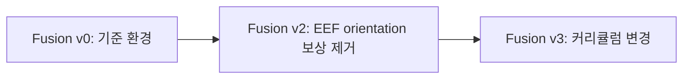

# Contact Sweep Clutter Fusion 버전 비교 — v0 → v2 → v3

[Fusion 기본 환경](CONTACT_SWEEP_CLUTTER_FUSION_ENVIRONMENT.md) · [구현 문서 안내](../README.md) · [활성 환경](../08_ACTIVE_ENVIRONMENTS.md) · [개발·검증 기록](../logs/2026-10-21_clutter_fusion_v3.md)

**기준일: 2026-10-21.** 이 문서는 Fusion의 기본 Scene·관측·제어 설명을 반복하지 않고, 현재 코드에서 확인한 v0·v2·v3의 상속과 차이를 설명한다. 과거에 논의한 push_fast=1.5는 현재 적용하지 않는다. **세 버전 모두 `terminations.push_fast.params["speed_condition"]=0.8`로 고정한다.**

## 1. 버전의 역할과 상속



| 구분 | v0 | v2 | v3 |
| --- | --- | --- | --- |
| Gym task ID | `Isaac-Inspire-Contact-Sweep-Clutter-Fusion-v0` | `Isaac-Inspire-Contact-Sweep-Clutter-Fusion-v2` | `Isaac-Inspire-Contact-Sweep-Clutter-Fusion-v3` |
| Env Cfg 부모 | Isaac Lab `ManagerBasedRLEnvCfg` | Fusion v0 Cfg | Fusion v2 Cfg |
| EEF orientation 보상 | 사용, weight −0.02 | 제거 | v2의 제거 상태 상속 |
| 커리큘럼 | 5개 | v0와 동일 | 11개로 교체·확장 |
| push_fast 종료 속도 | 0.8 m/s | 0.8 m/s | 0.8 m/s |
| 학습 experiment 이름 | `inspire_contact_sweep_clutter_fusion` | `inspire_contact_sweep_clutter_fusion_v2` | `inspire_contact_sweep_clutter_fusion_v3` |

기존 Fusion v1은 v3으로 재작명했으며 현재 v1 task 등록은 없다. 기존 v1의 로그·checkpoint는 당시 조건의 결과로 보존한다. v3은 orientation 보상과 커리큘럼 조건이 달라 과거 v1 학습 결과와 같은 실험으로 취급하지 않는다.

## 2. v0 → v2: EEF orientation 보상 제거

v0의 `eef_orientation`은 EEF의 +Z축이 월드 위쪽을 향하는 정도를 평가하는 보조 비용이다. 두 축 사이 각도가 60°보다 작아지는 구간에서 비용을 주고, weight는 −0.02다. 정확한 함수와 수치는 [기본 환경의 보상 설명](CONTACT_SWEEP_CLUTTER_FUSION_ENVIRONMENT.md#47-작은-자세센서-변화-보조-비용)을 따른다.

v2는 `self.rewards.eef_orientation = None`으로 이 텀을 비활성화한다. Weight를 0으로 설정하는 방식이 아니라 RewardManager의 활성 항목에서 제외하므로 해당 보상 함수를 호출하지 않는다. 이 항목만 제거되어 활성 보상은 v0의 15개에서 v2·v3의 14개가 된다. 관측에서 EEF 자세를 제거하거나 Action의 회전을 제한하는 변경은 아니다.

직접 연결된 EEF 자세 termination은 없다. 기존 물체 낙하·전도, 선반 이동, 손목 높이, Arm 속도, 타겟 속도와 timeout 종료를 유지한다. 물체 전도는 물체 자세, 손목 높이는 위치 조건이므로 EEF orientation 보상과 함께 제거하지 않는다.

v2의 커리큘럼과 나머지 보상·관측·제어·Scene·reset은 v0와 같다.

## 3. v2 → v3: 커리큘럼 변경

v3은 v2의 보상 함수와 종료 조건을 유지하면서, 속도 허용 구간·action rate 가중치·목표 방향·접촉 보상 가중치·wrench 변화율 임계값의 일정을 바꾼다. 초기 Scene이나 물체 수를 변경하는 버전이 아니다.

### 3.1 진행 단위와 시작 시점

일정의 단위는 0부터 시작하는 **PPO Learning iteration**이다. Environment step이나 episode 횟수가 아니다. 현재 runner의 기본 rollout은 iteration당 환경별 36 control step이다.

- **v0·v2의 속도/action 일정:** iteration 300에서 첫 변경, 이후 300마다 갱신한다.
- **v3의 보상 일정 10개:** iteration 499까지 초기값, 500에서 첫 증감, 이후 200마다 갱신한다. 즉 500·700·900·…에서 값이 바뀐다.
- **goal deadzone:** 별도 hold·interval 규칙을 사용하며 아래에서 비교한다.

v3의 `delayed_reward_schedule`은 현재 리워드 값에서 반복해서 빼거나 더하지 않는다. `start`와 현재 iteration으로 값을 다시 계산하여 최종값에서 멈춘다. 리워드 초기 설정과 `start`가 달라도 커리큘럼 적용 시 `start` 기반 값으로 덮어쓴다. `parameter="free_speed"`처럼 지정하면 해당 reward parameter를, `parameter`를 생략하면 해당 텀의 `weight`를 변경한다.

### 3.2 속도와 Action rate

| 항목 | 초기값 | v0·v2 일정 | v3 일정 | 최종 도달 iteration: v0·v2 / v3 |
| --- | --- | --- | --- | --- |
| `pushing_speed.free_speed` | 0.1 m/s | 300마다 −0.01, 최저 0.05 | 500부터 200마다 −0.01, 최저 0.03 | 1500 / 1700 |
| `arm_speed_excess.free_speed` | 1.0 rad/s | 300마다 −0.02, 최저 0.8 | 500부터 200마다 −0.02, 최저 0.7 | 3000 / 3300 |
| `action_rate.weight` | −0.03 | 300마다 −0.005, 최종 −0.06 | 500부터 200마다 −0.005, 최종 −0.06 | 1800 / 1500 |
| `eef_linear_speed.free_speed` | 1.5 m/s | 300마다 −0.02, 최저 0.7 | 500부터 200마다 −0.02, 최저 0.3 | 12000 / 12300 |

v3에서는 물체·Arm·EEF의 최종 무료 속도가 더 낮다. Action rate는 최종 가중치가 같지만 더 짧은 갱신 간격 때문에 최종값에 먼저 도달한다. 지수 비용 함수와 출력 상한, raw Action 변화량의 계산 방식은 유지한다. `joint_velocity`의 가중치와 Arm/Hand 기여 비율에는 새 커리큘럼을 추가하지 않는다.

### 3.3 Contact 보상 가중치 추가

v0·v2의 `contact_any`와 `contact_count` 가중치는 각각 0.4로 고정이다. v3에서는 두 항을 별도로 같은 일정으로 증가시킨다.

| 항목 | 초기값 | v3 첫 변경 | 이후 증가 | 최종값·도달 iteration |
| --- | --- | --- | --- | --- |
| `contact_any.weight` | 0.4 | 500에서 0.42 | 200마다 +0.02 | 2.0, iteration 16300 |
| `contact_count.weight` | 0.4 | 500에서 0.42 | 200마다 +0.02 | 2.0, iteration 16300 |

접촉 판정과 접촉 수의 포화 규칙은 바꾸지 않는다. 동일한 접촉 상태에 지급하는 가중치를 최대 5배로 높이는 일정이다. 실제 접촉 시간·학습된 행동이 같아진다는 뜻은 아니다.

### 3.4 Wrench 변화율 임계값 추가

v0·v2에서는 아래 네 임계값이 고정이다. v3은 iteration 500에서 첫 감소 후 200마다 줄이며, 네 항 모두 iteration 4300에 최종값에 도달한다.

| `wrench_change` parameter | v0·v2 고정값 / v3 초기값 | v3 감소량 / 200 iteration | v3 최종값 |
| --- | --- | --- | --- |
| `free_force_rate` | 2000 N/s | −50 N/s | 1000 N/s |
| `free_moment_rate` | 100 N·m/s | −2.5 N·m/s | 50 N·m/s |
| `saturation_force_rate` | 5000 N/s | −125 N/s | 2500 N/s |
| `saturation_moment_rate` | 250 N·m/s | −6.25 N·m/s | 125 N·m/s |

이 값은 힘·모멘트 자체의 크기가 아니라 **보정 wrench의 시간 변화율** 기준이다. 무료 구간과 포화 구간을 함께 낮춰 더 작은 급격한 변화에도 비용이 발생하게 한다. 별도 wrench termination을 추가하지 않는다.

보상 가중치 −0.1, 지수 형태·sharpness=3, 최대 비용 −0.1/초, episode 누적 양의 보상 대비 최대 5% 예산은 유지한다. 따라서 임계값 감소를 비용 상한 증가로 해석하지 않는다.

### 3.5 Goal deadzone 일정

앞·뒤 축 주변에 목표를 만들지 않는 각도 반폭을 60°에서 0°로 줄이는 방식은 같다. v3은 유지 구간이 길지만 감소 간격이 짧아 전체 방향을 더 이른 iteration에 허용한다.

| 항목 | v0·v2 | v3 |
| --- | --- | --- |
| 초기 deadzone 반각 | ±60° | ±60° |
| `hold_iterations` | 500 | 1000 |
| 감소 간격 | 200 | 100 |
| 감소량 | 1° | 1° |
| 첫 감소 | 700에서 59° | 1100에서 59° |
| 0° 도달 | 12500 | 7000 |

속도·보상 가중치는 rollout 전에 갱신하여 진행 중 episode에도 적용한다. Goal 일정은 다음 reset의 목표 샘플링에만 적용하며 이미 생성된 목표점은 바꾸지 않는다. 반복 reset으로 일정이 중복 진행되지 않는다. Checkpoint 로드 시 저장된 iteration의 단계를 복원하고 재생 중에는 그 단계로 유지한다.

## 4. 세 버전에서 유지하는 설정

세 버전 모두 Actor의 policy55D·초기 obstacles40D, Critic 전용 현재 타겟 위치3D, 8D Action, 로봇·Hand 제어, 물성·초기 배치·센서 모델과 관측 노이즈를 공유한다. 차이는 위 orientation 보상과 커리큘럼이다.

**`push_fast.speed_condition=0.8`은 세 버전 모두 동일하다.** 타겟의 월드 선속도 3D norm이 0.8 m/s를 초과하면 종료한다. 커리큘럼의 `pushing_speed.free_speed`는 비용이 시작되는 속도이며 이 종료 임계값을 바꾸지 않는다. EEF의 free speed 역시 타겟 속도 종료 조건과 다른 항목이다.

## 5. 코드 위치와 실행

코드 루트는 Workspace의 `src/inspire_sweep_baseline/inspire_sweep_baseline`이다.

| 위치 | 역할 |
| --- | --- |
| `contact_sweep_clutter_fusion/env_cfg.py`, `curriculum_cfg.py` | v0의 독립 Env Cfg와 기본 5개 일정 |
| `contact_sweep_clutter_fusion_v2/env_cfg.py` | v0 상속, `eef_orientation=None` |
| `contact_sweep_clutter_fusion_v3/env_cfg.py` | v2 상속, v3 curriculum 지정, push_fast=0.8 유지 |
| `contact_sweep_clutter_fusion_v3/curriculum_cfg.py`, `curriculum.py` | v3의 11개 일정과 지연 시작 함수 |
| 각 버전의 `ppo_cfg.py` | v0 → v2 → v3 PPO 상속, experiment 이름 분리 |

세 task 모두 기존 `ContactSweepClutterFusionEnv` runtime과 `CurriculumOnPolicyRunner`를 사용한다. v2는 v0 Curriculum Cfg를 그대로 상속하므로 별도의 v2 Curriculum 클래스를 만들지 않는다.

Workspace 루트에서 v3 학습을 시작하는 명령은 다음과 같다. v0·v2는 task ID를 첫 표의 값으로 교체한다.

```bash
./IsaacLab/isaaclab.sh -p src/inspire_sweep_baseline/scripts/train.py \
  --task Isaac-Inspire-Contact-Sweep-Clutter-Fusion-v3 \
  --num_envs 2048 --headless
```

## 6. 확인 범위

현재 코드의 Env·PPO 상속, 활성 보상 설정, 커리큘럼 수치와 iteration 계산을 근거로 작성했다. CPU 검사는 설정·상속·수치 경계를 확인하는 범위이며 실제 Isaac Sim/PhysX 실행이나 정책의 성능 향상을 입증하지 않는다. 실제 실행한 검사와 미검증 범위는 연결된 개발 로그에 남긴다.
