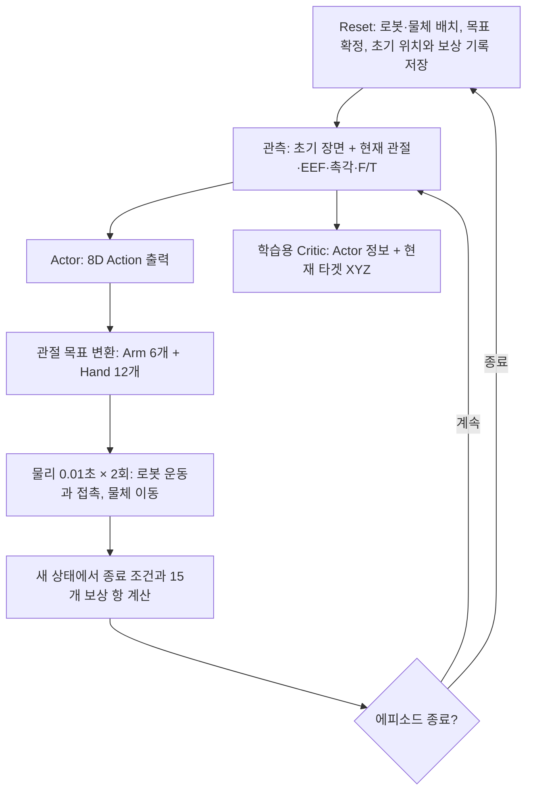

# Contact Sweep Clutter v1 — 관측·행동·보상으로 보는 MDP

[구현 문서 목록](../README.md)

기준일: 2026-10-20. 대상 환경은 **`Isaac-Inspire-Contact-Sweep-Clutter-v1`**이다. 이 문서는 현재 실행 설정과 보상 함수를 기준으로 한 에피소드의 입력, 행동, 상태 전이, 보상, 종료를 설명한다.

## 1. 태스크와 상태

UR5e와 Inspire Hand가 선반 위의 **타겟 물체 1개를 지정된 목표 위치로 밀고, 목표에 머무르도록 하는 작업**이다. 주변에는 장애물 3개가 있다. 정책은 타겟과 장애물의 초기 위치를 받고, 실행 중에는 관절 상태·손의 자세·촉각·손목 힘/토크를 사용한다.

| 항목 | 설정 |
| --- | --- |
| 실제 물체 | 타겟 1개 + 장애물 3개 |
| 물체 형상 | 반지름 4 cm, 높이 10 cm인 원기둥 |
| 물체 위치의 기준점 | 원기둥 **밑면 중심**의 link 원점 |
| 장면 작업 영역 | 선반 로컬 X ±0.20 m, Y ±0.50 m |
| 시작 타겟 위치 | 선반 중앙의 반경 2 cm 원판 안에서 샘플링 |
| 목표 | 시작 타겟에서 최대 15 cm 떨어진 위치; 선반 로컬 ±X 방향 각각 ±15°를 제외하고 방향 샘플링, 선반 여유 영역에 맞게 거리 제한 |
| 장애물 배치 | 목표를 확정한 뒤 물체 간 여유·손의 접근 공간을 고려해 3개 배치 |
| 물리 적분 | 0.01초마다 1회, 100 Hz |
| 정책의 제어 주기 | 물리 2회마다 1회, **0.02초 / 50 Hz** |
| 에피소드 상한 | **10초 / 500개 제어 step** |

물체 질량과 마찰은 에피소드마다 샘플링한다. 같은 환경 안의 네 원기둥에는 동일한 질량·마찰 샘플을 적용한다. 이 물성값 자체는 정책 관측에 포함하지 않는다.

시뮬레이터의 상태에는 로봇과 모든 물체의 현재 pose·속도, 물성, 접촉 상태, 목표, 초기 위치, 직전 Action, 에피소드 경과 step이 포함된다. 보상에 사용되는 최선 접근 거리·최선 목표 진행 기록도 상태의 일부다. Actor는 이 전체 상태를 받지 않으므로 **Actor 관점에서는 부분 관측 문제**다. 현재 타겟 위치를 학습용 Critic에만 추가 제공한다.

## 2. 한 에피소드의 MDP 흐름



1. **Reset:** 로봇 기준 자세, 타겟·장애물, 목표와 물성을 설정한다. 타겟·장애물 초기 관측과 보상 계산용 정확한 초기 위치를 저장하고, 거리 개선 기록을 초기화한다.
2. **관측:** Actor가 초기 장면 정보와 현재 센서·로봇 상태를 받는다. 첫 관측의 Action 이력은 Arm 6개가 0, Hand 2개가 1이다. 새 물리 측정이 없는 reset 직후 촉각과 F/T는 0이다.
3. **정책 출력:** Actor가 8차원 Action을 출력한다. Arm 관절 위치 목표와 Hand 개방도를 계산한다.
4. **전이:** 이 목표를 유지하면서 물리 시뮬레이션을 두 번 진행한다. 로봇과 물체의 상태가 바뀐다.
5. **평가:** 전이 후 상태에서 종료 조건을 판정하고 보상을 계산한다. 종료되는 step의 보상도 reset 전 상태를 사용한다.
6. **다음 입력:** 계속되는 환경은 다음 관측을 생성한다. 종료된 환경은 먼저 reset하고 새 에피소드의 관측을 반환한다. 병렬 환경 중 일부만 종료되면 해당 환경의 초기 위치와 기록만 갱신한다.

Critic은 학습 중 상태 가치를 추정한다. 실행 시 Action을 결정하는 경로는 Actor다.

## 3. Observation — 무엇을 관측하는가

### 3.1 좌표계와 시간 기준

- **Robot-root frame:** 로봇 베이스를 원점과 축으로 사용하는 좌표계. 타겟 시작 위치, 장애물 초기 위치, EEF pose, 목표 위치와 Critic의 현재 타겟 위치를 이 좌표계로 표현한다.
- **World frame:** 중력의 위쪽을 Z로 두는 시뮬레이션 좌표계. 목표 거리·목표 유지 보상의 XY는 이 좌표계의 수평면이다.
- **EEF frame:** 손목에 고정된 말단 기준점의 축과 원점. F/T의 힘·모멘트 표현에 사용한다.
- **초기값:** reset 때 정한 값과 측정 오차를 에피소드 동안 유지한다.
- **현재값:** 각 제어 step에서 갱신한다.

### 3.2 Actor의 기본 관측: `policy` 57D

아래 인덱스는 0부터 시작하는 Python slice이며, 끝 인덱스는 포함하지 않는다.

| 인덱스 | 관측 항목 | 차원 | 의미·단위 | 갱신·노이즈 |
| --- | --- | ---: | --- | --- |
| `0:6` | `joint_pos` | 6 | Arm 현재 관절각 − 기준 관절각, rad | 매 step |
| `6:12` | `joint_vel` | 6 | Arm 현재 관절속도 − 기준 관절속도, rad/s; 기준 속도는 0 | 매 step |
| `12:20` | `actions` | 8 | 직전에 실행한 raw Action | 매 step |
| `20:23` | `target_obs_state` | 3 | 타겟 **시작 위치**의 robot-root XYZ, m | reset 때 고정, 축별 ±1 cm 오차도 고정 |
| `23:24` | `target_obj_width` | 1 | 물체 크기 값, m. 이름은 width지만 실제 저장값은 **반지름 0.04 m** | 매 관측마다 Uniform ±0.01 m 오차 |
| `24:31` | `ee_pose` | 7 | EEF 위치 XYZ 3D + quaternion 4D, robot-root 기준 | 매 step; quaternion 순서는 `(w,x,y,z)` |
| `31:34` | `goal_pos` | 3 | 목표 XYZ, robot-root 기준, m | 에피소드 동안 고정 |
| `34:51` | `tactile` | 17 | 각 촉각 영역의 접촉 bit, 0 또는 1 | 매 step |
| `51:57` | `wrist_wrench` | 6 | EEF 기준 `[Fx,Fy,Fz,Mx,My,Mz]`, N 및 N·m | 매 step |

타겟이 이동해도 `target_obs_state`는 바뀌지 않는다. 목표도 reset 때 확정한 위치를 유지한다. 초기 타겟 위치의 오차는 매 step 다시 추출하지 않으므로, 관측이 흔들리는 것으로 타겟 이동을 표현하지 않는다.

Hand의 12개 관절각·관절속도는 이 벡터에 직접 들어가지 않는다. Hand 명령 이력은 8D Action 중 마지막 두 값에 포함된다. 관측 이력 stack과 recurrent hidden state는 사용하지 않으며 Actor/Critic의 관측 정규화도 꺼져 있다.

### 3.3 촉각 17D와 F/T 6D

촉각 채널의 순서는 **손바닥 1개 → 엄지 4개 → 검지·중지·약지·소지 각각 3개**다. 총 17개 채널을 서로 분리된 0/1 값으로 제공한다.

각 채널은 직접 패드 접촉 힘 또는 해당 영역으로 투영된 손가락 본체 접촉 힘의 크기가 **0.01 N 이상**이면 ON이다. 본체 접촉은 물체와의 접촉점이 정해진 패드 영역에 해당할 때만 해당 채널로 배정한다. 직접 패드와 투영 접촉의 판정은 OR로 합친다.

타겟과 장애물 모두 촉각 접촉을 만들 수 있다. 직접 패드의 접촉은 상대 물체 ID로 제한하지 않는다. Actor에는 접촉한 물체의 ID, 접촉 위치나 힘의 크기를 추가하지 않고 17개 bit만 전달한다.

F/T는 손목의 fixed-joint 반력을 EEF의 축과 기준점으로 변환한 값이다. 모멘트 변환에는 센서 위치와 EEF 사이의 거리도 반영한다. 중력·관성 성분을 제거하거나 영점 보정한 값이 아니므로 물체 접촉 이외의 하중도 포함할 수 있다.

### 3.4 장애물 초기 관측: `obstacles` 40D

각 슬롯은 `[present, x, y, z]`의 4개 값이며 총 10개 슬롯을 사용한다.

| 슬롯 | 내용 |
| --- | --- |
| 처음 3개 | 실제 장애물. `present=1`, robot-root 초기 XYZ에 축별 ±1 cm 오차를 한 번 적용 |
| 나머지 7개 | 빈 슬롯. 네 값 모두 0 |

40D 전체가 에피소드 동안 고정된다. 장애물이 움직여도 위치 관측을 갱신하지 않는다. 빈 슬롯은 실제 물체가 아니며, 이 입력에는 타겟을 넣지 않는다.

Actor는 이 40D를 **40 → 32(ReLU) → 16**의 학습 가능한 MLP로 압축한 뒤 기본 57D와 연결한다.

### 3.5 Critic의 현재 타겟 관측과 네트워크 입력

Critic에는 `privileged.target_position`으로 **현재 타겟의 robot-root XYZ 3D**를 추가한다. 시뮬레이터의 실제 위치이며 관측 노이즈를 넣지 않는다. 추가값은 현재 위치만 포함한다.

| 구분 | 원시 관측 | 장애물 압축 후 입력 | 출력 |
| --- | --- | --- | --- |
| Actor | `policy` 57D + `obstacles` 40D = **97D** | **73D** | 8D Action |
| Critic | `policy` 57D + `privileged` 3D + `obstacles` 40D = **100D** | **76D** | 상태 가치 1D |

Actor와 Critic은 각각 별도의 장애물 인코더를 학습한다. 이후 MLP의 hidden dimension은 `[256,128,64]`, 활성화는 ELU다. Actor는 현재 타겟 위치를 입력받지 않는다. 보상 계산기는 관측 벡터와 별도로 시뮬레이터의 현재 타겟·장애물 상태를 사용한다.

## 4. Action — 어떤 명령을 출력하는가

Action은 **Arm 6D + Hand 2D = 8D**의 연속 벡터다. 학습 시 Actor의 Gaussian 정책에서 Action을 샘플링하고, 재생 시에는 결정론적 정책 출력을 사용한다.

### 4.1 Arm: 기준 자세에 대한 관절 위치 목표 6D

| Action 인덱스 | 관절 | 기준 관절각, rad |
| --- | --- | ---: |
| 0 | `shoulder_pan_joint` | 0.0 |
| 1 | `shoulder_lift_joint` | −2.2 |
| 2 | `elbow_joint` | 2.2 |
| 3 | `wrist_1_joint` | 0.0 |
| 4 | `wrist_2_joint` | 1.57 |
| 5 | `wrist_3_joint` | 0.785 |

각 Arm 관절의 목표 위치는 다음과 같다.

```math
q^{\mathrm{cmd}}_{j,t}=q^{\mathrm{default}}_j+0.5a_{j,t},
\qquad j=0,\ldots,5.
```

예를 들어 첫 관절의 Action이 0.2이면 목표 관절각은 0.1 rad다. 같은 Action을 계속 출력하면 같은 목표 관절각을 유지한다. 현재 관절각에 매번 증분을 누적하는 명령이 아니다.

Action은 Cartesian 이동량이나 torque가 아니라 **관절 위치 목표**로 변환되어 actuator에 전달된다. Arm Action에 설정된 별도 clip은 없으며 runner의 `clip_actions`도 `None`이다. 물리 actuator의 속도 제한은 앞의 세 관절 2 rad/s, 손목 세 관절 4 rad/s이고 effort 제한은 각각 150 N·m와 28 N·m다.

### 4.2 Hand: 개방도 2D를 12개 관절 목표로 변환

| Action 인덱스 | 의미 |
| --- | --- |
| 6 | 엄지 대립 관절을 제외한 11개 굴곡 관절의 공통 개방도 |
| 7 | 엄지 대립 관절 `inspire_left_thumb_1_joint`의 개방도 |

Hand 명령은 먼저 `[0,1]`로 clamp한다. **0은 닫힘, 1은 열림**이다. 각 관절의 목표는 닫힌 자세와 열린 자세 사이를 선형 보간한다.

```math
u=\min(\max(a,0),1),\qquad
q^{\mathrm{cmd}}=q^{\mathrm{closed}}+
u\left(q^{\mathrm{open}}-q^{\mathrm{closed}}\right).
```

열린 자세의 12개 관절각은 모두 0 rad다. 닫힌 자세는 다음 값을 사용한다.

| 관절 | 닫힘 목표, rad | 사용 개방도 |
| --- | ---: | --- |
| 엄지 1 | 1.1641 | Action 7 |
| 엄지 2 | 0.5864 | Action 6 |
| 엄지 3 | 0.47052736 | Action 6 |
| 엄지 4 | 0.446389306432 | Action 6 |
| 검지·중지·약지·소지의 각 첫 관절 | 1.4381 | Action 6 |
| 검지·중지·약지·소지의 각 둘째 관절 | 1.55933183 | Action 6 |

Hand actuator의 관절 속도 제한은 1 rad/s, effort 제한은 0.20 N·m다. 실제 제어에는 clamp된 개방도를 쓰지만, 관측의 Action 이력과 Action 변화량 페널티에는 **clamp 전 raw Action**을 사용한다.

## 5. Reward — 무엇을 잘했을 때 보상을 받는가

총 **15개 항**의 합이 한 step의 보상이다. 접근·목표 진행 두 항은 새로 개선한 거리만큼 보상을 주며, `shelf_failure`는 실패 step에 한 번 −3을 지급한다. 나머지 항은 현재 상태의 보상률 또는 비용률에 제어 시간 `Δt=0.02초`를 곱해 누적한다.

아래 표의 **step 보상**은 가중치와 시간 처리를 모두 반영한 값이다.

| 항목 | step 보상 | 의미 |
| --- | --- | --- |
| `reaching` | `+30 × 새 최선 접근 개선량(m)` | EEF가 타겟에 더 가까이 접근 |
| `goal_distance` | `+100 × 새 최선 목표 진행량(m)` | 타겟이 목표 XY에 더 가까이 이동 |
| `goal_hold` | `+0.9 × 목표 반경 내 여부 × Δt` | 목표에 머무르는 시간 |
| `contact_any` | `+0.16 × (접촉 채널 ≥1) × Δt` | 하나 이상의 촉각 접촉 |
| `contact_count` | `+0.16 × min(접촉 채널 수,5)/5 × Δt` | 최대 5개까지 접촉 수 증가 |
| `arm_action_rate` | `−0.03 × min(Arm raw Action 변화 제곱합,100) × Δt` | Arm 명령 변화 억제 |
| `hand_action_rate` | `−0.03 × min(Hand raw Action 변화 제곱합,100) × Δt` | Hand 명령 변화 억제 |
| `arm_joint_velocity` | `−0.03 × min(Arm 6관절 속도 제곱합,100) × Δt` | 실제 Arm 관절 운동 비용 |
| `hand_joint_velocity` | `−0.01 × min(Hand 12관절 속도 제곱합,100) × Δt` | 실제 Hand 관절 운동 비용 |
| `object_tilt` | `−2 × 네 물체의 기울기 비용 합 × Δt` | 타겟·장애물의 기울어짐 억제 |
| `shelf_collision` | `−0.5 × 선반 이동·근접 비용 × Δt` | 선반 교란과 낮은 손 위치 억제 |
| `shelf_failure` | `−3 × shelf_collision 종료 여부` | 해당 실패의 마지막 step에 일회성 비용 |
| `pushing_speed` | `−2 × E(타겟 속력,1.0) × Δt` | 타겟 과속 비용 |
| `arm_speed_excess` | `−1 × E(Arm 최대 절대 관절속도,0.5) × Δt` | Arm 과속 비용 |
| `obstacle_displacement` | `−5 × min(장애물 초기 대비 XYZ 이동 제곱합,0.04) × Δt` | 장애물 위치 유지 |

### 5.1 Reaching: 새 최선 접근 거리

EEF 기준점과 **현재 타겟 밑면 중심** 사이의 3D 거리를 사용한다. 10 cm 이내는 추가 접근 보상에서 같은 거리로 취급한다.

```math
d_t=\max\left(\|p_{\mathrm{EEF},t}-p_{T,t}\|_2-0.10,0\right),
\qquad b_0=d_0,
```

```math
b_t=\min(b_{t-1},d_t),\qquad
R_{\mathrm{reach},t}=30(b_{t-1}-b_t).
```

이전 최선보다 1 cm 더 접근하면 +0.3이다. 멈춰 있거나, 멀어졌다가 이전 최선 위치로 돌아오는 행동에는 추가 보상이 없다. EEF는 손목에 고정된 기준점이므로 손가락만 구부리는 것은 EEF 접근량을 만들지 않는다. 타겟이 EEF 쪽으로 이동해 상대 거리가 줄어드는 경우에도 접근 개선량이 생길 수 있다.

### 5.2 Goal Distance: 새 최선 목표 진행량

현재 타겟과 목표 사이의 **월드 XY 거리**를 사용한다. 목표의 반경 1 cm에 들어오면 이 진행 보상의 거리 개선 예산을 모두 얻은 것으로 취급한다.

```math
\ell_t=\max\left(\|p_{T,t,xy}-g_{xy}\|_2-0.01,0\right),
\qquad h_t=\max(\ell_0-\ell_t,0),
```

```math
H_0=0,\qquad H_t=\max(H_{t-1},h_t),\qquad
R_{\mathrm{goal},t}=100(H_t-H_{t-1}).
```

새 최선 기록을 1 cm 개선하면 +1.0이다. 목표에서 멀어지는 step에 이 항 자체가 음수가 되지는 않지만, 이전 최고 기록까지 다시 접근해도 중복 보상을 받지 않는다. 예를 들어 초기 목표 거리가 15 cm이면 반경 1 cm까지의 총 진행 보상은 최대 +14다.

### 5.3 Goal 유지: 반경 안에서 시간에 비례해 누적

조건은 **월드 XY 목표 거리 ≤1 cm**다. 조건을 만족하면 step당 `0.9×0.02=0.018`을 받는다.

| 만족 시간 | 누적 보상 |
| --- | ---: |
| 1초 | +0.9 |
| 5초 | +4.5 |
| 10초 | +9.0 |

순간 보상률은 +0.9/초로 일정하다. 연속 체류 시간이 길어질수록 순간 보상률이 증가하는 ramp는 없다. 반경 밖에서는 0이고, 다시 들어오면 즉시 보상을 받는다. 따라서 여러 번 나누어 반경 안에 있더라도 총 체류 시간이 5초면 +4.5다.

이 조건 자체는 높이와 속도를 검사하지 않는다. 물체 낙하·전도·과속 등의 종료 조건은 별도로 적용된다.

### 5.4 Contact: 접촉 존재와 접촉 수

현재 17개 tactile bit 중 ON인 수를 `n`이라 한다. 두 보상은 같은 제어 step의 최신 촉각 판독값을 사용한다.

| ON 채널 수 | `contact_any` 보상률 | `contact_count` 보상률 | 합계, 초당 |
| ---: | ---: | ---: | ---: |
| 0 | 0 | 0 | 0 |
| 1 | +0.16 | +0.032 | +0.192 |
| 2 | +0.16 | +0.064 | +0.224 |
| 3 | +0.16 | +0.096 | +0.256 |
| 4 | +0.16 | +0.128 | +0.288 |
| 5 이상 | +0.16 | +0.16 | +0.32 |

5개 이상 접촉을 7초 유지하면 +1.12씩, 합 +2.24다. `n`은 접촉한 물체 수나 손가락 수가 아니라 **활성 tactile 채널 수**다. 이 보상에는 타겟과 장애물의 접촉을 구분하는 조건이 없다.

### 5.5 Action 변화량과 관절속도: 네 개의 운동 비용

Action 비용은 현재와 직전 raw Action의 차이를 **제곱한 뒤 합산**한다. Arm 6개와 Hand 2개를 분리하며 평균이나 정규화를 하지 않는다. 시간으로 나누지 않으므로 Action 미분값이 아니라 step 사이 변화량의 비용이다.

관절속도 비용은 Arm 6개, Hand 12개의 **실제 관절속도**를 각각 제곱해 합산한다. 관절 목표 속도를 사용하는 항이 아니다. 네 항 각각은 제곱합을 계산한 후 최대 100으로 제한한다. 이 상한은 보상 함수 출력에 대한 것이며 raw 입력을 바꾸지 않는다.

### 5.6 물체 기울기와 선반 비용

`object_tilt`는 각 물체의 위쪽 축과 **현재 선반 법선** 사이의 각도 `θ`를 사용한다. 각 물체의 비용은 다음과 같고, 타겟·장애물 네 개에 대해 합산한다.

```math
c_{\mathrm{tilt}}(\theta)=
\left[\min\left(\max\left(
\frac{\theta-0.0872664626}{0.9-0.0872664626},0\right),1\right)\right]^2.
```

5° 이하는 비용 0, 0.9 rad 이상은 해당 물체의 raw 비용 1이다. 네 물체가 모두 최대 비용이면 이 항은 초당 −8이다.

`shelf_collision`은 접촉 힘을 직접 적분하는 항이 아니라 다음 수치 조건의 합이다.

- **선반 이동 항:** 선반의 초기 대비 위치 변화 norm과 `root_vel_w`의 6D norm을 더한 값이 0.005보다 크면 1.
- **근접 gate:** EEF가 `선반 root 위치 +(0,0,1.06)`에서 20 cm 미만 거리에 있을 때 아래 높이 비용을 활성화.
- **손가락 높이:** 두 가상 손가락 기준점의 높이 `h`에 대해 `clip(1−h/0.02,0,1)`을 각각 합산.
- **손목 높이:** 손목 기준점 높이 `h`에 대해 `clip(1−h/0.08,0,1)`을 추가.

이 높이들은 `선반 root Z +1.06`을 기준으로 측정한다. 비용 합에 −0.5를 곱한다. 선반 이동 항은 구현상 위치·6D 속도의 norm을 수치적으로 더한 조건이므로, 0.005를 단일 물리 단위의 접촉 임계값으로 해석하지 않는다.

### 5.7 물체·Arm 과속 비용

표의 지수 비용 함수 `E`는 다음과 같다.

```math
E(v,v_{\mathrm{free}})=
\min\left(\frac{\exp(2\max(v-v_{\mathrm{free}},0))-1}{2},100\right).
```

실제 계산에서는 지수 입력도 제한하여 큰 입력에 의한 overflow를 막는다.

| 항목 | 속도의 정의 | 비용이 시작되는 기준 | 계수 |
| --- | --- | --- | ---: |
| `pushing_speed` | 타겟의 3D 선속도 norm, m/s | 1.0 m/s 초과 | −2 |
| `arm_speed_excess` | Arm 6관절 중 절댓값이 가장 큰 속도, rad/s | 0.5 rad/s 초과 | −1 |

`arm_speed_excess`는 모든 관절의 속도 제곱합을 사용하는 `arm_joint_velocity`와 함께 적용된다. 타겟 속력의 **종료 기준은 0.8 m/s 초과**로 따로 설정되어 있으므로, 속도 보상 기준 1.0 m/s가 실행 허용 속도를 의미하지 않는다.

### 5.8 장애물 이동 비용

각 장애물의 **노이즈 없는 초기 월드 XYZ**와 현재 월드 XYZ의 차이를 사용한다. 타겟과 빈 관측 슬롯은 계산 대상에서 제외한다.

```math
C_{\mathrm{obs},t}
=\min\left(\sum_{i=1}^{3}
\|p_{i,t}-p_{i,0}\|_2^2,\ 0.04\right),
\qquad R_{\mathrm{obs},t}=-5C_{\mathrm{obs},t}\Delta t.
```

이는 이동 경로의 누적 길이가 아니라 **현재 위치가 시작점에서 벗어난 정도**다. 장애물이 시작 위치로 돌아오면 이 항의 비용은 다시 0이 된다. 수평 이동과 높이 변화 모두 계산한다. Actor의 초기 관측 노이즈는 이 비용에 포함하지 않는다.

장애물 2개가 각각 10 cm 떨어져 있으면 제곱합은 0.02 m², 비용률은 −0.1/초다. 그 상태가 10초 유지되면 −1.0이다. 전체 제곱합 상한이 0.04 m²이므로 최대 비용률은 −0.2/초, 10초 누적 비용의 크기는 2를 넘지 않는다. 비유한 장애물 비용도 상한으로 포화시킨다.

### 5.9 선반 실패의 일회성 비용

`shelf_collision` 종료 조건이 참인 step에 `shelf_failure`로 정확히 −3을 차감한다. 기존 연속 `shelf_collision` 비용과 별도로 합산한다. TerminationManager가 현재 step의 실패를 판정한 뒤 RewardManager가 이 비용을 계산하며, 그 이후에 환경을 reset한다. 따라서 종료 전이의 반환 보상에 비용이 포함되고 reset 때문에 누락되지 않는다. 함수가 `step_dt`로 나누어 RewardManager의 시간 배율을 상쇄하므로 −0.06이 아닌 −3이다.

Timeout만 발생하거나 다른 실패만 발생한 경우에는 0이다. `shelf_collision`과 다른 종료 조건이 동시에 참이어도 이 항은 한 번만 −3을 차감한다. 자동 reset 후 다음 에피소드에 이전 비용이 반복되지 않는다.

## 6. 종료와 다음 에피소드

아래 조건 중 하나라도 해당하면 해당 환경의 에피소드가 종료된다.

| 종료 항목 | 조건 |
| --- | --- |
| `time_out` | 10초, 500개 제어 step 도달 |
| `object_drop` | 네 물체 중 하나라도 밑면의 환경 원점 기준 Z <1.04 m 또는 선반 법선 대비 기울기 ≥0.9 rad |
| `push_fast` | 타겟의 3D 속력 >0.8 m/s |
| `shelf_collision` | 선반 `root_vel_w` 6D norm >0.1 또는 손목이 `선반 root Z +1.05`보다 3 cm 미만 높이 |
| `hand_velocity` | 로그 이름과 달리 **Arm 6관절 중 하나의 절대속도 >5 rad/s** |
| `shelf_displacement` | 선반의 초기 대비 3D 이동 거리 >5 cm |

`shelf_collision` 종료에서는 손가락 높이를 검사하지 않는다. 표의 선반 속도 norm에는 선속도와 각속도 성분이 함께 들어간다. timeout은 truncation으로, 나머지 실패는 termination으로 전달한다.

목표 도달만으로는 종료되지 않는다. 목표 반경 안에서 체류 보상을 계속 받을 수 있으며, 실패 조건 또는 timeout까지 제어한다. 일회성 성공 보너스는 없으며, `shelf_collision` 실패에는 위의 −3 이벤트 비용이 있다. 종료 직후 새 목표와 물체 배치를 설정하고 초기 관측·Action 이력·보상 기록을 다시 초기화한다.

## 7. 보상 규모를 읽는 방법

초기 계수 설계에서 사용하는 양의 보상 비중은 **Reaching 약 35%, Goal Distance 약 35%, Goal 유지 약 20%, Contact 합 약 10%**다. 목표 유지 5초, 5개 이상 tactile 접촉 7초를 가정한 규모이며 페널티는 이 양의 합계에 포함하지 않는다.

비중은 런타임에 강제하는 값이 아니다. 매 step은 위의 15개 항을 그대로 합산한다. 접근 개선량, 목표 진행량, 실제 체류 시간과 접촉 수가 달라지면 비중도 달라진다. 예를 들어 목표에 한 번도 도달하지 않으면 목표 유지 보상은 0이다.

TensorBoard의 `Episode_Reward/<항목>`은 **가중된 에피소드 보상 합을 설정된 최대 시간 10초로 나눈 값**이다. 실제 에피소드 길이로 나눈 평균 보상률과 구분해야 한다. PPO의 할인계수는 0.98이며, 할인은 위 보상식의 계수에 추가로 곱해 표시하는 값이 아니라 학습에서 미래 보상을 평가할 때 적용한다.

## 8. 구현 근거와 확인 범위

| 내용 | 실제 코드 |
| --- | --- |
| 환경 설정·초기 위치 snapshot | [환경 설정](../../../../src/inspire_sweep_baseline/inspire_sweep_baseline/contact_sweep_clutter_v1/env_cfg.py), [reset 처리](../../../../src/inspire_sweep_baseline/inspire_sweep_baseline/contact_sweep_clutter_v1/env.py) |
| 초기 위치·Critic 관측·라우팅 | [관측 설정](../../../../src/inspire_sweep_baseline/inspire_sweep_baseline/contact_sweep_clutter_v1/observations_cfg.py), [PPO 입력 설정](../../../../src/inspire_sweep_baseline/inspire_sweep_baseline/contact_sweep_clutter_v1/ppo_cfg.py) |
| 목표 유지·Contact·장애물 이동 | [보상 설정](../../../../src/inspire_sweep_baseline/inspire_sweep_baseline/contact_sweep_clutter_v1/rewards_cfg.py), [보상·촉각 판독 함수](../../../../src/inspire_sweep_baseline/inspire_sweep_baseline/contact_sweep_clutter_v1/mdp.py) |
| 접근·목표 개선량과 속도 비용 | [거리 개선 함수](../../../../src/inspire_sweep_baseline/inspire_sweep_baseline/mdp/dex_rewards.py), [운동·속도 비용 함수](../../../../src/inspire_sweep_baseline/inspire_sweep_baseline/mdp/goal_rewards.py) |
| 관측값·Hand Action 변환 | [관측 함수](../../../../src/inspire_sweep_baseline/inspire_sweep_baseline/mdp/observations.py), [Hand Action 함수](../../../../src/inspire_sweep_baseline/inspire_sweep_baseline/mdp/actions.py) |

관측 분리, 부분 reset, 보상 함수 경계, 실제 접촉에서의 양의 보상, 짧은 GPU PPO 업데이트는 검사했다. 목표 유지 성공률과 장기 학습 후의 보상 비중은 이 문서에서 성능 결과로 주장하지 않는다.
