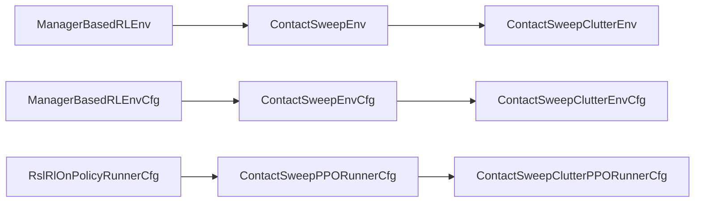
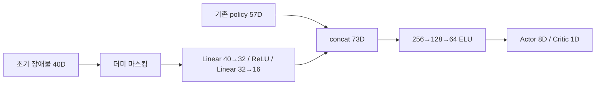

# Contact Sweep와 Contact Sweep Clutter 환경 구성

[구현 문서 목록](../README.md) · [활성 환경](../08_ACTIVE_ENVIRONMENTS.md) · [패키지 실행 안내](../../../../src/inspire_sweep_baseline/README.md)

**기준일: 2026-10-20.** `Isaac-Inspire-Contact-Sweep-v0`는 단일 물체 Sweep의 독립 기준 환경이며, `Isaac-Inspire-Contact-Sweep-Clutter-v0`는 이를 상속해 장애물과 초기 장애물 관측 임베딩을 추가한 환경이다. 두 환경 모두 UR5e–Axia80–Inspire Hand의 Joint Position 제어를 사용한다.

이 문서의 Clutter 설정은 후속 수정까지 반영한 **장애물 3개, RED 제외 반경 10.3 cm**다. 최초 구현의 장애물 6개·RED 8.3 cm 설정과 구분한다. 두 환경 모두 타겟의 현재 위치를 관측하므로 완전한 Blind 환경은 아니다.

## 1. 두 환경 비교

| 항목 | Contact Sweep v0 | Contact Sweep Clutter v0 |
| --- | --- | --- |
| Task ID | `Isaac-Inspire-Contact-Sweep-v0` | `Isaac-Inspire-Contact-Sweep-Clutter-v0` |
| 역할 | 단일 타겟 기준 환경 | 장애물이 있는 Sweep 환경 |
| 물체 | 타겟 1개 | 타겟 1개 + 장애물 3개 |
| 장애물 배치 | 없음 | 뒤쪽 GRAY 1개 + WHITE 2개 |
| 타겟·목표 분포 | 중앙 반경 2 cm, 최대 15 cm 목표 | 동일 |
| 기존 관측 | policy 57D | 동일한 policy 57D |
| 추가 관측 | 없음 | 초기 장애물 40D |
| 정책·가치망 입력 | 57D | 57D + 학습 임베딩 16D = 73D |
| Action | Arm 6D + Hand 2D = 8D | 동일 |
| `object_tilt` | 타겟의 tilt 비용 | 타겟·장애물 4개의 tilt 비용 합 |
| `object_drop` | 타겟 낙하·전도 | 4개 물체 중 하나라도 낙하·전도 |
| 촉각 본체 접촉 투영 | 타겟 필터 | 타겟·장애물 전체 필터 |
| 로그 폴더 | `logs/rsl_rl/inspire_contact_sweep` | `logs/rsl_rl/inspire_contact_sweep_clutter` |

## 2. 클래스와 상속 구조

Contact Sweep은 Renewal v3의 최종 설정을 새로운 기준점으로 정리한 환경이다. 기존 프로젝트의 환경 Cfg·runtime을 상속하지 않고 Isaac Lab 기반 클래스에 직접 연결된다. 로봇 자산과 공통 MDP 계산 함수는 재사용한다. 기존 Renewal v3는 별도로 유지된다.



| 책임 | 기준 환경 | Clutter 환경 |
| --- | --- | --- |
| Scene | `ContactSweepSceneCfg` | `ContactSweepClutterSceneCfg` 상속, 장애물·필터 추가 |
| Observation | `ContactSweepObservationsCfg` | 파생 Cfg에서 `obstacles` 그룹 추가 |
| Event | `ContactSweepEventsCfg` | 파생 Cfg에서 배치·다중 물체 물성 함수 교체 |
| Reward | `ContactSweepRewardsCfg` | 파생 Cfg에서 `object_tilt` 함수만 교체 |
| Termination | `ContactSweepTerminationsCfg` | 파생 Cfg에서 `object_drop` 함수만 교체 |
| Action·Command | 독립 Cfg | 부모 설정 상속 |
| Runtime | 센서 freshness와 reset Action 이력 관리 | 초기 장애물 관측 버퍼·명시적 seed reset 추가 |

코드 진입점은 [contact_sweep](../../../../src/inspire_sweep_baseline/inspire_sweep_baseline/contact_sweep)와 [contact_sweep_clutter](../../../../src/inspire_sweep_baseline/inspire_sweep_baseline/contact_sweep_clutter)다. Gym 등록은 [package init](../../../../src/inspire_sweep_baseline/inspire_sweep_baseline/__init__.py)에서 관리한다.

## 3. 공통 장면과 물성

선반의 작업 영역은 선반 로컬 XY 기준 X ±0.20 m, Y ±0.50 m다. 선반 기본 위치는 환경 원점 기준 `(-0.7, 0, 0)`이며 작업면 높이는 1.05 m다. 타겟은 파란색 원기둥이다.

| 물체 속성 | 적용값 |
| --- | --- |
| 반지름·높이 | 0.04 m·0.10 m |
| 물체 pose 원점 | 밑면 중심 |
| 질량 분포 | 기존 clipped Gaussian 질량을 1.5배: 중심 0.5475 kg, 범위 0.345–0.750 kg |
| 질량 중심·관성 | 아래쪽 높이 20%에 질량 80%, 나머지에 20%인 bottom-heavy 구조 |
| 물체·선반 정지 마찰 분포 중심 | 각각 0.315 |
| 물체·선반 동적 마찰 분포 중심 | 각각 0.252 |
| Hand 정지·동적 마찰 분포 중심 | 0.585 / 0.468 |
| 접촉 재질 결합 | Average |

질량·마찰은 episode reset마다 랜덤화한다. 마찰은 유한한 재질 bucket에서 샘플링하며 정지·동적 마찰에 고정 비율을 강제하지 않는다. Clutter 장애물은 주황색이며 타겟과 동일한 형상·물성 설정을 갖는다. **같은 환경 안에서는 매 reset의 타겟 질량·관성·마찰 샘플을 모든 장애물에 그대로 적용**한다. 서로 다른 환경의 샘플은 다를 수 있다.

[원기둥 자산](../../../../src/inspire_sweep_baseline/inspire_sweep_baseline/assets/mass_cylinder.py) · [기준 물성 랜덤화](../../../../src/inspire_sweep_baseline/inspire_sweep_baseline/mdp/realistic_physics.py) · [Clutter 물성 적용](../../../../src/inspire_sweep_baseline/inspire_sweep_baseline/contact_sweep_clutter/physics.py).

## 4. 목표 생성과 reset

두 환경의 타겟·목표 분포는 같다.

1. 로봇과 선반 등을 기본 상태로 reset한다. 로봇의 초기 관절 자세는 고정이다.
2. 선반 중앙 반경 0.02 m 원판에서 타겟 XY를 면적 기준 균등 샘플링한다.
3. 선반 로컬 +X·−X 방향 각각 ±15°를 제외한 나머지 300°에서 목표 방향을 균등 샘플링한다.
4. 해당 방향으로 0.15 m 이동한 목표를 만든다. 물체 반지름 0.04 m와 추가 경계 여유 0.02 m를 지키도록 필요한 경우 거리만 줄인다.
5. Clutter에서는 이 타겟·목표를 확정한 뒤 장애물을 배치하고 초기 장애물 관측을 저장한다.
6. 물성을 랜덤화하고, CommandManager는 초기 타겟 pose와 이동 벡터로 episode 동안 고정된 목표를 저장한다.

Clutter는 참고 생성기의 넓은 타겟 스폰 영역이나 360°·5–20 cm 목표 분포를 사용하지 않는다. 장애물 배치 실패 시 타겟·목표를 바꾸거나 제약을 완화하지 않고 배치만 재시도하며, 상한을 넘으면 오류로 처리한다. 부분 reset은 해당 환경의 상태·관측·물성만 갱신한다.

### Clutter의 구역과 장애물 배치

[scene_randomization](../../../../src/scene_randomization/LOGIC.md)의 기하 판정·후보 생성·접근 경로 규칙을 재사용하고, Clutter 전용 설정에서 개수와 RED 크기를 지정한다.

| 구역·제약 | 현재 설정 |
| --- | --- |
| RED | 타겟 이동 경로 주변을 비우고 로봇 진입 전면 방향으로 확장한 배치 금지 영역 |
| RED 제외 반경 | 장애물 중심 기준 10.3 cm = 물체 반지름 4 cm × 2 + 여유 2.3 cm |
| GRAY | 확장 경로 주변 및 뒤쪽 영역에서 RED를 제외한 영역. 외곽 반경 14 cm |
| WHITE | RED·GRAY 밖의 허용 영역 |
| 장애물 구성 | 뒤쪽 GRAY 1개, WHITE 2개 |
| 초기 물체 중심 간격 | 최소 9.6 cm, 표면 간격 최소 1.6 cm |
| 셀·국소 밀도 | 5×2 셀에서 타겟 포함 셀당 최대 3개, 반경 18 cm 안의 다른 물체 최대 3개 |
| 접근 경로 | 작은 원으로 근사한 손가락의 진입 경로를 예약하고 장애물과의 간격 검사 |

RED 확장은 물체 자체를 키우는 것이 아니라 **장애물을 놓지 않는 영역을 키우는 것**이다. 원본 생성기 cm 좌표 `(x,y)`는 선반 로컬 m 좌표 `(0.20-y/100, x/100)`로 변환한다. 원본 −Y 전면 방향은 실제 로봇 쪽인 선반 +X 방향에 해당한다. 기하 접근 경로는 로봇 전체 IK나 실제 Hand 전체의 충돌 없는 접근을 보장하지 않는다.

[현재 배치 설정과 알고리즘](../../../../src/inspire_sweep_baseline/inspire_sweep_baseline/contact_sweep_clutter/layout.py) · [reset 연결](../../../../src/inspire_sweep_baseline/inspire_sweep_baseline/contact_sweep_clutter/events.py).

## 5. 관측과 임베딩

### 공통 policy 57D

Actor와 Critic 모두 다음 순서의 관측을 사용한다. 위치·자세의 root frame은 로봇의 root frame이다.

| 순서 | Term | 차원 | 의미 |
| --- | --- | --- | --- |
| 1 | `joint_pos` | 6 | Arm 관절 위치 − 기본 관절 위치, rad |
| 2 | `joint_vel` | 6 | Arm 관절 속도 − 기본 속도, rad/s |
| 3 | `actions` | 8 | 직전 Action |
| 4 | `target_obs_state` | 3 | 현재 타겟 밑면 중심 위치, root frame, m |
| 5 | `target_obj_width` | 1 | 이름은 width지만 실제 값은 반지름 0.04 m |
| 6 | `ee_pose` | 7 | root frame의 EEF 위치 3D + quaternion 4D |
| 7 | `goal_pos` | 3 | root frame의 목표 위치, m |
| 8 | `tactile` | 17 | 촉각 영역별 접촉 bit, 판정 기준 0.01 N |
| 9 | `wrist_wrench` | 6 | EEF frame·기준점의 힘 3D와 모멘트 3D, N·Nm |
| 합계 | | **57** | |

타겟 위치와 width 항에는 매 관측마다 ±0.01의 균일 노이즈가 적용된다. 타겟 위치는 episode 초기값에 고정하지 않는다. F/T는 중력·동역학 보상이나 tare로 제거하지 않은 반력 표현이며, reset 직후 아직 신선하지 않은 센서 데이터는 무효화한다.

촉각은 직접 패드 접촉과 패드 영역으로 투영한 부모 body 접촉을 결합한다. Clutter의 부모 필터에는 실제 물체 4개를 모두 포함한다. 관측에 접촉 물체 ID를 추가하지 않는다.

### Clutter의 초기 장애물 40D

```text
[1, x0, y0, z0,  1, x1, y1, z1,  1, x2, y2, z2,
 0,  0,  0,  0, ... 더미 7칸 ...]
```

총 10개 슬롯 각각은 `[HEADER,x,y,z]`다. 타겟은 포함하지 않는다. 실제 장애물 3칸은 HEADER=1, 더미 7칸은 HEADER와 좌표가 모두 0이다. 좌표는 타겟과 같은 root frame의 밑면 중심 위치(m)다. reset 때 각 축 ±1 cm 노이즈를 한 번 적용하고 저장한다. 이후 장애물이 움직여도 관측을 갱신하지 않는다.



Actor와 Critic은 각각 별도 인코더를 가진다. rollout에는 원시 관측 `policy57 + obstacles40`을 저장하고 PPO 미니배치에서 임베딩을 다시 계산하므로 인코더도 함께 학습된다. **97D는 원시 관측·export 입력 크기, 73D는 임베딩 결합 후 정책·가치망 입력 크기**다. Checkpoint와 JIT/ONNX export에 인코더가 포함된다. Export 입력 순서는 `[policy57, obstacles40]`다.

[기준 관측](../../../../src/inspire_sweep_baseline/inspire_sweep_baseline/contact_sweep/observations_cfg.py) · [인코더 모델](../../../../src/inspire_sweep_baseline/inspire_sweep_baseline/contact_sweep_clutter/models.py).

## 6. 행동과 물리적 제한

정책 Action은 8D다. Arm 6D는 `기본 관절 위치 + 0.5 × action`의 Joint Position 목표이며, 직전 관절 위치에 대한 증분이 아니다. Hand 2D는 전체 굽힘과 엄지 opposition의 개방도를 지정한다. Hand 입력은 제어 시 [0,1]로 제한되고 1은 완전히 열린 상태다. Hand 12개 관절 목표로 변환한다.

| 항목 | 값 |
| --- | --- |
| Arm 초기 위치 | `(0, −2.2, 2.2, 0, 1.57, 0.785)` rad |
| Shoulder pan/lift·elbow 속도 제한 | 각 2 rad/s |
| Wrist 1/2/3 속도 제한 | 각 4 rad/s |
| Hand 12개 속도 제한 | 각 1 rad/s |
| Arm effort 제한 | 앞 3개 각 150 N·m, 손목 3개 각 28 N·m |
| Hand effort 제한 | 각 0.20 N·m |
| 물리 시간 간격 | 0.01초 |
| Decimation·정책 주기 | 2·0.02초, 50 Hz |
| Episode 최대 길이 | 10초, 500 policy steps |

속도 제한은 `velocity_limit_sim`을 통해 PhysX에 적용된다. 속도 비용이나 과속 종료와는 별개이며 모든 접촉 순간의 관절 상태를 직접 잘라내는 clamp는 아니다. 물체 속도 0.8 m/s는 아래의 종료 기준이지 물체의 물리적 속도 상한이 아니다.

## 7. 보상과 페널티

두 환경은 같은 10개 term과 weight를 사용한다. Clutter는 `object_tilt`의 대상만 전체 물체로 확장한다.

| Term | Weight | 계산·대상 |
| --- | --- | --- |
| `reaching` | +30 | EEF–현재 타겟의 3D 거리에서 0.10 m를 제외한 거리의 episode 최소 기록 개선량 |
| `goal_distance` | +94 | 타겟–목표 XY 거리의 새 최선 기록 개선량, 목표 허용 반경 0.01 m |
| `arm_action_rate` | −0.03 | raw Arm Action 변화량 제곱합 |
| `hand_action_rate` | −0.03 | raw Hand Action 변화량 제곱합 |
| `arm_joint_velocity` | −0.03 | 실제 Arm 6개 관절 속도 제곱합 |
| `hand_joint_velocity` | −0.01 | 실제 Hand 12개 관절 속도 제곱합 |
| `object_tilt` | −2 | 선반 법선 대비 물체 기울기의 bounded 제곱 비용 |
| `shelf_collision` | −0.5 | 선반 이동·속도와 가상 finger/wrist의 선반 근접 비용 |
| `pushing_speed` | −2 | 타겟의 3D 선속도가 0.2 m/s를 넘는 정도의 지수 비용 |
| `arm_speed_excess` | −1 | Arm 최대 절대 관절 속도가 1 rad/s를 넘는 정도의 지수 비용 |

일반 비용 term의 실제 스텝 기여는 `weight × 반환값 × 0.02초`다. 네 운동 제곱합은 평균·정규화하지 않고 합산한 뒤 출력만 100으로 제한한다. Hand 제어 입력 clamp와 raw Action 보상 계산은 구분한다.

### 접근과 목표 보상

두 진행 보상은 새 최선 거리 기록을 갱신한 **미터 단위 개선량**만 보상한다. 정지·후퇴·이전 최선 위치로의 복귀는 추가 보상을 만들지 않는다. 함수 내부에서 step_dt로 나누므로 실제 스텝 기여는 각각 `30 × 개선 거리`, `94 × 개선 거리`다. 초기 거리로 정규화하지 않는다.

예를 들어 타겟이 목표 쪽으로 새 최선 기록을 1 cm 개선하면 goal 보상 기여는 0.94다. 초기 목표 거리가 정확히 15 cm라면 허용 반경 1 cm까지의 누적 goal 보상 상한은 `94 × 0.14 = 13.16`이다. 실제 초기 목표 거리가 단축된 episode의 상한은 더 작다.

Goal weight 94는 과거 로그의 reaching·goal_distance 평균으로부터 reaching:goal 기여를 약 3:4로 조정한 값이다. 이론상 최대값으로 산정하지 않았으며, 새 정책에서 같은 비율을 보장하지 않는다.

### 기울기와 속도 비용

기울기 비용은 물체마다 `clip((tilt−5°)/(0.9 rad−5°), 0, 1)²`로 계산한다. 실제 계산에서는 각도를 모두 rad로 맞춘다. 기준 환경의 비용 범위는 [0,1], Clutter는 4개 비용을 더해 [0,4]다. 합산 후에도 weight는 −2다.

속도 비용은 `min(0.5 × (exp(2 × max(speed−free_speed,0))−1), 100)`이다. 구현은 exp 이전에 포화시켜 극단적인 유한 속도에서 overflow를 막는다. **Clutter에서도 pushing_speed는 타겟만 평가**하며 장애물 속도 비용은 추가하지 않는다.

### TensorBoard 수치의 해석

`Episode_Reward/<term>`은 해당 term의 episode 누적 기여를 최대 episode 길이 10초로 나눈 값이다. 예를 들어 scalar 1.3은 같은 집계에서 누적 기여 약 13에 대응한다. `Train/mean_reward`는 episode reward를 별도 버퍼로 평균하므로 모든 term scalar의 합에 10을 곱한 값과 집계 시점·표본 가중이 정확히 일치하지 않을 수 있다. 순간 리워드·누적 리워드·TensorBoard scalar를 같은 단위로 비교하지 않는다.

[보상 설정](../../../../src/inspire_sweep_baseline/inspire_sweep_baseline/contact_sweep/rewards_cfg.py) · [진행 보상](../../../../src/inspire_sweep_baseline/inspire_sweep_baseline/mdp/dex_rewards.py) · [공통 비용](../../../../src/inspire_sweep_baseline/inspire_sweep_baseline/mdp/goal_rewards.py).

## 8. 종료 조건

| Term | 조건 | Clutter 적용 범위 |
| --- | --- | --- |
| `time_out` | 10초 도달 | 동일 |
| `object_drop` | 물체 밑면 원점의 환경 기준 높이 <1.04 m 또는 선반 법선 대비 tilt ≥0.9 rad | 모든 물체 중 하나라도 해당 |
| `push_fast` | 타겟 3D 선속도 norm >0.8 m/s | 타겟만 |
| `shelf_collision` | 선반 root velocity 벡터 norm >0.1 또는 가상 wrist가 선반면보다 0.03 m 미만 높음 | 동일 |
| `hand_velocity` | 이름과 달리 Arm 6개 중 절대 속도 >5 rad/s | 동일 |
| `shelf_displacement` | 선반 초기 위치 대비 이동 거리 >0.05 m | 동일 |

`shelf_collision`은 접촉력 0.1 N 판정이 아니다. 현재 구현은 선반 root velocity의 선속도·각속도 성분이 포함된 벡터 norm과 wrist 높이를 사용하며, finger 높이 종료 검사는 꺼져 있다. 별도 `object_outside_shelf` 종료는 비활성이다. 목표 도달 성공 종료와 성공 보너스·goal-hold 보상은 없으며, 목표에 도달해도 기존 실패 또는 timeout까지 진행한다.

[종료 설정](../../../../src/inspire_sweep_baseline/inspire_sweep_baseline/contact_sweep/terminations_cfg.py) · [Clutter tilt/drop](../../../../src/inspire_sweep_baseline/inspire_sweep_baseline/contact_sweep_clutter/mdp.py).

## 9. PPO 구성과 실행

| 항목 | 두 환경 공통값 |
| --- | --- |
| Actor·Critic 본체 | hidden 256/128/64, ELU |
| Observation normalization | 비활성 |
| 초기 Action 표준편차 | 1.0 |
| Rollout | 환경당 36 steps |
| PPO epoch / minibatch | 8 / 4 |
| Learning rate / schedule | 0.001 / adaptive |
| Gamma / Lambda | 0.98 / 0.95 |
| Clip / desired KL | 0.2 / 0.02 |
| Value loss / entropy 계수 | 1.0 / 0.005 |
| Max gradient norm | 1.0 |
| 최대 iteration / 저장 간격 | 90,000 / 50 |

Clutter만 별도의 40→32→16 인코더를 Actor·Critic에 추가한다. 두 환경의 기본 scene 수는 4,096이며 실행 시 `--num_envs`로 조절한다. 다음 명령은 workspace 루트에서 실행한다.

```bash
# 단일 물체 환경 학습
./IsaacLab/isaaclab.sh -p src/inspire_sweep_baseline/scripts/train.py \
  --task Isaac-Inspire-Contact-Sweep-v0 --num_envs 2048 --headless

# 장애물 환경 학습
./IsaacLab/isaaclab.sh -p src/inspire_sweep_baseline/scripts/train.py \
  --task Isaac-Inspire-Contact-Sweep-Clutter-v0 --num_envs 2048 --headless

# 단일 물체 환경 재생
./IsaacLab/isaaclab.sh -p src/inspire_sweep_baseline/scripts/play.py \
  --task Isaac-Inspire-Contact-Sweep-v0 --num_envs 1 \
  --checkpoint "<contact-sweep-checkpoint.pt>" --real-time

# 장애물 환경 재생
./IsaacLab/isaaclab.sh -p src/inspire_sweep_baseline/scripts/play.py \
  --task Isaac-Inspire-Contact-Sweep-Clutter-v0 --num_envs 1 \
  --checkpoint "<clutter-checkpoint.pt>" --real-time
```

단일 물체와 Clutter는 모델 구조가 다르므로 각 환경에 맞는 checkpoint를 사용한다. Clutter의 장애물 6→3개 변경은 v0 ID와 네트워크 차원을 유지하지만, 배치 분포는 달라졌으므로 실험 기록에서 구분해야 한다. checkout의 `src/scene_randomization/generator.py`는 Clutter가 읽기 전용으로 사용하는 의존성이므로 함께 유지한다.

## 10. 검증 범위와 관련 기록

| 구성 | 실제 수행한 검증 | 기록 |
| --- | --- | --- |
| Contact Sweep | CPU 관련 131개, GPU 8 env·PPO 1 iteration, v3와 설정 및 짧은 학습 결과 tensor 동등성 | [독립 기준 환경](../logs/2026-10-20_contact_sweep_reference.md) |
| Clutter 최초 6개 구성 | CPU 168개, 기하 10,000개, GPU PPO smoke, 인코더 학습·checkpoint·JIT/ONNX와 lifecycle | [최초 Clutter 구현](../logs/2026-10-20_contact_sweep_clutter.md) |
| 현재 Clutter 3개·RED 10.3 cm | CPU 57개·9 subtests, 기하 4,096개, GPU 4 env에서 물성·관측·부분 reset·전도·장애물 촉각 검증 | [RED 확대·장애물 감소](../logs/2026-10-20_clutter_red_expansion.md) |

짧은 smoke와 상태를 조작한 접촉·전도 검사는 실행 계약 검증이다. 현재 3개 장애물 구성의 장기 PPO 학습 안정성, 장애물 회피 성공률, 수천 환경 규모 처리량과 실물 전이는 아직 검증되지 않았다.
