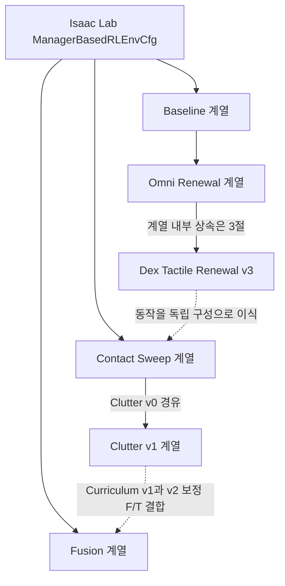
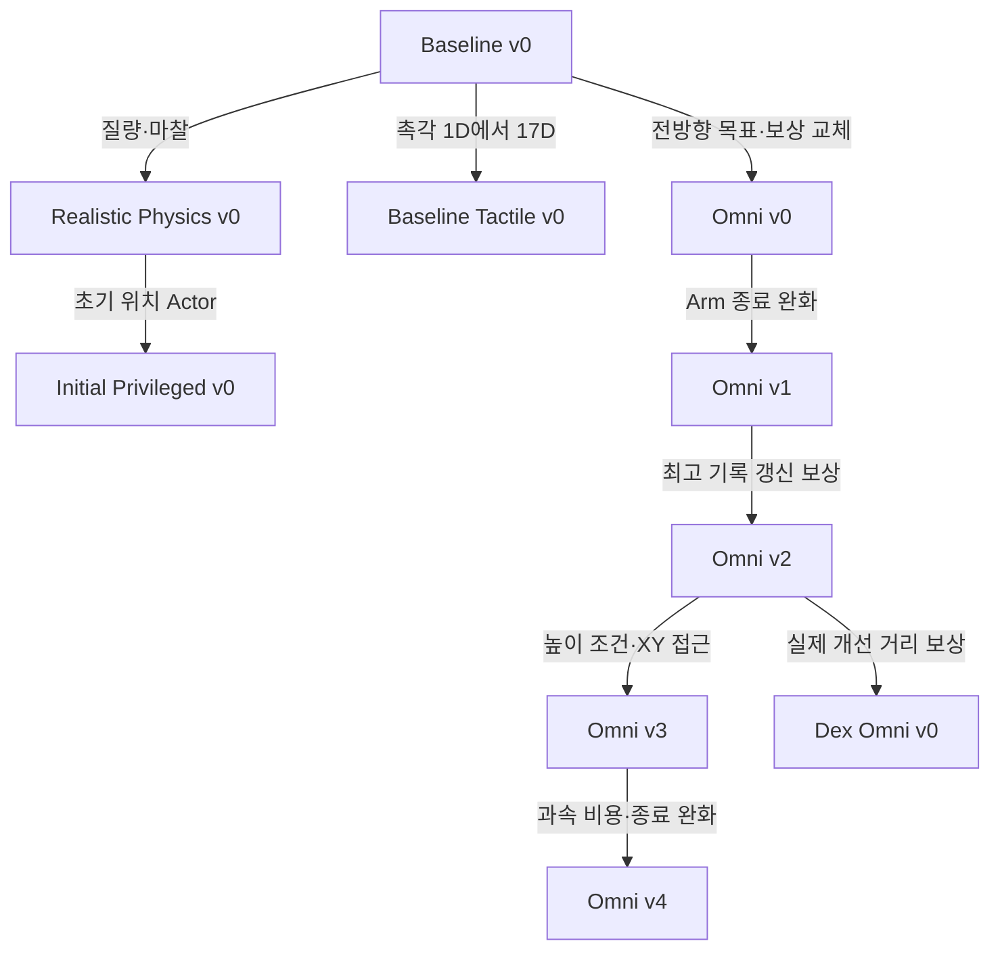
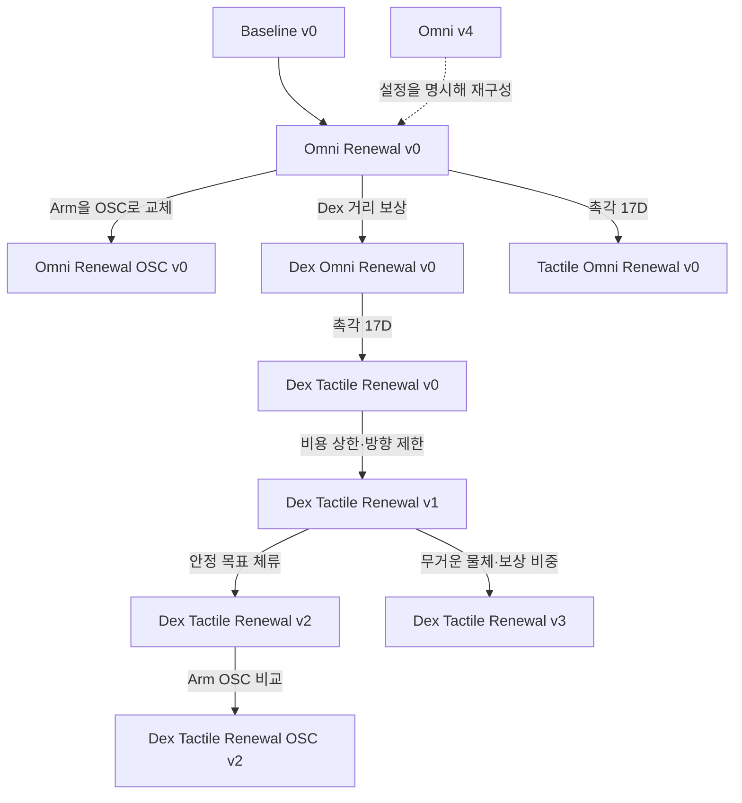
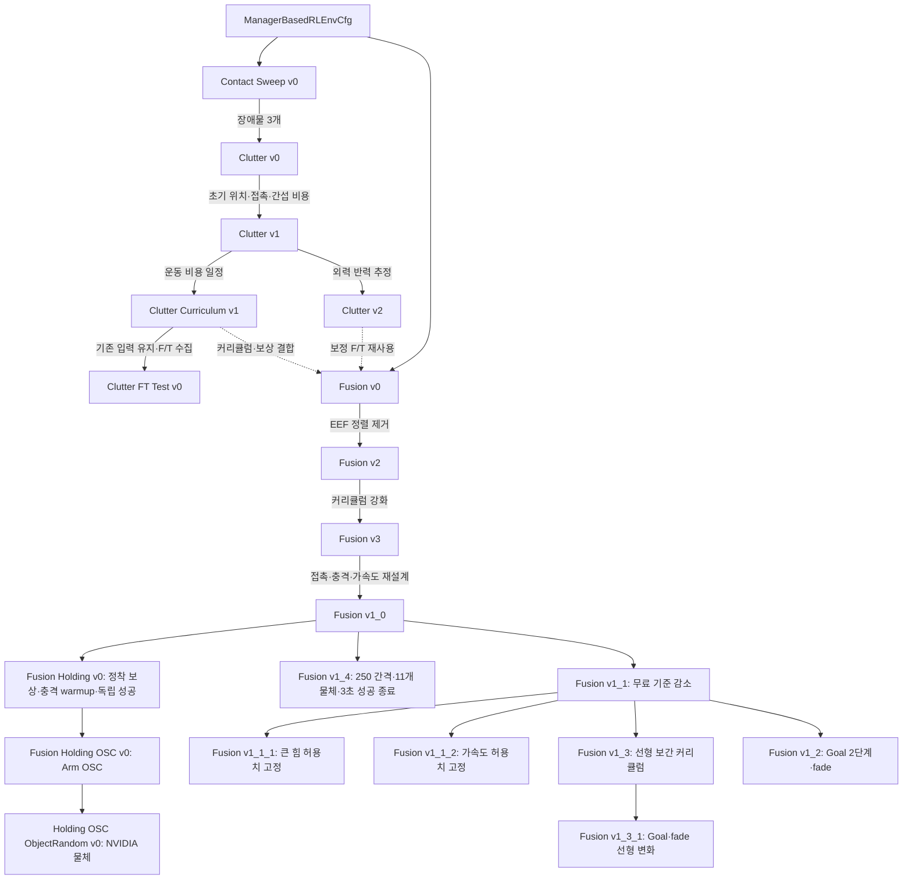

# Inspire Sweep 환경 계층과 변경 의도

[구현 문서 안내](../README.md) · [등록·실행 안내](../08_ACTIVE_ENVIRONMENTS.md) · [문서 작성·검증 기록](../logs/2026-10-22_environment_catalog.md)

**기준일: 2026-10-23.** [패키지 등록 코드](../../../../src/inspire_sweep_baseline/inspire_sweep_baseline/__init__.py)에 등록된 환경의 문서화 목록을 정리한다. 변경 흐름을 먼저 보고 아래 표의 상대 링크를 통해 각 환경의 기본 구성·관측·전체 보상·종료·커리큘럼을 확인할 수 있다. 기존 독립 문서 7개를 유지하고, 독립 문서가 없던 22개는 과거 실험을 찾아볼 수 있는 짧은 설명으로 추가했다.

여기서 환경의 계층은 **등록된 EnvCfg의 직접 상속**이다. Runtime, Scene, Reward 같은 구성요소의 상속은 다를 수 있다. 실선은 실제 EnvCfg 상속, 점선은 동작의 재구성이나 기능 결합을 뜻한다. 버전 번호는 시간순 단일 계보를 뜻하지 않는다. 문서화 대상인 과거 실험도 코드에는 등록되어 있으며, 문서 추가가 새 학습·성능 검증이나 환경 삭제를 뜻하지 않는다.

## 1. 전체 흐름: 세 독립 베이스

Baseline, Contact Sweep, Fusion은 각각 `ManagerBasedRLEnvCfg`를 직접 상속한다. 특히 **Contact Sweep은 Renewal v3의 subclass가 아니며, Fusion은 Clutter의 subclass가 아니다.** 위 개요에서 계열로 묶은 경로의 직접 부모는 아래 상세도와 표에서 확인한다.

## 2. Baseline과 초기 Omni: 물성·관측·보상 분리

| 환경 문서 | 직접 부모 | 변경 의도와 실제 차이 |
| --- | --- | --- |
| [Baseline v0](SWEEP_BASELINE_ENVIRONMENT.md) | Isaac Lab | Hand·센서·제어기를 한꺼번에 바꾸며 생긴 문제를 분리할 기준을 확보한다. 이전 Inspire 구성의 Joint Position 8D·현재 물체 관측 41D·좌우 밀기와 Homing을 독립 패키지로 이식했다. |
| [Realistic Physics v0](SWEEP_REALISTIC_PHYSICS_ENVIRONMENT.md) | Baseline | 물체 안정성에 대한 물성의 영향을 확인한다. 1 kg 고정 물체를 0.230–0.500 kg의 에피소드별 질량과 선반·물체·Hand 마찰 랜덤화로 바꾸며 제어·보상은 유지한다. |
| [Initial Privileged v0](SWEEP_INITIAL_PRIVILEGED_ENVIRONMENT.md) | Realistic Physics | 실행 중 시각 갱신을 없애고 학습에만 현재 상태를 활용한다. Actor는 초기 물체 위치 41D, Critic은 현재 pose·속도 13D를 추가한 54D다. |
| [Baseline Tactile v0](TACTILE_ENVIRONMENT.md) | Baseline | 접촉 위치를 구분할 입력을 확보한다. 단일 palm bit를 17개 영역으로 확장해 57D로 바꾸며 현재 물체 위치와 기존 제어·보상을 유지한다. |
| [Omni v0](OMNI_ENVIRONMENT.md) | Baseline | 좌우 고정 이동과 Homing에서 전방향 목표 이동으로 과업을 바꾼다. 현실 물성을 재사용하고 접근·목표 비용·성공/실패 이벤트로 보상을 교체한다. Realistic Physics EnvCfg를 상속하는 구조는 아니다. |
| [Omni v1](SWEEP_OMNI_V1_ENVIRONMENT.md) | Omni v0 | 접근 중 Arm 속도로 조기에 끝나는 문제를 줄이도록 `hand_velocity` 종료를 완화한다. 현재 적용값은 1.5 rad/s이며 이 이름은 Arm 관절 검사를 뜻한다. |
| [Omni v2](SWEEP_OMNI_V2_ENVIRONMENT.md) | Omni v1 | 가까운 곳에 머무르며 보상을 받는 구조에서 실제 새 진전을 보상하는 구조로 바꾼다. 접근·목표의 정규화 최고 기록 개선량을 사용하고 시간·성공·실패 보상과 성공 종료를 제거한다. |
| [Omni v3](SWEEP_OMNI_V3_ENVIRONMENT.md) | Omni v2 | 접근 높이를 맞춘 상태에서 수평 접근을 유도한다. 높이 오차 2 cm 이내에서 XY 접근 최고 기록을 갱신한다. |
| [Dex Omni v0](DEX_OMNI_V0_ENVIRONMENT.md) | Omni v2 | 초기 거리로 정규화한 진전 대신 실제 개선 거리(m)에 보상을 준다. 3D 접근과 목표 거리 기록 개선량을 사용한다. Omni v3의 높이 게이트는 상속하지 않는다. |
| [Omni v4](SWEEP_OMNI_V4_ENVIRONMENT.md) | Omni v3 | 시도를 허용하면서 과속을 비용으로 억제한다. Arm 종료 5 rad/s·물체 종료 0.5 m/s, 선반 XY 이탈 종료 제거, 물체·Arm 과속 비용을 적용한다. |

의도 근거: [Notion 학습 기록](https://app.notion.com/p/3f7bd3c55e1b80e5a161c6e0dd175773)의 기준 환경 복귀·물성·초기 위치 관측 설명, [Omni 초기 종료 진단](../logs/2026-10-14_omni_immediate_termination.md), [v2 보상 개편](../logs/2026-10-15_omni_v2_rewards.md), [v3 높이 게이트](../logs/2026-10-15_omni_v3_height_gated_reaching.md), [Dex 보상](../logs/2026-10-15_dex_omni_rewards.md), [v4 변경](../logs/2026-10-15_omni_v4_speed_penalty.md). 당시 기록의 수치보다 현재 코드에서 적용되는 값을 우선한다.

## 3. Renewal: 명시적 구성에서 촉각·안정화·제어 비교로

| 환경 문서 | 직접 부모 | 변경 의도와 실제 차이 |
| --- | --- | --- |
| [Omni Renewal v0](SWEEP_OMNI_RENEWAL_ENVIRONMENT.md) | Baseline | 여러 단계에 나뉜 Omni v4의 동작을 명시적 Manager 구성으로 재정리한다. v4와의 연결은 설계 계승이며, 이후 추가된 지수 속도 비용·선반 종료 조건은 현재 Renewal 계약으로 읽는다. |
| [Omni Renewal OSC v0](SWEEP_OMNI_RENEWAL_OSC_ENVIRONMENT.md) | Omni Renewal | 같은 과업에서 Arm 관절 위치 제어를 Cartesian 증분 OSC로 바꿔 비교한다. Arm 6D+Hand 2D의 차원은 유지하지만 Action의 의미와 제어 경로가 달라진다. |
| [Dex Omni Renewal v0](DEX_OMNI_RENEWAL_ENVIRONMENT.md) | Omni Renewal | Renewal의 명시적 구성에서 실제 거리 개선량 보상을 사용한다. Dex Omni v0를 직접 상속하지 않고 접근·목표 보상 함수를 교체한다. |
| [Tactile Omni Renewal v0](TACTILE_OMNI_RENEWAL_ENVIRONMENT.md) | Omni Renewal | 정규화 진행 보상에 17개 접촉 영역 관측을 결합한다. 41D→57D이며 현재 물체 위치 입력은 유지한다. |
| [Dex Tactile Renewal v0](DEX_TACTILE_OMNI_RENEWAL_ENVIRONMENT.md) | Dex Omni Renewal | Dex 거리 보상에 17개 촉각 관측을 결합한다. Tactile Omni Renewal과는 관측 구성을 공유하는 별도 분기다. |
| [Dex Tactile Renewal v1](DEX_TACTILE_OMNI_RENEWAL_V1_ENVIRONMENT.md) | Dex Tactile Renewal v0 | 과도한 속도 비용을 제한하고 초기 밀기 방향·손목 높이를 조정한다. 지수 비용 상한 100, Arm 물리 속도 제한, wrist 여유 3 cm, ±X 주변 각 15° 목표 제외를 적용한다. |
| [Dex Tactile Renewal v2](DEX_TACTILE_OMNI_RENEWAL_V2_ENVIRONMENT.md) | Dex Tactile Renewal v1 | 목표를 지나치지 않고 안정적으로 유지하도록 만든다. 0.5초 안정 달성의 일회성 +100과 연속 체류 시간에 비례하는 최대 +20/s 보상을 추가하며 성공 시 즉시 종료하지 않는다. |
| [Dex Tactile Renewal v3](DEX_TACTILE_OMNI_RENEWAL_V3_ENVIRONMENT.md) | **Dex Tactile Renewal v1** | 기존 run을 바탕으로 접근·목표 기여를 조절하고 더 무거운 물체를 사용한다. 질량 1.5배, 목표 가중치 94, 물체 free speed 0.2 m/s·가중치 −2다. v2의 성공·체류 보상은 포함하지 않는다. |
| [Dex Tactile Renewal OSC v2](DEX_TACTILE_OMNI_RENEWAL_OSC_V2_ENVIRONMENT.md) | Dex Tactile Renewal v2 | 목표 유지 과업에서 OSC를 비교한다. v2의 관측·보상·종료를 유지하면서 Arm Action·actuator·OSC 경로를 바꾼다. |

의도 근거: [Renewal 재구성](../logs/2026-10-15_omni_renewal_environments.md), [OSC 추가](../logs/2026-10-15_renewal_osc.md), [Renewal 상세 계약과 개발 기록 링크](../08_ACTIVE_ENVIRONMENTS.md), 각 독립 문서의 코드 근거. **이 9개 환경의 물체 위치는 모두 현재값**이며, Initial Privileged 또는 Clutter v1의 초기 위치 Actor와 구분한다. 커리큘럼은 없다.

## 4. Contact Sweep과 Fusion: 독립 기준·장애물·접촉 학습

| 환경 문서 | 직접 부모 | 변경 의도와 실제 차이 |
| --- | --- | --- |
| [Contact Sweep v0](CONTACT_SWEEP_ENVIRONMENT.md) | Isaac Lab | Renewal v3를 보존하면서 이후 확장의 기준을 분리한다. 동작을 독립 Env·Scene·Manager·PPO에 구성한다. 단일 타겟, 현재 위치를 포함한 57D, Joint Position 8D를 사용한다. |
| [Clutter v0](CONTACT_SWEEP_CLUTTER_ENVIRONMENT.md) | Contact Sweep | 기본 밀기 조건에 주변 물체를 추가한다. 기존 타겟·목표 분포를 유지하고 GRAY 1개·WHITE 2개를 배치한다. 초기 장애물 40D→MLP 16D, 모든 물체의 촉각·tilt·drop 검사를 적용한다. |
| [Clutter v1](CONTACT_SWEEP_CLUTTER_V1_MDP.md) | Clutter v0 | 초기 시각 이후의 접촉 조작을 학습하도록 한다. Actor 타겟 위치를 초기값으로 바꾸고 Critic만 현재 XYZ를 추가한다. 목표 체류·촉각 접촉 두 항·장애물 이동 비용을 더한다. |
| [Clutter Curriculum v1](CONTACT_SWEEP_CLUTTER_CURRICULUM_V1_ENVIRONMENT.md) | Clutter v1 | 초기 밀기를 익힌 뒤 움직임을 정교하게 만든다. 물체·Arm 허용 속도와 Arm action-rate·joint-velocity 가중치의 네 일정을 추가한다. |
| [Clutter v2](CONTACT_SWEEP_CLUTTER_V2_ENVIRONMENT.md) | Clutter v1 | F/T에서 Hand 자체 하중을 줄여 외력 정보를 제공한다. 중력·관성 보정 반력으로 관측을 교체하고, 작은 변화 허용·초당 상한·양의 보상 대비 예산을 가진 wrench 변화 비용을 추가한다. Curriculum v1을 상속하지 않는다. |
| [Clutter FT Test v0](CONTACT_SWEEP_CLUTTER_FT_TEST_ENVIRONMENT.md) | Clutter Curriculum v1 | 기존 정책 입력을 바꾸지 않고 보정 F/T를 수집해 새 비용을 설계한다. Actor에는 기존 F/T를 유지하고 보정·raw 신호를 진단 버퍼로 별도 제공한다. |
| [Fusion v0](CONTACT_SWEEP_CLUTTER_FUSION_ENVIRONMENT.md) | Isaac Lab | Curriculum v1과 보정 F/T를 통합하고 접촉·주변 간섭·급격한 힘 변화를 함께 다룬다. 초기 가림·bit flip, policy 55D, 통합 보상과 EEF 자세·속도 비용을 독립 구성한다. |
| [Fusion v2](CONTACT_SWEEP_CLUTTER_FUSION_V2_ENVIRONMENT.md) | Fusion v0 | 정렬 보상이 반대 방향 밀기를 방해했다는 관찰에 대응한다. `eef_orientation`만 제거한다. |
| [Fusion v3](CONTACT_SWEEP_CLUTTER_FUSION_V3_ENVIRONMENT.md) | Fusion v2 | 초기 밀기에서 후반 정밀 조작으로 더 빠르고 강하게 전환한다. 속도·접촉·wrench·목표 방향 커리큘럼을 바꾼다. 현재 코드에서는 `push_fast`도 1.0→0.8 m/s로 명시한다. |
| [Fusion v1_0](CONTACT_SWEEP_CLUTTER_FUSION_V1_0_ENVIRONMENT.md) | Fusion v3 | 손등까지 포함한 접촉 유지, 비타겟 충격, 물체를 발사하는 행동을 다룬다. Reward·Termination·Curriculum을 독립 선언하고 손 전체 접촉·비타겟 힘·wrench 크기 변화·물체 가속도 비용, 목표 허용 범위·장애물 개수 일정을 구성한다. |
| [Fusion v1_4](CONTACT_SWEEP_CLUTTER_FUSION_V1_4_ENVIRONMENT.md) | **Fusion v1_0** | 학습된 v1_0을 이어 허용 기준을 보정한다. 250 iteration 간격 커리큘럼, 최대 Gray 5/White 5, Goal hold·Hand contact 보상 강화, push_fast 1.0 m/s와 연속 Goal hold 3초 성공 종료를 적용한다. v1_3 계열과 별도 분기다. |
| [Fusion Holding v0](CONTACT_SWEEP_CLUTTER_FUSION_HOLDING_V0_ENVIRONMENT.md) | **Fusion v1_0** | 초기 1000 iteration 충격 weight 0 이후 강화, 거리·속도 정착 보상, 고정 0.5cm·0.01m/s·3초 성공. 후속 변경으로 변위 계수5.0·최대Gray5/White5·Hand contact1.45·push_fast1.0m/s. v1_4와는 형제 분기이며 세 속도 일정의 값만 동일하다. |
| [Fusion Holding OSC v0](CONTACT_SWEEP_CLUTTER_FUSION_HOLDING_OSC_V0_ENVIRONMENT.md) | **Fusion Holding v0** | Arm을 참조 Renewal OSC v0의 상대 pose·stiffness200 OSC로 교체하고 관절 PD를0으로 설정한다. 나머지 Holding 계약 유지. |

의도 근거: [Contact 독립화](../logs/2026-10-20_contact_sweep_reference.md), [Clutter 추가](../logs/2026-10-20_contact_sweep_clutter.md), [Clutter v1](../logs/2026-10-20_contact_sweep_clutter_v1.md), [Curriculum v1](../logs/2026-10-20_clutter_v1_curriculum.md), [Clutter v2](../logs/2026-10-20_contact_sweep_clutter_v2.md), [F/T 수집](../logs/2026-10-21_clutter_ft_collection.md), [Notion 학습 기록](https://app.notion.com/p/3f7bd3c55e1b80e5a161c6e0dd175773)의 Clutter/Fusion 변경 이유, [Fusion 비교](CONTACT_SWEEP_CLUTTER_FUSION_VERSIONS.md)와 [v1_0 후속 변경](../logs/2026-10-22_clutter_fusion_v1_0_population_recovery.md).

## 5. 전체 등록 ID → 독립 문서

| 등록된 Gym ID | 독립 문서 | 이번 작업 |
| --- | --- | --- |
| `Isaac-Inspire-Sweep-Baseline-v0` | [Baseline](SWEEP_BASELINE_ENVIRONMENT.md) | 신규 |
| `Isaac-Inspire-Sweep-Realistic-Physics-v0` | [Realistic Physics](SWEEP_REALISTIC_PHYSICS_ENVIRONMENT.md) | 신규 |
| `Isaac-Inspire-Sweep-Realistic-Physics-Initial-Privileged-v0` | [Initial Privileged](SWEEP_INITIAL_PRIVILEGED_ENVIRONMENT.md) | 신규 |
| `Isaac-Inspire-Sweep-Baseline-Tactile-v0` | [Baseline Tactile](TACTILE_ENVIRONMENT.md) | 기존 |
| `Isaac-Inspire-Sweep-Omni-v0` | [Omni v0](OMNI_ENVIRONMENT.md) | 기존 |
| `Isaac-Inspire-Sweep-Omni-v1` | [Omni v1](SWEEP_OMNI_V1_ENVIRONMENT.md) | 신규 |
| `Isaac-Inspire-Sweep-Omni-v2` | [Omni v2](SWEEP_OMNI_V2_ENVIRONMENT.md) | 신규 |
| `Isaac-Inspire-Sweep-Omni-v3` | [Omni v3](SWEEP_OMNI_V3_ENVIRONMENT.md) | 기존 |
| `Isaac-Inspire-Sweep-Omni-v4` | [Omni v4](SWEEP_OMNI_V4_ENVIRONMENT.md) | 신규 |
| `Isaac-Inspire-Dex-Omni-v0` | [Dex Omni v0](DEX_OMNI_V0_ENVIRONMENT.md) | 기존 |
| `Isaac-Inspire-Sweep-Omni-Renewal-v0` | [Omni Renewal](SWEEP_OMNI_RENEWAL_ENVIRONMENT.md) | 신규 |
| `Isaac-Inspire-Sweep-Omni-Renewal-OSC-v0` | [Omni Renewal OSC](SWEEP_OMNI_RENEWAL_OSC_ENVIRONMENT.md) | 신규 |
| `Isaac-Inspire-Dex-Sweep-Omni-Renewal-v0` | [Dex Omni Renewal](DEX_OMNI_RENEWAL_ENVIRONMENT.md) | 신규 |
| `Isaac-Inspire-Tactile-Sweep-Omni-Renewal-v0` | [Tactile Omni Renewal](TACTILE_OMNI_RENEWAL_ENVIRONMENT.md) | 신규 |
| `Isaac-Inspire-Dex-Tactile-Sweep-Omni-Renewal-v0` | [Dex Tactile Renewal](DEX_TACTILE_OMNI_RENEWAL_ENVIRONMENT.md) | 신규 |
| `Isaac-Inspire-Dex-Tactile-Sweep-Omni-Renewal-v1` | [Dex Tactile Renewal v1](DEX_TACTILE_OMNI_RENEWAL_V1_ENVIRONMENT.md) | 신규 |
| `Isaac-Inspire-Dex-Tactile-Sweep-Omni-Renewal-v2` | [Dex Tactile Renewal v2](DEX_TACTILE_OMNI_RENEWAL_V2_ENVIRONMENT.md) | 신규 |
| `Isaac-Inspire-Dex-Tactile-Sweep-Omni-Renewal-v3` | [Dex Tactile Renewal v3](DEX_TACTILE_OMNI_RENEWAL_V3_ENVIRONMENT.md) | 신규 |
| `Isaac-Inspire-Dex-Tactile-Sweep-Omni-Renewal-OSC-v2` | [Dex Tactile Renewal OSC v2](DEX_TACTILE_OMNI_RENEWAL_OSC_V2_ENVIRONMENT.md) | 신규 |
| `Isaac-Inspire-Contact-Sweep-v0` | [Contact Sweep](CONTACT_SWEEP_ENVIRONMENT.md) | 신규 |
| `Isaac-Inspire-Contact-Sweep-Clutter-v0` | [Clutter v0](CONTACT_SWEEP_CLUTTER_ENVIRONMENT.md) | 신규 |
| `Isaac-Inspire-Contact-Sweep-Clutter-v1` | [Clutter v1](CONTACT_SWEEP_CLUTTER_V1_MDP.md) | 기존 |
| `Isaac-Inspire-Contact-Sweep-Clutter-Curriculum-v1` | [Clutter Curriculum v1](CONTACT_SWEEP_CLUTTER_CURRICULUM_V1_ENVIRONMENT.md) | 신규 |
| `Isaac-Inspire-Contact-Sweep-Clutter-v2` | [Clutter v2](CONTACT_SWEEP_CLUTTER_V2_ENVIRONMENT.md) | 신규 |
| `Isaac-Inspire-Contact-Sweep-Clutter-FT-Test-v0` | [Clutter FT Test](CONTACT_SWEEP_CLUTTER_FT_TEST_ENVIRONMENT.md) | 신규 |
| `Isaac-Inspire-Contact-Sweep-Clutter-Fusion-v0` | [Fusion v0](CONTACT_SWEEP_CLUTTER_FUSION_ENVIRONMENT.md) | 기존 |
| `Isaac-Inspire-Contact-Sweep-Clutter-Fusion-v2` | [Fusion v2](CONTACT_SWEEP_CLUTTER_FUSION_V2_ENVIRONMENT.md) | 신규 |
| `Isaac-Inspire-Contact-Sweep-Clutter-Fusion-v3` | [Fusion v3](CONTACT_SWEEP_CLUTTER_FUSION_V3_ENVIRONMENT.md) | 신규 |
| `Isaac-Inspire-Contact-Sweep-Clutter-Fusion-v1_0` | [Fusion v1_0](CONTACT_SWEEP_CLUTTER_FUSION_V1_0_ENVIRONMENT.md) | 기존 |
| `Isaac-Inspire-Contact-Sweep-Clutter-Fusion-v1_1` | [Fusion v1_1](CONTACT_SWEEP_CLUTTER_FUSION_V1_1_ENVIRONMENT.md) | 신규 |
| `Isaac-Inspire-Contact-Sweep-Clutter-Fusion-v1_1_1` | [Fusion v1_1_1](CONTACT_SWEEP_CLUTTER_FUSION_V1_1_1_ENVIRONMENT.md) | 신규 |
| `Isaac-Inspire-Contact-Sweep-Clutter-Fusion-v1_1_2` | [Fusion v1_1_2](CONTACT_SWEEP_CLUTTER_FUSION_V1_1_2_ENVIRONMENT.md) | 신규 |
| `Isaac-Inspire-Contact-Sweep-Clutter-Fusion-v1_3` | [Fusion v1_3](CONTACT_SWEEP_CLUTTER_FUSION_V1_3_ENVIRONMENT.md) | 신규 |
| `Isaac-Inspire-Contact-Sweep-Clutter-Fusion-v1_3_1` | [Fusion v1_3_1](CONTACT_SWEEP_CLUTTER_FUSION_V1_3_1_ENVIRONMENT.md) | 신규 |
| `Isaac-Inspire-Contact-Sweep-Clutter-Fusion-v1_2` | [Fusion v1_2](CONTACT_SWEEP_CLUTTER_FUSION_V1_2_ENVIRONMENT.md) | 신규 |
| `Isaac-Inspire-Contact-Sweep-Clutter-Fusion-v1_4` | [Fusion v1_4](CONTACT_SWEEP_CLUTTER_FUSION_V1_4_ENVIRONMENT.md) | 2026-10-23 추가 |
| `Isaac-Inspire-Contact-Sweep-Clutter-Fusion-Holding-v0` | [Fusion Holding v0](CONTACT_SWEEP_CLUTTER_FUSION_HOLDING_V0_ENVIRONMENT.md) | 2026-10-23 추가 |
| `Isaac-Inspire-Contact-Sweep-Clutter-Fusion-Holding-OSC-v0` | [Holding OSC v0](CONTACT_SWEEP_CLUTTER_FUSION_HOLDING_OSC_V0_ENVIRONMENT.md) | 2026-10-23 추가 |

## 6. 기록을 읽을 때의 기준

현재 설정값은 상속·`__post_init__`를 포함한 코드의 최종 적용값으로 확인했다. 과거 설명과 다른 값도 코드 수정 없이 기록했다. Omni v1의 Arm 속도 종료는 현재 1.5 rad/s다. Fusion v0/v2의 `push_fast`는 [기본 설정](../../../../src/inspire_sweep_baseline/inspire_sweep_baseline/contact_sweep_clutter_fusion/terminations_cfg.py)에서 **1.0 m/s**, v3는 [명시적 override](../../../../src/inspire_sweep_baseline/inspire_sweep_baseline/contact_sweep_clutter_fusion_v3/env_cfg.py)로 **0.8 m/s**다. 기존 Fusion 비교·개발 로그의 “모두 0.8”은 이 코드 스냅샷과 다르다.

기존 Omni v3 설명 이후 공통 Reaching 함수에는 최단 기록에서 멀어진 상태의 매-step 비용과 초기 접근거리 0일 때의 분모 fallback이 추가되었다. 현재 동작은 [같은 함수를 쓰는 Omni v4 요약](SWEEP_OMNI_V4_ENVIRONMENT.md)과 [공통 구현](../../../../src/inspire_sweep_baseline/inspire_sweep_baseline/mdp/goal_rewards.py)을 따른다. 기존 독립 문서는 재작성하지 않았다.

Notion의 관찰은 변경 동기를 설명하는 사용자 기록으로 사용했으며, 이번 작업에서 영상이나 학습 성능을 재검증하지 않았다. 페이지 응답에 `truncated=true`와 읽을 수 없는 외부 객체 1개가 표시되어 전체 블록을 읽었다고 보지 않는다. 표에 사용한 변경 설명은 반환된 본문과 로컬 코드·개발 로그로 대조했다. 등록 목록·문서 링크·Markdown 검사와 미검증 범위는 [개발 로그](../logs/2026-10-22_environment_catalog.md)에 남긴다.

## Holding OSC ObjectRandom v0 추가

`Isaac-Inspire-Contact-Sweep-Clutter-Fusion-Holding-OSC-ObjectRandom-v0`는 Holding OSC v0을 직접 상속한다. NVIDIA YCB 자산·균일 크기 랜덤화·물체별 관성을 추가한다. 후속 변경으로1.5배 확대·실제OBB 비겹침 검사·실린더 타겟 유지·정립 자세 교정·최대15개(1+7+7) 고정 테스트·장애물14슬롯 관측를 적용했다. [상세 환경](CONTACT_SWEEP_CLUTTER_FUSION_HOLDING_OSC_OBJECT_RANDOM_V0_ENVIRONMENT.md).
