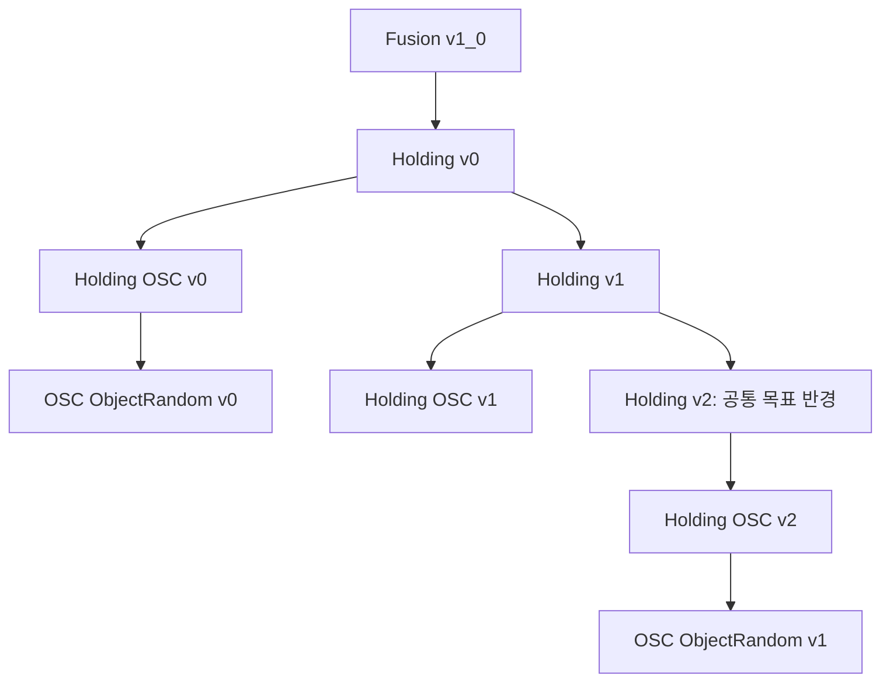

# Fusion Holding 환경 계열과 개발 방향

[환경 문서 안내](README.md) · [활성 환경과 실행](../08_ACTIVE_ENVIRONMENTS.md) · [환경 전체 상속도](ENVIRONMENT_EVOLUTION.md)

기준일: 2026-10-23. Fusion Holding과 파생 환경은 **목표 유지와 성공 종료 → OSC에서 같은 과업 성능 재현 → 다양한 실제 물체 형상으로 확장**하는 세 계열로 관리한다. 각 계열은 자신이 해결하는 문제를 기준으로 v1, v2, …를 증가시킨다.

여기서 `OSC-Random`은 물체 다양화 계열을 가리킨다. 현재 코드의 등록명은 `Holding-OSC-ObjectRandom`이며, 아래에서는 두 이름을 대응해서 사용한다. 이 문서 작성으로 기존 환경 ID를 변경하지 않는다.

## 1. 세 계열의 역할

| 계열 | 해결하려는 문제 | 버전을 올리는 기준 | 비교 기준 |
| --- | --- | --- | --- |
| Fusion Holding | 물체를 목표 위치에 도달시킨 뒤 안정적으로 유지하고 성공적으로 종료할 수 있는가? | 목표 유지·정착·성공 종료를 개선한 환경을 추가한다. | 이전 Holding 버전의 목표 도달·유지·성공/실패 결과 |
| Fusion Holding OSC | 제어를 OSC로 바꾸어도 Holding의 과업 결과를 재현할 수 있는가? | OSC 설정과 제어 구현을 바꾼 환경을 추가한다. | 선택한 Holding 부모 환경의 과업 성능 |
| Fusion Holding OSC-Random | 물체를 다양화하고 실제 물체 형상으로 바꾸어도 같은 과업을 수행할 수 있는가? | 물체 다양화·현실적인 물체 표현과 그에 필요한 장면 구성을 개선한 환경을 추가한다. | 선택한 OSC 부모 환경의 과업 성능 |

세 계열의 버전 번호는 각각의 개선 순서를 뜻한다. 숫자가 같다고 동일한 개발 단계나 동일한 부모를 뜻하지 않으며, 숫자가 크다고 성능이 더 좋다는 의미도 아니다.

## 2. Holding — 목표 유지와 성공 종료

Holding은 물체를 목표 근처로 밀어 보내는 것에서 더 나아가, 목표에 도달한 물체가 다시 이탈하지 않고 안정적으로 머물도록 만드는 기준 계열이다. 목표 위치 오차, 잔류 속도, 접촉 유지, 목표 체류 시간과 성공 종료의 관계를 다룬다.

Holding-v2와 이후 버전은 이 목표를 개선하기 위한 보상·성공 조건·커리큘럼 등의 변경을 담는다. 구체적인 변경 항목과 수치는 각 버전에서 별도로 정한다. 보상이 커졌다는 사실과 실제 목표 유지·성공률이 개선됐다는 결과는 구분한다.

현재 Holding-v0에는 거리·속도에 따른 정착 보상과 독립적인 성공 종료가 구현되어 있다. 성공은 위치 허용 오차 0.5 cm, 속도 허용치 0.01 m/s 조건을 3초 동안 유지하고 실패 조건에 해당하지 않을 때 판정한다. Holding-v1은 이 과업 설정을 계승하고 장애물 관측 용량을 16슬롯, 인코더를 64→32→16D로 확장했다. **v1의 실제 변경은 관측 용량 확장이며, 목표 유지 성능이 개선됐다는 실험 결과를 의미하지 않는다.**

Holding-v2는 공통 목표 반경2→1→0.5cm, goal_hold 계수4, 목표 내 무접촉 보상을 추가했다. [Holding v2 계약](CONTACT_SWEEP_CLUTTER_FUSION_HOLDING_V2_ENVIRONMENT.md).

세부 계약: [Holding v0](CONTACT_SWEEP_CLUTTER_FUSION_HOLDING_V0_ENVIRONMENT.md) · [Holding v1](CONTACT_SWEEP_CLUTTER_FUSION_HOLDING_V1_ENVIRONMENT.md).

## 3. OSC — 제어 변경 후 Holding 결과 재현

OSC 계열은 선택한 Holding 환경을 기준으로 Arm 제어를 바꾼다. 목표는 OSC를 사용하면서도 Holding에서 얻은 목표 도달·정착·유지·성공 종료 결과를 재현하는 것이다.

버전별 변경의 중심은 OSC의 stiffness·damping, 명령 scale, 좌표계·회전 표현, 관성 분리·중력 보상, effort 제한 등이다. OSC effort 제어와 충돌하지 않도록 Arm의 기존 관절 PD gain을 조정하는 것도 제어 변경에 포함한다. 제어 기준점은 우리 로봇의 EEF Frame을 따른다.

비교하는 Holding의 관측·보상·성공 조건·실패 조건·물체 분포·Hand 제어는 유지한다. 그래야 차이가 생겼을 때 OSC 변경의 영향을 판단할 수 있다. 별도의 과업 변경이 필요하면 그 변경을 명시적으로 구분한다.

여기서 ‘결과 재현’은 동일한 과업 성능을 얻는다는 의미다. Joint Position과 OSC는 Action 의미가 다르므로 기존 정책의 출력을 그대로 넣거나 같은 checkpoint를 사용하는 것만으로 재현됐다고 판단하지 않는다.

현재 OSC-v1은 **Holding-v1**, OSC-v2는 **Holding-v2를 직접 상속**한다. 사용자 후속 요청으로 OSC-v2의 목표 과업도 변경되어 두 OSC 버전을 순수 제어 차이만으로 비교할 수 없다. OSC-v2가 OSC-v1을 상속하는 구조는 아니다.

- OSC-v1: Robot Base 기준 상대 pose, stiffness 100, 관성 분리·중력 보상 사용.
- OSC-v2: UR10 Reach의 제어를 우리 EEF에 맞춰 이식. 위치/회전 stiffness 80/25, scale 0.03/0.15, RPY 회전 입력과 effort 제한, 관성 분리·중력 보상 미사용.

[OSC v1 설명](CONTACT_SWEEP_CLUTTER_FUSION_HOLDING_OSC_V1_ENVIRONMENT.md) · [OSC v2 설정과 검증](../logs/2026-10-23_fusion_holding_osc_v2.md). Holding-v1을 부모로 사용했던 당시 OSC-v2는 짧은 GPU 실행에서 토크 포화와 선반 충돌 종료가 관찰되어 Holding 결과 재현이 완료된 상태는 아니다.

## 4. OSC-Random — 다양한 물체와 실제 물체 형상으로 확장

OSC-Random 계열은 선택한 OSC 환경의 제어와 과업을 기반으로 물체 조건을 확장한다. 단순 원통에서 다양한 형상·크기·질량·마찰의 물체로 바꾸었을 때도 목표 도달·유지·성공 종료가 유지되는지를 다룬다.

물체의 종류를 늘리는 것뿐 아니라 충돌 형상, 관성, 초기 자세·배치와 비겹침 조건, 초기 관측의 타당성도 함께 확인한다. 특히 원통을 전제로 만든 가시성 판정이 비원통 물체에도 적합한지 검토해야 한다. 이 계열에서 필요한 물체·장면·관측 처리는 버전별로 명시하고, 부모 OSC 제어를 함께 바꾸어야 한다면 두 변경을 구분해 기록한다.

현재 `OSC-ObjectRandom-v1`은 OSC-v2를 직접 상속하며 NVIDIA YCB 물체의 종류·크기와 reset 시 위치·yaw·물성을 랜덤화한다. Gray 7개·White 7개의 장애물을 사용하고 16슬롯 관측에 넣는다. 타겟은 기존 원통을 유지한다. 따라서 **현재는 주변 장애물의 다양화가 구현된 단계이며, 타겟까지 실제 물체로 다양화한 환경은 아니다.**

현재 가시성 필터는 장애물을 반경 6 cm의 원형으로 근사한다. 비원통 물체의 실제 윤곽·방향·높이를 반영하는 가림 판정은 후속 개선 대상이다. 관측된 장애물을 왼쪽부터 채우고 인접한 유효 슬롯 사이에서 확률적으로 스왑하는 절차는 유지한다.

실제 물체의 시뮬레이션 모델을 사용하는 것과 실물 로봇에서 검증하는 것은 별도 단계다. [ObjectRandom v1 상세 계약](CONTACT_SWEEP_CLUTTER_FUSION_HOLDING_OSC_OBJECT_RANDOM_V1_ENVIRONMENT.md).

## 5. 현재 구현된 상속 관계

아래 화살표는 실제 EnvCfg의 직접 상속 관계다. 개발 진행 순서나 성능 순위를 나타내지 않는다.

| 현재 환경 | 직접 부모 | 이번 계열 구분에서의 의미 |
| --- | --- | --- |
| Holding-v0 | Fusion-v1_0 | 목표 정착·유지·성공 종료 기준 |
| Holding-v1 | Holding-v0 | 기존 과업 유지, 장애물 입력 용량 확장 |
| Holding-v2 | Holding-v1 | 공통 목표 반경 커리큘럼, 목표 내 접촉 간주, 정착 계수4 |
| Holding-OSC-v0 | Holding-v0 | 40D 장애물 입력의 OSC 분기 |
| Holding-OSC-v1 | Holding-v1 | 64D 장애물 입력의 OSC 제어 실험 |
| Holding-OSC-v2 | Holding-v2 | UR10 Reach 설정을 적용한 별도 OSC 제어 실험 |
| Holding-OSC-ObjectRandom-v0 | Holding-OSC-v0 | 14슬롯 장애물 관측의 물체 다양화 분기 |
| Holding-OSC-ObjectRandom-v1 | Holding-OSC-v2 | 16슬롯 장애물 관측의 물체 다양화 분기 |

현재 등록 ID는 위 환경명 앞에 `Isaac-Inspire-Contact-Sweep-Clutter-Fusion-`를 붙인 형태다. 예를 들어 OSC-v2의 전체 ID는 `Isaac-Inspire-Contact-Sweep-Clutter-Fusion-Holding-OSC-v2`다.

## 6. 앞으로 버전을 추가하는 방법

각 계열은 자신이 해결하는 문제를 기준으로 독립적으로 버전을 올린다. 새 버전에는 **기준 부모, 바뀐 조건, 비교 결과**를 함께 남긴다.

1. Holding의 새 버전에서는 목표 유지와 성공 종료에 어떤 개선을 시도했는지 설명한다.
2. OSC의 새 버전에서는 어느 Holding 결과를 재현하려는지와 바꾼 제어 설정을 기록한다.
3. OSC-Random의 새 버전에서는 어느 OSC 설정을 기반으로 어떤 물체 조건을 확장했는지 기록한다.

예를 들어 OSC-v3의 부모는 이름만으로 정해지지 않는다. Holding-v1을 계속 비교할 수도 있고, 이후 Holding-v2를 기준으로 삼을 수도 있다. 마찬가지로 OSC-Random-v2의 부모가 자동으로 OSC-v2가 되는 것은 아니다. 각 버전을 만들 때 기준 부모를 명시한다. 이는 버전 관리 원칙이며 해당 후속 환경이 이미 구현됐다는 뜻은 아니다.

비교 결과는 목표 위치 오차·잔류 속도·연속 유지 시간·성공 종료와 실패 원인을 중심으로 기록한다. OSC에서는 토크 포화·진동·충돌을, Random에서는 물체 종류·크기·물성별 결과를 함께 확인한다. 같은 목표·성공 조건과 비교 가능한 초기 조건을 사용하며, 환경 생성과 짧은 실행의 통과만으로 상위 단계의 결과를 재현했다고 판단하지 않는다.
