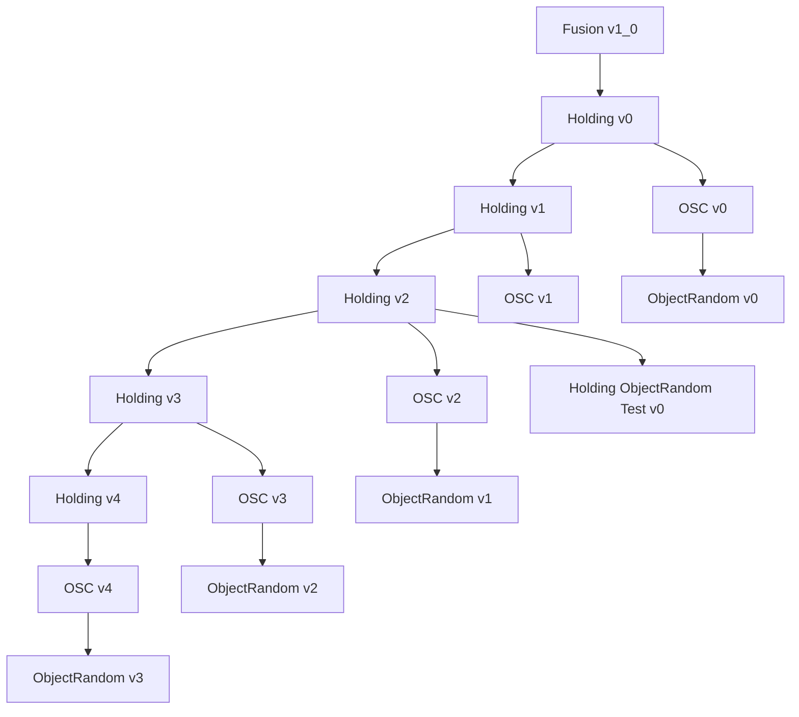

# Fusion Holding 환경 계열

기준일: 2026-10-25. [환경 계층](ENVIRONMENT_EVOLUTION.md) · [최신 v4 공통 계약](FUSION_HOLDING_V4_FAMILY.md) · [활성 환경](../08_ACTIVE_ENVIRONMENTS.md)

Holding은 목표 정착·유지 과업, Holding-OSC는 같은 과업의 Arm 제어 비교, Holding-OSC-ObjectRandom은 OSC에 물체·배치 랜덤화를 결합하는 계열이다. 최신 경로는 **Holding-v4 → Holding-OSC-v4 → Holding-OSC-ObjectRandom-v3**다. v4는 success 종료와 지급 시간 상한을 없애고 목표 중심에서 오래 유지하도록 보상한다. Timeout 100%는 학습 목표이며 달성 결과가 아니다.

## 직접 상속과 버전별 역할

아래 이름에는 공통 접두부 `Isaac-Inspire-Contact-Sweep-Clutter-Fusion-`를 붙인다. 번호가 같은 환경이 자동으로 부모가 되는 것은 아니다.



| 환경 | 직접 부모 | 핵심 변경 |
| --- | --- | --- |
| Holding-v0 | Fusion-v1_0 | 거리·속도 정착 보상, 독립 성공 종료, 충격 warmup |
| Holding-v1 | Holding-v0 | 장애물 관측 16슬롯·64D, encoder 64→32→16 |
| Holding-v2 | Holding-v1 | 공통 목표 반경 r, goal hold 계수 4, 목표 내 접촉 간주 |
| Holding-v3 | Holding-v2 | goal hold 누적 지급 시간 3초 제한 |
| Holding-v4 | Holding-v3 | success·시간 상한 제거, d≤2r 지급, d<r 중심 강화, ReachingOrGoal |
| Holding-OSC-v0 / v1 | Holding-v0 / v1 각각 | Robot Base 상대 pose, stiffness 100 |
| Holding-OSC-v2 / v3 / v4 | Holding-v2 / v3 / v4 각각 | 공통 Reach OSC 제어 적용 |
| Holding-OSC-ObjectRandom-v0 | Holding-OSC-v0 | NVIDIA 장애물, 고정 Gray7/White7, 관측 14슬롯 |
| Holding-OSC-ObjectRandom-v1 | Holding-OSC-v2 | 물리·관측 16슬롯, 활성 1/1→8/8 |
| Holding-OSC-ObjectRandom-v2 | Holding-OSC-v3 | 활성 최대 6/6, 1000 iteration 교대 증가, Gray 내측 15% |
| Holding-OSC-ObjectRandom-v3 | Holding-OSC-v4 | v2의 랜덤화 규칙을 새 Holding 과업에 결합 |
| Holding-ObjectRandom-Test-v0 | Holding-v2 | ObjectRandom-v1 구성을 Joint Position으로 비교 |

## Holding 보상과 종료의 버전 차이

d는 현재 타겟과 goal의 XY 거리, v는 타겟 XYZ 선속력이다. 아래는 유효한 타겟일 때의 goal hold만 비교한다. 모든 버전에서 RewardManager가 weight와 step_dt를 적용한다.

```math
q(d,v,a)=2^{-((d/a)^2+(v/s)^2)}
```

| Holding 버전 | 지급 범위·raw rate | weight | 지급 시간 상한 | success 종료 |
| --- | --- | --- | --- | --- |
| v0 / v1 | d<3a에서 q(d,v,a) | 2 | 없음 | 고정 0.005m·속력≤0.01m/s·연속 3초 |
| v2 | d≤r에서 q(d,v,r) | 4 | 없음 | live r·속력≤0.01m/s·연속 3초 |
| v3 | v2와 같은 rate | 4 | 에피소드 누적 3초 | v2와 같음, 지급 카운터와 독립 |
| v4 | d≤2r에서 q, d<r이면 추가로 1+(1-d/r)²를 곱함 | 4 | 없음 | 제거 |

범위 밖 또는 타겟 무효이면 0이다. v0/v1의 거리 scale a는 iteration 0/1000/6000/10000/12000/16000에서 각각 0.01/0.02/0.02/0.01/0.01/0.005m이며 250 간격 보간이다. v2 이후 r은 5000까지 0.02m, 10000에 0.01m, 20000에 0.005m로 매 iteration 선형 보간한다. **v4의 2r은 지급 경계이며 감쇠식의 분모는 여전히 r**이다.

중심·정지에서 v2 최대는 raw 1, 초당 4, 0.02초 step당 0.08이다. v4는 raw 2, 초당 8, step당 0.16이다. 동일 유지 시간의 최대 rate는 2배다. v3의 누적 상한 12와 달리 v2에는 지급 예산 상한 12가 없다. v2에서 중심·정지를 연속 유지하면 3초 success가 발생한다. v4는 10초 전체를 이상적으로 중심·정지로 유지할 때 goal hold 합계 80이며, 실제 초기 배치·도달 시간·실패는 별도다.

## 제어·랜덤화의 비교 기준

OSC-v0/v1은 기본 OSC, Robot Base 축, pose_rel, 모든 축 stiffness 100, scale 1/1이다. OSC-v2/v3/v4는 공통 `configure_reach_osc`를 사용하며 위치/회전 stiffness 100/50, damping ratio 1, 위치/회전 scale 0.03/0.15, RPY 입력, effort_limit_scale 1이다. 관성 분리와 중력 보상은 true, Arm 관절 PD는 0이다. 과거 80/25·false 기록은 현재 적용값이 아니다.

ObjectRandom-v3는 v2의 scene·events·ObjectRandomV2CurriculumCfg를 그대로 사용한다. 아래 통합된 v3 세대 설명의 ObjectRandom-v2 배치·개수 표는 v3에도 적용한다. 목표 실린더는 유지하며 NVIDIA YCB 랜덤화는 장애물에 적용한다.

## v3 세대 상세 계약 통합

기존 FUSION_HOLDING_V3_FAMILY.md의 등록·시간 예산·OSC·랜덤화·검증 설명을 이 절로 통합했다. 이 절의 Holding-v3/OSC-v3에는 성공 종료와 3초 지급 상한이 남아 있다. 최신 v4 과업에는 적용하지 않는다.

### 등록과 상속

아래 환경명의 공통 접두사는 `Isaac-Inspire-Contact-Sweep-Clutter-Fusion-`이다. Runtime은 모두 `inspire_sweep_baseline.runtime.contact_sweep_clutter_fusion:ContactSweepClutterFusionV1_0Env`, runner는 `CurriculumOnPolicyRunner`다.

| 환경명 | EnvCfg / 직접 부모 | PPO Cfg / experiment |
| --- | --- | --- |
| `Holding-v3` | `FusionHoldingV3EnvCfg` / `FusionHoldingV2EnvCfg` | `FusionHoldingV3PPORunnerCfg` / `inspire_contact_sweep_clutter_fusion_holding_v3` |
| `Holding-OSC-v3` | `FusionHoldingOSCV3EnvCfg` / `FusionHoldingV3EnvCfg` | `FusionHoldingOSCV3PPORunnerCfg` / `inspire_contact_sweep_clutter_fusion_holding_osc_v3` |
| `Holding-OSC-ObjectRandom-v2` | `FusionHoldingOSCObjectRandomV2EnvCfg` / `FusionHoldingOSCV3EnvCfg` | `FusionHoldingOSCObjectRandomV2PPORunnerCfg` / `inspire_contact_sweep_clutter_fusion_holding_osc_object_random_v2` |

EnvCfg는 각 계열의 `envs/contact_sweep_clutter_fusion_holding*_envs.py`, PPO Cfg는 `agent/contact_sweep_clutter_fusion_holding*_ppo_cfg.py`에 있다. 같은 파일의 이전 버전 등록을 보존한다. 직접 상속은 Holding-v2 → Holding-v3 → OSC-v3 → ObjectRandom-v2다.

### Holding-v3: 에피소드별 지급 시간 상한

[Holding-v2](CONTACT_SWEEP_CLUTTER_FUSION_HOLDING_V2_ENVIRONMENT.md)의 거리·속도 기반 `goal_settling`을 `CappedGoalSettling` Manager term으로 감싼다. 유효한 선반 위 상태, 공통 XY 목표 반경 안에서 양의 goal hold가 지급되는 제어 step마다 에피소드별 정수 카운트를 증가시킨다. 낮은 보상률이어도 같은 1 step을 소비한다. 보상 크기를 합산해 예산을 소모하는 방식이 아니다.

- 최대 지급 시간은 `max_hold_time=3.0`초다. 목표에서 벗어난 시간에는 카운트를 멈추며, 재진입해도 이전 카운트를 이어 간다.
- 시간 예산 소진 후에는 goal hold만 0이다. 부분 reset은 해당 환경의 카운트만, 전체 episode reset은 전체 카운트를 초기화한다.
- 기본 `step_dt=0.02`초에서는 최대 150 step을 지급한다. dt로 3초가 나누어떨어지지 않으면 마지막 지급 step의 비율만 줄여 실제 적분 시간이 3초를 넘지 않게 한다.
- 기존 거리·속도 shaping과 계수 4를 유지한다. RewardManager가 weight·dt를 한 번 적용한다. 정중앙·정지 상태에서 goal hold 총액은 최대 12다.
- 성공은 기존처럼 공통 반경·XYZ 속도 0.01 m/s 이하·실패 없음 조건을 연속 3초 유지하면 종료한다. 성공 timer와 지급 카운트는 독립적이다. 종료 판정 후 보상 계산 순서에서도 150번째 지급을 받는다.

공통 반경 2→1→0.5 cm 일정, goal distance, 목표 안 손 접촉 간주, 기타 보상·실패·timeout은 v2를 따른다. 손 접촉 간주에는 이번 시간 상한을 적용하지 않는다.

### OSC-v3: 현재 OSC-v2 제어 재사용

Holding-v3를 직접 상속하고 Arm만 OSC로 교체한다. `configure_reach_osc`에 기존 OSC-v2 설정 본문을 옮겨 두 버전이 함께 사용한다. 현재 코드 기준 위치/회전 stiffness는 100/50, damping ratio는 1, 상대 pose의 위치/회전 scale은 0.03/0.15다. RPY 입력, EEF offset, robot-base frame, effort 제한을 유지하며 관성 분리·중력 보상은 true다. Arm 관절 PD stiffness/damping은 0이다. 과거 문서의 80/25·false 표기는 현재 코드와 다르며, 이번 변경으로 제어 수치를 바꾸지 않았다.

### ObjectRandom-v2: 개수와 Gray 영역

ObjectRandom-v1의 원통 타겟, NVIDIA YCB 장애물 4종×크기 3단계, 1.5배 확대, yaw·질량·마찰 reset, OBB 비겹침·선반 검사와 초기 가림 관측을 재사용한다. **활성 개수 상한은 Gray6/White6**이다. 기존 물리 슬롯은8/8, 관측은16슬롯으로 유지하며 남는 슬롯을 비활성화한다. 7/7 반복 reset 검사의 첫 배치에서 실패하여 사용자 지정 분기에 따라6/6으로 낮췄다. [상한 선택·반복 검증 기록](../logs/2026-10-24_object_random_v2_population_cap.md). `ObjectRandomV2CurriculumCfg`가 다음 두 일정을 적용한다.

| iteration | Gray / White | Gray의 Red 방향 확장률 |
| --- | --- | --- |
| 0~2999 | 1 / 1 | 0% |
| 3000 | 1 / 2 | 0% |
| 4000 | 2 / 2 | 0% |
| 5000 | 2 / 3 | 0% |
| 6000 | 3 / 3 | 0%, 확장 시작점 |
| 6250 | 3 / 3 | 0.625% |
| 9000 | 4 / 5 | 7.5% |
| 11000 | 5 / 6 | 12.5% |
| 12000 이후 | 6 / 6, 이후 고정 | 15%, 이후 고정 |

White는 3000부터 2000마다, Gray는 4000부터 2000마다 한 개씩 추가하므로 전체적으로 1000마다 교대 증가한다. Gray 확장률은 6000~12000 사이에서 250 iteration마다 0.625%p씩 증가한다. 6000에서는 0, 첫 양의 값은 6250이다. 두 일정 모두 절대 learning iteration으로 계산해 resume·되감기에도 같은 값을 적용한다. 진행 중인 에피소드의 물체 위치·개수는 유지하고 다음 reset에 반영한다.

15%의 구현 해석은 **기존 Red 제외 반경 10.3 cm의 15%를 안쪽으로 허용**하는 것이다. 최대 패딩은 1.545 cm, Gray 중심의 새 제외 반경은 8.755 cm다. 원래 sweep 경로와 robot 쪽으로 연장된 wrist shadow에 대한 거리 함수를 그대로 사용하고, Gray와 rear Gray 후보의 내측 경계만 바꾼다. Red 면적을 15% 줄이는 의미는 아니다.

초기 구현의 실제2환경·seed42 검사에서는 초기 reset/step과 iteration6000·9000·12000·0의 reset을 통과했다. 당시 최대8/8에 도달한16000에서는200회 안에 비겹침 배치를 찾지 못했다. 이후7/7도 실패하여 현재 상한은6/6이다. **6/6·최대 패딩15%는 asset seed5개·100회 배치 reset·총400장면에서 실패0건**을 확인했다. 모든 장면에 대한 성공 보장은 아니며 [후속 반복 검증과 한계](../logs/2026-10-24_object_random_v2_population_cap.md)를 확인한다.

White 후보는 기존 Red·Gray 분류를 유지한다. Gray 외곽 반경 14 cm, rear 영역·최소 한 개 quota, 물체 간 간격·밀도·접근 경로 certificate·실제 OBB 비겹침과 선반 경계도 유지한다. 따라서 새로 허용한 영역 전체에 물체가 반드시 놓이는 것은 아니다. 로컬 `GrayPaddingLayoutGenerator`가 구역 판정을 확장하며 `src/scene_randomization`의 원본은 읽기 전용이다. 배치 실패 시 타겟·목표를 재추출하거나 개수를 줄이지 않는다.

### 공통 입력·페널티·실행

Actor는 policy 55D와 초기 장애물 64D, Critic은 현재 타겟 XYZ 3D를 추가해 raw 119D/122D다. 독립 64→32→16 장애물 encoder를 거치면 71D/74D다. Actor에 실행 중 타겟 GT를 추가하지 않는다. 행동은 Arm6D+Hand2D이며 Holding-v3는 Joint Position, 나머지는 위 OSC다. 정책 주기·자산 출처·좌표계·물성은 [Holding-v1 계약](CONTACT_SWEEP_CLUTTER_FUSION_HOLDING_V1_ENVIRONMENT.md)과 [ObjectRandom-v1 계약](CONTACT_SWEEP_CLUTTER_FUSION_HOLDING_OSC_OBJECT_RANDOM_V1_ENVIRONMENT.md)을 따른다.

네 운동 페널티는 로컬 `goal_rewards.action_rate_l2`·`joint_vel_l2`, Arm/Hand raw 제곱합과 실제 관절 속도, 가중치 −0.03/−0.03/−0.03/−0.01을 유지한다. 입력 정규화나 Hand 보상 clamp를 추가하지 않는다.

Workspace 루트에서 Isaac Lab Python, 선반 USD 접근 및 NVIDIA 물체 자산이 필요하다. 기본 Nucleus 선반 주소는 VPN 접근 조건을 확인한다. Windows 실행 예시는 다음과 같다. 환경 수는 처리량 검증값이 아니다.

```powershell
.\IsaacLab\isaaclab.bat -p src/inspire_sweep_baseline/scripts/train.py --task Isaac-Inspire-Contact-Sweep-Clutter-Fusion-Holding-v3 --num_envs 2048 --headless
.\IsaacLab\isaaclab.bat -p src/inspire_sweep_baseline/scripts/train.py --task Isaac-Inspire-Contact-Sweep-Clutter-Fusion-Holding-OSC-v3 --num_envs 2048 --headless
.\IsaacLab\isaaclab.bat -p src/inspire_sweep_baseline/scripts/train.py --task Isaac-Inspire-Contact-Sweep-Clutter-Fusion-Holding-OSC-ObjectRandom-v2 --num_envs 256 --headless
.\IsaacLab\isaaclab.bat -p src/inspire_sweep_baseline/scripts/play.py --task Isaac-Inspire-Contact-Sweep-Clutter-Fusion-Holding-OSC-ObjectRandom-v2 --num_envs 1 --checkpoint "<checkpoint.pt>"
```

[보상 구현](../../../../src/inspire_sweep_baseline/inspire_sweep_baseline/mdp/reward_functions/contact_sweep_clutter_fusion_holding_scheduled.py) · [Gray 배치 구현](../../../../src/inspire_sweep_baseline/inspire_sweep_baseline/mdp/common/contact_sweep_clutter_fusion_holding_osc_object_random_placement.py) · [커리큘럼 설정](../../../../src/inspire_sweep_baseline/inspire_sweep_baseline/mdp/curricula/contact_sweep_clutter_fusion_holding_osc_object_random.py) · [실제 검증과 한계](../logs/2026-10-24_fusion_holding_v3.md).

## 최신 문서와 이후 버전 관리

- [Holding-v4](CONTACT_SWEEP_CLUTTER_FUSION_HOLDING_V4_ENVIRONMENT.md): Joint Position 기준 과업.
- [Holding-OSC-v4](CONTACT_SWEEP_CLUTTER_FUSION_HOLDING_OSC_V4_ENVIRONMENT.md): 제어기 비교.
- [Holding-OSC-ObjectRandom-v3](CONTACT_SWEEP_CLUTTER_FUSION_HOLDING_OSC_OBJECT_RANDOM_V3_ENVIRONMENT.md): 랜덤화 결합.
- [v4 공통 보상·r·종료·커리큘럼](FUSION_HOLDING_V4_FAMILY.md).

새 버전은 직접 부모와 변경한 과업·제어·랜덤화 조건을 명시한다. 같은 계열의 CFG는 기존 역할별 파일에 모으고 등록·PPO experiment·환경 목록을 함께 갱신한다. 비교 결과에는 목표 오차, 잔류 속도, 유지 시간, timeout/실패 비율을 기록한다. OSC에서는 토크 포화·진동·충돌, Random에서는 형상·크기·물성별 결과를 함께 확인한다. 짧은 실행 통과를 장기 학습 성능으로 해석하지 않는다.
