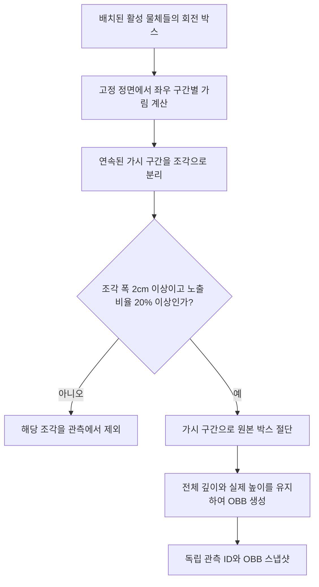

# 초기 부분 관측 OBB의 구성 방법

이 문서는 다른 코드나 자료를 읽지 않고도 관측의 의미와 생성 절차를 이해할 수 있도록 설명한다. 기준일은 2026-11-18이다.

## 1. 무엇을 관측하는가

장면에 놓인 물체를 고정된 정면에서 보았을 때, 다른 물체에 가리지 않고 드러나는 부분을 회전 가능한 바운딩 박스로 표현한다. 이 박스를 **관측 OBB**라고 부른다. OBB는 물체를 감싸는 직육면체이며, 여기서는 수직축은 유지하고 수평면에서만 회전한다.

타겟과 장애물을 모두 같은 관측 대상 물체로 처리한다. 다만 관측 결과에는 어느 것이 타겟인지, 어느 것이 장애물인지 표시하지 않는다. 결과는 독립 관측 ID와 박스의 위치·크기·방향이다.

이 방식은 시뮬레이터가 알고 있는 물체 기하를 이용해 초기 지각 결과를 근사한다. 실제 카메라 이미지나 depth 이미지를 생성·분석하는 방식은 아니다.



## 2. 관측을 정의하는 가정

### 고정된 정면과 평행 시선

관측자는 정해진 한 방향에서 장면을 바라본다. 시선들은 서로 평행하며 원근에 따른 크기 변화는 고려하지 않는다. 사람이 결과를 확인하기 위해 화면을 회전하더라도 관측 방향은 바뀌지 않는다.

현재 좌표에서는 Z가 위쪽이다. 관측자는 +X 쪽에서 -X 쪽을 바라보고, 정면에서의 좌우 폭은 Y 방향으로 잰다.

### 실제 형상은 회전 박스로 근사

각 물체의 실제 굴곡과 구멍을 계산하지 않고, 물체 방향을 따르는 전체 회전 박스로 근사한다. 따라서 손잡이 구멍이나 오목한 부분을 통과하는 시선은 표현하지 않는다. 여기서 ‘잘린 형상’은 이 근사 박스를 잘라 얻은 형상이다.

### 물체 사이의 가림만 계산

타겟과 활성 장애물은 모두 다른 물체를 가릴 수 있다. 타겟이 장애물을 가리는 경우도 동일하게 처리한다. 로봇·손·선반 구조물은 이 관측의 가림 원인에 포함하지 않는다. 비활성 물체도 입력에서 제외한다.

### 가리는 물체의 높이는 무한으로 취급

앞 물체가 차지하는 좌우 구간은 높이에 관계없이 뒤 물체를 가린다. 앞 물체가 낮더라도 그 위로 뒤 물체의 윗부분을 따로 관측하지 않는다.

이것은 가림 판단의 가정이다. 출력 박스의 높이를 무한으로 만든다는 뜻이 아니다. 출력에는 원본 물체의 실제 높이를 사용한다.

### 드러난 좌우 구간의 깊이는 전부 안다고 가정

보이는 좌우 구간을 찾은 뒤에는 그 구간에 해당하는 원본 박스의 앞뒤 깊이를 온전히 유지한다. 정면에서 보이는 얇은 표면만 남기지 않는다. 그러나 가려진 좌우 구간 자체를 복원해서 추가하지는 않는다.

이 때문에 최종 관측은 ‘표면 점들의 박스’가 아니라 **드러난 좌우 구간에 대응하는 전체 부피를 감싼 박스**다.

## 3. 입력과 용어

각 활성 물체에는 다음 기하 정보가 필요하다. 길이 단위는 미터이고 각도 단위는 라디안이다.

| 입력 | 의미 |
| --- | --- |
| 중심 위치 | 회전 박스의 기하 중심 `(x, y, z)` |
| 크기 | 물체의 수평 두 축을 따르는 전체 길이와 실제 높이 |
| yaw | Z축을 중심으로 한 수평 회전각 |
| 관측 방향 | 관측자에서 장면 안쪽으로 향하는 고정 수평 방향 |

물체 중심과 모든 크기는 실제 스케일을 반영해야 한다. 물체의 배치 기준점과 기하 중심이 다르면, 기준점에 회전된 중심 오프셋을 더해서 기하 중심을 구한다. 입력 크기는 반길이가 아닌 전체 길이다. 수직축까지 기울어진 물체의 일반적인 3차원 회전은 현재 표현 범위에 포함하지 않는다.

이후 설명에서는 다음 용어를 사용한다.

| 용어 | 정의 |
| --- | --- |
| 원본 박스 | 가림을 적용하기 전, 실제 물체를 근사하는 전체 회전 박스 |
| 가시 구간 | 정면의 좌우 축에서 해당 물체가 가장 앞에 드러나는 연속 구간 |
| 가시 조각 | 가시 구간 하나에 대응하는 원본 박스의 잔여 형상 |
| 노출 폭 | 가시 조각 하나가 정면 좌우 축에서 차지하는 길이 |
| 원본 전체 폭 | 원본 박스를 정면 좌우 축에 투영한 전체 길이 |
| 관측 물체 | 폭·비율 필터를 통과한 가시 조각 하나 |
| 관측 스냅샷 | 한 번의 관측에서 생성하여 보관하는 관측 물체들의 집합 |

원본 전체 폭은 회전각에 따라 달라진다. 원본 박스의 가로 길이나 세로 길이 중 하나를 그대로 노출 비율의 분모로 사용하면 안 된다. 또한 노출 폭은 피팅이 끝난 OBB의 한 변 길이와도 구분한다.

## 4. 좌우 구간별로 무엇이 보이는지 계산

### 관측 좌표로 바꾸기

각 원본 박스의 수평 바닥면은 회전된 직사각형이다. 그 꼭짓점을 두 개의 수평 축으로 표현한다.

- `u`: 정면에서의 좌우 위치.
- `v`: 시선이 진행하는 앞뒤 깊이. 값이 작을수록 관측자에게 가깝다.

현재 정면 방향에서는 `u = Y`, `v = -X`로 둘 수 있다. 모든 물체를 같은 좌표계로 변환해서 비교한다.

### 구간을 나누는 위치 찾기

좌우 축 전체를 짧은 구간들로 나눈다. 분할 위치는 각 바닥면 꼭짓점의 `u` 좌표와, 바닥면 경계선들이 교차하는 점의 `u` 좌표다. 이를 정렬하고 중복된 위치를 제거한다.

꼭짓점에서는 물체가 나타나거나 사라지고 경계선의 기울기가 바뀔 수 있다. 경계 교차점에서는 두 물체의 앞뒤 순서가 바뀔 수 있다. 두 종류의 위치를 모두 반영해야 회전된 박스의 가림을 다룰 수 있다.

### 각 구간의 가장 앞 물체 선택

분할된 구간의 가운데에서 평행 시선을 하나 놓는다. 각 물체의 바닥면과 이 시선이 만나는 지점 중 가장 작은 `v`를 찾는다. 그 값이 해당 물체의 정면 경계다.

물체들 중 정면 경계의 `v`가 가장 작은 물체가 그 구간을 차지한다. 뒤 물체들은 같은 구간에서 가려진다. 아무 물체도 만나지 않으면 빈 구간이다.

이때 물체 중심의 거리로 순서를 대신하지 않는다. 회전된 물체에서는 중심이 더 멀어도 일부 경계가 더 앞에 있을 수 있기 때문이다. 같은 구간에서 정면 경계가 정확히 동률인 특수한 경우에는 입력 순서에 따른 고정된 선택을 사용하며 무작위로 뒤집지 않는다.

가림 판단에는 관측 필터 적용 전의 모든 입력 물체를 사용한다. 작아서 최종 관측에서 제외될 물체도 이 단계에서는 뒤 물체를 가린다.

## 5. 가시 조각 분리와 노출 필터

같은 원본 물체가 차지한 구간들이 바로 붙어 있으면 하나의 연속 가시 구간으로 합친다. 사이에 다른 물체가 보이는 구간이 있으면 분리된 상태로 유지한다.

예를 들어 가운데가 가려져 왼쪽과 오른쪽만 보이면 가시 조각은 두 개다. 실제로 같은 물체에서 나온 조각이어도 별개의 관측 물체 후보로 다룬다. 향후 지각 모델이 두 부분을 동일 물체로 연결할 수 있다고 가정하지 않기 때문이다.

가시 조각 하나의 노출 폭을 $w$, 그 조각의 원본 물체 전체 폭을 $W$라고 하면, 다음 두 조건을 모두 만족해야 관측에 포함한다.

```math
w \geq 0.02 \quad \mathrm{and} \quad \frac{w}{W} \geq 0.20
```

같은 조건을 한 번의 폭 비교로 표현할 수도 있다.

```math
w \geq \max(0.02,\ 0.20W)
```

정확히 2cm 또는 20%인 경계값도 포함한다. 계산 중 기계 정밀도 수준의 반올림 오차는 보정하되, 물리적인 허용 폭을 추가해 기준을 낮추지는 않는다.

| 원본 전체 폭 | 조각 노출 폭 | 노출 비율 | 결과 |
| --- | --- | --- | --- |
| 6cm | 1.9cm | 약 31.7% | 최소 폭 미달로 제외 |
| 20cm | 3cm | 15% | 비율 미달로 제외 |
| 10cm | 2cm | 20% | 두 경계값을 만족하므로 포함 |
| 20cm | 4cm | 20% | 포함 |
| 20cm | 떨어진 조각이 각각 3cm | 각 15% | 둘 다 제외. 합산 30%로 판정하지 않음 |
| 1.9cm | 1.9cm | 100% | 완전 가시여도 최소 폭 미달로 제외 |

관측에서 탈락한 앞 물체를 지운 뒤 뒤 물체의 가림을 다시 계산하지 않는다. 그렇게 하면 작은 물체 뒤를 잘못 드러내게 된다.

## 6. 가시 조각에서 OBB 만들기

필터를 통과한 각 가시 구간에 대해서만 다음 절차를 수행한다.

1. 원본 바닥면 직사각형을 해당 `u` 구간의 양 끝에서 절단한다.
2. 그 구간 안에 들어오는 바닥면을 모두 남긴다. 앞쪽 표면만 남기지 않고 각 `u`에서 원본이 가진 전체 `v` 범위를 유지한다.
3. 남은 볼록 다각형을 감싸는 수평 최소 면적 직사각형을 구한다.
4. 여기에 원본 물체의 실제 높이와 수직 중심 위치를 결합해 직육면체를 만든다.

최소 면적 직사각형을 찾을 때는 절단 다각형의 각 변에 평행한 방향을 후보로 삼는다. 각 후보 방향에서 꼭짓점들을 투영해 가장 작은 포위 직사각형을 만들고, 그중 면적이 최소인 것을 선택한다. 따라서 원본 물체의 yaw와 다른 방향이 선택될 수 있다.

완전히 드러난 원본 박스가 필터를 통과한 경우에는 원본 박스 자체가 최소 면적 결과이므로 그대로 사용할 수 있다.

OBB는 잔여 형상을 **감싸는 근사**다. 절단 다각형이 직사각형이 아니면 OBB 안에 실제 잔여 형상에 속하지 않는 여백이 생긴다. 이 여백이 가려진 영역으로 일부 뻗을 수 있으며, 서로 다른 조각의 OBB끼리 겹칠 수도 있다. 따라서 OBB를 정확한 가시 영역 마스크나 충돌 형상으로 해석하지 않는다.

## 7. 숫자로 보는 전체 예시

아래는 위에서 본 관측 좌표 `(u, v)`의 예시다. 길이는 설명의 편의를 위해 모두 cm로 쓴다. 작은 `v`가 앞쪽이며, 두 물체는 바닥 높이 0에 놓여 있다. 수평 박스 축은 `u`, `v`와 나란하다.

| 물체 | 좌우 범위 `u` | 앞뒤 범위 `v` | 높이 |
| --- | --- | --- | --- |
| 뒤 물체 | 0–20 | 16–24 | 10 |
| 앞 물체 | 8–12 | 4–6 | 3 |

앞 물체는 `u = 8–12`에서 뒤 물체를 가린다. 앞 물체가 높이 3cm이고 뒤 물체가 10cm이지만, 높이 무관 가림 가정 때문에 뒤 물체의 윗부분도 해당 좌우 구간에서는 관측하지 않는다.

```text
정면 좌우 위치 u:  0        8    12        20
뒤 물체:          [  가시  ][가림][  가시  ]
앞 물체:                   [가시]
```

뒤 물체에는 폭 8cm인 가시 조각 두 개가 남는다. 원본 전체 폭이 20cm이므로 각 조각의 노출 비율은 40%다. 두 조각 모두 폭·비율 기준을 통과한다. 앞 물체도 전체 폭 4cm가 보이므로 통과한다.

관측 출력은 다음과 같은 세 개의 독립 OBB가 된다. ID 번호 자체에는 의미가 없다.

| 관측 ID | 중심 `(u, v, z)` | 크기 `(u축 길이, v축 길이, 높이)` |
| --- | --- | --- |
| 0 | `(4, 20, 5)` | `(8, 8, 10)` |
| 1 | `(16, 20, 5)` | `(8, 8, 10)` |
| 2 | `(10, 5, 1.5)` | `(4, 2, 3)` |

물리 물체는 두 개지만 관측 물체는 세 개다. 뒤 물체의 두 조각에는 원래 앞뒤 깊이 8cm와 실제 높이 10cm가 그대로 남는다. 출력에는 ID 0과 ID 1이 같은 실제 물체에서 나왔다는 관계나, 어느 ID가 타겟인지에 대한 라벨을 넣지 않는다.

## 8. 출력과 관측 시점

한 번의 관측 결과는 다음 정보를 가진 항목들의 목록이다.

- 독립 관측 ID.
- OBB의 기하 중심 `(x, y, z)`.
- OBB의 수평 두 변 길이와 실제 높이.
- OBB의 수평 회전각 yaw.

관측 개수는 가변이며 0개일 수도 있다. 조각 분리 때문에 입력 물체 수보다 많을 수도 있다. ID는 해당 스냅샷 안에서 관측을 구분하기 위한 값이며, 다음 스냅샷에서 같은 번호가 같은 물체를 뜻하지는 않는다.

초기 배치가 완료되면 한 번 관측하여 스냅샷을 저장한다. 일반적인 프레임 갱신이나 검토용 카메라 이동으로 다시 계산하지 않는다. 새 배치를 만들면 관측도 갱신하고, 같은 배치를 명시적으로 재관측하면 동일한 기하 결과가 나온다.

화면에 그리는 관측 박스와 비교용 원본 박스는 충돌과 물리 반응이 없는 표시다. 표시를 켜거나 끄는 동작은 관측 내용에 영향을 주지 않는다.

## 9. 적용 범위와 한계

이 관측은 **초기 장면의 기하 기반 지각 근사**다. 실제 Perception 모델, 이미지 기반 검출, 타겟 의미 분류, 분리 조각의 동일 물체 연결, 시간에 따른 추적은 포함하지 않는다.

원본 전체 폭·깊이·높이를 알고 있다는 가정은 시뮬레이터의 기하 정보에 의존한다. 실제 센서만으로 같은 정보를 얻을 수 있다고 주장하지 않는다. 또한 물체를 전체 박스로 근사하고 가리는 높이를 무한으로 취급하므로 실제 광학적 가시성과 차이가 날 수 있다.

현재 계산은 단일 장면의 CPU 기하 계산이다. 다중 환경용 처리, 정책 입력의 padding·mask·정규화와 Actor/Critic 연결은 이 관측 정의에 포함되지 않는다. 관측의 의미를 이해하는 것과 학습 정책에 어떤 형태로 전달할지 결정하는 것은 별개의 단계다.

검토용 뷰어는 가림이 있는 장면을 찾기 위해 배치 후보를 선택하고 사용자가 닫을 때까지 실행한다. 이 동작들은 관측 계산의 정의가 아니다. 어떤 방식으로 만들어진 장면이든 같은 입력 기하와 같은 관측 방향을 주면 위 절차를 동일하게 적용한다.
