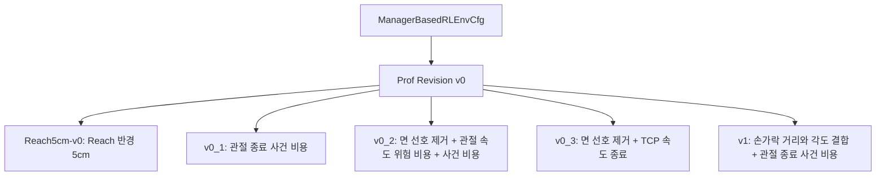
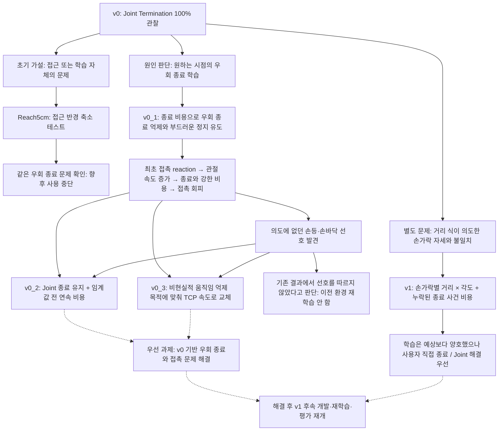

# Prof Revision 환경 계통과 학습 기록

기준일: **2026-11-24**. 대상은 `src/inspire_sweep_baseline`의 Prof Revision 6개 환경이다. 실제 EnvCfg·RewardsCfg·TerminationsCfg·PPOCfg를 기준으로 정리했다. 상세 구현 계약은 [Prof Revision v0와 파생 환경](PROF_REVISION_V0.md)을 따른다.

## 현재 학습 현황 — 2026-11-24 최신 사용자 보고

**현재 학습 중인 환경은 아래3개뿐이다.** Joint Termination 문제 해결을 최우선으로 두고 비교한다. 그 외 환경은 모두 사용자가 직접 종료했다. 서버 상태는 사용자 보고에 근거하며 별도 원격 확인은 하지 않았다.

| 학습 서버 | 현재 환경 | 상태 | 이번 학습에서 확인할 방향 |
| --- | --- | --- | --- |
| **.30** | **v0_3** | **학습 중** | Joint 종료를 TCP 선속도 종료로 교체한 대안 |
| **.180** | **v0_2** | **학습 중** | Joint 종료 유지 + 임계값 전 연속 비용 |
| **.250** | **v0_1** | **학습 중** | 종료 사건 비용만 추가한 비교 기준; 매우 느리지만 성공률은 조금씩 상승 |

| 종료한 환경 | 과거 학습 서버 | 중단 사유·결과 |
| --- | --- | --- |
| v0 | .30 | 약6000iter에서 Joint Termination100% 원인 조사 목적으로 직접 중단 |
| Reach5cm-v0 | .250 | 결과가 v0과 차이 없고 같은 우회 종료 문제로 직접 중단. 향후 사용 안 함 |
| v1 | .180 | 생각보다 학습이 잘 됐으나 Joint 문제를 먼저 확실히 해결하기 위해 직접 중단. 이후 재개 검토 |

v0_1은 의도보다 지나치게 느리며, 성공률이 조금씩 오르더라도 사용자는 경험상 실패 가능성이 높다고 평가한다. 이는 사용자 전망이며 확정된 실패 판정은 아니다. v1은 학습 실패 때문에 중단한 것이 아니라 연구 우선순위에 따른 중단이다.

이하에는 환경 구성·코드 상속·개발 의도 관계를 설명한다. 상세 학습 이력은5절, 결과와 해석은6절, 추가 기록용 템플릿은 문서 후반에서 관리한다.

## 1. 직접 상속 관계



**Reach5cm-v0, v0_1, v0_2, v0_3, v1은 모두 v0의 직접 자식**이다. 버전 번호가 순서대로 이어져도 v0_3이 v0_2를 상속하거나 v1이 v0_1을 상속하는 구조가 아니다. 예를 들어 v0_3에는 v0_2의 margin 비용과 종료 사건 비용이 들어가지 않는다.

베이스 `ProfRevisionEnvCfg`는 Isaac Lab의 `ManagerBasedRLEnvCfg`를 직접 상속한다. Single Contact를 기능 기준으로 삼았지만 해당 EnvCfg를 Python 부모로 두지 않는다. 6개 환경 모두 실행 클래스 `runtime.prof_revision:ProfRevisionEnv`를 재사용한다.

| 환경 | 전체 Gym task ID | EnvCfg 클래스 | 직접 부모 |
| --- | --- | --- | --- |
| v0 | `Inspire-Sweep-Prof-Revision-v0` | `ProfRevisionEnvCfg` | `ManagerBasedRLEnvCfg` |
| Reach5cm-v0 | `Inspire-Sweep-Prof-Revision-Reach5cm-v0` | `ProfRevisionReach5cmEnvCfg` | `ProfRevisionEnvCfg` |
| v0_1 | `Inspire-Sweep-Prof-Revision-v0_1` | `ProfRevisionV0_1EnvCfg` | `ProfRevisionEnvCfg` |
| v0_2 | `Inspire-Sweep-Prof-Revision-v0_2` | `ProfRevisionV0_2EnvCfg` | `ProfRevisionEnvCfg` |
| v0_3 | `Inspire-Sweep-Prof-Revision-v0_3` | `ProfRevisionV0_3EnvCfg` | `ProfRevisionEnvCfg` |
| v1 | `Inspire-Sweep-Prof-Revision-v1` | `ProfRevisionV1EnvCfg` | `ProfRevisionEnvCfg` |

## 2. 베이스 v0의 구성

### 과업·Scene·제어

선반 위 타겟을 목표 XY 위치까지 미는 과업이다. UR5e 팔과 Inspire 손을 사용하고, 타겟은 원통이며 활성 장애물은 최대6개다. 초기 타겟 반경2cm·목표 거리6–12cm·전 방향 목표 배치와 Warp IK reset을 사용한다. 자산·물성·배치의 상세값은 [베이스 계약](PROF_REVISION_V0.md)에 연결한다.

| 항목 | v0 기준 |
| --- | --- |
| 기본 병렬 환경 수 | 2048 |
| 물리 주기 | 0.01초 |
| 정책 주기 | 0.02초, decimation2 |
| Episode | 10초, 최대500 policy step |
| 행동 | 팔 OSC6D + 손 normalized 위치6D, 총12D |
| 손 행동 | 0은 펼침, 1은 굽힘의 정규화 비율 |
| 목표 성공 | timeout 때 추적 가시 OBB 중심의 목표 XY 거리 <=3cm, 동시 실패 제외 |
| Curriculum | 비어 있음 |

목표 반경에 먼저 들어가도 즉시 성공 종료하지 않는다. 10초 시점의 성공 조건을 만족해야 한다.

### 관측과 네트워크

reset 때 관측 가능한 타겟·장애물 OBB를 만들고, Actor와 Critic은 그 **초기 world snapshot을 현재 EEF 좌표계로 변환한 값**을 받는다. 보상·성공 판정은 초기 가시 타겟 조각을 물체에 부착해 실시간 추적한 중심을 사용한다.

가시성은 선반 +X에서 −X를 보는 기하 규칙이다. 독립된 가시 폭이 `max(2cm, 전체 투영 폭의20%)` 이상인 조각을 채택한다. 타겟은 가장 넓은 조각1개, 장애물은 조각별 최대16슬롯이다. 물체 하나가 여러 장애물 슬롯을 차지할 수 있다.

| policy 관측 순서 | 차원 |
| --- | --- |
| 팔 관절 위치 / 속도 | 6 / 6 |
| EEF Pose | 7 |
| 손 구동 관절 위치 | 6 |
| 손가락5개 Pose | 35 |
| 초기 타겟 OBB | 10 |
| 목표 위치 | 3 |
| 이전 행동 | 12 |
| 촉각 | 17 |
| 손목 F/T | 6 |
| **합계** | **108** |

별도 obstacles 관측은 `(mask + 위치3 + 크기3 + quaternion4) ×16 =176D`다. 타겟·장애물 OBB와 손가락 Pose의 quaternion은 xyzw다. EEF Pose의 기존 wxyz 표현과 구분한다.

장애물 encoder는176→128→64→32→16이고, policy108D와 embedding16D를 합쳐 본체124D에 입력한다. Actor/Critic은 각자 독립 encoder와256→128→64 MLP를 가진다. F/T는 보상된 물리 wrench에 관측 noise를 적용하고 힘±150N·모멘트±8Nm로 clip한 뒤 정규화한다.

### 베이스 보상과 종료

아래 weight는 RewardManager 설정값이다. 일반 rate는 `weight × raw × dt`로 지급되지만, 거리 증분과 사건 함수는 `/dt`를 반환하여 실제 transition 기여에서 dt가 상쇄된다.

| 보상 term | weight | 역할 |
| --- | --- | --- |
| sweep_progress | 100 | 목표 거리 감소 × 접촉 인정 × 힘 정렬 × 면 계수 |
| sweep_retreat | −20 | 목표 거리 증가 비용 |
| reaching | 4.9 | EEF–추적 중심 거리의10cm 초과분 감소/증가 |
| contact_formation | 0.245 | 손끝5개와 OBB 간 거리 합에 따른 자세 점수 |
| arm_action_rate / hand_action_rate | 각각−0.03 | 행동 변화 비용, raw cap100 |
| arm_joint_velocity / hand_joint_velocity | 각각−0.03 | 관절 속도 L2 비용, raw cap100 |
| arm_action_limit / hand_action_limit | 각각−3 | 행동 범위 초과 비용, raw cap10 |
| shelf_collision | −0.5 | 선반 충돌 비용 |
| shelf_failure | −3 | 선반 실패 사건 비용 |
| obstacle_contact | −0.04 | free force50N 이후 장애물 접촉 비용 |
| wrench_change | −0.1 | free force change30N / moment change3Nm 이후 변화 비용 |
| object_tilt | −30 | 활성 물체 기울기 비용 |
| obstacle_displacement | −150 | 장애물 변위 비용 |

총16개다. `arm_joint_velocity`라는 이름의 **보상**과 같은 이름의 **종료 조건**은 서로 다른 Manager 항이다. v0에도 연속 관절 속도 비용은 있지만, 팔 속도 **종료 사건 비용 `arm_joint_failure`는 없다**.

접촉 인정은 최근3 policy step 중2회 이상의 유효 접촉이다. 힘 정렬은 목표 방향과 현재 접촉 힘의 정렬을 평가한다. 면 선호는 에피소드의 의도된 sweep 방향 구역을 기준으로 구역1/2 손등·구역3/4 손바닥을 선호하며, 선호1.5·반대0.7·미분류 중립1.0을 실제 접촉 하중에 따라 적용한다.

거리 단위는 m이다. 손끝–OBB 외부 거리 d_i를 사용하며 내부/표면의 거리는0이다. 베이스 Formation의 실제 step 기여는 다음과 같다.

```math
r_{\mathrm{formation}}=0.245\frac{0.05}{0.05+\sum_{i=1}^{5}d_i}\Delta t
```

베이스 실패 종료는 활성 물체 낙하/전도, 선반 실패, **팔 관절 하나라도 절대 속도 >1.0 rad/s**다. 정확히1.0은 속도 종료가 아니다. 성공과 timeout은 `time_out=True`이고, 물리 실패는 실패 종료다.

PPO는 rollout36step, gamma0.98, lambda0.95,8epochs/4mini-batches, 학습률0.001/adaptive, clip0.2, entropy0.005, 최대90000iterations,50iterations마다 저장이다. 파생 환경은 PPO 수치를 그대로 쓰고 실험명만 분리한다.

## 3. 부모 대비 버전별 변경

| 환경 | Reach 반경 | 면 선호 | Formation | 속도 실패 종료 | 새 연속 margin | 새 종료 사건 비용 | 보상 수 |
| --- | --- | --- | --- | --- | --- | --- | --- |
| v0 | 10cm | 1.5/0.7 | 거리 합,0.245 | 팔 >1rad/s | 없음 | 없음 | 16 |
| Reach5cm-v0 | **5cm** | 부모 | 부모 | 부모 | 없음 | 없음 | 16 |
| v0_1 | 부모 | 부모 | 부모 | 부모 | 없음 | **팔 종료−3** | 17 |
| v0_2 | 부모 | **모든 면1** | 부모 | 부모 | **0.8–1rad/s 제곱** | **팔 종료−3** | 18 |
| v0_3 | 부모 | **모든 면1** | 부모 | **TCP >=4m/s로 교체** | 없음 | 없음 | 16 |
| v1 | 부모 | 부모 | **손가락별 거리×각도 합,0.3675** | 부모 | 없음 | **팔 종료−3** | 17 |

표의 “새 비용 없음”은 기존 관절 속도 L2·다른 비용까지 없다는 의미가 아니다. 위 차이 외 관측·자산·물리·행동·reset·성공 반경·episode 길이·PPO 수치를 상속한다.

### Reach5cm-v0 — 접근 허용 반경만 축소

`reach_near_radius`를0.10→0.05m로 바꾼다. Reaching 식과 weight4.9는 같다. 성공 반경3cm와 혼동하지 않는다.

### v0_1 — 팔 관절 속도 종료 사건 비용만 추가

기존 종료 flag를 읽어 실제 terminal transition에−3을 한 번 부과한다. 다른 보상과 종료 threshold는 부모와 같다.

### v0_2 — 면 중립 + 관절 속도 사전 비용 + 종료 사건 비용

Sweep의 면 계수를 모두1로 바꾸고 weight100은 유지한다. 최대 절대 팔 관절 속도 v에 대해 새 비용을 추가한다.

```math
x=\min\left(1,\max\left(0,\frac{v-0.8}{0.2}\right)\right),
\qquad r_{\mathrm{margin}}=-3x^2\Delta t
```

0.8 이하에서는 새 margin 비용0,0.9에서는−0.015/step,1.0 이상에서는−0.06/step이다(dt0.02). 팔 속도 종료 사건−3도 추가되어 종료 step에서 새 두 항 합은−3.06이다. 종료 판정은 부모대로 >1.0이며 정확히1.0에서는 종료하지 않는다.

### v0_3 — 면 중립 + TCP 선속도 종료

면 계수를1로 통일한다. 팔 관절 속도 종료를 삭제하고 **UR5e 마지막 링크 `wrist_3_link` 원점의 월드3D 선속도 크기 >=4.0m/s**로 교체한다. 손 쪽 EEF offset이나 F/T 센서 링크의 속도가 아니다. 링크 원점 속도는 COM 속도에서 위치 차이를 보정한 값이다.

성공 판정에서도 같은 step의 TCP 속도 실패를 제외한다. 별도의 TCP 종료 사건 페널티나 v0_2 margin은 없다. 기존 팔 관절 속도 L2 보상 비용과 actuator 제한은 유지한다.

### v1 — 손가락별 거리와 양방향 각도 결합

팔 속도 종료 사건−3을 추가하고 Formation만 다음으로 교체한다. n_i는 EEF 기준 지문 Normal, u_i는 같은 좌표계에서 해당 손가락 pad 원점→추적 OBB 중심 방향이다.

```math
r_{\mathrm{formation}}=0.3675\sum_{i=1}^{5}
\left[\frac{0.05}{0.05+d_i}\cos^2\theta_i\right]\Delta t,
\qquad \cos\theta_i=\frac{n_i\cdot u_i}{\|n_i\|\|u_i\|}
```

각도0°/180°에서 최대,±90°에서 최소이며 손등 방향도 허용한다. 퇴화 벡터의 각도 점수는0이다. 손가락별 곱을 **합산하며 평균화하지 않는다**. weight는 기존의1.5배지만 raw 최대가1→5이므로 최대 Formation 기여는 부모의7.5배다. 부모의 Sweep 면 선호는 그대로 남는다.

## 개발 의도 관계와 현재 우선순위

아래 화살표는 **문제 인식 → 해결 의도 → 후속 실험**의 관계다. 코드 상속을 뜻하지 않는다. 파생 환경의 직접 부모는 모두 v0이며, 실험 의도상으로는 v0_1의 관찰이 v0_2/v0_3 설계로 이어졌다. 경위와 결과 해석은2026-11-24 사용자 보고 기준이다.



실선은 개발 경위, 점선은 앞으로의 우선순위와 재개 조건이다. v0_2/v0_3의 효과가 확인되었다는 의미는 아니다.

| 환경·결정 | 출발한 문제 또는 가설 | 의도와 선택 | 연결된 후속 판단 |
| --- | --- | --- | --- |
| v0 원인 조사 | Joint Termination100%, 처음에는 시작 직후 종료 문제를 의심 | 약6000iter에 직접 중단하고 원인 확인 | 시작 직후 문제가 아니라 정책이 원하는 시점에 종료를 유발한다고 판단 |
| Reach5cm-v0 | Joint 종료율이 내려가지 않는 것이 학습 실패라고 생각 | 접근 허용 반경10→5cm로 테스트 | 같은 우회 종료 문제이므로 의미 없는 조건으로 판단, 사용 중단 |
| v0_1 | 종료를 이용해 원하는 시점에 episode를 끊음 | 종료 사건 비용을 추가해 우회 종료 억제·부드러운 정지 유도 | 최초 접촉 reaction에도 종료와 강한 비용 발생, 물체 주변 정지 학습 |
| 면 선호 삭제 | 원래 없어야 할 손등·손바닥 선호 신호 발견 | 새 분기 v0_2/v0_3에서 제거 | 기존 정책이 선호를 실질적으로 따르지 않았다고 보아 이전 환경 재학습은 안 함 |
| v0_2 | v0_1의 갑작스러운 종료 비용과 접촉 회피 | 기존 Joint Termination을 유지하면서0.8rad/s부터 연속 비용 제공 | Joint 종료를 계속 활용할 수 있는지 확인할 분기, 결과 미보고 |
| v0_3 | Joint 속도는 접촉 reaction에 민감하다는 판단 | 비현실적 움직임 방지 목적을 유지하면서 TCP 속도>=4m/s로 교체 | reaction 영향 감소를 기대하는 대안, 실제 효과는 미확인 |
| v1 | v0 거리 식이 원하는 손가락 자세를 만들지 못함 | 손가락별 거리×각도 합과 종료 사건 비용 추가 | 학습은 예상보다 양호했으나 Joint 문제 해결을 우선하여 직접 종료·후속 작업 보류 |

v1에서 추가한 것은 누락된 **종료 사건 페널티**다. v0에도 Joint Termination 조건 자체는 이미 있었다. v0_1의 “부드러운 종료”는 우회 실패 종료 대신 감속·정지를 유도하려는 의도이며, 성공 종료 조건이나 감속 제어를 새로 추가했다는 뜻은 아니다.

**현재 우선순위는 v0 기반 우회 종료·접촉 reaction 문제 해결 후 v1 손가락 자세 개선 재개다.** 최신 사용자 지시로 v1 run도 직접 종료된 상태이며, 현재 `.180`에서는 v0_2를 학습한다. v1이 계속 학습 중이라는 이전 보고는 이 최신 현황으로 대체한다.

## 4. 실행 ID와 기본 로그 이름

| 환경 | PPO experiment_name |
| --- | --- |
| v0 | `inspire_sweep_prof_revision_v0` |
| Reach5cm-v0 | `inspire_sweep_prof_revision_reach5cm_v0` |
| v0_1 | `inspire_sweep_prof_revision_v0_1` |
| v0_2 | `inspire_sweep_prof_revision_v0_2` |
| v0_3 | `inspire_sweep_prof_revision_v0_3` |
| v1 | `inspire_sweep_prof_revision_v1` |

기본 학습 로그는 `logs/rsl_rl/<experiment_name>/<run>/` 계열이다. 실제 저장 위치는 실행 옵션·복사/보관 위치에 따라 달라질 수 있으므로 아래 기록에는 실제 경로를 적는다. workspace 루트에서 예를 들어 다음과 같이 실행한다.

```bash
python src/inspire_sweep_baseline/scripts/train.py --task Inspire-Sweep-Prof-Revision-v0_3 --num_envs 2048 --headless
python src/inspire_sweep_baseline/scripts/play.py --task Inspire-Sweep-Prof-Revision-v0_3 --checkpoint /absolute/path/to/model.pt --num_envs 1 --real-time
```

## 5. 학습 위치와 진행 현황 메모

**2026-11-24 사용자 보고 기준**으로 채운 현황표다. 호스트는 제공된 약칭 그대로 기록했다. 원격 프로세스는 별도 확인하지 않았으며, 알려지지 않은 GPU·PID·run 경로·seed 등은 뒤의 run별 상세 메모에 추가한다.

| 환경 | 학습 위치 | 학습 진행·중단 정보 | 현재 연구 방침 | 학습 메모 |
| --- | --- | --- | --- | --- |
| v0 | `.30` | 약6000iter에서 사용자 직접 중단 | 우회 종료 원인 조사 및 해결의 기준 환경 | Joint Termination100%로 중단. 최초부터 종료되는 문제와 구분 |
| Reach5cm-v0 | `.250` | **사용자 직접 종료** | **앞으로 이 조건 사용 안 함** | 결과가 v0과 차이 없고, v0과 같은 우회 종료 문제로 중단 |
| v0_1 | `.250` | **현재 학습 중**, iteration 미보고 | 종료 사건 비용만 추가한 비교 기준으로 계속 관찰 | 의도보다 지나치게 느리지만 성공률 조금씩 상승. 사용자는 경험상 실패 가능성이 높다고 평가 |
| v0_2 | `.180` | **현재 학습 중**, iteration 미보고 | Joint Termination 문제 우선 해결 | 면 선호 제거 + 종료 전 연속 비용 + 종료 사건 비용. 학습 결과 미보고 |
| v0_3 | `.30` | **현재 학습 중**, iteration 미보고 | TCP 선속도 종료 대안으로 Joint 문제 해결 | 접촉 reaction 영향을 줄이려는 의도. 학습 결과 미보고 |
| v1 | `.180`에서 과거 학습 | **사용자 직접 종료** | Joint 문제를 확실히 해결한 뒤 다시 진행 | 예상보다 학습이 잘 됐지만 우선순위로 중단. 현재 이 서버는 v0_2 학습 중 |

서버 위치와 학습 상태를 갱신할 때는 날짜·작성자를 함께 남긴다. 신규 run은 행을 복제하고 실제 로그 경로·checkpoint·코드 버전을 run별 상세 메모에 연결한다.

## 6. 학습 결과와 행동 메모

### 사용자 보고에 따른 결과·해석·후속 결정

아래는 **2026-11-24 사용자가 제공한 결과**를 요약한 표다. 수치가 주어지지 않은 곳은 정성 관찰로 기록하며, 구현 smoke 결과를 학습 성능으로 대체하지 않는다.

| 환경 | 관찰된 학습 결과 | 사용자 원인 해석 | 실험에 대한 판단 | 후속 결정 |
| --- | --- | --- | --- | --- |
| v0 | Joint Termination100%. 시작 직후가 아니라 정책이 원하는 시점에 종료 | 정책이 관절 속도 종료를 유발해 에피소드를 끊는 우회 행동 학습 | 목표 근처에서 계속 손실을 받는 대신 종료할 수 있는 문제가 핵심 | 약6000iter에 중단하고 원인 조사; 종료 우회부터 해결 |
| Reach5cm-v0 | 결과가 v0과 차이 없음 | v0과 같은 우회 종료 문제 | 접근 반경 변경 테스트가 문제 해결에 의미 없다고 판단 | v0과 같은 이유로 직접 중단, 향후 사용 안 함 |
| v0_1 | 최초 접촉 reaction 이후 종료·강한 비용과 물체 주변 정지 관찰. 현재는 의도보다 지나치게 느리지만 성공률 조금씩 상승 | 접촉 비용으로 접촉을 회피하는 경향을 학습했다고 해석 | 성공률 상승에도 경험상 실패 가능성이 높다는 사용자 평가 | .250에서 학습 지속, v0_2/v0_3과 종료 방식 비교 |
| v0_2 | **학습 결과 미보고** | 미확인 | Joint 종료를 유지하는 접근의 유효성 평가 예정 | 우회 종료와 최초 접촉 회피가 개선되는지 확인 |
| v0_3 | **학습 결과 미보고** | 미확인 | TCP 속도가 reaction 영향을 덜 받으면서 비현실적 움직임을 제한할 것으로 기대 | 실제 접촉·종료 행동으로 기대 효과 확인 |
| v1 | 성공률 상승, 예상보다 학습이 잘 됐다는 사용자 평가. 정량 수치는 미보고 | 손가락 자세 실험 이전에 Joint 문제를 먼저 확실히 해결할 필요 | 학습 실패에 따른 중단이 아니라 연구 우선순위 조정 | 사용자가 직접 종료. v0 기반 종료 문제 해결 후 재개 |

**공통 관찰과 결정:** 기존 결과가 손등·손바닥 선호를 실질적으로 받아들이지 않았다고 사용자 판단. 해당 신호를 제거하기 위해 과거 환경을 다시 학습하지 않고, v0_2/v0_3에서 제거한다.

정량 결과를 추가할 때는 성공률(10초 종료 시 성공)과 목표 진입률(도중3cm 이내 진입)을 구분하고, checkpoint·평가 방식·seed·episode 수를 함께 기록한다. 기존 정량 평가 결과는 다음 절에 별도로 보존한다.

### 이미 확인된 과거 평가

다음은 [2026-11-24 두 checkpoint 진단](../experiments/2026-11-24_prof_revision_stop_termination_diagnosis.md)의 기록이다. 현재 학습 현황이나 새 버전 성능을 의미하지 않는다.

| 환경·checkpoint | 평가 조건 | 성공 | 목표3cm 진입 | 팔 관절 속도 종료 |
| --- | --- | --- | --- | --- |
| v0·model_6100.pt | deterministic, seed42/43, 각64환경×3episode, 총384 | 0/384 | 330/384(85.94%) | 383/384(99.74%) |
| Reach5cm-v0·model_7950.pt | 동일 조건, 총384 | 0/384 | 347/384(90.36%) | 381/384(99.22%) |

당시 보관 경로:

- v0: `logs/TEMP/2026-11-24/inspire_sweep_prof_revision_v0/2026-11-24_00-27-46/model_6100.pt`
- Reach5cm-v0: `logs/TEMP/2026-11-24/inspire_sweep_prof_revision_reach5cm_v0/2026-11-24_01-06-28/model_7950.pt`

목표 근처 진입 후 빠른 팔 속도 종료가 관측됐다. 기존 정량 진단은 종료 이후 손실을 끊는 유인과의 일치를 확인했으며 정책 의도·학습 인과 자체를 확정하지 않았다. 이후 사용자는 이를 원하는 시점의 우회 종료로 판단했다고 보고했다. 두 기록의 증거 수준을 구분한다.

v0 중단 시점은 사용자 보고의 약6000 iter로 기록하고, 기존 평가 대상 파일명 model_6100.pt도 원래대로 보존한다. 정확한 마지막 iteration과 평가 파일의 대응은 미확인이다. 또한 이번 사용자 설명에 따라 **물체 주변 정지·접촉 회피 결과는 v0_1에 귀속**한다. 앞선 요약에서 v1 무동작으로 적었던 부분은 이 최신 보고로 정정한다.

### 구현 검증과 학습 성능의 구분

| 환경 | 확인된 구현 검증 기록 | 장기 결과 상태 |
| --- | --- | --- |
| v0 | [관측·GPU·collection 검증](../logs/2026-11-23_prof_revision_v0_implementation.md) | 위 과거 checkpoint 평가 참고 |
| Reach5cm-v0 | 같은 기록의 반경 변경 대조, 위 Play 진단 | 위 과거 checkpoint 평가 참고 |
| v0_1 | [GPU4환경·실제 팔 종료 비용 검증](../logs/2026-11-24_prof_revision_v0_1_implementation.md) | 사용자 보고: 접촉 회피 관찰, 매우 느리지만 성공률 조금씩 상승; .250 학습 중 |
| v0_2 | [CPU61·GPU4환경·PPO1회](../logs/2026-11-24_prof_revision_v0_2_implementation.md) | 장기 개선 미검증 |
| v0_3 | [CPU62·GPU4환경·PPO1회](../logs/2026-11-24_prof_revision_v0_3_implementation.md) | 장기 개선 미검증 |
| v1 | [CPU58·GPU4환경·PPO1회](../logs/2026-11-24_prof_revision_v1_implementation.md) | 사용자 보고: 예상보다 양호한 학습, Joint 문제 우선 해결을 위해 직접 종료 |

CPU 개수는 해당 구현 당시 수행한 검증 묶음이다. 테스트 수·짧은 PPO 성공은 정책의 과업 성공률이 아니다. v0_3의 TCP4m/s 경계 검증은 sampled velocity 주입이며 실제4m/s 궤적 재현과 구분한다.

### run별 상세 메모 템플릿

아래 블록을 복제해 날짜순으로 누적한다.

```text
기록일(KST) / 작성자:
환경 Task ID / run 별칭:
코드 commit / 미커밋 diff 보관 위치:
서버·GPU / 작업 디렉터리 / 세션·PID:
실행 명령 / seed / num_envs:
학습 시작·종료 / 재개 이력 / 현재 상태 확인 시각:
원본 로그 / 보관 경로 / checkpoint:
평가 방식(deterministic/stochastic) / seed / episode 수:
성공률 / 목표 진입률 / 최종 목표 거리 / episode 길이:
종료 원인별 비율(팔 속도 또는 TCP 속도·선반·낙하/전도·timeout):
Sweep·retreat·Formation·속도 L2·margin·사건 비용:
목표 밖 정체 / 목표 근처 감속·정지 / 손가락 자세 관찰:
비교 대상 / 동일하게 맞춘 조건 / 차이와 한계:
결론 / 다음 실험:
영상·원시 데이터·보고서 링크:
```

## 7. 코드와 관리 위치

현재 구성의 근거는 다음 실제 파일이다. 세부 구현 설명은 [베이스·파생 계약](PROF_REVISION_V0.md)에서 관리하고, 이 문서는 상속 비교와 학습 기록의 진입점으로 사용한다.

- [환경 상속](../../../../src/inspire_sweep_baseline/inspire_sweep_baseline/envs/prof_revision_envs.py)
- [보상 구성](../../../../src/inspire_sweep_baseline/inspire_sweep_baseline/mdp/rewards/prof_revision.py)
- [종료 구성](../../../../src/inspire_sweep_baseline/inspire_sweep_baseline/mdp/terminations/prof_revision.py)
- [PPO 구성](../../../../src/inspire_sweep_baseline/inspire_sweep_baseline/agent/prof_revision_ppo_cfg.py)
