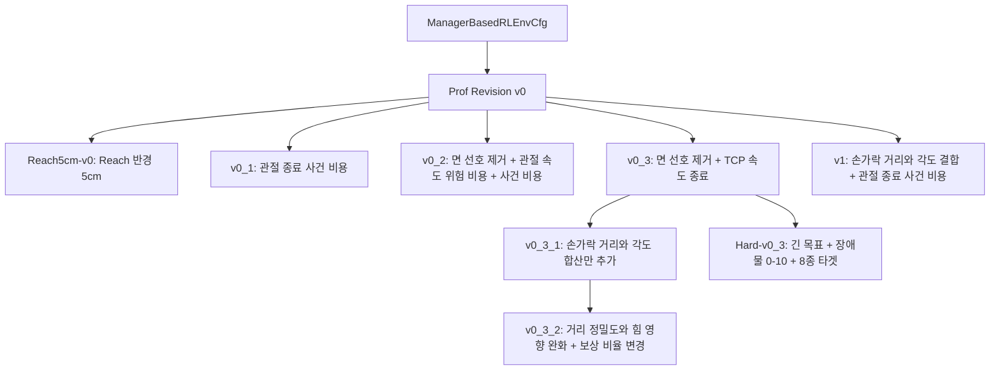
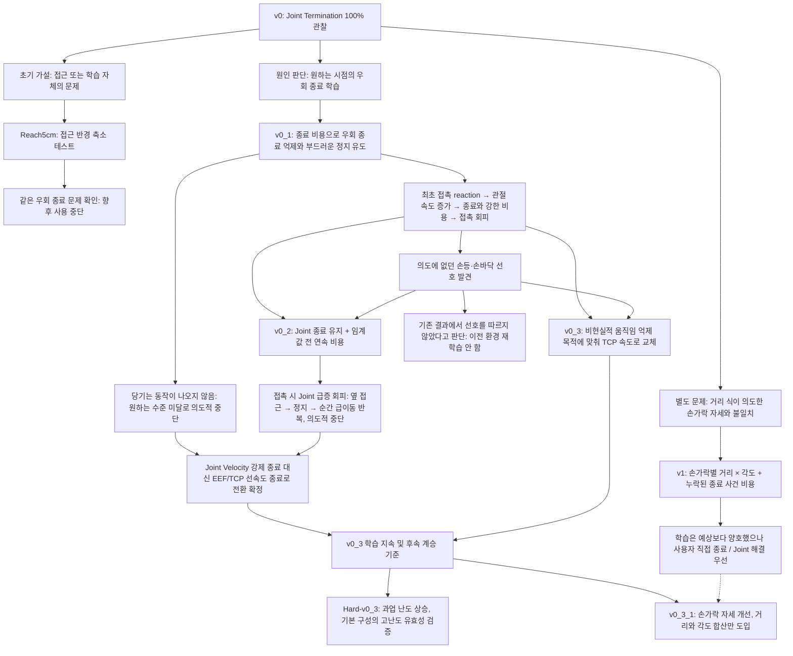

# Prof Revision 환경 계통과 학습 기록

구성 기준일: **2026-11-26**, 학습 상태 사용자 보고 기준일:2026-11-25. 대상은 `src/inspire_sweep_baseline`의 Prof Revision 9개 환경이다. 학습 상태·행동 관찰·후속 결정은 최신 사용자 보고를 반영하고, 구현 구성은 실제 EnvCfg·RewardsCfg·TerminationsCfg·PPOCfg를 기준으로 정리했다. 상세 구현 계약은 [Prof Revision v0와 파생 환경](PROF_REVISION_V0.md)을 따른다.

2026-11-26: **v0_3_2 추가**. v0_3_1을 직접 상속하여 거리 기반 힘 영향 완화·중심 정밀도·보상 비율 변경을 적용한다. 성공3cm·기존TCP 종료·관측·제어·과업 분포·PPO 수치는 보존한다. [상세 계약](PROF_REVISION_V0.md#prof-revision-v0_3_2) · [최종 대조·검증](../logs/2026-11-26_prof_revision_v0_3_2_implementation.md). 아래 기존8개 환경의 학습 상태 보고를 새 환경의 장기 학습 결과로 해석하지 않는다.

## 현재 학습 현황 — 2026-11-25 최신 사용자 보고

**v0_1·v0_2는 원하는 수준의 결과가 나오지 않아 의도적으로 학습을 중단했고, v0_3은 학습을 지속한다.** Joint Velocity 강제 종료 대신 EEF/TCP 선속도 터미네이션을 사용하는 방향으로 전환하기로 확정했다. 학습 상태는 사용자 보고이며 원격 프로세스를 별도로 확인하거나 중단한 기록이 아니다.

| 마지막 보고 서버 | 환경 | 최신 상태 | 관찰·판단 |
| --- | --- | --- | --- |
| **.30** | **v0_3** | **학습 지속 중** | TCP 선속도 종료를 사용하는 계승 기준 환경 |
| .180 | v0_2 | **사용자 의도적 중단** | 접촉 시 Joint 급증을 피하려 물체 옆 접근 → 정지 → 순간적 급이동 패턴 반복. 원하는 수준 미달 |
| .250 | v0_1 | **사용자 의도적 중단** | 당기는 동작이 나오지 않음. 원하는 수준 미달 |

| 종료한 환경 | 과거 학습 서버 | 중단 사유·결과 |
| --- | --- | --- |
| v0 | .30 | 약6000iter에서 Joint Termination100% 원인 조사 목적으로 직접 중단 |
| Reach5cm-v0 | .250 | 결과가 v0과 차이 없고 같은 우회 종료 문제로 직접 중단. 향후 사용 안 함 |
| v1 | .180 | 생각보다 학습이 잘 됐으나 Joint 문제 우선 해결을 위해 직접 중단한 기존 상태 유지. 손가락 보상식은 v0_3_1에서 재사용 |

2026-11-24에는 v0_1·v0_2·v0_3 모두 학습 중이라고 보고됐으나, 위2026-11-25 상태가 이를 대체한다. v0_1의 당시 “느리지만 성공률이 조금씩 상승” 관찰은 학습 지속 결정을 의미하지 않는다. 서버 약칭은 마지막 보고 위치이며, 중단 후 서버 재배치와 새 파생 환경의 장기 학습 시작 여부는 보고되지 않았다.

v0_3을 기준으로 두 실험을 분리한다. **Hard-v0_3은 과업 난도를 높여 기존 기본 구성이 고난도 조건에도 유효한지 확인**하고, **v0_3_1은 만족스럽지 않은 손가락 자세를 개선하기 위해 손가락 보상에 거리·각도 결합을 도입**한다. 두 환경의 구현 검증 완료와 장기 학습 결과는 구분한다.

이하에는 환경 구성·코드 상속·개발 의도 관계를 설명한다. 상세 학습 이력은5절, 결과와 해석은6절, 추가 기록용 템플릿은 문서 후반에서 관리한다.

## 1. 직접 상속 관계



**Reach5cm-v0, v0_1, v0_2, v0_3, v1은 모두 v0의 직접 자식**이다. 버전 번호가 순서대로 이어져도 v0_3이 v0_2를 상속하거나 v1이 v0_1을 상속하는 구조가 아니다. 예를 들어 v0_3에는 v0_2의 margin 비용과 종료 사건 비용이 들어가지 않는다.

베이스 `ProfRevisionEnvCfg`는 Isaac Lab의 `ManagerBasedRLEnvCfg`를 직접 상속한다. Single Contact를 기능 기준으로 삼았지만 해당 EnvCfg를 Python 부모로 두지 않는다. 기존8개 환경은 실행 클래스 `runtime.prof_revision:ProfRevisionEnv`를 재사용한다. v0_3_2만 그 직접 자식인 `ProfRevisionV0_3_2Env`에서 상태 생성·추가telemetry를 확장한다.

| 환경 | 전체 Gym task ID | EnvCfg 클래스 | 직접 부모 |
| --- | --- | --- | --- |
| v0 | `Inspire-Sweep-Prof-Revision-v0` | `ProfRevisionEnvCfg` | `ManagerBasedRLEnvCfg` |
| Reach5cm-v0 | `Inspire-Sweep-Prof-Revision-Reach5cm-v0` | `ProfRevisionReach5cmEnvCfg` | `ProfRevisionEnvCfg` |
| v0_1 | `Inspire-Sweep-Prof-Revision-v0_1` | `ProfRevisionV0_1EnvCfg` | `ProfRevisionEnvCfg` |
| v0_2 | `Inspire-Sweep-Prof-Revision-v0_2` | `ProfRevisionV0_2EnvCfg` | `ProfRevisionEnvCfg` |
| v0_3 | `Inspire-Sweep-Prof-Revision-v0_3` | `ProfRevisionV0_3EnvCfg` | `ProfRevisionEnvCfg` |
| v0_3_1 | `Inspire-Sweep-Prof-Revision-v0_3_1` | `ProfRevisionV0_3_1EnvCfg` | `ProfRevisionV0_3EnvCfg` |
| v0_3_2 | `Inspire-Sweep-Prof-Revision-v0_3_2` | `ProfRevisionV0_3_2EnvCfg` | `ProfRevisionV0_3_1EnvCfg` |
| Hard-v0_3 | `Inspire-Sweep-Prof-Revision-Hard-v0_3` | `ProfRevisionHardV0_3EnvCfg` | `ProfRevisionV0_3EnvCfg` |
| v1 | `Inspire-Sweep-Prof-Revision-v1` | `ProfRevisionV1EnvCfg` | `ProfRevisionEnvCfg` |

`Hard-v0_3`는2026-11-25 추가한 v0_3의 직접 자식이다. 목표 최소5cm·선반 경계까지, 장애물0–10개,8종 타겟을 사용하며 나머지 v0_3 구성을 상속한다. [상세 계약·실행](PROF_REVISION_V0.md#prof-revision-hard-v0_3) · [검증](../logs/2026-11-25_prof_revision_hard_v0_3_implementation.md).

`v0_3_1`는 v0_3에 손가락 거리×양방향 cos² 합산 mode만 추가한다. weight0.245 유지, 추가 관절 사건 비용 없음. Hard 과업 분포를 상속하지 않는다. [상세 계약](PROF_REVISION_V0.md#prof-revision-v0_3_1) · [검증](../logs/2026-11-25_prof_revision_v0_3_1_implementation.md).

## 2. 베이스 v0의 구성

### 과업·Scene·제어

선반 위 타겟을 목표 XY 위치까지 미는 과업이다. UR5e 팔과 Inspire 손을 사용하고, 타겟은 원통이며 활성 장애물은 최대6개다. 초기 타겟 반경2cm·목표 거리6–12cm·전 방향 목표 배치와 Warp IK reset을 사용한다. 자산·물성·배치의 상세값은 [베이스 계약](PROF_REVISION_V0.md)에 연결한다.

| 항목 | v0 기준 |
| --- | --- |
| 기본 병렬 환경 수 | 2048 |
| 물리 주기 | 0.01초 |
| 정책 주기 | 0.02초, decimation2 |
| Episode | 10초, 최대500 policy step |
| 행동 | 팔 OSC6D + 손 normalized 위치6D, 총12D |
| 손 행동 | 0은 펼침, 1은 굽힘의 정규화 비율 |
| 목표 성공 | timeout 때 추적 가시 OBB 중심의 목표 XY 거리 <=3cm, 동시 실패 제외 |
| Curriculum | 비어 있음 |

목표 반경에 먼저 들어가도 즉시 성공 종료하지 않는다. 10초 시점의 성공 조건을 만족해야 한다.

### 관측과 네트워크

reset 때 관측 가능한 타겟·장애물 OBB를 만들고, Actor와 Critic은 그 **초기 world snapshot을 현재 EEF 좌표계로 변환한 값**을 받는다. 보상·성공 판정은 초기 가시 타겟 조각을 물체에 부착해 실시간 추적한 중심을 사용한다.

가시성은 선반 +X에서 −X를 보는 기하 규칙이다. 독립된 가시 폭이 `max(2cm, 전체 투영 폭의20%)` 이상인 조각을 채택한다. 타겟은 가장 넓은 조각1개, 장애물은 조각별 최대16슬롯이다. 물체 하나가 여러 장애물 슬롯을 차지할 수 있다.

| policy 관측 순서 | 차원 |
| --- | --- |
| 팔 관절 위치 / 속도 | 6 / 6 |
| EEF Pose | 7 |
| 손 구동 관절 위치 | 6 |
| 손가락5개 Pose | 35 |
| 초기 타겟 OBB | 10 |
| 목표 위치 | 3 |
| 이전 행동 | 12 |
| 촉각 | 17 |
| 손목 F/T | 6 |
| **합계** | **108** |

별도 obstacles 관측은 `(mask + 위치3 + 크기3 + quaternion4) ×16 =176D`다. 타겟·장애물 OBB와 손가락 Pose의 quaternion은 xyzw다. EEF Pose의 기존 wxyz 표현과 구분한다.

장애물 encoder는176→128→64→32→16이고, policy108D와 embedding16D를 합쳐 본체124D에 입력한다. Actor/Critic은 각자 독립 encoder와256→128→64 MLP를 가진다. F/T는 보상된 물리 wrench에 관측 noise를 적용하고 힘±150N·모멘트±8Nm로 clip한 뒤 정규화한다.

### 베이스 보상과 종료

아래 weight는 RewardManager 설정값이다. 일반 rate는 `weight × raw × dt`로 지급되지만, 거리 증분과 사건 함수는 `/dt`를 반환하여 실제 transition 기여에서 dt가 상쇄된다.

| 보상 term | weight | 역할 |
| --- | --- | --- |
| sweep_progress | 100 | 목표 거리 감소 × 접촉 인정 × 힘 정렬 × 면 계수 |
| sweep_retreat | −20 | 목표 거리 증가 비용 |
| reaching | 4.9 | EEF–추적 중심 거리의10cm 초과분 감소/증가 |
| contact_formation | 0.245 | 손끝5개와 OBB 간 거리 합에 따른 자세 점수 |
| arm_action_rate / hand_action_rate | 각각−0.03 | 행동 변화 비용, raw cap100 |
| arm_joint_velocity / hand_joint_velocity | 각각−0.03 | 관절 속도 L2 비용, raw cap100 |
| arm_action_limit / hand_action_limit | 각각−3 | 행동 범위 초과 비용, raw cap10 |
| shelf_collision | −0.5 | 선반 충돌 비용 |
| shelf_failure | −3 | 선반 실패 사건 비용 |
| obstacle_contact | −0.04 | free force50N 이후 장애물 접촉 비용 |
| wrench_change | −0.1 | free force change30N / moment change3Nm 이후 변화 비용 |
| object_tilt | −30 | 활성 물체 기울기 비용 |
| obstacle_displacement | −150 | 장애물 변위 비용 |

총16개다. `arm_joint_velocity`라는 이름의 **보상**과 같은 이름의 **종료 조건**은 서로 다른 Manager 항이다. v0에도 연속 관절 속도 비용은 있지만, 팔 속도 **종료 사건 비용 `arm_joint_failure`는 없다**.

접촉 인정은 최근3 policy step 중2회 이상의 유효 접촉이다. 힘 정렬은 목표 방향과 현재 접촉 힘의 정렬을 평가한다. 면 선호는 에피소드의 의도된 sweep 방향 구역을 기준으로 구역1/2 손등·구역3/4 손바닥을 선호하며, 선호1.5·반대0.7·미분류 중립1.0을 실제 접촉 하중에 따라 적용한다.

거리 단위는 m이다. 손끝–OBB 외부 거리 d_i를 사용하며 내부/표면의 거리는0이다. 베이스 Formation의 실제 step 기여는 다음과 같다.

```math
r_{\mathrm{formation}}=0.245\frac{0.05}{0.05+\sum_{i=1}^{5}d_i}\Delta t
```

베이스 실패 종료는 활성 물체 낙하/전도, 선반 실패, **팔 관절 하나라도 절대 속도 >1.0 rad/s**다. 정확히1.0은 속도 종료가 아니다. 성공과 timeout은 `time_out=True`이고, 물리 실패는 실패 종료다.

PPO는 rollout36step, gamma0.98, lambda0.95,8epochs/4mini-batches, 학습률0.001/adaptive, clip0.2, entropy0.005, 최대90000iterations,50iterations마다 저장이다. 파생 환경은 PPO 수치를 그대로 쓰고 실험명만 분리한다.

## 3. 부모 대비 버전별 변경

| 환경 | Reach 반경 | 면 선호 | Formation | 속도 실패 종료 | 새 연속 margin | 새 종료 사건 비용 | 보상 수 |
| --- | --- | --- | --- | --- | --- | --- | --- |
| v0 | 10cm | 1.5/0.7 | 거리 합,0.245 | 팔 >1rad/s | 없음 | 없음 | 16 |
| Reach5cm-v0 | **5cm** | 부모 | 부모 | 부모 | 없음 | 없음 | 16 |
| v0_1 | 부모 | 부모 | 부모 | 부모 | 없음 | **팔 종료−3** | 17 |
| v0_2 | 부모 | **모든 면1** | 부모 | 부모 | **0.8–1rad/s 제곱** | **팔 종료−3** | 18 |
| v0_3 | 부모 | **모든 면1** | 부모 | **TCP >=4m/s로 교체** | 없음 | 없음 | 16 |
| Hard-v0_3 | v0_3 | v0_3 | v0_3 | v0_3 | 없음 | 없음 | 16 |
| v0_3_1 | v0_3 | v0_3 | **손가락별 거리×각도 합,0.245** | v0_3 | 없음 | 없음 | 16 |
| v0_3_2 | v0_3_1 | v0_3_1 | **같은 식,0.1715** | v0_3_1 | 없음 | 없음 | 16 |
| v1 | 부모 | 부모 | **손가락별 거리×각도 합,0.3675** | 부모 | 없음 | **팔 종료−3** | 17 |

표의 “새 비용 없음”은 기존 관절 속도 L2·다른 비용까지 없다는 의미가 아니다. 초기5개 파생 환경은 표의 차이 외 관측·자산·물리·행동·reset·성공 반경·episode 길이·PPO 수치를 v0에서 상속한다. Hard-v0_3·v0_3_1의 부모는 v0_3이며, Hard만 목표 거리·활성 장애물 수·타겟 종류·배치 기하를 확장한다. v0_3_2는v0_3_1 직접 자식으로Sweep를거리 기반 힘 완화·가중 거리H로 바꾸고,weight는진행100·이탈−40·Reach9.8·Formation0.1715·장애물변위−300으로 조정한다. 장애물cap0.04는 유지한다.

### Reach5cm-v0 — 접근 허용 반경만 축소

`reach_near_radius`를0.10→0.05m로 바꾼다. Reaching 식과 weight4.9는 같다. 성공 반경3cm와 혼동하지 않는다.

### v0_1 — 팔 관절 속도 종료 사건 비용만 추가

기존 종료 flag를 읽어 실제 terminal transition에−3을 한 번 부과한다. 다른 보상과 종료 threshold는 부모와 같다.

### v0_2 — 면 중립 + 관절 속도 사전 비용 + 종료 사건 비용

Sweep의 면 계수를 모두1로 바꾸고 weight100은 유지한다. 최대 절대 팔 관절 속도 v에 대해 새 비용을 추가한다.

```math
x=\min\left(1,\max\left(0,\frac{v-0.8}{0.2}\right)\right),
\qquad r_{\mathrm{margin}}=-3x^2\Delta t
```

0.8 이하에서는 새 margin 비용0,0.9에서는−0.015/step,1.0 이상에서는−0.06/step이다(dt0.02). 팔 속도 종료 사건−3도 추가되어 종료 step에서 새 두 항 합은−3.06이다. 종료 판정은 부모대로 >1.0이며 정확히1.0에서는 종료하지 않는다.

### v0_3 — 면 중립 + TCP 선속도 종료

면 계수를1로 통일한다. 팔 관절 속도 종료를 삭제하고 **UR5e 마지막 링크 `wrist_3_link` 원점의 월드3D 선속도 크기 >=4.0m/s**로 교체한다. 손 쪽 EEF offset이나 F/T 센서 링크의 속도가 아니다. 링크 원점 속도는 COM 속도에서 위치 차이를 보정한 값이다.

성공 판정에서도 같은 step의 TCP 속도 실패를 제외한다. 별도의 TCP 종료 사건 페널티나 v0_2 margin은 없다. 기존 팔 관절 속도 L2 보상 비용과 actuator 제한은 유지한다.

### v1 — 손가락별 거리와 양방향 각도 결합

팔 속도 종료 사건−3을 추가하고 Formation만 다음으로 교체한다. n_i는 EEF 기준 지문 Normal, u_i는 같은 좌표계에서 해당 손가락 pad 원점→추적 OBB 중심 방향이다.

```math
r_{\mathrm{formation}}=0.3675\sum_{i=1}^{5}
\left[\frac{0.05}{0.05+d_i}\cos^2\theta_i\right]\Delta t,
\qquad \cos\theta_i=\frac{n_i\cdot u_i}{\|n_i\|\|u_i\|}
```

각도0°/180°에서 최대,±90°에서 최소이며 손등 방향도 허용한다. 퇴화 벡터의 각도 점수는0이다. 손가락별 곱을 **합산하며 평균화하지 않는다**. weight는 기존의1.5배지만 raw 최대가1→5이므로 최대 Formation 기여는 부모의7.5배다. 부모의 Sweep 면 선호는 그대로 남는다.

## 개발 의도 관계와 현재 우선순위

아래 화살표는 **문제 인식 → 실험 → 관찰 → 후속 결정**의 관계다. 코드 상속은1절을 따른다. v0_1의 관찰이 v0_2/v0_3 설계로 이어졌고,2026-11-25에는 Joint Velocity 강제 종료에서 EEF/TCP 선속도 종료로 방향을 확정했다. 초기5개 파생 환경은 v0의 직접 자식이고, Hard-v0_3·v0_3_1은 v0_3의 직접 자식이다.



실선은 개발 경위·사용자 결정이며, 점선은 v1의 손가락 보상식을 재사용하는 관계다. 종료 방식의 채택은 확정된 연구 방침이다. v0_3이나 두 자식의 장기 성능·개선 정도까지 확정됐다는 의미는 아니다.

| 환경·결정 | 출발한 문제 또는 가설 | 의도와 선택 | 연결된 후속 판단 |
| --- | --- | --- | --- |
| v0 원인 조사 | Joint Termination100%, 처음에는 시작 직후 종료 문제를 의심 | 약6000iter에 직접 중단하고 원인 확인 | 시작 직후 문제가 아니라 정책이 원하는 시점에 종료를 유발한다고 판단 |
| Reach5cm-v0 | Joint 종료율이 내려가지 않는 것이 학습 실패라고 생각 | 접근 허용 반경10→5cm로 테스트 | 같은 우회 종료 문제이므로 의미 없는 조건으로 판단, 사용 중단 |
| v0_1 | 종료를 이용해 원하는 시점에 episode를 끊음 | 종료 사건 비용을 추가해 우회 종료 억제·부드러운 정지 유도 | 기존 접촉 회피·정지 관찰에 더해 당기는 동작이 나오지 않음. 원하는 수준 미달로 의도적 중단 |
| 면 선호 삭제 | 원래 없어야 할 손등·손바닥 선호 신호 발견 | 새 분기 v0_2/v0_3에서 제거 | 기존 정책이 선호를 실질적으로 따르지 않았다고 보아 이전 환경 재학습은 안 함 |
| v0_2 | v0_1의 갑작스러운 종료 비용과 접촉 회피 | 기존 Joint Termination을 유지하면서0.8rad/s부터 연속 비용 제공 | 접촉 시 Joint 급증을 피하는 옆 접근·정지·순간 급이동 반복. 원하는 수준 미달로 의도적 중단 |
| v0_3 | Joint 속도는 접촉 reaction에 민감하다는 판단 | 비현실적 움직임 방지 목적을 유지하면서 TCP 속도>=4m/s로 교체 | 이 종료 방식으로 전환 확정, 학습 지속 및 두 후속 실험의 기준으로 채택 |
| v1 | v0 거리 식이 원하는 손가락 자세를 만들지 못함 | 손가락별 거리×각도 합과 종료 사건 비용 추가 | 기존 run은 중단 유지. 손가락 보상식만 v0_3_1에서 재사용 |
| Hard-v0_3 | 쉬운 목표·적은 장애물·원통 타겟 조건에 기본 구성이 의존하는지 확인 필요 | 보상과 종료는 v0_3를 보존하고 과업 난도 확장 | 고난도 조건에서도 기본 구성이 유효한지 검증할 분기 |
| v0_3_1 | v0_3의 손가락 자세가 만족스럽지 않음 | v1의 손가락 거리·각도 합산만 도입, weight0.245 유지 | v1의 관절 사건 비용 없이 손가락 자세 변화와 과업 성능을 확인할 분기 |

v1에서 추가한 것은 누락된 **종료 사건 페널티**다. v0에도 Joint Termination 조건 자체는 이미 있었다. v0_1의 “부드러운 종료”는 우회 실패 종료 대신 감속·정지를 유도하려는 의도이며, 성공 종료 조건이나 감속 제어를 새로 추가했다는 뜻은 아니다.

**현재 방침은 v0_3 학습을 지속하면서, 동일한 속도 종료 방식을 유지하는 두 자식으로 난도와 손가락 자세를 각각 검증하는 것이다.** 기존 v1 전체를 재개하는 대신 손가락 보상식만 v0_3_1에 이식했다. v0_1·v0_2의 의도적 중단은 실패한 프로세스나 자동 종료가 아니라 사용자 판단에 따른 학습 중단이다.

사용자가 표현한 “EEF 속도 터미네이션”은 현재 계열 코드의 `tcp_linear_velocity`로 연결한다. 실제 측정점은 **`wrist_3_link` 원점의 월드3D 선속도**, 임계값은 **>=4m/s**다. 손 쪽 EEF offset 속도와는 구분한다. 이 결정으로 기존 Joint Velocity **종료 조건**을 대체하며, 기존 관절 속도 L2 **보상 비용**이나 actuator 제한을 제거한다는 뜻은 아니다.

### v0_3 계승 실험의 분리

| 분기 | 사용자 목적 | v0_3 대비 독립 변화 | 보존하는 기준 | 결과 상태 |
| --- | --- | --- | --- | --- |
| `Inspire-Sweep-Prof-Revision-Hard-v0_3` | 고난도 환경에도 기본 구성이 유효한지 확인 | 목표 최소5cm·선반 내부까지 상한 해제, 장애물0–10개, 타겟8종과 저비용 무작위 분산 배치 | 손가락 거리 보상·weight0.245를 포함한 기존 보상과 TCP 종료·관측·제어·PPO | 구현·분산 배치 수정 검증 완료, 장기 학습·평가 결과 미보고 |
| `Inspire-Sweep-Prof-Revision-v0_3_1` | 만족스럽지 않은 손가락 자세 개선 | 손가락별 거리×양방향 cos² 합산, weight0.245 유지 | 원통·목표6–12cm·장애물0–6개·TCP 종료·나머지 보상·관측·제어·PPO | 구현 검증 완료, 자세 개선·성공률 미검증 |

두 자식은 서로를 상속하지 않는다. Hard의 “기본 구성”은 기존 v0_3 보상·제어 구성을 뜻한다. 구체적인 장기 학습·평가 결과는 각 분기의 후속 기록에 남긴다.

## 4. 실행 ID와 기본 로그 이름

| 환경 | PPO experiment_name |
| --- | --- |
| v0 | `inspire_sweep_prof_revision_v0` |
| Reach5cm-v0 | `inspire_sweep_prof_revision_reach5cm_v0` |
| v0_1 | `inspire_sweep_prof_revision_v0_1` |
| v0_2 | `inspire_sweep_prof_revision_v0_2` |
| v0_3 | `inspire_sweep_prof_revision_v0_3` |
| Hard-v0_3 | `inspire_sweep_prof_revision_hard_v0_3` |
| v0_3_1 | `inspire_sweep_prof_revision_v0_3_1` |
| v0_3_2 | `inspire_sweep_prof_revision_v0_3_2` |
| v1 | `inspire_sweep_prof_revision_v1` |

기본 학습 로그는 `logs/rsl_rl/<experiment_name>/<run>/` 계열이다. 실제 저장 위치는 실행 옵션·복사/보관 위치에 따라 달라질 수 있으므로 아래 기록에는 실제 경로를 적는다. workspace 루트에서 예를 들어 다음과 같이 실행한다.

```bash
python src/inspire_sweep_baseline/scripts/train.py --task Inspire-Sweep-Prof-Revision-v0_3 --num_envs 2048 --headless
python src/inspire_sweep_baseline/scripts/play.py --task Inspire-Sweep-Prof-Revision-v0_3 --checkpoint /absolute/path/to/model.pt --num_envs 1 --real-time
```

## 5. 학습 위치와 진행 현황 메모

**상태는2026-11-25 사용자 보고 기준**이다. 호스트는2026-11-24에 제공된 마지막 위치를 보존하며, 중단 후의 서버 할당을 추정하지 않는다. 원격 프로세스는 별도 확인하지 않았으며, 알려지지 않은 GPU·PID·run 경로·seed 등은 뒤의 run별 상세 메모에 추가한다.

| 환경 | 학습 위치 | 학습 진행·중단 정보 | 현재 연구 방침 | 학습 메모 |
| --- | --- | --- | --- | --- |
| v0 | `.30` | 약6000iter에서 사용자 직접 중단 | 우회 종료 원인 조사 및 해결의 기준 환경 | Joint Termination100%로 중단. 최초부터 종료되는 문제와 구분 |
| Reach5cm-v0 | `.250` | **사용자 직접 종료** | **앞으로 이 조건 사용 안 함** | 결과가 v0과 차이 없고, v0과 같은 우회 종료 문제로 중단 |
| v0_1 | `.250`에서 마지막 보고 | **원하는 수준 미달로 의도적 중단**, 마지막 iteration 미보고 | Joint Velocity 강제 종료를 사용하는 이 분기의 학습 중단 | 당기는 동작이 나오지 않음 |
| v0_2 | `.180`에서 마지막 보고 | **원하는 수준 미달로 의도적 중단**, 마지막 iteration 미보고 | Joint Velocity 강제 종료에서 TCP 선속도 종료로 방향 전환 | 접촉 시 Joint 급증을 피하는 옆 접근 → 정지 → 순간 급이동 반복 |
| v0_3 | `.30`에서 마지막 보고 | **학습 지속 중**, 최신 iteration 미보고 | TCP 선속도 종료를 채택한 후속 계승 기준 | 별도 Play 결과와 현재 학습 진행을 구분 |
| Hard-v0_3 | 미보고 | 구현·단기 검증 완료, 장기 학습 시작 여부 미보고 | 고난도 조건의 기본 구성 유효성 검증 | v0_3 직접 자식, 손가락 보상 변경 없음 |
| v0_3_1 | 미보고 | 구현·단기 검증 완료, 장기 학습 시작 여부 미보고 | 손가락 자세 개선 | v0_3 직접 자식, 거리·각도 합산만 추가 |
| v0_3_2 | 로컬 검증만 | 구현·등록 완료, 장기 학습 미실행 | 감속 방해 완화·중심 정밀도·보상 비중 | v0_3_1 직접 자식, 원통/목표/장애물 분포 유지 |
| v1 | `.180`에서 과거 학습 | **사용자 직접 종료** | 기존 전체 run 재개 대신 손가락 보상식만 v0_3_1에 재사용 | 당시 학습이 예상보다 양호했다는 기존 사용자 보고 보존 |

서버 위치와 학습 상태를 갱신할 때는 날짜·작성자를 함께 남긴다. 신규 run은 행을 복제하고 실제 로그 경로·checkpoint·코드 버전을 run별 상세 메모에 연결한다.

## 6. 학습 결과와 행동 메모

### 사용자 보고에 따른 결과·해석·후속 결정

아래는 **2026-11-25 최신 사용자 보고와 기존 관찰**을 요약한 표다. 수치가 주어지지 않은 곳은 정성 관찰·사용자 해석으로 기록하며, 구현 smoke 결과를 학습 성능으로 대체하지 않는다.

| 환경 | 관찰된 학습 결과 | 사용자 원인 해석 | 실험에 대한 판단 | 후속 결정 |
| --- | --- | --- | --- | --- |
| v0 | Joint Termination100%. 시작 직후가 아니라 정책이 원하는 시점에 종료 | 정책이 관절 속도 종료를 유발해 에피소드를 끊는 우회 행동 학습 | 목표 근처에서 계속 손실을 받는 대신 종료할 수 있는 문제가 핵심 | 약6000iter에 중단하고 원인 조사; 종료 우회부터 해결 |
| Reach5cm-v0 | 결과가 v0과 차이 없음 | v0과 같은 우회 종료 문제 | 접근 반경 변경 테스트가 문제 해결에 의미 없다고 판단 | v0과 같은 이유로 직접 중단, 향후 사용 안 함 |
| v0_1 | **당기는 동작이 나오지 않음**. 기존 보고에는 접촉 회피·물체 주변 정지와 느린 성공률 상승도 있었음 | 기존 Joint 종료·사건 비용 접근이 원하는 행동을 만들지 못했다고 판단 | **원하는 수준의 결과 미달** | **의도적 학습 중단**, v0_3 계열로 방향 전환 |
| v0_2 | **물체 접촉 시 Joint 급증**, 물체 옆 접근 → 정지 → 순간적으로 확 움직이는 패턴 반복 | Joint 급증·종료를 피하려는 패턴이라고 사용자 해석 | **원하는 수준의 결과 미달**, Joint Velocity 강제 종료 접근을 계속 사용하지 않기로 결정 | **의도적 학습 중단**, EEF/TCP 선속도 종료로 전환 확정 |
| v0_3 | 학습 지속 중. 손가락 자세는 사용자 기대에 미달 | Joint Velocity 강제 종료를 대신할 계승 기준으로 선택 | **EEF/TCP 선속도 종료 방식 채택 확정**. 장기 성능의 완전한 검증과 구분 | 원래 학습 지속, Hard-v0_3와 v0_3_1을 독립 파생 |
| Hard-v0_3 | 장기 학습 결과 미보고 | 기본 구성이 쉬운 과업에만 유효한지 확인 필요 | 난도 확장 실험 | 목표 거리·장애물·타겟 종류를 어렵게 하고 기존 구성의 유효성 확인 |
| v0_3_1 | 손가락 자세 개선 결과 미보고 | 기존 거리 합 보상만으로 만족스러운 자세가 나오지 않는다는 사용자 판단 | 손가락 보상 실험 | v0_3에 손가락 거리·각도 합산만 도입하여 변화 확인 |
| v1 | 성공률 상승, 예상보다 학습이 잘 됐다는 과거 사용자 평가. 정량 수치는 미보고 | 당시 Joint 문제를 먼저 해결할 필요가 있었음 | 기존 run 중단 상태 보존 | 손가락 식만 v0_3_1에 가져오고 관절 사건 비용은 제외 |

**공통 관찰과 결정:** 기존 결과가 손등·손바닥 선호를 실질적으로 받아들이지 않았다고 사용자 판단. 해당 신호를 제거하기 위해 과거 환경을 다시 학습하지 않고, v0_2/v0_3에서 제거한다.

**2026-11-25 확정 결정:** Joint Velocity 강제 종료 대신 EEF/TCP 선속도 종료를 사용하고 v0_3를 계승한다. v0_1·v0_2의 학습 중단 사유는 각각 당김 부재와 접촉 시 Joint 급증 회피 패턴이다. Hard-v0_3의 난도 검증과 v0_3_1의 손가락 자세 검증은 서로 다른 질문을 다룬다.

정량 결과를 추가할 때는 성공률(10초 종료 시 성공)과 목표 진입률(도중3cm 이내 진입)을 구분하고, checkpoint·평가 방식·seed·episode 수를 함께 기록한다. 기존 정량 평가 결과는 다음 절에 별도로 보존한다.

### 이미 확인된 과거 평가

다음은 [2026-11-24 두 checkpoint 진단](../experiments/2026-11-24_prof_revision_stop_termination_diagnosis.md)의 기록이다. 현재 학습 현황이나 새 버전 성능을 의미하지 않는다.

| 환경·checkpoint | 평가 조건 | 성공 | 목표3cm 진입 | 팔 관절 속도 종료 |
| --- | --- | --- | --- | --- |
| v0·model_6100.pt | deterministic, seed42/43, 각64환경×3episode, 총384 | 0/384 | 330/384(85.94%) | 383/384(99.74%) |
| Reach5cm-v0·model_7950.pt | 동일 조건, 총384 | 0/384 | 347/384(90.36%) | 381/384(99.22%) |

당시 보관 경로:

- v0: `logs/TEMP/2026-11-24/inspire_sweep_prof_revision_v0/2026-11-24_00-27-46/model_6100.pt`
- Reach5cm-v0: `logs/TEMP/2026-11-24/inspire_sweep_prof_revision_reach5cm_v0/2026-11-24_01-06-28/model_7950.pt`

목표 근처 진입 후 빠른 팔 속도 종료가 관측됐다. 기존 정량 진단은 종료 이후 손실을 끊는 유인과의 일치를 확인했으며 정책 의도·학습 인과 자체를 확정하지 않았다. 이후 사용자는 이를 원하는 시점의 우회 종료로 판단했다고 보고했다. 두 기록의 증거 수준을 구분한다.

v0 중단 시점은 사용자 보고의 약6000 iter로 기록하고, 기존 평가 대상 파일명 model_6100.pt도 원래대로 보존한다. 정확한 마지막 iteration과 평가 파일의 대응은 미확인이다.2026-11-24 보고의 **물체 주변 정지·접촉 회피는 v0_1의 과거 관찰**로 보존한다.2026-11-25 추가 보고의 **옆 접근·정지·순간 급이동 반복은 v0_2의 관찰**이며, 두 기록을 혼동하지 않는다. v1 무동작으로 귀속하지 않는다.

v0_3의 별도 checkpoint Play 결과와 센서 검증 한계는 [2026-11-25 정량 보고서](../experiments/2026-11-25_prof_revision_v0_3_play_analysis.md)를 따른다. 특정 checkpoint의 평가와 현재 학습 지속 상태·종료 방식 채택 결정은 별개다.

v0_3_1/model_15550의 [2026-11-26 방향별 Play 보고서](../experiments/2026-11-26_prof_revision_v0_3_1_play_analysis.md)는512episode에서334성공(65.23%)·목표 진입 후 최종 실패157건을 확인했다. Formation 수식은 일치했으나 양의 예산46.2%·비접촉 지급22.3%로 실제 접촉 자세·최종 성공을 대신하지 않는다. 부모의 다른 checkpoint와 학습 iteration이 다르므로 자세 개선의 인과 대조나 장기 최종 평가로 해석하지 않는다.

세 체크포인트 v0_1/13850·v0_2/15200·v0_3/7650의 [장애물 변위 비용 분석](../experiments/2026-11-25_prof_revision_obstacle_displacement_analysis.md)은 학습 로그와 새 headless Play768episode를 대조했다. v0_3의 최대 변위1cm 이상·5cm 미만20건은 평균 비용−0.452/양의 보상+6.070이었고,5cm 이상5건은−10.189/+4.887이었다. 작은·짧은 이동과 큰 지속 이탈을 구분해야 하며, 해당 분석은 환경·weight를 변경하지 않은 관찰과 고정 trajectory 민감도다.

### 구현 검증과 학습 성능의 구분

| 환경 | 확인된 구현 검증 기록 | 장기 결과 상태 |
| --- | --- | --- |
| v0 | [관측·GPU·collection 검증](../logs/2026-11-23_prof_revision_v0_implementation.md) | 위 과거 checkpoint 평가 참고 |
| Reach5cm-v0 | 같은 기록의 반경 변경 대조, 위 Play 진단 | 위 과거 checkpoint 평가 참고 |
| v0_1 | [GPU4환경·실제 팔 종료 비용 검증](../logs/2026-11-24_prof_revision_v0_1_implementation.md) | 사용자 보고: 당김 부재·원하는 수준 미달로 의도적 중단 |
| v0_2 | [CPU61·GPU4환경·PPO1회](../logs/2026-11-24_prof_revision_v0_2_implementation.md) | 사용자 보고: 접촉 시 Joint 급증 회피 패턴·원하는 수준 미달로 의도적 중단 |
| v0_3 | [CPU62·GPU4환경·PPO1회](../logs/2026-11-24_prof_revision_v0_3_implementation.md), [별도 Play 분석](../experiments/2026-11-25_prof_revision_v0_3_play_analysis.md) | 학습 지속, 후속 계승 기준. checkpoint 평가와 장기 최종 성능을 구분 |
| Hard-v0_3 | [36개 검사·64환경 reset/step·sampler stress·PPO1회](../logs/2026-11-25_prof_revision_hard_v0_3_implementation.md) | 고난도 유효성·장기 학습 결과 미검증 |
| v0_3_1 | [32개 검사·4환경 reset/step·16환경 PPO1회](../logs/2026-11-25_prof_revision_v0_3_1_implementation.md) | 손가락 자세 개선·장기 성공률 미검증 |
| v0_3_2 | [최신 CPU·GPU·PPO 검증](../logs/2026-11-26_prof_revision_v0_3_2_implementation.md) | 정밀 정착·장기 성공률 개선 미검증 |
| v1 | [CPU58·GPU4환경·PPO1회](../logs/2026-11-24_prof_revision_v1_implementation.md) | 사용자 보고: 예상보다 양호한 학습, Joint 문제 우선 해결을 위해 직접 종료 |

CPU 개수는 해당 구현 당시 수행한 검증 묶음이다. 테스트 수·짧은 PPO 성공은 정책의 과업 성공률이 아니다. v0_3의 TCP4m/s 경계 검증은 sampled velocity 주입이며 실제4m/s 궤적 재현과 구분한다.

### run별 상세 메모 템플릿

아래 블록을 복제해 날짜순으로 누적한다.

```text
기록일(KST) / 작성자:
환경 Task ID / run 별칭:
코드 commit / 미커밋 diff 보관 위치:
서버·GPU / 작업 디렉터리 / 세션·PID:
실행 명령 / seed / num_envs:
학습 시작·종료 / 재개 이력 / 현재 상태 확인 시각:
원본 로그 / 보관 경로 / checkpoint:
평가 방식(deterministic/stochastic) / seed / episode 수:
성공률 / 목표 진입률 / 최종 목표 거리 / episode 길이:
종료 원인별 비율(팔 속도 또는 TCP 속도·선반·낙하/전도·timeout):
Sweep·retreat·Formation·속도 L2·margin·사건 비용:
목표 밖 정체 / 목표 근처 감속·정지 / 손가락 자세 관찰:
비교 대상 / 동일하게 맞춘 조건 / 차이와 한계:
결론 / 다음 실험:
영상·원시 데이터·보고서 링크:
```

## 7. 코드와 관리 위치

현재 구성의 근거는 다음 실제 파일이다. 세부 구현 설명은 [베이스·파생 계약](PROF_REVISION_V0.md)에서 관리하고, 이 문서는 상속 비교와 학습 기록의 진입점으로 사용한다.

- [환경 상속](../../../../src/inspire_sweep_baseline/inspire_sweep_baseline/envs/prof_revision_envs.py)
- [보상 구성](../../../../src/inspire_sweep_baseline/inspire_sweep_baseline/mdp/rewards/prof_revision.py)
- [종료 구성](../../../../src/inspire_sweep_baseline/inspire_sweep_baseline/mdp/terminations/prof_revision.py)
- [PPO 구성](../../../../src/inspire_sweep_baseline/inspire_sweep_baseline/agent/prof_revision_ppo_cfg.py)
