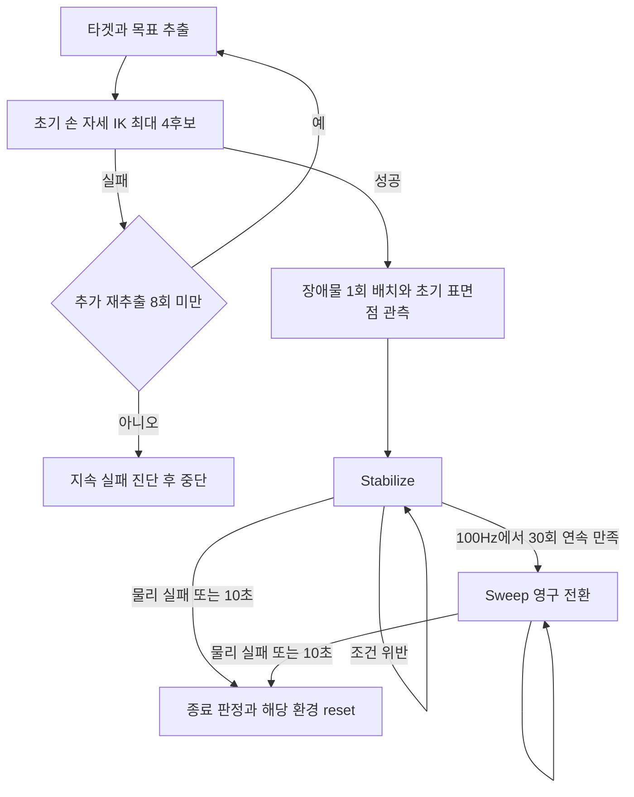

# Inspire-Stabilize-Sweep-v0 상세 환경 설명

2026-11-18 기준. `src/inspire_sweep_baseline`에 구현한 독립 Stabilize → Sweep 환경의 현재 동작을 설명한다. 기존 코드 기준 `d70802e`·root `3a94b60` 이후, 같은 날짜의 reset 오류 수정과 사용자 승인 초기 자세 변경을 반영한다.

이 환경은 초기 장면에서 얻은 물체의 대표 표면점과 실행 중 로봇 상태·촉각·손목 F/T를 이용해, 먼저 안정적인 접촉을 만든 다음 타겟을 목표 위치로 미는 과업이다. 하나의 정책이 총10초 동안 두 단계를 수행한다. 초기 시각 관측 이후 실제 물체 이동을 시각으로 계속 추적하지 않는다.

**학습 시작 시 reset IK 오류를 수정했으며 학습 행동 평가는 여전히 미완료다.** 초기 자세 변경에 이어, 사용자가 IK 실패 때문에 학습이 중단되지 않도록 다른 배치로 복구하는 처리를 요청했다. 현재는 실패한 환경의 타겟·목표만 제한적으로 재추출한다. 고정 roll/pitch를 해제하고 손목 방향을 바꾸는 최대4후보를 사용한다. 이후 방향·높이 정정에 따라 손바닥은 항상 로봇 기준 왼쪽을 향하고 손 하단은 상판 위5mm에 맞춘다. 구체적인 자세와 검증 범위는 아래에 정리한다.

[개발 명세](../../01_plan/environments/2026-11-18_stabilize_sweep_spec.md) · [Ticket 범위와 상태](../../01_plan/environments/2026-11-18_stabilize_sweep_ticket_review.md) · [구현·검증 기록](../logs/2026-11-18_stabilize_sweep_implementation.md)

## Finger 초기화 Test 환경

Iteration Time 약90초라는 사용자 보고에 따라, 초기화 경로를 비교할 두 파생 환경을 추가했다. 사용자는 **초기 배치·IK만 Finger 방식으로 교체하고 대표 표면점 관측은 유지**하도록 선택했다.

| Test task | 직접 상속하는 EnvCfg | Runtime | PPO 로그 이름 |
| --- | --- | --- | --- |
| `Inspire-Stabilize-Sweep-v0-Test` | `StabilizeSweepEnvCfg` | 부모 `StabilizeSweepEnv` 재사용 | `inspire_stabilize_sweep_v0_test` |
| `Inspire-Sweep-Only-v0-Test` | `SweepOnlyEnvCfg` | 부모 `SweepOnlyEnv` 재사용 | `inspire_sweep_only_v0_test` |

두 Test는 `SweepSimpleEventsCfg`를 공유하는 기존 Finger-v0/v1/v2 계열의 `fast_reset_scene`과 reset 파라미터를 그대로 호출한다. 원형 footprint/RED ZONE 기반 배치, 타겟 반지름2cm 영역, 목표6–12cm·30도 제외각, 장애물0–6개와 단일 Warp IK를 재사용한다. 기존 Finger 소스와 두 원본 환경은 수정하지 않는다.

초기 EEF는 선반 로컬 X=0.28–0.30m, 타겟과 반대 Y쪽으로0.10–0.18m, 기본 FK 높이+0.01m에 Z±0.02m에서 추출한다. 손 방향은 기본 quaternion으로 고정한다. 따라서 원본 Stabilize의 목표축 표면 간격5cm·손 하단 상판+5mm 자세와 다르다. 전용 로봇 충돌 hull 구성·자기충돌 선형계획 검사·4후보 탐색·실패 행8회 재추출은 Test에서 사용하지 않는다. 배치 free cell 부족이나 단일 IK 미수렴의 오류 처리는 Finger 원본을 따른다. 원본 Stabilize/Sweep Only의 제한적 복구는 그대로 유지한다.

Finger reset 직후 같은 대표 표면점 snapshot을 생성해 policy 관측 cache를 갱신한다. Finger 함수가 만든 중심점 관측은 정책 입력으로 사용하지 않는다. 표면점의 노출 비율·분리 component·타겟 최대 component 선택, EEF 변환, episode 내 월드점 고정, 관측 실패/슬롯 초과 시 장애물0개 fallback은 유지한다. 이 fallback이 발생한 경우에만 Finger가 배치한 장애물을 추가로 제거한다. 물리 step 없이 선택 환경만 갱신한다.

후속 요청으로 두 Test에 Finger-v0/v1과 동일한 `InverseDistanceReach`를 추가했다. 환경 설정의 차이는 reset event와 `reaching` 보상이다. 나머지 보상, Stabilize Test의 Gate, Sweep Only Test의 Gate 없음, 관측67D/64D·액션12D·종료·커리큘럼은 각각 부모와 동일하다. PPO는 로그 이름만 분리한다. 원본 두 환경에는 Reach를 추가하지 않는다.

Reach는 EEF와 현재 타겟 BBOX 중심의 3차원 거리 `d`를 사용하며 weight30, near_radius0.10m, distance_scale0.10m다. 초기 EEF와 타겟 root의 거리에서0.10m를 뺀 양수 부분 `D0`를 episode 동안 고정하며, 부분 reset에서는 해당 행만 갱신한다. Finger 구현의 초기 root 기준 정규화와 실행 중 BBOX 중심 기준 거리를 그대로 재사용한다. 제어 step 지급액은 다음과 같다.

```math
r_{\mathrm{reach}}=30\,\Delta t\,\frac{D_0}{T}\,\frac{0.10}{0.10+\max(d-0.10,0)},\qquad T=10\,\mathrm{s}.
```

접촉·높이·Gate 조건은 없다. Stabilize Test에서는 Gate 전후 모두, Sweep Only Test에서는 reset 직후부터 지급된다. 정책에 현재 중심점 관측을 추가하는 변경은 아니다.

```bash
python src/inspire_sweep_baseline/scripts/train.py --task Inspire-Stabilize-Sweep-v0-Test
python src/inspire_sweep_baseline/scripts/train.py --task Inspire-Sweep-Only-v0-Test
```

`Reset/finger_placement_ms`는 Finger 배치·IK 호출 시간, `Reset/observation_ms`는 환경당 표면점 생성 시간, `Reset/batch_ms`는 전체 reset event 시간이다. 표면점 관측 비용은 여전히 남으며90초 학습 iteration의 원인이나 개선 폭을 이 변경만으로 확정하지 않는다.

초기화 교체 검증(Reach 추가 전):CPU45개·변경4파일 mypy 통과. Stabilize Test4환경과 Sweep Only Test64환경에서 각각 seed0–7 전체 reset, 같은 seed의 Finger 원본 결과 대조, 실제 step·부분/자동 reset·Gate 차이·표면 관측·접촉 계측이 통과했다. reset 호출 시간 중앙값은4환경143.79ms,64환경1,993.98ms였고 Finger 배치/IK만의 중앙값은18.53ms·19.81ms였다. 표면점 생성 시간은 환경당9.96ms·10.67ms였으며 reset 전체에는 그 밖의 Manager 처리도 포함된다. GPU warmup/관측/진단을 포함한 이 검사 시간을 학습 iteration throughput으로 해석하지 않는다. [원시 결과](../../03_assets/validation/2026-11-18_stabilize_sweep_finger_tests.json)에 보존했다.

Reach 추가 후 검증:CPU45개·보상/환경 설정2파일 mypy 통과. 두 Test 각각 GPU4환경·seed0–1 reset 및 실제 step에서 Finger Reach 수식/weight, 부분 reset 상태 격리, 기존 Gate 차이를 확인했다. 전체 설정 대조에서 부모 대비 reset event와 Reach만 다른 것을 검증했다. [Reach 검증 결과](../../03_assets/validation/2026-11-18_stabilize_sweep_test_reach.json). 장기 학습과 iteration time 개선은 평가하지 않았다.

## Sweep Only 파생 환경

`Inspire-Sweep-Only-v0`는 이 문서의 `Inspire-Stabilize-Sweep-v0`를 상속하며 Stabilize 보상과 Gate를 제거한 비교 환경이다. 부모 환경의 구성과 동작은 유지한다.

| 구분 | 부모 Stabilize → Sweep | Sweep Only |
| --- | --- | --- |
| Runtime/EnvCfg | `StabilizeSweepEnv` / `StabilizeSweepEnvCfg` | 각각을 상속하는 `SweepOnlyEnv` / `SweepOnlyEnvCfg` |
| 안정화 보상 | `stage`(setup 및 Gate 이후 완료 보상) | 제거, 상수 완료 보상도 지급하지 않음 |
| 안정화 전용 비용 | `initial_movement`, `initial_rotation` | 제거 |
| Gate | 물리30sample 연속 안정화 후 Sweep | 계산하지 않음, reset 직후부터 Sweep |
| Sweep 보상 | Gate 이후 거리 감소·접촉 유지·힘 방향, 멀어짐 비용 | 동일 수식/계수를 첫 제어 step부터 적용 |
| 압착 비용 | 양 단계 적용 | 그대로 유지 |
| phase 관측 | Stabilize0 → Sweep1 | 항상1, 기존67D 관측 차원 유지 |
| PPO 로그 이름 | `inspire_stabilize_sweep_v0` | `inspire_sweep_only_v0` |

`SweepOnlyState`는 부모의 Sweep 거리 이력·접촉 count 및 `finish` 계산을 상속한다. reset에서 Sweep 상태를 활성화하고 sample에서는 안정화 점수·초기 자세 비용·Gate 연속 카운터를 계산하지 않는다. 접촉 힘·모멘트·압착 계측은 부모 runtime에서 계속 수행한다. Gate가 없어도 최근3회 중2회 접촉 인정·count/20 정규화·힘 방향과 크기·EEF 높이 조건은 유지한다. 따라서 첫 step부터 Sweep 계산이 활성화된다는 것이 접촉 없이 양의 밀기 보상을 지급한다는 의미는 아니다.

손바닥 항상 왼쪽·오른쪽 손등 밀기, 손 하단 상판+5mm, IK 실패 행 재추출, 시각 표면점, 액션12D, 관측 policy67D/obstacles64D,10초 timeout·실패 종료·성공 판정, 모든 나머지 보상·커리큘럼 및 PPO 설정은 부모를 상속한다. 전체/부분 reset과 자동 reset 모두 즉시 Sweep으로 복귀한다.

Workspace 루트에서 실행한다.

```bash
python src/inspire_sweep_baseline/scripts/train.py --task Inspire-Sweep-Only-v0
```

검증:CPU43개 및 변경5파일 mypy 통과. 실제 GPU4환경에서 등록·PPO/EnvCfg 전체 대조, seed0–7 reset, 첫 step부터 Sweep 활성, 부분/자동 reset, IK·충돌 실패 주입 복구, 실제 접촉·물리 step·timeout 경계를 통과했다. 부모 클래스 정의는 수정 전 AST 해시와 동일하다. [원시 검증](../../03_assets/validation/2026-11-18_sweep_only.json)을 보존했다. 장기 PPO 학습 및 부모 대비 성능 비교는 수행하지 않았다.

## 환경의 목적과 전체 흐름

기준 기능은 `Inspire-Sweep-Simple-Finger-ForceDirection-v0`에서 가져왔다. 로봇·자산·제어·공통 비용은 재사용하지만, 새 환경의 EnvCfg·SceneCfg·runtime·Manager Cfg·PPO Cfg는 기존 환경 Cfg/runtime을 상속하지 않고 선언한다. Isaac Lab 기반 클래스와 공용 계산·제어·신경망 구현은 재사용한다. 따라서 여기서 독립이라는 말은 모든 공용 코드의 상속과 재사용까지 없앴다는 뜻은 아니다.



Stabilize에서 필요한 것은 접촉력만 크게 만드는 행동이 아니다. 목표 방향 힘은 약0.5N으로 유지하면서 옆 방향 힘·회전 모멘트·타겟 이동·회전·속도를 동시에 제한해야 한다. Sweep에서는 이 조건을 계속 유지할 필요 없이, 접촉과 힘 방향을 고려한 거리 감소 보상을 받는다. 강한 압착 비용과 공통 안전·동작 비용은 양 단계에서 적용한다.

| 항목 | 현재 값 |
| --- | --- |
| Gym ID | `Inspire-Stabilize-Sweep-v0` |
| 환경 클래스 | `runtime.stabilize_sweep:StabilizeSweepEnv` |
| 설정 클래스 | `envs.stabilize_sweep_envs:StabilizeSweepEnvCfg` |
| PPO 설정 | `agent.stabilize_sweep_ppo_cfg:StabilizeSweepPPORunnerCfg` |
| 기본 병렬 환경 수 | 2048, 환경 간격2.5m. 이 규모의 처리량은 미검증 |
| 물리 주기 | 0.01초,100Hz |
| 정책 주기 | decimation2,0.02초,50Hz |
| episode 길이 | Stabilize 포함10초, 기본500 policy step |
| 관측 | `policy`67D + `obstacles`64D |
| 행동 | 팔6D + 손6D =12D |
| 목표 조기 종료 | 없음 |

## 장면과 물리 자산

### 로봇과 선반

로봇은 UR5e 팔에 AXIA80과 Inspire RH56E2 오른손을 결합한 기존 자산을 사용한다. 오른손 자산의 관절 이름 일부에는 역사적인 `inspire_left` 문자열이 남아 있다. 이름 때문에 왼손 모델로 해석하면 안 된다.

로봇 root의 기본 위치는 환경 원점 기준 `(0, 0, 0.79505)`m, 회전 quaternion은 wxyz 순서 `(0, 0, 0, 1)`이다. 선반 root는 `(-0.7, 0, 0)`m이고 질량은30kg이다. 배치 계산에서 사용하는 선반 상판은 선반 로컬 `X∈[-0.20,0.20]`, `Y∈[-0.50,0.50]`m, 높이1.05m다. 선반은 움직이지 않는 수학적 평면이 아니라 변위·속도를 읽고 실패를 판정하는 물리 객체다.

EEF는 `axia80_link`에 고정 offset을 둔 제어점이다. 센서 로컬 Z offset은 `0.13 + sensor_height/2`m이며, OSC와 EEF 기준 물체 관측이 이 프레임을 사용한다. 손목 F/T는 EEF 원점과 축으로 변환한다.

팔의 기존 position drive는 stiffness·damping을0으로 만들고 OSC 토크 제어를 사용한다. 팔 물리 effort 한계는 앞3관절150N·m, 뒤3관절28N·m, 물리 속도 한계는 모든 팔 관절3.14rad/s다. 과업의 실패 종료 한계1rad/s는 이 물리 한계보다 낮다. 손 drive는 stiffness1.2, damping0.06, effort 한계10N·m, 속도 한계1rad/s를 사용한다. 센서 질량은0.28kg이다.

기존 자산의 손 내부 충돌 메쉬 겹침 때문에 articulation self-collision은 비활성 설정을 유지한다. 아래 초기화의 자기충돌 검사는 별도의 기하 검사이며, 실행 중 PhysX 자기충돌을 새로 활성화한 것이 아니다.

### 타겟과 장애물 풀

각 환경은 타겟1개와 장애물 후보16개를 물리적으로 보유한다. 타겟은 항상 slot0의 원통이다. 장애물 풀은 다음8종을 각각2개씩 가진다.

| 형상 | 자산 식별자 |
| --- | --- |
| 원통 | `cylinder` |
| 상자·머그·병 | `cube`, `mug`, `bottle` |
| YCB 식품 상자 | `003_cracker_box`, `004_sugar_box` |
| YCB 캔 | `005_tomato_soup_can`, `002_master_chef_can` |

타겟 원통의 기준 반지름은4cm, 높이는10cm다. 각 물체의 균일 scale은 환경 생성 시0.9–1.1에서 추출하며, episode reset마다 다시 바꾸지 않는다. 타겟은 따라서 반지름3.6–4.4cm, 높이9–11cm 범위를 가진다. 장애물의 실제 치수·충돌 형상·원점 위치는 해당 자산과 scale에서 읽는다.

실제로 배치하는 장애물 요청 수는 episode마다0–6개 중 균일하게 선택한다. 후보는16개에서 중복 없이 선택하므로 같은 형상2개는 가능하지만 같은 물리 객체를 두 번 선택하지 않는다. 배치 실패나 시각 fallback으로 실제 장애물 수가 요청 수보다 작아질 수 있다. 미사용 물체는 상판 밖의 서로 다른 높은 위치로 옮기고 중력을 비활성화한다.

### 물성의 추출 시점

질량과 마찰은 startup에서 추출하고 reset 사이에 유지한다. 타겟과 각 장애물 질량은 기존 범위0.230–0.500kg에1.5배를 적용한 **0.345–0.750kg의 균일 분포**다. 관성도 질량 비율에 맞춰 조정한다.

마찰은 기존 평균±2표준편차 범위를4096개 균일 bucket으로 구성해 추출한다. 아래는 bucket을 만드는 범위이며 실제 bucket 값은 구간 중점이다. 선반·손은 환경별, 물체는 각 물리 객체별로 할당한다.

| 대상 | 정지 마찰계수 범위 | 동마찰계수 범위 |
| --- | --- | --- |
| 선반 | 0.213–0.417 | 0.170–0.334 |
| 물체 | 0.235–0.395 | 0.188–0.316 |
| 손 | 0.295–0.875 | 0.236–0.700 |

## 좌표와 위치의 의미

환경에서 쓰는 물체 위치는 다음 세 가지를 구별해야 한다.

| 개념 | 계산과 용도 | 정책의 직접 입력 |
| --- | --- | --- |
| 초기 대표 표면점 | reset 시 정면에서 보이는 실제 표면 교점. episode 동안 월드 좌표를 고정하고 현재 EEF로 변환 | 타겟과 모든 관측 장애물에 제공 |
| 형상 중심 centroid | 실제 link pose에 scale이 반영된 로컬 bounds 중심을 회전·이동한 점. 목표 거리, 초기 이동량, Gate에서 사용 | 현재 XYZ를 직접 제공하지 않음 |
| 질량중심 COM | PhysX의 실제 COM readback. 접촉 모멘트와 centroid 속도 계산에서 사용 | 직접 제공하지 않음 |

현재 타겟은 대칭 원통이므로 로컬 bounds 중심이 형상 중심에 해당한다. 여기서 centroid를 가시 mask의 중심이나 모든 형상에 대한 일반적인 체적 적분 중심과 혼동하면 안 된다. 원통 자산의 root, 형상 중심, COM은 서로 다르다. 실제 검증 예에서 높이10.4831cm인 원통의 centroid는 root 위5.2415cm, COM은 root 위2.0966cm였다.

초기 표면점 $p_{s,0}^{W}$의 시각 관측은 현재 EEF pose $(p_e^W,R_e^W)$에 대해 다음과 같다.

```math
p_{s}^{E}(t) = (R_e^W(t))^\mathsf{T}\bigl(p_{s,0}^{W}-p_e^W(t)\bigr)
```

EEF가 움직이면 관측 XYZ도 변하지만, 물체가 실제로 밀렸다는 이유로 초기 월드 표면점을 갱신하지 않는다. 목표점은 episode 동안 고정되며 현재 EEF로 변환해서 제공한다. 목표 command 내부는 위치3D와 초기 quaternion4D의7D지만 정책은 목표 XYZ3D만 받는다. command의 Z는 reset 당시 타겟 link root 높이를 유지하며 성공 거리와 밀기 방향은 XY만 사용한다.

## Reset과 초기 배치

### 타겟과 목표 선택

타겟 XY는 선반 중심의 반지름2cm 원판에서 면적 기준 균일하게 추출한다. 물체 하단이 상판1.05m에 맞도록 실제 bounds를 사용해 root Z를 결정하고, 타겟 yaw는−90도로 둔다.

목표 방향은 선반 로컬 `atan2(Y,X)`로 정의한다. +X는 로봇 쪽6시, −X는12시 방향이다. ±X 방향 각각30도 이내를 제외하여 허용 구간은 `[30°,150°]`와 `[210°,330°]`가 된다. 이 deadzone은 고정이며 학습 중 좁아지지 않는다.

목표 거리는6–12cm에서 추출하되 실제 타겟 크기와 가장자리2cm 여유를 반영해 허용 최대 거리를 줄인다. 각 허용 방향에서 거리를 균일하게 뽑으며, 환형 영역의 면적 균일 표집은 아니다. 같은 타겟·목표의4개 초기 자세가 모두 IK/충돌 검사에 실패한 환경만 타겟·목표를 다시 뽑는다. 초기 추출 외 최대8회이며 성공한 환경은 재추출하지 않는다. 장애물·관측 fallback은 목표 재추출을 일으키지 않는다. 원래 추출 규칙은 유지하지만 최종 장면은 IK와 충돌 검사를 통과한 배치에 조건부인 분포가 된다.

### 초기 손 자세

2026-11-18 후속 방향·높이 정정: 실제 오른손 손바닥은 **EEF +Z**, 손등은 **EEF −Z**다. 좌우 목표를 유지하며 손바닥은 항상 로봇이 선반을 바라볼 때 왼쪽(선반 −Y 반구)을 향한다. 왼쪽 목표에는 손바닥을, 오른쪽 목표에는 손등을 사용한다. 대각선 목표의 진행 방향과 정렬하되 손바닥을 오른쪽으로 뒤집지 않는다.

손은 타겟에서 목표로 향하는 XY 방향의 반대편에 놓는다. 왼쪽 목표는 손바닥 법선을 목표 방향으로, 오른쪽 목표는 반대 방향으로 정렬한다. 손 충돌 형상의 실제 정점을 이용한 목표 방향 지지점과 원통 반지름을 계산해 **마주 보는 양쪽 표면 간격5cm**를 둔다. 오른쪽 밀기의 손등 표면도 같은 방식으로 계산한다. EEF 원점과 타겟 중심 사이의 거리를5cm로 둔다는 의미가 아니다.

손바닥 법선 주위로 회전하여 EEF에서 손목 부착 원점으로 향하는 축이 로봇 베이스 쪽을 향하게 한다. 베이스 방향은 손바닥 평면에 수평 투영하며 실제 EEF frame offset을 사용한다. 고정 roll/pitch는 사용하지 않는다.

EEF 높이는 기본 관절 FK 높이에서 복사하지 않는다. 각 후보의 손 충돌 정점을 회전한 뒤, 그 최하단이 타겟 밑면(상판) 위5mm에 오도록 EEF Z를 계산한다. 식은 `EEF Z = target centroid Z − target half height + 0.005m − min(rotated hand vertex Z)`다. 따라서 물체 scale과 손목 기울기가 반영되며, 이전의 기본 약1.211461m와 실패 시4–6cm 상승 후보를 폐기한다. 현재 자산에서는 수평 손목 후보의 EEF가 선반 로컬 약1.102714m가 된다.

| 후보 순서 | 손 충돌 형상 최하단 | 수평 베이스 방향에서 손목 축의 고도각 |
| --- | --- | --- |
| 1 | 상판+5mm | 0도 |
| 2 | 상판+5mm | +2도 |
| 3 | 상판+5mm | 0도 |
| 4 | 상판+5mm | +2도 |

앞 후보가 실패한 환경만 다음 후보로 이동한다. 손바닥 법선 방향은 이 회전으로 바뀌지 않으며, 각 자세의 실제 손 표면으로5cm 간격을 계산한다. 그다음 선반 로컬 XY 각각±1cm, yaw±10도의 난수를 적용한다. 따라서5cm는 jitter 이전 명목 간격이다. 반복되는0도·2도 후보도 XY/yaw 난수는 새로 뽑는다. 추가 Z·roll/pitch 난수는 없고 모든 후보에서 같은 하단 여유를 유지한다. 손의 물리 관절은0rad로 시작한다.

같은 타겟과 목표에 대해 최대4개의 손목 방향·XY/yaw 후보를 시도한다. 후보마다 Warp IK 수렴, 관절 한계, 타겟·선반·로봇 충돌 기하를 검사한다. 성공한 환경은 더 재시도하지 않는다. 4개 모두 실패하면 해당 환경만 타겟·목표를 재추출하여 같은4후보를 검사한다. 기본 `max_layout_resamples=8`로 최초 포함9개 배치·최대36개 자세까지 제한하며 성공한 행의 배치·관절·충돌 형상은 보존한다. 모든 행의 유효 자세가 결정된 뒤 장애물 배치·관측·simulator 반영을 진행한다. 실패한 자세를 simulator에 쓰거나 physics step으로 시험하지 않는다.

이 복구는 reset 내부의 배치 거부이며 Termination/timeout으로 기록하지 않는다. 아직 정책의 행동이 시작되지 않은 초기화 실패에 보상이나 패널티를 부여하지 않고, 현재 진행 중인 다른 환경의 episode를 종료하지 않는다. 첫 학습 래퍼 reset과 episode 종료 후 자동 reset에 동일하게 적용한다. 재추출 횟수와 복구된 환경 비율은 별도 Reset 로그에 기록한다.

9개 배치가 모두 실패하면 무한 반복 대신 환경 ID와 마지막 IK/충돌 진단을 포함한 오류로 중단한다. 자산·solver 코드·시각 관측 등의 일반 예외는 IK 실패로 간주하여 숨기지 않는다. 즉 드문 불가능 배치는 자동 복구하지만 모든 오류에서 실행을 계속한다는 보장은 아니다.

로봇–타겟·선반 검사는 충돌 형상의 보수적 OBB를 사용한다. 자기충돌은 OBB 후보를 실제 충돌 convex hull의 교집합 검사로 좁힌다. 기존 손0rad 자세의 내부 겹침 쌍만 사용자 승인 예외로 두며 새로운 팔–팔·팔–손 충돌 검사는 유지한다. 같은 고정 연결 그룹과 인접 관절 그룹의 구조적 쌍은 자기충돌 검사 대상에서 제외한다.

### 장애물 배치와 금지영역

장애물은 기존 RED ZONE과 초기 로봇 충돌 형상에1cm 여유를 둔 영역의 합집합을 침범하지 않도록 배치한다. RED ZONE은 타겟–목표 선분을 로봇 쪽 +X로 확장한 영역과 물체 크기 여유로 구성한다. 목표를 미는 데 필요한 공간이라는 의미를 유지한다.

초기 로봇 공간은 각 충돌 OBB의 보수적 XY 외곽과 Z 구간으로 검사한다. 장애물 높이와 Z 구간이 겹치는 로봇 부분에 대해 분리 거리를 요구한다. 원형 footprint와 cell jitter 여유도 포함하므로 단순한 중심점 포함 검사보다 보수적이다.

배치 grid는5mm이며 물체 footprint·상판 경계·다른 장애물·RED·로봇 공간을 모두 만족하는 cell을 찾는다. 요청된 후보를 큰 footprint부터 한 번씩 처리하고, 성공한 배치는 유지한다. 유효 cell이 없는 후보만 생략하며 뒤의 작은 후보는 계속 검사한다. 배치 전체를 처음부터 반복하거나 장애물을 새로 재추출하지 않는다. 장애물 yaw는−π–π에서 추출한다.

### 관측 fallback과 부분 reset

배치 후 시각 snapshot을 한 번 만든다. 타겟의 유효 가시 조각이 없거나 비타겟 가시 조각이16개를 넘으면 해당 환경의 장애물을 모두 제거하고 타겟만 한 번 더 관측한다. 최대 관측 횟수는2회이며, 타겟 단독 상태에서도 미검출이면 오류다. 부분적으로 가려져 관측에 잡히지 않은 장애물도 이 fallback이 발생하지 않았다면 물리 장면에는 남는다.

장면 계획 뒤 선택된 환경의 상태만 simulator에 쓴다. reset 자체로 physics step을 진행하지 않는다. 초기 표면점, Gate 상태, 연속 카운터, 접촉 이력, 이전 거리, 초기 pose와 해당 환경의 센서 이력을 초기화한다. 다른 환경의 물체·로봇 상태와 시간은 유지한다. 형상·scale·질량·마찰은 reset에서 재추출하지 않는다.

## 초기 표면점 관측

초기 시각은 RGB 이미지를 신경망에 입력하는 방식이 아니다. 실제 USD 시각 메쉬에 정면 평행 광선을 쏘아 가시 표면을 계산한다. 관측 방향은 선반 로컬 +X에서−X이고, YZ 평면의 광선 간격은1mm다. 활성 물체와 선반을 가림 계산에 포함하며 로봇은 초기 시각 가림 메쉬에 포함하지 않는다.

각 광선은 가장 앞에서 만나는 삼각형의 교점을 반환한다. 같은 실제 물체에서 나온 mask라도4방향 연결요소가 끊기면 서로 다른 가시 조각이다. 각 조각은 가로 폭이2cm 이상이고 원본 물체 가로 폭의20% 이상이어야 한다.20%는 면적 비율이 아니라 현재 구현의 투영 가로 폭 기준이다.

유효 조각의 mask 픽셀 평균 위치를 계산한 뒤, 그 평균에 가장 가까운 실제 유효 픽셀의3D 교점을 대표점으로 선택한다. 따라서 mask 평균이 빈 공간에 놓여도 공중의 점을 출력하지 않는다.

타겟은 유효 조각 중 픽셀 수가 가장 많은 하나만 사용한다. 나머지 타겟 조각을 장애물 슬롯에 넣지 않는다. 비타겟은 모든 유효 조각을 각각 독립된 관측 물체로 사용한다. 내부 가림 계산에는 실제 source ID가 필요하지만 정책에는 ID·크기·회전·조각 간 대응을 제공하지 않는다.

비타겟 관측은16개 고정 슬롯의 `[valid,x,y,z]`다. 유효 조각을 한 번 채운 순서를 episode 동안 유지하며 빈 슬롯은4개 값 모두0이다. 현 코드에는 추가 위치 noise, visibility bit flip, 인접 슬롯 shuffle을 연결하지 않는다. 이 슬롯은 물리 객체16개와 일대일 대응하지 않는다. 하나의 물리 장애물이 여러 슬롯을 차지할 수 있다.

## 정책 관측과 제어

### 관측 순서와 차원

`policy`는 다음 순서의67D 벡터다. 위치는 m, 각도는 rad, quaternion은 wxyz 순서다.

| 순서 | 항목 | 차원 | 의미와 좌표 |
| --- | --- | --- | --- |
| 1 | `joint_pos` | 6 | 현재 팔 관절각, 기본 자세 차감 없음 |
| 2 | `joint_vel` | 6 | 현재 팔 관절 속도, rad/s |
| 3 | `hand_configuration` | 6 | 현재 손 drive6관절의 실제 각도 |
| 4 | `ee_pose` | 7 | 로봇 root 기준 EEF 위치3D·quaternion4D |
| 5 | `target_obs_state` | 3 | 초기 타겟 표면점의 현재 EEF 좌표 |
| 6 | `goal_pos` | 3 | 고정 목표의 현재 EEF 좌표 |
| 7 | `actions` | 12 | 직전 실행 입력인 ActionManager raw action |
| 8 | `tactile` | 17 | 손바닥·손등 접촉을 쌍으로 인코딩한 값 |
| 9 | `wrist_wrench` | 6 | 보상된 손목 외력·모멘트, EEF 원점·축, N/N·m |
| 10 | `phase` | 1 | Stabilize=0, Gate 달성 후 Sweep=1 |

별도 `obstacles` 그룹은16슬롯×4값=64D다. Actor와 Critic 모두 같은 `policy`·`obstacles`를 받는다. Critic용 현재 타겟·장애물 XYZ 그룹은 없다. 다만 `phase`는 simulator의 Gate 계산 결과이므로 정책이 단계 달성 여부는 알 수 있다.

촉각은0.05N 임계값의 손바닥·손등 bit를 결합해 무접촉0, 손바닥만1, 손등만−1, 양쪽2로 표현한다. 기초 bit 각각에 독립1% flip noise를 적용한 뒤 재인코딩한다. 손목 F/T는 손 자체의 모델과 운동학을 사용하는 보상된 외력으로, 물체 ID를 사용하는 접촉 분류와 다르다. 힘에 표준편차0.05N, 모멘트에0.005N·m의 Gaussian noise를 더하고 각 힘축±150N, 모멘트축±8N·m로 관측을 clip한다. 이 관측 clip이 Gate 접촉력을 clip하는 것은 아니다.

### 팔과 손 행동

정책의12D 행동 앞6개는 현재 EEF 프레임의 상대 위치·회전 명령이다. 뒤6개는 손 drive 관절의 절대 rad 명령이다. Runner는 모든 채널을±π/2로 clip하고 ActionManager에 넘긴다. 팔 위치 scale은0.03m, 회전 scale은0.15rad이며, 예를 들어 위치 채널1은 해당 EEF 축으로3cm의 상대 목표를 뜻한다. 명령 프레임은 한 policy step의 두 물리 substep 동안 고정한다.

OSC는6축 pose 제어, 고정 임피던스, inertia decoupling, 중력 보상을 사용한다. 병진 stiffness는100, 회전 stiffness는50, damping ratio는 모두1이다. 접촉 wrench 명령 축과 nullspace 제어는 비활성이다. 따라서 Gate 목표0.5N을 force controller에 직접 넣는 구조가 아니라, 정책이 pose 명령을 통해 접촉력을 만들어야 한다.

손 명령 순서는 thumb2, index1, middle1, ring1, little1, thumb1이다. 각 하한은0rad이고 상한은 다음과 같다.

| Drive | 상한 rad |
| --- | --- |
| thumb2 | 0.5864 |
| index1·middle1·ring1·little1 | 각각1.4381 |
| thumb1 | 1.1641 |

손 action term이 이 URDF 범위로 clamp한 뒤 mimic 비율을 적용해12개 물리 손 관절 목표를 만든다. Last Action과 action-rate 비용은 이 손 관절 clamp 이전, Runner clip 이후의 raw12D를 사용한다. 추가 tanh 정규화는 없다. 직접 `env.step()`을 호출하는 코드가 Runner를 거치지 않으면 Runner clip도 자동 적용되지 않으므로 구분해야 한다.

## 접촉 계측과 Stabilize Gate

### 손과 타겟 사이의 물리량

Gate는 정책의 손목 F/T 관측 대신 **타겟–손으로 필터링한 PhysX 접촉 데이터**를 사용한다. 법선 접촉점과 마찰 anchor를 각각 읽어 타겟에 작용하는 월드 합력 $F$와 실제 COM 기준 모멘트 $\tau$를 계산한다.

```math
F = \sum_i f_i^{n} + \sum_j f_j^{t}
```

```math
\tau = \sum_i (p_i^{n}-c_{\mathrm{COM}})\times f_i^{n}
       +\sum_j (p_j^{t}-c_{\mathrm{COM}})\times f_j^{t}
```

```math
S = \sum_i \lVert f_i^{n}\rVert
```

$S$는 법선 하중 크기의 합이다. 서로 반대 방향의 법선 힘이 상쇄되어 합력이0이 되어도 $S$는 증가하므로 압착을 감지할 수 있다. 선반·장애물의 반력은 이 타겟–손 계측에 포함하지 않는다. 양 API의 인덱스 버퍼를 섞지 않도록 법선 축약 후 마찰 데이터를 읽는다.

접촉 인덱스 범위 오류·비유한 값·packed buffer가 가득 차 누락 가능성이 있는 경우를 유효 Gate 접촉으로 인정하지 않는다. 관측 noise는 이 계산에 넣지 않는다. 물리 sample마다100Hz로 평가하며, centroid의 선속도는 COM 선속도에 $\omega\times(c-c_{\mathrm{COM}})$를 더해 구한다.

### Gate 조건

현재 centroid에서 목표로 향하는 XY 단위벡터를 $\hat d$로 정의한다. $F_\parallel=F\cdot\hat d$, $F_\perp=F-F_\parallel\hat d$이며, 이때 $F_\perp$에는 수직 힘도 포함된다. 현재 기본 장면의 수직축은 월드 Z다.

아래 조건을 **모두30개 연속 물리 sample**, 즉0.3초 동안 만족해야 한다.

| 조건 | 통과 범위 |
| --- | --- |
| 유효 접촉 | 데이터 유효·유한, 법선 하중 $S\geq0.01$N |
| 목표 방향 | XY 목표 방향 정의 가능 |
| 목표 방향 힘 | $\lvert F_\parallel-0.5\rvert\leq0.2$N |
| 수직을 포함한 나머지 힘 | $\lVert F_\perp\rVert\leq0.2$N |
| 수직축 모멘트 | $\lvert\tau_z\rvert\leq0.005$N·m |
| XY 모멘트 | $\lVert\tau_{xy}\rVert\leq0.01$N·m |
| 초기 centroid 대비3D 이동 | 3mm 이하 |
| 초기 orientation 대비 SO(3) 회전각 | 3도 이하 |
| centroid 선속도 | 0.005m/s 이하 |
| 각속도 | 0.05rad/s 이하 |
| 법선 하중 합 | $S\leq5$N |

통과 전 하나라도 위반하면 연속 카운터를0으로 되돌린다.29회로는 전환하지 않으며30회에서 영구 latch한다. 통과 후 Gate 조건을 잃어도 Stabilize로 돌아가지 않는다.

### 정책 step의 전환 경계

step 시작 때 해당 step의 보상 단계를 고정한다. 두 물리 sample 중 Gate가 달성되더라도 그 step 전체의 보상은 Stabilize 기준이며, step 후 관측의 phase는1이 된다. 다음 action부터 Sweep 보상을 사용한다.

Gate 달성 step에서도 이전 거리 이력을 현재 값으로 갱신하고 접촉 유지 이력은 Stabilize 동안 쌓지 않는다. 이 때문에 안정화 중 이동한 거리를 Sweep에서 소급 지급하지 않는다. 같은 step이10초 timeout이면 종료 판정은 이미 달성된 Gate를 볼 수 있으므로 나머지 성공 조건을 만족할 때 성공으로 기록한다.

## 보상 구성과 시간 적분

RewardManager는 각 함수 출력에 weight와 policy dt0.02초를 곱한다. 아래 setup·완료·초기 이동·회전·압착은 이 dt를 한 번 적용한다. Sweep 거리항과 선반 실패 비용은 함수 내부에서 dt로 나누므로 최종 보상에서는 dt가 상쇄된다.

### 안정화 점수와 완료 보상

유효 접촉·유한 데이터·정의 가능한 목표 방향일 때 물리 sample별 setup 점수는 다음과 같다. 그렇지 않으면0이다.

```math
r_{\mathrm{setup}} =
\mathrm{clip}(F_\parallel/0.5,0,1)
\exp\left[
-\left(\frac{F_\parallel-0.5}{0.2}\right)^2
-\frac{\lVert F_\perp\rVert^2}{0.2^2}
-\left(\frac{\tau_z}{0.005}\right)^2
-\frac{\lVert\tau_{xy}\rVert^2}{0.01^2}
\right]
```

각 sample에서 비선형 점수를 계산한 뒤 policy step 내 평균을 취한다. 힘·모멘트를 먼저 평균해 서로 반대인 불안정 sample이 상쇄되게 하지 않는다. setup 점수는0–1이며, Gate 조건의 이동·회전·속도·상한을 모두 만족할 때만 점수를 주는 이진 보상은 아니다.

`stage` weight는1이다. Stabilize에서는 setup 평균, Sweep에서는 항상 원점수1의 완료 보상을 준다. Gate 통과 직후 안정화 보상이0이 되어 통과를 회피하게 하는 직접적인 항은 제거했다. 다른 비용까지 포함한 정책이 실제로 지연·정지 전략을 배우지 않는지는 별도의 행동 평가 대상이다.

### 초기 이동과 회전 비용

초기 centroid를 $c_0$, 초기 orientation에 대한 현재 최소 회전각을 $\theta$라고 하면 다음 비용을 Stabilize에서만 적용한다. $[x]_+=\max(x,0)$이다.

```math
C_p=\left[\frac{\lVert c-c_0\rVert}{0.003}-1\right]_+^2,
\qquad
C_R=\left[\frac{\theta}{3\pi/180}-1\right]_+^2
```

각 weight는−1이다. 현재 구현에서 두 값은 policy step의 마지막 물리 sample 상태를 사용한다. 이동3mm·회전3도까지는 비용0이며, Sweep에서는 초기 pose를 유지시키는 이 비용을0으로 한다.

### 압착 비용

```math
C_c=\left[\frac{S}{5}-1\right]_+^2
```

weight는−1이며 Stabilize와 Sweep 모두에 적용한다.5N까지 비용0, 초과분은 제곱 증가한다. setup과 마찬가지로 sample별 비용을 먼저 계산한 뒤 평균한다. 예를 들어 두 sample의 $S$가5N과10N이면 비용 평균은0.5다. 평균 하중7.5N에 식을 한 번 적용한0.25가 아니다. 압착을 별도의 phase나 행동 단계로 정의하지 않는다.

### Sweep의 거리 감소와 멀어짐

현재 centroid–목표 XY 거리를 $d_t$, 직전 policy step 거리를 $d_{t-1}$로 둔다. 평생 최소 거리나 reset 초기 거리를 기준으로 하지 않는다.

```math
R_{\mathrm{sweep},t}
=30[d_{t-1}-d_t]_+h_ta_t
-38.91[d_t-d_{t-1}]_+
```

이는 Manager dt까지 반영된 최종 거리 보상이다. Stabilize step에는 두 항 모두0이다. 멀어짐 항은 Sweep에서 현재 접촉 여부와 무관하게 적용한다.

접촉 계수 $h_t$는 다음 순서로 계산한다.

1. policy step의 두 물리 sample 중 하나라도 유효 접촉 $S\geq0.01$N이면 현재 접촉으로 기록한다. 해당 step 전체 접촉 데이터는 유효해야 한다.
2. 최근3 policy step 중2회 이상 접촉했고, 현재 EEF가 초기 상판 높이+12cm보다 **엄격히 낮으면** 접촉 유지 인정이다.
3. 인정 step에서 카운터를+1, 불인정 step에서−2 하고0–20으로 제한한다.
4. 인정 step의 $h_t$는 `count/20`, 불인정 step은 카운터가 남아 있어도0이다.

방향 계수 $a_t$는 두 물리 sample의 평균3D 합력과 현재 목표 XY 방향 사이 cosine을0–1로 제한한 값이다.

```math
a_t=\mathrm{clip}\left(
\frac{\bar F_{xy}\cdot\hat d_{xy}}{\lVert\bar F\rVert},0,1\right)
```

현재 실제 접촉이 있고 모든 sample이 유효하며, 평균 합력의 수평 크기가1N 이상이고 목표 방향이 정의될 때만 이 값을 사용한다. 나머지는0이다. 분모에는 수직 힘도 들어가므로 위에서 누르는 힘이 커질수록 같은 수평 힘의 방향 점수는 작아진다. 목표1cm 이내에서 방향이나 접촉을 자동 인정하는 예외는 없다.

예를 들어1cm 접근, $h_t=1$, $a_t=1$이면 거리 보상은+0.30이다. 이어서1cm 멀어지면−0.3891이다. 동일 거리 왕복의 **거리항만** 비교한 상한은 음수이지만, 전체 정책의 왕복 행동이 해결됐다는 실험 결과를 의미하지 않는다.

### 유지하는 공통 비용

다음 항은 양 단계에서 유지한다. 초기 weight0인 항도 커리큘럼에서 활성화된다.

| 항목 | Weight | 원점수와 주요 조건 |
| --- | --- | --- |
| 팔 action-rate | −0.03 | raw 팔6D의 현재·직전 차이 제곱합, cap 없음 |
| 손 action-rate | −0.03 | raw 손6D의 현재·직전 차이 제곱합, cap 없음 |
| 팔 관절 속도 | −0.03 | 팔6관절 속도 제곱합, 원점수 cap100 |
| 손 관절 속도 | −0.01 | 손12물리 관절 속도 제곱합, 원점수 cap100 |
| 선반 충돌·접근 | −0.5 | 기존 선반 움직임과 가상 finger/wrist 근접 비용 |
| 선반 실패 | −3.0 | 기존 선반 속도·손목 높이 실패 predicate에 dt 상쇄. 선반 변위만으로 실패한 경우는 이 항을 지급하지 않음 |
| 장애물 접촉 | 초기0 → −0.1 | 비타겟 장애물이 손에 가하는 합력 크기의 허용치 초과 지수 비용, cap100 |
| F/T 크기 변화 | 초기0 → −0.1 | 연속 step 힘 norm·모멘트 norm 변화의 정규화 지수 비용, raw cap1 |
| 물체 기울기 | −30 | 활성 타겟·장애물의5도 초과 기울기를0.9rad까지 정규화·제곱 후 합산 |
| 장애물 변위 | −150 | 활성 비타겟의 초기 root 위치 대비3D 변위 제곱합, 합산 원점수 cap0.04 |

장애물 접촉 비용은 합력 크기에서 허용 힘을 뺀 양의 초과량 $e$에 대해 $0.5(\exp(2e)-1)$을 사용하고100에서 제한한다. 압착 비용의 법선 크기 합 $S$와는 다른 물리량이다.

F/T 변화 비용은 벡터 차이 norm이 아니라 `abs(norm(current)−norm(previous))`다. 힘·모멘트 각각의 허용 변화량 초과분을 허용치의1.5배로 나누고, 둘 중 큰 severity를0–1로 제한한 뒤 `(exp(3×severity)−1)/(exp(3)−1)`로 변환한다. 동일 크기의 벡터 방향 회전만으로는 이 항이 증가하지 않는다. 보상 계산은 관측 term의 noise·clip 이전 물리 출력에서 읽는다. **양의 누적 보상5% 상한은 제거했지만 raw cap1은 유지**한다.

선반 충돌·접근 비용은 기존 함수를 그대로 쓴다. 선반 초기 위치 대비 변위 norm과6D 속도 norm의 합이0.005보다 크면1을 추가한다. 별도로 선반 root 위1.06m 기준점에서 EEF 거리가0.2m 미만일 때 가상 finger 높이2cm 및 wrist 높이8cm에 대한 선형 근접 비용을 더한다. 이 항의1.06m 기준과 아래 실패 조건의1.05m 기준은 기존 구현 그대로다.

원본 두 환경은 기존 Reach, 독립 goal-distance/hold, 접촉 유지 단독 보상, 방향 단독 보상을 활성화하지 않는다. 두 `-Test`만 앞 절의 Reach를 추가로 사용한다. 물체 가속도·EEF 속도·EEF orientation 등의 비활성 비용도 임의로 추가하지 않는다.

## 종료 조건과 성공 집계

목표에 일찍 들어와도 episode를 성공 종료하지 않는다.10초 timeout에서 다음 조건을 모두 만족할 때 성공으로 기록한다.

- 그 episode에서 Gate를 한 번 이상 달성했다.
- 현재 centroid–목표 XY 거리가 **0.03m 미만**이다. 정확히0.03m는 실패다.
- 같은 step에 아래 물리 실패가 없다.

Gate 후 목표에서 빠져나왔다가 돌아오는 것은 허용되지만, 과거 최소 거리나 과거 목표 진입만으로 성공을 유지하지 않는다. Gate 없이 목표에 있어도 timeout 실패다. timeout과 성공 term은 모두 `time_out=True`이므로 기존 시간제한 bootstrap 구분을 유지한다.

| 물리 실패 | 현재 판정 |
| --- | --- |
| 활성 물체 낙하·기울기 | 타겟 또는 활성 장애물의 실제 bounds 하단이 상판보다1cm 넘게 낮아짐, 하단 비유한값, 또는 선반 기준 기울기0.9rad 이상 |
| 선반 실패 | 선반6D root 속도 norm>0.1, wrist 높이<현재 상판+3cm, 또는 초기 위치 대비 선반3D 변위>5cm의 합집합 |
| 팔 과속 | 팔 관절 중 하나라도 절댓값 속도>1rad/s |

선반 속도 predicate는 선속도와 각속도를 묶은 기존6D norm이며, 순수 선속도0.1m/s라고 바꿔 해석하지 않는다. 선반 실패의 finger 검사는 비활성이다. 이 물리 실패들은10초 전에도 종료시키고, timeout과 동시에 발생하면 성공보다 우선한다.

최근 완료 episode 최대10,000개의 ring buffer로 timeout 성공률을 집계한다. `timeout_success_rate`의 분모는 이 window 내 timeout에 도달한 episode 수이며 모든 시작 episode 수가 아니다. 조기 실패도 ring window를 차지하지만 timeout 분모에는 들어가지 않으므로 종료 분포와 함께 해석해야 한다.

## 커리큘럼과 PPO

### 비용 커리큘럼

아래 knot 사이를 보간하되250 iteration 단위로 값을 갱신한다.0 iteration부터의 절대 일정이며 마지막 knot 이후 최종값을 유지한다.

| 항목 | iteration과 값 |
| --- | --- |
| F/T 힘 크기 변화 허용량 N | 0:50, 3000:50, 6000:30, 10000:30, 12000:20 |
| F/T 모멘트 크기 변화 허용량 N·m | 0:5, 3000:5, 6000:3, 10000:3, 12000:2 |
| 장애물 접촉 허용 힘 N | 0:80, 3000:80, 6000:50, 10000:50, 12000:30 |
| F/T 변화 weight | 0:0, 1000:0, 3000:−0.03, 6000:−0.1 |
| 장애물 접촉 weight | 0:0, 1000:0, 3000:−0.02, 6000:−0.05, 10000:−0.05, 12000:−0.1 |

목표 방향 제외각30도와 팔 과속 종료1rad/s는 고정이다. 이 두 값의 커리큘럼은 활성화하지 않는다. Gate 임계값과 신규 stage·이동·회전·압착·Sweep weight에도 별도 일정은 없다.

### 정책과 가치 모델

Actor와 Critic은 각각 장애물64D를32D hidden layer와16D embedding으로 압축하는 별도 학습 encoder를 가진다. 빈 슬롯은 encoder 진입 전에 mask한다.67D 직접 관측과16D embedding을 연결한83D가 `[256,128,64]` ELU MLP에 들어간다. encoder activation은ReLU이며 관측 정규화는 비활성이다. Actor는12D Gaussian 행동, Critic은 scalar value를 출력한다.

| PPO 항목 | 설정 |
| --- | --- |
| Runner | `CurriculumOnPolicyRunner` |
| rollout 길이 | 환경당36 step |
| 최대 iteration | 90,000 |
| checkpoint 저장 주기 | 50 iteration |
| 초기 Gaussian std | 1.0 |
| 학습률·일정 | 0.001, adaptive |
| learning epochs·mini batches | 8·4 |
| PPO clip | 0.2 |
| value loss coefficient | 1.0, clipped value loss 사용 |
| entropy coefficient | 0.005 |
| discount γ·GAE λ | 0.98·0.95 |
| desired KL·gradient norm cap | 0.02·1.0 |
| experiment name | `inspire_stabilize_sweep_v0` |

export 입력은 policy67D와 obstacles64D를 연결한131D다. encoder 이후 내부83D를 외부 입력으로 주는 방식이 아니다. 단계 관측이 추가되었으므로 기존66D 직접 관측 모델과 입력 계약이 다르다.

## 실행과 진단 읽기

workspace root에서 Isaac Lab Python 환경을 활성화한 뒤 검사한다.

```bash
python src/inspire_sweep_baseline/scripts/check_stabilize_sweep.py --headless
```

이 검사는 기본4환경 seed42에서 학습과 같은 `RslRlVecEnvWrapper`의 첫 reset을 실행하고 reset·step·부분 reset, 물리 접촉 계측, 제어된 Gate 경계 입력, seed0–7 reset 감사를 수행한다. 결과 기본 경로는 `/tmp/stabilize_sweep_validation.json`이다. `--output`으로 결과 경로, `--num-envs`로 병렬 환경 수, `--audit-resets`로 감사 seed 수를 바꿀 수 있다. 감사 실패는 JSON에 보존하며 하나라도 실패하면 검사를 실패 처리한다. 각 전체 reset에서 타겟·목표 추출이 정확히1회이고 실제 배치·명령과 일치하는지도 검사한다.

학습 진입점과 task 지정은 다음과 같다. 이는 호출 방법이며 현재 검증 완료된 학습 실행 결과가 아니다. 4후보 실패 시 해당 환경의 배치를 최대8회 다시 뽑으며, 최초 포함9개 배치가 전부 실패하면 진단 후 중단한다.

```bash
python src/inspire_sweep_baseline/scripts/train.py --task Inspire-Stabilize-Sweep-v0 --headless
```

| 진단 | 의미 |
| --- | --- |
| `Reset/requested_obstacles`, `actual_obstacles` | reset batch의 요청·실제 물리 장애물 수 평균 |
| `Reset/placement_skipped` | 공간 부족으로 생략한 수. 시각 fallback의 제거 수와 별개 |
| `Reset/empty_fraction` | 실제 장애물0개인 환경 비율 |
| `Reset/ik_attempts` | 재추출한 배치를 포함한 환경별 총 IK 후보 시도 수의 batch 평균 |
| `Reset/layout_resamples` | 최초 추출 이후 환경별 타겟·목표 재추출 횟수의 batch 평균,0–8 |
| `Reset/ik_recovery_fraction` | 이번 reset에서 배치를 재추출한 환경 비율 |
| `Reset/observation_fallbacks` | 두 번째 관측을 수행한 환경 비율 |
| `Reset/target_missing_fallbacks`, `slot_overflow_fallbacks` | 타겟 미검출·16슬롯 초과 사유 비율 |
| `Reset/observation_ms` | 환경당 관측 처리 시간 평균 |
| `Reset/observation_upload_ms`, `readback_ms` 등 | 실제 로그는 모두 `Reset/observation_` 접두사. mesh upload·mask/hit readback·ray·components 세부 시간 |
| `Reset/batch_ms` | reset event batch 처리 시간. 외부 전체 reset 호출 시간과 구별 |
| `Metrics/target_goal_distance_xy_m_*` | episode 시간 평균·최종·최소 centroid 거리 |
| `Metrics/timeout_*` | 최근 완료 episode window의 timeout 수·성공 수·성공률 |

관측 세부 시간에는 GPU 동기화와 계측 자체의 비용이 포함된다. 장면 계획 전체의 모든 CPU/GPU 이동을 합산한 profiler 결과는 아니다. 환경당 관측 평균, batch reset, 외부 reset 호출, 학습 iteration 시간은 서로 다른 측정치다.

## 검증 결과와 현재 제한

다음 표는 초기 구현 시의 검증이다. 뒤의 후속 reset 오류 수정 검증과 구분한다.

| 검증 | 결과와 범위 |
| --- | --- |
| 신규 CPU 테스트 | 37개 통과. 등록, 표면점·노출·조각, Gate 조건별 위반, 비용·접촉·dt 경계, 모델 forward·gradient·TorchScript export 포함 |
| 타입 검사 | 신규 production22파일 mypy 통과. 무타입 본문 전체의 엄격 검사를 의미하지 않음 |
| GPU 통합 | RTX3090,2환경. 실제 reset·step, 다른 환경 상태·시간 보존, 고정 표면점의 현재 EEF 변환, centroid/COM 구분 통과 |
| 실제 접촉 계측 | 법선 하중24.674N/17.728N의 제어된 손–타겟 접촉에서 native packed 데이터·force matrix와 합력·COM 모멘트 대조 |
| Gate 단계 경계 | 알려진 안정화 sample 입력을 replay하여30sample 전환, 보상 단계, 같은 step timeout 성공·부분 reset 확인. 물리적으로0.5N 안정화를 달성한 검사는 아님 |
| 전체 패키지 회귀 | 보완 전1270 passed,10 skipped,2 failed. 실패2개는 시작 커밋에서도 동일 재현. 보완 후 신규37개와 GPU 통합 재검증 |
| ONNX | adapter 입력 shape 확인. 실제 ONNX 변환 실행은 미수행 |

2환경 seed0–7 감사에서 seed0·2는 reset 성공, 나머지6배치는 적어도 한 환경의4후보 IK 미수렴으로 중단됐다. 이것은 수치 IK 실패를 확인한 결과이며 해당 조건의 모든 자세가 수학적으로 도달 불가능하다는 증명은 아니다. 이후 사용자가 초기 자세 변경을 승인하여 위의 새 후보 정책으로 교체했다. 당시에는 목표 재추출 금지를 유지했으며, 이후 실패 행 복구 요청에서 제한적 재추출을 추가했다. 이 실패 수치는 수정 전 이력이다.

최신 진단의 seed0 전체 reset은 초기 cache를 포함해2157.49ms, seed2는87.53ms였다. 마지막1환경 부분 reset event는54.54ms, 관측은2.035ms였다. 실제 초기4step 평균338.65ms에는 lazy/JIT 비용이 들어가므로 정상상태 throughput으로 사용할 수 없다.2048환경 처리량·학습 iteration 시간·실제 Gate 달성·Gate 직전 정체·전환 후 정지·왕복·조기 실패 행동은 미검증이다. 초기 weight 선택을 정책 행동 검증과 동일하게 취급하지 않는다.

[원시 GPU 진단](../../03_assets/validation/2026-11-18_stabilize_sweep.json)과 [검증·리뷰 로그](../logs/2026-11-18_stabilize_sweep_implementation.md)에 실패와 측정 범위를 함께 보존했다.

### 후속 reset 오류 수정 검증

사용자 보고와 같은4환경·seed42 학습 래퍼 첫 reset은 수정 전에 동일 오류를 재현했고 수정 후 통과했다. 최종 코드로4환경 및64환경 각각 seed0–31 전체 reset 감사를 수행하여128개·2,048개 행이 모두 성공했다. reset당 타겟·목표 추출1회, 커밋된 배치·목표 일치, 기존0.5mm·0.003rad IK 허용오차, 실제 step·접촉 계측·부분 reset 격리·Gate replay 경계도 통과했다. CPU 테스트는38개이며 변경 production2파일의 mypy도 통과했다.

64환경 감사의 최대 위치 오차는0.4979mm, 회전 오차는0.00299955rad였다. 전체 reset 시간 중앙값은4환경143.78ms,64환경1,489.44ms이며 정상 학습 throughput으로 해석하지 않는다.2,048환경 동시 실행과 장기 학습·실제 Gate 달성은 미검증이다. [수정 전후 원시 결과](../../03_assets/validation/2026-11-18_stabilize_sweep_reset_fix.json)와 [수정 근거·전체 대조](../logs/2026-11-18_stabilize_sweep_implementation.md)를 참조한다.

### 현재 초기화 실패 복구 검증

CPU41개 및 변경 production1파일 mypy가 통과했다. GPU4환경·64환경에서 첫 reset IK 실패, 부분 reset 충돌 실패, timeout 후 자동 reset IK 실패를 각각4후보 연속 거부로 주입했고 모두 실패 행 재추출로 복구됐다. 성공한 행의 목표·자세와 비대상 환경의 상태/시간을 보존하며 잘못된 종료·보상을 추가하지 않았다. 정상 seed0–31 감사(128개·2,048개 행)도 모두 통과했고 이 정상 감사에서는 추가 재추출이 발생하지 않았다. 손바닥 왼쪽·상판+5mm·IK 허용오차·물리 step·접촉·Gate/timeout 검증을 유지했다. [실패 주입 및 정상 감사 원시 결과](../../03_assets/validation/2026-11-18_stabilize_sweep_reset_recovery.json)를 참고한다.

상한까지 계속 실패하는 경우는 CPU에서 검증했으며, 실제 자산의 모든 가능한 실패 배치나 장기 학습 성능을 검증한 것은 아니다.

### 손바닥 왼쪽·낮은 자세 검증 이력

CPU39개 및 production2파일 mypy가 통과했다. GPU4환경·64환경 각각 seed42 학습 래퍼 첫 reset과 seed0–31 반복 reset(128개·2,048개 행)을 통과했다. 실제 손바닥은 모든 감사 행에서 로봇 기준 왼쪽을 향하고, 목표 쪽 접촉면(왼쪽 손바닥/오른쪽 손등)과 목표 방향 cosine 최솟값은 0.98491549였다. 실제 EEF pose로 변환한 손 충돌 형상 하단은 상판 위 4.54–5.04mm로, 명목5mm와 IK 허용차를 반영한 범위 안이었다. 무재추출·기존 IK/충돌·실제 step·접촉 계측·부분 reset·제어된 Gate/timeout 검사가 통과했다. [원시 진단](../../03_assets/validation/2026-11-18_stabilize_sweep_left_low_fix.json)에 결과를 보존했다.

이는 초기 자세 검증이며, 정책이 이후 손을 들어 올리는 모든 궤적의 방지나 학습된 밀기 성능을 검증한 것은 아니다. 초기 자세 조건만 수정했으며 동작 중 Z 제한·보상·관측·종료는 변경하지 않았다.

### 후속 손바닥 축 정정 검증 이력

아래의 항상 왼쪽·낮은 자세 수정 전, EEF −Z→+Z 수정 후에도4환경·64환경 각각 seed42 학습 래퍼 reset과 seed0–31 감사를 모두 통과했다. 실제 로봇 손바닥 센서의 바깥 방향을 읽어 목표와의 cosine>0.98을 검사했으며 최솟값은 0.98463112였다. 좌우 목표·무재추출·IK·충돌·물리 step·부분 reset 검증은 유지한다. CPU38개도 통과했다. [방향 정정 원시 진단](../../03_assets/validation/2026-11-18_stabilize_sweep_palm_axis_fix.json)에 실제 자산 축과 결과를 기록했다.

## 구현 위치

아래는 설명과 실제 동작을 대조할 때 사용하는 주요 진입점이다. 각 Manager의 Cfg와 계산 함수는 기존 역할별 디렉터리에 분리되어 있다.

| 책임 | 코드 |
| --- | --- |
| 환경 구성 | [stabilize_sweep_envs.py](../../../../src/inspire_sweep_baseline/inspire_sweep_baseline/envs/stabilize_sweep_envs.py) |
| 장면·물리 풀·센서 | [SceneCfg](../../../../src/inspire_sweep_baseline/inspire_sweep_baseline/assets/scenes/stabilize_sweep.py) |
| step·부분 reset·집계 | [runtime](../../../../src/inspire_sweep_baseline/inspire_sweep_baseline/runtime/stabilize_sweep.py) |
| 초기화·IK·fallback | [reset event](../../../../src/inspire_sweep_baseline/inspire_sweep_baseline/mdp/event_functions/stabilize_sweep.py) |
| 초기 표면점 | [surface helper](../../../../src/inspire_sweep_baseline/inspire_sweep_baseline/mdp/common/stabilize_sweep_surface.py) |
| 접촉 합력·COM 모멘트·압착 | [contact helper](../../../../src/inspire_sweep_baseline/inspire_sweep_baseline/mdp/common/stabilize_sweep_contact.py) |
| Gate·보상 상태와 경계 | [state helper](../../../../src/inspire_sweep_baseline/inspire_sweep_baseline/mdp/common/stabilize_sweep_state.py) |
| 관측 순서 | [ObservationCfg](../../../../src/inspire_sweep_baseline/inspire_sweep_baseline/mdp/observations/stabilize_sweep.py) |
| 보상 항·weight | [RewardCfg](../../../../src/inspire_sweep_baseline/inspire_sweep_baseline/mdp/rewards/stabilize_sweep.py) |
| 종료 조건 | [TerminationCfg](../../../../src/inspire_sweep_baseline/inspire_sweep_baseline/mdp/terminations/stabilize_sweep.py) |
| 학습 설정 | [PPOCfg](../../../../src/inspire_sweep_baseline/inspire_sweep_baseline/agent/stabilize_sweep_ppo_cfg.py) |
| 실제 환경 검증 | [GPU 검사](../../../../src/inspire_sweep_baseline/scripts/check_stabilize_sweep.py) · [CPU 테스트](../../../../src/inspire_sweep_baseline/tests/test_stabilize_sweep.py) |
