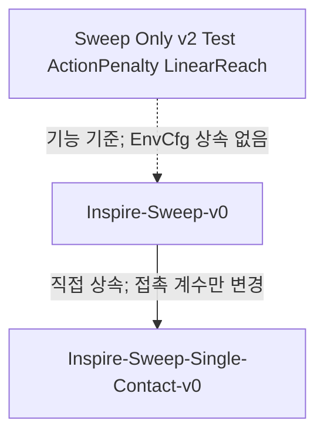

# Sweep 계통: 방향별 접촉면 선호와 접촉 조건 비교

## 개발 배경

기존 Sweeping 환경에서는 목표 물체를 목표 위치까지 이동시키는 행동이 상당 부분 학습되었다. 사용자 관찰에 따르면 Pull·Push 방향을 제외한 조작에서는 상당한 성공을 보였으나, 목표 방향에 따라 손바닥과 손등을 선택하기보다 **항상 손등 쪽으로 밀려는 경향**이 나타났다.

이는 목표 도달과 의도한 접촉면 선택이 서로 다른 평가 대상임을 보여준다. 타겟을 목표에 도달시키더라도 특정 접촉면에 편향된 행동이 형성될 수 있다. 이에 따라 새 Sweep 계통은 목표 이동 보상에 **방향별 접촉면 선호도**를 추가하여, 목표 방향에 맞는 손바닥·손등 사용을 유도하도록 구성하였다.

기존 성공과 손등 편향은 사용자가 보고한 관찰이다. 해당 보고에는 정확한 이전 task ID·run·성공률·방향별 표본 수가 제시되지 않았으므로 특정 이전 버전의 정량 성능으로 단정하지 않는다. 새 선호도 항이 편향을 해결했는지는 현재 학습 결과로 확인할 사항이다.

## 계통과 환경 구성

기능 기준은 `Inspire-Sweep-Only-v2-Test-ActionPenalty-LinearReach`이며, 새 계통의 기준 환경은 **`Inspire-Sweep-v0`**다. 사용자가 요청한 간결한 네이밍과 독립 파일 구성을 적용했다. Sweep-v0의 EnvCfg와 PPO Cfg는 Isaac Lab 기반 Cfg를 직접 상속하며 이전 task EnvCfg를 상속하지 않는다. Scene·MDP·물리 lifecycle 등 검증된 공통 구성요소는 재사용한다.



| 환경 | 주된 목적 | 접촉 계수 | 로그 experiment name |
| --- | --- | --- | --- |
| `Inspire-Sweep-v0` | 방향별 손바닥·손등 선호를 학습 | 이력 인정 × 누적 count/20 | `inspire_sweep_v0` |
| `Inspire-Sweep-Single-Contact-v0` | 같은 선호도 환경에서 누적 접촉 강화를 제거 | 이력 인정 여부의 boolean을1/0으로 변환 | `inspire_sweep_single_contact_v0` |

이 문서에서 사용자가 말한 **`Contact-v0`는 `Inspire-Sweep-Single-Contact-v0`의 약칭**으로 정리한다. 별도의 `Inspire-Contact-v0` task를 추가했다는 뜻은 아니다. 공통 과업·관측·제어·보상·PPO 수치의 기준은 [Sweep-v0 상세 문서](SWEEP_V0.md)다.

## 방향별 접촉면 선호의 설계

로봇에서 멀어지는 방향을12시, 로봇 쪽을6시로 정의한다. 12시·6시의 Push/Pull 구역은 각각±30°의60° 폭이며, 오른쪽·왼쪽 구역은 나머지120°씩을 사용한다. **Deadzone은0°**이므로 어느 목표 방향도 제외하지 않는다. 구역을 나누는 각도와 목표 방향을 금지하는 Deadzone을 구분한다.

| 구역 | 목표 이동 방향 | 각도 폭 | 선호 접촉면 | 선호 계수 | 반대 계수 |
| --- | --- | --- | --- | --- | --- |
| 1 | 12시 / Push | 60° | 손등 | 1.5 | 0.7 |
| 2 | 오른쪽 / 3시 | 120° | 손등 | 1.5 | 0.7 |
| 3 | 6시 / Pull | 60° | 손바닥 | 1.5 | 0.7 |
| 4 | 왼쪽 / 9시 | 120° | 손바닥 | 1.5 | 0.7 |

선호 계수는 **양의 거리 감소 Sweep 보상에만** 곱한다. 접촉면 자체에 독립적인 양의 보상을 지급하거나, 잘못된 이동 방향에 보상을 주는 구성은 아니다. 반대 면을 사용해도 계수0.7의 진행 보상은 가능하므로, 선호 면을 강제하는 hard constraint와는 다르다.

방향은 reset 시 정해진 목표 이동 벡터를 기준으로 유지한다. 접촉면은 관측 noise나 손목 F/T의 부호가 아니라 **타겟과 손의 실제 접촉점·법선 하중**으로 판정한다. 장애물·선반 접촉이 선호도 계산에 섞이지 않도록 타겟만 선택한다. 양면이 동시에 접촉하면 법선 하중 비율로1.5와0.7을 섞으며, 분류 가능한 접촉이 없으면 계수1을 사용한다. 구체적인 좌표·경계·표면 분류 범위는 [접촉면 계수 상세](SWEEP_V0.md#방향별-접촉면-계수)를 따른다.

## 두 환경에서 비교하는 접촉 조건

두 환경 모두 최근3개 **정책 제어 스텝** 중 유효 타겟 접촉이2회 이상이어야 한다. 이력 인정에 필요한 기존 EEF 높이 조건도 동일하다. 차이는 인정된 접촉을 양의 Sweep 보상에 반영하는 계수다.

### Sweep-v0: 누적 접촉 강화

Sweep-v0는 이력이 인정되면 카운트를1 올리고 미인정이면2 낮추며0–20으로 제한한다. 인정된 스텝의 접촉 계수는 count/20이다. 첫 인정의 계수는0.05이고, 인정이 누적되어야 최대1을 받는다. 접촉이 끊긴 뒤 재접촉했을 때도 남은 누적 상태가 이후 보상 크기에 영향을 준다.

이 구성은 접촉의 지속성에 따라 진행 보상을 점진적으로 강화한다. 목표 이동·힘 정렬·접촉면이 같아도 접촉을 유지해 온 이력에 따라 보상 크기가 달라진다.

### Single Contact: 접촉 여부만 사용

Single-Contact-v0는 `contact_recognized`라는 **boolean 상태만** 가진다. 최근3스텝 중2회가 인정되면True, 아니면False이며, 보상 계산에서만 이를1/0으로 변환한다. `contact_count` 필드는 없고0/20 대체 표현도 사용하지 않는다.

이력 조건이 처음 충족되는 시점부터 접촉 계수1을 받는다. 부모와 비교하면 누적 접촉 카운트에 따른 보상 지연을 제거하고 **접촉 인정 여부만으로 보상하는 차이**를 둔 환경이다. 항상20배의 보상을 주는 환경은 아니다. 부모가 이미 최대 접촉 계수1에 도달했다면 나머지 조건이 같은 두 환경의 보상은 같다.

현재 스텝의 실제 접촉·유효 데이터·수평 평균 힘1N 이상·힘 방향 정렬 조건은 두 환경에 그대로 남는다. 과거2회 접촉으로 이력이 인정되어도 현재 힘 조건이 충족되지 않으면 양의 Sweep 보상은0이다. 따라서 boolean 접촉 여부가1이라는 사실만으로 진행 보상이 보장되지는 않는다.

| 비교 항목 | Sweep-v0 | Single-Contact-v0 |
| --- | --- | --- |
| 최근3스텝 중2회 접촉 조건 | 유지 | 유지 |
| 누적 카운트 상태 | 있음 | 없음 |
| 최초 이력 인정 시 접촉 계수 | 0.05 | 1 |
| 최대 접촉 계수 | 1 | 1 |
| 미인정 스텝의 접촉 계수 | 0 | 0 |
| 현재 접촉·힘·정렬·높이 조건 | 기존 조건 | 동일 |
| 부분 reset | 선택 행의 이력·카운트 초기화 | 선택 행의 이력·boolean 초기화 |

## 공통으로 고정한 조건

두 환경은 방향별 접촉면 계수, LinearReach, 역방향 페널티, 원시 액션 페널티, Scene·초기화·관측·제어·종료·PPO hyperparameter를 공유한다. Contact 조건을 바꾸면서 다른 보상 가중치를 함께 바꾸지 않았다.

기존 활성5개 커리큘럼은 제거하고 장애물 허용 힘50N·가중치-0.04, F/T 허용 변화량30N·3Nm·가중치-0.1을 처음부터 고정 적용한다. 학습 도중 일정 변화와 접촉 조건 변화가 동시에 발생하지 않도록 구성했다.

손목 F/T는 정책 관측에서만 힘±150N·모멘트±8Nm로 clip한 뒤 각 축의 한계로 나누어[-1,1]로 정규화한다. F/T 변화량 페널티·접촉 하중·물리 제어는 정규화 전 물리값을 사용한다. 기존 실행에서 F/T 관측 변화에 Actor가 과도하게 반응하고 원시 액션 제곱 페널티가 커진 사례를 고려한 구성이다. [해당 학습 중단 진단](../logs/2026-11-20_wr7_v1_action_penalty_numerical_failure.md)과 이번 관측 정규화의 장기 효과는 서로 다른 확인 대상이다.

## 현재 학습 현황

**2026-11-20 사용자 보고 기준**이다.

| 서버 식별 표기 | 현재 학습 환경 | 상태 |
| --- | --- | --- |
| `.180` | `Inspire-Sweep-v0` | 학습 중 |
| `.250` | `Inspire-Sweep-Single-Contact-v0` / 사용자 약칭 Contact-v0 | 학습 중 |

서버 표기는 사용자가 준 끝자리 식별자를 그대로 사용했다. 이 문서 작성 중 원격 서버에 접속하거나 프로세스를 시작·중단·재시작하지 않았다. run 경로·checkpoint·seed·iteration·최신 성공률은 제공되지 않았다. 이전 문서의 Sweep Only 서버 배치는 당시 기록이며, 현재 이 새 계통의 배치는 위 표를 따른다.

개발 단계에서는 Sweep-v0의 CPU116개와 GPU4환경 smoke, Single Contact의 최종 boolean 구현에 대한 CPU110개와 GPU4환경 reset·8step·부분reset 검사를 통과했다. 이는 코드·수치·lifecycle 검사이며 사용자가 현재 수행 중인 장기 학습 결과나 접촉면 편향 개선의 증거가 아니다.

## 학습 결과에서 확인할 항목

이번 계통의 핵심 질문은 **목표 도달 능력을 유지하면서 방향에 맞는 접촉면 선택이 형성되는가**이다. 전체 성공률과 접촉면 선호를 함께 확인해야 한다.

| 확인 대상 | 해석할 내용 |
| --- | --- |
| 구역별 목표 도달 | 기존에 어려웠던 Pull·Push와 좌우 구역의 성공을 구분 |
| 구역별 손바닥·손등 사용 | 구역1·2 손등, 구역3·4 손바닥의 선택 경향 |
| 미분류·양면 접촉 | 중립 계수 또는 혼합 계수가 평가에서 차지하는 비중 |
| 접촉 인정과 지속 | 누적 강화 제거가 진행 보상·접촉 유지에 미치는 차이 |
| 간섭과 동작 안정성 | 장애물 이동·하중·F/T 변화·원시 액션 비용의 변화 |

위 항목은 결과를 해석하기 위한 평가 관점이며, 모든 비율을 현재 코드가 별도 로그로 출력한다는 뜻은 아니다. 기존 `Metrics/timeout_success_rate`는 timeout episode에 대한 성공률이므로 손바닥·손등 선호와 전체 episode 성공을 대신하지 않는다. 자세한 분모와 성공 판정은 [상세 문서](SWEEP_V0.md#종료-조건과-성공률)를 따른다.

두 서버의 결과를 비교할 때는 실제 저장 설정·seed·학습 진행량·평가 표본을 확인해야 한다. 현재 보고만으로 Single Contact가 더 우수하다거나 손등 편향이 해결됐다고 결론 내리지 않는다.

## 실행과 관련 기록

아래는 workspace 루트에서의 실행 예시다. 현재 학습 중인 실행을 중복으로 시작하라는 지시가 아니다.

```bash
python src/inspire_sweep_baseline/scripts/train.py \
  --task Inspire-Sweep-v0 --num_envs 2048 --headless

python src/inspire_sweep_baseline/scripts/train.py \
  --task Inspire-Sweep-Single-Contact-v0 --num_envs 2048 --headless
```

- [Sweep-v0 상세 구성·수식](SWEEP_V0.md)
- [Sweep-v0 구현·검증](../logs/2026-11-20_sweep_v0.md)
- [Single Contact 구현·boolean 정정·검증](../logs/2026-11-20_sweep_single_contact.md)
