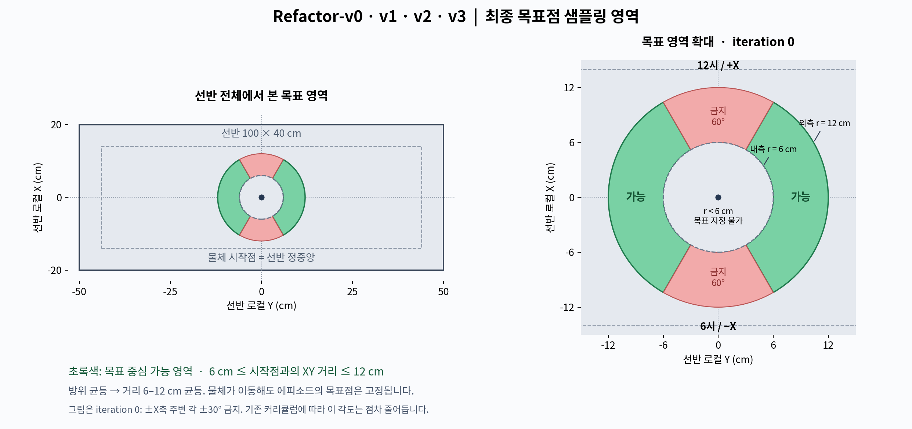

# Inspire-Wrench-Refactor-v0

2026-11-06: 체크포인트 없이 EEF Cartesian/Hand2D를 조작하고 전체·선반·로봇 reset 및 선반 상태 복원을 수행하는 [수동 실행기](../logs/2026-11-06_wrench_refactor_manual.md)를 추가했다. 원본 환경은 보존하며 수동 인스턴스만 v3 EEF 보정 OSC를 사용한다.

2026-11-06 후속 검증: [GUI32환경 리셋·좌우 밀기 및 수정 기록](../logs/2026-11-06_wrench_refactor_gui_validation.md). Wrist3−π/2, Arm속도종료3rad/s가 현재값이다.

2026-11-05 질량·EEF·촉각 후속 수정 반영. 사용자 요청에 따라 v0_2를 검토 기준으로 삼고 **기존 환경 설정 상속을 끊은** 독립 환경이다. ‘변경 없음’의 근거는 v0·v0_1·v0_2·v0_3·v0_4·v1·v2의 활성 구성과 호출 함수를 모두 대조한 결과다. [개발·검증 기록](../logs/2026-11-05_wrench_refactor_v0_implementation.md).

## 등록·파일·실행

| 항목 | 값 |
| --- | --- |
| Gym ID | `Inspire-Wrench-Refactor-v0` |
| EnvCfg | `envs/wrench_refactor_envs.py:WrenchRefactorEnvCfg(ManagerBasedRLEnvCfg)` |
| Runtime | `runtime/wrench_refactor.py:WrenchRefactorEnv(ManagerBasedRLEnv)` |
| Scene | `assets/scenes/wrench_refactor.py:WrenchRefactorSceneCfg(InteractiveSceneCfg)` |
| Managers | `mdp/{actions,commands,observations,events,rewards,terminations,curricula}/wrench_refactor.py` |
| PPO | `agent/wrench_refactor_ppo_cfg.py:WrenchRefactorPPORunnerCfg(RslRlOnPolicyRunnerCfg)` |
| Model | `agent/wrench_refactor_models.py:WrenchRefactorModel(MLPModel)` |
| 실험명 | `inspire_wrench_refactor_v0` |

경로 기준은 `src/inspire_sweep_baseline/inspire_sweep_baseline`이다. 모든 Manager Cfg도 별도로 선언한다. 검증된 계산 함수·액션 term·자산 스포너의 재사용과 환경 Cfg 상속은 구분한다. 기존 Wrench 설정/함수/자산은 수정하지 않았다.

Workspace 루트, Isaac Lab Python에서 실행한다. GPU32환경 기본 물리 검증은 통과했지만 아래 학습 명령의 실제 학습 성공을 주장하지 않는다.

```bash
python src/inspire_sweep_baseline/scripts/train.py --task Inspire-Wrench-Refactor-v0 --num_envs 2048 --headless
python src/inspire_sweep_baseline/tests/_wrench_refactor_probe.py --num_envs 64 --headless
```

기존 Wrench 체크포인트는 입력 차원이 달라 직접 재개할 수 없다. 학습에는 `train.py`를 사용하며 이번 작업에서는 실행하지 않았다. `logs/rsl_rl`은 수정하지 않았다.

## 고정 물체 풀과 초기화/reset

물리 물체는 **타겟 원통 1개 + 장애물 16개**다. 장애물은 `cylinder`, `cube`, `mug`, `bottle`, `003_cracker_box`, `004_sugar_box`, `005_tomato_soup_can`, `002_master_chef_can`을 각각 정확히 2개 보유한다. 타겟은 별도 원통이다. 환경마다 각 물체의 크기·질량·마찰 난수는 독립 추첨할 수 있으며 값의 중복을 금지하지 않는다.

| 시점 | 실행 |
| --- | --- |
| USD 생성 | 기존 8종 기준 형상을 재사용하고 각 물체에 단일 `U(0.9,1.1)` 크기 배율 적용 |
| prestartup | 생성 시 저장된 실제 scale 반영 bounds 수집, `spawn_z = 1.05 - min_z` 17개 캐시 |
| startup | 물체별 질량 및 마찰, 환경별 선반/손 마찰을 균등 추첨; 관성은 자기 형상의 원래 관성/질량 비례로 갱신 |
| reset | Gray/White 각각 독립 정수 `U{0,1,2,3}`; 16개 풀에서 중복 없는 후보를 선택하여 활성 배치; 미선택 물체 주차; 속도 0; 관측 스냅샷 재생성 |

질량은 기존 지원 범위 `U(0.230,0.500) × 1.5 kg`, 즉 0.345–0.750kg이다. 마찰은 기존 역할별 평균±2σ 범위를 균등 분포로 바꿨다. 아래는 정마찰/동마찰 범위다.

| 역할 | 정마찰 | 동마찰 |
| --- | --- | --- |
| 선반 | 0.213–0.417 | 0.170–0.334 |
| 물체 | 0.235–0.395 | 0.188–0.316 |
| 손 | 0.295–0.875 | 0.236–0.700 |

마찰은 PhysX 재질 수 제한 때문에 역할마다 4096개 균등 분위수 쌍을 만들고 균등 인덱스로 선택한다. 동마찰 순열로 두 계수의 결합을 분산한다. 질량·크기는 연속 균등 분포다. Arm/Axia80의 마찰은 기존 기본값을 유지한다. 위 범위는 사용자가 새 숫자를 지정하지 않았으므로 기존 범위를 이용한 구현 선택이다.

기존 v0_2도 실제로 크기·물성은 startup 고정이었다. 새 환경에서는 **종류별 실제 풀 보장**, 균등 분포, 물체별 물성, 스폰 높이 캐시와 reset 분리를 명시적으로 구성했다. 기존 v0_2의 실제 물체는 10개였으며 16은 관측 슬롯 수였다.

미사용 물체는 기존 중력 해제 방식으로 선반보다 충분히 높은 `z=50+2×slot`에 분리 주차한다. 활성 물체만 중력을 켜고 wake-up한다. 목표·관측·보상·종료의 활성 마스크에서 주차 물체를 제외한다. 부분 reset은 선택 환경의 자세·중력 플래그·스냅샷만 갱신한다.

기존 모든 curriculum stage × 환경 × 16개 사전 배치 bank는 제거했다. 연속 목표·거리 균등 추출을 유지하려고 reset에 최대 6개 선택 후보만 OBB 탐색한다. RED margin23mm, 후방 offset20mm, Gray padding65mm, 물체 간격20mm, 보드 margin5mm는 Wrench-v0의 기하 규칙을 재사용한다. 제한 탐색이 실패하면 같은 목표·같은 요청 수로 재시도하며 목표나 개수를 몰래 바꾸지 않는다. 최종 실패는 명시적 오류다. GPU32환경에서7168배치의 초기 바닥 정렬 및 첫100ms 거동을 계측했다. 모든 가능한 형상 조합과2048환경 처리량까지 보장하는 검사는 아니다.

## 목표 방향·거리와 시각화



2026-11-06 후속: 반경6cm 내부와12cm 외부를 제외한 환형 영역을 사용한다. 그림은 물체가 선반 중앙에 있는 iteration0 기준이다. [변경·검증](../logs/2026-11-06_wrench_refactor_goal_annulus.md).

선반 local ±X가 12시/6시, ±Y가 양옆이다. 반각 α를 제외한 두 구간 `[α, π−α]`, `[π+α, 2π−α]`에서 방향을 균등 추출한다. 원통 초기 위치는 반경2cm 원판에서 면적 균등이다. 방향별 최대 거리는 원통 footprint와 가장자리 여유2cm를 뺀 선반 사각형에 대한 ray 교차로 계산한다. **거리는 시작점으로부터 6cm 이상, min(12cm, 해당 방향의 선반 유효 최대 거리) 이하에서 균등 추첨**한다. 반경6cm 원의 내부는 목표 중심으로 사용할 수 없으며6cm 경계는 허용한다. 추가 ±(0.16,0.46)m clamp는 적용하지 않는다. 최대 거리12cm를 넘는 목표는 제외한다. 방위를 먼저 균등 추출하고 거리 `0.06 + U(0,1)*(min(maximum,0.12)-0.06)`를 적용하므로 방위 편향 없이 최소 거리를 보장한다. 각 방위의 최대 거리가6cm 미만인 비정상 구성은 재추첨 대신 오류로 처리한다.

기존 샘플러는 방향 후보를 균등 추출하지만 거리는 해당 ray의 상한을 그대로 사용했다. 중앙 원통10,000개 검사는 +Y4909개/−Y5091개, 거리0.15m 고정이었다. 왼쪽 방향을 금지하는 비대칭 조건은 확인되지 않았다. 기존 유한 bank의 환경별 방향 표본 편차와 학습된 정책의 행동 편향은 별도 문제이며 실제 정책 검증은 수행하지 않았다.

새 샘플러는 각 deadzone 단계에서 50,000표본의 좌우 비율·각도 히스토그램·정규화 거리 평균/표준편차를 검사했다. 장애물 배치 성공 여부로 목표를 재추첨하지 않아 방향 분포를 바꾸지 않는다.

목표 마커는 기존 `RevisionGoalCommand`의 **반경3cm 녹색 구**를 재사용한다. `SphereCfg`에 collision/rigid/mass 설정이 없는 시각화 전용 마커다. 이미 Wrench-v0부터 반경3cm였음을 확인했다.

## 오른손·촉각·F/T

원본은 `/tmp/inspire_urdf_right_with_force_sensor.zip`의 오른손 URDF/STL이다. `scripts/build_wrench_right_hand.py`로 `assets/data/wrench_right_hand/ur5e_inspire_right.usda`와 `tactile_regions.json`을 생성했다. USD는 기존 UR5e 자산을 상대 참조하고 손 부분의 형상·관절 프레임·축·COM·주관성 축을 오른손 원본으로 대체하고 질량/관성은 공식 총질량790g에 맞게 비례 보정한다. 기존 손 메시를 반사한 모델이 아니다.

기존 공유 제어·F/T·접촉 함수와의 연결을 위해 내부 `inspire_left_*` 링크/관절 이름은 **호환 슬롯 이름**으로 남는다. 실제 각 슬롯의 메시와 관성은 오른손이며 `vendor_right_link`/`handedness=right` metadata로 출처를 구별한다. 이름의 left 문자열을 형상의 손잡이성으로 해석하면 안 된다. 원본 왼손 USD는 수정하지 않았다.

촉각은 원래 순서의 손바닥측17개 + 대응 손등측17개다. 각 패드의 실제 XY convex footprint를 해당 parent collider의 convex hull 양쪽 표면에 투영한다. 접촉점의 XY마다 ray–hull 교차로 앞/뒤 표면 깊이를 계산하며, 상자 두께를 가정하지 않는다. 별도 손등 메시·강체·질량·collider는 만들지 않는다.

PhysX의 개별 contact point/count/start 버퍼를 읽어 해당 접촉을 분류한다. 같은 물체–parent pair의 접촉점이 여러 개여도 모두 유지한다. 겹치는 footprint는 정규화 중심거리로 하나에 할당하며, 앞/뒤는 더 가까운 면 하나에 할당한다. 힘은 접촉점별 크기를 누적하여 반대 방향 힘 상쇄로 채널을 잃지 않는다. 기존 패드의 직접 접촉도 앞17개에 포함한다. 임계값은0.05N이며 equality를 포함한다. parent 상세 접촉 필터는 17개 물체이며, 기존 직접 패드 센서는 모든 충돌 상대를 감지한다. 따라서 손등 투영은 현재 물체 접촉용이고 선반/지면 투영 접촉은 포함하지 않는다.

기존 왼손의 buried-pad 보완 아이디어를 오른손 geometry로 다시 계산했다. 좌표 tolerance0.5mm, 표면 깊이 tolerance1.5mm, normal의 local-Z 절댓값0.2 이상을 사용한다. 메모리는 접촉256개씩 나누어 제한한다. 실제GPU좌우밀기에서앞면ch0/뒷면ch17활성은확인했다.모든채널·접촉manifold용량·2048환경성능은검증하지않았다.

F/T는 `PureWristWrench`/`PureWrenchReader`를 재사용한다. 실제 PhysX의 오른손 30개 강체 질량·관성·COM·운동 상태로 중력/관성 support wrench를 계산하므로 왼손 관성을 그대로 빼지 않는다. Axia80 measurement child인 `inspire_base_link`의 identity joint frame과 EEF offset142.7mm를 보존했다. USD-only 조립 검사는 통과했지만 실제GUI32환경에서무접촉residual과좌우접촉wrench를계측했다. 수치는후속검증로그를따른다.

## 관측·제어·PPO

| raw 구간 | Actor | Critic |
| --- | --- | --- |
| 0:6 | Arm joint pos6 | 동일 의미 |
| 6:12 | Arm joint vel6 | 동일 의미 |
| 12:14 | 측정 hand config2 | 동일 의미 |
| 14:21 | root-frame EEF pose7 | 동일 의미 |
| 21:24 | 초기 target XYZ3, 초기 bias±1cm | 현재 target XYZ3, noise 없음 |
| 24:26 | 초기 목표 polar2 | 동일 의미 |
| 26:34 | 기존 tanh action feedback8 | 동일 의미 |
| 34:68 | front17 + back17 tactile | 동일 의미 |
| 68:74 | 보상된 wrist F/T6 | 동일 의미 |

양쪽 raw는74D, 장애물은16×`[mask,x,y,z]`=64D다. 각 모델의 별도 `64→32→16` 인코더 뒤 raw와 결합하여 **두 모델 모두90D MLP 입력**이다. 인코더 전 총입력은 양쪽138D이며 Critic에 target3을 덧붙이지 않는다.

Actor 장애물은 reset 시 가시성0.35·mask flip1%·좌표±1cm·인접 swap10%를 유지한다. Critic은 모든 **활성** 비타겟 물체의 현재 root XYZ, noise/가시성 필터/mask flip/swap 모두 없음이다. 기존 Critic에는 swap10%가 있었으나 ‘변조 없음’ 요구에 따라 제거했다. 두 raw 그룹의 tactile1% flip과 F/T 표준편차0.05N/0.005Nm noise는 기존 분포를 유지하며 그룹별로 추출한다. 물리 tactile sample은 공유한다.

Arm은 v0_2의 `pose_rel` 6D OSC, position scale0.03m, orientation scale0.15rad, RPY 변환, Final·Revision과 같은 root task frame을 사용하고 gain·gravity·effort cap을 유지한다. Hand는 기존 2D openness0–1과12관절 mapping을 오른손 축에 연결한다. v1/v2의 wrench command controller는 사용하지 않는다. 액션 페널티는 사용자 최종 정정대로 **출력 토크** 기준이다.

PPO 수치는 Wrench-v0_2와 동일: rollout36, MLP256/128/64 ELU, 인코더32 ReLU, 초기 표준편차1, gamma0.98, lambda0.95, clip0.2, epoch8, minibatch4, 학습률0.001 adaptive, entropy0.005, KL0.02, max grad1, 저장50iteration, 최대90000iteration. 시간은 physics0.01초×decimation2, episode10초다. CPU의 실제 RSL-RL PPO update에서 두 인코더 갱신 및138D Actor JIT 결과 일치를 검증했다. 이는 시뮬레이션 학습 결과가 아니다.

## 전체 보상 대조

모든 weight와 수식은 최종 활성 Cfg 기준이다. 일반 항은 RewardManager가 `dt=0.02`를 곱한다. Reaching과 일회성 보너스·shelf 실패 이벤트는 함수 안에서 dt를 상쇄한다.

| 항목 | 최종 구성 | Wrench 계열 근거·차이 |
| --- | --- | --- |
| target_reaching | `DexReachProgress`, weight30, near0.10m, 새 최단 거리 감소량 | 전 계열의 기존 term 보존 |
| target_goal_distance | `goal_distance_v2`, weight5, scale0.05m, EEF<14cm | v0/v1/v2 지수식 재사용; v0_2 cosine 및 v0_4 progress와 다름 |
| target_goal_hold | `goal_hold_v2`, weight10, full0.025m/outer0.035m Smoothstep, 속도 감쇠 없음 | 기존 식·수치 보존, EEF<14cm |
| target_contact | weight0.1, 3step 중2회·목표내부 인정, count최대10, 불인정5회 초기화 | v0_2 누적 구조; 후속 확인으로 목표내부도 현재 EEF<14cm, 정확히3cm 포함 |
| robot_action_rate_penalty | weight−1, `0.03×ΣΔ(τ/limit)^2 + 0.03×ΣΔclamp(hand,0,1)^2` | Arm은 v0_3/v0_4와 동일; Hand는 실행 개방도로 범위 제한 |
| robot_joint_velocity_penalty | weight−1, Arm0.03+Hand0.01, group cap100 | 함수·계수 보존, Hand 합산만 독립 구동6축으로 제한 |
| object_tilt_penalty | weight−30, free5°, fail0.9rad, 활성 물체 | 전 계열 함수·params 보존 |
| obstacle_displacement_penalty | weight−150, 3D 초기변위 제곱, cap0.04, 활성 비타겟 | 전 계열 함수·params 보존 |
| object_acceleration_penalty | 제거 | 요청 |
| shelf_penalty | weight−1, 기존 충돌/근접×0.5 + collision 이벤트3 | 전 계열 `ShelfPenalty` 보존 |
| obstacle_contact_penalty | weight−0.05, free30N, max100 | free50→30; 기존 합력 비용 함수 유지 |
| target_goal_first_entry_bonus | 1회+15, `d<=3cm`, 속도 감쇠 없음 | 이전 최대25 및 속도감쇠 제거; inclusive 경계 적용 |
| target_goal_success_bonus | 안정3초 성공 종료 시+75 | 기존 함수·weight 보존 |
| wrist_wrench_change_penalty | weight−0.1, freeΔF20N/freeΔM2Nm, saturation2.5, sharpness3 | 전 계열 함수·params 보존 |
| target_speed_penalty | 제거 | 요청 |

EEF 높이는 초기 선반 작업면 기준 world Z이며 정확히14cm에서는 높이 조건을 만족하지 않는다. 최초 진입/성공 보너스에는 새 높이 조건을 추가하지 않았다. 접촉 보상의 history와 count reset은 환경별로 처리한다.

## 종료·커리큘럼·로그

| 종료 | 최종 구성 |
| --- | --- |
| object_fall_or_tilt | 기존 활성 물체 bbox bottom, clearance0.01m, fail0.9rad |
| target_speed | 제거 |
| shelf_failure | 기존 `shelf_termination` |
| arm_joint_velocity | 기존 `arm_velocity`, threshold5→1→3rad/s（후속 사용자 지시） |
| target_goal_success | `d<=3cm`, speed<=0.005m/s 연속3초; 선행 실패면 성공 보너스 제외 |
| timeout | 조건 없는 `time_out`, `time_out=True`; 이전 실패-only timeout 이름/조건 제거 |

남은 커리큘럼은 `target_goal_direction_deadzone` 하나다. iteration0/9999=30°,10000=25°,13000=20°,16000=15°,19000=10°,22000=5°,25000이후0°다. `target_free_speed`, `obstacle_population`은 선언하지 않았다.

Runtime의 거리·EEF/타겟 속도·가속도 평균, 최대 force/moment, 실제 Gray/White 수·layout_complete 로그는 유지한다. 가속도 보상을 제거해도 진단용 가속도 평균은 유지된다. 보상 로그는 활성13항, 종료 로그는5항이다.

## 검증 상태

새 동작 CPU 검사, 기존 Wrench 전체 회귀, 오른손 USD 조립, 실제 Isaac Lab 설정 import는 통과했다. 상세 명령·개수는 [개발 로그](../logs/2026-11-05_wrench_refactor_v0_implementation.md)에 기록한다. 초기 Isaac Sim 실패는 sandbox 장치 접근 제한이었다. 이후 실제 GPU32환경 스폰/부분reset/finite rollout 및 질량 readback을 통과했다. 오른손 접촉/F/T 시험은 후속 시험 로그에 실패 사례까지 기록하며,2048환경 처리량과 `train.py` PPO/장기 정책 성능은 미검증이다.

## 재구성 계약과 문서 사용 순서

이 문서는 **2026-11-06 root-frame OSC·목표6–12cm 수정까지 포함한 Refactor-v0**의 실행 계약이다. 이전 Wrench 환경 파일이 없어도 재구성할 수 있도록 수치·기하·상태 갱신을 아래에 명시한다. [재구성 소스 부록](WRENCH_REFACTOR_V0_RECONSTRUCTION.md)은 실제 호출되는 모듈과 그 import 의존성, 학습 진입점, 환경 등록 코드의 파일별 전문·SHA-256·추출 방법을 담는다. 본문은 설계와 의미를, 부록은 부동소수점 처리·텐서 정렬·캐시·예외 처리까지 포함하는 정확한 구현을 제공한다. 부록은 실행 코드와 대조한 스냅샷이며 별도 개발 브랜치가 아니다.

재구성 입력은 본문, 소스 부록, 아래 자산 목록, 지정한 Isaac Lab/Isaac Sim/RSL-RL 설치다. 라이브러리 자체를 새로 구현할 필요는 없다. 기존 환경 CFG는 복사하거나 상속하지 않고 `ManagerBasedRLEnvCfg`에서 새로 구성한다. 함수 모듈 중 역사적 이름이 있는 것은 실제 import 의존성 때문에 포함된 것이다. 모듈에 정의된 모든 보상이나 curriculum을 활성화하는 의미가 아니다. 활성 목록은 본문의 13개 보상·5개 종료·1개 curriculum이 전부다.

| 재현 기준 | 확인한 값 |
| --- | --- |
| Python | Isaac Sim 환경의 Python3.11 |
| Isaac Sim | 5.1.0.0 |
| Isaac Lab 패키지 | 0.54.4 |
| Isaac Lab Git | `929f0fe1e9c1699efebf31b2ad0ab723a7d6e7e9` |
| isaaclab-rl | 0.5.2 |
| rsl-rl-lib | 5.0.1 |
| PyTorch | 2.7.0 |
| NumPy | 1.26.0 |
| Gymnasium | 1.2.1 |
| TensorDict | 0.13.0 |
| USD 오프라인 생성 | pxr + NumPy + SciPy |

GPU 병렬 물리는 seed를 고정해도 장치/solver/build가 다르면 bit 단위로 동일해진다고 보장할 수 없다. 여기서 동일 환경은 자산·물리 파라미터·관측·제어·분포·보상·종료·학습 구성을 동일하게 재현한다는 뜻이다. 목표만 같은 임의의 sweep 환경을 만드는 것은 이 계약의 재현이 아니다.

### 자산 전달 목록

자산 경로 기준은 `src/inspire_sweep_baseline/inspire_sweep_baseline/assets/data`다.

| 자산 | 용도/전달 조건 |
| --- | --- |
| `wrench_right_hand/ur5e_inspire_right.usda` | 오른손 geometry, 30바디 질량/관성, 29관절 수정 overlay |
| `wrench_right_hand/tactile_regions.json` | 오른손 17개 footprint 및 부모 hull halfspace, 질량 보정 provenance |
| `ur5e_inspire_usd/ur5e_inspire.usd` | overlay의 상대 참조. 이 파일 하나만으로 참조가 닫히지 않음 |
| `ur5e_inspire_usd/configuration/*.usd` | base/robot/physics/sensor 네 레이어를 디렉토리 구조 그대로 전달 |
| `ur5e_inspire_usd/config.yaml` | 원본 자산 설정 기록 |
| `tactile_regions.json` | 기존 공유 모듈의 body 이름/parent 연결 초기화에 필요. 오른손 투영 형상은 위 새 JSON에서 읽음 |
| 원본 오른손 ZIP | overlay 재생성 시에만 필요. 이미 생성된 USD+JSON으로 실행하면 ZIP 불필요 |
| shelf USD와 모든 reference/payload/texture | 현재 기본 URI는 `omniverse://192.168.0.13/Library/Shelf/Arena/Collected_speedrack_shape/speedrack_shape.usd` |
| YCB4종 USD 및 하위 자산 | Isaac 자산 서버 `Props/YCB/Axis_Aligned`의 cracker/sugar/soup/master-chef 네 모델 |

**선반과 YCB는 이 작업에서 로컬 패키지로 수집한 자산이 아니다.** 다른 머신에서 문서와 자산만으로 재구성하려면 해당 USD의 참조 파일까지 전달해야 한다. 원격 URI 문자열만 복사해서 오프라인 재현이 되는 것은 아니다. 선반은 `INSPIRE_SWEEP_SHELF_USD_PATH`에 실제 로컬 USD를 지정할 수 있다. YCB는 부록의 `ISAAC_NUCLEUS_DIR` 참조를 같은 자산의 로컬 경로로 대체하거나 동일 Isaac 자산 서버를 사용한다. 원격 파일의 SHA는 이 작업에서 확인하지 못했다. 로컬 자산 SHA와 source ZIP SHA는 부록에 기록한다.

패키지 wheel을 만들 때 오른손 `*.usda`, `*.json`도 package-data에 넣는다. editable 설치에서만 우연히 발견되는 파일로 두지 않는다. `src/scene_randomization/generator.py`와 `visibility.py`는 코드 의존성이며 **자산이 아니다**. 소스 부록에 포함되어 있고, 기존 동적 로더가 요구하는 형제 디렉토리 구조를 유지한다.

### 독립 등록과 초기 생성

1. `inspire_sweep_baseline` import 시 Gym에 ID를 등록한다. entry point는 `inspire_sweep_baseline.runtime.wrench_refactor:WrenchRefactorEnv`다.
2. `env_cfg_entry_point`는 `inspire_sweep_baseline.envs.wrench_refactor_envs:WrenchRefactorEnvCfg`, `rsl_rl_cfg_entry_point`는 `inspire_sweep_baseline.agent.wrench_refactor_ppo_cfg:WrenchRefactorPPORunnerCfg`다.
3. `disable_env_checker=True`. Actor/Critic 관측은 dict/TensorDict 경로로 전달한다.
4. Isaac Sim `AppLauncher`를 먼저 시작한 뒤 환경 패키지와 USD/PhysX 의존 모듈을 import한다. 일반 Python에서 설정 import만 먼저 하면 Kit 모듈 누락이 날 수 있다.
5. `gym.make(ID, cfg=cfg)`와 `env.reset(seed=seed)`로 생성한다. 학습에는 제공된 `scripts/train.py`를 쓴다.

### 물리 시간과 장면 배치

| 항목 | 최종 값/의미 |
| --- | --- |
| physics dt | 0.01s, 100Hz |
| policy step | physics2회, 0.02s, 50Hz |
| episode | 10s, 최대500 policy step |
| 환경 수/간격 | 2048 / 2.5m |
| physics 복제 | `replicate_physics=False`: 환경별 geometry scale/물성이 다름 |
| gravity | `(0,0,-9.81)`m/s² |
| render_interval | 2 physics step |
| bounce threshold | 0.2m/s |
| friction correlation distance | 0.00625m |
| gpu_found_lost_aggregate_pairs_capacity | `2**25` |
| gpu_total_aggregate_pairs_capacity | `16*1024*16` |
| gpu_max_rigid_patch_count | `5*2**17` |
| ground | `/World/ground`, GroundPlaneCfg 기본값 |
| light | DomeLight, 색(.75,.75,.75), intensity2500 |
| viewer | eye(3.5,3.5,3.5), lookat(0,0,.3) |

각 환경의 원점을 `o_e`라고 한다. 기본 선반 pose는 `o_e+(-.7,0,0)`, identity quaternion이다. 로봇 root는 `o_e+(0,0,.79505)`, quaternion `(w,x,y,z)=(0,0,0,1)`이다. 이는 Z축180° 회전이며 identity가 아니다. 선반 local 작업판은 `x∈[-.20,.20]`, `y∈[-.50,.50]`, 표면 `z=1.05`m다. 목표/장애물 배치는 선반 frame으로 계산한 뒤 실제 선반 pose로 world 변환한다.

모든 길이는 m, 각도는 rad, 힘은 N, 모멘트는 Nm, 질량은 kg다. quaternion은 wxyz이며 ROS/Scipy의 xyzw와 혼동하지 않는다. USD row-vector 행렬을 NumPy/Scipy column-vector로 사용할 때 transpose한다.

## 선반 30kg 적용 절차와 오른손 질량

### 선반: API 생성 순서

문제는 숫자만100→30으로 바꾸는 것으로 해결되지 않는다. 사용 중인 `spawn_from_usd`는 USD reference를 추가한 뒤 `modify_mass_properties`를 호출한다. 후자는 대상에 이미 `UsdPhysics.MassAPI`가 있어야 수정하며 없으면 `False`를 반환한다. `MassPropertiesCfg` 선언만으로 API가 생성된다고 가정하면 안 된다.

Refactor 전용 spawner의 순서는 다음과 같다.

1. 원래 cfg를 복사하고 `mass_props=None`으로 하여 reference를 먼저 로드한다.
2. 생성된 shelf subtree에서 `RigidBodyAPI`가 있는 Prim을 찾는다.
3. 강체가1개면 그 body를 선택한다. 없으면 shelf root에 `RigidBodyAPI`를 생성한다. 2개 이상이면 `RigidObject` 계약 위반으로 예외를 내며 각 body에30kg씩 부여하지 않는다.
4. 선택 body에 `MassAPI.Apply`를 호출하고 `physics:mass=30`을 author한다.
5. 기존 explicit inertia와 양수 old mass가 있으면 관성에 `30/old_mass`를 곱한다. old mass를 알 수 없는데 explicit inertia가 있으면 diagonal inertia를0으로 지정하여 collider 기반 계산을 요청한다. COM/기존 kinematic flag는 보존한다.
6. 선반 역할 material을 bind한 뒤 clone한다. startup 마찰 변경은 질량을 다시 쓰지 않는다.

실제 외부 선반 USD의 kinematic flag를 이번 작업에서 새로 강제하지 않았다. kinematic 자산은 mass attr가 있어도 운동 응답이 동적 강체와 다르므로, 재현 시 원본 USD를 사용하고 GPU probe의 `root_physx_view.get_masses()==30`을 확인해야 한다. CPU USD fixture에서는 root/child body와 MassAPI 유무 세 경우를 검증했다. 이는 원격 선반에서 PhysX가 읽은 질량을 확인한 것과 구분한다.

### 오른손: 공식 총질량과 파츠 보정

로컬의 `RH56E2-R-T1.zip` 파일명, 오른손12관절·17촉각 모델 구성에 맞추어 **RH56E2 촉각형 T1**의 총질량을 기준으로 사용한다. 제조사 공식 RH56E2 페이지는 촉각형을 **790±10g**, 비촉각형을770±10g으로 명시한다. 이 환경은 촉각형 명목값 **0.790kg**을 사용한다. [제조사 제품 명세](https://en.inspire-robots.com/product/rh56e2/).

원본 오른손 URDF는 palm/finger13바디와 tactile17바디의 질량 합이0.8783kg이다. 공식 총질량과 맞지 않으므로 아래 비율을 모든30개 바디에 적용한다.

```math
s_m=\frac{0.790}{0.8783},\qquad
m_i'=s_m m_i,\qquad I_i'=s_m I_i.
```

COM 위치와 inertia principal axes는 유지한다. 양의 대칭 관성 행렬을 고유분해한 뒤 고유값을 같은 비율로 줄인다. 이는 공식 **총질량**을 맞추는 모델링 선택이며 각 파츠의 실제 제조사 질량을 측정했다는 뜻은 아니다. 공장별790±10g 편차를 추가 랜덤화하지 않는다. 손 물성 중 friction만 startup 랜덤화하고 mass는 모든 환경에서790g 고정이다.

Axia80 하우징의1g은 별도 body이며 손790g에 포함하지 않는다. UR5e의 질량에도 보정 비율을 곱하지 않는다. 가상 손등 tactile에는 새 body를 만들지 않으므로 질량이 추가되지 않는다. 보정은 USD 생성 시 수행하여 PhysX 초기화와 F/T mass cache 생성보다 앞선다. reset에서 재보정하지 않는다.

## 로봇 topology, 관절, EEF 제어

### 관절 순서와 Hand mapping

Arm action6개와 관측6개 순서는 `shoulder_pan_joint`, `shoulder_lift_joint`, `elbow_joint`, `wrist_1_joint`, `wrist_2_joint`, `wrist_3_joint`다. 초기 각도는 `(0,-2.2,2.2,0,1.57,-π/2)`, 초기 속도는 모두0이다. 2026-11-05 GUI 시험 중 사용자 요청으로 Wrist 3만 `.785→-π/2`로 바꿨다. 손바닥이 world −Y(로봇이 선반을 보는 기준 왼쪽), 손등이 +Y를 향한다. IK/관절 랜덤 reset은 없으며 `reset_scene_to_default`로 이 고정 자세를 복원한다.

| Arm 항목 | 앞3관절 | 뒤3관절 |
| --- | --- | --- |
| effort limit | 150Nm | 28Nm |
| sim velocity limit | 2rad/s | 4rad/s |
| termination velocity | 절댓값1rad/s 초과 | 절댓값1rad/s 초과 |
| implicit stiffness/damping | 0/0 | 0/0 |

손 관절은 thumb1,2,3,4, index1,2, middle1,2, ring1,2, little1,2 순서다. 내부 이름은 앞에 `inspire_left_`, 뒤에 `_joint`를 붙인다. 실제 모델의 handedness는 오른손이다. 각 관절에 effort0.20Nm, sim velocity1rad/s, stiffness1.2, damping.06, armature.0001을 사용한다. open target은12개 모두0이다.

closed target 벡터는 아래와 같다.

```text
[1.1641, .5864, .47052736, .446389306432,
 1.4381, 1.55933183, 1.4381, 1.55933183,
 1.4381, 1.55933183, 1.4381, 1.55933183]
```

액션8D는 `[Arm6, flexion_openness, thumb_opposition_openness]`다. 마지막2개만 `[0,1]`로 clamp한다. `q_target = q_closed + u*(q_open-q_closed)`이며 thumb1에는 opposition 채널, 나머지11개에는 flexion 채널을 사용한다. 오른손 URDF의 관절 축을 적용하므로 왼손 이름을 보고 action sign을 임의로 반전하지 않는다. URDF -Z revolute axis는 USD +Z joint 양쪽 local frame을 X축π 회전하여 보존한다. self collision은 꺼져 있다.

### F/T 조립과 frame 정의

기존 `inspire_mount` fixed joint를 inactive 처리하고 그 사이에 `axia80_link`를 삽입한다. 하우징은 반경.041m, 높이.0254m의 Z cylinder, mass.001kg, collider 활성, contact_offset.001m/rest_offset0이다. 기존 hand mount frame의 Z방향으로 손 전체를.0254m 이동시키고 센서 중심은 그 중간.0127m에 둔다.

`ur5e_to_axia80_joint`는 wrist3→sensor, `axia80_measurement_joint`는 sensor→hand base다. measurement joint의 child는 `inspire_base_link`, child local pose는 identity다. fixed joint를 merge하면 측정 reaction과17개 tactile body가 사라질 수 있으므로 merge하지 않는다.

EEF frame은 `axia80_link` local `(0,0,.1427)`, quaternion `(w,x,y,z)=(.5,-.5,-.5,-.5)`다. 센서 하우징 중심과 EEF는142.7mm 떨어져 있고, hand base보다130mm 앞이다. EEF point를 손바닥 root나 wrist3 origin으로 대체하면 제어·보상·F/T가 달라진다. `ee_frame`과 Arm action `body_offset`은 같은 값을 쓴다.

가상 safety frame은 `inspire_base_link`에 부착하며 같은 `TOOL_ROTATION_H`를 쓴다. `finger_frame` 두 점은 `(.07,0,.13)`, `(-.07,0,.13)`이고 `wrist_frame`은 `(0,0,-.17)`이다. 이 점들은 tactile pad가 아니다.

### OSC: Final·Revision과 동일한 root-frame 제어

2026-11-06 사용자 후속 요청으로 활성 Action을 `UR10OperationalSpaceControllerAction`으로 변경했다. `task_frame_rel_path=None`이며 상대 명령은 로봇 root 축에서 해석한다. 이전 `WrenchRefactorOSCAction`의 EEF task-frame·Jacobian·속도 override는 호출하지 않는다. 기존 정의는 과거 계측 재현용으로 파일에 남아 있지만 활성 Cfg가 가리키지 않는다.

제어 위치는 오른손 Scene의 `axia80_link`에 지정한 EEF offset `(0,0,.1427)`와 quaternion `(.5,-.5,-.5,-.5)`를 유지한다. 공통 클래스는 UR10이라는 이름과 무관하게 cfg에서 로봇·Arm6축·body·offset을 읽고, 실제 오른손 articulation의 Jacobian·질량행렬·중력항을 사용한다. 왼손 자산이나 손 관절을 가져오지 않는다. 오른손 USD, Wrist3−π/2, Hand2D mapping·센서·F/T 보정은 그대로다.

Raw Arm translation3개에.03m를 곱한다. rotation3개에.15rad를 곱한 RPY를 quaternion→axis-angle로 변환한다. 위치 목표는 현재 offset EEF 위치에 root 축의 delta를 더한 값이다. 회전 delta 역시 기본 `pose_rel` 경로에서 root 축 기준으로 적용한다. Arm raw 자체를±1에 clamp하지 않으며 최종 토크를 관절 limit로 제한한다.

Jacobian과 속도는 Final·Revision이 사용하는 설치된 Isaac Lab 기본 구현을 그대로 사용한다. 즉 이전 Refactor 전용의 회전한 lever arm Jacobian·link-origin 속도 보정으로 대체하지 않는다. 이는 사용자가 요청한 제어 방식 통일에 따른 명시적인 동작 변경이며, 전용 보정의 물리 정확도가 개선되었다는 의미가 아니다. gain과 EEF offset을 같게 두고 명령 프레임·기본 계산 경로를 통일했다.

OSC는 full inertial dynamics decoupling, gravity compensation, fixed impedance를 사용한다. motion stiffness는 병진100·회전50, damping ratio는 모두1, nullspace는 none이다. 라이브러리의 operational mass `Λ=(JM⁻¹Jᵀ)⁻¹`, pose error, damping으로 task wrench를 만들고 `Jᵀ`로 토크를 반환한다. Coriolis compensation을 임의로 추가하지 않는다. 한 환경의 토크 벡터 중 하나라도 nonfinite면 그 환경6축 전체를0으로 만든 뒤 effort limit로 clamp한다. 포화 여부를 별도 bool로 보관하고 실제 적용된 토크를 action-rate 보상에 사용한다.

## 물체 geometry, 분포, reset 상태 머신

### 각 형상의 생성 규칙

모든 물체는 root1개와 collider children으로 이루어진다. 물리 object index0은 `mass_cylinder`, index1..16은 `obstacle_0..15`다. 형상 순서는 앞의 고정 풀 목록과 같으며 각 종류 두 개가 연속한다. asset reference를 공유하더라도 환경별 root scale/mass/material은 독립적이다.

| kind | 기준 형상 |
| --- | --- |
| cylinder | radius.04, height.10, Z축, bottom-origin |
| cube | 크기(.06,.08,.10), bottom-origin box |
| mug | 중심X−.012, 외반경.035/내반경.029, 바닥두께.006, 전체높이.10, 벽16분할 convex pieces와 손잡이3개 box |
| bottle | body radius.03/height.075; shoulder height.025에서 radius.012로 축소; neck.025; cap radius.014/height.01; 총높이.135 |
| YCB boxes/cans | Axis_Aligned 스캔을 X−90°로 세우고 중심XY/바닥Z 정렬; 별도 flat-bottom box 또는32각 elliptical can collider |

YCB 기준 크기 정규화는 회전 후 visual bound의 크기 `(sx,sy,sz)`에 대해 `k=1.5*.9*min(.04/(hypot(sx,sy)/2), .12/sz)`다. root XY는 visual bound 중심, Z는바닥이0이 되도록 offset한다. 원본 스캔 collider는 disable하고 평평한 단일 proxy collider를 사용한다. 이 정규화 다음에 모든 종류에 환경별 `U(.9,1.1)` scale을 한 번 적용한다. cube라는 이름을 보고 정육면체로 재구현하면 안 된다.

각 collider는 contact_offset.001, rest_offset0, convexHull이다. object rigid solver iteration은 position16/velocity1, max linear/angular velocity1000, max depenetration5, 최초 disable_gravity=True다. 물체 inertial 원본이 explicit이면 geometry scale에 대해 inertia에 scale²을 적용하고, startup 질량 변경 때 추가로 `new_mass/original_mass`를 곱한다. COM를 scale²처럼 다시 보정하지 않는다.

### 시작 난수와 reset 난수

환경 constructor에서 layout용 `torch.Generator(device)`를 seed로 생성한다. Python의 shape/scale 난수는 환경 생성 시 설정된 global seed 흐름을 사용한다. 물성용 generator는 CPU에서 `seed+173`이다. `reset(seed=...)`는 layout RNG를 다시 seed할 수 있지만 이미 생성된 geometry·mass·friction은 바꾸지 않는다.

질량 버퍼의 PhysX flat index는 object-major `object_id*num_envs+env_id`다. reset gravity flags도 동일하다. env-major로 잘못 flatten하면 다른 환경의 물체를 바꾸게 된다. Isaac `RigidObjectCollection` write API의 환경별13D state는 position3+quaternion4+linear/angular velocity6이다.

### 목표 샘플링 의사 코드

독립 `u0,u1,u2,u3~U[0,1)`를 사용한다. target의 이미 scale된 local bounds로 `half=amax(abs(minXY),abs(maxXY))`를 구한다.

```python
phi = 2*pi*u0
target_xy = .02*sqrt(u1) * [cos(phi), sin(phi)]
safe = [.20, .50] - half - .02
side = int(u2 >= .5)
theta = alpha + ((2*u2) % 1)*(pi-2*alpha) + side*pi
direction = [cos(theta), sin(theta)]
max_distance = min((safe-sign(direction)*target_xy) / max(abs(direction),1e-12))
distance = u3*max_distance
goal_xy = target_xy + direction*distance
```

좌우 side와 해당 side 내 angle은 위 단일u2의 분할로 균등이다. 방향 전체를 먼저 뽑고 유효 판 밖 목표를 rejection하는 방식과 다르다. 후자는 선반 가로세로 길이에 따라 방향 편향이 생길 수 있다. 거리의 분포는 **방향별 조건부 균등**이며, 목표점의2D 면적 균등이 아니다.

### Gray/White와 OBB 배치

선반 좌표 `(x,y)`를 보드 좌표 `(u,v)=(y,.20-x)`로 바꾼다. 보드는 `u∈[-.50,.50], v∈[0,.40]`; 손목 후방은 보드−v다. 타겟 footprint는 목표까지 고정 yaw로 이동한다고 가정한다.

RED는 target OBB의 직선 swept convex 영역에 보드−v 방향의 wrist extrusion을 합친 영역이고, margin.023을 둔다. Gray는 RED 바깥의 추가.065 padding 영역 또는 target 뒤 접근 사각형이다. 이 사각형은 진행 방향 반대로 길이.160, 폭.220이고 중심은 target에서 `(.160/2+.020)`만큼 뒤다. WHITE는 RED/GRAY의 여집합이다. 물체 중심이 아니라 **전체 OBB와 각 영역의 교차/분리**로 zone을 결정한다.

1. Gray/White count를 각각0..3에서 독립 추첨한다. 기대 활성 장애물 수는3개, 최대6개다.
2.16개 물리 slot에 난수를 붙여 argsort하고 첫6개를 선택한다. 앞3개를 Gray 후보, 뒤3개를 White 후보로 사용한다. 각 종류를 reset마다 동일한 개수로 활성화할 필요는 없다.
3. 각 선택 물체의 half footprint와 local center offset을 사용한다. 후보 yaw는 `U(-π,π)`, 후보 위치는 회전된 OBB가 board margin5mm 안에 완전히 들어가는 사각형에서 균등이다.
4. zone, target 간격20mm, 이미 배치된 모든 활성 물체와 간격20mm를 SAT로 검사한다. 네 OBB 축 중 하나에서 필요한 gap 이상 분리되어야 한다. corner 대각선에서는 보수적인 판정이다.
5. slot당 후보64개, restart4개, pass2개를 사용한다. restart별 slot 순서를 무작위로 달리한다. 최대 배치 수를 고르고 동률이면 Gray가 많은 결과를 택한다.
6. 요청 수량을 채우지 못한 행만 같은 목표·같은 물체·같은 count로 최대3회 더 탐색한다. 그래도 실패하면 RuntimeError다. 목표를 재추첨하거나 count를 줄여서 통과시키지 않는다.
7. OBB center에서 회전된 asset-origin offset을 빼서 실제 root XY를 구한다. scale 적용 bounds의 `min_z`로 캐시한 Z에 둔다.

이 탐색은 구성 공간 전체에서 가능한 모든 레이아웃의 균등 분포를 보장하지 않는다. 요구한 균등 분포는 **수량, 목표 방향, 방향별 거리, startup 물성**이다. 후보 배치에는 위 유한 탐색의 순서 편향이 있다.

### reset 순서와 부분 reset

기본 scene reset으로 로봇/선반/물체 초기 state를 복원한 뒤 `object_spawn` event에서 배치를 덮어쓴다. 활성 object는 gravity on, 나머지는 gravity off로 둔다. 모든 물체의 linear/angular velocity를0으로 쓴다. target id=0, goal delta는 shelf quaternion으로 world 변환한다.

노이즈/가시성 처리한 Actor obstacle snapshot은 이때 한 번 만든다. 이후 Reward/Termination/Action/Observation managers의 행별 상태를 reset하고, Command manager가 새 target initial state와 goal world position을 캡처한다. runtime은 마지막에 초기 물체 위치 snapshot을 기록하고 action/prev_action의 Hand 채널을1로 둔다. Arm history는0으로 초기화한다.

`env_ids` 밖의 물체 state, 난수 고정 물성, 보상 history, 초기 observation을 지우지 않는다. reset한 행은 `sensor_data_fresh=False`이고 첫 물리 step 이후에만 신선한 F/T/contact로 취급한다. 일부 행만 reset한 순간 전체 환경의 캐시를 무분별하게 다시 진행시키지 않는다.

## 촉각34D와 F/T6D의 수학적 정의

### tactile 채널과 접촉 판정

0..16 순서는 palm, thumb1..4, index1..3, middle1..3, ring1..3, little1..3이다. 17..33은 같은 순서의 대응 뒷면이다. 순서를 USD traversal 순서로 정하지 않고 이름 lookup과 유일성 검사로 고정한다.

앞면 실제 pad sensor의 world net force 크기를 먼저 넣는다. parent contact view에서는 각 pair의 `count/start`를 사용해 모든 접촉점을 펼친다. pair의 대표점 하나 또는 평균 위치 하나만 쓰면 같은 물체가 앞/뒤에 동시에 닿는 경우를 잃는다. impulse→force 변환에는 policy dt가 아닌 physics dt.01을 쓴다.

접촉 world point와 normal을 각 대응 pad body local frame으로 변환한다. JSON의 footprint inequality `a*x+b*y+c<=0`를.0005m tolerance로 검사한다. parent convex hull inequality `a*x+b*y+c*z+d<=0`에 같은 XY를 대입해 Z ray의 상단 `z+`/하단 `z-`를 구한다. 두 표면 중 가까운 면까지 거리≤.0015m, local normal의 `abs(z)>=.2`, 유효 hull 교차를 모두 만족해야 한다. 두 면 동률이면 앞면이다. 여러 pad footprint에 걸리면 `(XY-center)/half_size`의 제곱거리 합이 최소인 하나에만 할당한다.

채널 힘은 direct pad net-force magnitude + 할당된 parent 접촉점 force magnitude 합이다. 접촉점별 force vector를 먼저 합산하지 않는다. 결과 `force>=.05`일 때1, 그보다 작으면0이며 equality를 포함한다. stale 행은0이다. 이후 관측용1% bit flip은 별도로 적용하므로 최종 noisy observation이 항상 물리 접촉 bit와 같지는 않다.

parent sensor는 총17개 물체를 filter하고, parent당 최대 contact buffer는 `16*17=272`다. object→hand sensor는30개 hand body를 filter하며 `16*30=480`이다. 이 숫자는 실제 접촉 pair당16개를 보장한다는 뜻이 아니라 센서가 예약하는 총 capacity 설정이다. 접촉 overflow와 실제 solver manifold는 GPU probe가 필요하다.

촉각 임계값.05N과 보상의 target-hand 접촉 임계값.01N은 별도 계약이다. 이번 요청은 tactile recognition 변경이므로 보상 접촉 threshold까지 임의로 변경하지 않았다. whole-hand reward 센서의 `force_threshold=.01`과 Actor/Critic tactile `.05`를 혼동하지 않는다.

### F/T cancellation

측정 reaction은 `axia80_measurement_joint`의 child joint axes에서 parent가 child에 가하는 wrench다. child joint frame이 hand base identity이므로 해당 body pose로 world axes로 회전한다. child origin C에서 EEF E로 torque를 운반한다.

```math
F_{raw}^W=R_C^W F_C,\qquad
M_{raw,E}^W=R_C^W M_C+(p_C^W-p_E^W)\times F_{raw}^W.
```

30개 downstream hand body 각각의 실제 PhysX 질량, COM position, COM velocity/acceleration, link quaternion, COM inertia를 읽는다. inertia tensor는 link axes 기준이므로 principal quaternion으로 두 번 회전하지 않는다.

```math
I_i^W=R_i^W I_i^B(R_i^W)^T,\qquad
F_i=m_i(a_{COM,i}^W-g^W),
```

```math
M_i=I_i^W\alpha_i^W+\omega_i^W\times(I_i^W\omega_i^W)
 +(p_{COM,i}^W-p_E^W)\times F_i.
```

support wrench는 이 힘/모멘트의 합이고, pure wrench는 raw−support다. 마지막에 EEF quaternion의 역회전으로 두3D 벡터를 회전하여 `[Fx,Fy,Fz,Mx,My,Mz]`를 반환한다. 외부 물체가 손에 가하는 힘과 reaction residual의 부호가 반대일 수 있다. 센서값을 임의로 절댓값 처리하지 않는다.

reset 직후 valid mask=False인 행은0이며 finite 검사 전에 stale state를 가린다. 실제 접촉을 offset으로 흡수하는 tare 학습은 없다. mass/inertia는 reader 생성 시 캐시하므로 향후 손 질량을 runtime에서 바꾸면 `refresh_mass_properties`도 호출해야 한다. 현재는 USD 단계 보정 이후 고정이므로 추가 refresh가 필요 없다. 이 계산은 연속시간 이론상 support 제거이며 PhysX step-averaged reaction의 solver/damping residual까지0이라고 보장하지 않는다.

## 관측의 상세 계약

Actor는 매 step 현재 관절/EEF/촉각/F/T를 읽되 물체 위치와 obstacle visibility는 초기 snapshot만 받는다. Critic은 target XYZ를 현재값으로 대체하고 장애물도 현재 활성 전체를 받는다. Critic에 초기 target과 현재 target을 동시에 넣지 않는다.

`hand_configuration`은 목표 개방도가 아니라 측정 관절각을 open/closed span에 least-squares 투영한 값이다. flexion은11개 관절의 `(q-closed)*span` 합을 `sum(span²)`으로 나누고, opposition은 thumb1 한 관절로 구한다. 결과 두 값은0..1 clamp한다.

EEF pose는 robot root 기준 position3+quaternion4(wxyz)다. initial target도 robot root 기준 XYZ이며 bias는 reset 때 각 축 `U(-.01,.01)`로 뽑아 episode 중 유지한다. Critic 현재 target에는 이 bias를 넣지 않는다. joint pos/vel은 실제 rad/rad/s이며 default pose를 빼지 않는다.

goal2D는 Cartesian XY가 아니라 **초기 target에서 goal까지의 polar `[distance, clockwise_angle]`**다. 초기 world displacement를 root axes로 역회전하고, distance는XY norm, angle은 `atan2(-dy,dx) mod 2π`다. 영거리면 angle0이다. 현재 target을 기준으로 다시 계산하면 Actor에게 진행 상태가 새어 나오므로 금지한다.

last_action8D는 바로 직전 실행에 전달된 raw manager action의 `tanh`다. Hand 실행 clamp 값이나 Arm effort를 이 관측에 넣지 않는다. Action-rate 보상의 정의와 observation 정의는 다르다.

초기 장애물 가시성은 shelf coordinates `(y,-x)`에서+Y방향 평행 광선을 쏜2D 원판 근사다. 각 object의 scale된 XY bounds에서 보수적 외접 반경을 얻는다. 각 원의 좌우 silhouette edge 사이 구간을 나누고 중점 ray의 가장 앞 물체에 해당 구간 폭을 할당한다. 보이는 폭/직경≥.35면 visible이다. target도 가림을 만드는 물체에 포함되지만 obstacle observation에는 제외한다. 실제 RGB/depth 카메라는 없다.

가시성은1% 독립 flip한 후 active mask와 AND한다. 따라서 parked 물체는 false positive obstacle로 나타나지 않는다. root XYZ에 초기±.01m noise를 넣고 reported root Y 내림차순 정렬한다. 점유된 인접 pair마다 순서대로10% swap을 시도한다. 이후 noisy snapshot은 고정한다. Critic은 매 step 현재 root XYZ를 같은 정렬 규칙으로 packing하지만 noise/visibility/swap 없이 active 전체를 사용한다. 비활성 row는 `[0,0,0,0]`으로 만든다.

raw Actor와 Critic은 tactile bit flip1%, F/T 독립 Gaussian 표준편차(.05,.05,.05,.005,.005,.005)를 각각 적용한다. Critic의 ‘변조 없음’은 장애물 encoding 입력에 해당하며 raw sensor noise 제거를 의미하지 않는다. 두 raw group이 physical sample을 공유해도 noise draw는 독립이다.

## 보상 수식, 경계, 이벤트 순서

아래 수식에서 `dt=.02`, `d`는 현재 target root와 고정 goal의 world XY 거리, `H`는 EEF world Z가 초기 선반 표면+0.14보다 **작음**, `A`는 활성 물체 집합, `O`는 활성 비타겟 집합이다. 일반적인 한 step 지급값은 `weight*raw*dt`다. 함수가 내부에서dt를 나누는 항은 별도로 표시한다.

### 접근·거리·hold

접근은 EEF와 **현재 target root**의3D 거리에서.10을 뺀 양수 부분 `D`를 사용한다. reset 직후 `best=D0`, 매 step `new_best=min(best,D)`. 지급은 `30*(best-new_best)`이고 best를 갱신한다. 반경 내부에 계속 있거나 멀어졌다 돌아오는 행동은 추가 보상이 없다. 처음부터반경 내부면 접근 보상 예산은0이다.

거리 raw는 `H*exp(-d/.05)`, weight5다. 속도 감쇠나 contact gate는 없다. hold는 `u=clamp((d-.025)/.01,0,1)`, raw `H*V*(1-3u²+2u³)`, weight10이다. 여기서V는 아래 기존 물리 유효성이다.

- target position/velocity, goalXY, bbox bottom, up alignment가 유한함.
- target이 active이고 선반 local root `abs(x)<=.16`, `abs(y)<=.46`.
- scale/현재회전을 반영한8개 bbox corner 최하점이 선반 localZ1.04..1.07에 있음.
- target up과 shelf up의 내적이 `cos(.9)` 이상.

이 hold 유효성은 목표 샘플링 rectangle과 서로 다른 검사다. 거리 보상에는V를 곱하지 않는다. 최초 진입과 성공에는 별도의 height gate를 추가하지 않는다.

### 누적 contact와 action/joint 비용

실제 target-hand 합력 norm≥.01N, fresh, H이면 contact=True다. `inside=(finite(d) and d<=.03 and H)`.3step history에 `contact OR inside`를 shift-in한다. `accepted=(inside OR sum(history)>=2) AND H`다.

accepted면 count를1올려10에서 cap하고 miss streak를0으로 만든다. 미인정이면 지급은0, miss를1올린다. miss가5에 도달하면 count를0으로 초기화한다. 인정되면 raw=count, weight.1이다. 매 step 중복 호출은 캐시를 반환하여 count를 두 번 올리지 않는다. 최대 지급은 `.1*10*.02=.02/step`이다.

Arm normalized effort는 마지막 physics substep 실제 적용 토크를 각 관절 limit로 나누어−1..1로 제한한 값이다. 이전 policy step 대비 squared difference 합을 cap100한다. Hand는 현재/이전 manager raw action을 각각0..1로 clamp한 뒤 squared difference 합을 구한다. 비용은 `C_action=.03*arm_sum+.03*hand_sum`, 지급은 `−dt*C_action`이다. Arm normalization에 OSC6D command나 measured joint reaction을 대입하지 않는다.

Joint velocity 비용은 `C_joint=.03*min(sum(arm_velocity²),100)+.01*min(sum(hand_velocity²),100)`, 지급은 `−dt*C_joint`다. Arm/Hand 관절 이름 순서를 명시적으로 resolve한다.

### 물체와 선반 비용

물체 tilt angle은 현재 shelf up과 각 object up의 내적을clamp한 뒤acos로 구한다. 각 활성 물체의 `clamp((tilt-5deg)/(.9-5deg),0,1)²`를 합하고 `−30*dt`를 곱한다. parked 물체를 포함하지 않는다.

장애물 displacement는 `sum_{i∈O} ||p_i-p_i,reset||²`를 전체 합한 뒤.04에서 cap하고 `−150*dt`를 곱한다.3D root displacement이며 object별 cap 후 합산하는 것이 아니다. NaN/Inf는 max cost로 변환한다.

Shelf dense 비용은 `moved + near*(finger_cost_sum+wrist_cost)`다. moved는 `norm(shelf_pos-initial)+norm(shelf_vel6)>.005`; near는 `norm((shelf_pos+[0,0,1.06])-EEF)<.2`이다. fingers/wrist의 world Z clearance를 이1.06m reference로 구하고 finger별 `clamp(1-h/.02,0,1)` 및 wrist `clamp(1-h/.08,0,1)`을 쓴다. dense 지급은 `−.5*dt*dense`다.

Shelf event 지급−3은 아래 shelf collision predicate가 True일 때다: shelf6D root velocity norm>.1 또는 wrist frame clearance<.03(표면1.05m 기준). `check_fingers=False`다. **5cm 선반 displacement만으로 종료한 경우는 이−3 이벤트에 포함되지 않는다.** 최상위 항 이름이 shelf_penalty여도 실제 기존 함수는 collision 부분을 다시 평가한다. 이 세부 차이를 문서 표현만 보고 확대하지 않는다.

장애물 contact 비용은 모든 활성 비타겟→hand world force vector를 합한 뒤 norm을 취한다. 접촉점별 크기 합을 사용하는 tactile과 다르다. `e=max(norm(F)-30,0)`, `C=min(.5*expm1(2e),100)`, 지급 `−.05*dt*C`다. overflow 방지를 위해 exponent 계산 전에 e를 `.5*log(201)`로 제한한다. stale면0이다.

### 이벤트 보너스와 wrench 변화 비용

최초 goal 진입: episode에서 처음 finite `d<=.03`이면 +15를 정확히1회 지급한다. velocity damping, H 조건은 없다. 같은step 실패가 발생해도 이 latch 자체는 진입 이벤트를 기록한다. 성공보너스와 달리 실패 우선 차단을 추가하지 않는다.

안정 성공: 아래 termination이 True이면 +75를1회 지급한다. timeout 여부와 독립된 실제 terminal success다. 먼저 계산된 fall/shelf/arm failure가 있으면 성공 True가 되지 않으므로 +75도 없다.

Wrench 변화 비용은 **벡터 차이 norm이 아니라 force/moment 각각의 norm 크기의 변화 절댓값**이다.

```math
\Delta F=\left|\|F_t\|-\|F_{t-1}\|\right|,\quad
\Delta M=\left|\|M_t\|-\|M_{t-1}\|\right|,
```

```math
s=\mathrm{clip}\left(\max\left(\frac{\max(\Delta F-20,0)}{30},
\frac{\max(\Delta M-2,0)}{3}\right),0,1\right),\quad
C_W=\frac{e^{3s}-1}{e^3-1}.
```

지급은 `−.1*dt*C_W`. 관측 노이즈 적용 전 pure wrench를 사용하며 첫 fresh sample은 history만 채우고 지급0이다. invalid/stale history 뒤에도 첫 정상 sample에는 차이 비용을 부여하지 않는다. 크기가 같고 방향만 바뀌는 force는 이 비용이0일 수 있다. 기존 수식 보존사항이다.

### 종료 순서와 timeout

1. `object_fall_or_tilt`: 활성 물체 중 bbox bottom이1.04미만/비유한, 또는 tilt≥.9rad이면 True.
2. `shelf_failure`: 앞의 shelf collision OR 초기 대비 shelf position displacement>.05m. finger termination은 끔.
3. `arm_joint_velocity`:6개 Arm 중 어느 하나라도 `abs(qdot)>3.0`. equality3.0은 실패 아님.
4. `target_goal_success`: finite target position, finite speed/distance, d≤.03,3D COM linear speed≤.005가 연속150step(3s). 끊기면 해당 행 count0. 앞의 실패가True면 성공False.
5. `timeout`: `episode_length_buf>=max_episode_length`, `time_out=True`. 목표 내부/외부 조건 없음.

각 실패와 성공은 terminated, timeout은 truncated 계열로 처리한다. RSL-RL wrapper의 timeout bootstrap을 보존한다. 목표 첫 진입 보너스는 ‘이미 성공했다’는 뜻이 아니다. 처음부터 goal radius안인 episode도3초 안정 조건을 만족해야 성공한다.

## PPO와 episode/iteration 연결

Actor와 Critic은 서로 다른 encoder와 MLP parameter를 가진다. 각 obstacle input은16행4열을 복원해 mask≤.5인 행을 모두0으로 만든 뒤flatten한다. encoder는64→32 ReLU→16이며 최종16에 별도ReLU를 추가하지 않는다. raw74와concat하여90→256 ELU→128 ELU→64 ELU→output이다. Actor output8은 Gaussian mean, Critic output1은 value다. observation normalization=False다. 초기 Gaussian std는1이다.

Rollout에는 encoder latent만 저장하지 않고 원시74/64 관측을 저장한다. PPO minibatch에서 encoder를 다시 계산하여 두 encoder에 각각gradient가 흐르게 한다. actor export는 `[policy74,obstacles64]`138D 입력에서8D deterministic action을 반환하고 critic 입력이 없어야 한다.

`CurriculumOnPolicyRunner`는 학습 시작/각 rollout 직전에 environment에 iteration을 알린다. horizon36step으로 나누며 physics step수나 num_envs로 iteration을 추정하지 않는다. checkpoint load 시 저장된 iteration으로 curriculum을 복구한다. 현재 episode 목표를 중간에 다시 뽑지 않고, 변경된 deadzone은 이후 reset부터 적용된다.

Runner는 기본 PPO를 `NumericalPPO`로 바꾸는 기존 수치 점검을 사용한다. observation/value/return/value-loss 허용 상한은 각각1e6, std 하한은1e−4이며 정상 PPO 목적/보상을 바꾸는 용도가 아니다. 비정상 rollout/update를 기록하고 중단하는 상세 동작은 소스 부록에 포함한다. 학습 seed 기본값은 runner42, train CLI/Hydra override 후 env로 전달된다. 학습 실행 시 cfg YAML을 함께 저장하여 override를 기록해야 한다.

## 재현 검증 절차와 남은 범위

문서/자산만 받은 에이전트는 다음 순서로 확인한다.

1. 부록 추출 스크립트로 **새 빈 디렉토리**에 코드를 복원하고 파일별SHA를 검사한다. 기존 workspace에 덮어쓰지 않는다.
2. asset 디렉토리를 위 구조로 복사하고 local hash를 비교한다. 외부 shelf/YCB reference closure를 준비한다.
3. USD-only probe로30개 hand body 합0.790kg,29개 right joint frame 정합,17개 paired region,measurement child identity,선반 MassAPI 순서를 확인한다.
4. 실제 Isaac AppLauncher에서 config-only probe를 실행한다. scene objects17개, shelf30, tactile.05, root-frame 공통 OSC actionclass, Actor/Critic group routing이 맞는지 확인한다.
5. GPU가 있는 환경에서64개 reset/부분reset/rollout probe를 실행한다. 실제 PhysX shelf mass30과 hand sum.790, reset 전후 mass/friction/scale 불변, finite74/64 관측을 검사한다.
6. 실제 접촉 없이 손 자세/Arm을 움직이며 pure F/T residual을 기록한다. 단일물체 앞뒤 동시 접촉을 만들어 두 tactile 채널이 모두 켜지고 force buffer가overflow하지 않는지 확인한다.
7.2048개 최대수량 reset throughput/contact buffer를 측정한 뒤 `train.py` PPO rollout/update와 장기 학습을 검증한다.

이번 작업의 CPU 수식/분포/경계 검사와 USD authoring 검사는 통과했다. 실제 Kit 설정 import도 통과했다. 초기 driver 부재 판단은 sandbox의 장치 접근 제한을 호스트 문제로 오인한 것이다. 권한 범위가 허용된 실행에서 RTX3090/CUDA와 GUI PhysX32환경을 확인했고 선반30kg·손.790kg readback, reset/partial reset/finite rollout을 통과했다. 동적 접촉 검증의 결과·실패 경로와 2048환경/학습 미검증 범위는 후속 시험 로그를 따른다. 문서의 reconstruction completeness와 실제 물리 성능 검증을 구분한다.

남아 있는 알려진 계약 차이도 재구현 시 숨기지 않는다. hold 유효성의±(.16,.46)m 조건, shelf dense의1.06m reference와 termination의1.05m reference, tactile projected-back의 물체 전용 필터, reward contact.01N와 tactile.05N, shelf displacement-only 종료의 이벤트 비용 부재는 위에 명시한 **현재 구현 동작**이다. 이를 임의로 통일하면 이번 환경과 달라진다.

## 2026-11-05 GUI 검증 중 수정

- EventManager가 필수 인자 두 개를 제외하고 CFG 파라미터를 검사하므로 startup 함수의 `env_ids`를 필수 인자로 수정했다. 기존 `env_ids=None`은 실제 초기화에서 파라미터 검사 오류를 일으켰다.
- 주차 물체도 gravity flag 갱신 후 `wake_up`한다. 활성 물체만 깨우면 readback flag는 중력 해제인데 일부 주차 물체가100ms에53.96mm 자유 낙하했다. 모든 변경 row를 깨운 단기 GPU224배치 재검사에서는 최대 drift3.82µm였다. 기존 Wrench 공통 함수는 바꾸지 않고 Refactor 전용 함수로 고쳤다.
- Arm 속도 종료 임계값은 후속 사용자 지시로3.0rad/s다. 물리 actuator 속도 한도(첫3축2, 손목3축4rad/s)는 그대로다.
- 테스트의1.40m 높은 접근 경로는 상단 선반 접촉을 유발하여 폐기했다. 경로와 제어 실패 뒤의 접촉 값은 정상 밀기 검증으로 해석하지 않는다.

## 2026-11-06 Hand 속도 페널티의 미믹 제외

`robot_joint_velocity_penalty`의 Hand 대상은 원본 오른손 URDF에서 mimic이 없는6축으로 제한한다. USD의 기존 이름은 `inspire_left_thumb_1_joint`, `inspire_left_thumb_2_joint`, `inspire_left_index_1_joint`, `inspire_left_middle_1_joint`, `inspire_left_ring_1_joint`, `inspire_left_little_1_joint`다. 이름에left가남아있지만오른손geometry/URDF에매핑된다.

엄지3·4번,검지/중지/약지/소지2번은합산에서제외한다. Arm6축계수.03, Hand계수.01,각group제곱합cap100,weight−1,dt.02는유지한다. Hand2D명령과12개관절의위치목표·actuator·관측·촉각·F/T는변경하지않았다. 이전GUI v7의기록은12축합산을사용한당시결과로보존한다.
