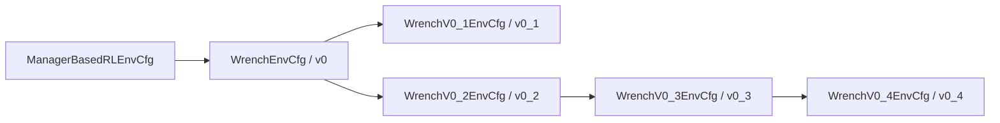

# Wrench v0 계열 상세 명세

2026-11-05 현재 코드 기준. 대상은 **`Inspire-Wrench-v0`, `v0_1`, `v0_2`, `v0_3`, `v0_4`**다. 공통 환경 전체와 파생 버전의 최종 차이를 함께 설명한다. 실제 실행에 Hydra override가 있으면 실행 시 저장된 설정이 우선한다.

모든 v0 계열은 **상대 pose를 입력받는 OSC**를 사용한다. `Wrench-v1/v2`의 Desired Wrench 제어는 이 문서의 대상이 아니다. v0_3/v0_4의 토크 정규화는 보상 계산을 바꾼 것이며 정책 행동을 Desired Wrench 명령으로 바꾼 것이 아니다.

[환경 구성 코드](../../../../src/inspire_sweep_baseline/inspire_sweep_baseline/envs/wrench_envs.py) · [등록 코드](../../../../src/inspire_sweep_baseline/inspire_sweep_baseline/__init__.py) · [문서 작성·대조 기록](../logs/2026-11-05_wrench_v0_family_documentation.md)

## 목차

1. [과업과 버전 관계](#1-과업과-버전-관계)
2. [시간·좌표·로봇](#2-시간좌표로봇)
3. [형상·물성·배치와 reset](#3-형상물성배치와-reset)
4. [관측과 네트워크 입력](#4-관측과-네트워크-입력)
5. [행동·OSC와 action-rate](#5-행동osc와-action-rate)
6. [전체 보상 구성](#6-전체-보상-구성)
7. [거리·접촉·Hold·진입의 상세 동작](#7-거리접촉hold진입의-상세-동작)
8. [커리큘럼의 정확한 일정](#8-커리큘럼의-정확한-일정)
9. [종료와 경계값](#9-종료와-경계값)
10. [상태 수명과 실행 순서](#10-상태-수명과-실행-순서)
11. [PPO·실행·로그 해석](#11-ppo실행로그-해석)
12. [검증 범위와 코드 위치](#12-검증-범위와-코드-위치)

## 1. 과업과 버전 관계

선반의 장애물 사이에서 Inspire Hand로 타겟을 목표 XY 위치까지 밀고 정지 상태를 유지한다. Actor는 초기 장면 정보, 현재 관절·EEF, 촉각과 보정 F/T를 사용한다. Critic과 보상은 현재 물체의 시뮬레이터 상태를 사용할 수 있다. 따라서 Actor가 현재 타겟 위치를 직접 관측하는 GT 정책과 구별된다.



**v0_2는 v0_1을 상속하지 않는다.** v0_1의 고정40°·짧은 목표 거리·연속 접촉 조건이 v0_2 이후에 전달되지 않는다. v0는 Revision-Test-v2의 동작을 기준으로 구성한 독립 EnvCfg이며, 기존 Revision/Final/Holding의 EnvCfg·runtime을 상속하지 않는다. 계산 함수·자산 spawner·`RevisionGoalCommand`·`RevisionModel`은 재사용한다.

| 버전 | Gym ID | EnvCfg 직접 부모 | PPO class / experiment_name |
| --- | --- | --- | --- |
| v0 | `Inspire-Wrench-v0` | `ManagerBasedRLEnvCfg` | `WrenchPPORunnerCfg` / `inspire_wrench_v0` |
| v0_1 | `Inspire-Wrench-v0_1` | `WrenchEnvCfg` | `WrenchV0_1PPORunnerCfg` / `inspire_wrench_v0_1` |
| v0_2 | `Inspire-Wrench-v0_2` | `WrenchEnvCfg` | `WrenchV0_2PPORunnerCfg` / `inspire_wrench_v0_2` |
| v0_3 | `Inspire-Wrench-v0_3` | `WrenchV0_2EnvCfg` | `WrenchV0_3PPORunnerCfg` / `inspire_wrench_v0_3` |
| v0_4 | `Inspire-Wrench-v0_4` | `WrenchV0_3EnvCfg` | `WrenchV0_4PPORunnerCfg` / `inspire_wrench_v0_4` |

공통 runtime은 `inspire_sweep_baseline.runtime.wrench:WrenchEnv`다. PPO도 EnvCfg와 같은 버전 관계로 설정을 상속하고 실험명만 바꾼다.

### 1.1 최종 차이표

| 항목 | v0 | v0_1 | v0_2 | v0_3 | v0_4 |
| --- | --- | --- | --- | --- | --- |
| 목표 거리 보상 | 지수 근접도 | 지수×cosine×연속 접촉 | 지수×cosine | v0_2 동일 | 에피소드 최단 거리 개선량 |
| 거리 보상 weight | 3.7 | 3.7 | 3.7 | 3.7 | 3.7 |
| 독립 접촉 보상 | 즉시 접촉, weight1.45 | 삭제 | 2-of-3 누적, weight0.1 | v0_2 동일 | v0_2 동일 |
| EEF 높이 상한 | 12cm 미만 | 12cm 미만 | 12cm 미만 | 14cm 미만 | 14cm 미만 |
| Arm action-rate 대상 | raw 정책 입력 | 동일 | 동일 | 정규화 OSC 출력 토크 | 동일 |
| 최초 진입 무감쇠 속력 | 1cm/s | 1cm/s | 1cm/s | 4cm/s | 4cm/s |
| 타겟 속도 비용 free_speed | 0.1→0.02m/s | 동일 | 동일 | 0.02m/s 고정 | 동일 |
| 장애물 요청 | Gray3/White3→4/5 | 동일 | −1/−1 기준 일정 + ±1 clamp | 각 색 독립0–4 균등 | 동일 |
| 목표 방향 제외 반각 | 30°→0° | 40° 고정 | 30°→0° | 30°→0° | 30°→0° |
| 목표 거리 허용 범위 | 5–15cm | 4–7.5cm | 5–15cm | 5–15cm | 5–15cm |
| startup bank 단계 수 | 9 | 4 | 75 | 175 | 175 |
| 활성 Reward / Curriculum 수 | 15 / 3 | 14 / 2 | 15 / 3 | 15 / 1 | 15 / 1 |

현재 코드의 v0_2·v0_3·v0_4 접촉 weight는 **0.1**이다. 과거 인계와 v0_2 설명의1.45·step당0.29는 현재 코드와 다르다. 현재는 카운트10·dt0.02에서 최대 **0.02/step**이다. 이 문서는 설명을 정정하며 환경 코드를 변경하지 않는다.

## 2. 시간·좌표·로봇

| 항목 | 공통 기본값 |
| --- | --- |
| 병렬 환경 / 환경 간격 | 2048 / 2.5m |
| 물리 dt / decimation | 0.01s / 2 |
| 정책·보상 dt | 0.02s, 50Hz |
| 최대 에피소드 길이 | 10s, 500 policy steps |
| 물리 물체 | 타겟1 + 장애물 후보9 = 10개 |
| 물리 배치 용량 | Gray4, White5 |
| 장애물 관측 슬롯 | 16개, 물리 물체 수와 별도 |
| 선반 위치 / 질량 | env 원점 기준 (−0.7,0,0)m / 100kg |
| 작업면 | shelf-local Z=1.05m, XY 반폭 (0.20,0.50)m |
| robot root 초기 위치 / quaternion | (0,0,0.79505)m / (0,0,0,1), wxyz 순서 |
| Arm 초기 각도 | (0,−2.2,2.2,0,1.57,0.785)rad |
| Arm effort 한도 | (150,150,150,28,28,28)Nm, 관절 이름 순서 |
| Arm simulator 속도 한도 | (2,2,2,4,4,4)rad/s |
| Arm actuator stiffness / damping | 0 / 0, OSC가 effort 지정 |
| Hand effort / 속도 한도 | 0.20Nm / 1rad/s |
| Hand stiffness / damping / armature | 1.2 / 0.06 / 0.0001 |

EEF는 `axia80_link`에서 sensor-local +Z142.7mm의 가상 프레임이다. OSC 제어점과 EEF 관측은 이 offset을 포함한다. `wrist_frame`과 `finger_frame`은 별도 프레임이므로 EEF 높이를 wrist clearance로 해석하면 안 된다.

| 계산 | 좌표·단위 |
| --- | --- |
| 타겟–목표 거리 | world XY, m |
| 타겟 속력 | world 선속도3D norm, m/s |
| Actor/Critic 위치 관측 | robot-root 기준, m |
| 배치·물체 바닥 판정 | shelf-local, 실제 scale·회전 반영 bbox |
| 보상용 EEF 높이 | world Z − 초기 선반 root Z − 1.05m |
| 보정 F/T 관측 | EEF 원점·EEF 축, N / Nm |

높이 상한은 현재 물체 상단이나 움직인 선반을 따라가지 않는다. 초기 선반 위치를 기준으로 고정한다. 성공은 XY 거리와3D 선속력으로 판정하며 별도 EEF 높이 조건은 없다.

Scene은 `replicate_physics=False`다. PhysX 설정은 bounce threshold0.2, friction correlation distance0.00625, found/lost aggregate pairs `2**25`, total aggregate pairs `16*1024*16`, max rigid patches `5*2**17`이다. 대규모 GPU 실행 성능은 이 설정값만으로 입증되지 않는다.

## 3. 형상·물성·배치와 reset

근거: [Scene](../../../../src/inspire_sweep_baseline/inspire_sweep_baseline/assets/scenes/wrench.py), [spawner](../../../../src/inspire_sweep_baseline/inspire_sweep_baseline/assets/revision_spawners.py), [배치 bank](../../../../src/inspire_sweep_baseline/inspire_sweep_baseline/mdp/common/wrench_layout.py), [reset](../../../../src/inspire_sweep_baseline/inspire_sweep_baseline/mdp/event_functions/wrench.py).

### 3.1 형상·크기는 생성 시 고정

타겟은 슬롯0 `mass_cylinder`의 원통이다. 기준 반지름4cm·높이10cm에 등방 scale U(0.9,1.1)을 적용하므로 반지름3.6–4.4cm, 높이9–11cm다. 각 장애물 슬롯은 다음8종에서 생성 시 균등 선택하고 별도 U(0.9,1.1) scale을 적용한다.

| 종류 | 기준 형상 |
| --- | --- |
| cylinder | 반지름0.04m, 높이0.10m |
| cube, mug, bottle | 생성 기준 치수(0.06,0.08,0.10)m; 배치에는 각 mesh의 실제 bbox 사용 |
| `003_cracker_box`, `004_sugar_box` | NVIDIA YCB Axis_Aligned, 기준 size_fraction0.9 |
| `005_tomato_soup_can`, `002_master_chef_can` | NVIDIA YCB Axis_Aligned, 기준 size_fraction0.9 |

시각 형상과 collider에 같은 scale을 적용한다. 각 환경·슬롯의 종류와 scale은 reset 때 다시 뽑지 않는다. 16개 관측 슬롯 때문에 물체16개를 생성하는 구조도 아니다.

### 3.2 물성은 startup에 한 번 샘플링

환경당 질량 샘플 하나를 타겟과 모든 장애물에 공통 적용한다.

```math
m=1.5\,\mathrm{clip}\left(\mathcal{N}(0.365,0.0675^2),0.230,0.500\right)\;\mathrm{kg}.
```

최종 범위0.345–0.750kg, 분포 중심0.5475kg다. 관성은 형상별 원래 inertia/mass 비율을 유지해 조정한다. 물체별 독립 질량 랜덤화가 아니다.

마찰은 역할별4096개 Gaussian quantile bucket에서 샘플링하며 음수는0으로 제한한다. 같은 환경의 같은 역할 collider는 같은 샘플을 공유한다.

| 역할 | 정지마찰 평균 / 표준편차 | 동마찰 평균 / 표준편차 |
| --- | --- | --- |
| Floor | 0.315 / 0.051 | 0.252 / 0.041 |
| Object | 0.315 / 0.040 | 0.252 / 0.032 |
| Tool/Hand | 0.585 / 0.145 | 0.468 / 0.116 |

근거는 [물성 분포](../../../../src/inspire_sweep_baseline/inspire_sweep_baseline/mdp/common/realistic_physics.py)와 `WrenchEventsCfg.object_physics_randomization.mode='startup'`다. 함수 이름에 episode가 포함되어 있어도 이 계열에서는 매 reset 물성을 바꾸지 않는다.

### 3.3 타겟·목표 샘플링

타겟 XY는 선반 중심 반지름2cm 원판에서 면적 균등 추출한다. 목표 방향은 shelf-local ±X 주변의 제외 반각을 뺀 두 각도 구간에서 추출한다. 실제 타겟 footprint, 가장자리 여유2cm, root 위치 제한을 고려해 가능한 ray 길이를 계산하고 목표 거리 상한으로 제한한다.

v0_1은 최소4cm·상한7.5cm, 나머지는 최소5cm·상한15cm다. **해당 구간에서 길이를 균등 추출하는 방식은 아니다.** 32개 방향 후보 중 최소 길이를 만족하는 첫 후보를 사용하며 ±Y fallback을 둔다. 구체식은 [sample_revision_commands](../../../../src/inspire_sweep_baseline/inspire_sweep_baseline/mdp/common/revision_layout.py)에 있다.

`target_goal_pos` Command는 world 목표 XYZ와 초기 타겟 quaternion을 합친7D다. 목표는 초기 타겟 위치에 배치에서 정한 변위를 더해 고정한다. `resampling_time_range=(1e6,1e6)`이고 중간 update는 비어 있어10초 에피소드 도중 목표를 바꾸지 않는다. 목표 시각화 반경은3cm다.

### 3.4 RED·Gray·White와 bank

OBB 배치는 실제 scale과 yaw를 반영한 footprint를 사용한다. 최소 물체 간격20mm, board wall margin5mm, 후보32개·restart4회·pass2회를 사용한다.

- RED는 타겟 시작→목표 swept footprint와 손목 진입 영역을 포함하는 배치 금지 영역이다. `red_margin=0.023m`다.
- Gray는 RED 외곽 padding65mm 영역과 타겟 후방160×220mm 사각형을 포함하며 RED는 제외한다. 후방 사각형은 반대 진행 방향으로20mm 후퇴한다.
- White는 RED·Gray 바깥의 허용 영역에 배치한다.

Gray 후보는 OBB가 Gray와 일부 교차하는 조건이며 전체 OBB가 Gray 내부에 있을 필요는 없다. 실제 타겟 shelf yaw는0이다. 배치에 실패하면 가능한 최대 개수 결과를 보존한다. 따라서 **균등한 것은 요청 개수이고, 실제 배치 개수의 균등분포는 보장하지 않는다.**

| 버전 | bank 단계 | 단계당 환경별 후보 | 한 환경에 저장하는 후보 총수 |
| --- | ---: | ---: | ---: |
| v0 | 9 | 16 | 144 |
| v0_1 | 4 | 16 | 64 |
| v0_2 | 75 | 16 | 1200 |
| v0_3 / v0_4 | 175 | 16 | 2800 |

bank는 startup에 실제 환경별 형상으로 만든다. `layout_build_batch_size=256`이며 reset에서는 현재 각도·개수 조합의16개 후보 중 하나를 복원추출한다. step 중 OBB 재검색은 없다. v0_3/v0_4는 각도7개마다 개수25쌍이 모두 가능하므로175단계가 필요하다. 부모 대비 startup 생성량·메모리는 늘어나며 실제2048환경 GPU 비용은 미검증이다.

활성 물체의 root Z는 `1.05 − scaled_bounds_min_z`로 설정한다. 비활성 후보는 shelf-local Z=`50+2*slot`m에 주차하고 중력을 끄며 활성 mask에서 제외한다. 물리 body 자체를 삭제하지 않는다. v0_3/v0_4에서도 Gray4/White5 용량과 총10개 물체를 보존하며 요청만 색별 최대4로 제한한다.

### 3.5 Event와 reset 계약

| term | mode | 역할 |
| --- | --- | --- |
| `object_geometry` | prestartup | geometry metadata·scaled bounds 준비 |
| `layout_bank` | startup | 해당 버전 모든 각도·개수 조합의 bank 생성 |
| `reset_all` | reset | robot·shelf 등 기본 scene 상태 복원 |
| `object_spawn` | reset | count 결정, bank 복원, pose·속도·gravity·mask·초기 장애물 관측 갱신 |
| `object_materials` | startup | 물리 material buffer 준비 |
| `object_physics_randomization` | startup | 질량·관성·역할별 마찰 샘플링 |

v0/v0_1은 `reset_wrench_scene`, v0_2는 `reset_wrench_feasibility_scene`, v0_3/v0_4는 `reset_wrench_uniform_scene`을 사용한다. 뒤의 두 함수도 count별로 묶어 같은 기본 reset을 호출한다. 부분 reset은 선택 환경만 바꾸며 형상·물성·startup bank는 유지한다. `reset(seed=...)`는 배치 선택 RNG를 재설정하지만 기존 bank를 다시 생성하지 않는다.

## 4. 관측과 네트워크 입력

모든 v0 계열의 관측은 동일하다. 근거는 [WrenchObservationsCfg](../../../../src/inspire_sweep_baseline/inspire_sweep_baseline/mdp/observations/wrench.py)다.

### 4.1 policy 그룹57D

| 인덱스 | term | 차원 | 의미·갱신·noise |
| --- | --- | ---: | --- |
| [0:6] | `joint_pos` | 6 | 현재 Arm 각도rad, default pose 차감 없음 |
| [6:12] | `joint_vel` | 6 | 현재 Arm 각속도rad/s |
| [12:14] | `hand_configuration` | 2 | 실제12관절에서 역산한 flexion/opposition, [0,1] |
| [14:21] | `ee_pose` | 7 | 현재 EEF root-frame XYZ+quaternion(wxyz) |
| [21:24] | `target_obs_state` | 3 | 초기 타겟 root XYZ, episode당 축별±1cm 균등 bias |
| [24:26] | `goal_pos` | 2 | 초기 타겟→목표 root 변위의 거리·각도 |
| [26:34] | `actions` | 8 | `tanh(action_manager.action)`, 다음 정책 호출에서 직전 실행 명령 |
| [34:51] | `tactile` | 17 | threshold0.01N 접촉 bit, bit별1% 반전 noise |
| [51:57] | `wrist_wrench` | 6 | EEF 보정 F/T; force σ0.05N, moment σ0.005Nm Gaussian noise |

목표 각도는 `atan2(-dy,dx) mod 2π`다. 초기 타겟 bias는 매 관측 jitter가 아니라 reset 때 뽑아 유지하는 값이다. `hand_configuration`은 명령값이 아니라 실제 관절 상태에서 계산한다. 이전 행동 관측의 tanh는 관측만 제한하며 실행 action이나 페널티용 raw action을 바꾸지 않는다.

F/T는 downstream Hand의 중력·관성 support를 제거한 값이며 EEF 원점과 축으로 표현한다. 촉각17bit, 객체별 Hand 접촉 합력, F/T6D는 서로 다른 신호다. 접촉 보상은 객체별 `force_matrix_w`에서 타겟을 선택하고 **normal contact 벡터를 먼저 합친 뒤 norm**을 취한다. 접선 마찰이나 접촉별 norm의 합이 아니므로 반대 방향 힘은 상쇄될 수 있다.

### 4.2 장애물·Critic 입력

각 장애물 슬롯은 `[presence,x,y,z]`이며16×4=64D다. 비보고 슬롯은0으로 채운다.

| 항목 | Actor `obstacles` | Critic `critic_obstacles` |
| --- | --- | --- |
| 위치 갱신 | reset 초기값을 고정 | 매 관측 현재 위치 |
| 대상 | 초기 가시성에 의해 보고된 활성 장애물 | 실제 활성 장애물 전부 |
| 좌표 | robot root | robot root |
| 좌표 noise | reset 때 축별±1cm 균등 | 없음 |
| 가시성 | footprint 기반 occlusion, threshold0.35 | 필터 없음 |
| visibility 오류 | 실제 활성 장애물에만1% flip | 없음 |
| 순서 | root Y 내림차순 후 인접 쌍10% swap, reset 때 | 같은 정렬·swap을 매 관측 |

가시성 반전으로 비활성 주차 물체를 새로 보고하지 않는다. 활성 장애물이 이동·낙하하면 reset 전까지 Critic 현재 관측 대상에 남는다. Critic의 swap은 좌표 noise는 아니지만 배열 순서를 확률적으로 바꾼다.

| 입력 | 원시 차원 | 장애물 encoder 후 MLP 입력 |
| --- | ---: | ---: |
| Actor: policy + 초기 obstacles | 57+64=121 | 57+16=73 |
| Critic: policy + 현재 target XYZ + 현재 obstacles | 57+3+64=124 | 57+3+16=76 |

Critic은 policy 그룹을 공유하므로 전체 입력이 noise-free인 것은 아니다. 추가 privileged 타겟 위치와 현재 장애물 좌표가 noise-free다. Actor·Critic의 장애물 encoder는 각각 별도 학습되며64→32(ReLU)→16 구조다.

## 5. 행동·OSC와 action-rate

### 5.1 모든 버전의 실행 행동

행동은 Arm6D + Hand2D다. Arm은 상대 XYZ에0.03m, 상대 RPY에0.15rad를 곱하고 RPY→quaternion→axis-angle로 변환해 pose OSC에 전달한다. 기본 Arm clamp는 따로 지정하지 않으므로0.03m를 하드 최대 변위로 해석하면 안 된다. task frame이 따로 없으므로 robot base 기준 상대 pose다.

| OSC 설정 | 공통값 |
| --- | --- |
| class | `UR10OperationalSpaceControllerAction` |
| target_types / impedance | `pose_rel` / fixed |
| motion axes / wrench axes | (1,1,1,1,1,1) / (0,0,0,0,0,0) |
| stiffness | (100,100,100,50,50,50) |
| damping ratio | (1,1,1,1,1,1) |
| inertial decoupling / partial | True / False |
| gravity / nullspace | True / none |
| effort_limit_scale / minimum_effort_limit | 1.0 / 1e−6 |
| saturation_tolerance | 1e−6 |

물리 substep마다 동역학·Jacobian·EEF 상태를 갱신하고 토크를 계산한다. 비유한 effort가 있는 행은0으로 대체하고 관절별 한도로 clamp한 후 actuator에 제출한다. Hand 첫 채널은 flexion, 두 번째는 thumb opposition이다. 실행 시 [0,1]로 clamp하고 `closed + openness*(open−closed)`로12관절 목표를 만든다. 0은 닫힘,1은 열림이다.

### 5.2 v0·v0_1·v0_2의 페널티

raw 정책 입력을 $a_t$라 두면 함수 반환값은 다음과 같다.

```math
c_t=0.03\min\left(100,\|a^{arm}_t-a^{arm}_{t-1}\|_2^2\right)
   +0.03\min\left(100,\|a^{hand}_t-a^{hand}_{t-1}\|_2^2\right).
```

최종 step 보상은 `−c_t * dt`다. 위치·회전 scale을 곱하기 전 정책 값이며, dt로 나눈 변화율이 아니다. Hand도 실행 clamp 전 ActionManager의 raw2D 차이를 사용한다.

### 5.3 v0_3·v0_4의 페널티

Arm만 실제 OSC 최종 출력 토크를 정규화한 값으로 바꾼다.

```math
L_j=\max(\mathrm{joint\_effort\_limit}_j\,\mathrm{effort\_limit\_scale},10^{-6}),\qquad
u_{t,j}=\mathrm{clip}(\tau_{t,j}/L_j,-1,1).
```

```math
c_t=0.03\min\left(100,\|u_t-u_{t-1}\|_2^2\right)
   +0.03\min\left(100,\|a^{hand}_t-a^{hand}_{t-1}\|_2^2\right).
```

현재 기본 한도는 앞3관절150Nm, 뒤3관절28Nm다. 코드는 이 수치를 하드코딩하지 않고 실제 asset의 선택 관절 한도를 읽는다. 마지막 물리 substep의 출력을 제어 step끼리 비교하며 substep 간 변화를 합산하지 않는다. reset 후 첫 Arm 기준값은0이고, 부분 reset은 선택 환경 이력만 지운다. 동일 제어 step 재호출은 cached 값을 반환한다.

**Hand는 기존 raw 변화량 계산 그대로다.** 실행 명령의 유효 범위가 [0,1]이어도 정책 raw 출력 자체에 그 범위가 강제되는 것은 아니다. 이 페널티에서 Hand를 새로 clamp하거나 tanh하지 않는다.

| Arm 부분만 비교, dt=0.02 | 기존 | v0_3/v0_4 |
| --- | ---: | ---: |
| 제곱합 상한 | cap100 | 6축×최대변화2²=24 |
| 계수 적용 후 raw 비용 상한 | 3.0 | 0.72 |
| step 보상 최대 절댓값 | 0.06 | 0.0144 |

상한이 줄어도 **기대값·평균 비용이 반드시 줄어드는 것은 아니다.** 기존은 정책 입력, 새 방식은 상태에도 의존하는 OSC 토크를 비교한다. 같은 정책 입력에도 토크가 변할 수 있고, 입력이 크게 바뀌어도 포화된 토크가 같을 수 있다. 평균 비교에는 같은 조건의 rollout 측정이 필요하다.

## 6. 전체 보상 구성

근거는 [보상 Cfg](../../../../src/inspire_sweep_baseline/inspire_sweep_baseline/mdp/rewards/wrench.py)다. 일반 step 보상은 `weight × 함수 반환값 × dt`다. Reaching·최초 진입·성공·v0_4 거리 개선량은 함수에서 dt를 나눠 시간 적분을 상쇄한다. Shelf는 이벤트/연속 비용이 섞여 있다.

아래에서 $d$는 타겟–목표 XY 거리, $v$는 타겟3D 선속력, 공통 초과 비용은 다음과 같다. 실제 구현은 overflow 전에 지수를 제한한다.

```math
E(x,b)=\min\left(100,\frac{\exp(2\max(x-b,0))-1}{2}\right).
```

| 순서·term | weight | 함수·raw 의미 | 버전 차이 |
| --- | ---: | --- | --- |
| 1 `target_reaching` | 30 | `DexReachProgress`: EEF–현재 타겟3D 거리에서10cm를 뺀 양수부의 역대 최소 개선량/dt | 없음 |
| 2 `target_goal_distance` | 3.7 | v0 `goal_distance_v2`: 높이 조건을 둔 `exp(−d/0.05)` | 7절 |
| 3 `target_goal_hold` | 10 | `goal_hold_v2`: 2.5–3.5cm Smoothstep, 유효 상태·높이 조건 | 높이12→14cm |
| 4 `target_contact` | 1.45 또는0.1 | v0 `target_contact_below_height`; v0_2 이후 `WrenchV0_2ContactMaintenance` | v0_1 삭제; v0_2 이후0.1 |
| 5 `robot_action_rate_penalty` | −1 | `action_rate_penalty` 또는 `WrenchV0_3ActionRatePenalty` | 5절 |
| 6 `robot_joint_velocity_penalty` | −1 | `joint_velocity_penalty`: Arm0.03×관절속도 제곱합 cap100 + Hand0.01×제곱합 cap100 | 없음 |
| 7 `object_tilt_penalty` | −30 | `active_object_tilt_cost`: 활성 물체별 `clip((angle−5°)/(0.9rad−5°),0,1)²` 합 | 없음 |
| 8 `obstacle_displacement_penalty` | −150 | `active_obstacle_displacement_cost`: 활성 비타겟의 초기 대비3D 변위 제곱합, 합계 cap0.04 | 없음 |
| 9 `object_acceleration_penalty` | −0.05 | `ObjectAccelerationPenalty`: 활성 물체별 `E(COM 선가속도 norm,15)` 합 | 없음 |
| 10 `shelf_penalty` | −1 | `ShelfPenalty`: `3×collision/dt + 0.5×연속 비용` | 없음 |
| 11 `obstacle_contact_penalty` | −0.05 | `obstacle_contact_force_cost`: 활성 비타겟–Hand 합력에 `E(norm,50)` | 없음 |
| 12 `target_goal_first_entry_bonus` | 25 | `FirstGoalEntryBonusV2`: 최초3cm 내부 진입 때 속도 감쇠/dt | 무감쇠1→4cm/s |
| 13 `target_goal_success_bonus` | 75 | `settled_success_bonus`: 성공 termination/dt | 없음 |
| 14 `wrist_wrench_change_penalty` | −0.1 | `IndependentWrenchMagnitudeChangePenalty`: F/T 크기 변화 기반0–1 비용 | 없음 |
| 15 `target_speed_penalty` | −5 | `exponential_pushing_speed_cost_limit`: `E(v,free_speed)` | 커리큘럼→0.02 고정 |

v0_1은4번 term이 없어14항이다. 나머지는15항이며 term 이름·순서를 유지한다. cosine 거리 보상은 음수가 될 수 있으므로 양의 weight가 항상 양의 보상을 뜻하지 않는다.

### 6.1 객체 비용의 대상과 단위

Tilt와 가속도는 활성 타겟·장애물을 모두 평가하고 displacement는 타겟을 제외한다. 변위 cap0.04는 거리4cm가 아니라 **3D 변위 제곱합의 상한0.04m²**다. 한 장애물만 움직이면20cm에서 포화하지만 여러 장애물의 변위가 합쳐진다.

가속도는 정책 step 속도 차분이 아니라 직전 physics step의 PhysX world COM 선가속도다. 가속·감속을 같은 norm으로 평가한다. 물체별 비용 cap100을 합산하므로 전체 cap은 활성 물체 수×100이다. reset 또는 활성화 직후 첫 표본은 억제한다.

장애물 접촉 비용은 타겟을 제외한 활성 물체–Hand 접촉 벡터를 합산한 뒤 norm을 취한다. 센서가 stale이면0이다. 개별 접촉 크기를 더한 값과 다르다.

### 6.2 선반 비용

Collision은 선반6D root velocity norm>0.1 또는 wrist clearance<3cm다. 발생 step에서 이벤트−3을 지급한다. 초기 대비 선반 위치 변위>5cm만으로 실패한 경우에는 이 collision 이벤트와 동일하지 않다.

연속 비용은 `moved + near × (finger_cost + wrist_cost)`다. moved는 초기 위치와의 거리 + 6D 속도 norm이0.005를 초과할 때1이다. near는 live shelf root Z+1.06m 표면 proxy와 EEF의3D 거리가20cm 미만인 경우다. proxy 기준 높이로 두 finger의 `clip(1−height/0.02,0,1)`을 합하고 wrist의 `clip(1−height/0.08,0,1)`을 더한다. 연속 부분의 최종 보상은 `−0.5×비용×dt`다.

### 6.3 F/T 변화 비용

관측 noise를 더하기 전 EEF 보정 F/T를 읽는다. 힘·모멘트 각각의 **norm 차이의 절댓값**을 계산한다.

```math
\Delta F=\left|\|F_t\|_2-\|F_{t-1}\|_2\right|,\qquad
\Delta M=\left|\|M_t\|_2-\|M_{t-1}\|_2\right|,
```

```math
s=\mathrm{clip}\left(\max\left(\frac{\max(\Delta F-20,0)}{30},\frac{\max(\Delta M-2,0)}{3}\right),0,1\right),\qquad
c=\frac{\exp(3s)-1}{\exp(3)-1}.
```

20N·2Nm까지 무료이며50N·5Nm 변화에서 포화한다. 벡터 차이의 norm이나 초당 변화율이 아니다. 첫 유효 표본과 stale 이력은 비용을 만들지 않는다. 보상 budget 제한은 없고 raw 상한1이다. v0_3/v0_4의 OSC 토크 변화 비용과도 별도 항이다.

## 7. 거리·접촉·Hold·진입의 상세 동작

### 7.1 공통 높이 조건

EEF 높이를 $h_t=z_{EEF,t}-z_{shelf,initial}-1.05$로 정의한다. v0/v0_1/v0_2의 높이 조건 $H_t$는 $h_t<0.12$, v0_3/v0_4는 $h_t<0.14$다. 정확히 상한에 있으면 불인정한다. 거리·Hold와 실제 접촉 표본에 적용하며 최초 진입·성공에는 적용하지 않는다.

v0_2 이후의 접촉 보상은 시간 윈도우와 목표 내부 예외를 추가로 사용한다. 따라서 **현재 EEF가 높다는 이유만으로 최종 접촉 보상이 반드시0이 되지는 않는다.** 목표 내부 예외 외에도 직전 두 유효 접촉 표본이 남아 있으면 현재 raw 표본이False여도 2-of-3 윈도우가 인정될 수 있다.

### 7.2 v0: 지수 거리 근접도

```math
r^{distance}_t=3.7\,\Delta t\,H_t\exp(-d_t/0.05).
```

접촉 여부나 거리 감소 여부는 요구하지 않는다. 높이를 만족하고 같은 거리에 정지해도 계속 지급한다. 목표에서 최대0.074/step(dt0.02)이다. 거리5cm에서는 약0.0272/step이다.

### 7.3 v0_1: 연속 접촉과 signed cosine

초기·현재 타겟 위치를 $p_0,p_t$, 목표를 $g$라 두고 world XY 벡터로 계산한다.

```math
\alpha_t=\begin{cases}
1,&d_t<0.03,\\
\cos(p_0-g,p_t-g),&d_t\ge0.03.
\end{cases}
```

```math
r^{distance}_t=3.7\,\Delta t\,H_t\,C_{t-1}C_t\,\alpha_t\exp(-d_t/0.05).
```

$C_t$는 fresh·finite 타겟–Hand 합력 norm≥0.01N인 표본이다. **서로 인접한 두 제어 step에서 모두 실제 접촉**이어야 하며 현재 step은 높이도 만족해야 한다. 이전 step의 접촉 기록 자체에는 높이 조건을 넣지 않는다. 호출이 건너뛰면 연속 접촉으로 인정하지 않는다.

3cm 미만에서는 alpha만1로 바뀌고 접촉 조건은 계속 필요하다. 목표 반대편3cm 이상에서 cosine이 음수이면 거리 보상도 음수다. 정확히3cm에는 cosine을 적용한다. 첫 표본은 단독으로 보상을 만들지 않으며 부분 reset은 선택 환경 이력을 지운다. 독립 `target_contact` term은 없다.

### 7.4 v0_2·v0_3: 접촉 조건 없는 signed cosine

동일한 alpha를 사용하되 연속 접촉 조건을 제거한다.

```math
r^{distance}_t=3.7\,\Delta t\,H_t\,\alpha_t\exp(-d_t/0.05).
```

v0_2는 높이12cm, v0_3은14cm다. 그 외 거리 함수·scale0.05·weight3.7은 같다. 초기 위치는 noisy Actor 관측이 아니라 noise 없는 reset snapshot이다. 계산 결과가 비유한 경우0으로 처리한다.

### 7.5 v0_4: 에피소드 최단 거리 개선량

`WrenchV0_4GoalProgress`는 Holding v0~v4 및 대응 OSC·ObjectRandom 계열에서 사용하는 `DexPlanarGoalProgress`를 상속한다. `position_tolerance=0.0`으로 목표 중심까지의 개선을 계산한다.

```math
b_t=\min(d_0,d_1,\ldots,d_t),\qquad
r^{distance}_t=3.7\,(b_{t-1}-b_t)H_t.
```

함수는 개선량/dt를 반환하고 RewardManager가 dt를 곱하므로 최종 식에는 dt가 남지 않는다. 초기 거리로 나눈 비율이 아니라 **미터 단위 개선량**이다. cosine·접촉·지수 근접도는 사용하지 않는다. 부모 weight3.7을 보존했으며 Holding의 다른 계수를 가져오지 않았다.

| 거리 변화 예 | 최단 거리 변화 | 거리 보상, 높이 만족 시 |
| --- | --- | ---: |
| 10→8cm | 10→8cm | 3.7×0.02=0.074 |
| 8→9cm | 8cm 유지 | 0 |
| 9→8cm | 8cm 유지 | 0 |
| 8→7cm | 8→7cm | 3.7×0.01=0.037 |
| 7cm에서 정지 | 7cm 유지 | 0 |

높이가 상한 이상인 step에도 최단 기록은 갱신하고 지급만0으로 만든다. 이후 EEF를 낮추는 것만으로 그 개선량을 받지 않는다. reset에서 타겟 위치를 저장한 뒤 첫 평가 때 새 goal을 사용하므로 첫 행동 개선량을 포함한다. 부분 reset은 선택 환경의 기록만 초기화한다.

**해석:** 높이 조건을 항상 만족하고 초기 거리10cm에서 목표 중심까지 도달하면 에피소드 거리 보상 총합은 최대0.37이다. v0_3의 거리 보상은 같은 거리에 머무는 시간에도 누적되므로 두 보상은 같은 weight라도 규모와 목적이 다르다. 이는 식으로부터의 결과이며 학습 성능 우열을 뜻하지 않는다.

### 7.6 접촉 보상

v0는 현재 실제 접촉 표본이 fresh·finite, 합력≥0.01N, EEF<12cm이면 raw1을 반환한다. weight1.45·dt0.02에서0.029/step이다. 목표 점유만으로는 지급하지 않는다. v0_1에는 이 독립 항이 없다.

v0_2·v0_3·v0_4는 다음 순서로 계산한다.

1. 실제 접촉 표본은 공통 함수 `target_contact_below_height`로 계산한다. v0_2는12cm, v0_3/v0_4는14cm다.
2. $I_t=[d_t<0.03]$이면 힘·freshness·높이와 무관하게 raw 접촉 표본으로 취급한다.
3. 현재 포함3개 표본에서2개 이상 접촉이면 인정한다. 목표 내부 $I_t$는 이력 없이 즉시 인정한다.
4. 인정하면 누적 count에1을 더하고 최대10으로 제한하며 연속 불인정 수를0으로 만든다.
5. 불인정이면 보상0, 연속 불인정 수+1이다. 1–4회에는 count를 보존하고5회째에0으로 초기화한다.

최종 보상은 **`0.1 × count × dt`**, 기본 dt에서 count1일 때0.002, count10일 때0.02다. 기준은 원시 무접촉5회가 아니라 **2-of-3 판정의 연속 불인정5회**다. 목표 내부에 계속 있으면 실제 힘이 없어도10까지 증가한다.

부분 reset은 해당 환경의 윈도우·count·불인정 수·cache를 지운다. 같은 step 재호출은 count를 늘리지 않는다. 평가 step이 건너뛰거나 되감기면 전체 이력을 지우고 새 표본으로 시작한다. 임시 진단 print는 전체 주석 처리되어 있다.

### 7.7 Hold

모든 버전에서 다음 Smoothstep을 사용한다.

```math
u=\mathrm{clip}\left(\frac{d-0.025}{0.010},0,1\right),\qquad
r^{hold}_t=10\,\Delta t\,H_tV_t(1-3u^2+2u^3).
```

2.5cm 이내 최대0.2/step, 정확히3cm에서0.1/step, 3.5cm 이상0이다. 속도 감쇠는 없지만 상태 유효성 $V_t$는 필요하다.

유효 조건은 활성 타겟, 유한 위치·속도·goal·기울기·바닥, 현재 shelf-local root |X|≤0.16m·|Y|≤0.46m, bbox 바닥1.04–1.07m, 현재 선반 상방 대비 기울기≤0.9rad다. 실제 scaled bbox의8개 꼭짓점을 변환해 바닥을 계산한다. 정확히0.9rad에서는 Hold의 기하 조건은 허용하더라도 종료 조건은 실패다.

### 7.8 최초 진입과 성공 보너스

최초로 **`d<0.03m`**인 표본에서 다음을 한 번 지급한다.

```math
r^{entry}=25\exp\left[-\left(\frac{\max(v-v_{free},0)}{0.02}\right)^2\right].
```

| 버전 | $v_{free}$ | 감쇠 scale | 높이 gate |
| --- | ---: | ---: | --- |
| v0/v0_1/v0_2 | 0.01m/s | 0.02m/s | 없음 |
| v0_3/v0_4 | 0.04m/s | 0.02m/s | 없음 |

v0_3/v0_4는4cm/s까지+25, 6cm/s에서약+9.197이다. 최초 진입 때 지급액이 거의0이어도 진입 기회는 소진되며 재진입으로 다시 받을 수 없다. 실패 termination과 같은 step에 진입해도 별도 실패 억제 조건은 없다.

성공 보너스+75는 모든 버전에서 **3cm 이내·0.005m/s 이하를 연속3초** 만족하여 성공 termination이 발생했을 때 지급한다. 최초 진입+25, Hold, 성공+75는 서로 다른 항이다. 성공 판단은 선행 실패와 동시 발생하면 억제된다.

## 8. 커리큘럼의 정확한 일정

기준은 PPO learning iteration이다. step 수나 episode 수가 아니다. `CurriculumOnPolicyRunner`가 `set_learning_iteration()`을 통해 값을 전달한다. reset event의 변경은 다음 reset부터 적용되고 보상 params 변경은 이후 계산에 적용된다.

### 8.1 방향: v0·v0_2·v0_3·v0_4

| iteration | ±X 제외 반각 |
| --- | ---: |
| 0–9999 | 30° |
| 10000–12999 | 25° |
| 13000–15999 | 20° |
| 16000–18999 | 15° |
| 19000–21999 | 10° |
| 22000–24999 | 5° |
| 25000 이후 | 0° |

v0_1은 이 term을 비활성화하고40°를 고정한다. Gray padding65mm나 목표 성공 반경3cm를 변경하는 일정은 없다.

### 8.2 장애물: v0·v0_1

| iteration | Gray | White |
| --- | ---: | ---: |
| 0–9999 | 3 | 3 |
| 10000–11999 | 3 | 4 |
| 12000–13999 | 4 | 4 |
| 14000 이후 | 4 | 5 |

White는10000부터4000간격, Gray는12000부터4000간격으로 증가하되4/5 상한으로 제한한다. v0_1은 각도40° 고정 상태에서 같은 네 개수 단계를 사용한다.

### 8.3 장애물: v0_2

아래는 랜덤화 전 기준 개수다.

| iteration 시작 | Gray 기준 | White 기준 |
| --- | ---: | ---: |
| 0 | −1 | −1 |
| 2000 | −1 | 0 |
| 5000 | 0 | 0 |
| 8000 | 0 | 1 |
| 11000 | 1 | 1 |
| 14000 | 1 | 2 |
| 17000 | 2 | 2 |
| 20000 | 2 | 3 |
| 23000 | 3 | 3 |
| 26000 | 3 | 4 |
| 29000 | 4 | 4 |
| 32000 이후 | 4 | 5 |

각 reset에서 색별 독립 정수−1/0/+1을 균등 추출해 기준에 더한 뒤 Gray0–4·White0–5로 clamp한다. 따라서0–1999는 항상0/0, 2000부터 White1이 가능하다. 최종 기준4/5에서는 실제 요청 Gray3/4·White4/5이고 상한 확률은각2/3이다. clamp 때문에 경계의 결과 분포는 균등하지 않다.

### 8.4 장애물: v0_3·v0_4

`obstacle_population=None`으로 해당 커리큘럼과 로그를 제거한다. 모든 iteration에서 reset마다 Gray·White 각각 독립적으로0,1,2,3,4를1/5 확률로 요청한다. 개수쌍25개는 각각1/25 확률이다. 실제 배치 실패는 기존 OBB 규칙에 따라 처리한다.

### 8.5 속도 비용: v0·v0_1·v0_2

`target_free_speed`는 `target_speed_penalty.params.free_speed`만 수정한다. 점은 `(0,0.1),(499,0.1),(500,0.09),(1900,0.02)`, 보간 간격은250이다.

| iteration | free_speed(m/s) |
| --- | ---: |
| 0–499 | 0.1000 |
| 500–749 | 0.0900 |
| 750–999 | 0.0775 |
| 1000–1249 | 0.0650 |
| 1250–1499 | 0.0525 |
| 1500–1749 | 0.0400 |
| 1750–1899 | 0.0275 |
| 1900 이후 | 0.0200 |

v0_3/v0_4는 `target_free_speed=None`이며 처음부터0.02m/s 고정이다. 이 값은 **타겟 속도 페널티의 무료 구간**이다. 최초 진입 무료 속도0.01/0.04, 성공 속도0.005, 과속 종료1.0m/s와 구별한다.

## 9. 종료와 경계값

모든 버전은 같은6개 종료 term을 같은 순서로 사용한다. 근거는 [종료 Cfg](../../../../src/inspire_sweep_baseline/inspire_sweep_baseline/mdp/terminations/wrench.py)와 [성공 타이머](../../../../src/inspire_sweep_baseline/inspire_sweep_baseline/mdp/termination_functions/wrench.py)다.

| 순서·term | 판정 | time_out |
| --- | --- | --- |
| 1 `object_fall_or_tilt` | 활성 물체 중 bbox 바닥 비유한, 현재 shelf-local 바닥<1.04m, 기울기≥0.9rad 중 하나 | False |
| 2 `target_speed` | 타겟3D 선속력>1m/s | False |
| 3 `shelf_failure` | 선반6D root velocity norm>0.1, wrist clearance<3cm, 초기 대비 선반 위치 변위>5cm 중 하나 | False |
| 4 `arm_joint_velocity` | Arm 어느 관절이든 절댓값>5rad/s | False |
| 5 `target_goal_success` | 거리≤3cm·속력≤0.005m/s 연속3초, 같은 step 선행 실패 없음 | False |
| 6 `target_goal_miss_at_timeout` | 최대 episode time에 도달했고 success 아님 | True |

선반6D 속도는 선속도3축과 각속도3축을 그대로 연결한 벡터의 norm이다. `check_fingers=False`여서 finger clearance는 shelf 실패 조건이 아니지만 연속 shelf 비용에는 들어간다. Arm actuator 속도 한도2/4rad/s와 실패 임계5rad/s는 서로 다른 설정이다.

성공 타이머는 dt0.02에서150개 연속 표본이 필요하다. 조건 이탈 또는 비유한 거리·속도는 타이머를0으로 되돌린다. 각속도 조건이나 별도 EEF 높이 조건은 없다. 성공과 timeout이 동시에 성립하면 success를 우선하며 목표 안에서 timeout이 됐다는 이유만으로+75를 지급하지 않는다.

| 경계 | 정확히 경계에서의 현재 동작 |
| --- | --- |
| 거리3cm | 성공 거리 조건은True; 최초 진입·접촉 내부 예외는False; cosine 예외도False |
| 거리2.5cm / 3.5cm | Hold는 각각 최대 / 0 |
| EEF12cm 또는14cm | 해당 버전 높이 조건False |
| 접촉 합력0.01N | 실제 접촉 힘 조건True |
| 최초 진입 free_speed와 같은 속력 | 감쇠 없음 |
| 성공 속력0.005m/s | 성공 속력 조건True |
| 기울기0.9rad | 물체 실패True |
| 물체 바닥1.04m | 낙하 실패False |
| wrist clearance3cm | 이 clearance만으로는 실패False |
| 선반 변위5cm / Arm 속력5rad/s | 해당 초과 조건False |

표는 현재 코드의 `<`, `<=`, `>`, `>=` 차이를 그대로 설명한다. 명칭이 모두 goal 관련이라고 동일 경계식으로 바꾸어 해석하지 않는다.

## 10. 상태 수명과 실행 순서

제어 step에서는 raw 행동 처리 → 두 물리 substep에서 Action 적용 → 센서·scene 갱신 → episode/common step 증가 → 종료 판정 → 보상 계산 → 종료 환경 reset → Command·관측 갱신 순서로 진행한다. 보상은 종료 상태를 읽은 뒤 reset 전에 지급한다.

reset에서는 기본 scene 상태·배치를 복원하고 manager 상태와 Command를 갱신한다. Wrench runtime은 Hand 현재/이전 raw2채널을1로 맞추고 초기 물체 위치 snapshot을 저장한다. Goal progress의 reset은 새 Command가 확정되기 전 타겟 위치를 저장하고 이후 첫 평가에서 새 goal을 적용하도록 설계되어 있다.

| 상태 | reset 동작·중복 호출 의미 |
| --- | --- |
| Reaching 최단 거리 | 선택 환경의 초기 EEF–타겟 거리로 초기화; 새 최단 개선만 지급 |
| v0_1 연속 접촉 | 이전 접촉False·cache0; 같은 step 재호출은 새 접촉 표본 아님 |
| v0_2 이후 접촉 | 3표본 윈도우·count·misses·cache 초기화 |
| v0_3 이후 Arm rate | 이전 정규화 토크0·cache0; 다음 step부터 현재 출력과 비교 |
| v0_4 목표 progress | 초기 타겟 위치 저장·최고 개선량0; 같은 거리 재평가는 새 개선 아님 |
| 최초 진입 | entered=False·cache0 |
| 성공 | 연속 표본 수0·결과False |
| 가속도·F/T 변화 | 유효 이력 초기화, 첫 표본 억제 |
| 형상·물성·bank | reset으로 재생성하지 않음 |

각 이력은 환경별 tensor로 유지하며 부분 reset은 선택 행만 초기화한다. 단, 접촉 유지 항에서 전역 step이 건너뛰거나 되감기면 연속 표본 의미를 보장할 수 없어 모든 환경의 접촉 이력을 지운다.

## 11. PPO·실행·로그 해석

### 11.1 학습 설정

공통 모델은 `RevisionModel`이며 Actor·Critic 각각 독립 장애물 encoder와 MLP를 갖는다. encoder는64→32(ReLU)→16, MLP hidden은256/128/64와 ELU다. observation normalization=False, Actor Gaussian 초기 std=1.0이다.

| 항목 | 값 |
| --- | --- |
| runner | `CurriculumOnPolicyRunner` |
| rollout | 36 steps/env, dt 기준0.72s |
| 기본2048환경 transitions/iteration | 73728 |
| max_iterations / save_interval | 90000 / 50 |
| gamma / lambda | 0.98 / 0.95 |
| learning rate / schedule | 0.001 / adaptive |
| desired KL | 0.02 |
| epochs / minibatches | 8 / 4 |
| clip / entropy coefficient | 0.2 / 0.005 |
| value loss coefficient / clipped value | 1.0 / True |
| max gradient norm | 1.0 |

버전 사이에 PPO 수치를 변경하지 않았다. 관측·행동 차원이 같아도 보상·배치 분포가 달라 checkpoint의 평가 결과를 동일 실험으로 취급할 수 없다. v0_3의 Arm 보상 변경 자체가 정책 출력 의미를 변경한 것은 아니다.

### 11.2 실행

workspace 루트에서 Isaac Lab 의존성이 있는 Python을 사용한다. 아래는 명령 안내이며 이번 문서 작업에서 실행한 학습 기록이 아니다.

```bash
python src/inspire_sweep_baseline/scripts/train.py --task Inspire-Wrench-v0 --num_envs 2048 --headless
python src/inspire_sweep_baseline/scripts/train.py --task Inspire-Wrench-v0_1 --num_envs 2048 --headless
python src/inspire_sweep_baseline/scripts/train.py --task Inspire-Wrench-v0_2 --num_envs 2048 --headless
python src/inspire_sweep_baseline/scripts/train.py --task Inspire-Wrench-v0_3 --num_envs 2048 --headless
python src/inspire_sweep_baseline/scripts/train.py --task Inspire-Wrench-v0_4 --num_envs 2048 --headless
```

```bash
python src/inspire_sweep_baseline/scripts/play.py --task Inspire-Wrench-v0_4 --num_envs 16 --checkpoint /absolute/path/to/model.pt
python src/inspire_sweep_baseline/tests/_wrench_probe.py --version v0_4 --num_envs 64 --headless --device cuda:0
```

probe는 `v0`, `v0_1`, `v0_2`, `v0_3`, `v0_4`를 지원한다. 설정 비교·부분reset·유한 관측/보상·36step collection을 검사하는 준비된 도구이며, probe 존재 자체는 물리 검증 완료를 뜻하지 않는다.

### 11.3 로그 해석

| 로그 | 의미 |
| --- | --- |
| `Episode_Reward/<term>` | 종료/reset된 환경들의 해당 에피소드 누적 보상 평균 ÷ 최대 episode 시간10초 |
| `Episode_Termination/<term>` | 해당 종료 조건 발생 집계 |
| `Curriculum/obstacle_population` | v0/v0_1 요청 수, v0_2 랜덤화 전 기준 수; v0_3/v0_4에는 없음 |
| `Curriculum/target_free_speed` | 속도 비용의 free_speed; v0_3/v0_4에는 없음 |
| `Curriculum/target_goal_direction_deadzone` | 현재 제외 반각; v0_1에는 없음 |
| `Metrics/target_goal_distance_xy_mean` | 에피소드 중 목표 거리 평균의 reset 환경 평균 |
| `Metrics/eef_linear_speed_mean` | EEF 선속력 평균 |
| `Metrics/target_linear_speed_mean` | 타겟3D 선속력 평균 |
| `Metrics/target_linear_acceleration_mean` | 타겟 COM 가속도 norm 평균 |
| `Metrics/max_force`, `Metrics/max_moment` | 에피소드별 최대 EEF 보정 힘/모멘트 norm의 reset 환경 평균 |
| `Metrics/obstacle_actual_gray`, `Metrics/obstacle_actual_white` | 이번 reset으로 실제 배치된 각 색 개수 평균 |
| `Metrics/layout_complete` | 이번 reset의 요청 개수 충족 비율 |

`Episode_Reward`는 step 보상도, 에피소드 보상 합 그 자체도 아니다. 현재 Isaac Lab [RewardManager.reset](../../../../IsaacLab/source/isaaclab/isaaclab/managers/reward_manager.py)은 실제 경과 시간 대신 **최대 episode 시간**으로 나눈다. 예를 들어 성공+75를 받은 환경만 reset되면 이 항 로그는7.5다. 조기 종료 에피소드라도 분모10초는 같다.

v0_4의 거리 항은 지속 근접 보상에서 개선량 보상으로 의미가 바뀌므로 같은 로그 이름의 크기만으로 성능을 비교하지 않는다. 성공률·최종 오차·종료 이유·접촉 상태·실제 장애물 개수를 함께 읽는다. 접촉 count 자체는 별도 metric이 아니며 해당 함수 이력 또는 추가 계측 없이 로그를 count로 직접 해석하지 않는다.

## 12. 검증 범위와 코드 위치

### 12.1 확인된 것과 미검증인 것

이 문서는 현재 코드·설정·기존 개발 로그를 대조한 문서 작업이다. 환경 실행 코드를 수정하거나 새 학습을 실행하지 않았다.

| 근거 | 확인 범위 |
| --- | --- |
| [v0 구현 기록](../logs/2026-11-04_wrench_v0_implementation.md) | 당시 CPU82개 통과·CUDA4개 skip |
| [v0_1 구현 기록](../logs/2026-11-04_wrench_v0_1_implementation.md) | 당시 CPU78개, 연속 접촉·cosine·40°·짧은 목표 거리 |
| [v0_2 구현 기록](../logs/2026-11-05_wrench_v0_2_implementation.md) | 누적 count·2-of-3·5회 초기화·상한10; 과거 weight 설명은 현재0.1과 구분 |
| [v0_3/v0_4 구현 기록](../logs/2026-11-05_wrench_v0_3_v0_4_implementation.md) | CPU103개, 기존 환경 회귀·최종 설정 대조·175개 CPU bank·토크 정규화·높이/속도 경계·거리 progress/reset |

테스트 수는 서로 중복된 회귀를 포함하므로 합산하지 않는다. 설정 검사는 official configclass와 Manager term을 사용하지만 시뮬레이터·자산 leaf에 CPU double을 사용하는 범위를 포함한다. CPU OBB bank 생성 검사는 실제 Isaac Sim 물리 rollout과 다르다.

기존 구현 시 NVIDIA 드라이버 사용 불가로 실제 GPU 초기화·2048환경 reset/collection·접촉 물리·PPO·학습 성공률은 미검증으로 기록되어 있다. 이번 문서 작성으로 그 상태가 바뀌지 않는다. 특히175개 bank의 생성 시간·메모리, 토크 변화 페널티의 실제 평균 크기, v0_4의 보상 규모 변화가 학습에 미치는 영향은 별도 실험이 필요하다.

### 12.2 수정·검토할 코드

| 항목 | 소스 |
| --- | --- |
| EnvCfg·상속·높이·bank 단계 | [envs/wrench_envs.py](../../../../src/inspire_sweep_baseline/inspire_sweep_baseline/envs/wrench_envs.py) |
| runtime·reset·metrics | [runtime/wrench.py](../../../../src/inspire_sweep_baseline/inspire_sweep_baseline/runtime/wrench.py) |
| Scene·물체 수·센서 | [assets/scenes/wrench.py](../../../../src/inspire_sweep_baseline/inspire_sweep_baseline/assets/scenes/wrench.py) |
| 관측 순서·noise | [mdp/observations/wrench.py](../../../../src/inspire_sweep_baseline/inspire_sweep_baseline/mdp/observations/wrench.py) |
| pose OSC 설정 | [mdp/actions/wrench.py](../../../../src/inspire_sweep_baseline/inspire_sweep_baseline/mdp/actions/wrench.py) |
| pose OSC 실제 출력 | [mdp/action_functions/contact_sweep_clutter_fusion_holding_osc.py](../../../../src/inspire_sweep_baseline/inspire_sweep_baseline/mdp/action_functions/contact_sweep_clutter_fusion_holding_osc.py) |
| Hand 실행 clamp·mapping | [mdp/action_functions/hand_openness.py](../../../../src/inspire_sweep_baseline/inspire_sweep_baseline/mdp/action_functions/hand_openness.py) |
| 보상 이름·weight·params | [mdp/rewards/wrench.py](../../../../src/inspire_sweep_baseline/inspire_sweep_baseline/mdp/rewards/wrench.py) |
| 버전별 거리·접촉·Arm rate | [mdp/reward_functions/wrench.py](../../../../src/inspire_sweep_baseline/inspire_sweep_baseline/mdp/reward_functions/wrench.py) |
| 높이·Hold·진입·F/T 변화 | [mdp/reward_functions/revision.py](../../../../src/inspire_sweep_baseline/inspire_sweep_baseline/mdp/reward_functions/revision.py) |
| Holding 최단 거리 계산 | [mdp/reward_functions/dex_rewards.py](../../../../src/inspire_sweep_baseline/inspire_sweep_baseline/mdp/reward_functions/dex_rewards.py) |
| Event 모드·reset 함수 | [mdp/events/wrench.py](../../../../src/inspire_sweep_baseline/inspire_sweep_baseline/mdp/events/wrench.py), [mdp/event_functions/wrench.py](../../../../src/inspire_sweep_baseline/inspire_sweep_baseline/mdp/event_functions/wrench.py) |
| 커리큘럼 설정·계산 | [mdp/curricula/wrench.py](../../../../src/inspire_sweep_baseline/inspire_sweep_baseline/mdp/curricula/wrench.py), [mdp/curriculum_functions/wrench.py](../../../../src/inspire_sweep_baseline/inspire_sweep_baseline/mdp/curriculum_functions/wrench.py) |
| 종료·성공 상태 | [mdp/terminations/wrench.py](../../../../src/inspire_sweep_baseline/inspire_sweep_baseline/mdp/terminations/wrench.py), [mdp/termination_functions/wrench.py](../../../../src/inspire_sweep_baseline/inspire_sweep_baseline/mdp/termination_functions/wrench.py) |
| PPO·실험명·모델 | [agent/wrench_ppo_cfg.py](../../../../src/inspire_sweep_baseline/inspire_sweep_baseline/agent/wrench_ppo_cfg.py), [agent/revision_models.py](../../../../src/inspire_sweep_baseline/inspire_sweep_baseline/agent/revision_models.py) |

개별 변경 이력은 [v0](WRENCH_V0_ENVIRONMENT.md), [v0_1](WRENCH_V0_1_ENVIRONMENT.md), [v0_2](WRENCH_V0_2_ENVIRONMENT.md), [v0_3/v0_4](WRENCH_V0_3_V0_4_ENVIRONMENTS.md)를 따른다. v1/v2의 wrench 제어와 비교하려면 [별도 명세](WRENCH_V0_V1_ENVIRONMENT.md)를 읽는다.
