# Sweep 세 체크포인트의 영역별 보상·접촉·F/T Timeline

**실측 평가 보고서 · 2026-11-23 · 초기 episode 0~10초**

## 핵심 결과

- **Sweep v0**: 512개 초기 episode 중 355개 성공(69.3%). 평균 episode return은 9.507.
- **Single Contact v0**: 512개 초기 episode 중 392개 성공(76.6%). 평균 episode return은 9.628.
- **Single Contact v1**: 512개 초기 episode 중 247개 성공(48.2%). 평균 episode return은 1.382.

**가장 큰 차이는 영역4다.** 성공률이 Sweep v0 80.5%, Single Contact v0 81.6%, v1 3.4%였다. v1의 양의 Sweep 누적 보상은 0.188로 두 v0의 3.619·3.974보다 작았고, 전체 유효 타겟 접촉의 평균 방향 오차는 85.54°였다.

**영역3에서는 v1이 더 자주 성공했다.** 성공률은 2.5%·13.8%·32.5%였다. 다만 v1의 양의 보상 구간 평균 각도 10.03°와 전체 접촉 평균 106.75°는 크게 다르다. 양의 보상이 들어오는 짧은 구간만 보고 전체 접촉이 잘 정렬됐다고 해석할 수 없다.

**보상 크기는 환경 간 동일 척도의 성능 점수가 아니다.** v1은 Reaching을 거리 증분으로 바꾸고 방향 불일치에 음의 Sweep을 주므로, v0와 return의 직접 순위 비교는 피한다. 영역별 성공·접촉·힘 방향을 함께 본다.

## 평가 범위와 그래프 읽기

- 각 체크포인트를 256개 병렬 환경에서 시드 42·43으로 실행했다. 체크포인트당 초기 episode 512개, 총 1,536개다. 체크포인트 간 실행은 GPU 메모리를 고려해 순차 진행했다. 이 환경의 성공은 10초 timeout 시점의 타겟–목표 XY 거리 <3 cm이며, 그 전에 물체·선반·팔 속도 실패가 발생하면 실패 종료다.
- 정책은 deterministic inference이며 학습 환경의 관측 noise를 유지했다. 정책 간 초기 물리 장면 일치 여부는 아래 검증 항목에 기록했다.
- 정책 주기는 0.02초, 물리 주기는 0.01초다. 그래프는 0.2초 구간 평균이며, x축은 episode 시작부터의 시간이다. 0초는 첫 동작 전 상태이며 첫 측정은 0.02초다.
- 보상 y축은 **실제 weight × raw × dt가 적용된 정책 step당 Reward**다. 조기 종료 이후에는 보상 0을 넣어 초기 표본 수를 고정한다. 누적 보상은 실제 step 보상 합이다. Total 음영은 episode 간 표준오차 ±1 SEM이며 95% 신뢰구간이 아니다.
- 센서는 **해당 시각까지 살아 있는 초기 episode**에서 평균한다. 종료 이후 센서값은 존재하지 않으므로 0으로 채우지 않는다. 장면 구성은 시간이 갈수록 달라질 수 있으며, 방향 그래프의 생존 episode 수를 함께 확인해야 한다. 센서 음영은 개별 env-step의 10~90% 범위이며 평균의 신뢰구간이 아니다.
- 힘 방향 일치도는 **양의 `sweep_progress`가 실제 지급된 step**에 한정한다. 현재 타겟→목표 XY 방향과 타겟에 작용하는 손의 접촉력 XY 사이 각도 θ를 사용한다. 0°는 일치, 90°는 수직, 180°는 반대다. 접촉력은 법선+마찰을 물리 substep 평균한 값이다.
- 이 조건은 선택 편향을 갖는다. v0도 양의 정렬을 요구하고, v1은 방향 보상식 자체가 **θ<30°에서만 양수**다. 따라서 v1의 지급 구간에서 30° 이내 비율이 높다는 사실만으로 방향 제어 개선을 입증하지 않는다. 점선 CDF와 표의 ‘전체 접촉’(수평 합력≥1 N) 결과를 함께 제시한다.
- 촉각 17채널은 없음 0·손바닥 1·손등 −1·양면 2의 범주형이다. 범주 코드를 직접 평균하지 않고 면별 활성 수·채널별 활성 확률을 제시한다. 원시 촉각 임계값은 0.05 N이며 타겟뿐 아니라 선반·장애물 접촉도 포함한다. `Observed any`는 실제 정책 입력의 noise 적용 후 활성 채널 수다.
- 손목 F/T는 손의 중력·관성을 보상한 EEF 기준점·EEF 좌표계의 반력이다. N과 Nm을 분리했다. 타겟 접촉력과 좌표계·부호·측정 대상이 다르며, F/T만으로 타겟에 가한 힘을 분리할 수 없다. 노름은 **각 표본에서 먼저 계산한 뒤 평균**해 방향 상쇄를 막았다.
- 공통 각도 지표는 XY 힘만으로 계산한다. 기존 v0 보상식은 같은 내적을 3D 힘 크기로 나누므로 수직력이 크면 정렬 계수가 추가로 낮아진다. alignment.csv의 `cosine_xy_mean`·`cosine_3d_mean`에 두 값을 구분해 보존했다.
- 정책 F/T는 힘 축별 ±150 N·모멘트 축별 ±8 Nm로 clip한 뒤 [-1,1]로 정규화한다. 별도 정책 그래프는 실제 noise·clip·scale 적용 후 입력이며 terminal step의 자동 reset 관측은 제외했다.

| 영역 | reset 시 지정 방향 | 선호 접촉면 |
| --- | --- | --- |
| 1 | 12시 중심 ±30°, 선반 −X | 손등 |
| 2 | 3시 방향, +30°~+150°, 선반 +Y | 손등 |
| 3 | 6시 중심 ±30°, 선반 +X | 손바닥 |
| 4 | 9시 방향, −150°~−30°, 선반 −Y | 손바닥 |

영역은 reset 시의 방향으로 고정했다. 정확히 ±30°는 영역1, ±150°는 영역3이다. 시간 중 목표를 지나쳐도 영역을 다시 분류하지 않는다.

## 영역 1

### 보상 분포

| 정책 | episode 수 | 성공률 | 평균 return | Sweep + | Sweep − | Reaching | 기타 비용 | 평균 길이(s) |
| --- | ---: | ---: | ---: | ---: | ---: | ---: | ---: | ---: |
| Sweep v0 | 87 | 88.5% | 8.890 | 2.452 | 0.000 | 7.370 | -0.932 | 9.79 |
| Single Contact v0 | 87 | 93.1% | 9.288 | 2.807 | 0.000 | 7.406 | -0.926 | 9.77 |
| Single Contact v1 | 87 | 86.2% | 2.233 | 2.693 | -0.076 | 1.124 | -1.509 | 9.38 |

**양의 Sweep 지급 시점:** 전체 양의 Sweep 보상 중 90%가 지급된 시각은 Sweep v0 1.52초 / Single Contact v0 1.12초 / Single Contact v1 1.48초다. 이는 영역 내 episode들의 양의 보상을 합산한 분포의 누적 90% 시각이다.

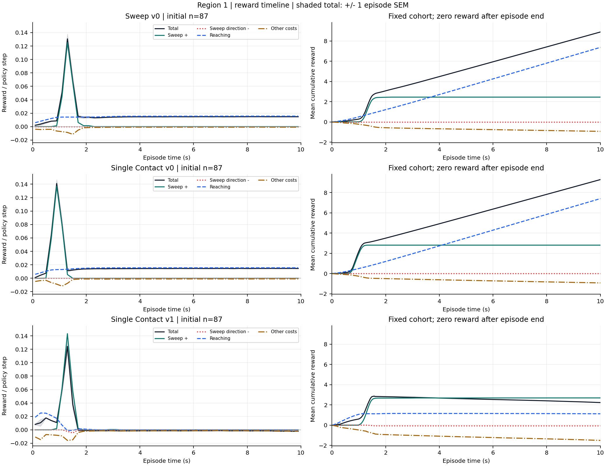

표의 보상 항은 episode 전체 누적값의 평균이다. 그래프 왼쪽은 step당 보상, 오른쪽은 초기 표본 전체의 평균 누적 보상이다. Sweep −는 v1의 방향 불일치 음수분이며, 목표에서 멀어지는 `sweep_retreat`는 기타 비용에 포함했다.

모든 개별 Reward 항의 평균 Timeline

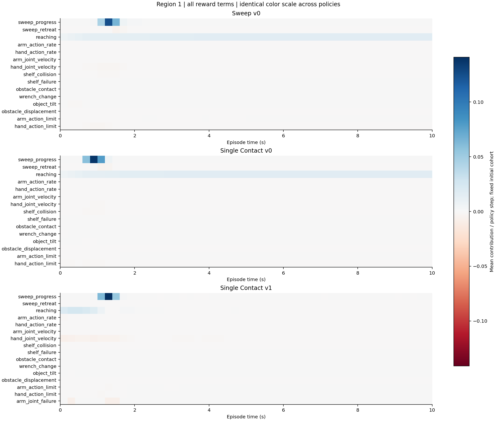

### 양의 Sweep 지급 구간의 힘 방향

| 정책 | 지급 episode / 전체 | 지급 step | 지급 시간/episode(s) | 평균 θ | 중앙 θ | P90 θ | ≤30° | 전체 접촉 평균 θ | 전체 접촉 ≤30° |
| --- | ---: | ---: | ---: | ---: | ---: | ---: | ---: | ---: | ---: |
| Sweep v0 | 86/87 | 2117 | 0.487 | 20.91° | 14.87° | 51.48° | 76.1% | 35.11° | 65.5% |
| Single Contact v0 | 85/87 | 1360 | 0.313 | 15.74° | 10.80° | 36.44° | 85.9% | 62.83° | 58.6% |
| Single Contact v1 | 85/87 | 1441 | 0.331 | 9.69° | 8.37° | 20.24° | 100.0% | 21.63° | 79.2% |

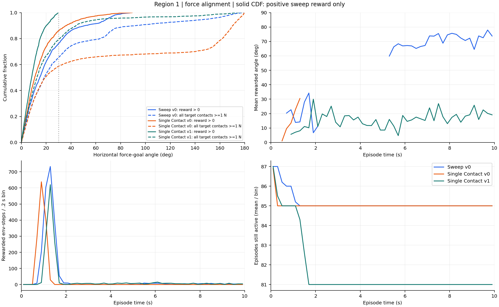

각도 통계는 지급 step을 동일 가중치로 집계했다. 오래 접촉하는 episode가 더 많이 기여한다. episode별 각도를 먼저 평균한 결과와 XY·3D 코사인, 표본 수는 alignment.csv에 보존했다. 지급 step이 없으면 각도는 미정(—)이다.

### Contact Sensor Timeline

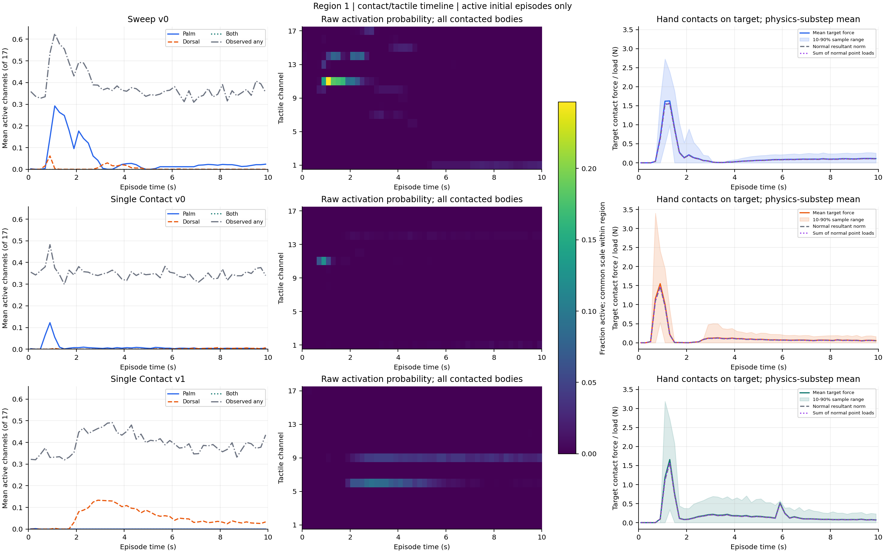

오른쪽은 타겟에 작용한 접촉력이다. 실선은 법선+마찰 합력의 크기, 회색 점선은 법선 합력의 크기, 보라 점선은 개별 법선 접촉 하중 크기의 합이다. 마지막 값은 서로 반대 방향으로 누르는 접촉이 상쇄되지 않는다. 음영은 실선의 10~90% 표본 범위다.

### F/T Sensor Timeline

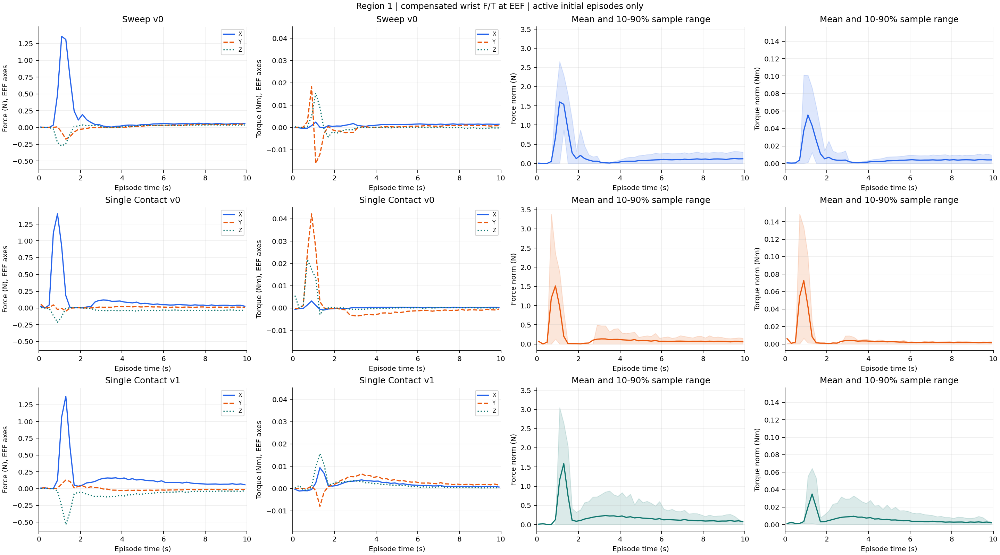

| 정책 | 타겟 접촉 비율 | 촉각 활성 비율 | 평균 활성 손바닥/손등 채널 | 타겟 힘 평균/P95(N) | F/T 힘 평균/P95(N) | F/T 모멘트 평균/P95(Nm) | 정책 F/T 포화 비율 |
| --- | ---: | ---: | ---: | ---: | ---: | ---: | ---: |
| Sweep v0 | 35.7% | 4.8% | 0.05/0.00 | 0.17/1.18 | 0.17/1.20 | 0.006/0.041 | 0.00% |
| Single Contact v0 | 23.6% | 1.1% | 0.01/0.00 | 0.14/1.05 | 0.14/1.13 | 0.006/0.035 | 0.00% |
| Single Contact v1 | 23.8% | 5.3% | 0.00/0.05 | 0.19/1.22 | 0.19/1.35 | 0.006/0.036 | 0.00% |

**원시 촉각과 정책 입력:** 동일한 비종료 env-step에서 한 채널 이상 활성인 비율은 원시→noise 적용 후 Sweep v0 4.79%→32.08% / Single Contact v0 1.08%→29.58% / Single Contact v1 5.27%→32.93%였다. 정책에는 34개 면별 bit에 각각 1% flip noise가 적용되므로 실제 접촉이 없는 표본에도 활성 신호가 들어갈 수 있다. 타겟 접촉 비율과 촉각 활성 비율은 측정 대상·표면 분류·임계값이 달라 직접 같아야 하는 값이 아니다.

비율·센서 요약은 생존 초기 episode의 env-step을 합산한 값이다. 촉각 활성 비율은 17채널 중 하나라도 활성인 비율이며 양면은 손바닥·손등 양쪽에 포함한다. 포화는 실제 정책 관측의 6축 중 하나라도 정규화 절댓값이 1인 비율이다.

실제 정책 입력의 정규화 F/T 6축

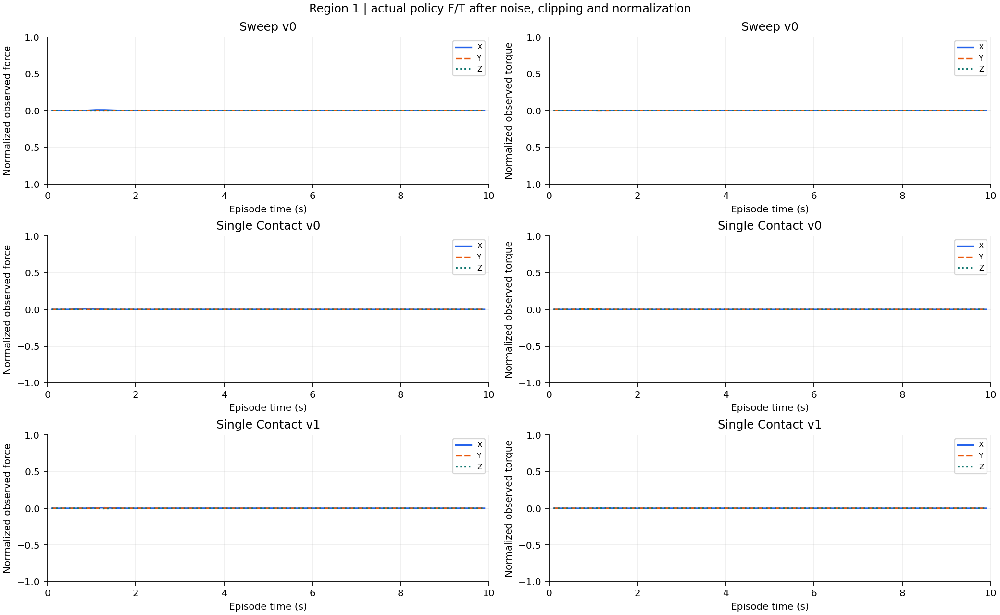

## 영역 2

### 보상 분포

| 정책 | episode 수 | 성공률 | 평균 return | Sweep + | Sweep − | Reaching | 기타 비용 | 평균 길이(s) |
| --- | ---: | ---: | ---: | ---: | ---: | ---: | ---: | ---: |
| Sweep v0 | 171 | 79.5% | 10.257 | 3.810 | 0.000 | 7.239 | -0.793 | 9.53 |
| Single Contact v0 | 171 | 92.4% | 10.351 | 3.969 | 0.000 | 7.220 | -0.837 | 9.57 |
| Single Contact v1 | 171 | 81.9% | 2.540 | 2.752 | -0.075 | 1.308 | -1.445 | 9.19 |

**양의 Sweep 지급 시점:** 전체 양의 Sweep 보상 중 90%가 지급된 시각은 Sweep v0 1.74초 / Single Contact v0 1.72초 / Single Contact v1 1.82초다. 이는 영역 내 episode들의 양의 보상을 합산한 분포의 누적 90% 시각이다.

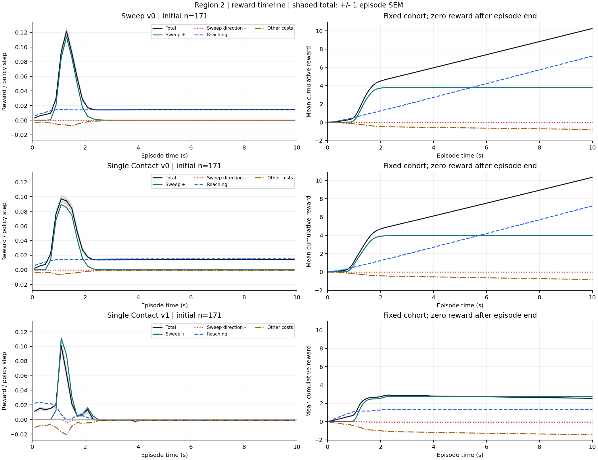

표의 보상 항은 episode 전체 누적값의 평균이다. 그래프 왼쪽은 step당 보상, 오른쪽은 초기 표본 전체의 평균 누적 보상이다. Sweep −는 v1의 방향 불일치 음수분이며, 목표에서 멀어지는 `sweep_retreat`는 기타 비용에 포함했다.

모든 개별 Reward 항의 평균 Timeline

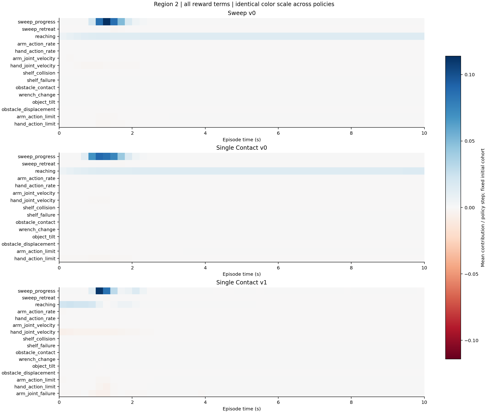

### 양의 Sweep 지급 구간의 힘 방향

| 정책 | 지급 episode / 전체 | 지급 step | 지급 시간/episode(s) | 평균 θ | 중앙 θ | P90 θ | ≤30° | 전체 접촉 평균 θ | 전체 접촉 ≤30° |
| --- | ---: | ---: | ---: | ---: | ---: | ---: | ---: | ---: | ---: |
| Sweep v0 | 169/171 | 6557 | 0.767 | 20.35° | 14.87° | 46.62° | 76.0% | 25.03° | 71.3% |
| Single Contact v0 | 163/171 | 5868 | 0.686 | 17.19° | 12.33° | 38.49° | 83.2% | 27.47° | 75.7% |
| Single Contact v1 | 161/171 | 2580 | 0.302 | 9.07° | 7.46° | 19.91° | 100.0% | 29.68° | 78.5% |

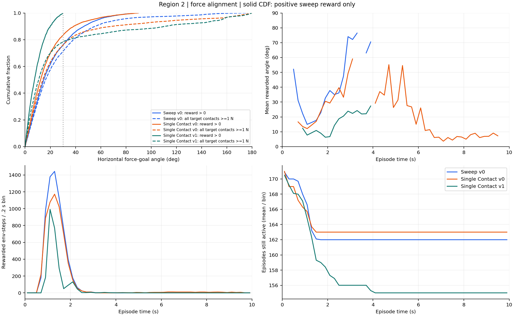

각도 통계는 지급 step을 동일 가중치로 집계했다. 오래 접촉하는 episode가 더 많이 기여한다. episode별 각도를 먼저 평균한 결과와 XY·3D 코사인, 표본 수는 alignment.csv에 보존했다. 지급 step이 없으면 각도는 미정(—)이다.

### Contact Sensor Timeline

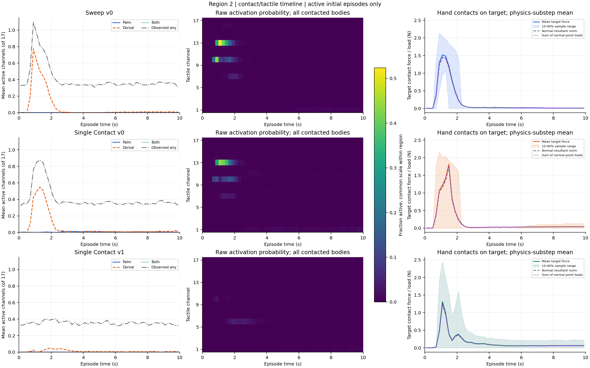

오른쪽은 타겟에 작용한 접촉력이다. 실선은 법선+마찰 합력의 크기, 회색 점선은 법선 합력의 크기, 보라 점선은 개별 법선 접촉 하중 크기의 합이다. 마지막 값은 서로 반대 방향으로 누르는 접촉이 상쇄되지 않는다. 음영은 실선의 10~90% 표본 범위다.

### F/T Sensor Timeline

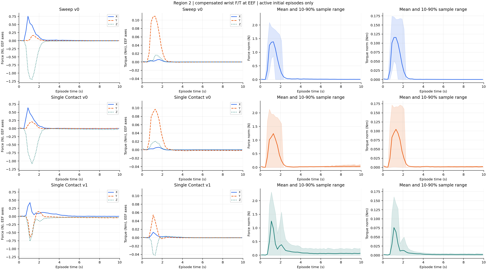

| 정책 | 타겟 접촉 비율 | 촉각 활성 비율 | 평균 활성 손바닥/손등 채널 | 타겟 힘 평균/P95(N) | F/T 힘 평균/P95(N) | F/T 모멘트 평균/P95(Nm) | 정책 F/T 포화 비율 |
| --- | ---: | ---: | ---: | ---: | ---: | ---: | ---: |
| Sweep v0 | 19.1% | 6.5% | 0.00/0.07 | 0.16/1.46 | 0.15/1.43 | 0.013/0.128 | 0.00% |
| Single Contact v0 | 17.1% | 6.3% | 0.01/0.07 | 0.18/1.55 | 0.15/1.51 | 0.013/0.134 | 0.00% |
| Single Contact v1 | 30.1% | 1.1% | 0.00/0.01 | 0.15/0.92 | 0.15/0.94 | 0.007/0.038 | 0.00% |

**원시 촉각과 정책 입력:** 동일한 비종료 env-step에서 한 채널 이상 활성인 비율은 원시→noise 적용 후 Sweep v0 6.47%→33.53% / Single Contact v0 6.36%→33.43% / Single Contact v1 1.08%→29.97%였다. 정책에는 34개 면별 bit에 각각 1% flip noise가 적용되므로 실제 접촉이 없는 표본에도 활성 신호가 들어갈 수 있다. 타겟 접촉 비율과 촉각 활성 비율은 측정 대상·표면 분류·임계값이 달라 직접 같아야 하는 값이 아니다.

비율·센서 요약은 생존 초기 episode의 env-step을 합산한 값이다. 촉각 활성 비율은 17채널 중 하나라도 활성인 비율이며 양면은 손바닥·손등 양쪽에 포함한다. 포화는 실제 정책 관측의 6축 중 하나라도 정규화 절댓값이 1인 비율이다.

실제 정책 입력의 정규화 F/T 6축

## 영역 3

### 보상 분포

| 정책 | episode 수 | 성공률 | 평균 return | Sweep + | Sweep − | Reaching | 기타 비용 | 평균 길이(s) |
| --- | ---: | ---: | ---: | ---: | ---: | ---: | ---: | ---: |
| Sweep v0 | 80 | 2.5% | 7.516 | 1.008 | 0.000 | 7.194 | -0.686 | 9.43 |
| Single Contact v0 | 80 | 13.8% | 7.192 | 1.475 | 0.000 | 6.600 | -0.882 | 8.77 |
| Single Contact v1 | 80 | 32.5% | 1.151 | 1.159 | -0.125 | 1.392 | -1.275 | 9.39 |

**양의 Sweep 지급 시점:** 전체 양의 Sweep 보상 중 90%가 지급된 시각은 Sweep v0 2.20초 / Single Contact v0 1.74초 / Single Contact v1 2.38초다. 이는 영역 내 episode들의 양의 보상을 합산한 분포의 누적 90% 시각이다.

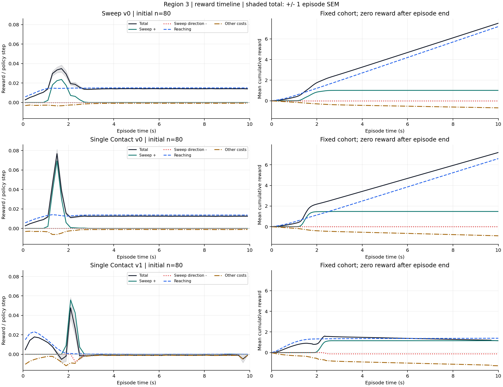

표의 보상 항은 episode 전체 누적값의 평균이다. 그래프 왼쪽은 step당 보상, 오른쪽은 초기 표본 전체의 평균 누적 보상이다. Sweep −는 v1의 방향 불일치 음수분이며, 목표에서 멀어지는 `sweep_retreat`는 기타 비용에 포함했다.

모든 개별 Reward 항의 평균 Timeline

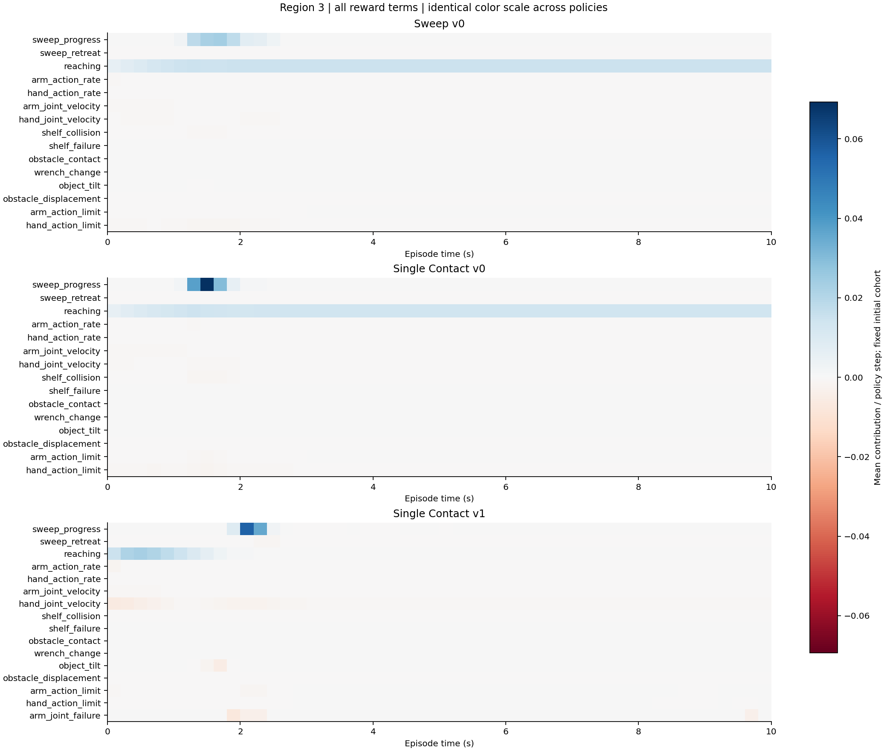

### 양의 Sweep 지급 구간의 힘 방향

| 정책 | 지급 episode / 전체 | 지급 step | 지급 시간/episode(s) | 평균 θ | 중앙 θ | P90 θ | ≤30° | 전체 접촉 평균 θ | 전체 접촉 ≤30° |
| --- | ---: | ---: | ---: | ---: | ---: | ---: | ---: | ---: | ---: |
| Sweep v0 | 74/80 | 2161 | 0.540 | 48.41° | 47.60° | 72.30° | 15.4% | 59.80° | 12.9% |
| Single Contact v0 | 72/80 | 1880 | 0.470 | 42.72° | 40.81° | 69.25° | 28.0% | 51.46° | 24.5% |
| Single Contact v1 | 34/80 | 519 | 0.130 | 10.03° | 7.96° | 21.95° | 100.0% | 106.75° | 22.9% |

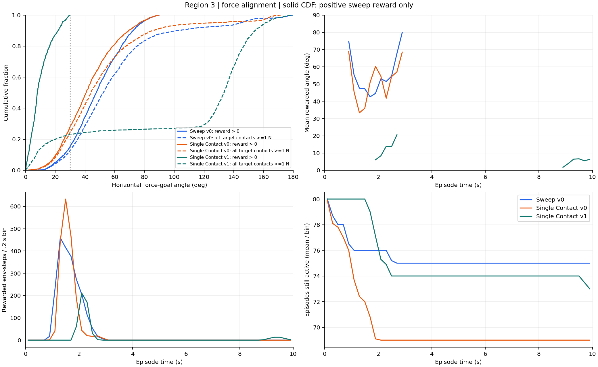

각도 통계는 지급 step을 동일 가중치로 집계했다. 오래 접촉하는 episode가 더 많이 기여한다. episode별 각도를 먼저 평균한 결과와 XY·3D 코사인, 표본 수는 alignment.csv에 보존했다. 지급 step이 없으면 각도는 미정(—)이다.

### Contact Sensor Timeline

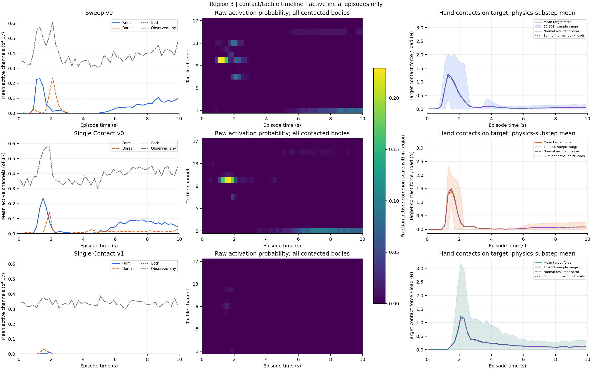

오른쪽은 타겟에 작용한 접촉력이다. 실선은 법선+마찰 합력의 크기, 회색 점선은 법선 합력의 크기, 보라 점선은 개별 법선 접촉 하중 크기의 합이다. 마지막 값은 서로 반대 방향으로 누르는 접촉이 상쇄되지 않는다. 음영은 실선의 10~90% 표본 범위다.

### F/T Sensor Timeline

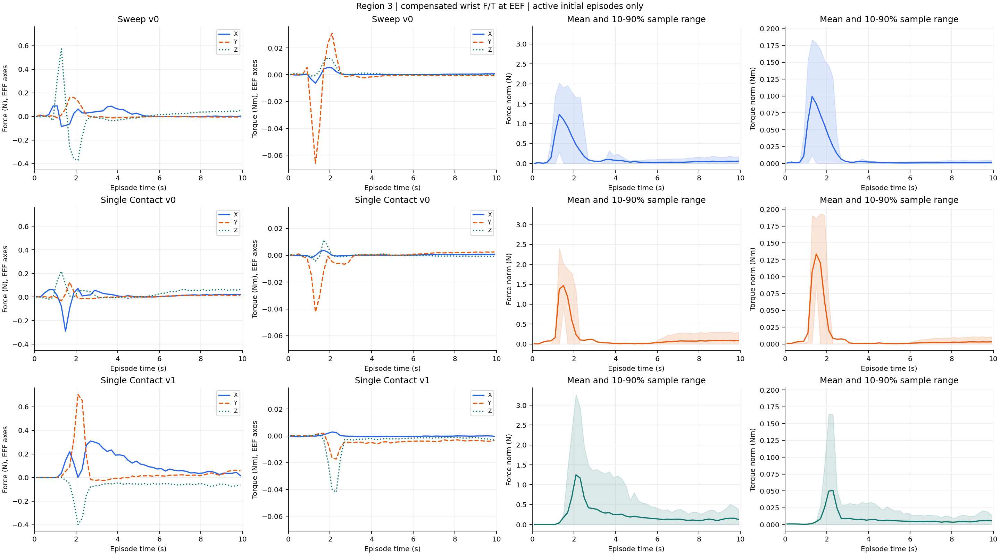

| 정책 | 타겟 접촉 비율 | 촉각 활성 비율 | 평균 활성 손바닥/손등 채널 | 타겟 힘 평균/P95(N) | F/T 힘 평균/P95(N) | F/T 모멘트 평균/P95(Nm) | 정책 F/T 포화 비율 |
| --- | ---: | ---: | ---: | ---: | ---: | ---: | ---: |
| Sweep v0 | 30.6% | 5.3% | 0.04/0.01 | 0.16/1.34 | 0.15/1.31 | 0.011/0.101 | 0.00% |
| Single Contact v0 | 26.5% | 6.2% | 0.05/0.01 | 0.15/1.36 | 0.15/1.34 | 0.011/0.116 | 0.00% |
| Single Contact v1 | 30.4% | 0.2% | 0.00/0.00 | 0.21/1.26 | 0.22/1.58 | 0.007/0.041 | 0.00% |

**원시 촉각과 정책 입력:** 동일한 비종료 env-step에서 한 채널 이상 활성인 비율은 원시→noise 적용 후 Sweep v0 5.31%→32.64% / Single Contact v0 6.17%→33.29% / Single Contact v1 0.19%→28.86%였다. 정책에는 34개 면별 bit에 각각 1% flip noise가 적용되므로 실제 접촉이 없는 표본에도 활성 신호가 들어갈 수 있다. 타겟 접촉 비율과 촉각 활성 비율은 측정 대상·표면 분류·임계값이 달라 직접 같아야 하는 값이 아니다.

비율·센서 요약은 생존 초기 episode의 env-step을 합산한 값이다. 촉각 활성 비율은 17채널 중 하나라도 활성인 비율이며 양면은 손바닥·손등 양쪽에 포함한다. 포화는 실제 정책 관측의 6축 중 하나라도 정규화 절댓값이 1인 비율이다.

실제 정책 입력의 정규화 F/T 6축

## 영역 4

### 보상 분포

| 정책 | episode 수 | 성공률 | 평균 return | Sweep + | Sweep − | Reaching | 기타 비용 | 평균 길이(s) |
| --- | ---: | ---: | ---: | ---: | ---: | ---: | ---: | ---: |
| Sweep v0 | 174 | 80.5% | 9.995 | 3.619 | 0.000 | 7.263 | -0.887 | 9.68 |
| Single Contact v0 | 174 | 81.6% | 10.208 | 3.974 | 0.000 | 7.275 | -1.041 | 9.63 |
| Single Contact v1 | 174 | 3.4% | -0.074 | 0.188 | -0.018 | 1.158 | -1.402 | 9.84 |

**양의 Sweep 지급 시점:** 전체 양의 Sweep 보상 중 90%가 지급된 시각은 Sweep v0 1.72초 / Single Contact v0 1.70초 / Single Contact v1 1.50초다. 이는 영역 내 episode들의 양의 보상을 합산한 분포의 누적 90% 시각이다.

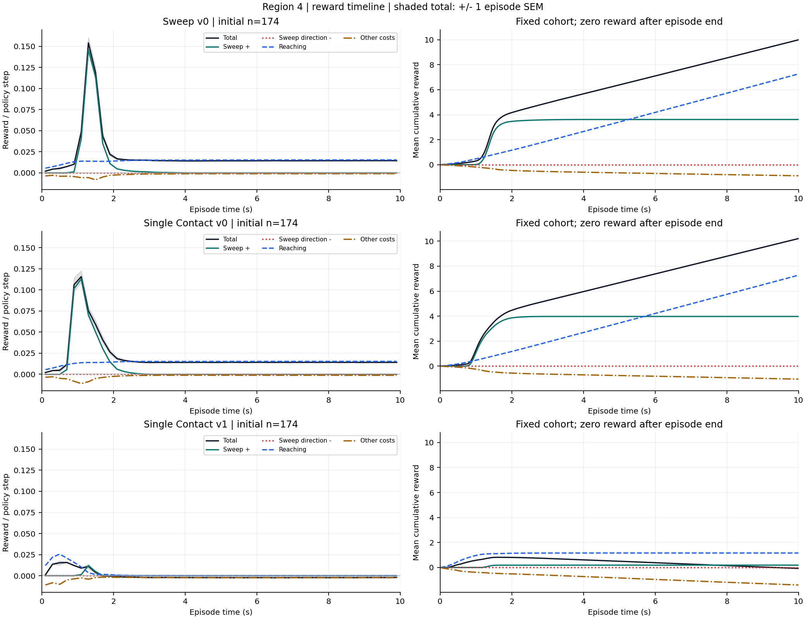

표의 보상 항은 episode 전체 누적값의 평균이다. 그래프 왼쪽은 step당 보상, 오른쪽은 초기 표본 전체의 평균 누적 보상이다. Sweep −는 v1의 방향 불일치 음수분이며, 목표에서 멀어지는 `sweep_retreat`는 기타 비용에 포함했다.

모든 개별 Reward 항의 평균 Timeline

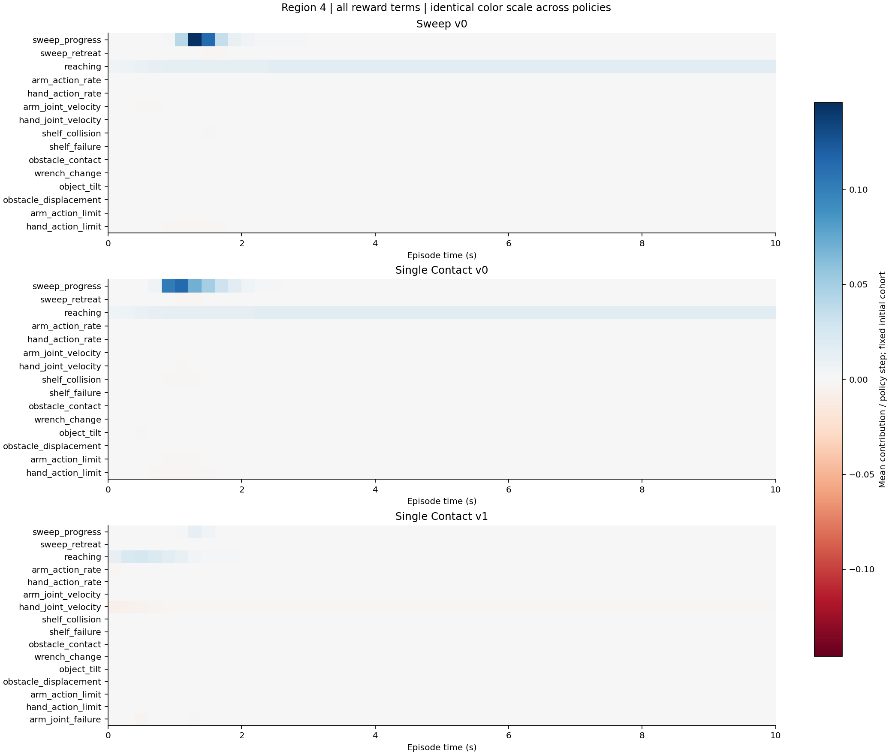

### 양의 Sweep 지급 구간의 힘 방향

| 정책 | 지급 episode / 전체 | 지급 step | 지급 시간/episode(s) | 평균 θ | 중앙 θ | P90 θ | ≤30° | 전체 접촉 평균 θ | 전체 접촉 ≤30° |
| --- | ---: | ---: | ---: | ---: | ---: | ---: | ---: | ---: | ---: |
| Sweep v0 | 169/174 | 6161 | 0.708 | 21.18° | 15.19° | 50.04° | 75.3% | 26.07° | 71.5% |
| Single Contact v0 | 169/174 | 4796 | 0.551 | 21.71° | 15.89° | 50.44° | 75.0% | 32.00° | 67.5% |
| Single Contact v1 | 48/174 | 379 | 0.044 | 17.58° | 19.22° | 28.15° | 100.0% | 85.54° | 6.4% |

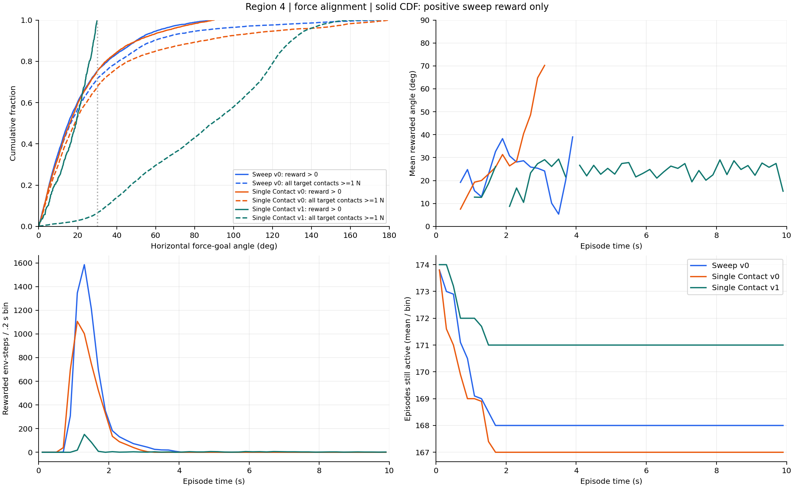

각도 통계는 지급 step을 동일 가중치로 집계했다. 오래 접촉하는 episode가 더 많이 기여한다. episode별 각도를 먼저 평균한 결과와 XY·3D 코사인, 표본 수는 alignment.csv에 보존했다. 지급 step이 없으면 각도는 미정(—)이다.

### Contact Sensor Timeline

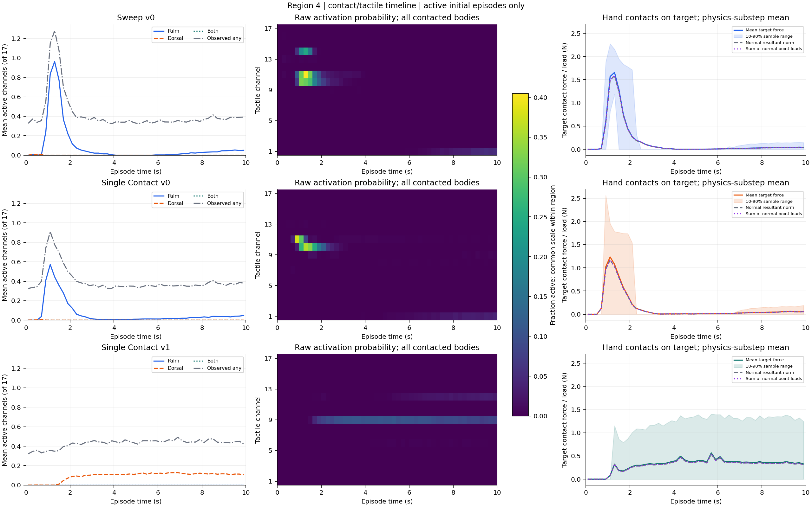

오른쪽은 타겟에 작용한 접촉력이다. 실선은 법선+마찰 합력의 크기, 회색 점선은 법선 합력의 크기, 보라 점선은 개별 법선 접촉 하중 크기의 합이다. 마지막 값은 서로 반대 방향으로 누르는 접촉이 상쇄되지 않는다. 음영은 실선의 10~90% 표본 범위다.

### F/T Sensor Timeline

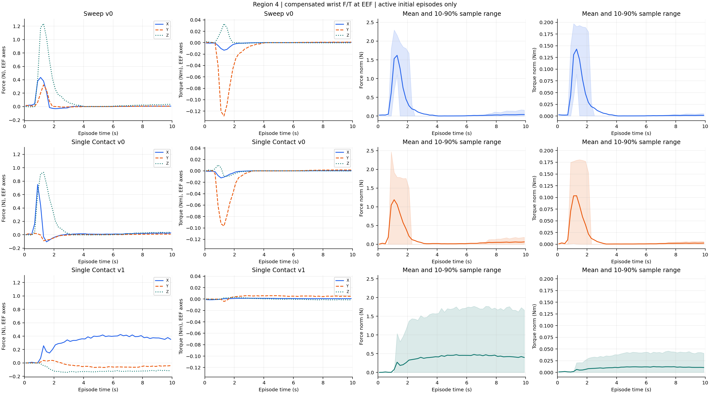

| 정책 | 타겟 접촉 비율 | 촉각 활성 비율 | 평균 활성 손바닥/손등 채널 | 타겟 힘 평균/P95(N) | F/T 힘 평균/P95(N) | F/T 모멘트 평균/P95(Nm) | 정책 F/T 포화 비율 |
| --- | ---: | ---: | ---: | ---: | ---: | ---: | ---: |
| Sweep v0 | 19.1% | 8.0% | 0.09/0.00 | 0.16/1.56 | 0.16/1.54 | 0.014/0.146 | 0.00% |
| Single Contact v0 | 17.6% | 6.6% | 0.07/0.00 | 0.13/1.36 | 0.14/1.36 | 0.011/0.121 | 0.00% |
| Single Contact v1 | 30.6% | 9.3% | 0.00/0.09 | 0.32/1.61 | 0.36/1.98 | 0.009/0.050 | 0.00% |

**원시 촉각과 정책 입력:** 동일한 비종료 env-step에서 한 채널 이상 활성인 비율은 원시→noise 적용 후 Sweep v0 8.04%→34.86% / Single Contact v0 6.57%→33.80% / Single Contact v1 9.27%→35.47%였다. 정책에는 34개 면별 bit에 각각 1% flip noise가 적용되므로 실제 접촉이 없는 표본에도 활성 신호가 들어갈 수 있다. 타겟 접촉 비율과 촉각 활성 비율은 측정 대상·표면 분류·임계값이 달라 직접 같아야 하는 값이 아니다.

비율·센서 요약은 생존 초기 episode의 env-step을 합산한 값이다. 촉각 활성 비율은 17채널 중 하나라도 활성인 비율이며 양면은 손바닥·손등 양쪽에 포함한다. 포화는 실제 정책 관측의 6축 중 하나라도 정규화 절댓값이 1인 비율이다.

실제 정책 입력의 정규화 F/T 6축

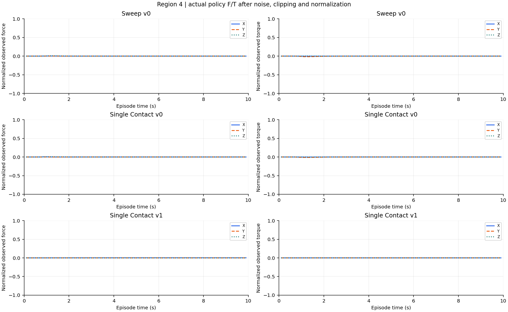

## 체크포인트·근거·검증

| 정책 | 학습 run | checkpoint |
| --- | --- | --- |
| Sweep v0 | 2026-11-22_17-07-15 | [model_20900.pt](../../../../logs/TEMP/2026-11-23/inspire_sweep_v0/2026-11-22_17-07-15/model_20900.pt) |
| Single Contact v0 | 2026-11-22_17-14-33 | [model_15550.pt](../../../../logs/TEMP/2026-11-23/inspire_sweep_single_contact_v0/2026-11-22_17-14-33/model_15550.pt) |
| Single Contact v1 | 2026-11-22_17-15-01 | [model_10950.pt](../../../../logs/TEMP/2026-11-23/inspire_sweep_single_contact_v1/2026-11-22_17-15-01/model_10950.pt) |

- 초기 물리 장면 대조: 두 시드 모두 robot joint·물체 상태·목표·방향·bounds·활성 물체의 hash가 정책 간 **모두 일치**했다. 동일 장면에서 각 정책을 비교한 결과다.
- 6개 실행 모두 500step을 완료했고 1,536개 초기 episode의 종료를 각 1회 확인했다. 보상항 합과 실제 RewardManager total의 최대 차이는 2.38e-07다.
- 초기 episode에서 접촉 샘플 유효 비율은 최소 100.0000%, 센서 fresh 비율은 최소 100.0000%다. 실제 정책 F/T 범위 [-1,1]과 촉각 범주, v1 양의 방향 보상 θ<30°를 원시 배열로 확인했다.
- 각 체크포인트의 SHA-256을 수집 전·후 대조했다. 원본 학습 로그에는 쓰지 않았다. 환경·보상·정책 입력 구성은 변경하지 않았고 평가 스크립트만 추가했다. PhysX aggregate-pair capacity만 평가에 필요한 메모리 크기 2²¹로 축소했다.
- 저장된 학습 env.yaml과 현재 평가 설정의 Action·Reward·Observation·Command·Termination·Event·Curriculum, episode 길이·decimation·목표 반경·F/T 제한값을 대조해 세 정책 모두 일치를 확인했다. v1 Sweep 및 Reaching 항은 수집한 내부 구성요소로 별도 재계산해 실제 지급값과 대조했다.
- **미검증 범위:** 실물 센서·실물 조작, 학습 seed 간 재학습 분산, 장기 성능 및 reward 조건을 제거한 인과적 방향 제어 개선. 같은 정책에서 관측 noise를 제거했을 때의 성능도 측정하지 않았다.

### 원시 데이터와 재계산

- [실행별 원시 trace·초기 장면·설정·metadata](../../../../outputs/sweep_region_timelines_20261123)
- [영역별 성과·보상 요약](../../03_assets/sweep_region_timelines_2026-11-23/summary.csv) · [전체 보상항](../../03_assets/sweep_region_timelines_2026-11-23/reward_terms.csv)
- [방향 일치도와 분모](../../03_assets/sweep_region_timelines_2026-11-23/alignment.csv) · [센서 통계](../../03_assets/sweep_region_timelines_2026-11-23/sensors.csv) · [평균 Timeline 수치](../../03_assets/sweep_region_timelines_2026-11-23/timeline.csv)
- [검증·장면 hash 대조](../../03_assets/sweep_region_timelines_2026-11-23/validation.json)
- [수집 스크립트](../../../../src/inspire_sweep_baseline/scripts/collect_sweep_region_timelines.py) · [보고서 재계산 스크립트](../../../../src/inspire_sweep_baseline/scripts/report_sweep_region_timelines.py)
- 환경 정의: [Sweep v0 계약](../environments/SWEEP_V0.md). 센서 채널 이름과 보상별 callable·params·weight, 체크포인트 hash는 실행별 metadata.json에 저장했다.

### 촉각 채널 번호

| 번호 | 센서 body |
| ---: | --- |
| 1 | `inspire_palm_force_sensor` |
| 2 | `inspire_thumb_force_sensor_1` |
| 3 | `inspire_thumb_force_sensor_2` |
| 4 | `inspire_thumb_force_sensor_3` |
| 5 | `inspire_thumb_force_sensor_4` |
| 6 | `inspire_index_force_sensor_1` |
| 7 | `inspire_index_force_sensor_2` |
| 8 | `inspire_index_force_sensor_3` |
| 9 | `inspire_middle_force_sensor_1` |
| 10 | `inspire_middle_force_sensor_2` |
| 11 | `inspire_middle_force_sensor_3` |
| 12 | `inspire_ring_force_sensor_1` |
| 13 | `inspire_ring_force_sensor_2` |
| 14 | `inspire_ring_force_sensor_3` |
| 15 | `inspire_little_force_sensor_1` |
| 16 | `inspire_little_force_sensor_2` |
| 17 | `inspire_little_force_sensor_3` |
