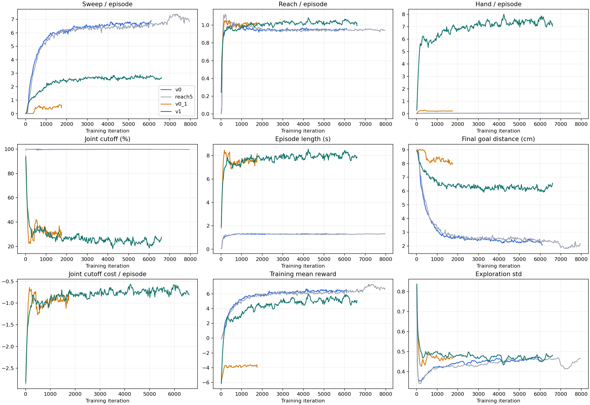
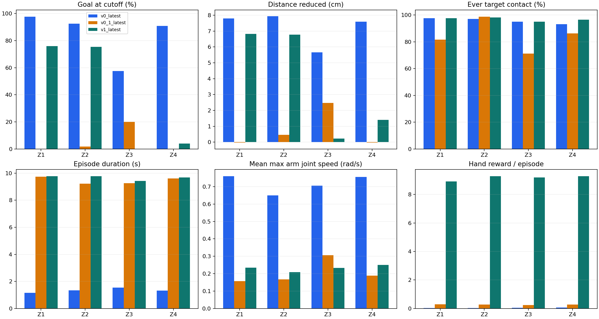
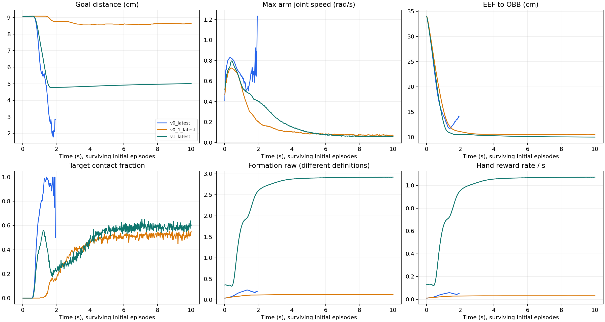
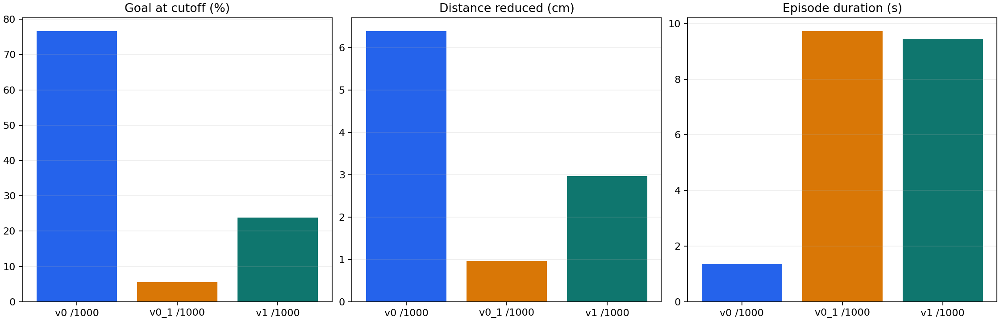
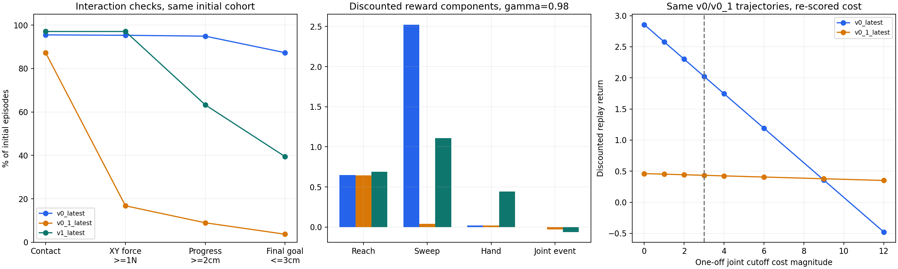
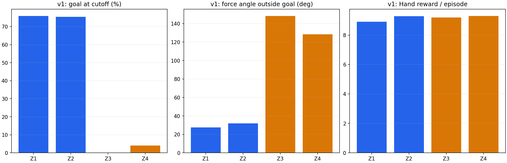

# Prof Revision: 팔 속도 종료 페널티 후 밀기 성능이 낮아진 이유

2026-11-24 · TEMP의 네 학습 로그와 고정 정책 재생 · v0_1·v1 추가 분석

## 핵심 판단

**v0_1은 종료를 피하는 데는 성공했지만, ‘목표까지 밀고 정지하기’ 대신 ‘접근한 뒤 충분한 힘을 주지 않고 오래 버티기’를 학습한 상태다.** 최신 정책의 목표 도달은 기존 v0 447/512=87.3%에서 v0_1 19/512=3.7%로 낮아졌다. v0_1은447회 접촉했지만 수평 접촉력1N이 발생한 episode는86회뿐이다. 평균9.45초를 사용해 목표 거리를0.53cm만 줄인다. 접근은 이루어지지만 실제 밀기로 이어지지 않는다. [S1]

**새 페널티가 물리적으로 밀기를 막거나 잘못 계산되는 현상은 확인되지 않았다.** 기존 v0 정책을 v0_1 환경에서 그대로 실행하면 같은 seed의256episode가 원래 v0 재생과 행동·타겟 궤적·힘·관절 속도·종료 시점까지 완전히 같다. 목표 도달도224/256회로 같다. 달라지는 값은 종료 step의−3뿐이다. 즉, 달라진 것은 보상에 반응해 학습된 정책이며, 액추에이터나 종료 조건이 새로 강화된 것이 아니다. [S2]

**v1은 손 자세를 더 잘 만들지만, 그 자세와 목표 방향이 결합되지 않은 별도 문제가 뚜렷하다.** 전체 도달률은39.5%로 v0_1보다 높지만, Zone1·2는약75%, Zone3은0%, Zone4는4.0%다. Zone3·4에서는 목표 밖 유효 접촉력의 평균 방향 오차가148.2°·128.4°인데도 Hand 누적 보상은9.20·9.29로 다른 Zone과 비슷하다. 손 자세 보상은 정상 지급되지만 목표에 반하는 힘을 억제하지 않는다. [S1, S3]

가장 지지되는 설명은 **‘빠른 접근·밀기·속도 종료’로 이어지던 학습 경로에 일회−3이 생기자, 밀기와 제동을 함께 배우기보다 저속 생존 쪽으로 학습이 이동했다**는 것이다. v1에서는 큰 지속형 Hand 보상이 그 대안을 더 매력적으로 만든다. 다만 **‘−3이면 제대로 미는 행동의 보상이 반드시 손해’라는 설명은 틀리다.** 실제 v0 궤적에−3을 붙여도 평균 return은+5.145, γ=0.98 할인합도+2.023으로 v0_1의−0.013·+0.434보다 높다. 관측된 나쁜 정책은 좋은 밀기가 불가능해진 전역 최적해라기보다, 학습이 도달한 낮은 성과의 행동 방식으로 해석해야 한다. 반복 훈련 ablation으로 학습 인과를 확정한 것은 아니다. [S4]

## 비교 범위와 실제 변경

직접 부모인 v0를 주 대조군으로 사용했다. Reach5cm는 이전 분석과 학습 로그의 보조 대조군이다. 원본 로그·체크포인트·환경·보상·PPO 소스는 수정하지 않았다.

| 환경 | 최신 checkpoint | v0 대비 실제 환경 차이 |
| --- | ---: | --- |
| v0 | 6100 | 기준: 종료 사건 비용 없음 |
| Reach5cm v0 | 7950 | Reach 반경10→5cm |
| v0_1 | 1750 | 팔 속도 종료 사건 비용−3 추가 |
| v1 | 6600 | 동일한−3 추가, Hand 식을 손가락별 거리×양면 방향 점수의 합으로 변경, weight0.245→0.3675 |

학습 시 저장된 env.yaml 전체와 agent.yaml을 대조했다. v0_1에서 의미 있는 환경 차이는 `arm_joint_failure` 하나이고, PPO는 로그 이름만 다르다. v1도 위의 두 보상 변경 외 의미 있는 차이는 없다. 학습 PC별 자산 절대 경로와 로그 경로는 별도로 기록했다. 팔 속도 종료는 네 환경 모두 **실제 팔 관절 중 하나라도 |속도|>1rad/s**인 기존 조건이다. [S5]

사건 보상 함수는 이미 계산된 종료 flag를 읽어 `flag/step_dt`를 반환하며, RewardManager가 weight−3과 dt를 곱한다. 따라서 **해당 종료 step에서 정확히−3, 나머지 step에서0**이다. 매 step−3을 받거나, dt 때문에−150이 지급되는 구현이 아니다. 모든 재생에서 독립 재계산과 일치했다.

재생은 다음과 같이 분리했다. 결과를 섞어 하나의 성공률로 만들지 않았다.

| 목적 | 정책·표본 |
| --- | --- |
| 최신 성능 | 기존 v0 재생512회 재사용, 새 v0_1·v1 각각512회; seed42·43,256환경씩 |
| 학습 기간 대조 | v0·v0_1·v1의 model1000 각각256회; seed42·43,128환경씩 |
| 탐색 noise 영향 | 최신 세 정책의 저장된 Gaussian action 분포에서 표본 추출, 각각128회; seed42 |
| 보상 배선/물리 영향 | v0 model6100을 v0_1 환경에서256회 재생; seed42 |

모든 표본은 환경별 첫 episode의 실제 terminal transition까지다. Joint Termination은 이전 요청대로 평가 종료로 포함하고, **목표 도달은 종료 시 타겟–목표 XY 거리≤3cm**로 별도 집계했다. timeout의 원래 `success`와 혼동하지 않았다. 재학습·정책 업데이트는 하지 않았다.

## 학습 로그에서도 초반부터 다른 행동으로 갈라진다

아래는901~1000 iteration의100개 logger 기록 평균이다. `Episode_Reward/*`는 최대 episode 길이10초로 나눈 값이므로10을 곱했다. 실제 episode 길이를 곱하지 않았다. 이벤트 비율은 logger 집계의 평균이며 원시 episode 수를 합산한 확률은 아니다. [S6]

| 정책 /1000 | Sweep 누적 규모 | Reach | Hand | 속도 종료 | timeout | 길이(s) |
| --- | --- | --- | --- | --- | --- | --- |
| v0 | 5.460 | 0.976 | 0.042 | 99.7% | 0.0% | 1.30 |
| v0_1 | 0.409 | 0.985 | 0.192 | 34.6% | 65.3% | 7.19 |
| v1 | 1.960 | 0.966 | 6.057 | 33.1% | 66.8% | 7.27 |

처음0~99 iteration부터 v0는 평균0.42초, v0_1은4.29초, v1은4.14초였다.100~499 구간에는 v0의 Sweep 누적 규모가2.649까지 올라가지만 v0_1은0.083에 머문다. **좋은 밀기를 먼저 배운 뒤 종료 문제만 나중에 교정한 과정이 아니다.** 페널티가 있는 실행은 밀기를 충분히 발견하기 전에 긴 episode와 종료 회피 쪽으로 갈라졌다. 이 시간 순서는 학습 경로 해석을 지지하지만 gradient 수준의 인과 추적은 아니다.

최신100개 기록에서는 v0_1의 속도 종료31.3%·timeout68.5%, v1은25.0%·74.9%다. 두 실행 모두 종료를 피하는 빈도는 커졌지만, v0_1 Sweep은0.644로 v0의6.790보다 작고 v1 Hand는7.287로 Sweep2.592보다 크다. Reach5cm의 Sweep은7.010으로, 페널티가 없는 두 기존 정책의 양호한 밀기 패턴과 일관된다.



학습 중 손 속도 누적 비용은 v0−0.386, v0_1−2.472, v1−2.272다. episode가 약1.3초에서7.6~7.9초로 늘면서 기존의 연속 비용도 오래 쌓인다. 항목의 weight가 새로 커진 것은 아니다. v0_1의 학습 평균 return은−3.713으로, ‘가만히 있으면 큰 양의 보상을 얻는다’는 단순 설명도 맞지 않는다. 안전하게 버티는 정책이 관측상 나쁜 해인데도 학습되어 있다는 점이 중요하다.

## 실제 재생: v0_1은 접촉에서 밀기 힘으로 넘어가지 못한다

| 정책 | 목표 도달/n | 순거리 감소(cm) | 종료 거리(cm) | 길이(s) | 속도 종료/n | timeout/n |
| --- | --- | --- | --- | --- | --- | --- |
| v0 /6100 | 447/512 (87.3%) | 7.44 | 1.64 | 1.33 | 511/512 | 0/512 |
| v0_1 /1750 | 19/512 (3.7%) | 0.53 | 8.55 | 9.45 | 58/512 | 453/512 |
| v1 /6600 | 202/512 (39.5%) | 3.93 | 5.15 | 9.69 | 17/512 | 495/512 |

| 정책 | 접촉 episode | 수평 힘≥1N episode | 2cm 이상 진행 episode | 종료 시≤3cm |
| --- | --- | --- | --- | --- |
| v0 /6100 | 489/512 | 488/512 | 486/512 | 447/512 |
| v0_1 /1750 | 447/512 | 86/512 | 46/512 | 19/512 |
| v1 /6600 | 497/512 | 497/512 | 324/512 | 202/512 |

위 네 열은 같은 초기 모집단에 대한 각각의 사건 검사다. 서로 다른 이벤트의 시각을 억지로 연결한 인과 funnel은 아니다. 진행은초기 거리에서 episode 최소 거리까지의 감소이며, 종료 시 순거리 감소와 구분한다. 힘은 **타겟에 작용한 손의 법선+마찰 합력**을 두 물리 substep에 걸쳐 평균한 값이다. 손목 F/T의 반력을 대신 사용하지 않았다.

v0_1은 접촉한447회 중361회에서 수평 합력1N을 한 번도 만들지 못했다. 전체512회 중2cm 이상 진행한 경우도46회뿐이다. 반면 v0는489회 접촉 중488회에서1N 이상이 발생했다. **병목이 단순 접촉 유무보다, 실제 밀기 힘을 형성하는 전환에 집중되어 있다.**

episode별 팔 최대 관절 속도의 시간 평균은 v0 0.713rad/s, v0_1 0.194rad/s, v1 0.231rad/s다. 종료 시 EEF–OBB 거리는14.06→10.63·10.43cm로 오히려 가까워진다. v0_1은 물체 근처까지 접근한 뒤, 충분한 힘과 목표 방향의 이동을 만들지 않는 저속 행동을 보인다.2초 이후 목표 밖에서 생존한 구간 중 타겟 병진 속도<0.5cm/s인 시간 비율의 episode 평균은 v0_1 97.9%, v1 93.2%다. ‘느리지만 끝까지 미는 중’으로 보기는 어렵다.




시간 곡선은 해당 시각까지 생존한 초기 episode만 평균한다. 종료 후0을 넣거나 다음 episode를 섞지 않았다. v0는2초 전에 전부 끝나므로 이후 곡선이 없다. 시각별 남은 표본 수는[S1]의CSV에 있다. raw Formation은 환경별 식과 범위가 달라 직접 품질 순위로 비교하지 않는다.

## ‘학습이 짧아서’와 ‘실행 시 noise를 꺼서’만으로 설명되지 않는다

동일 model1000을 각각256회 재생했다. [S1]

| 정책 /1000 | 목표 도달/n | 순거리 감소(cm) | 길이(s) | Sweep | Hand |
| --- | --- | --- | --- | --- | --- |
| v0 /1000 | 196/256 (76.6%) | 6.38 | 1.35 | 6.484 | 0.041 |
| v0_1 /1000 | 14/256 (5.5%) | 0.95 | 9.72 | 0.646 | 0.261 |
| v1 /1000 | 61/256 (23.8%) | 2.97 | 9.46 | 2.654 | 8.191 |



v0_1의 최신 iteration이1750으로 짧다는 한계는 있다. 그러나 같은 1000에서도 차이가 크며, v1은6600까지 학습했어도 기존 v0 수준의 목표 도달을 회복하지 못했다. 훈련을 더 하면 반드시 회복된다는 결론이나, 영구적으로 회복할 수 없다는 결론은 둘 다 내리지 않았다.

저장된 action 분포에서 직접 sampling한128episode도 확인했다. optimizer 업데이트 없이 원래 관측 noise를 유지했다. 최신 정책 한 시점의 분포를 재생한 것으로, 여러 iteration에 걸친 학습 모집단의 완전한 재현은 아니다.

| 표본추출 실행 | 목표 도달/n | 속도 종료/n | 길이(s) | 실제 return |
| --- | --- | --- | --- | --- |
| v0 /6100 | 110/128 | 128/128 | 1.29 | 7.261 |
| v0_1 /1750 | 4/128 | 28/128 | 8.21 | -3.704 |
| v1 /6600 | 28/128 | 29/128 | 7.97 | 5.044 |

v0_1의 sample 실행 return−3.704는 학습 로그−3.713과 비슷하다. 결정론적 mean 실행의 return 약0과 달리, action sampling으로 연속 비용과 종료 위험이 증가한다. v1도 mean 도달39.5%보다 sample128회의 도달21.9%가 낮다. 그래도 v0_1이 거의 밀지 못하는 현상은 mean과sample 모두에서 남는다.

**탐색 분산이0으로 붕괴한 경우는 아니다.** checkpoint의 팔6D std 평균은 v0 0.447, v0_1 0.538, v1 0.573이다. 따라서 ‘탐색 표준편차가 작아져서’라고 단정하지 않는다. 관측된 변화는 저속 mean 제어·낮은 밀기 힘·긴 체류이며, 분산 붕괴와 구분한다. 저장 actor 파라미터와 학습 scalar는 모두 유한했다. [S4]

## 페널티가 물리를 막는가: 같은 정책을 넣으면 궤적은 그대로다

기존 v0 model6100을 v0_1에 넣어 seed42·256환경에서 재생했다. 초기 해시와 첫 episode의 action·타겟 위치·힘·관절 속도·Reach 거리가 기존 v0 실행과 모두 정확히 같았고, 모든 terminal flag도 같았다. 보상 차이는 `−3×팔 속도 종료 flag`와 정확히 일치했다. 목표 도달도224/256회로 같다. [S2]

이 검사는 **실행 중 보상 항이 액추에이터·관측·물리 상태를 직접 바꾼다는 설명을 배제하는 근거**다. 이미 배운 정책은 같은 밀기를 수행할 수 있다. 새 보상으로 처음부터 학습한 v0_1 정책이 다른 행동을 선택하게 된 것이다.

추가로 실제 관측된512개 v0 궤적에−3을 붙이고 재평가했다. v0_1과 같은 Hand 식·같은 전체 보상으로 비교하면 다음과 같다. 상태·action을 바꾸거나 정책을 다시 학습하지 않은 계산이다. [S4]

| 고정 정책 궤적 | 공통 v0_1 보상 누적값 | γ=0.98 할인합 |
| --- | --- | --- |
| v0 /6100 | 5.145 | 2.023 |
| v0_1 /1750 | -0.013 | 0.434 |
| v1 /6600 | 3.475 | 1.366 |

**−3이 있어도 기존 밀기 궤적이 현재 v0_1 궤적보다 높은 보상을 얻는다.** 따라서 ‘페널티가 너무 커서 목표까지 밀면 반드시 손해’라는 전역 손익 설명은 지지되지 않는다. 문제는 그런 행동을 발견·유지·제동하는 학습 경로다. 이 비교는 현재 정책들의 관측 궤적에 한정되며 모든 가능한 정책의 최적성을 증명하지 않는다.

v0 궤적에서 목표 안에 도달한447회도 모두 마지막 팔 속도 종료 때문에−3을 받는다. 현 항은 ‘실패한 밀기’와 ‘목표까지 민 뒤 제동하지 못한 밀기’를 구분하지 않는다. 보상에는 목표 진입·정지 유지의 별도 bonus가 없다. 목표까지 밀면서 제동하는 방법을 새로 배우는 대신, 낮은 속도로 접근해 종료 사건과 큰 움직임을 함께 피하는 방법이 더 쉽게 발견될 수 있다.



### PPO의 시간 처리도 함께 봐야 한다

γ=0.98은정책 step0.02초마다 적용된다. 할인 가중치는 약0.69초마다 절반이 되고, GAE의 직접 잔차 가중치γλ=0.931의 반감 시간은약0.19초다. 실제 PPO는 critic bootstrap을 사용하므로 이것이 과제의 절대 기억 한계라는 뜻은 아니다. 다만 즉시 발생할 수 있는−3과, 접근·접촉 이력·1N 힘·방향 조건을 통과한 뒤 생기는 밀기 보상은 학습 시점과 신뢰도가 다르다.

학습 config는 `is_finite_horizon=false`다. timeout은 RSL wrapper가 `time_outs`로 보내고 PPO가 critic 값을 보상에 bootstrap한다. 일반적인 팔 속도 종료는 실제 terminal로 다음 가치가 끊긴다. **두 방식은 agent가 받는 학습 신호에서 같지 않다.** 성공도timeout에서 판정되지만 별도 성공 보상은 없으므로, 목표 밖에서 자세를 유지하다timeout한 상태를 직접 실패 비용으로 처리하지 않는다. [S7]

이 설정은 기존 v0에도 있었으나 v0는 거의 모두1.3초의 속도 종료를 썼고, 새 정책은 대부분10초timeout을 쓰므로 실제 노출되는 경로가 달라졌다. 위 할인합은 물리 보상의 유한 궤적 합이며 PPO의 timeout value bootstrap은 포함하지 않는다. 이를 실제 value target과 동일하다고 해석하지 않았다. GAE/timeout을 바꾸는 재학습 ablation은 수행하지 않았으므로 보조 설명이다.

## v1은 손 자세를 개선하면서 목표와 충돌하는 방향을 남긴다

v0의 Hand는 다섯 거리 합의 역수형 점수지만, v1은 손가락별 거리 점수와 양면 normal 점수의 곱을 **합산**한다. 평균으로 나누지 않는다. [S3]

```math
H_{v0}=\frac{0.05}{0.05+\sum_f g_f},\qquad R_{hand,v0}=0.245H_{v0}\,dt
```

```math
H_{v1}=\sum_f\frac{0.05}{0.05+g_f}\cos^2(\theta_f),\qquad R_{hand,v1}=0.3675H_{v1}\,dt
```

normal은 pad의 양면을 동일하게 취급한다. 이 각도는 **Tip→OBB 중심**과의 각도이며, 목표로 밀어야 할 방향이나 실제 접촉력 방향이 아니다. 현재 타겟 접촉·거리 감소·목표 도달·올바른 힘 방향 없이도 지급된다. 반대로 Sweep은 목표 방향 힘의 투영을0~1로 자르므로, 반대 방향 힘은 양의 Sweep을0으로 만든다. 실제 목표 거리 증가가 작으면 Retreat 비용도 작다. 즉 **목표에 반하는 정적인 힘과 양의 Hand 보상이 동시에 존재할 수 있다.**

앞서 확인한 손등/손바닥 선호는 그대로다. Zone1·2 손등, Zone3·4 손바닥의1.5배/반대면0.7배이며, 이 배율은 양의 Sweep에만 적용된다. v0_1·v1에서 새로 바뀐 조건이 아니고 Hand 항에는 적용되지 않는다. 따라서 면 선호가 있어도 반대 방향 힘을 내며 자세 보상만 받는 상태를 자동으로 제거하지는 못한다.

Hand raw 최대는1→5, 가중 rate 최대는0.245→1.8375/s로 **7.5배**다. 단순히 weight만1.5배 올린 변경이 아니다.10초간의 이론 최대 누적값은2.45→18.375다. 실측 Hand 누적은0.044→9.208, 평균 rate는약0.033→0.951/s다. 식·자세·episode 길이 변화가 함께 반영된 결과다.

다만γ를 적용하면 v1의 Hand 기여는0.443, Sweep은1.108이다. **누적 Hand9.21가 Sweep3.36보다 크다는 사실만으로 ‘할인 학습 목표에서도 Hand가 항상 우세’라고 말할 수는 없다.** 전체 미할인 return이12.11로 v0의8.14보다 높아도 과제 성능은 낮다는 점, 목표 밖에서 오래 받을 수 있는 별도 보상원이 있다는 점이 실측의 핵심이다.

### 같은 자세 보상인데 방향별 성과는 정반대다

| Zone | v0 도달 | v0_1 도달 | v1 도달 | v1 힘 각도(°) | v1 Hand 누적 | 정지·목표 밖 Hand 비중 |
| --- | --- | --- | --- | --- | --- | --- |
| 1 | 85/87 | 0/87 | 66/87 | 27.5 | 8.912 | 16.6% |
| 2 | 158/171 | 3/171 | 129/171 | 32.0 | 9.278 | 19.3% |
| 3 | 46/80 | 16/80 | 0/80 | 148.2 | 9.200 | 93.3% |
| 4 | 158/174 | 0/174 | 7/174 | 128.4 | 9.291 | 88.5% |



힘 각도는 타겟–목표 거리>3cm이고 타겟 접촉의 수평 합력≥1N인 sample에서 episode별 평균한 값이다. 유효 episode 수는Zone1~4가85·168·76·168회다. 유효 힘이 거의 없는 v0_1의 일부 Zone처럼3회·13회만 평가되는 작은 표본과 다르다.

v1 Zone3은목표 도달0/80회지만 Hand9.200을 받고, 그 Hand의93.3%가 **목표 밖·타겟 병진 속도<0.5cm/s**인 구간에 지급된다. Zone4도도달7/174회, Hand9.291, 같은 비중88.5%다. Zone1·2의목표 도달66/87·129/171회와는 대조적이다. 지문 normal을 물체로 향하게 하는 조건이 실제 밀기 방향의 정렬을 보장하지 않는 것이 데이터로 드러난다.

손끝–추적 OBB 거리 합은 종료 시 v0_1 35.34cm에서 v1 15.25cm로 작아진다. 따라서 새 자세 항이 전혀 동작하지 않는 것이 아니다. **자세 근접은 개선됐지만, 그 보상을 받는 자세가 원하는 방향의 밀기·목표 도달과 연결되지 않았다.** 손끝은 실제 mesh 표면이 아닌 추적 가시 OBB의 체적까지 거리이며, 이를 손가락별 접촉력의 증거로 바꾸어 말하지 않았다.

또한 전체 v1 Hand의50.8%는 해당step에 타겟 접촉 flag가 없는 상태에서 지급된다. 물리 sample은 모두유효했다. 이 항이 접촉 여부를 요구하지 않는 구현과 일치한다. 수치가 오류라는 뜻이 아니라, 설계한 shaping 목표와 최종 조작 목표의 차이다.

## 검증한 설명과 남은 불확실성

| 설명 후보 | 판단 | 근거·한계 |
| --- | --- | --- |
| 새 종료 조건·물리·액추에이터가 밀기를 제한 | 배제 근거 강함 | config 동일, 같은 v0 정책의 궤적이 v0_1에서 정확히 같음 |
| −3이 매 step/잘못된 dt로 중복 지급 | 관측 범위에서 배제 | 모든 실제 step에서0 또는−3, 독립 재계산 일치 |
| 페널티를 붙이면 좋은 밀기는 반드시 수익이 낮음 | 반증 | 공통 v0_1 보상에서 v0 궤적의 누적·할인 보상이 더 높음 |
| 학습 초반 종료 회피로 경로가 갈라짐 | 강하게 지지 | 초반 로그·같은 1000·저속/약한 힘의 실제 재생이 일관됨. 반복 훈련 인과는 미검증 |
| v0_1은 단지1750이라서 부족 | 일부 한계이나 충분한 설명 아님 | 같은 1000에서도 큰 격차. 장기 회복 여부는 미검증 |
| 탐색 std가0으로 붕괴 | 배제 | std·actor 파라미터 유한, 새 모델의 팔 std는 오히려 큼 |
| v1 Hand가 목표와 무관한 자세 유지의 대안 제공 | 강하게 지지 | 식·큰 rate·Zone3/4의 반대 방향 힘·정지 중 지급을 모두 확인 |
| 현재 타겟 위치 피드백 부족이 제동 학습을 어렵게 함 | 가능한 보조 요인 | 초기 시각 snapshot 관측은 모든 버전에 공통. 관측 ablation 없이 단독 원인으로 확정 불가 |

환경 관측·제어의 다른 원인을 임의로 새 원인으로 추가하지 않았다. 초기 OBB snapshot과 현재 EEF·손끝·촉각·F/T만으로 제동해야 하는 제약은 원래부터 있었지만, 종료 회피를 넘어서 제대로 정지해야 하는 새 학습 요구를 더 어렵게 만들 수 있다. 이는 가능한 해석으로 남긴다.

## 다음 실험의 우선순위

**첫째, 좋은 밀기에서 제동을 배우는 경로를 별도로 시험하는 것이 우선이다.** 이미 잘 미는 v0 checkpoint를 같은 v0_1 보상으로 이어 학습한 경우와 처음부터 학습한 경우를 비교하면, ‘밀기 발견 이전에 회피로 굳어진다’는 설명을 구분할 수 있다. 페널티를 점진 적용하는 비교도 같은 초기 정책·훈련 seed·업데이트 예산으로 설계할 수 있다. 이번 고정 정책 실험은 그 출발 정책이 새 환경에서 여전히 밀 수 있음을 확인한 단계이며, fine-tuning 효과를 검증한 것은 아니다.

**둘째, 종료 회피와 정상 완수를 서로 다른 신호로 정의해야 한다.** ‘안 움직여서10초 버티기’와 ‘목표까지 밀고 낮은 속도로 유지하기’를 현재 보상은 충분히 구분하지 않는다. 목표 진입·저속 유지의 실제 달성에 보상을 연결하는 대조 실험을 검토할 필요가 있다. 페널티만 없애면 이전의 빠른 강제 종료 활용으로 돌아갈 수 있으므로 그것만을 해결책으로 제시하지 않는다.

**셋째, v1 Hand의 크기와 목표 결합을 분리해 검사해야 한다.** 동일한−3을 유지한 상태에서 새 Hand를 기존 수준의rate로 맞춘 경우와, 진행·현재 접촉·올바른 힘 방향과 결합한 경우를 따로 비교해야 한다. 핵심 판단 지표는 raw return이 아니라Zone별목표 도달·2cm 진행·유효 힘 방향·정지 유지와 개별 Tip 분포다. 자세가 좋아졌다는 이유로 Zone3/4의 역방향 힘 증가를 허용해서는 안 된다.

위 내용은 비교 실험 제안이다. 이번 작업에서 환경·보상·PPO·γ·종료 threshold를 변경하거나 새 정책을 학습하지 않았다.

## 방법·검증·재현

새 정책 재생14회·2,432episode를 완료하고 기존 v0의512episode를 재사용했다. 총2,944episode이며, 서로 다른 cohort를 구분해 보존했다. 모든 새 실행은 exit0·metadata complete·환경별 첫 terminal1회를 확인했다. 물리 dt0.01초·정책 dt0.02초·관측 noise 유지, 기존 runner·원래 정책·원래 종료를 사용했다. 모델과학습 로그는 read-only다.

학습 config와 재생 config의 차이는 환경 수,seed43 추가,출력 경로,로컬robot USD 경로,PhysX aggregate-pair capacity2²⁵→2²¹이다. 고정 v0 정책을 자식 환경에서 시험한 cohort만 의도적으로−3 항이 추가된다. 같은 seed·같은 환경 수의 비교에서 초기 장면 해시가 일치한다. 학습 PC 자산 원본과의 byte 동일성은 독립 검증하지 못했다.

원래 RewardManager.compute를 한 번 호출한 후 자동reset 전에 실제 항별 기여·총합·물리 상태를 저장했다. Reaching·Sweep·Retreat·v0/v1 Hand·종료 사건 비용은 numpy로 독립 재계산했다. 보상 합,종료 threshold와 flag,접촉 이력 Gate,기하·normal 방향을 대조했다. 상세 오차와 config 차이,trace 해시는[S8]에 보존했다. 원본파일 해시는 작업 전후 불변을 확인했다.

실제 지급과 독립 재계산의 최대 절대 오차는 Reach2.98e−7·Sweep3.58e−7·Retreat2.24e−8·Hand1.31e−8이며, 사건 비용 오차는0이다. 반환 총보상과 항별 합의 차이는2.39e−7 이하이고, 종료 threshold/flag 및 접촉 이력 Gate 불일치는0개다. 원시 접촉 sample 유효율은100%였다.

원시trace·학습 scalar 전체·실행/분석 스크립트·설치된PPO source snapshot은[작업 산출물](../../../../outputs/prof_revision_penalty_diagnosis_20261124/)에 있다. 기본 재생은 다음 형식이다. 이미 존재하는 output을 덮어쓰지 않으므로 새 이름을 지정한다.

```powershell
& C:/Users/3cmde/miniconda3/envs/env_isaaclab/python.exe outputs/prof_revision_penalty_diagnosis_20261124/collect.py --task Inspire-Sweep-Prof-Revision-v0_1 --checkpoint logs/TEMP/2026-11-24/inspire_sweep_prof_revision_v0_1/2026-11-24_18-45-33/model_1750.pt --output outputs/prof_revision_penalty_diagnosis_20261124/v0_1_latest_seed42_replay --num_envs 256 --seed 42 --steps 500 --headless
```

v1은task와checkpoint를 해당 환경의model6600으로 바꾼다. 표본추출 실행에는`--stochastic`을 추가한다. 분석 순서는 `read_training.py`→`analyze.py`→`mechanisms.py`→`report.py`다. 폴더명이 달라지면 분석기의 입력 경로도 맞춘다.

각 환경은 훈련 run 하나이며 여러 훈련 seed·같은 초기 weight의 재학습 ablation은 없다. 같은 iteration 비교와 고정 정책 검사는 학습 인과를 완전히 분리하지 않는다. v0_1의 추가 장기 학습, fine-tuning/보상 변경안, 실물 조작·완전한 정지 유지의 효과는 미검증이다. PPO timeout value target을 재구성한 것이 아니라 관측 물리 보상의 할인합을 사용했다. 보고서는 **확인된 행동 변화와 지지되는 기전을 구분해 사용하는 범위에서 유효하다.**

## 근거 자료

- **S1:** [cohort·Zone 요약](../../03_assets/prof_revision_penalty_diagnosis_2026-11-24/cohort_summary.csv) · [전체episode](../../03_assets/prof_revision_penalty_diagnosis_2026-11-24/episodes.csv) · [분포](../../03_assets/prof_revision_penalty_diagnosis_2026-11-24/distributions.csv) · [모든보상항](../../03_assets/prof_revision_penalty_diagnosis_2026-11-24/reward_returns.csv) · [시간별표본수](../../03_assets/prof_revision_penalty_diagnosis_2026-11-24/time_course_counts.csv).
- **S2:** [같은정책의환경대조](../../03_assets/prof_revision_penalty_diagnosis_2026-11-24/fixed_policy_comparison.json).
- **S3:** [실제보상Cfg](../../../../src/inspire_sweep_baseline/inspire_sweep_baseline/mdp/rewards/prof_revision.py) · [사건비용함수](../../../../src/inspire_sweep_baseline/inspire_sweep_baseline/mdp/reward_functions/stabilize_sweep.py) · [손가락기하·거리/normal식](../../../../src/inspire_sweep_baseline/inspire_sweep_baseline/mdp/common/prof_revision_geometry.py) · [진행·방향계산](../../../../src/inspire_sweep_baseline/inspire_sweep_baseline/mdp/common/prof_revision_state.py).
- **S4:** [공통목표재평가·std·버전·할인설정](../../03_assets/prof_revision_penalty_diagnosis_2026-11-24/mechanism_summary.json) · [고정궤적페널티곡선](../../03_assets/prof_revision_penalty_diagnosis_2026-11-24/penalty_counterfactual.csv).
- **S5:** [학습config전체대조](../../03_assets/prof_revision_penalty_diagnosis_2026-11-24/training_config_comparison.json) · [환경계약](../environments/PROF_REVISION_V0.md).
- **S6:** [네학습로그요약](../../03_assets/prof_revision_penalty_diagnosis_2026-11-24/training_summary.json) · [원본TEMP폴더](../../../../logs/TEMP/2026-11-24/).
- **S7:** [사용한PPO source snapshot](../../../../outputs/prof_revision_penalty_diagnosis_20261124/installed_ppo_snapshot.py) · [RSL wrapper](../../../../IsaacLab/source/isaaclab_rl/isaaclab_rl/rsl_rl/vecenv_wrapper.py) · [성공판정](../../../../src/inspire_sweep_baseline/inspire_sweep_baseline/mdp/termination_functions/prof_revision.py).
- **S8:** [재계산·해시·설정검증](../../03_assets/prof_revision_penalty_diagnosis_2026-11-24/validation.json) · [원본파일해시](../../03_assets/prof_revision_penalty_diagnosis_2026-11-24/input_hashes.json) · [개발기록](../logs/2026-11-24_prof_revision_penalty_diagnosis.md).

Zone은 [이전 보고서의 정의](2026-11-24_prof_revision_zone_analysis.md)를 보존했다. 초기 지정 방향을 선반 좌표로 고정하고 1/2/3/4를 12시−X/3시+Y/6시+X/9시−Y로 구분했다. 최신 정책의 Zone별 표본 수는 모두 87·171·80·174회다.
