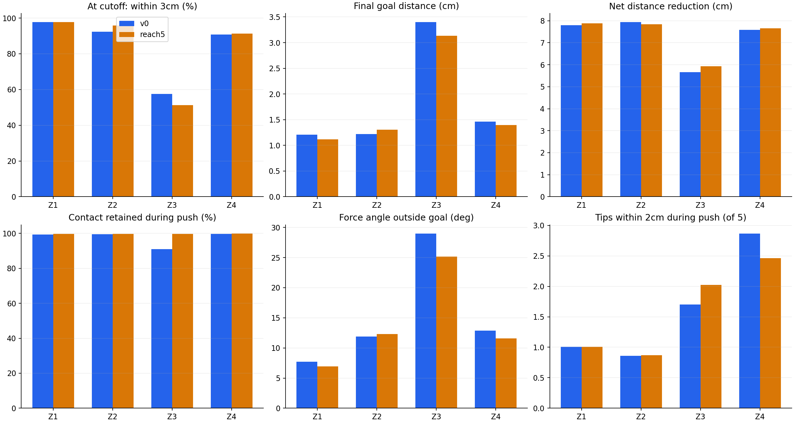
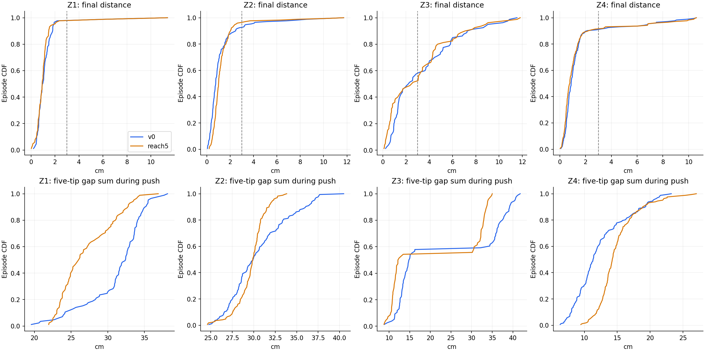
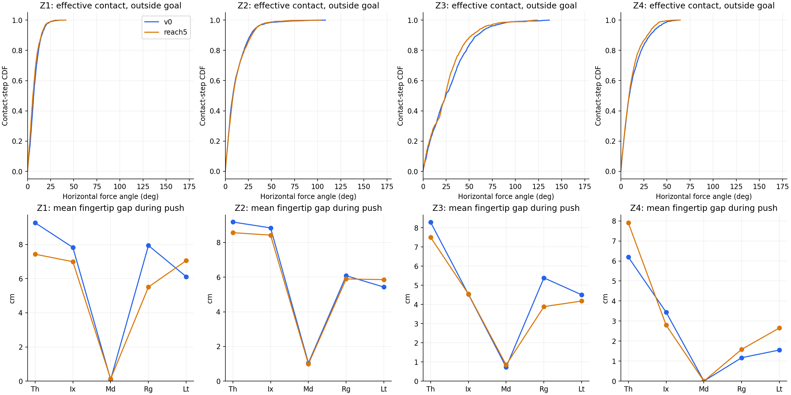
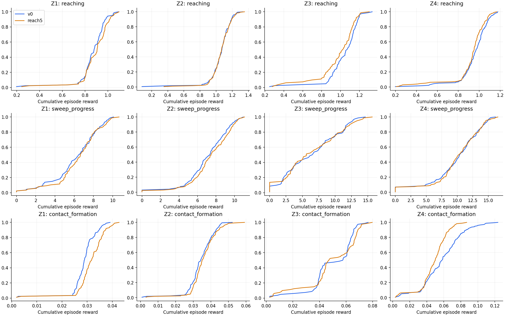
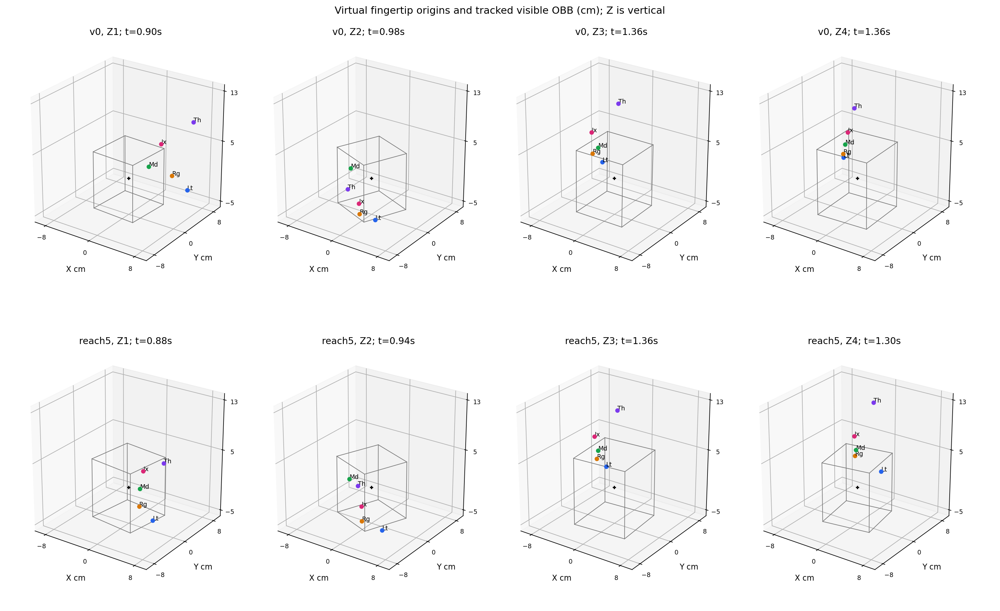
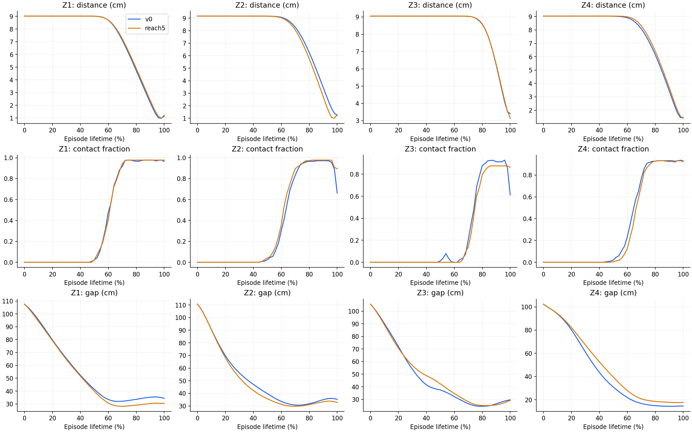
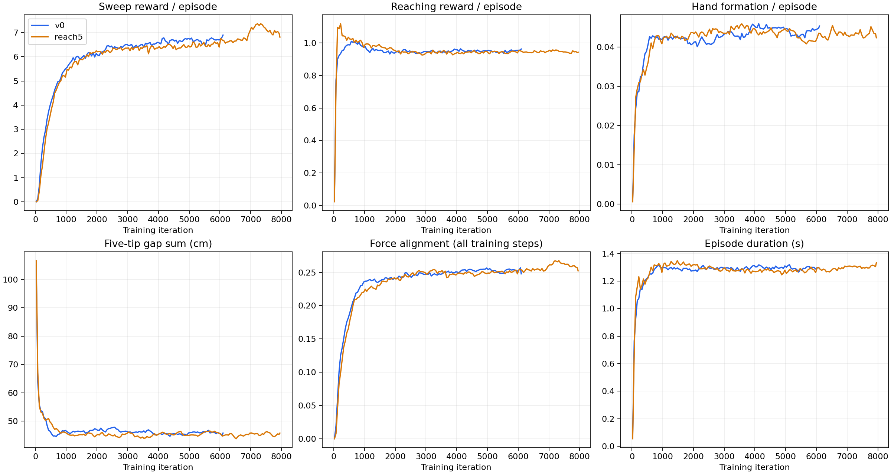

# Prof Revision v0·Reach5cm v0의 Zone별 밀기·접촉·손 자세 평가

2026-11-24 · `logs/TEMP/2026-11-24` · 각 정책 512episode, 총 1,024episode · Joint Termination을 평가 종료로 인정

## 핵심 결과

**Joint Termination 까지의 밀기 성과는 두 정책이 비슷하다.** 종료 시 목표 3cm 안에 있는 비율은 v0 **447/512=87.3%**, Reach5cm **449/512=87.7%**이며, 초기 평균 9.08cm의 목표 거리를 각각 7.44cm·7.49cm 줄였다. 정상적인 정지·유지 성능을 의미하지는 않는다. 이번 요청대로 속도 종료를 유효한 평가 종료로 포함했고, 별도의 정상 종료 실패 감점은 더하지 않았다. [S1]

**공통 병목은 Zone3 이다.** 목표 도달은 57.5%·51.3%, 목표 밖 유효 접촉의 평균 힘 방향 오차는 29.0°·25.2°다. 다른 Zone의 도달률 90.8~97.7%, 방향 오차 6.9~12.9°보다 나쁘다. Reach5cm의 Zone3은 일단 접촉한 뒤 접촉 유지율이 99.7%이지만,80 회 중 10 회는 물체에 닿기 전에 끝났다. 접촉 유지가 좋아도 밀기 완수와 같지는 않다. [S1]

**다섯 손끝을 함께 가까이 두는 자세는 충분히 형성되지 않았다.** 밀기 구간에서 물체 OBB2cm 이내인 손끝은 Zone1·2에서 평균 약 1 개, Zone3에서 1.70·2.03 개, Zone4에서 2.86·2.46 개다. 두 정책 모두 다섯 손끝이 동시에 2cm 이내인 표본은 없었다. 중지 Tip은 가깝지만 엄지·검지 등은 수 cm 떨어진 경우가 많다. Hand 보상 구현은 수식대로 동작했으나, 이를 다지 자세 학습의 성공으로 볼 수 없다. [S2]

**Reach 반경 10→5cm 변경의 추가 효과는 이 두 체크포인트만으로 입증되지 않는다.** EEF–추적 OBB 중심 거리는 종료 시에도 평균 14.06·14.35cm 다. Reach5cm는 5cm 안에 들어간 step이 0 개이며,10cm 안에 들어간 비율도 episode별 시간 비율 평균 0.77%뿐이다. 두 연속 상태가 모두 10cm 밖이면 두 반경의 증분 보상은 수학적으로 같다. [S1, S3]

## 평가 대상과 종료 해석

| 항목 | v0 | Reach5cm |
| --- | --- | --- |
| 정확한 Gym ID | Inspire-Sweep-Prof-Revision-v0 | Inspire-Sweep-Prof-Revision-Reach5cm-v0 |
| 학습 run | 2026-11-24_00-27-46 | 2026-11-24_01-06-28 |
| 분석 checkpoint | model_6100.pt | model_7950.pt |
| Reach 무감각 반경 | 10cm | 5cm |
| 본 평가 | seed42·43, 각 256 개 초기 episode | 같은 seed·환경 수·초기 장면 |
| 정책 | 결정론적 inference mean, 원래 관측 noise 유지 | 동일 |

학습이 정상 종료되지 않은 정책이라는 사용자 설명을 평가 전제로 삼았다. **원래 환경의 Joint Termination을 해제하거나 timeout 까지 강제로 연장하지 않았다.** 첫 episode의 실제 terminal transition 까지 포함해 평가했다. 모든 종료를 목표 성공으로 바꾸지는 않았다. 결과 표의 “목표 도달”은 **종료 시 XY 거리 ≤3cm**이며, 이 조건은 Joint Termination 여부와 독립적이다. 모든 초기 episode를 성과의 분모에 넣었다.1 회씩 발생한 물체 낙하·전도도 제외하지 않았다.

각 정책 511/512 회가 팔 속도로 끝났고, timeout 도달은 0 회다. 원래 `success`는 timeout 에서만 판단하므로 로그 성공률은 0 이지만, 이번 평가의 목표 도달률은 위와 같다. 한번 3cm 안에 진입한 episode는 모두 종료 때까지 반경 안에 있었다. 종료 시 물체 속도 평균은 0.219·0.226m/s로, 밀기 후 정지를 검증한 결과는 아니다.

같은 seed의 두 정책은 초기 관절·물체 state·목표·추적 OBB·손끝·방향의 해시가 모두 같았다. 두 모델은 학습 iteration과 학습 이력이 다르므로 반경 변경의 인과 효과를 분리하지 않는다. 장면별 대응 비교에서 Reach5cm가 개선된 경우 14 개, 악화된 경우 12 개이며, 목표 도달률 차이는+0.39%p 다. 대응 episode bootstrap의 기술적 95% 구간은−1.56~+2.34%p로 0을 포함한다. 두 seed에 대한 표본 변동 설명이며 재학습 실험의 신뢰구간은 아니다. [S4]

## Zone과 통계 기준

환경에 Zone별 상태·로그를 새로 추가하지 않았다. 기존 개발 기록의 시계방향 구분을 분석 라벨로 사용했으며, 공용 접촉면 보상이 사용하는 방향 분류와 대조했다. reset의 지정 밀기 방향을 선반 좌표로 변환해 고정하고, 목표를 지나쳐도 Zone을 바꾸지 않는다. [S5]

| Zone | 방향 | 각 정책 표본 수 | 보상에서 선호하는 면 |
| --- | --- | ---: | --- |
| 1 | 12 시 중심 ±30°, 선반−X | 87 | 손등 |
| 2 | 3 시 방향, +30°~+150°, 선반+Y | 171 | 손등 |
| 3 | 6 시 중심 ±30°, 선반+X | 80 | 손바닥 |
| 4 | 9 시 방향, −150°~−30°, 선반−Y | 174 | 손바닥 |

정확히 ±30°는 Zone1,±150°는 Zone3 이다.60°/120°/60°/120° 분할이므로 표본 수가 같을 필요는 없다.

- **접촉 개시:** 타겟 전용 접촉센서에서 실제 법선 하중 ≥0.01N 인 물리 substep이 있는 정책 step. 물리 sample이 모두 유효한 경우만 인정한다.
- **밀기 구간:** 첫 타겟 접촉부터 최초 3cm 진입까지, 미진입이면 종료까지다. 접촉이 한 번도 없으면 이 구간의 지표는 결측으로 두고 접촉 개시 실패를 별도로 센다. 유지율을 0으로 대체해 섞지 않는다.
- **접촉 유지율:** 위 구간의 접촉 step 비율을 episode별 계산한 뒤 평균한다.2 개 물리 substep 중 한번만 접촉해도 해당 정책 step의 접촉으로 세므로,50Hz 수준의 유지 지표다. 모든 물리 substep 내내 접촉했다는 뜻은 아니다.
- **접촉 이력 Gate:** 최근 3 개 정책 step 중 2 개 이상 접촉한 경우다. 물리 접촉 유지율과 구분한다.
- **힘 방향:** 타겟이 손으로부터 받은 법선+마찰 합력의 XY 방향과 현재 타겟→목표 XY 방향의 각도다.2 개 물리 substep을 평균하고, 수평 합력 ≥1N·목표 거리>3cm에서 평가한다. 목표 중심 부근의 방향 뒤집힘과 미약한 힘의 각도는 제외한다.
- **Tip 거리:** 실제 오른손 distal pad에서 정의한 가상 Tip 원점부터 **현재 추적 가시 OBB의 체적**까지 3D 거리다. OBB 안이면 0 이다. 실제 mesh 표면까지 거리·각 손가락 접촉력·관통량과 동일하지 않다.2cm 기준은 분석용 근접 기준이며 보상식의 임계값은 아니다.

접촉·각도·손끝의 본문 평균은 episode에 같은 가중치를 준다. “30° 이내 비율”, 접촉면 분류 비율은 해당 조건을 충족한 step을 합산한 비율이다. reward 분포는 episode 누적값이며, CSV에 원래 step 분포도 함께 보존했다.

## 얼마나 잘 밀었는가

| 정책 | Zone | 종료 시 ≤3cm | 초기→종료 거리(cm) | 순거리 감소(cm) | 평균 길이(s) |
| --- | --- | --- | --- | --- | --- |
| v0 | 1 | 85/87 (97.7%) | 9.00 → 1.21 | 7.80 | 1.16 |
| Reach5cm | 1 | 85/87 (97.7%) | 9.00 → 1.11 | 7.89 | 1.17 |
| v0 | 2 | 158/171 (92.4%) | 9.15 → 1.22 | 7.93 | 1.33 |
| Reach5cm | 2 | 164/171 (95.9%) | 9.15 → 1.31 | 7.85 | 1.33 |
| v0 | 3 | 46/80 (57.5%) | 9.07 → 3.40 | 5.67 | 1.55 |
| Reach5cm | 3 | 41/80 (51.2%) | 9.07 → 3.13 | 5.93 | 1.50 |
| v0 | 4 | 158/174 (90.8%) | 9.05 → 1.46 | 7.59 | 1.32 |
| Reach5cm | 4 | 159/174 (91.4%) | 9.05 → 1.39 | 7.66 | 1.32 |



Zone1은 두 정책 모두 85/87 회 도달했다. Zone2는 Reach5cm가 6 회 더 도달했지만 종료 거리 평균은 1.22→1.31cm로 약간 커졌다. 평균 거리와 3cm 임계값 도달률은 다른 지표이므로 동시에 개선될 필요가 없다. Zone4는 두 정책의 거리 감소와 도달률이 비슷하다.

Zone3은 v0가 80 회 중 34 회, Reach5cm가 39 회 목표 밖에서 끝났다. 전체 미도달 65·63 회 중 각각 52.3%·61.9%가 Zone3에 집중되어, 후속 개선을 여기부터 확인하는 것이 타당하다. [S1]



분포 그림의 3cm 수직선은 목표 도달 기준이다. Zone3은 최종 거리 분포의 오른쪽 꼬리가 길다. 손끝 거리 합도 Zone3에서 넓게 갈리므로 평균만으로 자세의 안정성을 설명하기 어렵다.

## Reaching: 증분 계산은 맞지만 근접 반경까지 수렴하지 않는다

이 두 환경의 Reaching은 EEF에서 **움직이는 추적 OBB 중심**까지 3D 거리에 적용된다. 물체 목표 거리나 손끝 거리 보상이 아니다. [S3]

```math
e_t = \max(\|\mathbf{p}_{EEF,t}-\mathbf{c}_{OBB,t}\|_2-\rho,0)
```

```math
R_{reach,t}=4.9(e_{t-1}-e_t)
```

양의 접근과 음의 이탈이 대칭이며, 누적 보상은 초기 초과거리와 종료 초과거리 차이로 망원합된다. 함수의 `/step_dt`와 RewardManager의 `×step_dt`는 상쇄된다. 거리 변화량에 4.9를 한 번 곱하며, 같은 거리에 머물기만 해서는 추가 Reach 보상이 나오지 않는다.

| 정책 | Zone | Reach 누적 평균 | 중앙값 [p10,p90] | 종료 EEF 거리(cm) | 반경 안 시간 비율 평균 |
| --- | --- | --- | --- | --- | --- |
| v0 | 1 | 0.870 | 0.879 [0.777, 0.979] | 16.60 | 0.0% |
| Reach5cm | 1 | 0.889 | 0.905 [0.793, 1.016] | 16.19 | 0.0% |
| v0 | 2 | 1.055 | 1.072 [0.937, 1.190] | 12.58 | 2.3% |
| Reach5cm | 2 | 1.063 | 1.068 [0.940, 1.195] | 12.46 | 0.0% |
| v0 | 3 | 1.034 | 1.070 [0.880, 1.186] | 13.00 | 1.1% |
| Reach5cm | 3 | 0.972 | 1.025 [0.785, 1.162] | 14.25 | 0.0% |
| v0 | 4 | 0.953 | 0.973 [0.835, 1.089] | 14.73 | 0.0% |
| Reach5cm | 4 | 0.923 | 0.952 [0.835, 1.077] | 15.34 | 0.0% |

두 정책은 초기 EEF 거리 34.19cm에서 약 14cm 까지 접근하며, 누적 Reach 평균은 0.986·0.972 다. **접근은 학습했으나 설정한 5cm/10cm 도달을 일반적으로 달성한 것은 아니다.** EEF와 Tip의 기준점이 다르므로 손끝이 물체에 닿으면서 EEF는 멀리 있을 수 있다.

두 시점의 거리가 모두 10cm 밖이면 `(r_prev−ρ)−(r_cur−ρ)=r_prev−r_cur`이므로 10cm와 5cm의 보상은 같다. Reach5cm의 5cm 내부 step은 0 개이고, 10cm 내부 시간 비율도 0.77%다. 반경을 줄여도 관측 궤적 대부분에서 추가 보상 신호가 생기지 않는 구조다. 반경 변경으로 자세가 좋아졌다는 결론은 이 결과로 지지되지 않는다.

## Sweeping: 거리·접촉·방향은 실제 지급과 일치한다

`Δd=d_prev−d_cur`, `h`는 최근 3step 중 2step 접촉 이력, `s`는 선호면 배율이다. 양의 진행에는 접촉·방향·면 배율이 적용되고 역방향 비용에는 그 Gate가 없다. [S3]

```math
a_t=\mathrm{clip}\left(\frac{\mathbf{F}_{xy,t}\cdot\widehat{\mathbf{g}_{xy,t}}}{\|\mathbf{F}_{xyz,t}\|_2},0,1\right)
```

```math
R_{sweep,t}=100\max(\Delta d_t,0)h_ta_ts_t,\qquad R_{retreat,t}=-20\max(-\Delta d_t,0)
```

`a`는 현재 유효 접촉·수평 합력 ≥1N·목표 거리>0 조건을 충족하지 않으면 0 이다. **분모가 3D 힘의 크기이므로 XY 각도가 좋아도 수직 힘이 크면 지급이 감소한다.** 반대로 목표에서 멀어지는 이동은 접촉이 없어도 비용을 받는다. 이번 요청에 따라 실제 종료 시점까지만 평가했다.

### 접촉은 대부분 유지되지만, 개시 실패와 Zone3은 따로 봐야 한다

| 정책 | Zone | 접촉 개시/n | 접촉 유지율 | 이력 Gate 유지율 | 유효 수평힘 유지율 | 힘각도 평가 episode |
| --- | --- | --- | --- | --- | --- | --- |
| v0 | 1 | 85/87 | 99.4% | 93.1% | 90.5% | 85 |
| Reach5cm | 1 | 85/87 | 99.7% | 93.4% | 92.1% | 85 |
| v0 | 2 | 166/171 | 99.5% | 94.1% | 95.9% | 166 |
| Reach5cm | 2 | 168/171 | 99.6% | 93.4% | 96.0% | 168 |
| v0 | 3 | 76/80 | 91.0% | 87.2% | 80.2% | 75 |
| Reach5cm | 3 | 70/80 | 99.7% | 94.4% | 90.9% | 70 |
| v0 | 4 | 162/174 | 99.6% | 94.0% | 94.4% | 162 |
| Reach5cm | 4 | 163/174 | 99.8% | 93.7% | 96.1% | 163 |

v0는 489/512 회, Reach5cm는 486/512 회에서 타겟 접촉이 있었다. 나머지 23·26 회는 실제 타겟 접촉 없이 종료했고, 성과 집계에는 전부 포함했다. 위 유지율은 **접촉 개시에 성공한 episode에 대한 조건부 지표**다. Reach5cm Zone3의 99.7%만 보고 접촉 없이 끝난 10/80 회를 놓치지 않아야 한다.

물체가 한 step에 0.1mm 이상 움직인 구간에서 타겟 접촉을 동반한 step 비율은 94.5%·95.3%다. 나머지에는 관성·초기 settling 등이 포함되며, 이를 센서 오류로 처리하지 않았다. 모든 첫 episode의 접촉 sample은 유효했고 sensor-fresh도 100%였다.

### 힘은 대체로 목표를 향하지만 Zone3이 더 흔들린다

| 정책 | Zone | 평균각도(°) | 30° 이내 step | 90° 이상 step | 수직힘 비중 평균 | 선호면 분류 step 비율 |
| --- | --- | --- | --- | --- | --- | --- |
| v0 | 1 | 7.7 | 99.6% | 0.0% | 29.1% | 19.9% |
| Reach5cm | 1 | 6.9 | 99.9% | 0.0% | 29.0% | 13.1% |
| v0 | 2 | 11.9 | 92.7% | 0.2% | 21.2% | 1.6% |
| Reach5cm | 2 | 12.3 | 91.4% | 0.1% | 27.5% | 1.4% |
| v0 | 3 | 29.0 | 56.9% | 1.7% | 17.5% | 42.6% |
| Reach5cm | 3 | 25.2 | 64.8% | 1.4% | 25.6% | 34.9% |
| v0 | 4 | 12.9 | 88.5% | 0.0% | 15.9% | 90.9% |
| Reach5cm | 4 | 11.6 | 90.8% | 0.0% | 16.5% | 92.3% |



30° 이내인 유효 접촉 step은 전체 86.8%·88.5%지만 Zone3 에서는 56.9%·64.8%다. 90° 이상인 step은 전체 0.32%·0.26%로 희소하다. Zone3의 큰 방향 오차·짧은 도달 거리·자세 편차를 함께 봐야 한다. 이 각도 분포는 양의 보상이 지급된 step 만 선택한 결과가 아니다.

Zone3에서 목표를 달성한 경우와 미달성한 경우의 평균 힘 각도는 v0 18.8° 대 45.2°, Reach5cm 15.2° 대 39.2°다. 밀기 중 Tip 거리 합도 14.85 대 36.66cm, 13.11 대 32.10cm로 갈린다. 방향·자세와 성과의 연관성이며, 자세 보상만 바꾸면 도달률이 개선된다는 인과 증거는 아니다. 접촉 없는 episode는 각도·밀기 중 Tip 평균에서 결측으로 남겼다. [S4]

### 손등/손바닥 선호는 모든 Zone에서 충분한 신호가 아니다

Zone1의 분류된 하중은 선호 손등의 반대인 손바닥에 실렸고, 선호면 하중 비율은 두 정책 모두 0%다. 다만 면 분류가 붙은 유효 접촉 step 자체가 19.9%·13.1%뿐이다. **나머지 80% 이상을 손바닥이나 손등으로 임의 분류할 수 없다.** Zone2는 분류된 하중은 손등 100%지만 분류 step이 1.6%·1.4%뿐이어서, 대부분 배율 1.0의 중립 처리다.

Zone4는 분류 step이 90.9%·92.3%, 분류 하중은 선호 손바닥 100%로 의도와 일치한다. Zone3은 분류 step 42.6%·35.0%, 그 안의 선호 손바닥 하중 99.2%·97.8%다. **면 배율 계산은 맞지만 Zone1의 반대면 사용과 Zone2의 분류 부족이 남는다.** 미분류는 sample이 유효하지 않다는 뜻이 아니라, 접촉 위치가 정의된 앞/뒷면 영역에 분류되지 않았다는 뜻이다.

### 보상 분포와 Gate별 크기

아래는 episode 누적값의 **중앙값 [p10, p90]**이다. 평균은 뒤의 Gate 대조표에 제시한다. 음의 Retreat는 목표 거리 증가분의 비용이다. [S1]

| 정책 | Zone | Sweep 중앙값 [p10,p90] | Retreat 중앙값 [p10,p90] | Hand 중앙값 [p10,p90] |
| --- | --- | --- | --- | --- |
| v0 | 1 | 6.520 [2.755, 9.007] | -0.077 [-0.186, -0.004] | 0.029 [0.025, 0.035] |
| Reach5cm | 1 | 6.634 [4.128, 9.276] | -0.058 [-0.163, -0.004] | 0.032 [0.027, 0.037] |
| v0 | 2 | 7.362 [4.707, 9.703] | -0.004 [-0.095, -0.002] | 0.034 [0.027, 0.043] |
| Reach5cm | 2 | 7.459 [5.004, 9.910] | -0.104 [-0.237, -0.002] | 0.035 [0.029, 0.045] |
| v0 | 3 | 6.545 [1.583, 11.873] | -0.002 [-0.140, -0.001] | 0.058 [0.036, 0.066] |
| Reach5cm | 3 | 5.608 [0.000, 12.254] | -0.002 [-0.023, -0.001] | 0.047 [0.017, 0.069] |
| v0 | 4 | 10.391 [5.040, 14.334] | -0.021 [-0.147, -0.000] | 0.058 [0.034, 0.086] |
| Reach5cm | 4 | 10.312 [6.050, 14.190] | -0.001 [-0.121, -0.000] | 0.050 [0.033, 0.066] |



거리 감소만 100 배한 값 → 접촉 이력 Gate → 방향 → 면 배율의 순서로 재계산했다. 모두 episode별 누적 후 Zone 평균이다. 첫 열은 **양의 거리 감소만 합산**하므로 역방향 step이 상쇄되는 순거리 감소와 다르다.

| 정책 | Zone | 100×양의거리감소 | 접촉 Gate 후 | 방향 후 | 면배율 후 실제 Sweep | 실제 Retreat |
| --- | --- | --- | --- | --- | --- | --- |
| v0 | 1 | 8.240 | 8.107 | 6.498 | 6.200 | -0.089 |
| Reach5cm | 1 | 8.236 | 8.111 | 6.643 | 6.453 | -0.070 |
| v0 | 2 | 8.067 | 8.006 | 7.083 | 7.098 | -0.027 |
| Reach5cm | 2 | 8.409 | 8.375 | 7.414 | 7.428 | -0.113 |
| v0 | 3 | 5.867 | 5.811 | 4.770 | 6.430 | -0.040 |
| Reach5cm | 3 | 5.985 | 5.941 | 4.850 | 6.391 | -0.010 |
| v0 | 4 | 7.844 | 7.768 | 6.739 | 9.925 | -0.051 |
| Reach5cm | 4 | 7.849 | 7.768 | 6.771 | 10.003 | -0.039 |

전체 평균에서 접촉 Gate는 7.677→7.599, 7.810→7.743으로 진행값을 약 1% 줄였다. 방향 조건은 이를 6.506·6.664로, 면 선호는 최종 7.802·7.975로 조정했다. Gate 오류로 보상이 소실되는 양상은 아니다. Zone4의 큰 Sweep 에는 손바닥 배율이 반영되므로 이를 다섯 손가락의 자세 품질 점수로 해석하지 않아야 한다.

## Hand: 거리 보상은 정상 지급되지만 중지 중심 근접형상이 남는다

두 체크포인트 모두 v0의 거리 합 보상을 쓴다. 후속 Prof Revision v1의 손가락별 거리×방향 항이나 팔 종료 일회 비용을 소급 적용하지 않았다. [S3]

```math
g_{f,t}=\left\|\max\left(\left|\mathbf{R}_{OBB,t}^{T}(\mathbf{p}_{f,t}-\mathbf{c}_{OBB,t})\right|-\frac{\mathbf{s}_{OBB}}{2},0\right)\right\|_2
```

```math
H_t=\frac{0.05}{0.05+\sum_{f=1}^{5}g_{f,t}},\qquad R_{hand,t}=0.245H_t\times0.02
```

거리 합 30cm 이면 raw 0.143·step 보상 0.00070, 15cm 이면 0.25·0.001225, 5cm 이면 0.5·0.00245 다. 다섯 Tip이 모두 OBB 안이면 raw 1·step 보상 0.0049가 최대다. 정지 중에도 거리 조건만 충족하면 매 step 양수이며, **접촉 유지·힘 방향·진행량·손끝 방향에 대한 Gate는 없다.**

### 손가락별 분포

밀기 구간의 3D Tip–OBB 거리(cm)를 episode별 시간 평균한 뒤 Zone 평균했다. 엄지·검지·중지·약지·소지 순서다. 전체 분위수와 2cm 근접 시간 비율은 [S2]의 CSV에 있다.

| 정책 | Zone | 엄지(cm) | 검지(cm) | 중지(cm) | 약지(cm) | 소지(cm) | 2cm 내 Tip 수/5 |
| --- | --- | --- | --- | --- | --- | --- | --- |
| v0 | 1 | 9.27 | 7.82 | 0.09 | 7.94 | 6.11 | 1.01 |
| Reach5cm | 1 | 7.43 | 6.99 | 0.14 | 5.51 | 7.05 | 1.01 |
| v0 | 2 | 9.18 | 8.84 | 1.05 | 6.08 | 5.43 | 0.86 |
| Reach5cm | 2 | 8.57 | 8.42 | 0.99 | 5.90 | 5.86 | 0.87 |
| v0 | 3 | 8.29 | 4.54 | 0.73 | 5.39 | 4.50 | 1.70 |
| Reach5cm | 3 | 7.51 | 4.55 | 0.85 | 3.89 | 4.18 | 2.03 |
| v0 | 4 | 6.20 | 3.44 | 0.01 | 1.17 | 1.56 | 2.86 |
| Reach5cm | 4 | 7.90 | 2.80 | 0.00 | 1.59 | 2.66 | 2.46 |

Zone1의 중지는 0.09·0.14cm 지만 엄지는 7.43~9.27cm, 검지는 6.99~7.82cm 다. Zone2도 중지는 약 1cm 인 반면 엄지·검지는 8cm 이상 떨어져 있다. **물체를 잘 미는 것과 여러 Tip을 가까이 배치하는 자세는 구분해야 한다.** 중지 Tip의 기하학적 근접을 확인한 결과이며, 실제 힘이 중지에만 실렸다고 단정하지 않는다. 손가락별 타겟 접촉력 분배는 이번 계측에 포함하지 않았다.

Zone4는 중지·약지·소지가 가까워 가장 좋은 근접 형상이지만 엄지는 6.20·7.90cm 다. Reach5cm의 거리 합은 Zone1·3에서 작아지는 대신 Zone4 에서는 12.37→14.95cm로 커졌다. 모든 Zone에서 일관된 다지 자세 개선이라고 볼 수 없다.

| 정책 | Zone | 거리합 평균(cm) | 거리 합 중앙값 [p10,p90] · cm | 종료 거리합(cm) | 밀기중 raw H |
| --- | --- | --- | --- | --- | --- |
| v0 | 1 | 31.24 | 32.43 [24.41, 35.12] | 34.39 | 0.140 |
| Reach5cm | 1 | 27.12 | 26.08 [23.06, 32.74] | 30.41 | 0.158 |
| v0 | 2 | 30.57 | 29.93 [26.72, 36.05] | 35.21 | 0.142 |
| Reach5cm | 2 | 29.73 | 29.88 [27.59, 31.78] | 32.80 | 0.145 |
| v0 | 3 | 23.46 | 14.92 [11.97, 39.22] | 29.65 | 0.210 |
| Reach5cm | 3 | 20.98 | 12.29 [10.57, 33.65] | 29.26 | 0.232 |
| v0 | 4 | 12.37 | 11.34 [8.06, 19.29] | 14.63 | 0.304 |
| Reach5cm | 4 | 14.95 | 14.25 [11.90, 18.89] | 17.70 | 0.257 |



그림은 목표 도달 episode 중 밀기 구간 평균 거리 합이 중앙값인 episode를 골라, 목표 밖 접촉 구간의 중간 sample을 사용했다. 회색 상자는 현재 추적 OBB, 색점은 가상 Tip 원점이다. 실제 손 mesh 나 관절 연결선 그림, 성과 전체의 평균 형상은 아니다. seed·환경 ID·step은 [대표 표본 선택](../../03_assets/prof_revision_zone_analysis_2026-11-24/geometry_selection.json)에 보존했다.

가상 pad 법선과 Tip→OBB 중심 방향의 양면 기준 각도도 계측했다. 밀기 구간의 episode 평균을 다시 평균하면 44.4°·44.0°다. v0 에는 이 각도에 대한 보상이 없으므로 방향 정렬의 학습 완료를 판정할 근거는 없다. 두 면을 동일하게 취급한 기하 진단값이며 접촉력 방향과도 다르다.

### Hand 보상 크기는 실제 자세 개선을 강하게 요구하지 않는다

episode 누적 Hand 평균은 0.0441·0.0415로 Sweep 평균 7.802·7.975의 0.57%·0.52%다. 손 관절 속도 누적 비용은 −0.330·−0.318, 손 Action Limit 비용은 −0.0759·−0.0784 다. 관측 return 규모에서 Hand 보상은 이 비용들보다 작다. 이를 gradient 나 학습 인과로 환산할 수는 없지만, **일부 Tip이 멀리 있어도 큰 밀기 return을 얻는 해법이 남아 있다**는 관측과 일치한다.

현재 Hand 항은 거리 합 하나를 평가하므로 각 Tip의 개별 최소 기준 달성을 강제하지 않고 접촉·방향 조건도 보지 않는다. 중지 근처에 물체를 두고 다른 Tip은 멀리 있는 형상도 일정한 양의 보상을 받는다. 누적 Hand는 episode 길이의 영향도 받으므로 raw H·거리 합·개별 Tip 분포를 함께 평가했다.



위 그림은 각 episode의 처음~종료를 0~100%로 정규화한 뒤 동일 가중 평균한 것이다. 종료 후 0을 채우거나 다음 episode를 섞지 않았다. 같은 백분율이 같은 실제 초를 뜻하지 않으므로 속도 비교에는 사용하지 않는다.

## 학습 로그와 실제 평가의 연결

학습 로그에서 checkpoint 직전 100 개 scalar 기록 평균의 팔 속도 종료는 99.866%·99.765%, episode 길이는 1.296·1.308 초다. `Episode_Reward`는 episode 누적값을 **최대 episode 길이 10 초로 나눈 로그**이므로 10을 곱해 보상 규모를 복원했다. 실제 평균 길이 1.3 초를 곱하지 않는다. [S6]

| 학습 로그 지표 | v0 | Reach5cm |
| --- | ---: | ---: |
| Reaching episode 규모 | 0.956 | 0.944 |
| Sweep episode 규모 | 6.790 | 7.010 |
| Hand episode 규모 | 0.0447 | 0.0434 |
| 5 개 Tip 거리 합(step 로그 평균,cm) | 45.21 | 45.41 |
| Force alignment(step 로그 평균) | 0.255 | 0.257 |

학습 scalar 에는 탐색 action·자동 reset·접촉 전 구간이 섞여 있다. 실제 평가의 밀기 중 Tip 거리 합 23.55·23.06cm, 접촉 조건부 힘 각도 14.1°·13.0°와 모집단이 다르다. 학습 전체의 평균을 밀기 구간 품질로 대체하지 않았다. 학습 로그에는 Zone별 원시 episode가 없으며, 본 Zone 분석은 명시한 두 checkpoint의 실측 재생 결과다.



## 의도대로 동작하는지에 대한 판단과 다음 확인

| 항목 | 구현·지급 확인 | 행동 수준 판단 |
| --- | --- | --- |
| Reaching | 부호·weight·dt·초과거리 증분 일치 | 접근은 학습했으나 근접 반경 도달은 드묾. 5cm화의 추가 효과 미입증 |
| Sweep 거리 | 양의 거리 감소 100배·역방향 20배 비용 일치 | 약 7.4~7.5cm 감소. Zone3 미도달 문제 |
| Sweep 접촉 | 최근 3step 중 2접촉 Gate·현재 접촉 조건 일치 | 접촉 후 유지는 대체로 좋으나 개시 실패 23·26회 포함 필요 |
| Sweep 방향 | 3D 힘 분모·수평 투영·1N 조건·배율 일치 | Zone1·2·4 양호. Zone3은 오차와 분산이 큼 |
| 접촉면 선호 | 앞/뒷면 하중 배율 계산 일치 | Zone4는 의도 일치. Zone1 반대면·Zone2 미분류가 문제 |
| Hand 거리 합 | 가상 Tip·live OBB·5cm scale·0.245 weight 일치 | 중지 중심 근접. 다섯 Tip의 협응 자세 달성 근거 부족 |
| 손끝 방향 | Pose 관측·진단. 방향 보상항 없음 | 두 v0 정책에서 방향 정렬 학습 완료로 볼 수 없음 |

후속 수정·재학습은 수행하지 않았다. 다음 실험의 우선순위는 **Zone3의 접촉 개시·완수 실패**와 **다지 자세 보상의 실효성**이다. 동일 훈련 조건·동일 iteration·여러 훈련 seed에서 Hand 항 유무/구성만 바꾸고, 목표 도달·접촉 개시·각 Tip 거리·힘 각도를 동시에 비교해야 한다. 자세가 좋아져도 밀기나 면 선호가 나빠지지 않는지 확인할 필요가 있다. 후속 v1 코드가 존재한다는 사실은 그 효과의 검증을 대신하지 않는다.

Reach는 EEF 거리와 실제 Tip 접촉 시 기하를 먼저 대조하고, 원하는 접근 기준이 EEF 중심인지 손끝·접촉면인지 명확히 한 뒤 반경을 결정하는 것이 좋다. 이번 결과에서는 5cm 화만으로 다지 근접을 요구하는 신호가 추가되었다고 보기 어렵다. 면 선호는 Zone1의 반대면 사용과 Zone2의 미분류를 먼저 확인해야 한다. 정지·유지 개선은 이번 평가와 분리한 후속 과제다.

## 검증·재현·한계

본 실행 4 회는 모두 process exit 0·metadata complete·모든 첫 episode terminal 포함으로 완료했다. 보상 합과 RewardManager 반환값의 최대 절대 차이는 3.58e−7 이다. numpy로 독립 구현한 Reaching·Sweep·Retreat·Hand의 보상 오차는 3.58e−7 이하, Tip–OBB 거리 오차는 8.95e−8m 이하, 접촉 이력 Gate 불일치는 0 개다. 모든 대상 보상·Tip 배열이 유한하고 접촉 sample 유효율·sensor-fresh는 100%다. [S7]

학습 시 env.yaml과 평가 env.yaml을 전체 재귀 대조했다. 차이는 환경 수 2048→256, seed43 추가, 결과 경로, 학습 PC→현재 PC의 robot USD 경로, PhysX aggregate-pair capacity 2²⁵→2²¹이다. 보상·종료·관측·제어·reset 설정의 의미상 차이는 없었다. capacity는 GPU 메모리를 위한 할당 변경이며 불완전 sample은 관찰되지 않았다. 학습 PC 자산 원본과의 byte 동일성은 독립 검증하지 못했고 현재 파일 해시를 보존했다.

원본 checkpoint·학습 event·학습 설정·활성 패키지 Python 파일의 작업 전후 SHA256을 대조해 변경 없음을 확인했다. 환경·보상·등록·PPO 코드는 수정하지 않았고 `logs/rsl_rl` 및 TEMP 로그는 읽기만 했다. terminal 상태와 reset이 섞이지 않도록 보상 계산 직후·자동 reset 전 값을 저장했다. 별도 noise 추출·보상 재호출은 하지 않았다.

결과는 두 checkpoint·두 평가 seed·결정론적 inference에 한정되며 학습 iteration도 다르다. 실제 정지·유지는 평가하지 않았다. Zone3의 표본 80 개, OBB와 mesh 거리의 차이, 접촉면 미분류, 손가락별 하중 미계측을 해석에 반영했다. Hand 보상의 인과 효과는 무보상 대조군 없이 확정할 수 없다. 보고서는 **검토한 범위에서 사용할 수 있으나 이 한계를 포함해 해석해야 한다.**

재현용 실행기·분석기·전체 학습 scalar·소스 snapshot·원시 trace는 [작업 산출물](../../../../outputs/prof_revision_zone_analysis_20261124/)에 있다. 예시는 Workspace 루트에서 실행한다. 기존 output을 덮어쓰지 않으므로 재실행에는 새 디렉터리 이름을 사용한다.

```powershell
& C:/Users/3cmde/miniconda3/envs/env_isaaclab/python.exe outputs/prof_revision_zone_analysis_20261124/collect.py --task Inspire-Sweep-Prof-Revision-v0 --checkpoint logs/TEMP/2026-11-24/inspire_sweep_prof_revision_v0/2026-11-24_00-27-46/model_6100.pt --output outputs/prof_revision_zone_analysis_20261124/v0_seed42_replay --num_envs 256 --seed 42 --steps 500 --headless
```

Reach5cm는 task를 `Inspire-Sweep-Prof-Revision-Reach5cm-v0`, checkpoint를 `inspire_sweep_prof_revision_reach5cm_v0/2026-11-24_01-06-28/model_7950.pt`로 바꾸고 seed42·43에서 수집한다. 분석은 같은 폴더의 `training.py`→`analyze.py`→`extra.py`→`report.py`→`polish.py` 순서다. 수집 폴더 이름을 변경하면 분석기의 입력 경로도 맞춘다.

## 근거 자료

- **S1:** [Zone요약](../../03_assets/prof_revision_zone_analysis_2026-11-24/zone_summary.csv) · [전체1,024episode](../../03_assets/prof_revision_zone_analysis_2026-11-24/episodes.csv) · [분포](../../03_assets/prof_revision_zone_analysis_2026-11-24/distributions.csv) · [전체보상항step/episode분포](../../03_assets/prof_revision_zone_analysis_2026-11-24/reward_distributions.csv).
- **S2:** [손가락별거리·근접시간](../../03_assets/prof_revision_zone_analysis_2026-11-24/finger_gaps.csv) · [정규화시간곡선](../../03_assets/prof_revision_zone_analysis_2026-11-24/episode_phase.csv).
- **S3:** [독립환경계약](../environments/PROF_REVISION_V0.md) · [상태·진행계산](../../../../src/inspire_sweep_baseline/inspire_sweep_baseline/mdp/common/prof_revision_state.py) · [손끝·OBB기하](../../../../src/inspire_sweep_baseline/inspire_sweep_baseline/mdp/common/prof_revision_geometry.py) · [보상Cfg](../../../../src/inspire_sweep_baseline/inspire_sweep_baseline/mdp/rewards/prof_revision.py) · [실제보상함수](../../../../src/inspire_sweep_baseline/inspire_sweep_baseline/mdp/reward_functions/prof_revision.py).
- **S4:** [대응비교·Zone별성과조건부상세](../../03_assets/prof_revision_zone_analysis_2026-11-24/supplement.json).
- **S5:** [이전영역분석의정의](2026-11-23_sweep_region_timelines.md#평가-범위와-그래프-읽기) · [공용방향·면선호함수](../../../../src/inspire_sweep_baseline/inspire_sweep_baseline/mdp/reward_functions/sweep_contact_preference.py).
- **S6:** [원본TEMP학습자료](../../../../logs/TEMP/2026-11-24/) · [학습scalar요약](../../../../outputs/prof_revision_zone_analysis_20261124/training_summary.json). 학습집계의분모는개별 episode 개수가아닌 logger 기록이다.
- **S7:** [재계산·설정대조·원시trace해시](../../03_assets/prof_revision_zone_analysis_2026-11-24/validation.json) · [원본 파일 해시](../../03_assets/prof_revision_zone_analysis_2026-11-24/input_hashes.json) · [분석기·현재 자산 해시](../../03_assets/prof_revision_zone_analysis_2026-11-24/analysis_sources.json) · [이번계측개발기록](../logs/2026-11-24_prof_revision_zone_analysis.md).
