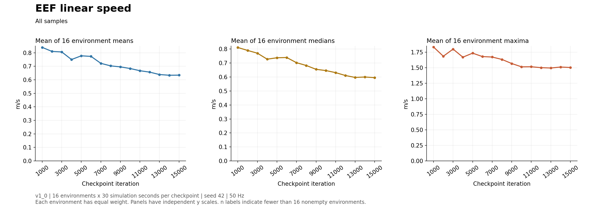
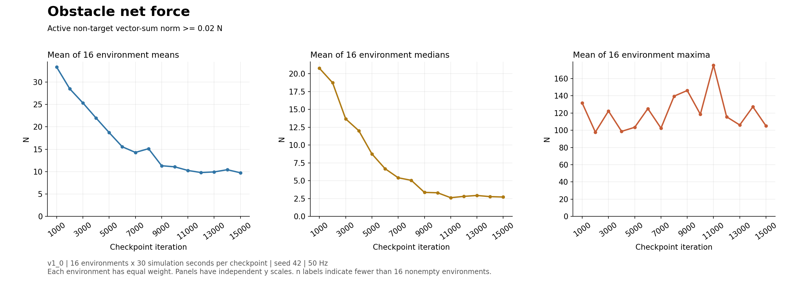
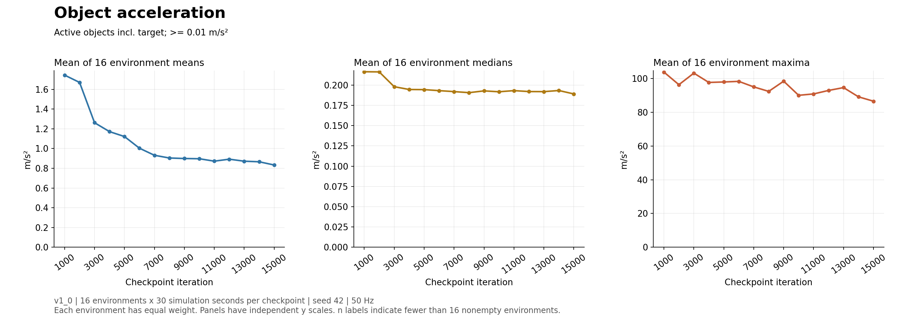
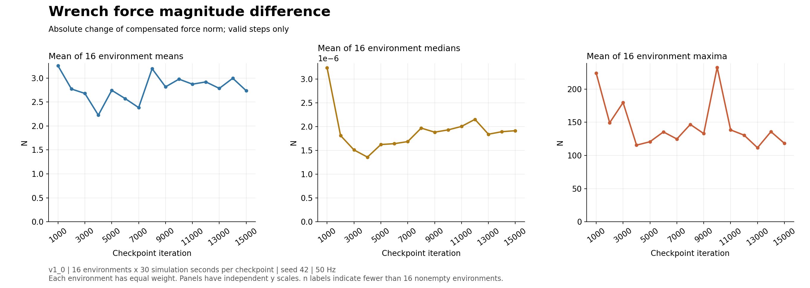
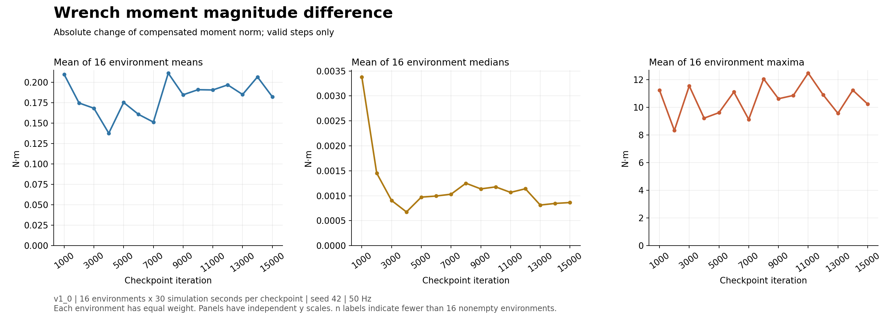

# Fusion v1_0: 학습 진행에 따른 물리 측정값 변화

[개발 로그](README.md)

**Checkpoint 1000~15000, 간격1000 · 각각16환경 × 내부 시간30초 · seed42**

각 환경에서 평균·중앙값·최대값을 구한 다음, 해당 통계량을16환경에 걸쳐 산술평균했다. 따라서 최대값 그래프는 환경별 최대값의 평균이다. 전체 표본의 최댓값은 CSV의 largest_observed_value 열에 별도로 보존한다. 조건을 통과한 표본이 없는 환경은0으로 채우지 않고 제외하며 유효 환경 수를 CSV와 그래프에 표시한다.

접촉력은 타겟을 제외한 활성 장애물 힘 벡터 합의 norm에서0.02N 이상, 가속도는 타겟 포함 활성 물체의 COM 가속도에서0.01m/s² 이상을 선택했다. 가속도 주 통계는 reset 첫 물리 표본을 포함한다. Wrench Diff는 보정된 EEF 힘/모멘트 크기의 스텝 간 절대 변화량이다. 벡터 차이 norm이나 시간 미분이 아니며, reset 첫 표본을 제외하고 별도 크기 문턱값은 적용하지 않는다.

각 체크포인트 iteration의 원래 커리큘럼을 복원·고정하여 재생했다. 따라서 물체 수와 보상 기준의 변화도 포함되며 정책 가중치만 바꾼 통제 실험은 아니다. 여러 seed에 대한 통계적 유의성은 평가하지 않았다.

[전체 이미지](../../03_assets/artifacts/2026-10-23_fusion_v1_0_training_trend/trend_overview.png) · [16환경 평균 통계 CSV](../../03_assets/artifacts/2026-10-23_fusion_v1_0_training_trend/statistics_averaged_16env.csv) · [환경별 상세 CSV](../../03_assets/artifacts/2026-10-23_fusion_v1_0_training_trend/statistics_per_environment.csv) · [실행 요약](../../03_assets/artifacts/2026-10-23_fusion_v1_0_training_trend/runs.csv)

## 관측된 변화

아래 수치는 각 환경 평균의16환경 평균이다. checkpoint1000과15000을 비교한다.

| 지표 | 1000 | 15000 | 변화 |
| --- | ---: | ---: | ---: |
| EEF 속력 (m/s) | 0.839832 | 0.634505 | -24.45% |
| 장애물 합력 (N) | 33.3506 | 9.7419 | -70.79% |
| 물체 가속도 (m/s²) | 1.74486 | 0.833323 | -52.24% |
| Wrench 힘 변화 (N) | 3.2553 | 2.73601 | -15.95% |
| Wrench 모멘트 변화 (N·m) | 0.209495 | 0.182206 | -13.03% |

EEF 속력·장애물 합력·가속도의 평균은 전반적으로 감소했다. 장애물 합력의 최대값 평균은 중간 checkpoint에서 오르내리므로 최대 충격까지 일관되게 감소했다고 해석하지 않는다. Wrench 힘/모멘트 변화량의 평균 역시 단조 감소하지 않고 변동한다. 이는 이번30초·단일 seed 실측 결과다.

## EEF Linear Speed

단위: m/s. 아래 세 열 모두 환경별 통계량의 평균.

| Checkpoint | 평균 | 중앙값 | 최대값 | 유효 환경 |
| --- | ---: | ---: | ---: | ---: |
| 1000 | 0.839832 | 0.811183 | 1.8342 | 16/16 |
| 2000 | 0.809935 | 0.790046 | 1.68599 | 16/16 |
| 3000 | 0.806182 | 0.770326 | 1.80077 | 16/16 |
| 4000 | 0.749919 | 0.727584 | 1.6709 | 16/16 |
| 5000 | 0.777448 | 0.737742 | 1.73559 | 16/16 |
| 6000 | 0.773113 | 0.739452 | 1.68055 | 16/16 |
| 7000 | 0.721886 | 0.702505 | 1.67305 | 16/16 |
| 8000 | 0.703067 | 0.682458 | 1.63439 | 16/16 |
| 9000 | 0.695586 | 0.655098 | 1.56859 | 16/16 |
| 10000 | 0.683562 | 0.64625 | 1.5153 | 16/16 |
| 11000 | 0.667174 | 0.631482 | 1.51662 | 16/16 |
| 12000 | 0.656707 | 0.610917 | 1.50193 | 16/16 |
| 13000 | 0.638938 | 0.597048 | 1.49641 | 16/16 |
| 14000 | 0.633715 | 0.600151 | 1.51203 | 16/16 |
| 15000 | 0.634505 | 0.595466 | 1.50473 | 16/16 |

## Obstacle Net Force

단위: N. 아래 세 열 모두 환경별 통계량의 평균.

| Checkpoint | 평균 | 중앙값 | 최대값 | 유효 환경 |
| --- | ---: | ---: | ---: | ---: |
| 1000 | 33.3506 | 20.7595 | 131.603 | 16/16 |
| 2000 | 28.4941 | 18.7411 | 97.8216 | 16/16 |
| 3000 | 25.3497 | 13.6649 | 122.329 | 16/16 |
| 4000 | 21.9865 | 12.0065 | 98.7051 | 16/16 |
| 5000 | 18.7211 | 8.75143 | 103.458 | 16/16 |
| 6000 | 15.5518 | 6.68568 | 125.119 | 16/16 |
| 7000 | 14.2894 | 5.41376 | 102.426 | 16/16 |
| 8000 | 15.1243 | 5.05266 | 139.623 | 16/16 |
| 9000 | 11.3139 | 3.36135 | 146.161 | 16/16 |
| 10000 | 11.0668 | 3.30991 | 118.539 | 16/16 |
| 11000 | 10.2576 | 2.61611 | 175.581 | 16/16 |
| 12000 | 9.79386 | 2.80279 | 115.622 | 16/16 |
| 13000 | 9.93416 | 2.9316 | 106.118 | 16/16 |
| 14000 | 10.4258 | 2.7668 | 127.233 | 16/16 |
| 15000 | 9.7419 | 2.71241 | 105.059 | 16/16 |

## Object Acceleration

단위: m/s². 아래 세 열 모두 환경별 통계량의 평균.

| Checkpoint | 평균 | 중앙값 | 최대값 | 유효 환경 |
| --- | ---: | ---: | ---: | ---: |
| 1000 | 1.74486 | 0.216582 | 103.898 | 16/16 |
| 2000 | 1.67072 | 0.216376 | 96.4147 | 16/16 |
| 3000 | 1.26223 | 0.198122 | 103.267 | 16/16 |
| 4000 | 1.17186 | 0.194656 | 97.7465 | 16/16 |
| 5000 | 1.12189 | 0.194505 | 98.0297 | 16/16 |
| 6000 | 1.00361 | 0.193241 | 98.3929 | 16/16 |
| 7000 | 0.931967 | 0.192048 | 95.1075 | 16/16 |
| 8000 | 0.904232 | 0.190745 | 92.4392 | 16/16 |
| 9000 | 0.899231 | 0.192928 | 98.4879 | 16/16 |
| 10000 | 0.896761 | 0.191851 | 90.1176 | 16/16 |
| 11000 | 0.872306 | 0.193258 | 90.9299 | 16/16 |
| 12000 | 0.892291 | 0.192106 | 93.0064 | 16/16 |
| 13000 | 0.871859 | 0.192015 | 94.6828 | 16/16 |
| 14000 | 0.865991 | 0.193394 | 89.2042 | 16/16 |
| 15000 | 0.833323 | 0.189162 | 86.6141 | 16/16 |

## Wrench Diff — 힘

단위: N. 아래 세 열 모두 환경별 통계량의 평균.

| Checkpoint | 평균 | 중앙값 | 최대값 | 유효 환경 |
| --- | ---: | ---: | ---: | ---: |
| 1000 | 3.2553 | 3.23529e-06 | 224.006 | 16/16 |
| 2000 | 2.77165 | 1.81216e-06 | 149.188 | 16/16 |
| 3000 | 2.67885 | 1.50968e-06 | 179.668 | 16/16 |
| 4000 | 2.22567 | 1.35892e-06 | 115.483 | 16/16 |
| 5000 | 2.74419 | 1.62292e-06 | 120.639 | 16/16 |
| 6000 | 2.57092 | 1.64137e-06 | 135.421 | 16/16 |
| 7000 | 2.38331 | 1.68509e-06 | 124.745 | 16/16 |
| 8000 | 3.1954 | 1.96869e-06 | 146.705 | 16/16 |
| 9000 | 2.81625 | 1.8832e-06 | 132.904 | 16/16 |
| 10000 | 2.9776 | 1.93072e-06 | 232.687 | 16/16 |
| 11000 | 2.87233 | 2.00375e-06 | 138.453 | 16/16 |
| 12000 | 2.91957 | 2.15257e-06 | 130.567 | 16/16 |
| 13000 | 2.78415 | 1.84015e-06 | 111.577 | 16/16 |
| 14000 | 2.99613 | 1.89293e-06 | 135.78 | 16/16 |
| 15000 | 2.73601 | 1.91354e-06 | 118.21 | 16/16 |

## Wrench Diff — 모멘트

단위: N·m. 아래 세 열 모두 환경별 통계량의 평균.

| Checkpoint | 평균 | 중앙값 | 최대값 | 유효 환경 |
| --- | ---: | ---: | ---: | ---: |
| 1000 | 0.209495 | 0.00338073 | 11.242 | 16/16 |
| 2000 | 0.174573 | 0.00145263 | 8.3304 | 16/16 |
| 3000 | 0.16812 | 0.000904708 | 11.5566 | 16/16 |
| 4000 | 0.137567 | 0.000674896 | 9.22368 | 16/16 |
| 5000 | 0.175198 | 0.000971956 | 9.62125 | 16/16 |
| 6000 | 0.160651 | 0.000994088 | 11.1143 | 16/16 |
| 7000 | 0.151189 | 0.00103078 | 9.13301 | 16/16 |
| 8000 | 0.211047 | 0.0012507 | 12.0662 | 16/16 |
| 9000 | 0.184588 | 0.00113691 | 10.6263 | 16/16 |
| 10000 | 0.190833 | 0.00117719 | 10.8664 | 16/16 |
| 11000 | 0.190518 | 0.00106693 | 12.4854 | 16/16 |
| 12000 | 0.196733 | 0.00113967 | 10.9182 | 16/16 |
| 13000 | 0.184988 | 0.000813235 | 9.56951 | 16/16 |
| 14000 | 0.206473 | 0.000845739 | 11.2459 | 16/16 |
| 15000 | 0.182206 | 0.000863432 | 10.2405 | 16/16 |

## 실행·검증

원본은 지정 TEMP run의 model_1000.pt~model_15000.pt이며 읽기 전용이다. 수집은 collect_fusion_reward_inputs.py에 --task Isaac-Inspire-Contact-Sweep-Clutter-Fusion-v1_0 --headless --num_envs 16 --steps 1500 --seed 42를 전달하여 checkpoint별 독립 프로세스로 실행했다. 각 수집 후 validate_fusion_reward_inputs.py를 실행했다.

Workspace outputs/fusion_reward_inputs/2026-10-23_v1_0_training_trend/ 아래 run_batch.py, analyze.py, publish_local.py에 재현 코드를 보존한다. model<iteration>/마다 env_00.csv~env_15.csv, resets.csv, episode_index.csv, 환경 설정·metadata·validation.json이 있다.

15개 실행 모두 정상 완료·검증 통과: 각 환경1,500행·30초, 전체360,000환경-step 표본. 총 reset9,435건. 종료 표본 보존·reset 경계·termination 원인·시간축·finite·물체 활성/차분 유효성·힘 합력 한계·wrench 차분 재계산을 검증했다. 분석 JSON은 원시 CSV 해시를 보존한다.

전체 표본을 사용하는 unthresholded 및 가속도 penalty_valid_unthresholded 결과를 CSV에 별도로 제공한다. 그래프는 primary 집계를 사용한다.

추가 확인:15개 실행의 관측·보상·행동·종료·이벤트·명령·커리큘럼·물리 설정을 학습 당시 저장 설정과 대조하여 모두 일치했다.75개 주 집계 조합 모두16환경의 유효 표본을 확보했다. 원시240개 CSV의 분석 후 SHA256 재검사, 환경 평균 독립 sum/count 계산, 집계 CSV 재읽기 검증을 통과했다. 그래프5개와 통합 이미지의 축·범례·값 표시를 시각 확인했다.
