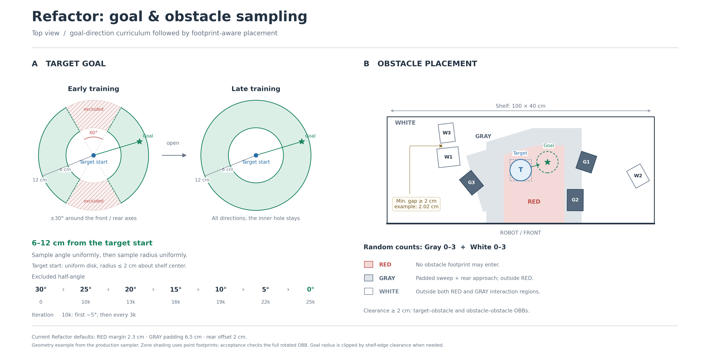

# Refactor 목표·장애물 샘플링 통합 이미지

## 요청과 범위

Refactor 계열의 Target Goal 생성과 RED/Gray/White 장애물 생성 조건을 한 이미지로 설명해 달라는 요청이다. 사용자 확인에 따라 ‘위아래가 끊긴 도넛 → 원형’은 확대도가 아니라 **방향 제외각 커리큘럼으로 완전한 고리가 되는 과정**으로 해석했다. 환경 코드·학습 설정·기존 로그는 변경하지 않았다.

## 산출물

- [PNG 이미지](../../03_assets/img/refactor_goal_obstacle_sampling.png): 4560×2280, 흰 배경.
- [편집 가능한 SVG](../../03_assets/img/refactor_goal_obstacle_sampling.svg).
- Workspace의 `outputs/refactor_sampling_figure/build_figure.py`: 재생성 스크립트.
- Workspace의 `outputs/refactor_sampling_figure/validation.json`: 배치·간격·목표 샘플링 검증 수치.



## 실제 코드와 표현의 대조

| 그림 요소 | 현재 코드 근거·표현 |
| --- | --- |
| 초기 Target | `wrench_refactor_layout.sample_commands`: 선반 중앙 반경2cm 원판 내부 면적 균등 |
| 목표 거리 | Target 시작점을 중심으로6–12cm. 내부6cm는 계속 제외하고, 필요 시 선반 경계 여유로 바깥 반경 제한 |
| 초기 제외 방향 | shelf ±X인 앞·뒤 각각 half-angle30°, 즉 각 틈의 전체 각도60° |
| 고리 완성 | `wrench.goal_deadzone_schedule`: 10k에서25°로 처음 감소, 이후3k마다5° 감소, 25k에서0° |
| 샘플링 분포 | 허용 방위 균등 → 해당 방향의 허용 반경 구간에서 거리 균등. 고리 면적 균등으로 표시하지 않음 |
| RED | Target swept OBB + 로봇 전면 방향 wrist extrusion +2.3cm margin. 장애물 footprint 침범 금지 |
| Gray | RED의6.5cm 바깥 envelope와 rear approach 직사각형의 합에서 RED 제외. Rear offset2cm |
| White | RED와 Gray 상호작용 영역에 겹치지 않는 장애물 OBB |
| 개수 | `event_functions/wrench_refactor.reset_scene`: Gray·White 각각0–3 균등. 그림 예시는3개+3개 |
| 최소 간격 | `LayoutConfig.finger_gap=.020`, `generate_layout`의 SAT 판정. 초기 타겟–장애물 및 모든 장애물 쌍 |

공통 양방향 Refactor의 규칙을 그렸다. `v3-Test`의 임시 왼쪽 목표 전용 제한은 일반 계열 규칙과 다르므로 이 그림에 포함하지 않았다. 초록 Goal의 점/별은 선택한 목표 중심이며, 목표 성공 반경3cm를 뜻하는 원을 추가하지 않았다.

## 생성·검증

실행 명령, workspace 루트:

```bash
/home/min/miniconda3/envs/env_isaaclab/bin/python outputs/refactor_sampling_figure/build_figure.py
```

실제 `bbox_scene_layout.generate_layout`, `zone_masks` 및 `wrench_refactor_layout.sample_commands` 함수를 시뮬레이터 없이 import해 실행했다. 예시 footprint 크기는 설명용이며 실제 USD 장면을 캡처한 것은 아니다. 배경은 점 footprint 기준의 존을 표시하지만 장애물의 허용·분류는 전체 회전 OBB로 검사했다. 그러므로 Gray 물체의 중심이 배경 White에 있어도 OBB가 Gray에 걸치면 Gray로 분류될 수 있다.

seed42에서 Gray3/White3 배치 완료, RED 침범0개, 타겟을 포함한7개 OBB의21개 쌍에 독립적인 NumPy vertex–segment 최소 유클리드 거리 검사를 적용했다. 최소 간격은 **0.020194522m ≈2.02cm**로 전부2cm 이상이었다. 초기30°와 최종0° 각각4000개 목표 샘플의 거리6–12cm 및 허용 방위 조건도 검사했다.

PNG를 직접 열어 고리 형태·라벨·범례·최소 간격 치수선이 보이는지 확인했다. 이미지 생성과 기하 검증이며 물리 시뮬레이션·학습·모든 실제 자산 조합의 검증은 수행하지 않았다. 기존 수동 조작 구현 등 이전 작업트리 변경은 보존했다.

## 후속: 무라벨 White·Gray·RED 6개 배치

사용자가 모든 라벨을 삭제하고 White/Gray/RED 영역 생성만 여러 배치로 보여 달라고 요청했다. 목표 고리·장애물·Target/Goal 마커·이동 화살표·치수선·범례·번호·설명 문구를 모두 제외한 영역 이미지를 새로 생성했다. 이전 통합 이미지는 보존했다.

- [6개 배치 모음 PNG](../../03_assets/img/refactor_zones_unlabeled/zones_all.png).
- [모음 SVG](../../03_assets/img/refactor_zones_unlabeled/zones_all.svg).
- [개별 PNG·SVG와 기하 메타데이터 ZIP](../../03_assets/img/refactor_zones_unlabeled.zip).
- 개별 이미지는 같은 폴더의 `zones_01`~`zones_06` PNG/SVG다.

`outputs/refactor_sampling_figure/build_zone_variants.py`로 재생성한다. 실제 `sample_commands`에서 seed20261106으로20000개 후보를 생성한 뒤, board 기준−45/0/45/135/180/225° 부근의6개 표본을 골랐다. 모두 초기 제외 half-angle30° 조건과 시작 반경2cm·목표 거리6–12cm 조건을 만족한다. RED margin2.3cm·Gray padding6.5cm·rear offset2cm를 유지하고, `zone_masks`의 점 footprint 분류를1201×481 좌표 격자에 적용했다.

6개 이미지 모두 영역의 상호 배타성과 전체 판 분할을 확인했고, Matplotlib의 비어 있지 않은 Text 객체0개 및 SVG의 `<text>` 요소0개를 검사했다. 모음 PNG도 직접 열어 라벨·마커 없이 영역만 보이는지 확인했다. 장애물 배치가 없는 그림이므로2cm 물체 간격 조건을 새로 시각화하거나 검증한 것으로 해석하지 않는다.

## 후속: 정면 Visibility 무라벨 이미지6종

정면 Visibility 인식을 앞선 이미지처럼 불필요한 텍스트 없이 여러 배치로 보여 달라는 후속 요청이다. 완전 노출·완전 가림·일부 노출의 인식/제외·두 물체에 의한 복합 가림·여러 깊이의 연쇄 가림을6개 이미지로 만들었다.

- [Visibility6종 모음 PNG](../../03_assets/img/refactor_visibility_unlabeled/visibility_all.png).
- [모음 SVG](../../03_assets/img/refactor_visibility_unlabeled/visibility_all.svg).
- [개별 PNG·SVG와 기하 메타데이터 ZIP](../../03_assets/img/refactor_visibility_unlabeled.zip).
- 개별 이미지는 같은 폴더의 `visibility_01`~`visibility_06` PNG/SVG다.

재생성 스크립트는 `outputs/refactor_sampling_figure/build_visibility_variants.py`다. 실제 runtime이 `event_functions/contact_sweep_clutter_fusion.py:_load_visibility_classifier`에서 로드하는 `src/scene_randomization/visibility.py`의 NumPy/Torch classifier를 모두 직접 호출했다. Refactor는 `event_functions/final.py:apply_final_visibility`를 통해 같은 classifier를 사용한다.

판정은 정면 평행광 투영에서 **노출된 폭 / 전체 투영 지름 ≥0.35**다. 이미지의 아래쪽이 로봇 전면이고 시선은 위쪽으로 진행한다. 파랑 실선 물체는 인식, 회색 점선 물체는 기준 미달이다. 얇은 시선은 가장 가까운 실제 표면에서 멈추고, 연회색 띠는 물체 뒤의 가림 방향이다. 하단 투영 띠는 구간별 실제 소유 물체의 인식 상태를 표시한다. 그림 내부에 제목·번호·라벨·범례·숫자는 넣지 않았다.

설명용 원형 proxy를 사용한 기하 모델이며 실제 USD의 광학 렌더링·센서 영상이 아니다. 현재 Refactor의 보수적인 bbox 외접 반경과 같은 원형 proxy Visibility의 의미를 설명한다. 서로 겹치지 않는 같은 높이 물체를 가정한다. 실제 reset에서 뒤따르는1% 인식 mask flip·좌표 noise·관측 slot swap은 기하 판정을 설명하는 이미지에서 제외했다. 모든 물체는 classifier의 가림 판정에 참여하며, 관측에서 제외된 중간 물체도 뒤쪽 물체를 물리적으로 가리는 예시를 포함했다.

검증은6개 시나리오 전체에서 NumPy/Torch 노출 비율과 인식 mask 일치(오차1e-12), 보드 경계, proxy 원 간2cm 여유를 확인했다. 완전 가림0%, 일부 노출의35% 위/아래, 복합 가림 기준 미달을 별도 assertion으로 검사했다. 모든 Matplotlib 비어 있지 않은 Text 객체0개와 SVG `<text>` 요소0개도 확인했다. 모음 PNG를 직접 열어 전체6개 배치·시선·색상 구분을 검토했다. 환경 코드·물성·학습 설정·학습 로그 변경 없음.
