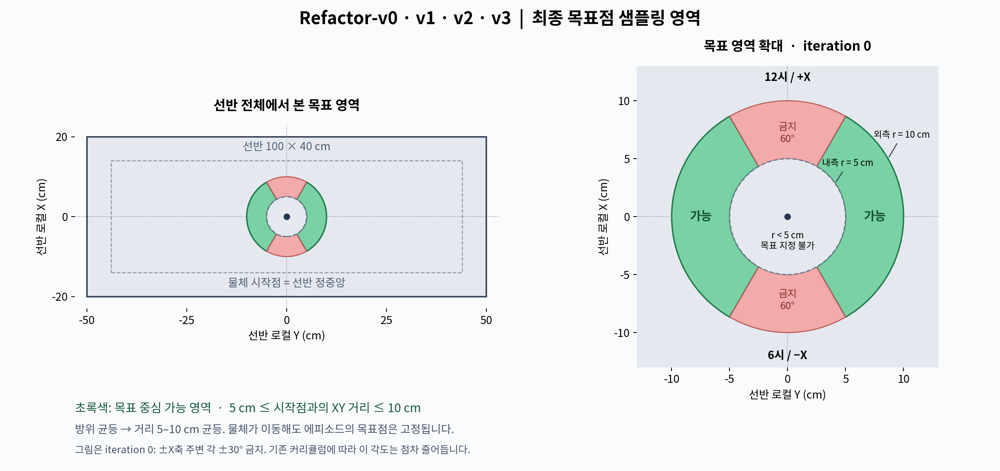

# Refactor 공통 목표 영역: 반경5–10cm

2026-11-06. [v0 현재 명세](../environments/WRENCH_REFACTOR_V0_ENVIRONMENT.md) · [재구성 부록](../environments/WRENCH_REFACTOR_V0_RECONSTRUCTION.md).



## 요청·의도·기준

사용자는 Refactor-v0 및 모든 하위 환경에서 물체 시작점을 중심으로 최대 반경10cm 안에서만 목표를 추출하도록 요청했다. 기존 최소5cm 및 iteration0 ±X축 주변 각각±30도 금지각과 결합하여, 상하60도 부채꼴이 빠진 환형 영역을 만든다. r=10은 문맥의 cm 단위로 해석했다. 목표점의 중심에 대한 제한이며 마커 구체 반경이나 물체 자체 스폰 위치의 제한을 바꾼 것이 아니다.

기준 root commit은89833ab4b5017ae91ba140d06d8add9393907dad다. 시작 시 이전 Refactor 수정에 따른 작업트리와 문서 submodule 변경이 있었다. 사용자 변경과 logs/rsl_rl은 보존했다. 샘플러·이벤트 함수·이벤트 Cfg의 변경 직전 텍스트를 /tmp/refactor_goal_5_10_before.json에 보존했다.

## 변경 전후·전체 계약

| 항목 | 이전 | 이후 |
| --- | --- | --- |
| 거리 하한 | 시작점으로부터0.05m | 동일 |
| 거리 상한 | 방향별 선반 유효 경계 | min(선반 유효 경계,0.10m) |
| 방위 추출 | 허용 각도 균등 | 동일 |
| 거리 추출 | 하한~상한 균등 | 동일한 원리로 새 상한 사용 |
| deadzone 커리큘럼 | 30도 반각 시작,10k 첫5도 감소,이후3k마다감소,0도하한 | 동일 |
| 물체 시작점 | 선반 중앙 반경2cm 원판 면적 균등 | 동일 |
| 자산·물성·활성 장애물·OSC·관측·보상·종료·PPO | 현재 v0/v1/v2/v3 계약 | 동일 |

코드 변경은 mdp/common/wrench_refactor_layout.py의 sample_commands에 max_goal_distance=0.10을 추가하고 ray 교차 최대 거리를 clamp_max하는 것, mdp/event_functions/wrench_refactor.py의 reset_scene에서 이 인자를 전달하는 것, mdp/events/wrench_refactor.py에 해당 params를 명시하는 것이다. 최대 거리는 유한하며 최소 거리 이상이어야 한다. v1/v2/v3는 공통 이벤트를 그대로 상속한다. 현재 원통 크기 및2cm 시작점 분포에서는 선반 유효 경계가10cm보다 멀기 때문에 모든 허용 방향에서 거리5–10cm가 가능하다. 일반적으로는 선반 경계도 계속 준수한다.

에피소드 시작점 기준으로 목표를 생성하며, 물체가 이동할 때10cm 원을 다시 따라가거나 목표를 재샘플링하지 않는다. 그림은 중앙 시작점·iteration0 기준이고, 학습 중 기존 방향 커리큘럼은 금지 각도를 줄인다. 방위 균등+거리 균등이므로 환형 영역의 면적 균등 분포와는 다르다.

## 검증

CPU186개 통과(23.06초). 기존 Refactor/Wrench·센서 회귀와 함께0/5/10/15/20/25/30도 반각 각각50,000개(총350,000표본)에서 방위 히스토그램·좌우비율·새 상한 기준 조건부 거리 평균/표준편차·5–10cm 범위·선반 경계를 확인했다. 내외 반경 정확히5cm/10cm에서 고정 반경 추출 경계 검사2개 및 잘못된 상한0.049/NaN/Inf 거부3개를 추가했다. 기존 배치·부분reset 검증도 통과했다.

실제 Isaac Lab GUI32환경(v0,seed42)에서 전체v0/v1/v2/v3 최종 설정/PPO 비교를 수행해 기존 부모·자식 차이만 남고 공통 상한이 상속되는지 확인했다. 활성 root OSC·오른손 USD/EEF offset·선반30kg·Hand790g·74/74/64/64 관측, 부분reset 보존, 커리큘럼8지점의 reset마다 초기 목표거리5–10cm, 각36step 총288step 유한 관측/보상 및 물성 고정을 통과했다. 측정38.41초, reset66.3–100.4ms. Fabric 시각화 경고는 있었으나 assertion은 통과했다.

```bash
env -u PYTHONPATH -u ROS_PACKAGE_PATH -u AMENT_PREFIX_PATH PYTEST_DISABLE_PLUGIN_AUTOLOAD=1 PYTHONDONTWRITEBYTECODE=1 /home/min/miniconda3/envs/env_isaaclab/bin/python -B -m pytest -q -p no:cacheprovider src/inspire_sweep_baseline/tests/test_wrench_refactor.py src/inspire_sweep_baseline/tests/test_wrench.py src/inspire_sweep_baseline/tests/test_wrench_v0_1.py src/inspire_sweep_baseline/tests/test_wrench_v0_2.py src/inspire_sweep_baseline/tests/test_wrench_v0_3.py src/inspire_sweep_baseline/tests/test_wrench_v1.py src/inspire_sweep_baseline/tests/test_tactile_projection.py src/inspire_sweep_baseline/tests/test_clutter_v2_wrench.py

env -u PYTHONPATH -u ROS_PACKAGE_PATH -u AMENT_PREFIX_PATH PYTHONDONTWRITEBYTECODE=1 /home/min/miniconda3/envs/env_isaaclab/bin/python -B src/inspire_sweep_baseline/tests/_wrench_refactor_probe.py --task Inspire-Wrench-Refactor-v0 --num_envs 32 --output outputs/wrench_refactor_validation/goal_annulus_5_10_gpu
```

산출물: workspace의 outputs/wrench_refactor_validation/goal_annulus_5_10_gpu/probe_32.json, goal_annulus_5_10_cpu.log, goal_annulus_5_10_gpu.log. 그림 생성기는 outputs/wrench_refactor_validation/goal_annulus_5_10/plot_region.py이며 PNG/SVG를 같은 디렉토리와 이 문서 저장소의03_assets/img에 보존했다. Matplotlib으로 그린 뒤 실제 PNG를 열어 검토했다. v0 재구성 소스3개 record와 reference_config를 갱신하고117개 record의 hash·Python 문법을 검사했다.

RL학습 성능·Collection Time 회귀·v1/v2/v3 개별 GUI 실행은 이번 변경에서 검증하지 않았다. 공통 이벤트 상속과 전체 설정 비교로 하위 적용을 확인했다.

문서 수식9파일·두 저장소 공백 검사 통과. 링크 검사에서 새 링크 오류는 없으며 기존 패키지 README의 FINAL_GOAL_ACCURACY_V0_2_ENVIRONMENT.md 누락 링크 한 개는 범위 밖 상태로 보존했다.

## 수치 후속: 6–12cm

사용자의 후속 지시로 같은 날 하한0.05→0.06m, 상한0.10→0.12m만 변경했다. 샘플러·reset 이벤트 인자 기본값·이벤트 params3곳의 수치를 맞췄고 방향 추출·선반 경계 clip·커리큘럼·나머지 MDP/PPO는 유지한다. v0 및 모든 하위 환경에 상속된다. 선반 유효 경계가12cm보다 가까운 방향은 기존대로 선반 경계까지만 사용한다. 변경 후 Refactor 회귀50개(5.03초), 새6/12cm 경계 및350,000개 분포 검사를 통과했다. GPU 시험은 수치만 바뀐 후 반복하지 않았으며 위 GUI 결과는5–10cm 당시 결과다. 현재 명세·재구성 record4개·그림 PNG/SVG를6–12cm로 갱신했다. 최신 그림은03_assets/img/refactor_goal_region_6_12cm.png, 재현 스크립트는 workspace outputs/wrench_refactor_validation/goal_annulus_6_12/plot_region.py다.
