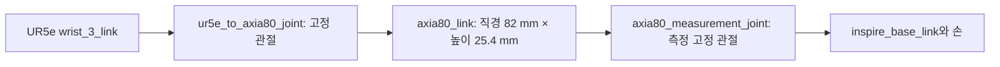

# 최종 환경의 F/T 센서 형상과 Wrench 계측

2026-11-01 작업트리의 **`Isaac-Inspire-Final-GoalAccuracy-v0_2_2`** 기준이다. 이 환경의 손목 F/T 센서는 **직경 82 mm, 높이 25.4 mm의 실린더 강체**와 그 아래 손에 연결된 **고정 관절의 6축 반력 계측**으로 구현된다. Actor와 Critic에는 원시 반력에서 손의 중력·관성 하중을 보상하고 EEF 기준으로 변환한 6D wrench에 관측 노이즈를 더해 제공한다.

| 구분 | 현재 구현 |
| --- | --- |
| 외형 | `axia80_link`, 반지름 41 mm·직경 82 mm·높이 25.4 mm |
| 센서 하우징 질량 | 0.001 kg = 1 g, 시뮬레이션 설정값 |
| 측정 위치 | `axia80_measurement_joint`, 하우징과 `inspire_base_link` 사이 |
| 원시 신호 | parent가 child에 가하는 고정 관절 반력·반력 모멘트 6D |
| 보상 대상 | 측정 관절 아래 손 링크 13개 + 촉각 pad 17개 = 30개 강체 |
| 최종 기준점·좌표축 | EEF 위치에 대한 모멘트, EEF 좌표축의 힘·모멘트 |
| 관측 순서·단위 | `[Fx, Fy, Fz, Mx, My, Mz]`, N 및 N·m |
| 관측 노이즈 | 힘 각 축 표준편차 0.05 N, 모멘트 각 축 0.005 N·m |

이 치수와 질량은 **현재 시뮬레이션에서 사용하는 값**이다. 실제 상용 센서의 질량·정격·분해능·전자회로까지 재현했다는 의미는 아니다. 특히 `axia80`이라는 이름만으로 하드웨어 사양을 추정하지 않는다.

## 1. 실린더의 형상과 물리적 구성

센서 하우징은 별도의 외부 센서 USD를 불러오는 대신, 로봇 생성 시 `CylinderCfg`로 추가한다. 패키지에 저장된 UR5e–Inspire USD의 기존 직접 연결 관절 `inspire_mount`를 비활성화하고 다음 연결을 만든다.



| 항목 | 코드 설정 | 해석 |
| --- | --- | --- |
| 반지름 | `SENSOR_RADIUS = 0.041` | 41 mm |
| 직경 | 반지름의 두 배 | 82 mm |
| 높이 | `SENSOR_HEIGHT = 0.0254` | 25.4 mm |
| 실린더 축 | `axis="Z"` | 센서 local Z축을 따라 두께가 놓임 |
| 질량 | `SENSOR_MASS = 0.001` | 1 g |
| 중력 | `disable_gravity=False` | 하우징에도 중력이 적용됨 |
| 충돌 | `collision_enabled=True` | 장식용 메시가 아닌 충돌 가능한 강체 |
| 접촉 설정 | `contact_offset=0.001`, `rest_offset=0` | 1 mm 접촉 offset, 외형의 직경·높이를 바꾸는 scale은 아님 |
| 표시 색상 | `(0.93, 0.38, 0.08)` | 주황색 하우징 |

고정 관절은 articulation에 보존되어야 6축 반력을 읽을 수 있다. 두 고정 관절은 직접 연결된 body 쌍의 충돌을 끄며, 로봇 articulation의 self-collision도 비활성이다. 하우징의 외부 물체·선반과의 충돌 기능은 유지한다. 하우징의 접촉 검출과 손목 wrench 계측은 서로 다른 경로다.

Final 장면은 `make_robot_cfg()`를 사용하며 최신 v0_2_2는 이 센서 치수·질량을 덮어쓰지 않는다. 물체의 형상·크기 무작위화와 달리 이 센서 크기는 reset마다 바뀌지 않는다.

근거: [센서 상수·생성·고정 관절](../../../../src/inspire_sweep_baseline/inspire_sweep_baseline/assets/robot.py), [최종 Scene 구성](../../../../src/inspire_sweep_baseline/inspire_sweep_baseline/assets/scenes/final.py).

## 2. 하우징 중심, 측정 원점, EEF는 서로 다른 점이다

원래 손 장착 위치를 O, 하우징 중심을 H, 측정 관절의 child-side 원점을 J, 최종 EEF를 E라고 하자. 현재 생성 코드가 만드는 위치를 원래 장착 프레임의 local Z축으로 쓰면 다음과 같다.

| 점 | 원래 장착 위치 O로부터의 local Z 위치 | 역할 |
| --- | --- | --- |
| O | 0 mm | wrist–하우징 연결 관절 위치 |
| H | 12.7 mm | 실린더 중심, `axia80_link` 원점 |
| J | 25.4 mm | 하우징–손 측정 관절, 이동된 `inspire_base_link` 원점 |
| E | 155.4 mm | wrench 관측의 최종 모멘트 기준점 |

손 전체는 기존 장착 프레임의 +Z 방향으로 센서 높이 25.4 mm만큼 이동한다. 하우징은 그 중간에 놓인다. 따라서 **하우징 중심 H와 실제 측정 원점 J의 차이는 12.7 mm**다. 이 Z는 local 축이며 로봇 자세에 따라 world 방향은 달라진다.

Final의 EEF 설정은 하우징 중심에서 `(0, 0, 0.13 + sensor_height/2)` m이므로 H에서 +142.7 mm, J에서는 +130 mm다. EEF 방향은 하우징에 대해 quaternion `(w,x,y,z) = (0.5, −0.5, −0.5, −0.5)`의 고정 회전을 적용한다. 따라서 EEF 축과 센서 하우징 축도 동일하지 않다.

**모멘트는 기준점에 따라 달라진다.** 측정 원점을 하우징 중심으로 잘못 간주하면 12.7 mm의 레버암 오류가 생긴다. 예를 들어 그 축에 수직인 10 N 힘이라면 모멘트 오차 크기는 최대 `0.0127 × 10 = 0.127 N·m`다. 이는 설정값에서 계산한 예시이며 실제 측정 오차를 실험한 수치는 아니다.

근거: [장착 위치 이동](../../../../src/inspire_sweep_baseline/inspire_sweep_baseline/assets/robot.py), [Final EEF offset](../../../../src/inspire_sweep_baseline/inspire_sweep_baseline/assets/scenes/final.py), [frame 생성 함수](../../../../src/inspire_sweep_baseline/inspire_sweep_baseline/assets/scenes/contact_sweep_clutter_fusion.py), [EEF 회전 상수](../../../../src/inspire_sweep_baseline/inspire_sweep_baseline/mdp/common/contact_sweep_clutter_fusion.py).

## 3. 원시 Wrench는 어떻게 읽는가

`FixedJointWrenchReader`는 `robot.body_names`에서 **`inspire_base_link`의 body index를 이름으로 찾아**, `robot.data.body_incoming_joint_wrench_b[:, child_body_index]`를 읽는다. 하우징 body의 index나 관절의 DOF index를 사용하는 방식이 아니다. 고정 관절은 움직이는 DOF가 없어도 6축 반력을 전달한다.

이 데이터는 Isaac Lab 내부에서 PhysX Tensor API의 `get_link_incoming_joint_force()`로 가져온다. 반환되는 6성분은 incoming joint의 **child joint frame**으로 표현된다. 현재 생성 관절의 child-side local pose는 항등이므로 J의 위치·방향은 `inspire_base_link`의 link pose와 일치한다. [NVIDIA PhysX Tensor API의 좌표계 정의](https://docs.omniverse.nvidia.com/kit/docs/omni_physics/108.0/extensions/runtime/source/omni.physics.tensors/docs/api/python.html#omni.physics.tensors.impl.api.ArticulationView.get_link_incoming_joint_force).

로컬 Isaac Lab `articulation_data.py`의 해당 property 설명에는 “parent body frame”이라는 문구가 남아 있다. 그러나 이 프로젝트의 실제 보상 코드는 **child joint frame**으로 처리하며, 이는 위 Tensor API 문서의 정의와 일치한다. 하우징 중심 pose로 회전·모멘트 변환을 수행하지 않는다.

원시 wrench에는 손이 물체와 접촉해서 생기는 하중뿐 아니라 **손 자체의 무게와 가속·회전에 필요한 지지 하중**도 포함된다. 따라서 raw 값을 그대로 외부 접촉력이라고 해석할 수 없다. 또한 이 신호는 촉각 pad 힘의 합, 모터 torque만의 합, 물체 pose로부터 역산한 힘이 아니다.

근거: [이름 기반 원시 반력 읽기](../../../../src/inspire_sweep_baseline/inspire_sweep_baseline/mdp/common/sensors.py), [Isaac Lab 반력 property](../../../../IsaacLab/source/isaaclab/isaaclab/assets/articulation/articulation_data.py), [현재 보상 구현](../../../../src/inspire_sweep_baseline/inspire_sweep_baseline/mdp/common/compensated_wrench.py).

## 4. 원시 반력에서 최종 Wrench를 만드는 과정

### 4.1 측정 관절 좌표축에서 world 축으로 회전

$R_{WJ}$는 J 좌표 성분을 world 성분으로 바꾸는 회전, $p_J^W$와 $p_E^W$는 측정 원점과 EEF의 world 위치다. 먼저 힘과 모멘트의 축을 회전한다.

```math
F_{\mathrm{raw}}^W=R_{WJ}F_{\mathrm{raw}}^J,
\qquad
M_{\mathrm{raw},J}^W=R_{WJ}M_{\mathrm{raw}}^J.
```

### 4.2 모멘트 기준점을 측정 관절 J에서 EEF E로 이동

```math
M_{\mathrm{raw},E}^W=M_{\mathrm{raw},J}^W+(p_J^W-p_E^W)\times F_{\mathrm{raw}}^W.
```

힘은 기준점을 옮겨도 변하지 않지만 모멘트에는 레버암과 힘의 외적이 추가된다. 현재 구현의 `raw_world`는 이 이동까지 수행한 값이다. 이름에 `world`가 있어도 **world 원점에 대한 모멘트가 아니라 EEF 위치에 대한 모멘트를 world 축으로 표현한 값**이다.

### 4.3 손의 중력·관성 지지 하중 계산

보상은 측정 관절 아래의 30개 강체를 대상으로 한다. 손 base와 손가락 링크 13개뿐 아니라 고정된 촉각 pad 17개의 질량·관성도 포함한다. 측정 관절 위쪽의 UR5e와 센서 하우징은 이 합에 포함하지 않는다.

각 손 강체 i에 대해 질량 $m_i$, world COM 위치 $p_i^W$, COM 선가속도 $a_i^W$, 각속도 $\omega_i^W$, 각가속도 $\alpha_i^W$를 사용한다. PhysX에서 읽은 COM 기준 관성 텐서를 해당 link의 회전으로 world 축에 표현한 것을 $I_i^W$라고 한다. 중력 가속도는 환경 설정의 $g^W$다.

```math
F_{\mathrm{support},i}^W=m_i(a_i^W-g^W),
```

```math
M_{\mathrm{support},i,E}^W=
I_i^W\alpha_i^W
+\omega_i^W\times(I_i^W\omega_i^W)
+(p_i^W-p_E^W)\times F_{\mathrm{support},i}^W.
```

첫 항은 각가속도, 둘째는 회전 운동의 gyroscopic 항, 셋째는 COM의 지지력이 EEF에 만드는 모멘트다. 30개 강체의 힘과 모멘트를 각각 합해 `support_world`를 얻는다. 가만히 있는 손에서도 $a_i=0$이면 $F_{\mathrm{support},i}=-m_i g$이므로 무게를 지탱하는 반력을 제거할 수 있다.

질량·관성은 실제 PhysX 값을 읽어 reader 생성 시 캐시한다. 현재 task의 손 질량·관성은 고정이라는 전제이며, 향후 손 물성을 변경한다면 `refresh_mass_properties()`로 갱신해야 한다. 매 시점에는 현재 손 링크 pose·COM 속도·가속도를 사용한다. 가속도는 최신 물리 step의 `body_com_acc_w`이며 50 Hz 제어 step 사이의 속도 차분으로 대체하지 않는다.

### 4.4 지지 하중을 빼고 EEF 축으로 회전

```math
w_{\mathrm{pure},E}^W=w_{\mathrm{raw},E}^W-w_{\mathrm{support},E}^W,
\qquad
w=\begin{bmatrix}F\\M\end{bmatrix}.
```

그 후 힘·모멘트에 각각 $R_{WE}^{\mathsf T}$를 적용해 EEF 축의 `pure_eef`를 만든다. 이 값이 `PureWristWrench`가 반환하는 센서 관측의 기본값이다.

| 출력 이름 | 모멘트 기준점 | 표현 좌표축 | 손 하중 보상 |
| --- | --- | --- | --- |
| `raw_world`, `raw_eef` | EEF | world 또는 EEF | 미적용 |
| `support_world`, `support_eef` | EEF | world 또는 EEF | 제거할 손 지지 하중 자체 |
| `pure_world`, `pure_eef` | EEF | world 또는 EEF | raw − support |

정적인 tare 값을 한 번 측정해 빼는 방식도, 학습 네트워크가 bias를 예측하는 방식도 아니다. 매 시점의 손 운동에 맞춰 Newton–Euler 하중을 계산한다. 이 계산은 타겟·장애물의 위치, 종류, 질량, 접촉 ID를 참조하지 않는다.

근거: [회전·모멘트 이동·Newton–Euler 보상](../../../../src/inspire_sweep_baseline/inspire_sweep_baseline/mdp/common/compensated_wrench.py), [관측 term의 reader 호출](../../../../src/inspire_sweep_baseline/inspire_sweep_baseline/mdp/observation_functions/contact_sweep_clutter.py).

## 5. 부호와 물리적 의미

이 구현은 **parent가 child에 가하는 반력의 부호**를 유지한다. 이상적인 동역학 관계에서 손에 가해진 외부 wrench가 $w_{\mathrm{ext}}$이면 관절 반력은 필요한 지지 하중에서 그 외부 wrench를 뺀 값이다. 따라서 같은 축·기준점에서 보상된 반력은 다음과 같이 해석한다.

```math
w_{\mathrm{raw}}\simeq w_{\mathrm{support}}-w_{\mathrm{ext}},
\qquad w_{\mathrm{pure}}\simeq-w_{\mathrm{ext}}.
```

예를 들어 손에 +Y 방향의 외력이 가해지면 보상된 관절 반력의 Y 성분은 반대 방향으로 나타난다. 이를 손에 작용하는 외력 벡터로 사용할 경우에는 이 부호 규약을 고려해야 한다. EEF로 축을 회전한 후에는 world Y와 EEF Y도 구별해야 한다.

센서 하우징에만 가해지는 접촉력은 **손 아래쪽 외력을 계측하는 이 단면의 신호와 동일하지 않다.** 하우징 충돌은 별도 접촉 경로로 검출할 수 있으며, 그 힘 전체가 손목 관측에 그대로 더해진다고 가정할 수 없다. 또한 wrench는 합력·합모멘트이므로 어떤 물체와 어느 지점에서 접촉했는지를 직접 식별하지 않는다.

`pure`라는 이름은 이상적으로 완벽한 무잡음 외력이라는 뜻이 아니다. 현재 구현은 물리 step의 관절 반력과 손 운동 정보를 결합한 모델 기반 residual이며, solver·시간 이산화·모델에 포함하지 않은 body damping 등의 잔차가 남을 수 있다.

## 6. 갱신 주기, reset, Actor·Critic 관측

물리 시간 간격은 0.01초이고 제어 decimation은 2이므로 정상 rollout의 정책 관측은 **0.02초, 50 Hz** 간격이다. Wrench reader는 `scene.update` 이후의 최신 물리 상태를 사용한다. 별도의 두 물리 step 평균 필터를 코드에서 적용하는 것은 아니다.

관측 term은 `(common_step_counter, _sim_step_counter)`를 키로 계산 결과를 캐시한다. 같은 step에서 EEF 표현과 world 표현을 요청하면 같은 sample을 사용한다. 반환 시 복사본을 사용하여 관측 노이즈가 원래 물리 sample을 수정하지 않게 한다.

reset된 환경은 `sensor_data_fresh=False`로 표시하고, 유효한 새 물리 측정이 없는 행은 6개 0으로 마스킹한다. 부분 reset에서는 다른 환경의 유효 sample을 유지한다. reset 접촉을 tare로 저장하는 과정은 없으므로 초기 접촉을 영점으로 학습해 지우지 않는다.

Final v1 및 최신 GoalAccuracy 관측에는 다음 노이즈가 추가된다.

```math
o_{\mathrm{FT},t}=w_{\mathrm{pure},E}^E+\epsilon_t,
\qquad
\epsilon_{t,k}\sim\mathcal{N}(0,\sigma_k^2),
```

```math
\sigma=(0.05,0.05,0.05,0.005,0.005,0.005).
```

앞의 세 값은 N, 뒤의 세 값은 N·m 단위다. 노이즈는 축별 독립이며 관측 계산마다 새로 뽑는다. 따라서 reset 마스킹 후에도 최종 noisy 관측은 반드시 0이 되지는 않는다. 별도의 센서 포화·ADC 양자화·시간 지연·저역통과 필터는 이 관측 경로에 구현되어 있지 않다.

Actor와 Critic은 같은 `policy` 그룹 안의 이 6D 관측을 받는다. 57D policy 벡터에서 0-based slice **`49:55`**다. Critic만 무잡음 raw wrench를 받는 구조가 아니며, Critic 전용 정보는 현재 타겟 위치 3D다. Wrench 관련 보상에서 사용하는 물리 sample과, 관측용 Gaussian noise가 더해진 최종 입력은 구별한다.

근거: [관측 선택](../../../../src/inspire_sweep_baseline/inspire_sweep_baseline/mdp/observations/final.py), [노이즈 함수](../../../../src/inspire_sweep_baseline/inspire_sweep_baseline/mdp/observation_functions/final.py), [캐시·reset mask 사용](../../../../src/inspire_sweep_baseline/inspire_sweep_baseline/mdp/observation_functions/contact_sweep_clutter.py), [runtime reset](../../../../src/inspire_sweep_baseline/inspire_sweep_baseline/runtime/final.py), [물리·제어 주기](../../../../src/inspire_sweep_baseline/inspire_sweep_baseline/envs/final_envs.py). 전체 관측 구성은 [State and Privileged Information](FINAL_STATE_AND_PRIVILEGED_INFORMATION.md)을 따른다.

## 7. 확인 범위

센서 치수·연결·EEF offset은 현재 생성 코드와 최종 Scene 상속에서 확인했다. 보상 관련 기존 테스트 7개와 Final F/T 노이즈 테스트 1개가 통과했다. 정적 손 무게 제거, 가속·회전·gyroscopic 항, 모멘트 이동, 외력의 반력 부호, 30개 downstream body 선택, 부분 reset·비정상 값 처리, 노이즈 표준편차를 확인한다.

이는 수학·단위 테스트이며 실제 상용 센서와의 일치도나 새 물리 rollout을 검증한 결과는 아니다. 이번 작업에서 실행 코드와 자산은 변경하지 않았다. 검증 명령·문서 검사·미검증 범위는 [개발 로그](../../02_implementation/logs/2026-11-01_final_ft_sensor_document.md)에 기록한다.
