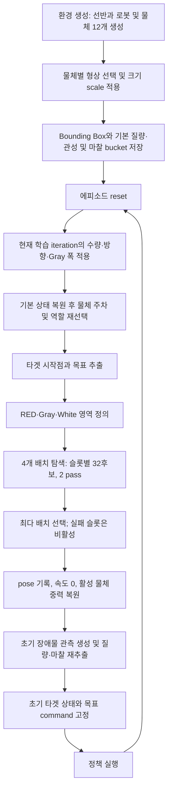

# Final 최종 환경의 Scene Generation and Randomization

2026-10-31 현재 작업트리의 **`Isaac-Inspire-Final-GoalAccuracy-v0_2_2`**를 기준으로 장면 생성과 무작위화를 설명한다. 이 환경은 처음에 환경별 물리 물체 12개를 만들고, 에피소드 초기화마다 그중 타겟 1개와 장애물 후보 9개의 역할을 다시 정한다. 이어서 타겟 시작점과 목표를 정한 뒤, **회전 Bounding Box인 OBB를 이용한 제한된 후보 탐색**으로 장애물을 배치한다.

중요한 구분은 **환경 생성 시 형상·크기를 정하는 과정**과 **reset마다 역할·위치·목표·물성을 바꾸는 과정**이다. reset에서 물체 USD를 새로 만들거나 충돌 형상을 교체하지 않는다. 장애물 배치에 실패하면 타겟과 목표를 유지한 채 탐색 결과의 실제 장애물 수를 줄인다.

| 항목 | 현재 최종 환경의 기본 규칙 |
| --- | --- |
| 물리 물체 | 원통 1 + 직육면체 1 + 기타 물체 10 = 12개/env |
| 논리 역할 | 타겟 1 + Gray 장애물 4슬롯 + White 장애물 5슬롯 |
| 실제 활성 수 | 초기 요청은 타겟 포함 3개, 최종 요청은 10개; 배치 부족 시 감소 |
| 타겟 초기 위치 | 선반 중심 반경 2cm 원판에서 후보 추출 |
| 목표 거리 | 선택 방향으로 최대 15cm, 경계까지 짧아질 수 있으며 최소 5cm 필요 |
| 타겟 자세 | 선반 좌표계 yaw 0, roll/pitch 0 |
| 장애물 자세 | 전체 360° 범위의 yaw 후보, roll/pitch 0 |
| 초기 물체 간 간격 | OBB 분리축 기준 최소 20mm |
| 장애물의 선반 경계 여유 | OBB 전체에 5mm |
| 탐색 예산 | 후보 32개 × 독립 배치 4개 × pass 2회 |
| 물체 크기 | 생성 시 물체별 등방성 scale `U(0.9,1.1)`, 이후 고정 |
| 질량·마찰 | 에피소드마다 재추출, 아래 물성 절의 공통 적용 규칙 사용 |

이 문서의 수치는 기본 설정이다. 실행 시 configuration override를 적용한 실험은 그 실행의 설정을 함께 확인해야 한다. 보상·학습 네트워크는 별도 [학습 네트워크 문서](FINAL_TRAINING_NETWORKS.md)를 따른다.

## 1. 장면 생성과 에피소드 초기화의 전체 흐름



reset은 지정된 `env_ids`에만 적용된다. 다른 병렬 환경의 진행 중인 장면을 다시 배치하지 않는다. 학습 iteration이 바뀌면 다음 reset에 쓸 커리큘럼 파라미터가 갱신되지만, 진행 중 에피소드의 장애물 수나 목표를 즉시 바꾸지는 않는다.

실제 실행 순서는 Isaac Lab의 reset lifecycle과 event 순서를 따른다. 커리큘럼 계산과 scene reset 후 `reset_all → object_spawn → object_physics_randomization`을 적용하고, 이후 관측·행동·command manager 등을 초기화한다. 목표 command는 **새로 배치한 타겟의 초기 pose에 생성한 이동 벡터를 더해서** 만든다. command 재추출 시간은 1,000,000초로 설정되어 일반적인 10초 에피소드 안에서는 고정된다.

근거: [현재 환경 구성](../../../../src/inspire_sweep_baseline/inspire_sweep_baseline/envs/final_envs.py), [event 연결](../../../../src/inspire_sweep_baseline/inspire_sweep_baseline/mdp/events/final.py), [reset runtime](../../../../src/inspire_sweep_baseline/inspire_sweep_baseline/runtime/final.py), [Isaac Lab reset 순서](../../../../IsaacLab/source/isaaclab/isaaclab/envs/manager_based_rl_env.py), [목표 command](../../../../src/inspire_sweep_baseline/inspire_sweep_baseline/mdp/command_functions/sweep_goal.py).

## 2. 생성 시 고정하는 물체 목록과 크기

### 2.1 물리 물체 12개와 기타 형상 14후보

| 구분 | 생성 수 | 기본 형상 |
| --- | --- | --- |
| 원통 | 1 | 반지름 0.04m, 높이 0.10m |
| 직육면체 | 1 | 0.06 × 0.08 × 0.10m |
| 기타 물체 | 10 | 아래 14개 형상·크기 후보에서 각각 독립 균등 선택 |

기타 14후보는 다음과 같다.

- NVIDIA YCB 형상 4종: `003_cracker_box`, `004_sugar_box`, `005_tomato_soup_can`, `002_master_chef_can`.
- 각 YCB 형상에 `size_fraction = 0.8, 0.9, 1.0`을 적용한 12개 변형.
- 절차적으로 생성한 mug 1종과 bottle 1종.

따라서 “14종”은 14개의 서로 다른 상품 형상을 뜻하지 않는다. 크기 변형을 포함한 후보 수다. 기타 물체 10개는 중복 선택을 허용하므로 한 환경에 같은 후보가 여러 개 생기거나 어떤 후보는 전혀 없을 수 있다.

YCB 자산은 먼저 upright 방향과 바닥 원점을 맞춘다. 원래 자산의 Bounding Box 크기를 $d_x,d_y,d_z$, 크기 변형을 $f$라고 하면 기본 등방성 배율은 다음과 같다.

```math
s_{\mathrm{fit}}
=1.5f\min\left(
\frac{0.04}{\sqrt{d_x^2+d_y^2}/2},\frac{0.12}{d_z}
\right),\qquad f\in\{0.8,0.9,1.0\}.
```

이 배율은 YCB 형상을 부모 환경의 크기 범위에 맞추는 단계다. 이후 아래의 ±10% 배율을 별도로 적용한다. 박스·캔의 시각 모델은 스캔 자산을 유지하지만 충돌에는 바닥이 평평한 박스 또는 타원형 원기둥 proxy를 사용한다. mug와 bottle은 여러 convex 조각으로 구성된다. **배치 검사에 쓰는 OBB와 실제 물리 충돌 형상은 같은 개념이 아니다.**

### 2.2 물체별 ±10% 크기 무작위화

PhysX가 시작하기 전 `prestartup` 단계에서 각 환경의 각 물체에 다음 배율을 한 번 추출한다.

```math
s_i\sim U(0.9,1.1),\qquad
(x,y,z)\mapsto(s_ix,s_iy,s_iz).
```

세 축에 서로 다른 배율을 넣는 비등방 변형이 아니라 **하나의 배율로 전체 형상을 확대·축소**한다. 시각 형상과 collider가 함께 변하고, 이후 배치에 사용할 local min/max bounds에도 이 scale을 한 번 적용해 저장한다. 명시적으로 정의된 관성은 $s_i^2$로 보정한다. 이 단계가 질량을 부피 비율 $s_i^3$로 무작위화하는 것은 아니다. 질량은 reset의 별도 분포에서 정한다.

환경 생성이 끝나면 각 물체의 형상·scale은 고정된다. reset에서 다른 물리 물체가 타겟이 되면 타겟의 형상과 크기는 달라질 수 있지만, 동일 물리 물체의 크기를 새로 뽑는 것은 아니다.

v0_2_2는 형상 prototype을 생성·복제하고 동일한 물리 속성의 재질을 공유해 초기 생성 비용을 줄인다. prototype은 simulation 시작 전에 제거하며, 에피소드 중 형상 교체나 재질 USD 재생성에는 사용하지 않는다.

근거: [12개 물체 Scene 구성](../../../../src/inspire_sweep_baseline/inspire_sweep_baseline/assets/scenes/final.py), [compact spawner](../../../../src/inspire_sweep_baseline/inspire_sweep_baseline/assets/final_compact_spawners.py), [Final 형상 후보](../../../../src/inspire_sweep_baseline/inspire_sweep_baseline/assets/final_spawners.py), [YCB 후보와 collider](../../../../src/inspire_sweep_baseline/inspire_sweep_baseline/assets/contact_sweep_clutter_fusion_holding_osc_object_random_spawners.py), [YCB 크기 정규화](../../../../src/inspire_sweep_baseline/inspire_sweep_baseline/assets/contact_sweep_clutter_fusion_holding_osc_object_random_geometry.py), [크기 무작위화](../../../../src/inspire_sweep_baseline/inspire_sweep_baseline/mdp/event_functions/final.py).

## 3. reset마다 타겟과 장애물 역할 선택

1. 물리 물체 12개를 기본 원격 위치로 돌리고 중력을 해제한다.
2. 타겟 그룹을 **원통 / 직육면체 / 기타** 중 각각 확률 1/3로 뽑는다.
3. 기타 그룹이면 해당 환경이 보유한 기타 물체 10개 중 하나를 균등 선택한다.
4. 기타 물체에 무작위 순서를 부여하되 선택한 타겟은 제외하고, 앞의 9개를 장애물 역할에 할당한다.
5. 앞 4개는 Gray 논리 슬롯, 뒤 5개는 White 논리 슬롯이 된다. 현재 커리큘럼이 요청한 각 그룹의 앞 슬롯만 배치 대상이 된다.

타겟이 원통·직육면체이면 기타 10개 중 9개를 장애물 후보로 선택한다. 타겟이 기타이면 남은 기타 9개가 모두 후보가 된다. **원통과 직육면체는 장애물로 사용하지 않는다.** 동일 물리 물체가 타겟과 장애물에 동시에 배정되지 않는다.

역할 선택은 활성 개수와 별개다. 예를 들어 초기 요청이 Gray 1·White 1이면 9개의 장애물 역할은 정해져 있어도 실제 배치는 각 그룹에서 하나씩만 시도한다. 최종 요청은 Gray 4·White 5다. 타겟을 포함한 활성 물체는 최대 10개이며 나머지 물리 물체는 주차 상태로 남는다.

한 환경의 기타 후보 보유 목록은 생성 시 고정된다. 따라서 기타 타겟의 종류 분포는 해당 환경의 보유 목록과 중복 횟수에 좌우된다. 전체 환경 생성 분포에서 기타 14후보는 균등하지만, **단일 환경이 reset을 반복한다고 14후보를 모두 경험하는 것은 아니다.**

근거: [CompactRoleCollection.select_roles와 park](../../../../src/inspire_sweep_baseline/inspire_sweep_baseline/mdp/common/final_compact_pool.py), [역할별 bounds·관성·센서 연결](../../../../src/inspire_sweep_baseline/inspire_sweep_baseline/mdp/event_functions/final.py).

## 4. 좌표계와 타겟 초기 위치·목표 생성

### 4.1 선반 좌표와 배치용 board 좌표

기본 선반 작업면의 수평 범위는 선반 좌표계에서 $x_s\in[-0.20,0.20]$, $y_s\in[-0.50,0.50]$m다. 작업면 높이는 선반 local 기준 1.05m이며, 기본 선반 root의 world 위치는 `(-0.7,0,0)`이다.

배치 알고리즘은 전면 방향을 일관되게 정의하려고 다음 board 좌표를 사용한다.

```math
x_b=y_s,\qquad y_b=0.20-x_s,\qquad
\psi_b=\psi_s-\pi/2.
```

따라서 board는 `x=[-0.5,0.5]`, `y=[0,0.4]`m이고 **로봇이 진입하는 전면은 `y_b=0`**, 전면으로의 방향은 $-y_b$다. 물체 pose를 기록할 때는 역변환한 뒤 선반의 world pose를 적용한다.

### 4.2 타겟 root가 들어갈 수 있는 범위

선택한 타겟의 scale 적용된 local bounds를 $b_{\min},b_{\max}$, 선반 반폭을 $h=(0.20,0.50)$, 여유를 $e=0.02$m라 하면 시작점과 목표에 공통으로 쓸 root 범위는 다음과 같다. 식은 XY 성분별 연산이다.

```math
\ell=\max(-h+e-b_{\min,xy},\;(-0.16,-0.46)),
\qquad
u=\min(h-e-b_{\max,xy},\;(0.16,0.46)).
```

물체 중심만 선반 안에 두는 것이 아니라 **yaw 0의 실제 local bounds 전체가 경계에서 2cm 이상 안쪽**에 있도록 root 범위를 제한한다. 동시에 root 자체의 범위 제한도 적용한다. 직육면체나 비대칭 자산이 원통과 같은 반지름을 갖는다고 가정하지 않는다. 함수 인자에 남아 있는 `object_radius=0.04`로 최신 OBB 배치를 원형 검사하는 것은 아니다.

### 4.3 초기 위치와 목표를 뽑는 알고리즘

현재 환경의 `wide_target=False` 경로는 다음 순서다.

1. 선반 중심의 반경 0.02m 원판에서 **32개 초기 root 후보**를 만든다. $\theta=2\pi u_1$, $r=0.02\sqrt{u_2}$, $p=(r\cos\theta,r\sin\theta)$이므로 원판 면적에 대해 균등한 후보 추출이다.
2. 후보 중 위의 $[\ell,u]$ 안에 들어가는 **첫 번째** 위치를 선택한다. 32개 모두 실패하면 오류를 반환한다.
3. 수평 방향각 32개를 전체 원주에서 균등 추출한다.
4. 각 단위 방향 $d$에 대해 root 허용 범위의 경계까지 갈 수 있는 ray 길이를 계산하고, 이를 0.15m로 제한한다.
5. 길이가 0.05m 이상이며 방향 제외 조건을 통과하는 **첫 번째** 방향을 선택한다.
6. 난수 방향이 모두 실패할 경우를 위해, 선반 $+y_s$와 $-y_s$ 중 남은 공간이 더 큰 방향을 마지막 후보로 추가한다. 이 fallback도 최소 거리와 방향 조건을 만족해야 한다.
7. 최종 목표는 $g=p+Ld$다. 타겟과 목표가 가능한 후보가 없으면 명시적으로 오류를 반환한다.

**목표 거리를 5–15cm에서 균등 추출하지 않는다.** 선택한 ray에서 가능한 최대 거리와 15cm 중 작은 값을 사용한다. 경계가 충분히 멀면 15cm이고, 가까우면 줄어든다. fallback이나 유효 방향 선별 때문에 최종 채택 방향의 분포도 단순한 전체 원주 균등분포와는 다르다.

타겟 yaw는 선반 기준 0으로 유지한다. 시작·목표 사이에서는 같은 자세로 직선 이동한다고 가정하여 배치 영역을 만든다. 물체 root Z는 `1.05 − local_bound_min_z`로 설정해 Bounding Box의 최저점이 작업면에 닿도록 한다. 목표 Z와 quaternion은 초기 타겟의 값을 유지한다.

### 4.4 방향 제외 조건과 커리큘럼

선반 $\pm x_s$축 주변의 반각 $\alpha$ 영역을 제외한다. 단위 방향 $d$가 통과하는 조건은 다음과 같다.

```math
|d_y|\ge\sin\alpha.
```

초기 $\alpha=30^\circ$이며, 학습 iteration 3000까지 유지한 뒤 500 iteration마다 5°씩 줄인다. 실제 첫 감소는 **3500**에서 일어나며 6000부터 0°다.

| iteration | 0–3499 | 3500 | 4000 | 4500 | 5000 | 5500 | 6000 이상 |
| --- | --- | --- | --- | --- | --- | --- | --- |
| 제외 반각 | 30° | 25° | 20° | 15° | 10° | 5° | 0° |

이는 목표 방향을 제한하는 규칙이다. 아래 RED 영역의 금지 규칙과 별개다.

근거: [sample_commands와 좌표 adapter](../../../../src/inspire_sweep_baseline/inspire_sweep_baseline/mdp/common/final_obb_geometry.py), [방향 커리큘럼 함수](../../../../src/inspire_sweep_baseline/inspire_sweep_baseline/mdp/curriculum_functions/contact_sweep_clutter_fusion.py), [현재 커리큘럼 설정](../../../../src/inspire_sweep_baseline/inspire_sweep_baseline/mdp/curricula/final.py).

## 5. 배치 금지·근접·나머지 영역

### 5.1 OBB로 검사하는 이유

물체별 scale 적용된 local XY bounds에서 반폭과 중심 offset을 구하고 yaw를 적용한다. 계획은 **footprint 중심**으로 수행하지만 시뮬레이터에는 **asset root pose**를 기록하므로, 비대칭 물체는 회전한 중심 offset을 더하거나 빼서 변환한다. 중심 offset을 무시하면 손잡이가 있는 물체 등의 실제 bounds와 계획이 어긋난다.

각 후보는 중심점만으로 분류하지 않고 **회전한 박스 전체**를 사용한다. 중심이 허용 영역에 있어도 모서리가 금지 영역에 들어가면 거절된다. 이 방식은 실제 mesh 사이의 여유가 있어도 OBB가 겹치면 거절할 수 있는 보수적 근사다.

### 5.2 RED 배치 금지 영역

RED의 기준 형상은 다음 순서로 만든다.

1. 초기 타겟 OBB와 목표 위치의 같은 OBB를 연결한 convex swept region을 만든다. 타겟을 고정 yaw로 직선 이동시킬 때 차지하는 평면 영역이다.
2. 이 영역을 **board 전면 방향인 $-y_b$로 작업판 밖까지 연장**한다. 타겟 이동과 전면에서 들어오는 손목의 평면 점유를 위한 공간이다.
3. 추가 안전 여유 `red_margin=0.003m`를 적용한다.

코드는 후보 OBB와 이 볼록 영역 사이의 분리축 clearance가 3mm보다 작은 후보를 RED로 판정한다. **RED에는 장애물을 배치하지 않는다.** RED가 차지하는 면적이 커져도 배치를 채우려고 이 영역을 축소하지 않는다.

### 5.3 Gray 근접 상호작용 영역

Gray는 다음 두 영역을 합치고 RED를 제외한 영역에 대응한다.

- RED 기준 영역 바깥의 추가 확장 폭 `gray_padding`.
- 타겟 시작점에서 **밀기 방향의 반대쪽**으로 길이 0.16m, 폭 0.22m인 접근 직사각형.

접근 직사각형은 타겟 시작점부터 반대 방향으로 뻗으며 중심은 `target − direction × 0.08m`다. Gray 후보는 RED를 침범하지 않으면서 외곽 상호작용 영역 또는 이 직사각형과 겹쳐야 한다. OBB 전체가 Gray 안에 포함되어야 하는 조건은 아니다.

여기서 “접근 직사각형”은 **비워 두는 별도의 금지 영역이 아니다**. RED와 겹치지 않는 부분에는 Gray 장애물이 들어갈 수 있다. 또한 현재 생성기는 첫 Gray를 반드시 후방에 두거나 후방에 최소 하나를 배치하는 조건을 갖지 않는다.

### 5.4 White 나머지 영역

White 후보는 RED를 침범하지 않고, 위의 Gray 외곽 영역과 접근 직사각형에도 겹치지 않아야 한다. Gray/White는 **배치 역할과 기하 분류**이며 물체의 형상 종류나 관측 가능 여부를 뜻하지 않는다.

White에 배치되었다는 것은 초기 배치의 기하 조건을 만족했다는 뜻이다. 조작 중 밀리거나 회전한 물체와 절대로 접촉하지 않는다는 동역학적 보장은 아니다.

### 5.5 적용되는 여유와 보장 범위

| 제약 | 적용 대상 | 값 |
| --- | --- | --- |
| 선반 경계 여유 | 타겟 시작·목표 bounds | 20mm 및 별도 root 범위 제한 |
| 작업판 경계 여유 | 모든 장애물 OBB 전체 | 5mm |
| 물체 간 초기 간격 | 타겟–장애물, 모든 활성 장애물 쌍 | 20mm |
| RED 추가 여유 | 타겟 이동·전면 연장 영역 대 장애물 OBB | 3mm |
| Gray 외곽 폭 | RED 기준 상호작용 영역 | 60–69mm, 커리큘럼 |
| 반대 방향 접근 직사각형 | Gray 분류 | 160 × 220mm |

물체 간 20mm 조건은 SAT 분리축에서 그만큼의 간격이 있는지를 검사한다. 통과하면 최소 유클리드 표면 간격도 확보되지만, 대각선 모서리에서는 실제로 공간이 있어도 보수적으로 거절할 수 있다. **20mm 조건은 초기 물체 쌍의 간격**이며 타겟의 전체 이동 경로에 동일한 20mm 간격을 적용하는 것은 아니다. 경로에는 RED 규칙이 적용된다.

이 배치 검사는 평면 OBB, yaw, 선반 XY 경계와 지지 높이를 다룬다. 전체 손가락·손목의 3D 진입 궤적, 로봇 IK 도달 가능성, 위쪽 선반과의 높이 충돌, 실제 접촉 후 물체 운동을 직접 검증하지는 않는다. RED와 간격은 접근 공간을 확보하기 위한 기하 조건으로 해석해야 한다.

근거: [OBB·SAT·zone_masks 구현](../../../../src/inspire_sweep_baseline/inspire_sweep_baseline/mdp/common/bbox_scene_layout.py), [shelf 변환과 높이 보정](../../../../src/inspire_sweep_baseline/inspire_sweep_baseline/mdp/common/final_obb_geometry.py). 모듈 API 계약은 [Bounding Box 배치 규칙](../../02_implementation/environments/BBOX_SCENE_LAYOUT.md)을 참고한다.

## 6. 장애물 생성 알고리즘과 실패 처리

### 6.1 후보 생성과 채택

타겟·목표와 각 슬롯에 대응하는 물체 bounds를 고정한 상태에서 다음 탐색을 수행한다.

```text
입력: 타겟 시작·목표, 타겟 OBB, 장애물 9개의 반폭, Gray/White 요청 수

요청 수를 Gray 최대 4, White 최대 5로 제한
각 환경에 독립 restart 4개 준비
각 restart마다 9개 슬롯의 처리 순서를 무작위로 결정

2개 pass에 대해:
    무작위 순서의 각 슬롯에 대해:
        yaw 후보 32개를 전체 360도에서 추출
        각 yaw에서 OBB 전체가 선반 안에 들어갈 중심 범위를 계산
        그 범위에서 중심 위치 후보 32개를 추출
        각 후보에 아래 조건을 모두 검사:
            선반 경계 5mm 여유
            해당 슬롯의 Gray 또는 White 조건, RED 침범 없음
            초기 타겟 OBB와 20mm 간격
            이미 채택한 모든 장애물 OBB와 20mm 간격
        요청 대상이고 아직 미배치인 슬롯에 첫 유효 후보를 채택
        후보가 없으면 해당 슬롯을 남기고 다음 슬롯 진행

restart별 (총 배치 수, Gray 배치 수)를 비교
총 배치 수가 가장 큰 결과 선택; 동률이면 Gray가 많은 결과 선택
선택 결과의 활성 mask와 실제 Gray/White 수 반환
```

후보 yaw의 board 표현은 `U(-π,π)`다. 해당 yaw의 AABB 반폭을 $e(\psi)$라 하면 중심 후보 범위는 `board_lower + 0.005 + e`부터 `board_upper − 0.005 − e`다. 물체가 너무 커서 범위가 뒤집히면 그 후보는 거절한다. 이 범위 안에서 좌표별 균등 추출 후 영역·간격 조건으로 거절하므로, 최종 배치 전체가 가능한 모든 장면에 대해 균등하다는 보장은 없다.

restart마다 순서를 섞는 이유는 먼저 놓인 큰 물체가 나중 물체의 공간을 차지하는 편향을 줄이기 위해서다. 한 슬롯이 실패해도 뒤의 더 작은 물체는 계속 시도한다. 두 번째 pass에서는 새 후보를 뽑아 실패 슬롯을 다시 시도하지만 **이미 채택한 물체를 이동시키는 backtracking은 하지 않는다**. 같은 restart의 슬롯 순서는 두 pass에서 유지된다.

### 6.1.1 영역 안의 위치는 어떻게 정하는가

**각 물체에 Gray 또는 White 역할을 먼저 지정한 다음, 선반 전체에서 뽑은 위치·회전 후보 중 그 역할의 조건을 통과하는 후보를 채택한다.** Gray 띠를 따라 일정 간격으로 놓거나, White를 작은 칸으로 나누어 한 칸에 하나씩 놓는 방식은 아니다. 영역은 후보를 받아들일지 결정하는 검사 조건이다.

예를 들어 Gray 슬롯에 mug가 배정되었다면 다음 순서로 위치를 찾는다.

1. 그 mug의 고정된 크기와 손잡이를 포함한 XY bounds를 가져온다. 후보마다 물체 종류나 크기를 다시 뽑지는 않는다.
2. 회전각 yaw를 32개 뽑고, **각 회전각에 위치 하나를 짝지어 총 32개의 `(위치, yaw)` 후보**를 만든다. 32개 위치와 32개 회전의 모든 조합인 1,024개를 검사하는 것은 아니다.
3. 각 후보가 Gray 조건과 선반 경계·물체 간 간격 조건을 모두 만족하는지 검사한다.
4. 통과한 후보가 여러 개면 **생성된 순서에서 첫 번째 후보**를 선택한다. 타겟에 가장 가깝거나 주변 공간이 가장 넓은 후보를 따로 평가해 고르지는 않는다.

후보를 뽑는 위치 범위는 물체의 크기와 회전각에 따라 달라진다. OBB의 두 반폭을 $h_x,h_y$, board 기준 yaw를 $\psi$라고 하면, 회전 후 board X/Y축 방향 반폭은 다음과 같다.

```math
e_x=|\cos\psi|h_x+|\sin\psi|h_y,\qquad
e_y=|\sin\psi|h_x+|\cos\psi|h_y.
```

기본 board 크기와 5mm 경계 여유를 적용하면 후보 **OBB 중심**의 추출 범위는 다음과 같다. 단위는 m다.

```math
c_x\sim U(-0.50+0.005+e_x,\;0.50-0.005-e_x),
```

```math
c_y\sim U(0.005+e_y,\;0.40-0.005-e_y).
```

즉, 물체가 크거나 회전해서 더 넓은 공간을 차지하면 중심을 뽑을 수 있는 범위가 좁아진다. 각 yaw에서 두 좌표는 이 직사각형 안에서 독립 균등 추출한다. 이 단계에는 Gray/White 조건이 아직 들어가지 않으며, 범위 자체가 성립하지 않는 후보는 거절한다.

### 6.1.2 Gray와 White에서 후보를 승인하는 규칙

영역 판정은 후보의 중심점이 아니라 **물체의 OBB 전체**를 기준으로 한다. 구현에서 후보 OBB와 타겟의 이동·전면 연장 기준 영역 사이의 분리축 clearance를 $q$라고 하자. 이는 중심 간 거리나 일반적인 최단 유클리드 거리와 다르며, 두 형상의 크기와 방향까지 반영한 분리축 계산값이다.

| 슬롯 역할 | 영역 조건 | 의미 |
| --- | --- | --- |
| 모든 장애물 | $q\ge0.003$ | RED 안전 여유를 침범하지 않아야 함 |
| Gray | 위 조건과 함께, $q<0.003+p$ **또는** 접근 직사각형과 OBB가 겹침 | 근접 띠와 후방 접근 직사각형 중 하나에 해당하면 됨 |
| White | $q\ge0.003+p$ **그리고** 접근 직사각형과 OBB가 겹치지 않음 | Gray로 분류되는 후보를 모두 제외 |

여기서 $p$는 현재 커리큘럼의 Gray 추가 폭인 0.060–0.069m다. 기본 폭 60mm에서는 접근 직사각형 밖의 후보가 `3mm ≤ q < 63mm`이면 Gray, `q ≥ 63mm`이면 White 조건에 해당한다. 접근 직사각형과 겹치면 `q ≥ 63mm`여도 Gray가 될 수 있다. 직사각형과 경계만 맞닿는 경우는 코드의 분리 판정에서 겹침으로 보지 않는다.

다음 예시는 영역 판정만 설명한다. 실제 채택에는 선반 경계와 물체 간 20mm 조건도 모두 통과해야 한다.

| 후보의 상황 | Gray 슬롯 | White 슬롯 |
| --- | --- | --- |
| 중심은 Gray 쪽이지만 모서리가 RED 안전 여유를 침범 | 거절 | 거절 |
| 중심은 White 쪽이지만 OBB 일부가 Gray 근접 조건에 해당하고 RED는 피함 | 허용 가능 | 거절 |
| OBB가 근접 띠 밖에 있지만 후방 접근 직사각형과 겹치고 RED는 피함 | 허용 가능 | 거절 |
| OBB가 RED·Gray 근접 조건·접근 직사각형을 모두 피함 | 거절 | 허용 가능 |

Gray 슬롯의 후보가 White 조건에 해당한다고 해서 그 물체를 White 역할로 바꾸어 배치하지 않는다. 반대도 같다. **역할은 고정하고 위치와 yaw만 다시 추출한다.** Gray 안에서도 좌우·전후 구획별 개수, 타겟과의 목표 거리, 균등한 각도 간격을 지정하지 않는다. 따라서 조건을 만족하면 한쪽에 여러 개가 모일 수도 있고, 후방 접근 직사각형에 하나도 없을 수도 있다.

### 6.1.3 같은 영역과 다른 영역의 물체 사이에는 어떤 규칙이 있는가

각 후보는 초기 타겟과 이미 채택한 **모든 활성 장애물**에 대해 OBB 분리축 기준 20mm 간격을 확보해야 한다. Gray끼리, White끼리뿐 아니라 Gray–White 사이에도 같은 조건을 적용한다. 영역 경계가 다르다는 이유로 두 물체의 겹침을 허용하지 않는다.

Gray를 모두 놓은 뒤 White를 놓는 순서도 아니다. 각 restart에서 Gray/White 슬롯을 섞어서 처리하므로 White가 먼저 자리 잡고 뒤의 Gray 후보 공간을 제한할 수 있다. 먼저 채택한 물체는 그 restart 안에서 고정되고, 뒤의 물체가 남은 공간을 찾는다. 한 물체의 32개 후보가 모두 실패해도 다른 슬롯은 계속 검사한다. 두 번째 pass는 미배치 물체에 새 후보를 주지만, 먼저 배치한 물체를 밀어내거나 옮기지 않는다.

마지막으로 채택한 OBB 중심을 실제 asset root 위치로 바꾼다. mug처럼 root와 bounds 중심이 다른 물체는 회전한 중심 offset을 빼서 실제 형상이 계획한 자리에 오게 한다. 높이는 `선반 작업면 높이 − local bounds의 최소 Z`로 정해 바닥을 작업면에 맞춘다. roll/pitch는 0이며, 위에서 떨어뜨려 자연스럽게 자리를 잡게 하는 방식이나 물체를 쌓는 배치는 사용하지 않는다.

이 규칙 때문에 결과는 무작위이지만 규칙적인 격자나 모든 가능한 장면에 대한 균등 분포는 아니다. 물체의 크기·yaw, 영역별 허용 공간, 먼저 채택된 물체, 제한된 탐색 횟수가 최종 위치 분포에 함께 영향을 준다.

근거: [후보 추출·영역 판정·채택 순서](../../../../src/inspire_sweep_baseline/inspire_sweep_baseline/mdp/common/bbox_scene_layout.py)의 `generate_layout`, `zone_masks`, `separated`와 [root 위치·지지 높이 변환](../../../../src/inspire_sweep_baseline/inspire_sweep_baseline/mdp/common/final_obb_geometry.py)의 `sample_shelf_layout`을 대조했다.

### 6.2 탐색 예산과 최다 배치의 의미

최대 9슬롯에서 기본 후보 검사량은 `4 restart × 2 pass × 9슬롯 × 32후보 = 2,304`개 위치·yaw 후보/env다. 각 후보는 이미 배치한 물체들과도 비교한다. 이는 정해진 작업량이며 시간 제한에 도달할 때까지 무한히 재시도하는 방식이 아니다.

최종 선택 점수는 `총 배치 수 × 5 + Gray 수`다. 이 때문에 총수가 우선이고, 같은 총수일 때만 Gray를 선호한다. 서로 다른 restart의 물체를 합치지 않는다.

“최다 배치”는 **이 제한된 탐색에서 찾은 결과 중 최다**라는 뜻이다. 연속 공간에서 수학적으로 가능한 최대 개수를 증명한 결과가 아니다. `complete=False` 역시 요청 수를 채우지 못했다는 뜻이며 물리적으로 불가능함을 증명하지 않는다.

### 6.3 실패에 따른 처리 구분

| 실패 위치 | 현재 동작 |
| --- | --- |
| 타겟 초기 위치 후보 32개 모두 부적합 | 명시적 오류. 장애물 개수 감소로 해결하지 않음 |
| 목표 난수 방향 32개가 모두 부적합 | 여유가 큰 ±선반 Y 방향 fallback을 검사 |
| fallback까지 목표 조건 불충족 | 명시적 오류. 타겟 형상을 바꾸어 계속 추첨하지 않음 |
| 장애물의 해당 pass에서 32후보 모두 실패 | 다음 슬롯을 계속 검사, 다음 pass에서 재시도 |
| 2 pass·4 restart 후에도 요청 수 부족 | 찾은 최다 결과의 실제 개수로 진행 |

장애물 수가 부족해도 **타겟·목표·존·최소 간격을 바꾸지 않는다**. 실패 슬롯을 더 작은 다른 형상으로 교체하지도 않는다. 요청된 논리 슬롯 중 배치에 성공한 슬롯만 활성화하므로 빈 슬롯이 중간에 남을 수 있다. 요청 수 자체를 하나씩 줄여서 생성기를 처음부터 반복 호출하는 방식은 아니다.

선택한 역할 중 비활성 물체는 선반 local Z=100m의 주차 위치에 두고 속도를 0으로 만든다. 역할에 포함되지 않은 나머지 물리 물체는 기본 Z=110m 주차 위치에 남는다. 모두 중력을 해제하고 과업의 활성 mask에서 제외한다. actor나 collider를 삭제·비활성화하여 물리 인덱스를 바꾸지는 않는다. 실제 배치 수는 `Metrics/obstacle_actual_gray`, `Metrics/obstacle_actual_white`로 기록된다.

근거: [generate_layout](../../../../src/inspire_sweep_baseline/inspire_sweep_baseline/mdp/common/bbox_scene_layout.py), [sample_shelf_layout](../../../../src/inspire_sweep_baseline/inspire_sweep_baseline/mdp/common/final_obb_geometry.py), [compact reset](../../../../src/inspire_sweep_baseline/inspire_sweep_baseline/mdp/event_functions/final.py), [중력 mask 처리](../../../../src/inspire_sweep_baseline/inspire_sweep_baseline/mdp/event_functions/contact_sweep_clutter_fusion.py), [실제 수량 로그](../../../../src/inspire_sweep_baseline/inspire_sweep_baseline/runtime/final.py).

## 7. 수량과 Gray 폭의 커리큘럼

물체 개수는 reset마다 정수 구간에서 무작위로 뽑지 않는다. **요청 개수는 학습 iteration의 결정론적 일정**, 실제 개수는 그 요청과 배치 결과로 정해진다.

| iteration 구간 | Gray 요청 | White 요청 | 타겟 포함 요청 총수 |
| --- | --- | --- | --- |
| 0–1999 | 1 | 1 | 3 |
| 2000–2499 | 1 | 2 | 4 |
| 2500–2999 | 2 | 2 | 5 |
| 3000–3499 | 2 | 3 | 6 |
| 3500–3999 | 3 | 3 | 7 |
| 4000–4499 | 3 | 4 | 8 |
| 4500–4999 | 4 | 4 | 9 |
| 5000 이상 | 4 | 5 | 10 |

Gray 외곽 폭은 `gray_padding × (1 + gray_red_padding_fraction)`으로 계산한다. 기본 `gray_padding=0.06m`, fraction은 4000의 0에서 10000의 0.15까지 1000 iteration 단위 계단식 선형 증가다.

| iteration | 0–4999 | 5000 | 6000 | 7000 | 8000 | 9000 | 10000 이상 |
| --- | --- | --- | --- | --- | --- | --- | --- |
| Gray 추가 외곽 폭 | 60mm | 61.5mm | 63mm | 64.5mm | 66mm | 67.5mm | 69mm |

이 값은 **Gray를 바깥쪽으로 넓힌다**. RED를 줄여 더 가까운 장애물을 허용하는 방식이 아니다. 이름에 남아 있는 `gray_red_padding_fraction`을 과거 배치 방식의 의미로 해석하면 안 된다. 방향 제외 반각도 별도 일정으로 변하므로, iteration에 따라 수량·방향·Gray 폭이 함께 장면 분포를 바꾼다.

근거: [Final 커리큘럼 설정](../../../../src/inspire_sweep_baseline/inspire_sweep_baseline/mdp/curricula/final.py), [수량 일정](../../../../src/inspire_sweep_baseline/inspire_sweep_baseline/mdp/curriculum_functions/contact_sweep_clutter_fusion.py), [Gray 폭 일정](../../../../src/inspire_sweep_baseline/inspire_sweep_baseline/mdp/curriculum_functions/contact_sweep_clutter_fusion_holding_osc_object_random.py), [계단식 보간](../../../../src/inspire_sweep_baseline/inspire_sweep_baseline/mdp/curriculum_functions/contact_sweep_clutter_fusion_holding.py).

## 8. 질량·마찰·관성의 무작위화

### 8.1 질량

환경별·에피소드별로 표준정규 난수 $\epsilon$ 하나를 뽑아 다음 질량을 사용한다.

```math
m=1.5\,\mathrm{clip}(0.365+0.0675\epsilon,\;0.230,\;0.500)\;\mathrm{kg},
\qquad\epsilon\sim\mathcal{N}(0,1).
```

최종 범위는 **0.345–0.750kg**다. clipping 전 배율 적용 분포의 중심은 0.5475kg, 표준편차 파라미터는 0.10125kg이다. 범위를 벗어난 샘플을 버리고 다시 추출하는 truncated Gaussian이 아니라 양 끝으로 잘라 붙이는 clipped Gaussian이므로 경계에 확률 질량이 생긴다. clipping 후 실제 표준편차를 0.10125kg이라고 단정하면 안 된다.

**한 환경에서는 이 질량을 타겟과 모든 논리 장애물에 공통 적용**한다. 물체마다 독립 질량을 뽑거나 형상·부피에 비례한 밀도를 맞추지 않는다. 서로 다른 환경과 reset에서는 새로운 값을 뽑는다.

각 물체의 최종 관성은 해당 물리 형상의 기준 관성에 질량 비율을 곱한다.

```math
I_i=I_{i,\mathrm{base}}\frac{m}{m_{i,\mathrm{base}}}.
```

따라서 질량은 같아도 형상이 다른 물체의 관성은 서로 다르다. 역할 재선택 때 선택된 물리 물체의 기준 질량·관성을 함께 remap하므로 이전 역할 물체의 관성을 잘못 재사용하지 않는다. 직전 에피소드의 관성에 배율을 누적하지도 않는다.

### 8.2 마찰

startup에서 역할별 4,096개의 `(정지 마찰, 동마찰)` bucket을 준비한다. Gaussian 중간 분위수로 각 marginal을 만들고, 동마찰 값의 순서를 무작위로 섞어 쌍을 구성하며 음수는 0으로 제한한다. reset마다 환경별로 선반·물체·손에 쓸 bucket을 각각 선택한다.

| 재질 역할 | 정지 마찰 평균 파라미터 | 정지 마찰 표준편차 파라미터 | 동마찰 평균 파라미터 | 동마찰 표준편차 파라미터 |
| --- | --- | --- | --- | --- |
| 선반 | 0.315 | 0.051 | 0.252 | 0.041 |
| 타겟·장애물 | 0.315 | 0.040 | 0.252 | 0.032 |
| Hand 접촉 body | 0.585 | 0.145 | 0.468 | 0.116 |

이는 연속 Gaussian을 매번 그대로 생성하는 대신 유한 pool에서 추출하는 구현이다. 해당 환경의 모든 물체에는 **동일한 물체용 마찰 쌍**을 적용한다. 손의 지정된 collider들도 같은 손용 샘플을 사용한다. 선반·물체·손 사이의 샘플은 각각 선택한다.

동마찰 평균은 정지 마찰 평균의 0.8배지만 **매 에피소드의 동마찰이 정지 마찰의 정확히 0.8배인 것은 아니다**. 별도로 구성한 marginal을 사용하며 `dynamic ≤ static`을 추가로 강제하는 코드도 없다.

대상 재질의 마찰 combine mode는 `average`다. 예를 들어 물체–선반 접촉의 계수는 두 재질 계수의 평균으로 결합한다. 반발계수·compliance 등 나머지 재질 성질은 보존하며 reset에서 무작위화하지 않는다. Arm·Axia80 등 손 이외의 robot shape 마찰도 이 reset 랜덤화에서 변경하지 않는다.

### 8.3 무작위화하지 않는 물리 항목

현재 event 경로에는 중력 크기·방향, 로봇 구동기 gain, 선반 질량, 선반 pose, 로봇 초기 관절 위치를 별도 분포로 바꾸는 항목이 없다. `reset_all`로 기본 상태를 복원한다. 활성 물체에는 중력을 사용하고 주차 물체는 중력을 끄지만, 이것은 비활성 관리이며 중력 domain randomization은 아니다.

근거: [질량·마찰 분포와 bucket](../../../../src/inspire_sweep_baseline/inspire_sweep_baseline/mdp/common/realistic_physics.py), [에피소드 공통 물성 적용](../../../../src/inspire_sweep_baseline/inspire_sweep_baseline/mdp/event_functions/contact_sweep_clutter_physics.py), [형상별 관성 복원](../../../../src/inspire_sweep_baseline/inspire_sweep_baseline/mdp/event_functions/contact_sweep_clutter_fusion_holding_osc_object_random.py), [질량 배율](../../../../src/inspire_sweep_baseline/inspire_sweep_baseline/mdp/common/contact_sweep_clutter_fusion.py), [재질 결합 규칙](../../../../src/inspire_sweep_baseline/inspire_sweep_baseline/assets/realistic_materials.py).

## 9. 실제 장면과 초기 관측의 구분

물리 배치를 완성한 뒤 Actor용 초기 장애물 관측을 만든다. 배치 오차와 관측 오차를 혼동하지 않도록 분리해서 이해해야 한다.

1. 배치한 장애물 위치를 robot root 좌표계로 변환한다.
2. XYZ 각 성분에 독립 `U(-0.01,0.01)m` 관측 노이즈를 더한다. 물리 pose 자체는 움직이지 않는다.
3. 초기 가시성을 계산하여 보고할 장애물을 선택한다. 현재 경로는 bounds 기반 원형 근사를 사용하는 전면 가시성 판정이며 실제 카메라 RGB·depth 렌더링이 아니다. 가시 폭 비율 기준은 0.35다.
4. 물리적으로 활성인 장애물의 가시 여부에 독립 1% 반전 확률을 적용한다.
5. 보고된 noisy 위치를 기준으로 왼쪽→오른쪽 정렬하고, 인접한 유효 슬롯 쌍을 순서대로 검사하며 각각 10% 확률로 교환한다. 빈 슬롯은 뒤쪽에 둔다.
6. `[present,x,y,z]`를 20슬롯, 총 80D로 저장한다. 현재 물리 장애물은 최대 9개여도 관측 용량은 20슬롯이다.

이 초기 관측은 에피소드 중 다시 생성하지 않는다. 가려진 장애물도 물리적으로는 존재하고 배치·접촉·보상에 영향을 줄 수 있다. 초기 타겟 관측의 reset 단위 ±1cm bias도 물리 타겟 위치 변경이 아니다. 촉각·F/T의 step 단위 노이즈는 [학습 네트워크의 관측 설명](FINAL_TRAINING_NETWORKS.md)에 정리되어 있다.

근거: [최종 배치 후 관측 생성](../../../../src/inspire_sweep_baseline/inspire_sweep_baseline/mdp/event_functions/final.py), [정렬과 인접 교환](../../../../src/inspire_sweep_baseline/inspire_sweep_baseline/mdp/event_functions/contact_sweep_clutter_fusion.py), [의존 가시성 분류기](../../../../src/scene_randomization/visibility.py), [관측 구성](../../../../src/inspire_sweep_baseline/inspire_sweep_baseline/mdp/observations/final.py).

## 10. 언제 무엇이 달라지는가

| 항목 | 환경 생성 시 | 매 에피소드 reset | 에피소드 진행 중 |
| --- | --- | --- | --- |
| 물리 물체 12개 및 collider | 생성 | 재생성하지 않음 | 유지 |
| 기타 물체 10개의 형상 후보 | 독립 균등 선택, 중복 허용 | 고정된 목록 사용 | 유지 |
| 각 물리 물체의 geometry scale | `U(0.9,1.1)` 한 번 | 재추출하지 않음 | 유지 |
| 타겟 그룹과 물리 물체 | 초기 목록 준비 | 그룹 1/3, 기타는 보유 10개 중 선택 | 고정 |
| 장애물의 Gray/White 역할 | 논리 슬롯 준비 | 타겟 제외 후 무작위 역할 배정 | 고정 |
| 요청 물체 수 | 초기 1/1 | 현재 iteration 일정 적용 | 에피소드 중 실제 수량 변경 없음 |
| 타겟 초기 위치와 목표 | 생성기 준비 | 후보 추출·검사 | command 고정 |
| 장애물 위치와 yaw | bounds 준비 | OBB 후보 탐색 | 물리 운동으로 변화 |
| 활성·주차 mask | 버퍼 준비 | 배치 성공 여부에 따라 결정 | reset 전까지 유지 |
| 질량과 형상별 관성 | 기준값 저장 | 공통 질량 재추출, 관성 재계산 | 유지 |
| 마찰 bucket | 역할별 4,096쌍 준비 | 역할별 bucket 선택 | 유지 |
| 초기 장면 관측 노이즈·가시성·순서 | 버퍼 준비 | 새로 생성 | 스냅샷 유지 |
| 선반·로봇 기본 pose | 기본 상태로 생성 | 기본 상태 복원 | 제어·물리에 따라 변화 |

물리 물체의 보유 목록과 크기는 재시드만으로 재생성되지 않는다. 배치 RNG는 `seed`, 역할 선택 RNG는 `seed+2122`를 사용하며 `reset(seed=...)`에서 다시 설정한다. 전역 난수와 크기용 NumPy RNG도 사용하므로, 동일한 seed가 서로 다른 장치·병렬 환경 수·reset 호출 순서에서 완전히 같은 장면열을 보장한다고 해석하지 않는다.

## 11. 코드 근거와 검증 범위

핵심 경로는 `FinalGoalAccuracyV0_2_2EnvCfg → FinalGoalAccuracyV0_2_2EventsCfg.object_spawn → randomize_final_compact_scene → sample_shelf_layout → sample_commands / generate_layout`이다. 앞선 Final v1의 NumPy 기반 배치나 이전 고정 타겟 풀 설명을 현재 알고리즘으로 대신하지 않았다.

이번 문서 작성에서 기존 **기하·shelf adapter·compact 역할·물성 테스트 43개**를 실행해 통과했다. 여기에는 CPU/CUDA tensor 기하 검사, 독립 polygon을 통한 OBB 간격·zone·경계 대조, 불가능한 타겟 오류, 불가능한 장애물 이후 다음 슬롯 탐색, 역할 중복 방지와 부분 reset mapping 검사가 포함된다. 추가로 현재 10논리역할 규격의 합성 bounds 64개 장면을 생성해 독립 polygon 검사, 지지 높이, 비활성 주차 처리를 확인했다.

이는 생성 알고리즘과 tensor 로직의 검증이다. 이번 작업에서 Isaac Sim을 새로 띄워 실제 물리 reset·학습·성공률을 측정하지 않았다. 기존 v0_2_2의 대체 선반 GPU 검증과 제한은 [현재 환경 계약](../../02_implementation/environments/FINAL_GOAL_ACCURACY_V0_2_2_ENVIRONMENT.md)에 별도로 남아 있다. 작성 근거·변경 범위·검증 명령은 [이번 문서 개발 로그](../../02_implementation/logs/2026-10-31_final_scene_generation_document.md)를 따른다.
