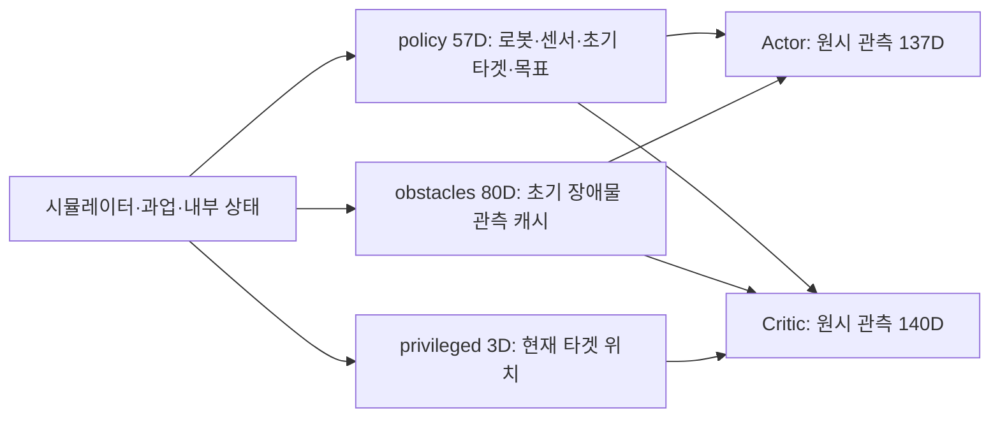

# 최종 환경의 State and Privileged Information

2026-10-31 작업트리의 **`Isaac-Inspire-Final-GoalAccuracy-v0_2_2`**를 기준으로 한다. 이 환경은 Final v1의 관측 구성과 비대칭 Actor–Critic을 상속한다. 초기 장면 정보를 받은 Actor는 실행 중 로봇 상태·촉각·손목 F/T를 사용하여 행동하고, Critic은 여기에 **현재 타겟 위치 3차원**을 추가하여 가치를 추정한다.

| 구분 | 현재 구성 | 의미 |
| --- | --- | --- |
| 환경 상태, State | 물리 상태·과업 조건·물성·내부 이력 등 | 시뮬레이션과 보상·종료를 결정하는 내부 정보. 하나의 고정 차원 벡터로 제공하지 않음 |
| Actor 원시 관측 | `policy` 57D + `obstacles` 80D = **137D** | 로봇·접촉 감각과 초기 장면 정보 |
| Critic 원시 관측 | `policy` 57D + `privileged` 3D + `obstacles` 80D = **140D** | Actor와 같은 관측에 현재 타겟 XYZ 추가 |
| Actor 본체 MLP 입력 | 57D + 장애물 임베딩 16D = **73D** | 80D 장애물 관측을 학습 가능한 인코더로 압축한 뒤의 차원 |
| Critic 본체 MLP 입력 | 57D + 3D + 장애물 임베딩 16D = **76D** | Critic 자신의 장애물 인코더를 사용 |

**140D는 전체 환경 State Space의 차원이 아니다.** 현재 타겟 속도·자세, 현재 장애물 상태, 질량·마찰 등은 Critic에도 직접 주어지지 않는다. 137D/140D는 환경이 제공하는 원시 관측의 크기이고, 73D/76D는 네트워크 내부 압축 이후의 입력 크기다.

근거: [최종 환경 구성](../../../../src/inspire_sweep_baseline/inspire_sweep_baseline/envs/final_envs.py), [관측 구성](../../../../src/inspire_sweep_baseline/inspire_sweep_baseline/mdp/observations/final.py), [PPO 관측 그룹 지정](../../../../src/inspire_sweep_baseline/inspire_sweep_baseline/agent/final_ppo_cfg.py), [Final 모델의 차원 검사](../../../../src/inspire_sweep_baseline/inspire_sweep_baseline/agent/final_models.py). 네트워크 층과 손실은 [학습 네트워크 문서](FINAL_TRAINING_NETWORKS.md), 초기 장면 생성은 [장면 생성·무작위화 문서](FINAL_SCENE_GENERATION_AND_RANDOMIZATION.md)를 따른다.

## 1. State Space: 환경이 실제로 보유하는 상태

강화학습에서 환경 상태는 다음 전이와 보상을 결정하는 정보를 뜻한다. 이 구현에서는 물리 엔진, 장면 객체, Manager, runtime buffer에 분산되어 있다. 해당 환경은 전체 상태를 평탄화한 별도의 `state_space`를 정의하지 않으며, 학습기에 전달하는 것은 뒤에서 설명할 관측 그룹이다.

설명을 위해 내부 상태를 다음과 같이 구분할 수 있다. 이는 코드가 제공하는 벡터의 정의나 최소 Markov state의 증명이 아니라, 실제 내부 정보의 역할별 분류다.

```math
s_t = \left(x_t^{\mathrm{physics}},\ c^{\mathrm{task}},\ \xi^{\mathrm{domain}},\ h_t^{\mathrm{internal}}\right).
```

| 내부 정보 | 구체적인 내용 | 필요한 이유 |
| --- | --- | --- |
| 로봇 물리 상태 | 팔 6개·손 12개 관절의 위치와 속도, 링크 pose·속도, 제어·접촉 관련 물리량 | 다음 움직임과 접촉 반응 계산 |
| 물체·선반 물리 상태 | 타겟과 장애물의 현재 위치·자세·선속도·각속도, 선반 상태 | 접촉·밀림·넘어짐·목표 도달 계산 |
| 과업 조건 | 선택된 타겟, 고정 목표, 초기 타겟 상태, 장애물 초기 위치, 활성 물체 mask | 어떤 물체를 어디로 이동할지와 초기 상태 대비 변화 결정 |
| 물리 객체와 역할의 대응 | 12개 물리 객체에서 타겟 1·Gray 4·White 5 논리 역할로 연결하는 mapping | reset마다 선택된 물체를 같은 과업 인터페이스로 다룸 |
| 무작위화된 조건 | 형상·크기·질량·관성·마찰 및 초기 배치 | 같은 행동에서도 달라지는 동역학과 접촉 조건 결정 |
| 관측 생성용 내부 정보 | 초기 타겟·장애물 캐시, 에피소드별 위치 오차, 초기 가시성·슬롯 순서, 센서 데이터 유효 여부 | 실제 물리 상태로부터 제한된 관측 생성 |
| 제어·보상·시간 이력 | 이전 행동, 제어 목표, 보상 term의 이전 값·누적 값, 에피소드 경과 step | action rate, 진행도·변화량 보상, 누적 판정과 timeout 계산 |

물리 엔진에는 접촉·제약 solver의 내부 정보도 있다. 따라서 로봇과 물체의 pose만 나열한 벡터가 모든 내부 상태를 완전히 대체한다고 단정하지 않는다. 커리큘럼에 사용하는 학습 진행도도 환경 생성·보상 설정을 바꾸지만 관측에는 포함되지 않는다.

최종 환경의 **12개 물리 객체, 10개 논리 역할, 20개 관측 슬롯은 서로 다르다.** 10개 역할 중 장애물은 최대 9개이며 실제 활성 개수는 커리큘럼과 배치 결과에 따라 감소할 수 있다. 선택되지 않은 물리 객체와 관측에 나타나지 않는 장애물도 시뮬레이터 쪽에서 관리한다. 물체 link state의 저장 형식은 위치 3 + quaternion 4 + 선속도 3 + 각속도 3 = 13개 성분이지만, 이를 물체 수와 곱한 값이 전체 상태 차원은 아니다.

근거: [최종 runtime과 상태 buffer](../../../../src/inspire_sweep_baseline/inspire_sweep_baseline/runtime/final.py), [compact 역할 mapping](../../../../src/inspire_sweep_baseline/inspire_sweep_baseline/mdp/common/final_compact_pool.py), [reset 상태 생성](../../../../src/inspire_sweep_baseline/inspire_sweep_baseline/mdp/event_functions/final.py), [보상 구성](../../../../src/inspire_sweep_baseline/inspire_sweep_baseline/mdp/rewards/final.py), [종료 구성](../../../../src/inspire_sweep_baseline/inspire_sweep_baseline/mdp/terminations/final.py).

## 2. Observation Space: 학습기에 전달되는 공간

단일 환경의 Gym 관측 공간은 다음 세 그룹을 가진 `Dict`다. 각 그룹 내부의 term은 하나의 벡터로 연결된다.

| 그룹 | 단일 환경 shape | 병렬 환경 N개 shape | Actor 사용 | Critic 사용 |
| --- | --- | --- | --- | --- |
| `policy` | `(57,)` | `(N, 57)` | 사용 | 동일한 관측 사용 |
| `obstacles` | `(80,)` | `(N, 80)` | 사용 | 동일한 관측 사용 |
| `privileged` | `(3,)` | `(N, 3)` | 사용하지 않음 | 사용 |

Isaac Lab은 이처럼 연결된 관측 그룹을 `Box(low=-inf, high=inf, shape=..., dtype=float32)`로 등록한다. 이는 API상의 공간 정의다. 실제 데이터에는 촉각의 0/1, 정규화된 quaternion, 손 개방도의 [0, 1] 등 더 좁은 제약이 있다. 반대로 초기 배치 범위를 실행 중 관측의 고정 상·하한으로 해석해서도 안 된다.

RSL-RL wrapper는 세 그룹을 담은 `TensorDict`를 반환한다. Actor 모델이 이 dictionary를 전달받더라도, 모델의 그룹 선택은 `policy`와 `obstacles`로 제한된다. **dictionary에 privileged 키가 존재하는 것과 Actor가 그 값을 사용하는 것은 다르다.** Critic은 `policy`, `privileged`, `obstacles`를 선택한다. 공통 그룹을 공유하므로 137 + 140 = 277개의 독립 관측을 환경에서 생성하는 구조도 아니다.



관측 이력 stacking이나 recurrent hidden state는 사용하지 않는다. 현재 설정에서 입력의 running mean/std 정규화도 비활성이다. 각 term에서 명시적으로 적용하는 상대 관절 위치, `tanh` 행동 피드백, 손 개방도 변환과 관측 노이즈는 별개다.

근거: [Gym 공간 구성과 step 순서](../../../../IsaacLab/source/isaaclab/isaaclab/envs/manager_based_rl_env.py), [RSL-RL wrapper](../../../../IsaacLab/source/isaaclab_rl/isaaclab_rl/rsl_rl/vecenv_wrapper.py), [관측 그룹 선택·압축](../../../../src/inspire_sweep_baseline/inspire_sweep_baseline/agent/contact_sweep_clutter_fusion_models.py).

## 3. Actor의 직접 관측: policy 57D

아래 인덱스는 **0부터 시작하고 끝 인덱스는 포함하지 않는** slice 표기다. 위치는 별도 언급이 없으면 로봇 root 좌표계이며 단위는 m다.

| 인덱스 | 항목 | 차원 | 의미·단위 | 시간 특성 |
| --- | --- | --- | --- | --- |
| `0:6` | 팔 관절 위치 | 6 | 현재 위치 − 기본 위치, rad | 매 관측 갱신 |
| `6:12` | 팔 관절 속도 | 6 | 현재 속도 − 기본 속도, rad/s | 매 관측 갱신 |
| `12:20` | 이전 행동 명령 | 8 | 직전 raw action의 성분별 `tanh` | 행동 적용 후 갱신 |
| `20:23` | 초기 타겟 위치 | 3 | 초기 link 원점 XYZ + 고정 위치 오차 | reset 단위로 고정 |
| `23:30` | EEF pose | 7 | 현재 XYZ와 quaternion `(w,x,y,z)` | 매 관측 갱신 |
| `30:32` | 목표 극좌표 | 2 | 초기 타겟에서 목표까지 XY 거리와 시계 방향 각도, m·rad | 에피소드 중 고정 |
| `32:49` | 촉각 접촉 | 17 | 부위별 접촉 비트 0/1 | 매 관측 갱신, 반전 노이즈 |
| `49:55` | 손목 F/T | 6 | EEF 기준 `[Fx,Fy,Fz,Mx,My,Mz]`, N·N·m | 매 관측 갱신, Gaussian noise |
| `55:57` | 현재 손 구성 | 2 | 실제 관절에서 추정한 굽힘·엄지 대립 개방도, [0,1] | 매 관측 갱신 |

### 3.1 로봇 상태와 행동 피드백

팔 관절 위치·속도는 각각 6개다. 손 12개 관절의 위치·속도를 모두 직접 입력하는 대신, 실제 손 관절 위치를 두 개의 개방도 값으로 압축한다. 굽힘은 엄지 대립 관절을 제외한 11개 관절을 open–closed 축에 최소제곱 투영하고, 대립은 해당 관절 하나를 같은 방식으로 환산한다. 결과는 [0, 1]로 제한하며 0은 closed, 1은 open 기준이다. **손의 명령값이 아니라 실제 측정된 관절 구성**을 나타낸다.

EEF pose는 현재 robot root에 대한 상대 pose다. quaternion에는 `quat_unique`를 적용하여 같은 회전을 나타내는 부호 중 대표값을 사용한다. EEF 속도 자체는 별도 관측 항목이 아니다.

행동 피드백은 `action_manager.action`의 8개 raw 값을 `tanh`로 변환한다. 의사결정 시점을 $o_t \rightarrow a_t$로 쓰면 입력되는 것은 직전에 적용한 $a_{t-1}$의 피드백이다. 환경 `step(a_t)`가 끝나 반환하는 다음 관측에는 방금 적용한 $a_t$가 들어간다. 이 변환은 관측에만 적용하며 원래 행동이나 action-rate 계산용 값은 수정하지 않는다.

근거: [기본 로봇·EEF 관측](../../../../src/inspire_sweep_baseline/inspire_sweep_baseline/mdp/observation_functions/sweep.py), [손 구성·행동 피드백](../../../../src/inspire_sweep_baseline/inspire_sweep_baseline/mdp/observation_functions/final.py).

### 3.2 초기 타겟과 고정 목표: 현재 물체 위치의 대체 관측이 아님

초기 타겟 위치는 reset 이후 CommandManager가 저장한 초기 target link 위치를 로봇 root 좌표계로 변환해 캐시한다. 그 뒤에는 현재 물체가 움직여도 갱신하지 않는다. 부분 reset에서는 해당 환경의 캐시만 새로 잡는다. 각 XYZ 성분에는 reset마다 독립적인 균등 오차가 추가된다.

```math
\widetilde{p}_{T,0}^{B} = p_{T,0}^{B}+b_T,
\qquad b_{T,k}\sim\mathcal{U}(-0.01,0.01)\ \mathrm{m}.
```

여기서 $B$는 로봇 root 좌표계이며 $b_T$는 에피소드 동안 고정된다. 매 step 새 위치 잡음을 뽑는 방식이 아니다. 위치의 기준점은 물체의 **link 원점**이며 모든 형상에서 질량중심이나 기하학적 중심과 같다고 가정하지 않는다.

목표는 초기 타겟 위치를 원점으로 한 극좌표로 제공한다. 실제 초기 위치와 목표 위치의 차이를 로봇 root 축으로 변환한 후 XY 성분으로 다음을 계산한다.

```math
\Delta p_0^B = R_{WB}^{\mathsf T}(p_G^W-p_{T,0}^W),
\qquad r=\sqrt{\Delta x^2+\Delta y^2},
\qquad \theta=\mathrm{atan2}(-\Delta y,\Delta x)\bmod 2\pi.
```

방향은 `+X → 0`, `−Y → π/2`, `−X → π`, `+Y → 3π/2`다. 극좌표는 관측 노이즈가 섞인 초기 타겟 위치에서 다시 계산하지 않고, 환경의 실제 초기 위치와 목표에서 계산한다. Actor는 초기 위치와 이 고정 변위로 목표 위치를 간접적으로 알 수 있지만, **현재 타겟에서 목표까지 남은 오차를 직접 받지는 않는다**. 타겟이 움직여도 이 두 값은 바뀌지 않는다.

근거: [초기 위치 캐시와 reset 시점](../../../../src/inspire_sweep_baseline/inspire_sweep_baseline/mdp/observation_functions/asymmetric_observations.py), [초기 목표 극좌표](../../../../src/inspire_sweep_baseline/inspire_sweep_baseline/mdp/observation_functions/contact_sweep_clutter_fusion.py), [물체 위치의 link 기준](../../../../IsaacLab/source/isaaclab/isaaclab/assets/rigid_object_collection/rigid_object_collection_data.py).

### 3.3 촉각 17D와 손목 F/T 6D

촉각은 손바닥 1, 엄지 4, 검지 3, 중지 3, 약지 3, 소지 3의 순서다. 각 부위는 접촉력 크기가 **0.01 N 이상**인지 나타내는 비트다. 직접 pad 접촉과 부모 링크에서 pad 영역으로 투영한 접촉을 합친 후, 비트마다 독립적으로 1% 확률로 0↔1 반전한다. 따라서 미접촉을 접촉으로, 접촉을 미접촉으로 관측할 수 있다.

이 17개 값은 접촉한 물체의 ID나 타겟/장애물 구분, 연속적인 힘 크기·방향을 담지 않는다. 부모 링크의 투영용 센서는 물체 경로로 필터링하지만 직접 pad 접촉은 같은 필터를 사용하지 않는다. 따라서 촉각 비트 전체를 타겟 전용 접촉 신호라고 해석할 수 없다.

손목 F/T는 고정 측정 관절의 반력을 그대로 내보내지 않는다. 손목 아래 손 링크들의 중력·관성 지지 하중을 모델로 보상하고, 모멘트 기준점을 EEF로 옮긴 뒤 EEF 축으로 표현한 6D residual을 사용한다. 이 내부 보상에는 손 링크의 질량·관성·운동 정보가 사용되지만, 물체의 현재 위치나 종류를 Actor 입력으로 추가하는 경로는 아니다. 모델 보상 residual이므로 이상적인 접촉 wrench와 항상 정확히 같다고 보장하지 않는다.

관측에는 각 축별 독립 영평균 Gaussian noise가 더해진다. 힘 축 표준편차는 **0.05 N**, 모멘트 축은 **0.005 N·m**다. 촉각 반전과 F/T 잡음은 관측 계산마다 다시 추출하며, 정상 rollout의 제어 주기는 0.02초, 50 Hz다. 물리 step은 0.01초로 제어 step당 두 번 진행한다.

reset 직후에는 새 센서 데이터가 아직 없다는 내부 flag에 따라 기본 촉각·F/T 출력을 0으로 처리한다. 그 뒤 관측 노이즈가 적용되므로 최종 관측이 반드시 모두 0인 것은 아니다. 이 센서 유효 flag 자체는 Actor나 Critic에 전달하지 않는다.

근거: [촉각 부위 정의](../../../../src/inspire_sweep_baseline/inspire_sweep_baseline/assets/robot.py), [촉각 투영](../../../../src/inspire_sweep_baseline/inspire_sweep_baseline/mdp/observation_functions/tactile_observations.py), [접촉 문턱값 판정](../../../../src/inspire_sweep_baseline/inspire_sweep_baseline/mdp/common/sensors.py), [센서 관측·캐시](../../../../src/inspire_sweep_baseline/inspire_sweep_baseline/mdp/observation_functions/contact_sweep_clutter.py), [wrench 보상](../../../../src/inspire_sweep_baseline/inspire_sweep_baseline/mdp/common/compensated_wrench.py).

## 4. Actor와 Critic의 공통 초기 장애물 관측: obstacles 80D

20개 슬롯 각각이 `[present, x, y, z]`를 가지므로 80D다. 타겟은 여기에 포함하지 않는다. 현재 compact 환경의 실제 장애물 후보 역할은 최대 9개이므로, 관측에 보고되는 슬롯도 최대 9개이고 나머지는 0으로 채운다.

```math
O_0=[m_1,x_1,y_1,z_1,\ldots,m_{20},x_{20},y_{20},z_{20}],
\qquad m_j\in\{0,1\}.
```

관측 생성은 reset 시 다음 순서로 한 번 진행한다.

1. 새로 배치된 활성 장애물의 초기 link 위치를 로봇 root 좌표계로 변환한다.
2. XYZ 각 성분에 독립적인 균등 오차 ±0.01 m를 추가한다.
3. 실제 배치와 크기에서 선반 전면 방향의 가시성을 계산한다. 보수적인 평면 footprint를 원으로 근사하고, 전면 투영 폭 중 가시 폭의 비율이 0.35 이상이면 기본적으로 보이는 것으로 판정한다. 타겟도 가림 계산에 참여한다. 실제 RGB 영상이나 depth point cloud를 입력하는 구성은 아니다.
4. 각 장애물의 가시 판정을 1% 확률로 반전한 뒤 활성 mask와 결합한다. 가려진 활성 물체가 드물게 보고될 수 있지만 비활성 물체를 새 물체로 만들어 보고하지는 않는다.
5. 관측되지 않는 슬롯은 `[0,0,0,0]`으로 만들고, 보고되는 슬롯은 **잡음이 포함된** root Y 좌표의 내림차순, 즉 `−Y` 오름차순으로 정렬한다.
6. 점유된 인접 슬롯 쌍을 앞에서부터 순차적으로 훑으며 각각 10% 확률로 교환한다. 뒤 교환은 앞 교환의 결과에 적용된다. 빈 슬롯은 뒤쪽에 유지한다.
7. 완성된 80D 벡터를 저장하고 해당 에피소드 동안 그대로 반환한다.

따라서 `present=1`은 **초기 관측에 보고된 슬롯**이라는 뜻이다. 실제 활성 물체 수나 물리적인 존재 여부를 완전하게 나타내지 않는다. `present=0`만 보고 빈 공간과 가려진 물체를 구별할 수 없다. 정렬·교환 이후 슬롯 번호는 물리 객체 ID나 Gray/White 역할 번호도 아니다.

이후 장애물이 밀리거나 넘어져도 80D 관측은 변하지 않는다. Actor와 Critic 모두 동일한 초기 장애물 관측을 받는다. 관측 그룹의 `enable_corruption=False`는 ObservationManager에서 추가 잡음을 넣지 않는다는 뜻이며, **reset 단계의 위치 오차·가시성 오차·순서 교환까지 없는 무잡음 정보라는 뜻은 아니다.**

각 모델의 장애물 인코더는 `present <= 0.5`인 슬롯 전체를 다시 0으로 마스킹한 뒤 `80 → 32 → 16` MLP로 압축한다. 이 16D는 초기 장면의 학습된 특징이며 현재 장애물 위치를 복원하도록 별도로 감독한 상태 추정값이 아니다. Actor·Critic 인코더는 별도 가중치다.

근거: [현재 compact reset과 가시성 적용](../../../../src/inspire_sweep_baseline/inspire_sweep_baseline/mdp/event_functions/final.py), [관측 오차 파라미터](../../../../src/inspire_sweep_baseline/inspire_sweep_baseline/mdp/events/final.py), [슬롯 정렬·인접 교환](../../../../src/inspire_sweep_baseline/inspire_sweep_baseline/mdp/event_functions/contact_sweep_clutter_fusion.py), [가시성 계산](../../../../src/scene_randomization/visibility.py), [마스킹 인코더](../../../../src/inspire_sweep_baseline/inspire_sweep_baseline/agent/contact_sweep_clutter_models.py).

## 5. Critic에만 주는 privileged 3D

현재 `privileged` 그룹에는 `object_position_in_root` 하나만 들어간다. 선택된 타겟의 **현재 link 원점 XYZ**를 시뮬레이터에서 읽어 로봇 root 좌표계로 변환하며, 초기 위치처럼 고정하지 않고 매 관측 갱신한다. 명시적인 관측 잡음은 적용하지 않는다.

```math
o_t^A=[o_t^{\mathrm{policy}},O_0],
\qquad
o_t^C=[o_t^{\mathrm{policy}},p_{T,t}^B,O_0].
```

여기서 $o_t^{\mathrm{policy}}$는 앞서 정의한 **57D policy 그룹 전체**를 뜻한다. Critic은 Actor와 같은 noisy policy·obstacles에 정확한 현재 타겟 위치를 추가로 받는다. 전체 관측이 무잡음 상태로 바뀌는 구조는 아니다.

현재 타겟 위치를 알면 Critic은 타겟의 이동·목표 접근 정도를 더 직접적으로 구분하여 가치를 학습할 수 있다. 다만 목표 자체는 공통 관측의 초기 위치·극좌표를 통해 전달되고 초기 위치에는 오차가 있으므로, Critic에 별도의 정확한 현재 목표 오차 벡터까지 주어진다고 설명해서는 안 된다.

| 정보 | 환경 내부에서 보유·계산 | Actor 직접 입력 | Critic 직접 입력 |
| --- | --- | --- | --- |
| 현재 팔 관절 위치·속도, EEF pose | 있음 | 있음 | 동일 |
| 손 12개 관절의 전체 위치·속도 | 있음 | 전체값 없음; 개방도 2D | 동일 |
| 초기 타겟 XYZ·목표 극좌표 | 있음 | 초기 위치 오차 포함 | 동일 |
| 초기 장애물 XYZ | 있음 | 가시성·오차 처리 후 일부 | 동일 |
| 현재 타겟 XYZ | 있음 | 없음 | **3D 추가, 명시적 잡음 없음** |
| 현재 타겟 자세·선속도·각속도 | 있음 | 없음 | 없음 |
| 현재 장애물 위치·자세·속도 | 있음 | 없음 | 없음 |
| 타겟/장애물의 종류·크기·질량·관성·마찰 | 있음 | 없음 | 없음 |
| 실제 활성 mask·Gray/White 구분·물리 ID mapping | 있음 | 없음 | 없음 |
| 촉각 비트·보상된 F/T | 있음 | 노이즈 적용 후 제공 | 동일 |
| 접촉 물체 ID·타겟 전용 접촉 판정 | 내부 센서·보상에서 사용 | 없음 | 없음 |
| 남은 시간·커리큘럼 진행도·보상 누적 이력 | 있음 | 없음 | 없음 |

표의 “없음”은 **별도의 입력 채널로 직접 주지 않는다**는 뜻이다. 숨겨진 물성이나 물체 움직임이 촉각·F/T·로봇 움직임에 간접적으로 영향을 미치는 것은 가능하다.

같은 소스 디렉터리에 타겟의 pose·속도를 함께 반환하는 13D `live_object_state_in_root` 함수가 있지만, **현재 Final의 privileged term은 그 함수를 사용하지 않는다.** 이를 근거로 현재 Critic이 타겟 13D 상태를 본다고 해석하면 잘못이다.

근거: [현재 privileged term 지정](../../../../src/inspire_sweep_baseline/inspire_sweep_baseline/mdp/observations/final.py), [현재 타겟 위치 조회](../../../../src/inspire_sweep_baseline/inspire_sweep_baseline/mdp/observation_functions/sweep.py).

## 6. 보상에 사용하는 상태와 네트워크에 제공하는 상태의 차이

환경은 Actor가 보지 못하는 정보를 사용하여 보상과 종료를 계산할 수 있다. 예를 들어 현재 타겟의 목표 거리·속도, 타겟에 실제로 접촉했는지, 장애물이 초기 위치에서 이동하거나 기울었는지, 선반 이상 상태와 timeout 등을 판단한다. 이 계산에 필요한 상태가 존재한다고 해서 그 상태가 자동으로 Critic 입력에 들어가지는 않는다.

센서 관련 보상 또한 ObservationManager가 최종 관측에 섞은 비트 반전·Gaussian noise를 그대로 보상 신호로 재사용하는 구조가 아니다. 보상 term은 자신의 실제 상태·센서 계산 경로를 사용한다. 반환되는 reward, done, timeout, 로그 metric은 학습·진단에 사용하지만 57D·80D·3D 관측 벡터의 추가 성분은 아니다.

비대칭 학습에서 현재 타겟 위치는 Critic의 value·return·advantage 계산에 기여하고, 이를 통해 Actor의 학습 신호에 영향을 준다. **실행 시 Actor의 행동을 계산하기 위해 현재 타겟 위치를 입력할 필요는 없다.** 이 구조는 privileged 상태를 입력받는 Critic의 출력을 Actor가 지도학습으로 그대로 모방하는 teacher–student 구조와는 구별된다.

## 7. 부분 관측과 시간 순서의 의미

Actor에게 이 과업은 부분 관측 문제다. 동일한 초기 장면·로봇 관측이라도 타겟 속도, 가려진 장애물, 물체의 자세·물성이 다르면 이후 결과가 달라질 수 있다. 초기 장면에서 출발해 접촉 감각으로 제어해야 하며, 현재 물체 상태 전체를 직접 관측하는 정책으로 해석하지 않는다.

Critic은 위치 3D만 추가로 받으므로 완전한 Markov state를 관측한다고 보장할 수도 없다. 따라서 현재 가치 함수를 정확히 표현할 때는 단순히 전체 상태의 $V(s_t)$라고 쓰기보다 **Critic 관측에 대한 $V_\phi(o_t^C)$**로 쓰는 편이 명확하다. 정책은 $\pi_\theta(a_t\mid o_t^A)$이며 feed-forward MLP다. 이전 행동 피드백이나 환경의 초기 관측 캐시는 물체 상태를 추적하는 recurrent memory와 다르다.

일반적인 한 제어 step의 순서는 다음과 같다.

1. 현재 관측으로 Actor가 행동을 선택한다.
2. 행동을 적용하고 물리 시뮬레이션을 2 step 진행한다.
3. 종료와 보상을 계산한다.
4. 종료된 환경만 자동 reset한다. 새 물체·목표·초기 관측 캐시·노이즈 bias를 준비한다.
5. command를 갱신하고 다음 관측을 계산한다.

따라서 종료된 환경 행에서는 반환 reward·done은 끝난 에피소드에 관한 값이고, 반환 관측은 **새 에피소드의 초기 관측**이다. 비종료 환경의 초기 장면 캐시는 그대로 유지된다. 이 점은 rollout이나 로그에서 현재 위치와 초기 위치를 비교할 때 중요하다.

## 8. 확인 범위

현재 등록·환경 상속, 관측 term 순서, reset 캐시, 좌표 변환, 감각 노이즈, 초기 장애물 생성·가시성·정렬, 모델 그룹 선택 및 Isaac Lab wrapper를 확인했다. 관련 기존 테스트 **15개가 통과**했으며, 초기 타겟 캐시와 부분 reset, 에피소드별 위치 오차, 목표 좌표계와 현재 타겟 정보의 비유입, 행동 피드백, 촉각·F/T 노이즈, 실제 손 구성, 57D/80D 입력의 PPO 실행·137D Actor export를 포함한다.

이번 작업은 설명 문서 작성이다. 새로운 물리 rollout이나 학습을 실행하지 않았으며, 성공률이나 실제 로봇에서의 상태 추정 정확도를 검증한 결과가 아니다. 실행 명령과 문서 검사 결과는 [개발 로그](../../02_implementation/logs/2026-10-31_final_state_privileged_document.md)에 기록한다.
