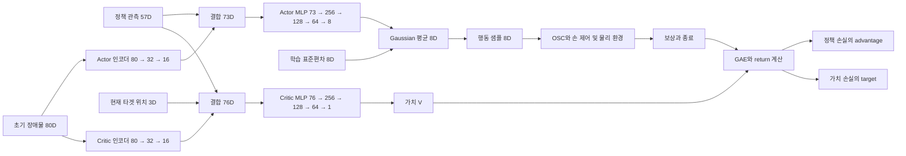

# Final 계열의 강화학습 네트워크 구조와 손실 함수

2026-10-31 작업트리 기준. 설명의 중심은 **Final v1 및 GoalAccuracy 파생 환경**이며, 가장 최근 추가된 `Isaac-Inspire-Final-GoalAccuracy-v0_2_2`를 포함한다. 이 환경들은 **비대칭 Actor–Critic과 PPO**를 사용한다. Actor는 실행 시 얻을 수 있는 관측으로 행동을 결정하고, Critic은 여기에 현재 타겟 위치를 추가하여 미래 보상을 추정한다.

핵심 구성은 다음과 같다. 여기서 관측용 MLP는 **초기 장애물 위치를 압축하는 학습 가능한 인코더**다. 촉각과 손목 F/T는 이 인코더를 통과하지 않고 정책 본체에 직접 입력된다.

| 구성요소 | 네트워크 구조 | 학습 신호 |
| --- | --- | --- |
| Actor 장애물 인코더 | `80 → 32(ReLU) → 16(Linear)` | PPO 정책 손실에서 역전파 |
| Actor 본체 | `73 → 256(ELU) → 128(ELU) → 64(ELU) → 8(Linear)` | PPO clipped surrogate loss |
| Actor 행동 표준편차 | 상태와 무관한 학습 파라미터 8개 | 정책 손실과 엔트로피 항 |
| Critic 장애물 인코더 | `80 → 32(ReLU) → 16(Linear)` | 가치 손실에서 역전파 |
| Critic 본체 | `76 → 256(ELU) → 128(ELU) → 64(ELU) → 1(Linear)` | Clipped value loss |

**Actor와 Critic의 인코더는 구조가 같지만 가중치는 공유하지 않는다. 관측용 MLP에 별도의 지도학습·재구성·위치 추정 손실은 없다.** 두 인코더는 각자의 강화학습 목적에 맞게 함께 학습된다.

## 1. 적용 환경과 버전 경계

| 환경 | 직접 정책 관측 | 장애물 원시 관측 | Actor 본체 입력 | Critic 본체 입력 |
| --- | --- | --- | --- | --- |
| Final v0 | 55D | 16슬롯 × 4 = 64D | 55 + 16 = 71D | 55 + 3 + 16 = 74D |
| Final v1, v1-1, Test-v1, v2, Test-v2 | 57D | 20슬롯 × 4 = 80D | 57 + 16 = 73D | 57 + 3 + 16 = 76D |
| GoalAccuracy v0, v1, v0_1, v0_2, v0_3, v0_2_1, v0_2_2 | 57D | 20슬롯 × 4 = 80D | 73D | 76D |

Final v0만 본체 입력 차원과 인코더 입력 차원이 다르다. v0의 장애물 인코더는 `64 → 32 → 16`이다. 본체 은닉층, 활성화 함수, PPO 설정은 동일한 기반 설정을 사용한다.

GoalAccuracy v0_2_2의 PPO 설정 상속은 `v0_2_2 → v0_2_1 → v0_2 → v0_1 → GoalAccuracy v0 → Final v1 → Final v0`이다. GoalAccuracy 파생 PPO 설정은 experiment 이름을 바꾸며, 네트워크와 손실의 하이퍼파라미터는 유지한다. 따라서 환경별 보상·배치·종료·커리큘럼 차이는 **학습 데이터와 return을 바꾸지만 네트워크 층 구조를 바꾸지는 않는다**. 물리 객체 수와 장애물 관측 슬롯 수도 서로 다른 개념이다. v0_2_2의 물리 객체 축소 이후에도 관측은 20슬롯이다.

근거: [환경 등록](../../../../src/inspire_sweep_baseline/inspire_sweep_baseline/__init__.py), [환경 구성](../../../../src/inspire_sweep_baseline/inspire_sweep_baseline/envs/final_envs.py), [Final PPO 설정](../../../../src/inspire_sweep_baseline/inspire_sweep_baseline/agent/final_ppo_cfg.py). 환경별 과업 차이는 [활성 환경 안내](../../02_implementation/08_ACTIVE_ENVIRONMENTS.md)를 따른다.

## 2. 전체 학습 구조



그림의 화살표는 정보 흐름이다. return과 advantage를 만든 뒤에는 이를 고정된 학습 target으로 사용하므로, Actor 손실에서 Critic으로 역전파하지 않는다. 환경의 물리 시뮬레이션이나 OSC를 미분하여 학습하는 구조도 아니다. 샘플링한 행동의 log probability와 그 행동에서 얻은 advantage로 정책을 개선한다.

정책은 feed-forward MLP이며 LSTM·GRU·Transformer와 같은 내부 기억 장치는 없다. 이전 행동 8D가 입력에 들어가므로 피드백 경로는 있지만, 관측 이력을 누적하는 recurrent network는 아니다. 초기 타겟·장애물 정보가 에피소드 동안 유지되는 것은 환경의 관측 캐시이며 네트워크의 recurrent state가 아니다.

## 3. Actor와 Critic이 받는 관측

### 3.1 직접 정책 관측 57D

아래 순서로 연결한 벡터를 Actor와 Critic이 공통으로 받는다.

| 관측 | 차원 | 의미 |
| --- | --- | --- |
| 팔 관절 위치 | 6 | 기본 관절 위치에 대한 현재 상대 위치 |
| 팔 관절 속도 | 6 | 기본 관절 속도에 대한 현재 상대 속도 |
| 이전 행동 명령 | 8 | 이전 raw action의 각 성분에 `tanh` 적용 |
| 초기 타겟 위치 | 3 | 로봇 root 좌표계의 초기 XYZ, reset 이후 유지 |
| End-effector pose | 7 | 로봇 root 좌표계의 현재 위치 3 + quaternion 4 |
| 초기 타겟에서 목표까지의 극좌표 | 2 | XY 거리와 시계 방향 방위각, 에피소드 동안 고정 |
| 촉각 접촉 비트 | 17 | 0.01 N 문턱값을 사용하는 접촉 정보 |
| 손목 F/T | 6 | 보상된 외력·모멘트, EEF 축 기준 N 및 N·m |
| 현재 손 구성 | 2 | 실제 관절 위치에서 계산한 굽힘 개방도와 엄지 대립 개방도 |
| **합계** | **57** | 초기 장면 정보와 현재 로봇·접촉 감각의 결합 |

기본 관측 노이즈는 초기 타겟 XYZ에 reset 단위 ±1 cm bias, 촉각 각 비트에 독립 1% 반전, F/T에 힘 0.05 N·모멘트 0.005 N·m 표준편차의 영평균 Gaussian noise다. Critic도 같은 `policy` 그룹을 받으므로 이 그룹 자체가 Critic용 무잡음 복사본으로 바뀌지는 않는다.

Actor에는 **현재 타겟 위치와 현재 장애물 위치가 직접 입력되지 않는다**. 목표 극좌표도 현재 타겟에서 목표까지의 잔여 오차가 아니라 초기 타겟을 기준으로 계산한 고정 명령이다. 따라서 현재 물체 상태를 직접 보는 정책과 구별해야 한다.

근거: [Final 관측 구성](../../../../src/inspire_sweep_baseline/inspire_sweep_baseline/mdp/observations/final.py), [행동 피드백·손 구성·센서 노이즈](../../../../src/inspire_sweep_baseline/inspire_sweep_baseline/mdp/observation_functions/final.py), [초기 타겟 캐시](../../../../src/inspire_sweep_baseline/inspire_sweep_baseline/mdp/observation_functions/asymmetric_observations.py), [초기 목표 극좌표](../../../../src/inspire_sweep_baseline/inspire_sweep_baseline/mdp/observation_functions/contact_sweep_clutter_fusion.py).

### 3.2 장애물 관측 80D

장애물 슬롯 하나는 `[present, x, y, z]`의 4D이고, 최대 20슬롯을 펼친 80D가 입력된다. XYZ는 초기 로봇 root 좌표계 위치이며 타겟은 제외한다. reset 시 관측 가능성·위치 노이즈·순서 처리 등을 반영한 스냅샷을 만들고 에피소드 중에는 다시 측정하지 않는다. 슬롯의 `present`는 해당 장애물이 관측에 포함되는지를 나타내므로 실제 물리 객체의 존재와 항상 같지는 않다.

인코더에 들어가기 직전 `present > 0.5`인 행만 유지하고 나머지는 4개 성분 모두 0으로 만든다. `torch.where`를 사용하므로 비활성 슬롯의 더미 좌표에 NaN/Inf가 있어도 인코더에 전달되지 않는다. 이는 입력 마스킹이며 학습 가능한 attention은 아니다.

근거: [장애물·센서 관측 함수](../../../../src/inspire_sweep_baseline/inspire_sweep_baseline/mdp/observation_functions/contact_sweep_clutter.py), [Final reset과 가시성 처리](../../../../src/inspire_sweep_baseline/inspire_sweep_baseline/mdp/event_functions/final.py), [인코더 구현](../../../../src/inspire_sweep_baseline/inspire_sweep_baseline/agent/contact_sweep_clutter_models.py).

### 3.3 Critic 전용 관측 3D

Critic에는 시뮬레이터에서 얻는 **현재 타겟 XYZ**가 추가된다. 이것이 비대칭 Actor–Critic의 privileged observation이다. 현재 타겟 quaternion, 속도, 전체 장애물의 현재 위치까지 추가하는 구성은 아니다.

Actor의 원시 입력 총량은 `57 + 80 = 137D`, Critic은 `57 + 3 + 80 = 140D`다. 인코더가 80D를 16D로 줄인 뒤 본체 입력은 각각 73D와 76D가 된다. **원시 관측 차원과 본체 MLP 입력 차원을 구분해야 한다.**

## 4. Actor Network

정책 관측을 $p_t$, 장애물 관측을 $o_0$, Actor 인코더 파라미터를 $\phi_A$, 본체 파라미터를 $\theta_A$라 하자.

```math
z_A = E_{\phi_A}(o_0) \in \mathbb{R}^{16}, \qquad
\mu_t = f_{\theta_A}([p_t,z_A]) \in \mathbb{R}^{8}.
```

| 층 | 입출력 차원 | 활성화 | 파라미터 수 |
| --- | --- | --- | --- |
| 본체 Linear 1 | 73 → 256 | ELU | 18,944 |
| 본체 Linear 2 | 256 → 128 | ELU | 32,896 |
| 본체 Linear 3 | 128 → 64 | ELU | 8,256 |
| 평균 출력 Linear | 64 → 8 | 없음 | 520 |
| **본체 합계** | | | **60,616** |

모든 Linear 층은 bias를 포함한다. 최종 출력에는 `tanh`나 sigmoid가 없으며, 출력 8개가 Gaussian 행동 분포의 평균이다. 표준편차는 MLP가 출력하지 않는다. 상태와 무관한 별도 학습 벡터 $\sigma\in\mathbb{R}^{8}$를 두며 초기값은 모든 성분 1.0이다. 설정의 `std_type='scalar'`는 표준편차를 직접 파라미터화한다는 뜻이며, 모든 행동이 하나의 scalar를 공유한다는 뜻은 아니다.

```math
\pi(a_t\mid p_t,o_0)
= \prod_{j=1}^{8}\mathcal{N}(a_{t,j};\mu_{t,j},\sigma_j^2).
```

학습 중에는 이 분포에서 행동을 샘플링하고, 결정론적 추론과 내보낸 Actor에서는 평균 $\mu_t$를 사용한다. 8D 행동은 팔 OSC의 상대 pose 명령 6D와 손 제어 2D다. 팔은 위치 scale 0.03, 회전 scale 0.15를 사용하며, 손 명령은 실행 단계에서 `[0,1]`로 제한된다. 이 후처리와 관측의 이전 행동 `tanh`는 Gaussian 평균 출력층의 활성화가 아니다. PPO의 log probability는 저장된 raw action에 대해 계산한다.

Actor는 인코더 3,120개와 표준편차 8개를 포함하여 **총 63,744개의 학습 파라미터**를 가진다. 관측의 running mean/std 정규화는 꺼져 있고, 본체나 인코더에 BatchNorm·LayerNorm·Dropout은 없다.

근거: [Final 모델](../../../../src/inspire_sweep_baseline/inspire_sweep_baseline/agent/final_models.py), [관측 결합 및 export](../../../../src/inspire_sweep_baseline/inspire_sweep_baseline/agent/contact_sweep_clutter_fusion_models.py), [행동 구성](../../../../src/inspire_sweep_baseline/inspire_sweep_baseline/mdp/actions/final.py), [손 명령 처리](../../../../src/inspire_sweep_baseline/inspire_sweep_baseline/mdp/action_functions/hand_openness.py), 설치된 RSL-RL 5.0.1의 `MLPModel`, `MLP`, `GaussianDistribution`.

## 5. Critic Network

현재 타겟 위치를 $q_t\in\mathbb{R}^{3}$라 하면 Critic은 다음과 같다.

```math
z_C = E_{\phi_C}(o_0) \in \mathbb{R}^{16}, \qquad
v_t = V_{\theta_C}([p_t,q_t,z_C]) \in \mathbb{R}.
```

| 층 | 입출력 차원 | 활성화 | 파라미터 수 |
| --- | --- | --- | --- |
| 본체 Linear 1 | 76 → 256 | ELU | 19,712 |
| 본체 Linear 2 | 256 → 128 | ELU | 32,896 |
| 본체 Linear 3 | 128 → 64 | ELU | 8,256 |
| 가치 출력 Linear | 64 → 1 | 없음 | 65 |
| **본체 합계** | | | **60,929** |

Critic 출력은 현재 조건에서 정책을 따를 때 받을 **할인 누적 보상의 추정값**이다. 성공 확률이나 행동별 Q값이 아니며, 출력 범위도 `[0,1]`로 제한하지 않는다. Critic에는 Gaussian 분포나 학습 표준편차가 없다.

Critic은 전용 인코더를 포함해 **총 64,049개**의 학습 파라미터를 가진다. Actor와 합치면 127,793개다. 두 모델은 별도 인스턴스로 생성되며 본체와 인코더 모두 독립적이다. 학습 시 Critic은 Actor의 advantage 계산을 도와주지만 결정론적 정책 실행에 Critic 입력이나 Critic 네트워크는 필요하지 않다.

근거: [Final 입력 계약](../../../../src/inspire_sweep_baseline/inspire_sweep_baseline/agent/final_models.py), [관측 결합](../../../../src/inspire_sweep_baseline/inspire_sweep_baseline/agent/contact_sweep_clutter_fusion_models.py), RSL-RL 5.0.1 `PPO.construct_algorithm`.

## 6. 관측용 MLP의 구조와 학습 목적

### 6.1 무엇을 압축하는가

마스킹 후 80D 벡터를 $\widetilde{o}_0$라 하면 각 인코더는 다음과 같다.

```math
E_\phi(o_0)
= W_2\,\mathrm{ReLU}(W_1\widetilde{o}_0+b_1)+b_2,
\qquad W_1\in\mathbb{R}^{32\times80},\quad
W_2\in\mathbb{R}^{16\times32}.
```

첫 Linear의 파라미터는 `80×32 + 32 = 2,592`, 두 번째는 `32×16 + 16 = 528`로 합계 3,120개다. 최종 16D에는 활성화가 없어 음수도 가능하다.

20개 장애물 전체를 **한꺼번에 펼쳐서 처리하는 MLP**다. 장애물마다 동일한 작은 MLP를 적용한 후 pooling하는 구조가 아니므로, 네트워크 자체가 슬롯 순서에 대한 불변성을 보장하지 않는다. 입력 슬롯 순서 처리와 네트워크의 집합 불변성은 구별해야 한다.

또한 16D의 각 성분에 특정 물체 위치·속도·접촉 상태라는 의미가 부여되어 있지 않다. Actor 인코더는 좋은 행동을 선택하는 데 유용한 특징을, Critic 인코더는 return을 예측하는 데 유용한 특징을 학습한다. 어떤 의미의 표현이 형성되었는지는 학습 결과를 별도로 분석해야 한다.

### 6.2 독립적인 encoder loss는 없다

현재 활성 경로에는 인코더의 정답 벡터, decoder, reconstruction loss, contrastive loss, 현재 물체 상태 예측 loss, 사전학습 단계가 없다. 학습 가능한 MLP이지만 독립적인 auxiliary task를 수행하지 않는다.

| 파라미터 | 직접 기울기를 제공하는 항 | 직접 제공하지 않는 항 |
| --- | --- | --- |
| Actor 본체와 Actor 인코더 | PPO 정책 손실 | Critic 가치 손실, 현재 설정의 엔트로피 항 |
| Actor 표준편차 8개 | PPO 정책 손실, 엔트로피 항 | Critic 가치 손실 |
| Critic 본체와 Critic 인코더 | 가치 손실 | 정책 손실, 엔트로피 항 |

일반적으로 Actor 목적에는 엔트로피 보너스도 포함된다. 다만 **현재 구현은 상태와 무관한 Gaussian 표준편차**이므로 엔트로피는 평균에 의존하지 않는다. 이에 따라 Actor 본체와 인코더에는 엔트로피 항의 직접 기울기가 없고, 표준편차에만 직접 작용한다. 표준편차가 바뀌면 이후 탐색과 정책 업데이트는 간접적으로 달라진다.

Actor 인코더의 학습 경로를 쓰면 다음과 같다.

```math
\nabla_{\phi_A}L_{\mathrm{policy}}
=\left(\frac{\partial z_A}{\partial\phi_A}\right)^\top
\left(\frac{\partial\mu}{\partial z_A}\right)^\top
\nabla_\mu L_{\mathrm{policy}}.
```

장애물 임베딩을 고정된 전처리 결과로 저장하는 대신, rollout에 원시 관측을 저장하고 PPO의 미니배치마다 현재 가중치로 임베딩을 다시 계산한다. 그래서 동일한 초기 장면 관측이라도 학습이 진행되면 다른 임베딩을 만들 수 있다.

## 7. PPO의 학습 target과 Loss Function

PPO는 환경 상호작용으로 데이터를 모으고, 그 데이터에 대해 여러 번 미니배치 최적화를 수행하는 정책 경사 방법이다. 이 전체 절차의 이론적 배경은 [PPO 원 논문](https://arxiv.org/abs/1707.06347)을 참고할 수 있다. 아래 식의 계수와 clipping 방식은 **현재 설치된 RSL-RL 5.0.1 구현과 Final 설정**에 대응한다.

### 7.1 보상에서 advantage와 return 만들기

환경 보상 $r_t$는 네트워크 loss 자체가 아니다. 접촉·목표 도달·안전 등 환경이 정의한 평가를 보상으로 받은 뒤, 이를 이용하여 Actor의 advantage와 Critic의 회귀 target을 만든다. 환경 버전별 reward가 달라져도 다음 손실 형식은 같다.

$v_t^{\mathrm{old}}$는 rollout 수집 시 Critic 값, $d_t$는 종료 또는 truncation 여부, $\widetilde r_t$는 아래 timeout 보정까지 적용한 저장 보상이다. GAE 계산은 다음과 같다.

```math
\delta_t = \widetilde r_t + \gamma(1-d_t)v_{t+1}^{\mathrm{old}}-v_t^{\mathrm{old}},
\qquad \gamma=0.98,
```

```math
\widehat A_t=\delta_t+\gamma\lambda(1-d_t)\widehat A_{t+1},
\qquad \lambda=0.95,\qquad
\widehat R_t=\widehat A_t+v_t^{\mathrm{old}}.
```

rollout 마지막에서 종료하지 않은 환경은 마지막 관측의 Critic 값으로 bootstrap한다. Actor에 넣는 advantage는 수집된 rollout 전체에 대해 평균 0·표준편차 약 1로 정규화한다. 분모에는 `1e-8`을 더한다. **Critic의 return target은 이 advantage 정규화 전 값으로 유지한다.** GAE는 여러 시점의 TD 오차를 지수 가중하여 정책 경사 추정의 분산과 편향을 조절하는 방식이다. [GAE 원 논문](https://arxiv.org/abs/1506.02438).

timeout은 구현을 구별해서 이해해야 한다. 기본 `is_finite_horizon=False`에서 wrapper는 truncation을 `time_outs`로 전달하고, 설치된 PPO는 다음처럼 **해당 transition에 저장된 현재 값**으로 보상을 보정한다.

```math
\widetilde r_t=r_t+\gamma\,v_t^{\mathrm{old}}\,\tau_t,
```

여기서 $\tau_t$는 `time_outs`다. 이후 `done`으로 GAE 연결을 끊는다. 이것을 종료 직전의 별도 final observation에서 $V(s_{t+1})$를 계산하는 구현으로 바꾸어 설명하면 정확하지 않다. Final의 성공 timeout과 미달 timeout은 모두 truncation으로 분류되므로 이 처리 대상이다. 실제 실패 termination과 구분한다.

### 7.2 Actor의 clipped surrogate loss

rollout 수집 당시 정책을 $\pi_{\mathrm{old}}$, 업데이트 중 정책을 $\pi$라고 하면 행동 확률비는 다음과 같다. 두 확률 모두 **수집 당시 실제로 선택했던 동일 행동**에 대해 계산한다.

```math
\rho_t=\exp\left(\log\pi(a_t\mid p_t,o_0)-\log\pi_{\mathrm{old}}(a_t\mid p_t,o_0)\right).
```

정규화된 advantage를 $\overline A_t$라 할 때 최소화하는 손실은 다음과 같다.

```math
L_{\mathrm{policy}}
=-\mathbb{E}_t\left[
\min\left(\rho_t\overline A_t,
\mathrm{clip}(\rho_t,0.8,1.2)\overline A_t\right)\right].
```

구현은 두 음수 항의 `max(...).mean()`을 사용하며 위 식과 동일하다. $\overline A_t>0$이면 해당 행동의 확률을 높이는 방향, $\overline A_t<0$이면 낮추는 방향으로 학습한다. clipping은 기존 데이터에서 정책을 지나치게 바꾸는 유인을 제한한다. 실제 확률비가 반드시 `[0.8,1.2]` 안에 머물도록 강제하는 제약은 아니다.

엔트로피를 포함한 Actor 목적은 다음과 같다.

```math
L_{\mathrm{actor}}=L_{\mathrm{policy}}-0.005\,\mathbb{E}_t[H(\pi_t)],
\qquad H(\pi_t)=\sum_{j=1}^{8}\log\left(\sigma_j\sqrt{2\pi e}\right).
```

엔트로피 항의 음수 부호는 손실 최소화가 탐색 분산을 유지하도록 유도한다는 뜻이다. entropy가 크다는 사실만으로 좋은 정책이라고 판단할 수는 없다.

### 7.3 Critic의 clipped value loss

업데이트 중 Critic 출력 $v_t$의 변화량을 수집 당시 값 주변으로 제한한 후보를 만든다.

```math
v_t^{\mathrm{clip}}
=v_t^{\mathrm{old}}+
\mathrm{clip}(v_t-v_t^{\mathrm{old}},-0.2,0.2).
```

```math
L_{\mathrm{value}}=
\mathbb{E}_t\left[
\max\left((v_t-\widehat R_t)^2,
(v_t^{\mathrm{clip}}-\widehat R_t)^2\right)\right].
```

단순 MSE와 clipping한 MSE 중 큰 값을 선택한다. 이 구현에는 앞에 `1/2` 계수가 없으며 value loss 계수는 1.0이다. value clipping의 ±0.2는 **가치값 변화의 절대량**이다. Actor 확률비의 ±20%와 같은 의미가 아니지만 설정상 동일한 `clip_param=0.2`를 재사용한다. Critic 자체의 출력 범위를 제한하는 것도 아니다.

### 7.4 실제로 최소화하는 통합 손실

```math
L_{\mathrm{total}}=
L_{\mathrm{policy}}+1.0\,L_{\mathrm{value}}
-0.005\,\mathbb{E}_t[H(\pi_t)].
```

Actor와 Critic의 모든 파라미터를 **하나의 Adam optimizer**에 넣고 한 번의 `backward()`로 기울기를 계산한다. optimizer가 하나라는 사실은 가중치 공유를 의미하지 않는다. 그래프가 분리되어 있어 각 손실은 앞 절의 경로에 따라 전달된다. 업데이트 전에는 Actor 전체와 Critic 전체의 gradient norm을 **각각** 1.0으로 clipping한다.

현재 설정에서는 RND와 symmetry가 비활성이다. 따라서 이 식에 RND·대칭성·지도학습·인코더 보조 손실이 추가되지 않는다. Critic이 만든 advantage는 고정된 수치로 Actor에 사용되며, Actor가 Critic의 출력에 대해 직접 미분하는 방식은 아니다.

근거: [PPO 하이퍼파라미터](../../../../src/inspire_sweep_baseline/inspire_sweep_baseline/agent/final_ppo_cfg.py), [Isaac Lab의 알고리즘 기본 설정](../../../../IsaacLab/source/isaaclab_rl/isaaclab_rl/rsl_rl/rl_cfg.py), [timeout wrapper](../../../../IsaacLab/source/isaaclab_rl/isaaclab_rl/rsl_rl/vecenv_wrapper.py), [Final 종료 분류](../../../../src/inspire_sweep_baseline/inspire_sweep_baseline/mdp/terminations/final.py), RSL-RL 5.0.1 `PPO.process_env_step`, `compute_returns`, `update`.

## 8. 학습 일정과 수치 안정성

| 항목 | 기본값 | 의미 |
| --- | --- | --- |
| 병렬 환경 | 4,096 | 실행 옵션 `--num_envs`로 변경 가능 |
| 정책 제어 간격 | 0.02 s | 물리 dt 0.01 s × decimation 2, 50 Hz |
| 최대 에피소드 길이 | 10 s | 500 정책 step, 실패 시 조기 종료 가능 |
| rollout 길이 | 환경당 36 step | 한 iteration의 수집 구간, 0.72 s 상당 |
| 기본 rollout 표본 수 | 147,456 | 4,096 × 36 transition |
| 학습 epoch | 8 | 수집 데이터를 반복 사용 |
| epoch당 미니배치 | 4 | 기본 미니배치 크기 36,864 |
| iteration당 optimizer step | 32 | 8 × 4 |
| 초기 learning rate | 0.001 | adaptive KL 스케줄 사용 |
| desired KL | 0.02 | 이전 Gaussian과 현재 Gaussian의 변화량 기준 |
| 최대 iteration | 90,000 | 실행 옵션으로 변경 가능 |
| 저장 간격 | 50 iteration | checkpoint 주기 |

한 iteration은 에피소드 하나가 아니다. 여러 환경에서 각각 36 step을 수집하고, GAE와 return을 만든 다음, 동일 rollout으로 32번 최적화하고 저장소를 비운다. 다음 iteration은 새 정책으로 데이터를 수집한다. 장기 replay buffer에서 오래된 데이터를 섞어 학습하는 방식은 아니다.

adaptive learning rate는 미니배치의 평균 `KL(old || new)`가 0.04보다 크면 learning rate를 1.5로 나누고 하한 `1e-5`를 적용한다. KL이 0보다 크고 0.01보다 작으면 1.5배로 늘리되 상한 `1e-2`를 적용한다. 이 learning rate는 Actor와 Critic에 함께 적용된다. KL은 별도 손실 벌점이나 early stopping 항으로 사용되지 않는다.

학습 진입점은 [train.py](../../../../src/inspire_sweep_baseline/scripts/train.py)다. [CurriculumOnPolicyRunner](../../../../src/inspire_sweep_baseline/inspire_sweep_baseline/agent/curriculum_runner.py)는 학습 iteration을 환경 커리큘럼에 전달하고, 기본 PPO를 [NumericalPPO](../../../../src/inspire_sweep_baseline/inspire_sweep_baseline/agent/numerical_ppo.py)로 연결한다. NumericalPPO는 기본 PPO 손실을 상속하면서 관측·출력·return·gradient·optimizer 상태 등의 수치 검사를 추가한다. 직접 파라미터화한 표준편차는 업데이트 후 최소 `1e-4`로 투영한다. 이것은 추가 loss가 아니며 정상 PPO의 위 손실 식을 바꾸지 않는다.

## 9. 질문별 해석

| 질문 | 현재 구현의 답 |
| --- | --- |
| Actor 관측 MLP는 현재 물체 위치를 추정하는가? | 명시적인 위치 추정 출력이나 정답 손실이 없다. 초기 장애물 배치의 정책용 특징을 학습한다. |
| 촉각·F/T도 별도의 인코더에 들어가는가? | 별도 인코더 없이 57D 정책 관측에 포함되어 Actor·Critic 본체로 들어간다. |
| Actor 인코더와 Critic 인코더는 같은가? | 층 구조만 같고 파라미터와 목적함수 경로는 분리된다. |
| 인코더에 loss가 없으면 학습되지 않는가? | 별도 loss가 없어도 상위 정책·가치 손실의 기울기로 학습된다. |
| Critic의 privileged 정보가 Actor 입력에 들어가는가? | 직접 들어가지 않는다. 학습 중 advantage의 평가 품질을 통해 간접적으로 정책 학습을 돕는다. |
| Gaussian의 평균과 표준편차를 모두 네트워크가 출력하는가? | 본체는 평균 8D만 출력한다. 표준편차는 독립 학습 벡터다. |
| value loss가 줄면 조작 성공률이 반드시 높아지는가? | value loss는 return 예측 오차다. 성공률은 별도의 과업 지표로 확인해야 한다. |
| 실험 버전의 reward 변경은 새로운 loss인가? | reward가 return과 advantage를 바꾸지만 PPO loss의 형식은 유지된다. |

## 10. 근거와 확인 범위

수치는 2026-10-31의 **미커밋 변경을 포함한 현재 작업트리**와 로컬 `env_isaaclab`의 **RSL-RL 5.0.1, PyTorch 2.7.0+cu128**을 기준으로 한다. 실행 시 Hydra/CLI override 또는 다른 RSL-RL 버전을 사용하면 해당 실행의 설정을 추가로 확인해야 한다. `train.py`의 최소 버전 검사 문자열만으로 실제 알고리즘 버전을 판단해서는 안 된다.

설치 라이브러리의 기준 위치는 `C:/Users/3cmde/miniconda3/envs/env_isaaclab/Lib/site-packages/rsl_rl`이며, 다음 파일을 확인했다.

| 파일과 symbol | 확인한 내용 |
| --- | --- |
| `algorithms/ppo.py`: `PPO` | 모델 독립 생성, optimizer, GAE, timeout, 실제 손실, clipping, KL 스케줄 |
| `models/mlp_model.py`: `MLPModel` | 관측 결합, normalization 비활성 경로, 확률적·결정론적 출력 |
| `modules/mlp.py`: `MLP` | Linear/활성화 순서, bias, 출력층 활성화 없음 |
| `modules/distribution.py`: `GaussianDistribution` | 상태 독립 표준편차 8개, log probability, entropy, KL |

CPU에서 실제 Final 모델을 생성하여 층 차원과 파라미터 수를 확인했고, 별도의 역전파 검사로 정책·가치·엔트로피의 기울기 경로를 확인했다. 작은 합성 rollout으로 NumericalPPO가 두 인코더를 갱신하는 것도 확인했다. 기존 Final PPO 테스트는 업데이트·checkpoint 복원·137D 입력 JIT export 검사를 통과했다.

이 검증은 네트워크와 최적화 경로에 대한 것이다. 신규 GPU 학습, 실제 조작 성공률, 학습된 16D 표현의 의미 분석은 수행하지 않았다. 자세한 검증 명령과 한계는 [작성·검증 기록](../../02_implementation/logs/2026-10-31_final_training_networks.md)에 남긴다.
